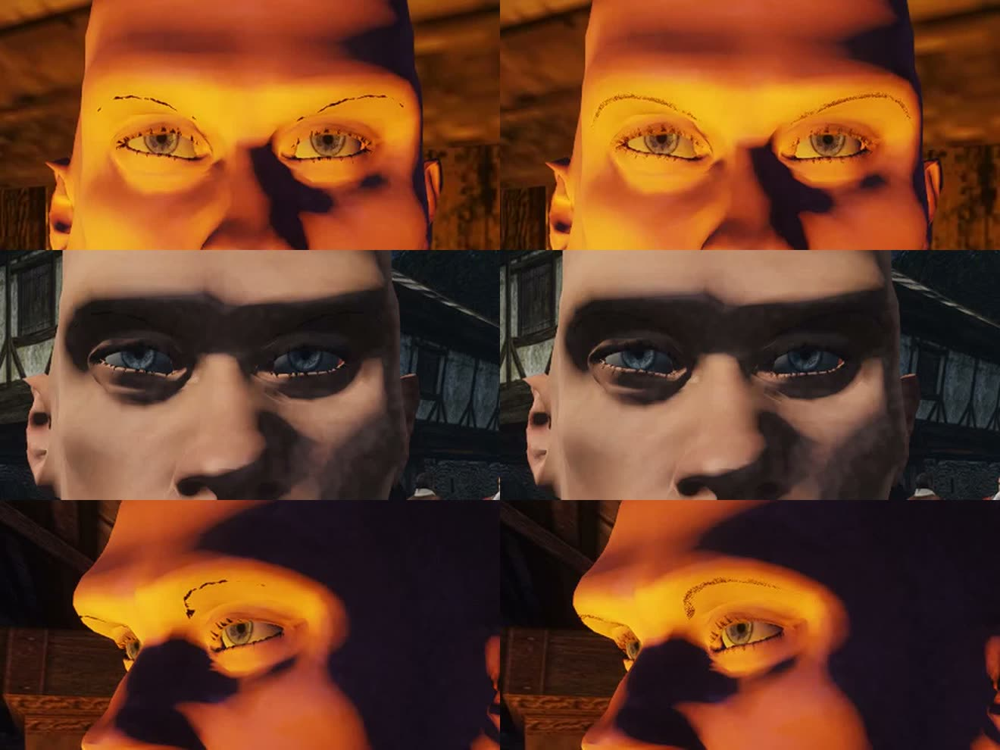
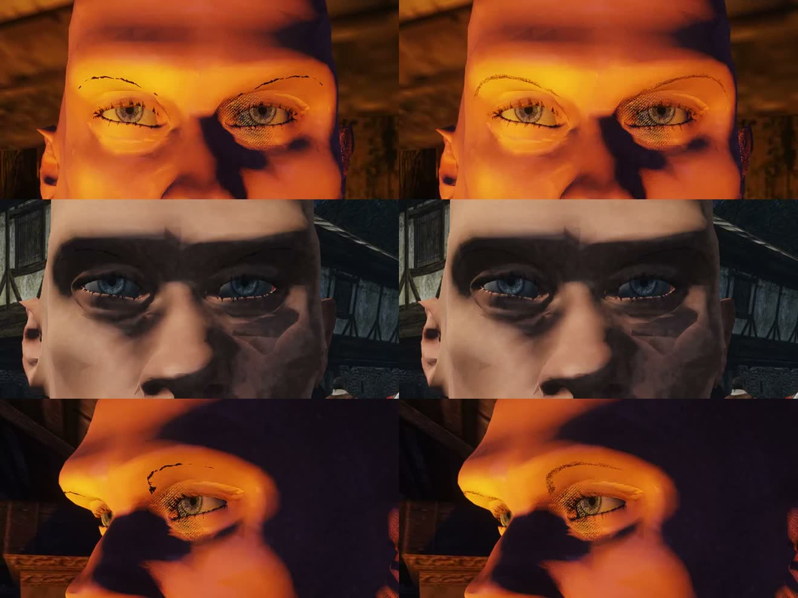
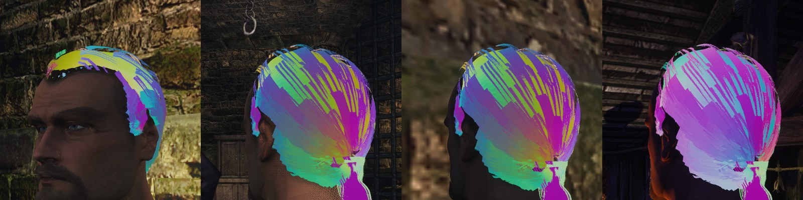
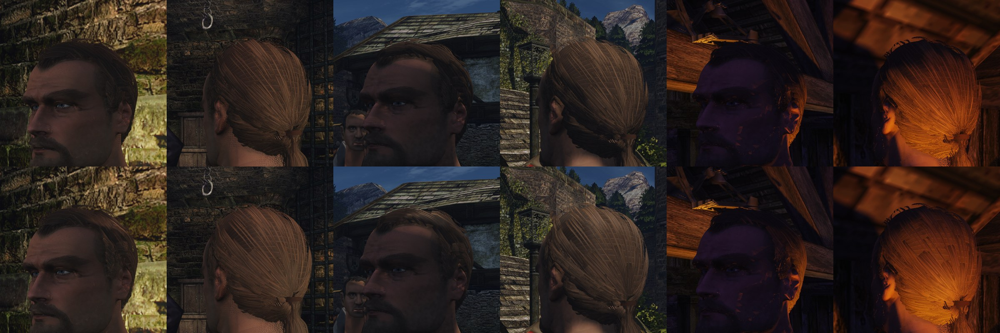

# Волосы на карточках в нашем рендере

2026-11-10. Исследование перед шейдером волос: этап 4 [конвейера NPC](../../../docs/npc-pipeline.md#4-волосы-и-борода) и шаг 7 [плана движка головы](../2026-11-hero-head/engine-plan.md#7-шейдеры-кожи-глаз-и-волос). Решение пользователя 2026-11-10: волосы и бороды делаются прядями на карточках с шейдером волос, а не лепным объёмом. Шейдер нужен раньше библиотеки причёсок: без него причёски не на чем принимать.

Кода в этой работе нет. Заметка отвечает на три вопроса правила «новое — сначала исследование» ([`AGENTS.md`](../../../AGENTS.md)). В конце — выбранный способ, шаги, приёмка и что нужно от контента для первой пробы.

## Цель

Волосы и борода героя, а потом любого NPC, в игре выглядят прядями, а не нарисованной шапкой:
- край причёски на фоне неба и стены — рваный и мягкий, без лесенки и без «кружева» альфа-теста;
- по волосам идут **два блика вдоль пряди**: белёсый и окрашенный цветом волос. Они двигаются при повороте головы и камеры;
- против факела или солнца край причёски **светится насквозь**;
- под TAA волосы не кипят и не мерцают, при беге не тянут шлейф;
- то же работает у трёх светов из [замысла головы](../2026-11-hero-head/intent.md#место): день на улице, ночь у факела или костра, интерьер со свечой.

Для Безымянного ([замысел](../2026-11-hero-head/intent.md#сохранить)): зализанные назад волосы без пробора, короткий хвост, тёмно-русый цвет с оливково-золотыми прядями (`#5c4b2d` на макушке, `#463825` у висков). Волосы немытые, с салом: лежат прядями и **блестят тускло**. Короткая бородка с усами `#7e5c4a`.

## 1. Как это выглядит на деле

### Два блика

Волос — диэлектрический цилиндр с чешуйками кутикулы, наклонёнными к кончику. Свет уходит от него тремя путями ([Marschner и др. 2003](https://graphics.stanford.edu/papers/hair/)):
- **R** — отражение от поверхности. Блик белый: свет не входит в волос;
- **TT** — проход насквозь. Свет окрашен пигментом. Его видно, когда свет за волосами: это просвет на контровом свете;
- **TRT** — вход, отражение от задней стенки, выход. Свет окрашен сильнее, чем в TT: он идёт через волос дважды. Это второй, цветной блик.

Наклон чешуек сдвигает блики R и TRT в разные стороны вдоль волоса. Поэтому они видны раздельно: белый ближе к кончику, цветной ближе к корню. Числа модели — из таблицы 1 статьи (сверено по тексту PDF):

| Параметр | R (белый) | TT (просвет) | TRT (цветной) |
|---|---|---|---|
| Сдвиг вдоль волоса α | −10…−5° | −α_R/2, то есть +2,5…+5° | −3α_R/2, то есть +7,5…+15° |
| Ширина β (стандартное отклонение) | 5…10° | β_R/2: 2,5…5° | 2β_R: 10…20° |

Показатель преломления волоса — 1,55. Блики «искрят» (glints) с силой k_G = 0,5…5 — это каустики внутри волоса.

Что из этого следует для вида:
- цветной блик в 2 раза шире белого и в 1,5 раза дальше сдвинут от зеркального направления;
- **у чёрных волос цветного блика нет**: пигмент поглощает свет на двух проходах (там же). У тёмно-русых волос героя он есть, но тусклый и тёплый — тон волос, а не жёлтый;
- белый блик огибает волос целиком, цветной — только со стороны света.

### Просвет на контровом свете

Путь TT уже R вдвое (β_TT = β_R/2) и смотрит почти прямо по направлению света. Поэтому он виден, когда источник почти за головой: светится край причёски, выбившиеся пряди и тонкий хвост. Толстый слой волос свет не пропускает. Karis в UE считает это поглощение по длине пути света через объём волос, взятой из тени ([слайды 2016](https://blog.selfshadow.com/publications/s2016-shading-course/karis/s2016_pbs_epic_hair.pdf), слайд 39). У нас это ночь у костра: свет снизу и сбоку, герой между костром и камерой.

### Пряди и размеры

- **Толщина волоса** на голове — 60–80 мкм у европейцев, по разным выборкам до 85 мкм ([BioNumbers](https://bionumbers.hms.harvard.edu/bionumber.aspx?id=114258)). Кутикула — пластины около 50 мкм длиной и 0,5 мкм толщиной ([BioNumbers](https://bionumbers.hms.harvard.edu/bionumber.aspx?id=114259)).
- **Волос меньше пикселя на любом расстоянии.** Камера игры — около 67° по вертикали (`cameraFov` в [`gothic.h`](../../../OpenGothic/common/gothic.h), из `VerticalFOV`). В 1080p на 40 см, крупный план диалога, пиксель — около 0,5 мм: волос занимает 0,14 пикселя. Со спины с 3–4 м пиксель — около 4–5 мм. Значит, отдельный волос не рисуется никогда. Тексель карточки — это доля покрытия нескольких волос, а альфа — частичное покрытие. Отсюда главная трудность: как показать долю покрытия без сортировки.
- **Причёска игрового уровня — сотни карточек.** Генератор карточек UE кладёт на пучок обычно три карточки ([документация](https://dev.epicgames.com/documentation/en-us/unreal-engine/hair-card-generator-for-grooms-in-unreal-engine)). У MetaHuman карточки LOD0 — около 15 тыс. треугольников, LOD1 — 3–5 тыс., дальше шапка-меш на 500 и 150 треугольников ([форум Epic](https://forums.unrealengine.com/t/custom-npc-hair-fur-feathers-best-practice/2248563)). Мастер AAA-причёсок строит объём тремя слоями пучков и ещё одним-двумя слоями выбившихся прядей; у бороды трёх слоёв хватает ([80.lv, Sosa](https://80.lv/articles/making-hair-and-beards-for-aaa-games/)).
- **Атлас** — 2048² или 4096², в нём 8–12 видов пучков: прямые, волнистые, тонкие пряди по краю. Карты пучка: альфа, корень → кончик, номер пряди, глубина, нормаль ([80.lv, Sosa](https://80.lv/articles/making-hair-and-beards-for-aaa-games/): `Alpha, ID, Depth, Root, Normal`). Совет оттуда же: «чем меньше полностью прозрачных мест, тем лучше для движка».

**Наша мера для героя** (выведена из этих чисел, а не взята готовой): короткая зализанная причёска с хвостом — 150–250 карточек, 4–6 тыс. треугольников; бородка с усами — 80–150 карточек, 1,5–2,5 тыс. треугольников; атлас 2048². Это между LOD1 и LOD0 MetaHuman: сама голова у нас — 4 151 вершина лица ([заметка головы](../2026-11-hero-head/README.md)), «дорогие» волосы рядом с ней будут чужими. Замысел просит меру детали «как у хорошего ремейка», а не кинематографа.

## 2. Как делают другие и где ловушки

### Модели блика

- **Kajiya-Kay (1989)** — блик по углу между касательной волоса и полувектором: `sin(T,H)^p`. Один белый блик, диффуз по `sin(T,L)`. Дёшево, но плоско: нет второго блика и просвета, а энергия не сохраняется, и диффуз светится там, где волос не освещён.
- **Scheuermann, ATI (2004)** — две копии Kajiya-Kay, сдвинутые вдоль нормали: белая к кончику, цветная к корню. Цветная умножается на шумовую маску ради искр. Сдвиг — из текстуры, чтобы пряди отличались ([доклад SIGGRAPH 2004](https://history.siggraph.org/wp-content/uploads/2022/12/2004-Talks-Scheuermann_Practical-Real-Time-Hair-Rendering-and-Shading.pdf)). Это стандарт игр 2005–2015 годов. Ловушка: числа сдвигов и степеней подбираются на глаз под один свет и разъезжаются при другом.
- **Marschner (2003)** и её упрощение **Karis в UE (2016)** — три лепестка R, TT и TRT, каждый — произведение продольной функции M (гауссиана со сдвигом α и шириной β) и азимутальной N ([слайды](https://blog.selfshadow.com/publications/s2016-shading-course/karis/s2016_pbs_epic_hair.pdf)):
  - N для R — `cos(φ/2)` с Френелем, без обратных тригонометрических функций;
  - TT и TRT — по одному лепестку-гауссиане от `cos φ`, поглощение — от цвета волос (BaseColor), показатель преломления зашит как 1,55;
  - многократное рассеяние — обёрнутый Ламберт с поглощением по длине пути света через объём, взятой из тени. Сам Karis называет эту часть «художественной», подобранной по фотографиям;
  - нормаль не задаётся: вместо неё «фальшивая» нормаль от касательной и направления взгляда. Это экономит работу художника и место в G-буфере;
  - **тени обязательны**: без них модель не работает, «это видно, если их выключить» (слайд 44). Тень фильтруется PCF с экспоненциальным спадом, а не жёстким сравнением.

  Числа одни на все света, поэтому модель не нужно перенастраивать под день и факел. Цена — несколько десятков инструкций на свет и пиксель волос.

### Прозрачность: смешивание, альфа-тест или хеш

- **Смешивание с сортировкой.** Края мягкие, но карточки надо сортировать, а внутри причёски порядок всё равно ломается. Прозрачное не пишет глубину, поэтому у него нет отложенного освещения, SSAO и векторов движения. ATI рисовала волосы в два прохода: сначала непрозрачная середина, потом прозрачные края ([Scheuermann 2004](https://history.siggraph.org/wp-content/uploads/2022/12/2004-Talks-Scheuermann_Practical-Real-Time-Hair-Rendering-and-Shading.pdf)).
- **Альфа-тест с порогом 0,5.** Порядок не нужен, глубина пишется. Но тексель с покрытием 0,3 пропадает, а с 0,7 становится сплошным: пряди становятся рублеными, край — лесенкой. В дальних мипах среднее покрытие падает, и причёска редеет до лысины. Это та же беда, что у листвы.
- **Хешированная альфа** ([Wyman, McGuire 2017](https://research.nvidia.com/labs/rtr/publication/wyman2017hashed)). Порог берётся не 0,5, а из хеша координаты, поэтому доля оставшихся пикселей равна альфе. Хеш считается от координат **в пространстве объекта**, квантованных по размеру пикселя: тогда шум приклеен к поверхности и не кипит при движении. С TAA шум усредняется в долю покрытия ([улучшенная версия 2019](https://research.nvidia.com/labs/rtr/publication/wyman2019improved) прямо разбирает связку с TAA). [Слайды GDC 2017](https://developer.download.nvidia.com/assets/gameworks/downloads/regular/GDC17/RealTimeRenderingAdvances_HashedAlphaTesting_GDC2017_FINAL.pdf) объясняют, почему простой случайный порог на каждый кадр мерцает, а хеш — нет.
- **Как делают сейчас.** Карточки в UE — маскированный материал со сглаживанием по кадрам. Строковые волосы Frostbite и RE4 тоже держатся на TAA, и Capcom прямо пишет о пределах TAA для волос ([разбор RE4](https://image.docswell.com/s/CAPCOM_RandD/KVVYN3-RE2023), [Frostbite, Tafuri 2019](https://www.advances.realtimerendering.com/s2019/hair_presentation_final.pdf)).

### Ловушки под TAA

- **Обрезка истории съедает тонкое.** Наш резолв обрезает историю коробкой дисперсии 3×3 в YCoCg (`VarianceGamma = 1.0`, [`taa_resolve.frag`](../../../OpenGothic/shader/antialiasing/taa_resolve.frag)). Тонкая светлая прядь на тёмном фоне в части кадров выпадает из коробки. Её история обрезается, и она мерцает. Поэтому хеш должен менять порог **каждый кадр по циклу TAA**, чтобы прядь была в коробке соседей и в «пустых» кадрах. Тогда коробка видит её разброс как законный.
- **Движение возвращает шум.** На идущей голове история перепроецируется хуже, вес текущего кадра растёт, и хеш снова виден зерном. Мера — клип бега со спины.
- **Шлейф за краем.** Резолв берёт вектор ближайшей по глубине точки из 3×3. На краю причёски это вектор головы, и фон за ней чуть тянется. Это допустимо, пока шлейф не длиннее 2–3 кадров: тот же предел, что принят для NPC в [исследовании TAA](../../render-features/2026-11-03-taa/README.md#приёмка).
- **Без TAA хеш — просто шум.** При `-taa 0` (CMAA2) нужен прежний порог 0,5.

### Тени и самозатенение

- Волосы без самозатенения выглядят пластиком: свет проходит до кожи головы, и вся причёска светится ровно. Karis: тень — главное в виде ([слайды](https://blog.selfshadow.com/publications/s2016-shading-course/karis/s2016_pbs_epic_hair.pdf), слайд 44).
- Классика самозатенения — **карты непрозрачности** слоями: Nalu у NVIDIA — 16 слоёв ([GPU Gems 2, гл. 23](https://developer.nvidia.com/gpugems/gpugems2/part-iii-high-quality-rendering/chapter-23-hair-animation-and-rendering-nalu-demo)), позже [глубинные карты непрозрачности](https://cemyuksel.com/research/deepopacity/) (Yuksel, Keyser 2008). Это отдельный проход теней только для волос.
- Дешёвый путь карточек — **запечённая глубина пряди** в текстуре: внутренние слои темнее, корни темнее кончиков. Плюс тень от общей карты теней, которая видит карточки альфа-тестом.

### Векторы движения и глубина

Хеш пишет глубину и вектор у оставшихся пикселей, у выброшенных остаётся фон. Это правильно: в пикселе действительно то, что под ним видно. Прозрачное со смешиванием не пишет ни того, ни другого, и TAA тянет за ним шлейф. Это ещё один довод за хеш.

### Apple GPU

На тайловых GPU Apple удаление скрытых поверхностей лучше всего работает для непрозрачного. Apple советует рисовать сначала непрозрачное, затем альфа-тест и `discard`, затем прозрачное и не перемешивать их ([WWDC20, сессия 10631](https://developer.apple.com/videos/play/wwdc2020/10631/)). Для причёски с 3–5 слоями карточек это значит: сколько слоёв, столько раз шейдер G-буфера считается в пикселе волос.

## 3. Что умеет наш движок

Сверено по коду 2026-11-10, ветка от `98b818fc1`.

### G-буфер и биты подсказок

[`Renderer`](../../../OpenGothic/common/graphics/renderer.cpp) (`gbufDiffuse` и соседи, строки ~592–598) держит четыре вложения:

| Вложение | Формат | Что лежит |
|---|---|---|
| `gbufDiffuse` | RGBA8 | цвет; `a` — биты подсказок |
| `gbufNormal` | R32U | нормаль, октаэдр 2×16 бит (`encodeNormal`, [`common.glsl`](../../../OpenGothic/shader/common.glsl)) |
| `gbufOrm` | RGBA8, только при своих материалах | `r` — затенение, `g` — шероховатость, `b` — металл, `a` — «свой материал» (>0,5) и доля жара углей (`1 − 0,49·share`) |
| `gbufMotion` | RG16F (или RGBA16F) | остаток движения объекта (подшаг 1б) |

Биты подсказок пишет `encodeHintBits()` в [`main.frag`](../../../OpenGothic/shader/materials/main.frag): бит 1 — плоская грань, бит 2 — альфа-тест, бит 3 — вода (обратная сторона). **Биты 0 и 4–7 свободны.** Читают их `decodeBits`/`isGBufFlat`/`isGBufWater` в `common.glsl` и проходы света, теней и проб.

**Касательной в G-буфере нет.** Для волос нужна одна величина сверх нормали. Касательная прядь лежит в плоскости, перпендикулярной нормали, поэтому её задаёт **один угол** вокруг нормали от базиса, построенного по самой нормали. 8 бит дают шаг 1,4° — точнее, чем нужно для блика шириной 5–10°. У волос металл всегда 0, поэтому угол ложится в `orm.b`, не трогая формат.

### Где уже есть направление пряди

Своих касательных у мешей Gothic нет. `mappedNormal()` в `main.frag` строит базис по производным позиции и UV (cotangent frame): вектор `b` — это направление роста координаты `v` на поверхности. Если в атласе пряди лежат вдоль `v`, направление пряди уже посчитано, без новых атрибутов вершин. Загрузчик glTF `TANGENT` не читает ([`gltfmesh.cpp`](../../../OpenGothic/common/gltfmesh.cpp)), и для волос он не нужен. Для кудрей можно добавить карту потока, повернув `b` в плоскости карточки.

### Освещение

Свет считается в трёх шейдерах, и все три берут свой материал по `orm.a > 0,5` и `materialBrdf()` из [`material_brdf.glsl`](../../../OpenGothic/shader/lighting/material_brdf.glsl) (GGX):
- солнце — [`direct_light.frag`](../../../OpenGothic/shader/lighting/direct_light.frag), с `-DVIRTUAL_SHADOW` под VSM;
- лампы — [`light.frag`](../../../OpenGothic/shader/lighting/light.frag), объёмами света;
- рассеянный свет и пробы — [`ambient_light.frag`](../../../OpenGothic/shader/lighting/ambient_light.frag).

Значит, волосы — это ветка `hairBrdf()` рядом с `materialBrdf()` в тех же трёх местах по биту «волосы».

**Отдельный проход вперёд для волос не годится.** Прямой проход `mainForward()` в `main.frag` освещает только солнцем и рассеянным светом (`diffuseLight()`): ламп в нём нет. Лампы считаются только отложенно. Причёска в таком проходе не светилась бы от факела, а это один из трёх светов приёмки. Своего списка ламп на пиксель для прямого прохода у движка нет.

### Альфа-тест и прозрачность

- `Material::Transparent` рисуется прямым проходом со смешиванием `SrcAlpha / OneMinusSrcAlpha`, без записи глубины ([`shaders.cpp`](../../../OpenGothic/common/graphics/shaders.cpp), выбор конвейера по `alpha`). Значит, без ламп, SSAO и векторов.
- `Material::AlphaTest` идёт в G-буфер вариантом `_g_at` и в тени вариантами `_d_at`/`_v_at`. Порог жёсткий: `if(t.a<0.5) discard;` в `main()` шейдера `main.frag`.
- Материал `MASK` из glTF становится альфа-тестом ([`convertMaterial`, `gltfmesh.cpp`](../../../OpenGothic/common/gltfmesh.cpp), флаг `mesh.alpha_test`). `BLEND` загрузчик пускает только для воды.
- Все материалы рисуются с одним режимом отсечения граней (`CullMode::Front` при выборе конвейера), признака двусторонности у материала нет. Карточки волос придётся делать с обеими сторонами в сетке или добавлять признак.

**Брови и ресницы головы героя уже альфа-тестовые карточки.** Это материалы MPFB в `characters/hero/head.glb`, у них 22 и 32 формы ([заметка головы](../2026-11-hero-head/README.md)). Хешированная альфа улучшит их первыми.

### TAA и векторы движения

- TAA по умолчанию: смещение Холтона на 8 фаз, история по глубине, обрезка дисперсией в YCoCg, вес по яркости, RCAS 0,75, смещение мипов −0,5 ([план графики](../../../docs/graphics-plan.md#как-работает-сейчас)).
- В шейдер приходят `scene.taaFrame` (номер кадра TAA, им уже вращается узор теней ламп) и `scene.taaActive` ([`scene.glsl`](../../../OpenGothic/shader/scene.glsl)). Этого хватает, чтобы хеш менялся по циклу TAA и падал на порог 0,5 без TAA.
- Векторы объектов (подшаг 1б) пишет `motionResidual()` в проходе G-буфера. Голова привязана к кости `BIP01 HEAD` ([`MdlVisual::setVisualBody`](../../../OpenGothic/common/graphics/mdlvisual.cpp)), поэтому карточки, которые в её glTF, получают вектор головы без новой работы.
- Полупрозрачное без маски реактивности — это открытый подшаг 1в. Хеш его не требует.

### Тени

- VSM по умолчанию на Vulkan: страницы 128 текселей, таблица 32×32 страницы на уровень, 16 уровней ([`vsm_common.glsl`](../../../OpenGothic/shader/virtual_shadow/vsm_common.glsl)). Тени ламп мягкие (PCSS).
- На Mac VSM по умолчанию выключен: солнце — две каскадные карты 2048, тени ламп жёсткие в одну выборку ([план графики](../../../docs/graphics-plan.md)). Мелкого самозатенения прядей на Mac от карт теней не будет: на Mac его даёт только запечённая глубина пряди.
- Карточки бросают тень альфа-тестом (`_v_at`, `_d_at`) с тем же порогом 0,5. Под мягким PCSS хеш в карте теней превращается в полупрозрачную тень. При жёсткой тени на Mac — в шум, поэтому там в тенях остаётся порог 0,5.

### Своя голова из glTF

- `Resources::loadCharacterHead` ([`resources.cpp`](../../../OpenGothic/common/resources.cpp)) грузит голову по записи в `characters/characters.json` через `loadGltfHeadMesh` ([`gltfmesh.*`](../../../OpenGothic/common/gltfmesh.h)). Части головы — жёсткие примитивы с морф-целями, кожа (`JOINTS_0`) отклоняется до шага 8 ([`own-content.md`](../../../docs/own-content.md)).
- Причёска первой пробы — ещё один примитив той же `head.glb` с материалом `MASK`. Волосы на черепе от формы лица почти не зависят. Бороде нужны формы рта, как бровям и ресницам: она привязывается к треугольникам кожи так же.
- Свои карты материала подключает `materials/materials.json` по имени текстуры: `albedo`, `normal`, `orm` ([`own-content.md`](../../../docs/own-content.md)). Признак «волосы» естественно положить туда же: новый флаг корзины рядом с `BK_NORMAL`/`BK_ORM` (`scene.glsl`, свободен `0x200`).
- Вложение ORM есть только при своём контенте с материалами (`Resources::materialMapsEnabled`). Голова героя — свой контент, но без него волосы должны падать на обычный Ламберт.

### Чего нет

- Касательной в G-буфере и бита «волосы».
- Двусторонних материалов.
- Порога альфы, отличного от 0,5, и хеша.
- Отдельной карты теней волос и контактных теней.
- Места замера крупного плана в `scripts/perf.sh`: места там — `market harbour harbour-night forest interior combat shot`, голова на весь экран не снимается.

Находка по пути: в Jolt, который уже в `lib/`, есть симуляция волос по прядям на GPU ([`Jolt/Physics/Hair/Hair.h`](../../../OpenGothic/lib/JoltPhysics/Jolt/Physics/Hair/Hair.h)). Автор помечает её как «ещё в разработке»: нет LOD, ветра, столкновений не с выпуклыми оболочками. Для хвоста шага 8 стоит посмотреть, но не сейчас.

## Выбранный способ

**Карточки в общем G-буфере с хешированной альфой под TAA; блик — упрощённый Marschner по Karis; направление пряди — угол в `orm.b`, признак волос — бит 4 подсказок.**

Почему так:
- **Отложенное освещение уже считает лампы**, а прямой проход у нас их не видит. Волосы в G-буфере светятся от факела и свечи без новой системы света.
- **Хеш даёт долю покрытия без сортировки** и при этом пишет глубину и векторы. SSAO, тени и TAA работают с волосами как с любым альфа-тестом.
- **Направление пряди помещается без новых вложений.** Нормаль остаётся настоящей, поэтому смещение теней ламп по нормали (`NormalBias` в `light.frag`), SSAO и декали крови читают её как раньше. UE кладёт касательную вместо нормали, но у нас эту нормаль читают проходы, которым касательная её бы испортила. Угол вокруг нормали — 8 бит в канале, который у волос пустует (металл = 0).
- **Marschner по Karis** — одни числа на все света, цветной блик и просвет из цвета волос. Kajiya-Kay пришлось бы подбирать на глаз под день, факел и свечу.

Упаковка для пикселя волос (бит 4 в `gbufDiffuse.a`):
- `gbufNormal` — нормаль оболочки причёски, а не плоской карточки: её дают нормали вершин карточек, перенесённые с гладкой оболочки над черепом;
- `orm.r` — затенение: глубина пряди и корень темнее кончика;
- `orm.g` — сдвиг блика конкретной пряди (вариация α по номеру пряди);
- `orm.b` — угол направления пряди;
- `orm.a` — 1, «свой материал».

Шероховатость волос (β) и базовый сдвиг α — постоянные материала волос в корзине, их не нужно хранить на пиксель.

**Запасной вариант.** Если хеш под TAA не пройдёт по клипам (зерно на беге, мерцание тонких прядей), карточки остаются в том же G-буфере с тем же бликом, но с обычным альфа-тестом и сохранением покрытия по мипам: альфа каждого мипа подбирается так, чтобы доля пикселей выше 0,5 равнялась средней альфе ([Castaño 2010](http://the-witness.net/news/2010/09/computing-alpha-mipmaps/), приём для листвы). Края грубее, зато устойчиво. Второй запасной — непрозрачная середина в G-буфере и прозрачная кайма прямым проходом — требует ламп в прямом проходе, поэтому только если первые два не пройдут.

## Шаги

Каждый шаг кончается тем, что видно в игре. Делает Claude Opus: шейдеры и вид — работа Claude ([`AGENTS.md`](../../../AGENTS.md)).

1. **Хешированная альфа для `MASK` своего контента.** Хеш по координатам объекта, квантованным по пикселю; порог меняется по `taaFrame`; без TAA — 0,5. В тенях под мягким PCSS — хеш, в жёстких тенях Mac — 0,5. Место крупного плана для `perf.sh` (`perf-face.bench`: камера `cam face`, как в `hero-head.bench`).
   **Видно:** брови и ресницы героя в клипе крупного плана мягкие, без лесенки; клип «порог 0,5 | хеш».
   Сделано по-другому — в разделе [«Шаг 1: как сделано»](#шаг-1-как-сделано).
2. **Первая причёска на карточках, пока с обычным светом.** Контент из раздела ниже; двусторонние карточки; герой со спины и в крупном плане.
   **Видно:** силуэт причёски и хвоста против неба, нет лысины в дальних мипах, нет кипения на беге.
3. **Признак волос и направление пряди.** Флаг корзины из `materials.json`, бит 4, угол в `orm.b`; отладочный вид направления цветом.
   **Видно:** в отладочном виде цвет течёт вдоль прядей ото лба к хвосту, без разрывов на краях карточек.
4. **Блик: R, TT, TRT по Karis** в `direct_light.frag` (оба пути теней), `light.frag` и рассеянном свете `ambient_light.frag`.
   **Видно:** два блика вдоль прядей у трёх светов; при медленном облёте камеры они скользят по волосам, а не прыгают.
5. **Самозатенение и просвет.** Затенение из глубины пряди в `orm.r`, поглощение просвета по тени и глубине; на Mac — только запечённая часть.
   **Видно:** клип у костра, костёр за героем — светится край причёски и хвост, а не вся голова.
6. **Бородка и брови на шейдере волос.** Борода привязана к коже и идёт за формами рта.
   **Видно:** клип реплики крупно — борода двигается с челюстью и блестит так же, как волосы.

После шагов 1–6 и приёмки начинается библиотека причёсок (этап 4 конвейера NPC), кости хвоста — шаг 8 плана головы.

## Шаг 1: как сделано

**Что в коде.** Порог альфа-теста считает `alphaThreshold()` в [`main.frag`](../../../OpenGothic/shader/materials/main.frag). В G-буфере у корзины с флагом `BK_HASHED_ALPHA` под TAA порог такой:

```
порог = fract(IGN(пиксель) + хеш(ячейка UV 1/256) + 0,618 · (taaFrame mod 64))
```

- `IGN` — шум пикселя (interleaved gradient noise, уже был в [`common.glsl`](../../../OpenGothic/shader/common.glsl)). Соседние пиксели получают разные пороги, поэтому коробка 3×3 резолва TAA принимает разброс и не обрезает историю.
- Шаг золотого сечения на каждый кадр TAA. У одного пикселя пороги за кадры ложатся равномерно, и история усредняет край до покрытия текселя.
- Хеш ячейки текстуры даёт разным карточкам над одним пикселем разные пороги. Без него передняя прядь закрывала бы заднюю, и покрытия не складывались бы.

**Чем отличается от плана выше.**
- **Шум экранный, а не по координатам объекта, как у Wyman.** Фрагментный вариант G-буфера общий для всех типов мешей, а вершинный вариант `_g` — общий для непрозрачного и альфа-теста. Координату объекта пришлось бы передавать каждому объекту мира ради нескольких корзин. При шаге порога на каждом кадре привязка шума к поверхности почти ничего не даёт: узор всё равно новый в каждом кадре. Так маскированные материалы под TAA делает и UE (`DitherTemporalAA`).
- **Проход окклюдеров HiZ.** Он рисует в ту же глубину, что и G-буфер (`Renderer::drawHiZ`), до него. Если бы он рисовал карточку с порогом 0,5, G-буфер нашёл бы её глубину перед кожей, которую хеш открыл, и в брови была бы дыра. Поэтому в HiZ хешированные корзины пишут только тексели с альфой ≈1.
- **Тени остаются на пороге 0,5 на шаге 1.** Тень бровей и ресниц меньше пикселя, по ним хеш в тенях не оценить. Решение — на шаге 2, по тени причёски.
- **Нашлась ошибка в смысле поля.** `scene.taaActive` значил не «кадр сглаживает TAA», а «тени ламп VSM поворачивают выборки по кадру» (`OPENGOTHIC_VSM_LAMP_TAA`, по умолчанию выключено). `taaFrame` при этом был 0, и первый прогон хеша не включил. Теперь признаки вида лежат в `scene.viewFlags` (`VF_HIZ`, `VF_TAA`), `taaFrame` идёт при любом TAA, а `taaActive` по-прежнему значит только лампы.

**Флаг.** `BK_HASHED_ALPHA` ставится только у `MASK` из glTF (`Material::isAlphaTestRequired`). Альфа-тест оригинала, например листва, остаётся на 0,5. Выключатель: `-hashalpha 0`, для стендов `OPENGOTHIC_HASHED_ALPHA=0`.

**Съёмка.** Стенд [`hair-clips.bench`](../../../scripts/bench/hair-clips.bench): лицо героя при трёх светах (полдень на рынке, полночь на улице гавани, дом с очагом и свечой), по три ракурса. Прогоны с `OPENGOTHIC_HASHED_ALPHA=0` и `=1`. Клипы лежат вне git: `~/.local/share/gothic-ai/remaster/npc-hair/step1/`, сравнение — `compare/mac-brows-0.5-vs-hash.mp4`.



Что видно на Mac:
- при пороге 0,5 бровь — рваная тёмная черта: от текстуры остаётся только плотная середина. С хешем видна вся бровь — мягкая редкая полоса по форме надбровья. Ресницы тоньше, без чёрных зубцов;
- сами брови MPFB светлые и редкие: их текстура рассчитана на смешивание. Это вопрос контента, не шейдера. Свою бровь шаг 6 сделает на карточках волос;
- днём бровь почти не видна ни так, ни так: на надбровье лежит тёмная тень глазницы (её видно и без хеша, отмечено в [заметке головы](../2026-11-hero-head/README.md)).

**Мерцание по числам.** Средняя разница яркости соседних кадров в области глаз на неподвижной камере (0–255):

| Клип | Mac, 0,5 | Mac, хеш | Ryzen, 0,5 | Ryzen, хеш |
|---|---|---|---|---|
| день, спереди | 0,05 | 0,21 | 0,21 | 0,33 |
| день, три четверти | 0,22 | 0,35 | 0,29 | 0,37 |
| свеча, спереди | 0,85 | 1,42 | 1,10 | 1,55 |
| свеча, три четверти | 0,54 | 1,00 | 0,71 | 1,08 |
| свеча, профиль | 0,44 | 1,07 | 0,66 | 1,07 |

Mac снят при 75 % с MetalFX (кадр 1440×810), Ryzen — 1920×1080 с VSM. На Ryzen хеш поднимает мерцание в 1,3–1,6 раза, на Mac — в 1,5–4: там зерно крупнее, как и ожидалось.



На Ryzen в обоих вариантах на веке правого глаза видна мелкая косая сетка. От хеша она не зависит; похоже на тень лампы VSM на веке. Отдельная задача, не этого шага.

Ограничитель из раздела «Приёмка» — «не выше, чем у бровей до хеша» — по числам не пройден: хеш оставляет мелкое зерно, которое меняется от кадра к кадру. История TAA берёт новый кадр с весом 0,1, поэтому у текселя с альфой 0,5 доля в пикселе гуляет примерно на ±0,1. Вся разница — доли уровня яркости на области; принимает глаз по клипу. Если зерно заметно, есть два хода, оба дешёвые:
- шаг порога по 8 фазам Холтона вместо золотого сечения: за каждый цикл смещения пиксель видит ровно 8 порогов;
- для бровей и ресниц — порог без шага по кадрам (пространственный хеш): зерно стоит на месте и усредняется только смещением TAA.

## Шаги 3–4: как сделано

Сделаны вместе: признак волос без блика ничего не меняет на экране, кроме отладочного вида.

**Признак и направление (шаг 3).**
- Запись материала в `materials.json` получает `"hair": true`; в слоте `orm` у неё лежит карта волос атласа (R — затенение, G — номер пряди, B — глубина пряди). Корзина получает флаг `BK_HAIR`.
- В G-буфере (`main.frag`) у такой корзины ставится бит 4 подсказок, а в `orm.b` вместо металла пишется угол пряди вокруг нормали. Направление пряди — куда на поверхности растёт `v`: вектор `b` того же базиса, что строит `mappedNormal()`. Корень в атласе сверху, поэтому это направление от корня к кончику.
- Базис вокруг нормали (`hairFrame`, `common.glsl`) — без ветвлений, по Duff 2017. Он переворачивается там, где `n.z` меняет знак, поэтому шейдер G-буфера берёт нормаль такой, какой её раскодирует проход света, а не исходную.
- Отладочный вид: `OPENGOTHIC_HAIR_DEBUG=1` — волосы показывают направление пряди цветом вместо света (`VF_HAIR_DEBUG` в `scene.viewFlags`).



Цвет течёт ото лба и висков к узлу хвоста. На этом кадре часть локонов верхних слоёв — дополнительного цвета: у карточки, которая отстоит от поверхности причёски, нормаль вершины смотрит чуть от камеры, и базис по производным переворачивается. Знак исправлен (`dot(n, cross(dpdx, dpdy))`), кадр после правки не переснят: очередь Ryzen была занята.

**Блик (шаг 4)** — [`hair_brdf.glsl`](../../../OpenGothic/shader/lighting/hair_brdf.glsl), формулы Karis для Unreal: R, TT, TRT и мягкий рассеянный член. Ветка `hairBrdf()` стоит рядом с `materialBrdf()` в проходах солнца (`direct_light.frag`) и ламп (`light.frag`). Небо и пробы (`ambient_light.frag`, `probe_ambient.frag`) освещают волосы как матовую поверхность их цвета: каналы ORM у волос свои, металла и запечённого затенения в них нет.

Чем отличается от Karis:
- **Цвет карточки — видимый цвет волос, а не пигмент.** Рассеянный член возвращает его как есть, а пути сквозь волос (TT, TRT) берут его квадрат: у Karis рассеяние — корень из цвета основы.
- **Свет не проходит сквозь голову.** У нас нет теней, которые знают толщину причёски: карты теней видят карточки альфа-тестом. Поэтому свет берётся по косинусу поверхности причёски с небольшим заворотом за терминатор (`hairShell`), а просвет и скользящее отражение — только там, где свет идёт вдоль поверхности (`hairBacklit`). Без этого лампа перед героем освещала затылок своим цветом: при скользящем угле Френель отражает почти весь свет.
- **Постоянные** одни на все света: шероховатость 0,40, наклон чешуек 0,035 рад со сдвигом по номеру пряди. При 0,52 белый блик был втрое слабее рассеянного света и не читался.

Выключить: убрать `hair` из записи материала — карточки освещаются как прежде.

**Съёмка.** Стенд [`hair-light.bench`](../../../scripts/bench/hair-light.bench): факелы башни Ксардаса, солнце в полдень на рыночной площади, дом с очагом и свечой в 22:00; под каждым светом — три четверти спереди и сзади и обход камеры вокруг головы шагами по 45°, на рынке ещё бег со спины. Ryzen, 1920×1080, VSM. Клипы вне git: `~/.local/share/gothic-ai/remaster/npc-hair/step4/`, сравнения «прежний свет | блик» — `compare/*-lambert-vs-hair.mp4`.



Что видно:
- блик сдержанный: волосы чуть светлее и глаже вдоль прядей, на солнце со спины читается светлая полоса на затылке;
- у свечи со спины по прядям идёт тёплый край;
- в тени и под небом волосы те же, что раньше: блик дают только солнце и лампы;
- двух раздельных бликов, как на фото чистых волос, нет: при шероховатости 0,40 они сливаются в одну широкую полосу.

**Не сделано.** Цена по `scripts/perf.sh face` не измерена: очередь Ryzen занята чужими замерами. Самозатенение и просвет по глубине пряди — шаг 5; `orm.r` карты волос пока не читается. На Mac не снималось.

## Приёмка

Вид принимает пользователь глазами по клипам, числа — ограничители ([правило](../../../AGENTS.md)).

**Клипы** — стенд `hero-head.bench` с новыми сценами, при трёх светах из [замысла](../2026-11-hero-head/intent.md#место):
- день на улице Хориниса: солнце сверху и сбоку;
- ночь у факела или костра: тёплый свет снизу и сбоку, и отдельно — источник за героем, для просвета;
- интерьер со свечой.

На каждом свету — крупный план, три четверти, со спины, медленный облёт камеры вокруг головы и бег со спины. Рядом — нынешняя голова: «сейчас | волосы». Цвет сверяется с кадром оригинала с той же камеры, а не на сером фоне.

**Ограничители:**
- мерцание: средняя разница яркости соседних кадров на неподвижной камере в области волос не выше, чем у бровей до хеша — та же мера, что в [исследовании TAA](../../render-features/2026-11-03-taa/README.md#приёмка);
- шлейф за головой на беге — не длиннее 2–3 кадров;
- **цена** по `scripts/perf.sh` на новом месте крупного плана, с волосами и без. Цель (моя, не замер): +0,3 мс GPU на 3080 в 1440p и до +1 мс на M1 Pro при 75 %. На обычных местах (`market`, `interior`) — в пределах шума.

## Что нужно от контента для первой пробы

Одна причёска героя на карточках и бородка, для `characters/hero/head.glb` в тестовом контенте `hero-head-1`. Делает Claude в Blender по скиллу [`blender-3d`](../../../.claude/skills/blender-3d/SKILL.md).

**Форма** (по [замыслу](../2026-11-hero-head/intent.md#сохранить)):
- волосы зализаны назад без пробора, стянуты в короткий хвост шнурком или кожаной полоской; виски не выбриты, хвост не ниже воротника;
- три слоя: нижний ложится на череп, средний даёт объём, верхний — немытые слипшиеся пряди и несколько выбившихся по краю;
- под карточками кожа черепа выкрашена в цвет корней, чтобы в просветах не было розовой кожи;
- бородка с усами сомкнута вокруг рта; по челюсти — щетина текстурой кожи, не карточками.

**Сетка:**
- причёска — 150–250 карточек, 4–6 тыс. треугольников; бородка — 80–150 карточек, 1,5–2,5 тыс.;
- карточки двусторонние: две грани в сетке, пока у материала нет признака;
- нормали вершин перенесены с гладкой оболочки над черепом: карточка освещается как часть объёма причёски, а не как плоскость;
- хвост — отдельная часть, чтобы на шаге 8 повесить его на кости;
- бородка привязана к треугольникам кожи так же, как брови и ресницы, и несёт формы рта.

**Атлас 2048²**, пряди в нём лежат вдоль `v`, корень сверху (`v = 0`), одинаково во всех пучках. 8–12 пучков: прямые широкие для нижнего слоя, узкие и волнистые для верхнего, отдельные волоски для края. Карты:

| Карта | Каналы | Что несёт |
|---|---|---|
| альбедо + альфа | RGB — цвет пряди: тёмно-русый `#5c4b2d`…`#463825` с оливково-золотыми прядями; A — покрытие | цвет и доля покрытия; альфа без лишних полностью прозрачных полей |
| карта волос (в слот `orm`) | R — затенение: корень темнее кончика и глубина слоя; G — номер пряди, случайное 0–1; B — глубина пряди внутри пучка | самозатенение, разброс блика по прядям, просвет |
| направление (не нужна для первой пробы) | RG — поток в плоскости карточки | только для кудрей; у зализанных волос направление даёт `v` |

Карта нормалей не нужна: Karis не нашёл от неё пользы при хороших тенях, а мелкий объём даёт альфа.

## Решения пользователя (2026-11-10)

- **Образец блика — нет.** Тусклый блик немытых волос принимаем по клипам на глаз.
- **Mac — проще, и это устраивает.** На Mac нет самозатенения от карт теней (только запечённое), хеш на 75 % с пространственным апскейлом даёт зерно крупнее.
- **Пряди — своим скриптом в Blender из кривых**, не карточками MPFB: из этого скрипта вырастет библиотека причёсок.
- **Шаг 1 начинать** — хешированная альфа на бровях и ресницах.
- **Хеш принят** по клипам [причёски на карточках](cards.md#в-игре) «порог 0,5 | хеш»; брови на клипах шага 1 отклонены и переделаны как [волоски в карте кожи](brows.md). Дальше — блик (шаги 3–4).

## Источники

- Marschner, Jensen, Cammarano, Worley, Hanrahan. [Light Scattering from Human Hair Fibers](https://graphics.stanford.edu/papers/hair/), SIGGRAPH 2003 — таблица 1 с числами α, β, η.
- Karis. [Physically Based Hair Shading in Unreal](https://blog.selfshadow.com/publications/s2016-shading-course/karis/s2016_pbs_epic_hair.pdf), SIGGRAPH 2016, курс PBS.
- Scheuermann. [Practical Real-Time Hair Rendering and Shading](https://history.siggraph.org/wp-content/uploads/2022/12/2004-Talks-Scheuermann_Practical-Real-Time-Hair-Rendering-and-Shading.pdf), SIGGRAPH 2004.
- Wyman, McGuire. [Hashed Alpha Testing](https://research.nvidia.com/labs/rtr/publication/wyman2017hashed), I3D 2017; [слайды GDC 2017](https://developer.download.nvidia.com/assets/gameworks/downloads/regular/GDC17/RealTimeRenderingAdvances_HashedAlphaTesting_GDC2017_FINAL.pdf); [Improved Alpha Testing Using Hashed Sampling](https://research.nvidia.com/labs/rtr/publication/wyman2019improved), TVCG 2019.
- Tafuri. [Strand-based Hair Rendering in Frostbite](https://www.advances.realtimerendering.com/s2019/hair_presentation_final.pdf), SIGGRAPH 2019.
- Capcom. [Resident Evil 4 Hair Discussion](https://image.docswell.com/s/CAPCOM_RandD/KVVYN3-RE2023), 2023.
- Nguyen, Donnelly. [Hair Animation and Rendering in the Nalu Demo](https://developer.nvidia.com/gpugems/gpugems2/part-iii-high-quality-rendering/chapter-23-hair-animation-and-rendering-nalu-demo), GPU Gems 2, 2005.
- Yuksel, Keyser. [Deep Opacity Maps](https://cemyuksel.com/research/deepopacity/), 2008.
- Epic. [Hair Card Generator](https://dev.epicgames.com/documentation/en-us/unreal-engine/hair-card-generator-for-grooms-in-unreal-engine); [числа LOD MetaHuman на форуме](https://forums.unrealengine.com/t/custom-npc-hair-fur-feathers-best-practice/2248563).
- Castaño. [Computing Alpha Mipmaps](http://the-witness.net/news/2010/09/computing-alpha-mipmaps/), 2010.
- Sosa. [Making Hair and Beards for AAA Games](https://80.lv/articles/making-hair-and-beards-for-aaa-games/), 80.lv.
- Apple. [Optimize Metal Performance for Apple silicon Macs](https://developer.apple.com/videos/play/wwdc2020/10631/), WWDC 2020.
- BioNumbers: [диаметр волоса](https://bionumbers.hms.harvard.edu/bionumber.aspx?id=114258), [кутикула](https://bionumbers.hms.harvard.edu/bionumber.aspx?id=114259).

## Журнал

- 2026-11-10 — заметка написана: способ, шаги, приёмка и контент первой пробы. Код шейдера не начат: его запускают после того, как пользователь прочитает заметку.
- 2026-11-10 — ответы пользователя: блик по клипам на глаз, на Mac проще — устраивает, пряди — своим скриптом из кривых, шаг 1 начат.
- 2026-11-10 — шаг 1: хешированная альфа своих `MASK` под TAA, стенды `hair-clips.bench` и `perf-face.bench`. Найдено и исправлено: `taaActive` значил лампы VSM, на Mac хеш не включался. Клипы Mac и Ryzen сняты, мерцание по числам выше, чем при 0,5 (Ryzen ×1,3–1,6, Mac ×1,5–4); приёмка за глазом пользователя.
- 2026-11-10 — пользователь принял хеш и причёску на карточках (шаг 2, [cards.md](cards.md)) и попросил блик. Цена хеша на Mac не домерена (прогон без хеша упал по таймауту); цена волос целиком меряется вместе с бликом.
- 2026-11-10 — шаги 3–4: признак волос в материале и корзине, угол пряди в `orm.b`, бит 4 подсказок, блик по Karis в проходах солнца и ламп; стенд `hair-light.bench`, отладочный вид `OPENGOTHIC_HAIR_DEBUG=1`. Найдено: без ограничения по поверхности причёски скользящее отражение освещает затылок светом лампы спереди.
- 2026-11-10 — пользователь отклонил вид причёски на кадрах шага 2 и блика: «налепленное поверх текстур». Разбор причин и обзор технологий — [quality.md](quality.md); предложены причёска прядями и пряди в игре лентами, решение за пользователем.
- 2026-11-10 — пользователь выбрал пряди. Шаг 1: [причёска героя прядями](groom.md) в Blender и её рендер в Cycles рядом с концептом — эталон вида волос; приёмка за пользователем.
