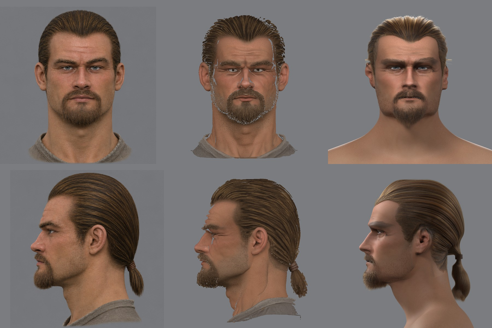
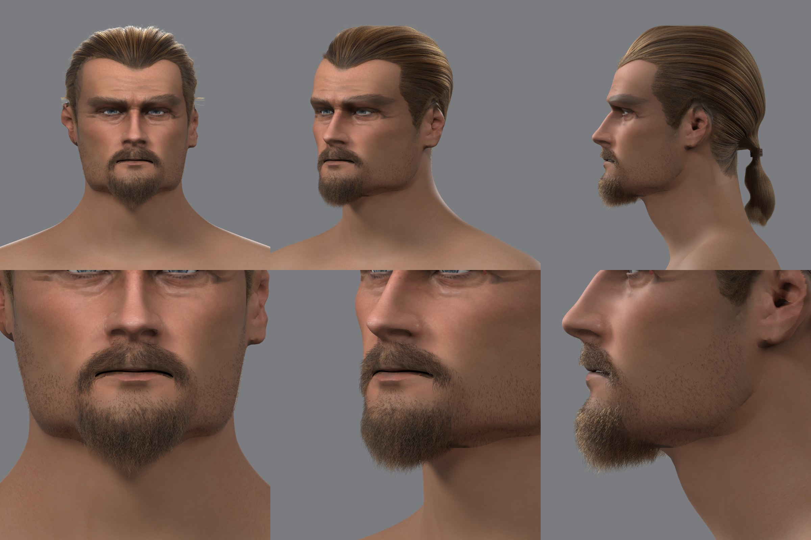

# Борода, усы и щетина волосками

2026-11-11. Пользователь принял вид [причёски прядями](groom.md) и показал на бороду: «странные артефакты». Здесь — откуда они и замена: борода, усы и щетина героя 3a волосками, тем же путём, что причёска. Рендер — Cycles, эталон вида; в игре борода пока прежняя.

## Откуда артефакты

Борода была [оболочкой](../2026-11-hero-head/skin/beard_shell.py): копия треугольников кожи нижней части лица, поднятая на поверхность бороды модели генератора, с цветом модели и вырезом по альфе.

- **Тёмные рваные линии по щекам и вокруг рта** — край оболочки. Она стоит над кожей на 0,6–1,2 мм, край режется альфой по порогу, под краем — щель и тень.
- **Серая «грязь» на щеках и челюсти** — щетина модели, нарисованная цветом: она лежала и в карте кожи, и на оболочке над ней.
- **Плоское размытое пятно вместо бороды** — у оболочки нет волосков, только цвет модели, а он в этом месте размыт.

Это не чинится правкой оболочки: щетина и борода — волоски, а не поверхность.

## Эталон: как растёт борода

| Что | Число | Источник |
|---|---|---|
| Густота, щека | 20–80 волос на см² | [keratin.com](https://www.keratin.com/hair-biology/beard-hair-biology-structure-density-growth-rate), [Thieme](https://www.thieme-connect.com/products/ejournals/pdf/10.1055/s-0041-1739248.pdf) |
| Густота, подбородок | 70–120 на см² | там же |
| Густота, верхняя губа | 80–110, в середине до 150 | там же |
| Рост | 0,3–0,5 мм в сутки | там же |

Щетина концепта — 2–3 мм, то есть около недели; бородка — 1–1,5 см. Волос бороды толще и жёстче волоса головы и вьётся; толщину в источниках с числом найти не удалось, взято 0,09–0,11 мм.

## Как сделано

[`beard.py`](../../../scripts/content/npc/hair/beard.py), numpy. Вход — то, что конвейер уже меряет; рук нет.

- **Где растёт и как густо** — по карте кожи, снятой с модели генератора. Кожа красная, борода бурая, щетина между ними: разность красного и синего на голой коже героя 73, в бороде 34. Доля пути от кожи к бороде — доля волос в этом месте. Голая кожа меряется на щеках и носу, борода — там, где её показали отступы.
- **Борода или щетина** — по отступу бороды модели над кожей (`disp` из `beard_shell.py`): до 3 мм — щетина, от 5,5 мм — борода. Длина волоса бороды — 1,8 отступа, чтобы волос под углом доставал до измеренной поверхности.
- **Усы** — полоса между носом и ртом по вершинам губ и носа сетки MPFB. Они у всех голов одни ([`template_points.json`](../../../scripts/content/npc/template_points.json)). Волос усов идёт от середины к углам рта и кончается у края губ.
- **Рост**: вниз и немного вперёд, с разбросом. Щетина стоит под 35–65° к коже, борода — под 22–42° и гнётся вниз. Волоски бороды собраны в пучки по семь и вьются.
- **Ноздри и рот** тёмные, но волос там нет: место, перед которым в 4 мм стоит кожа, не считается.
- **Кожа под волосками** — `skin_shaved.png`: нарисованная борода снята, на её месте цвет кожи вокруг. Часть тени оставлена: 30 % под щетиной, 70 % под бородой. Без этого нарисованная щетина под настоящими волосками читается грязью.
- Ни один волос не уходит под кожу: точки проверяются по облаку точек кожи с нормалями.

[`groom_render.py`](../../../scripts/content/npc/hair/groom_render.py) берёт несколько наборов прядей (`--groom`) и снимает три крупных плана: `beard`, `beard_q`, `jaw`.

## Проба 1





12 445 волосков: 5 167 бороды, 1 027 усов, 6 251 щетины; 12 точек на волос. Длина: борода — медиана 9,3 мм, до 24 мм; щетина — 1,6 мм. Генератор работает 15 секунд.

Что видно:
- швов и рваных линий нет: оболочки нет, волоски растут из кожи;
- бородка и усы читаются волосками, край бороды рыхлый, щетина редеет к скуле;
- борода светлее и рыжее концепта, усы у концепта гуще и тяжелее;
- под нижней губой у концепта волосы есть, у нас редкая щетина: так на модели генератора;
- щетина на шее кончается выше, чем у концепта.

## Что не сделано

- **В игре борода прежняя** — оболочка. Волоски придут туда вместе с прядями причёски (шаг 2 [пути](quality.md#что-предлагаю)); 12 точек на волос взяты с расчётом на игру.
- Цвет волос — те же три числа в рендере, что у причёски, плюс сдвиг в тень для бороды и щетины; с концепта не снят.
- Бакенбарды остались короткими волосками причёски; стык с щетиной не подгонялся.
- Привязка волосков к мимике: корень знает свой треугольник кожи, но в файл это ещё не пишется.
- Карта кожи без бороды нужна только с волосками: издали, где волосков не будет, останется прежняя карта.

## Команды

```
W=~/.local/share/gothic-ai/mpfb/work; S=scripts/content/npc; O=$W/groom3a/<круг>
python $S/hair/beard.py $W/skinc3a/uv.npz $W/regc3a/groups.npz $W/regc3a/views.json $W/skinc3a/b4/skin.png $W/skinc3a/k10/beard.npz $S/template_points.json $O
blender -b $W/regc3a/c1/reg_sub.blend -P $S/hair/groom_render.py -- $W/regc3a/views.json $O/skin_shaved.png $W/groom3a/g15/groom.npz $O s \
  --groom $O/beard_groom.npz --eye $W/skin3a/eye_dark.png --views front,quarter,profile,beard,beard_q,jaw
```
