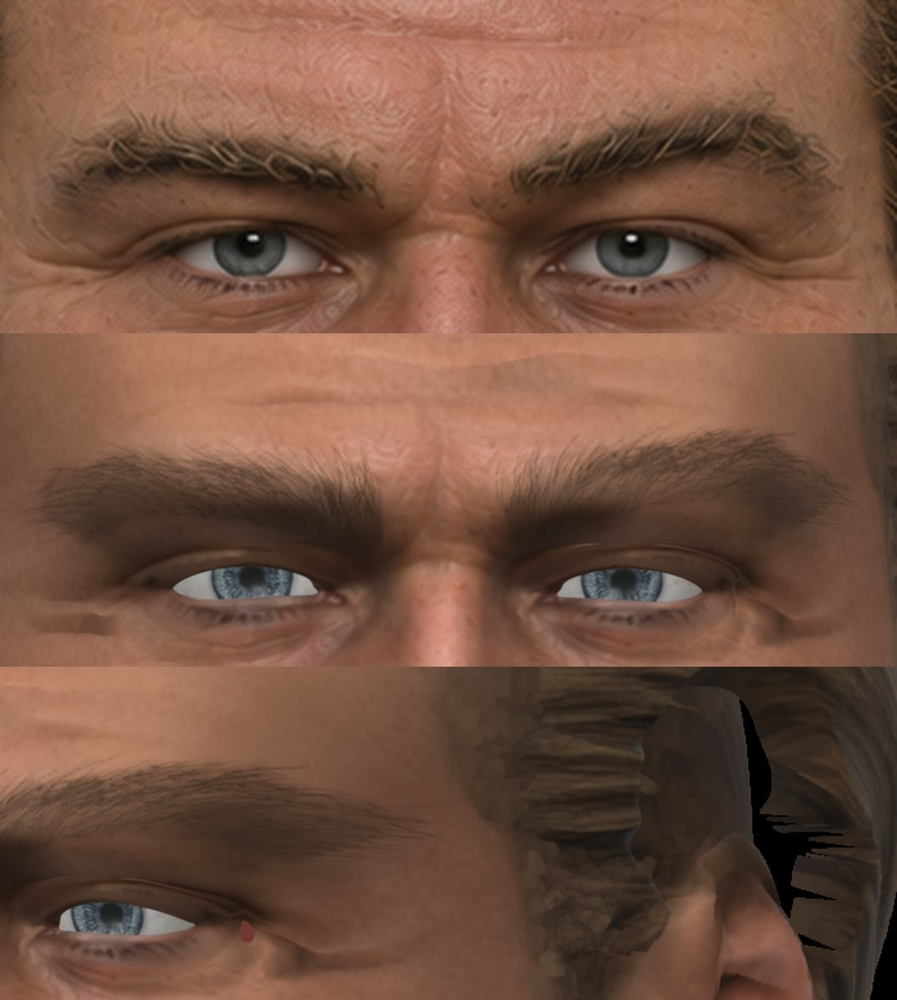
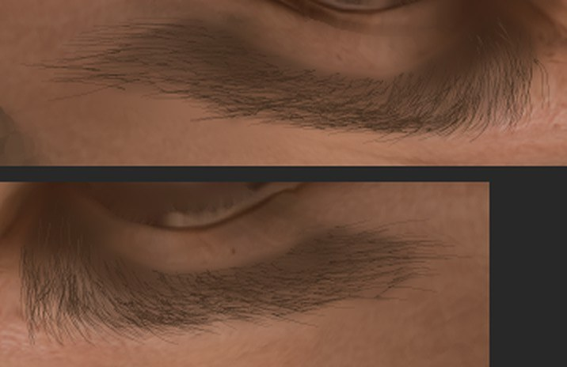
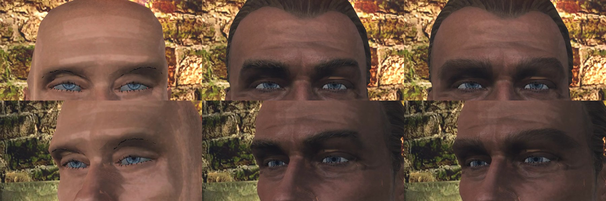

# Брови

2026-11-10. Пользователь отклонил брови на клипах шага 1 [шейдера волос](README.md): «выглядят плохо, нужно делать лучше» — и попросил исследовать, как брови делают правильно. Здесь — разбор, выбранный способ и первая проба на голове героя 3a из [конвейера NPC](../../../docs/npc-pipeline.md).

## Что было не так

- **На клипах шага 1** брови — карточки MPFB `eyebrow006` на лысой розовой голове. Их текстура — редкие тонкие штрихи под смешивание. Альфа-тест оставляет от них карандашную черту, хешированная альфа — редкую полоску. Это контент, а не шейдер: рисовать там нечего.
- **На голове 3a** бровь спроецирована с концепта. Форма и место верные, но концепт — 0,4 мм на пиксель: вместо волосков выходит мягкое тёмное пятно.

## Как это выглядит на деле

- В брови 275–400 волосков; это цифра клиники пересадки волос, а не измерение ([Donovan](https://donovanmedical.com/hair-blog/2015/5/5/cjgw8qq9hy8n0q2qxvl8sxjdu655y2)). Волоски растут по одному, а не пучками.
- Волосок выходит из кожи под очень острым углом и лежит на ней; на голове угол около 45° (тот же источник).
- Направление меняется вдоль брови: у переносицы волоски стоят почти вертикально, к виску ложатся вдоль брови ([обзор, Springer](https://link.springer.com/article/10.1007/s40257-022-00729-5)). В середине верхние и нижние ряды сходятся крест-накрест.
- Бровь героя на концепте 3a, по замеру: площадь около 485 мм², толщина 7–9 мм, кустистая, верхние волоски торчат вверх.
- В диалоге пиксель экрана — около 0,5 мм ([заметка волос](README.md#пряди-и-размеры)), волосок — 0,07–0,1 мм. Отдельный волосок не виден никогда. Читаются контур, густота, штрихи по направлению роста, рыхлый верхний край и кожа в просветах.

## Как делают другие

- **Два пути**: запечь волосы в текстуру головы или положить карточки. Запекание проще, карточки нужны там, где сквозь волосы должна быть видна кожа, и когда причёску меняют без перепекания ([справочник 3D-художника](https://sidney-eliot.github.io/3d-artists-handbook/mesh/hair)). Брови и ресницы часто кладут на тот же атлас, что и волосы ([80.lv, Avasilcutei](https://80.lv/articles/creating-hair-for-real-time-game-characters/)).
- **Подложка**: под волосами кожа затемнена в цвет корней. Голая кожа в просветах — самый частый признак дешёвых волос ([Stray Spark](https://www.strayspark.studio/blog/blender-hair-grooming-to-unreal-engine-pipeline-2026)).
- **MetaHuman**: пряди волосок к волоску только на PC и на ближнем уровне детализации, дальше и на Mac — карточки ([Epic](https://dev.epicgames.com/documentation/metahuman/platform-support-and-lod-specifications-for-metahumans)).
- **Ловушки**, наши и чужие:
  - редкая текстура штрихов под альфа-тестом даёт черту, а не бровь;
  - карточка над кожей даёт полоску тени и SSAO под собой;
  - бровь из библиотеки не совпадает с бровью концепта, а бровь — половина выражения лица.

## Что умеет движок

- Свой материал несёт `albedo`, `normal` и `orm` ([своя игра](../../../docs/own-content.md)). Значит, бровь в карте кожи может получить и рельеф волосков, и свою шероховатость.
- Карточки с `MASK` режутся порогом 0,5. Хешированная альфа под TAA — в черновике [PR #1165](https://github.com/kaifaty/GothicAI/pull/1165), не принята.
- Карта кожи головы — 4096 px на всё тело MPFB. На лице тексель — 0,216 мм по замеру: волосок 0,11 мм — половина текселя.

## Способ

Бровь — два слоя, первый обязателен для всех NPC.

1. **Волоски в карте кожи** — [`brow_paint.py`](../2026-11-hero-head/skin/brow_paint.py). Концепт даёт только то, что в нём есть: место, контур, густоту и цвет брови. Контур — точки бровей детектора лица, расширенные вверх, и темнота концепта относительно лба. Волоски рисуются заново в разрешении карты:
   - корни разбросаны по густоте;
   - направление — по анатомии: у переносицы вверх, в теле брови нижние идут вверх и наружу, верхние ложатся на них, в хвосте — вдоль брови; параметр кустистости поднимает верхние волоски;
   - цвет каждого волоска — из разброса цвета брови на концепте, от тени между волосками до освещённого волоска;
   - под волосками — подложка: кожа с мягкой тенью цвета волос. Спроецированное пятно заменено кожей с краёв.
2. **Карточки поверх** — редкий слой коротких прядей по верхнему краю, для силуэта в профиль и на крупном плане сюжетных лиц. Делается вместе с бородой на шейдере волос (шаг 6 [заметки волос](README.md#шаги)) и ждёт хешированной альфы.

Первый слой не требует правок движка и собирается сам по концепту, поэтому годится для сотен лиц.

## Приёмка

Принимает пользователь на глаз: крупный план рядом с концептом и кадры из игры на расстоянии диалога. Ограничители:
- бровь не темнее и не толще, чем на концепте;
- при закрытом глазе и поднятой брови волоски не тянутся полосами.

## Проба 1: голова 3a







По 605 волосков на бровь, площадь 485 мм², цвет волоска 68/45/30. Карточки бровей MPFB скрыты прозрачной картой, как в прошлом круге.

Что видно:
- бровь читается бровью: направление, рыхлый край, отдельные торчащие волоски;
- против концепта она ровнее и гуще, «причёсаннее»: у концепта волоски толще и светлее, кожи в просветах больше;
- под бровью в Blender лежит тень надбровья от света сверху; это свет, а не краска.

## Что не сделано

- Рельефа и шероховатости брови нет: волоски пока только цветом.
- Слоя карточек нет.
- Ресницы — прежние карточки MPFB, с теми же чёрными зубцами под порогом 0,5.
- Параметры подобраны на одной голове. Для другой брови их надо будет снимать с концепта: толщину волоска и кустистость.
- Тексель 0,216 мм крупнее волоска. Отдельная карта головы 4096 px дала бы около 0,1 мм.
- У внешнего угла правого глаза осталась красная точка — незакрашенный островок карты, он был и раньше.

## Команды

```
W=~/.local/share/gothic-ai/mpfb/work; H=reports/content/2026-11-hero-head; R=$W/regc3a; F3=$W/regf3a
~/.local/share/gothic-ai/mpfb/venv-mp/bin/python scripts/content/npc/face_points.py $F3/points concept_front=$F3/concept_front.png
python $H/skin/brow_paint.py uv.npz $R/groups.npz $R/views.json $F3/concept_front.png $F3/points/concept_front.json \
  <карта кожи>.png <карта с бровями>.png
```
