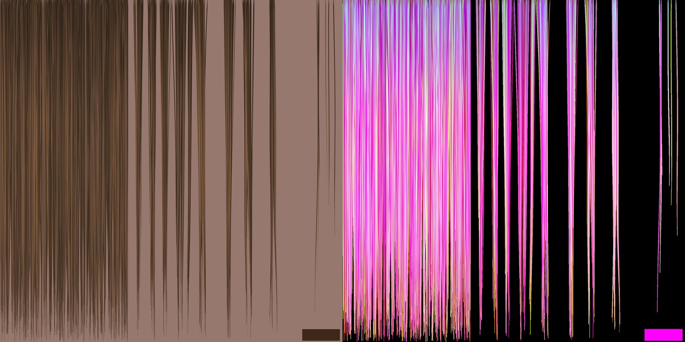
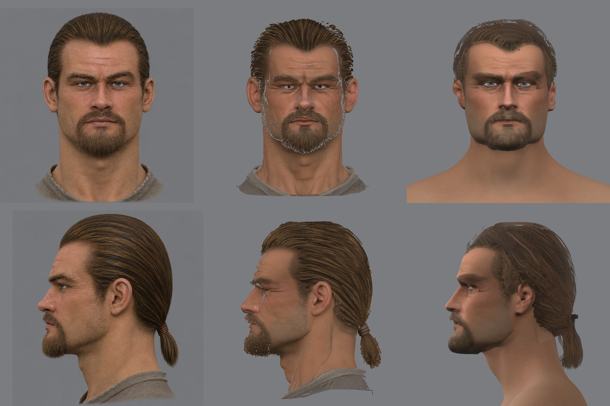
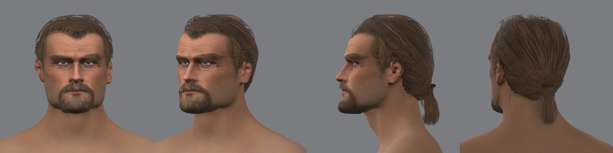
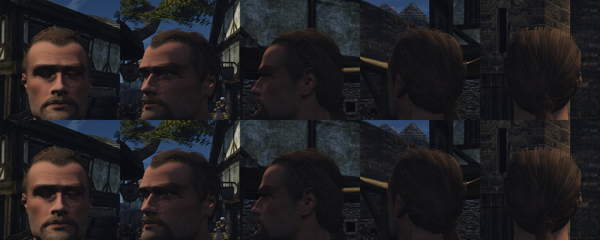

# Первая причёска на карточках (шаг 2)

2026-11-10. Шаг 2 [заметки волос](README.md#шаги): причёска героя 3a на карточках, пока с обычным светом. Требования к контенту — в разделе [«Что нужно от контента»](README.md#что-нужно-от-контента-для-первой-пробы); пряди — своим скриптом в Blender, решение пользователя. Голова — из [сквозного прохода конвейера NPC](../2026-11-npc-pipeline/README.md), брови — [волоски в карте кожи](brows.md).

## Как сделано

Два инструмента в [`scripts/content/npc/hair/`](../../../scripts/content/npc/hair/).

**Атлас прядей** — [`strand_atlas.py`](../../../scripts/content/npc/hair/strand_atlas.py), Blender. Восемь пучков 256×2048 px рядом, пряди вдоль `v`, корень сверху. Каждая прядь — линия от корня вниз: где начинается, докуда доходит, как волнится и к каким соседям липнет. Пряди строятся тонкими лентами и рендерятся сверху: ближняя закрывает дальнюю, край пряди — доля пикселя.



| Пучки | Что | Слой |
|---|---|---|
| 0–2 | широкие, прямые, густые | основа |
| 3–5 | локоны из 5–7 прядей | объём |
| 6 | узкие слипшиеся локоны | верх |
| 7 | отдельные волоски; внизу образец кожи для шнурка | край |

Карты: `hair_albedo.png` (цвет и покрытие) и `hair_map.png` (R — затенение корня и глубоких прядей, G — номер пряди, B — глубина пряди в пучке) для шагов 4–5. Цвета — три числа с волос концепта: тень 55/40/28, волос 80/59/42, блик 120/89/69; каждая седьмая прядь светлее.

**Раскладка** — [`hair_cards.py`](../../../scripts/content/npc/hair/hair_cards.py). Поверхность причёски уже измерена на модели генератора: `hair_cut.py` пишет её сеткой радиусов вокруг центра черепа и осью хвоста (`cap.npz`). Зализанные волосы идут по этой поверхности к узлу, где хвост отходит от головы. Карточка — полоса вдоль такой линии.

- **Основа** — полосы от линии волос до узла, бок о бок, как меридианы: вся поверхность закрыта прядями, которые идут в нужную сторону.
- **Поверх** — локоны, узкие слипшиеся локоны и ряд локонов, которые начинаются под краем: линия волос — это волосы, а не кромка оболочки. Отдельные волоски по краю выключены, пока прозрачность режется порогом.
- **Под карточками** — грубая оболочка на 7 мм глубже, одного тёмного цвета: щель между карточками не открывает череп.
- **Хвост** — два кольца карточек вокруг оси и кожаный шнурок на узле.
- **Нормали** карточки — нормали поверхности причёски, а не её плоскости.
- Верхние слои и хвост двусторонние, нижние — только наружная грань.

Выгрузка: `export_test_head.py --hair` несёт нормали карточек и ставит материалу волос `MASK`.

## Что нашлось

- **Отдельный волосок альфа-тест режет на штрихи.** Волосок 0,09 мм в атласе — меньше половины пикселя игры, его покрытие ниже порога 0,5. Прядь в атласе теперь 0,3 мм — несколько слипшихся волосков.
- **Линия к узлу упирается в ухо.** У линии волос есть вырез под ухо, и прямая дорога к узлу выходит за границу волос: половина полос основы обрывалась. Линия теперь огибает вырез.
- **Короткая карточка с частью пучка кончается тупым срезом.** Каждая карточка берёт пучок целиком, тогда она кончается кончиками прядей.
- **Отдельные волоски по краю в игре выглядят проволокой**: утолщённые под альфа-тест, они торчат тёмными прутьями на фоне света. Слой выключен до хешированной альфы.
- **Серая рубаха попадала в хвост**: его кончик мерился по точкам рубахи за ним и выходил на 16 мм длиннее.

## Проба 1





320 карточек (132 полосы основы, 78 и 54 локона, 37 у линии волос, 19 в хвосте), 9 258 треугольников вместе с оболочкой (1 764), 9 349 вершин. Прежняя шапка — 18 220 треугольников.

Что видно в Blender:
- читаются пряди, зачёс назад и хвост со шнурком; со спины и сбоку причёска похожа на концепт;
- спереди верх причёски ниже и неряшливее концепта: карточки над лбом видны с торца;
- цвет ровнее и рыжее концепта, блика нет — это шаги 3–5.

## В игре

Стенд [`hair-cards.bench`](../../../scripts/bench/hair-cards.bench): рынок Хориниса в полдень, голова целиком в кадре с пяти сторон, потом бег со спины. Движок — ветка шага 1 ([PR #1165](https://github.com/kaifaty/GothicAI/pull/1165), черновик), прогоны с `OPENGOTHIC_HASHED_ALPHA=0` и `=1` на Ryzen, 1920×1080. Клипы вне git: `~/.local/share/gothic-ai/remaster/npc-hair/step2/`, сравнения — `compare/run-0.5-vs-hash.mp4` и `compare/back-quarter-0.5-vs-hash.mp4`. В журнале игры: `loaded head for PC_HERO: 9 parts`.



Что видно:
- причёска читается волосами: пряди, зачёс к узлу, хвост; на беге со спины силуэт головы и хвоста держится;
- с порогом 0,5 пряди жёстче и между ними видны тёмные щели, с хешем затылок мягче и плотнее;
- место съёмки оказалось в тени, блика на волосах нет — свет волос будет на шагах 4–5;
- мерцание на беге не мерилось, клипы смотрит пользователь.

## Что не сделано

- Треугольников больше меры заметки (4–6 тысяч): основа идёт шагом 1 см по всей длине.
- Хвост не отдельная часть: движок принимает у головы только часть `hair`. Понадобится на шаге 8, с костями.
- Борода — прежняя оболочка, не карточки (шаг 6).
- Сохранения покрытия по мипам нет; нужно ли оно, покажут клипы.

## Команды

```
W=~/.local/share/gothic-ai/mpfb/work; H=reports/content/2026-11-hero-head; S=scripts/content/npc/hair; O=$W/hairc3a
blender -b -P $S/strand_atlas.py -- $O/atlas 1
python $H/skin/hair_cut.py $W/regc3a/views.json $H/fit/params-3a.json <raw.npz полной модели> $O/cap 1024 \
  --place $W/regf3a/place.json --tone $W/regf3a/tone.json
python $S/hair_cards.py $O/cap/cap.npz $O/<круг>
blender -b $W/probe.blend -P $H/mpfb/export_test_head.py -- <каталог контента> --hero ... \
  --hair $O/<круг>/hair.npz $O/atlas/hair_albedo.png --beard ...
```
