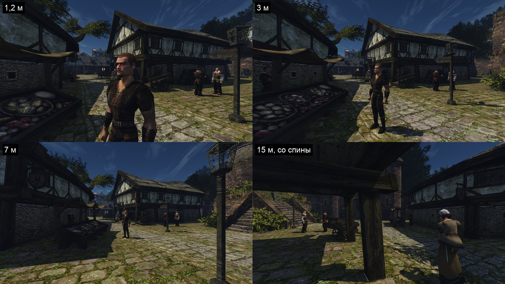
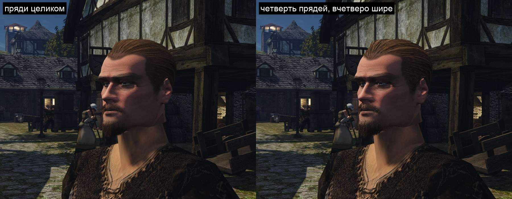

# Цена прядей в кадре

2026-11-11. Шаг 3 пути из [разбора](quality.md#что-предлагаю): замер. Пользователь посмотрел [кожу и стык](skin.md) и сказал: «ок, давай померяем». Здесь — сколько голова с [прядями](strands.md) стоит видеокарте и памяти, от чего цена зависит и что из этого следует для уровней детализации. Сами уровни не сделаны.

## Цель

Знать цену одной головы с прядями у лица и вдали на RTX 3080 и на Mac, и найти, где она сидит: в пикселях, в вершинах или в тенях. По этому решается, какие уровни детализации нужны и где граница шапки вдали.

## Как мерили

- **Стенд** `scripts/perf.sh`: место `face` — лицо героя крупно, 38–60 см, четыре ракурса; новое место `face-far` ([`perf-face-far.bench`](../../../scripts/bench/perf-face-far.bench)) — та же точка рынка в полдень с 1,2, 3 и 7 м спереди сбоку и с 15 м со спины. В кадре с 15 м героя закрывает столб навеса.
- **Ryzen**: RTX 3080, 1920×1080, полное разрешение, VSM. Все варианты — на одном бинарнике, каждый запуск игры свежий, по два повтора; заявки `gq quiet`.
- **Варианты**: голова оригинала; своя голова без прядей; она же без карт нормалей и шероховатости кожи; причёска на карточках; пряди целиком и доля 0,5, 0,25 и 0,1 (`OPENGOTHIC_GROOM_SHARE`: меньше прядей, каждая шире).
- **Что считаем.** На рынке кадр упирается в процессор: 8,5 мс при 2,7 мс работы видеокарты. Частота кадров от прядей на Ryzen не меняется, поэтому мера — время видеокарты на кадр (`gpu_ns`) и время по проходам (`OPENGOTHIC_GPU_PASSES=1`, один повтор).
- **Mac**: M1 Pro, окно 1728×1117 (кадр 3456×1918), один повтор, при разрешении игры по умолчанию и при полном. Машина была под чужой нагрузкой (средняя загрузка 18–40), числа грубые.



## Числа, Ryzen

Время видеокарты на кадр, мс, среднее по двум–шести запускам. Разброс между запусками одного варианта — до 0,07 мс.

| Вариант | Лицо крупно | 1,2 м | 3 м | 7 м | 15 м |
|---|---|---|---|---|---|
| Голова оригинала | 2,74 | 2,77 | 2,77 | 2,81 | — |
| Своя голова без прядей | 2,75 | 2,77 | 2,75 | 2,71 | 2,71 |
| Она же без карт кожи | 2,78 | 2,82 | 2,81 | 2,78 | — |
| Карточки | 2,78 | 2,82 | 2,80 | 2,77 | — |
| Пряди, доля 0,1 | 2,84 | 2,86 | 2,83 | 2,79 | 2,77 |
| Пряди, доля 0,25 | 2,86 | 2,83 | 2,83 | 2,81 | 2,81 |
| Пряди, доля 0,5 | 3,12 | 2,98 | 2,96 | 2,91 | 2,90 |
| Пряди целиком | 4,23 | 3,92 | 3,92 | 3,54 | 3,39 |

Этот счётчик занижает цену. Вот время проходов, которые рисуют и отсеивают геометрию, — прибавка к голове без прядей, мс:

| Проход | Что делает | Лицо сбоку | 3 м | 7 м | 15 м |
|---|---|---|---|---|---|
| `GBuffer` | рисует ленты в кадр | 0,96 | 0,27 | 0,30 | 0,26 |
| `Visibility` | отсев мешлетов для кадра | 0,57 | 0,57 | 0,28 | 0,28 |
| `VSM-visibility` | отсев мешлетов для теней солнца | 0,64 | 0,64 | 0,61 | 0,64 |
| `VSM-rendering` | рисует ленты в тени | 0,41 | 0,40 | 0,37 | 0,36 |
| **Всего, пряди целиком** | | **2,56** | **1,85** | **1,55** | **1,52** |
| Доля 0,5 | | 1,16 | 0,87 | 0,82 | 0,92 |
| Доля 0,25 | | 0,65 | 0,51 | 0,45 | 0,52 |

Остальные проходы кадра (свет, туман, TAA, блум) с прядями становятся короче: 1,90 мс без прядей, 1,25 мс с прядями. Сцена и разрешение те же.

Треугольников в кадре: без прядей — 0,6–1,5 млн, с прядями — на 5,5 млн больше при любом расстоянии. В файле 1,37 млн треугольников: пряди проходят конвейер четыре раза за кадр.

Память видеокарты на голову, по загрузчику (не замерено): 23 422 мешлета — 54 МБ вершин и 24 МБ индексов. Карты кожи — 34 МБ (цвет 11, нормали 22, шероховатость 0,7).

## Числа, Mac

Кадр на Mac упирается в видеокарту, поэтому мера — время кадра, медиана, мс (в скобках — кадров в секунду). Два разрешения: по умолчанию игра на Mac рисует 75 % кадра и растягивает его MetalFX.

| Вариант | 75 %, лицо крупно | 75 %, вдали (1,2–15 м) | Полное, лицо крупно | Полное, вдали |
|---|---|---|---|---|
| Своя голова без прядей | 10,8 (93) | 11,0 | 13,9 (72) | 14,3 |
| Пряди, доля 0,1 | 12,9 (78) | 14,2 | — | — |
| Пряди, доля 0,25 | 14,4 (69) | 16,1 | 18,4 (54) | 19,3 |
| Пряди целиком | 26,4 (38) | 25,7 | 32,8 (30) | 27,2 |

Строка «доля 0,25» при 75 % снята, когда загрузка Mac подскочила до 230; она согласуется с соседними, но ей веры меньше.

По проходам на Mac цена сидит там же: `GBuffer` и две карты теней солнца (`ShadowMap #0`, `#1`), затем отсев. Точных чисел по проходам нет: на Metal их интервалы перекрываются.

Пряди на Metal рисуются верно: причёска, борода и щетина на месте.



## Что нашлось

- **Своя голова, карты кожи и карточки в кадре ничего не стоят**: разница с головой оригинала — в пределах разброса.
- **Пряди целиком — 1,5–2,6 мс видеокарты 3080 на одну голову.** На Mac одна голова роняет частоту с 93 до 38 кадров в секунду; с расстоянием цена там тоже не падает.
- **Цена почти не падает с расстоянием.** У лица 2,6 мс, с 15 м, где голова меньше 20 пикселей и закрыта столбом, — 1,5 мс. Пиксели дают только треть цены у лица; остальное — отсев 23 тысяч мешлетов и вершины, а их число от расстояния не зависит.
- **Тени стоят 1,0 мс при любом расстоянии** — больше половины цены вдали. Долю прядей для тени выбирает вершинный шейдер: остальные ленты он схлопывает, но отсев и вершины уже оплачены за все.
- **Цена примерно пропорциональна числу прядей**: четверть прядей — четверть цены у лица и треть вдали.
- **Общий счётчик видеокарты занижает цену при лёгкой нагрузке.** По нему у лица половина прядей стоит 0,37 мс, все — 1,5 мс; по проходам — 1,2 и 2,6 мс. Остальные проходы под нагрузкой идут в полтора раза быстрее. Похоже, карта при малой загрузке сбрасывает частоту; это не проверено. Замеры лёгких сцен по `gpu_ns` стоит читать с этой поправкой.
- **Ракурс `cam face` на 7 м и дальше упирается в стены рынка.** Первая версия стенда мерила с 15 м стену: цена прядей там ноль, отсев по заслонам работает. Вид переставлен за спину героя.

## Что из этого следует

Предложение, решение за пользователем:

1. **Тени — с малой доли прядей, выбранной списком, а не шейдером.** Пряди в файле перемешаны, первые N % — готовый редкий уровень. В проходы теней идёт только он. Ожидание: тени 1,0 → около 0,1 мс на голову.
2. **Уровни по размеру головы на экране — началом списка**, как в idTech: ближе 1,5 м — все пряди, до 4 м — половина, до 10 м — четверть или десятая часть. Памяти это не добавляет. Ожидание с первым пунктом: 1,6 мс у лица, 0,5 мс в разговоре с двух-трёх метров, 0,1–0,2 мс вдали.
3. **Дальше 10–15 м — шапка**: сетка причёски без прядей. Её ещё нет.
4. **Mac**: даже десятая доля прядей стоит 2–3 мс на голову. По умолчанию — не больше четверти прядей у лица, тени с шапки, пряди только у ближних голов.

Толпа рынка в 20 голов даже на десятой доле прядей — 2–4 мс на 3080. Для NPC вдали нужна шапка, пряди — героям разговора и ближнему кругу.

## Что не сделано

- Уровней детализации и редкой тени нет: это следующий шаг.
- Вид малой доли прядей глазом пользователя не принят; пара кадров выше — один ракурс на Mac, клипов нет.
- Несколько голов с прядями в кадре не мерялись: голова одна, героя.
- Сцена, где кадр упирается в видеокарту 3080, не мерялась. Причина ускорения остальных проходов под нагрузкой не проверена.
- Память видеокарты посчитана по загрузчику, не замерена.
- Mac мерялся под чужой нагрузкой, один повтор; по проходам там точных чисел нет.

## Команды

```
# одна голова, один вариант (Ryzen; для Mac — BENCH_HOST=local)
BENCH_HOST=ryzen PERF_WINDOW=1920x1080 PERF_REPEAT=2 \
  PERF_ENV='OPENGOTHIC_CONTENT=<корень контента> OPENGOTHIC_GROOM_SHARE=0.25' scripts/perf.sh face face-far
# время по проходам: добавить в PERF_ENV OPENGOTHIC_GPU_PASSES=1
```

Варианты контента — копии `hero-head-3a-skin6`: без `groom` в `characters.json`, без `normal` и `orm` в записи кожи. Отчёты прогонов вне git: `/mnt/shared/gothic-ai/busy-euclid-ac58db/perf-hair/runs/` на хранилище Ryzen.
