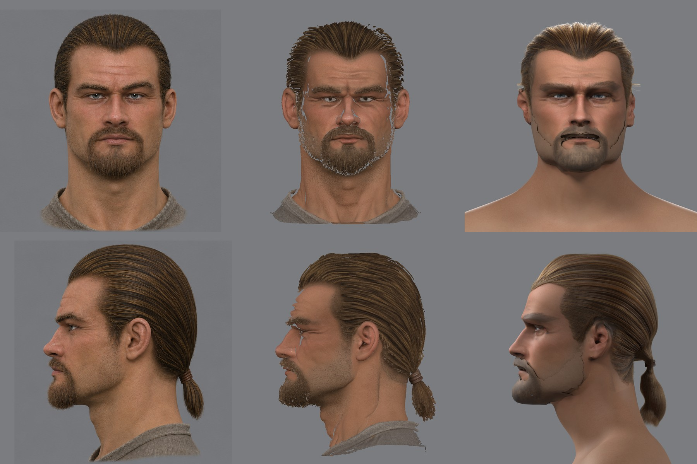
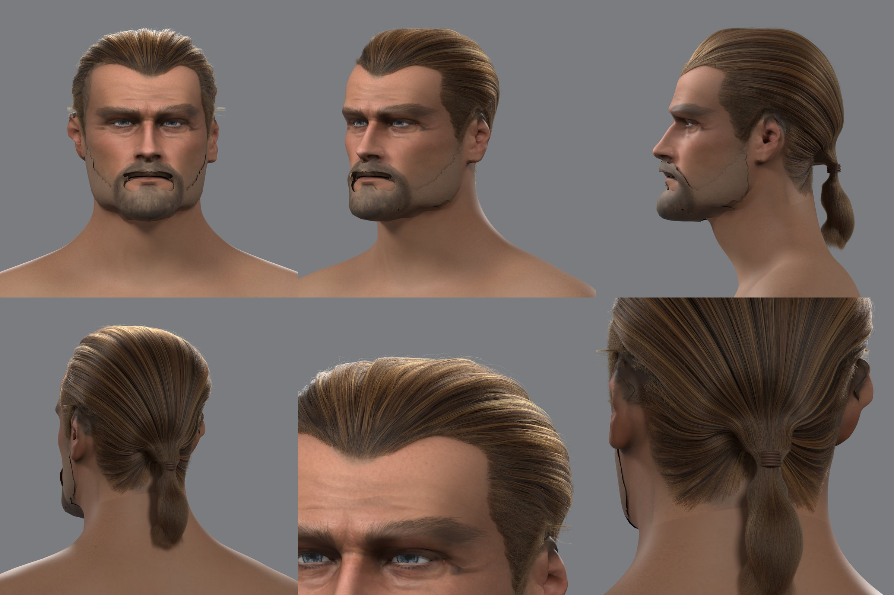

# Причёска прядями: источник для волос в игре

2026-11-10. Шаг 1 пути из [разбора](quality.md#что-предлагаю): причёска героя 3a прядями в Blender и её рендер в Cycles рядом с концептом. Это эталон вида волос: по нему пользователь принимает сами волосы до движка, с ним потом сравниваются пряди в игре. В игру на этом шаге ничего не попало.

## Как сделано

Два инструмента в [`scripts/content/npc/hair/`](../../../scripts/content/npc/hair/).

**Пряди** — [`groom.py`](../../../scripts/content/npc/hair/groom.py), numpy. Вход — то, что конвейер уже меряет: поверхность причёски и хвост модели генератора (`cap.npz` от `hair_cut.py`), сетка головы и карта кожи. Рук в причёске нет.

- **Корни** разбросаны равномерно по площади кожи головы внутри линии волос. Линия волос — край измеренной маски с медленным шумом, чтобы не была ровной.
- **Путь волоса**: зачёс назад, а в 6–14 см от узла — поворот прямо к узлу хвоста. Где прямой путь выходит за волосы (ухо), волос идёт по полю расстояний до узла в обход.
- **Слой**: волос выходит из кожи и поднимается на свой уровень между кожей и измеренной поверхностью причёски. У линии волос слой тонкий и растёт внутрь.
- **Локоны**: волос притягивается к волосу-вожаку своего локона. Два уровня: локоны около сантиметра и пучки по дюжине волос — немытые волосы лежат прядями.
- **Хвост**: у узла волосы проходят шнурок и заполняют измеренную форму хвоста. Волос остаётся с той стороны хвоста, с которой пришёл; кончаются волосы на разной длине.
- **Мелочь**: 2,5 % волос выбиваются из локона и приподнимаются, короткие волоски смягчают линию волос, каждый волос чуть дрожит к кончику.
- Цвет пряди — смещение по локону и пучку: от тени до золотистой пряди.

**Рендер** — [`groom_render.py`](../../../scripts/content/npc/hair/groom_render.py), Blender Cycles: кривые волос с шейдером Principled Hair, толщина волоса 0,08 мм у корня, шнурок — пять витков кожи. Свет и камеры те же, что у листов сходства головы.

## Что нашлось

- **Кратчайший путь к узлу — не зачёс.** Со лба он идёт вокруг головы сбоку, а не через макушку: голова длиннее, чем шире.
- **Прямой путь к узлу тоже не зачёс.** Точка, противоположная узлу, — середина линии волос, и пряди расходились от неё веером, вихром надо лбом. Поэтому волос сначала идёт назад, а к узлу — только вблизи него.
- **Луч от центра черепа может уйти мимо кожи головы к плечу.** Корни садились на шею, и по бокам хвоста висели «крылья». Берётся первая встреча луча с кожей, а не дальняя.
- **У линии волос измеренная поверхность стоит над кожей** на 1–2 см: голова подогнана к лысой модели, и её лоб не совпадает с лбом модели с волосами до миллиметра. Волосы шли валиком. Толщина слоя теперь растёт от линии волос.
- **В сетке причёски дыры у полюсов, а полюса — прямо над ушами.** Над ухом оставалось голое пятно. Сетка расширена на 8°, растут ли там волосы — говорит карта кожи.
- **Волос, зашедший на ухо, ложится поверх него** и торчит пучком. Ухо закрыто для путей; волос, который вышел за волосы, кончается на этом месте.
- **Корень хвоста на модели сливается с волосами головы**: радиусы хвоста там с выбросами, они обрезаны по медиане.

## Проба 1





78 563 волоса, ещё 2 034 выбившихся и 13 003 коротких; 1 151 локон и 6 716 пучков; 48 точек на волос. Длина волоса — медиана 23 см, хвост 99 мм. Рендер — 256 выборок на пиксель, около минуты на вид на M1 Pro.

Что видно:
- причёска читается волосами: зачёс, бороздки от гребня, золотистые пряди, глубина между локонами, пушок по силуэту;
- со спины и у узла — сходство с концептом лучшее;
- волосы чище и ровнее концепта: там пряди слипшиеся, с тёмными просветами между ними;
- линия волос — с мысом посередине, у концепта она прямее: это форма измеренной маски;
- цвет задан тремя числами в рендере и подобран на глаз по концепту, а не снят с него.

## Что не сделано

- **Борода и усы** на листах выше — прежняя оболочка с тёмными швами по краю. Сделаны волосками позже: [beard.md](beard.md). Бакенбарды — короткие волоски без своей формы.
- Около 6 тысяч волос обрезаны там, где их путь вышел за волосы, и остались короткими; у верха ушей во фронтальном виде ещё видны тонкие светлые волоски. 159 волос не нашли пути к узлу.
- Хвост не качается: симуляции нет.
- В игре прядей нет: ленты, запечённое самозатенение и замер цены — шаг 2 и 3.

## Команды

```
W=~/.local/share/gothic-ai/mpfb/work; S=scripts/content/npc/hair; O=$W/groom3a/<круг>
python $S/groom.py $W/hairc3a/cap/cap.npz $W/skinc3a/uv.npz $W/regc3a/groups.npz $O 90000 1 --skin $W/skinc3a/b4/skin.png
blender -b $W/regc3a/c1/reg_sub.blend -P $S/groom_render.py -- $W/regc3a/views.json $W/skinc3a/b4/skin.png $O/groom.npz $O s \
  --part $W/skinc3a/k10/beard.npz $W/skinc3a/k10/beard.png --eye $W/skin3a/eye_dark.png --size 1200 --spp 256
```
