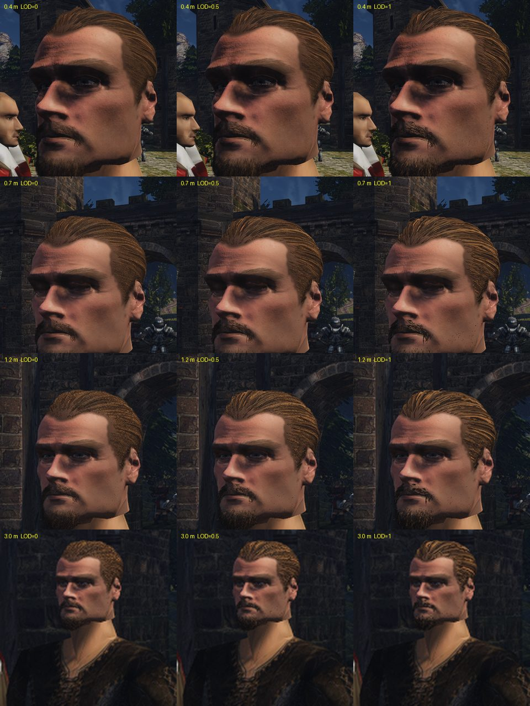

# Уровни детализации прядей и редкая тень

2026-11-11. Это шаг после [замера цены](cost.md): пряди целиком стоили видеокарте 3080 1,5–2,6 мс на голову, и цена почти не падала с расстоянием. На «Делать редкую тень прядей и уровни по расстоянию?» пользователь ответил «Да, делать». Шапки вдали пока нет.

## Цель

Пряди должны стоить по размеру головы на экране: у лица — примерно как сейчас, в разговоре с 1–3 м — доли миллисекунды, вдали — ноль. Тени — не дороже самих прядей. Вид у лица не должен меняться, а смена уровня на ходу не должна быть видна. Приёмка — глаз пользователя по клипу проезда камеры и паре кадров «все пряди | уровни».

## Как сделано

- **Список вместо выбора в шейдере.** Пряди в файле перемешаны по группам: волосы, короткие волосы, борода, щетина. Загрузчик ([`groommesh.cpp`](../../../OpenGothic/common/graphics/mesh/groommesh.cpp)) раздаёт мешлеты групп вперемешку, равномерно. Поэтому любое начало списка — та же доля волос, бороды и щетины. Уровень — это просто сколько мешлетов с начала рисовать. Памяти это не добавляет.
- **Доля по размеру на экране** ([`VisualObjects::preFrameUpdateStrands`](../../../OpenGothic/common/graphics/visualobjects.cpp)). Каждый кадр считается, сколько пикселей на экране занимает средняя прядь, 0,15 мм. Пряди сливаются, пока одна не станет шириной `OPENGOTHIC_GROOM_LOD` пикселя (0,5 по умолчанию): доля = ширина пряди / (0,5 × пиксель у головы). Нижняя граница — 2 %. Шаг уровня — 1/8 удвоения. Уровень меняется, только когда нужный отстоит на целый шаг, — так нет мигания между двумя соседними.
- **Оставшиеся пряди шире**: на сколько меньше прядей, во столько раз шире каждая (вершинный шейдер, `strandExpand`). Покрытие головы волосами то же.
- **Тень — первая восьмая того, что рисуется в кадре** (`StrandShadowList` в `scene.glsl`). Отсев теней (`Visibility` для каскадов, `VSM-visibility`) берёт из списка только её, ленты в тени шире в восемь раз. Раньше долю для тени выбирал вершинный шейдер, а отсев и вершины оплачивались за все пряди.
- **Пряди не заслоняют.** Проход заслонов перед G-буфером (`VF_HIZ`) их пропускает: тонкая лента ничего не закрывает, а отсев стоил как всё остальное.

Выключить уровни: `OPENGOTHIC_GROOM_LOD=0` — все пряди всегда, тень по-прежнему с восьмой части.

Доля по расчёту (вертикальный угол камеры 67,5°, 1080 строк):

| Расстояние до головы | 0,4 м | 0,7 м | 1,2 м | 3 м | 7 м | 15 м |
|---|---|---|---|---|---|---|
| `GROOM_LOD=0.5`, по умолчанию | 61 % | 35 % | 20 % | 8 % | 3,5 % | 2 % |
| `GROOM_LOD=1` | 31 % | 18 % | 10 % | 4 % | 2 % | 2 % |

## Цена

Ryzen, RTX 3080, 1920×1080, VSM, стенды `face` и `face-far` из [замера цены](cost.md), по проходам (`OPENGOTHIC_GPU_PASSES=1`). Прибавка проходов, которые рисуют и отсеивают геометрию, к голове без прядей, мс:

| Вид | Пряди целиком | Уровни по умолчанию | из них `GBuffer` | тени (`VSM-visibility` + `VSM-rendering`) |
|---|---|---|---|---|
| Лицо крупно, четыре ракурса | 2,10–2,56 | 0,55–0,75 | 0,33–0,56 | 0,03–0,14 |
| 1,2 м | 1,87 | 0,20 | 0,05 | 0,09 |
| 3 м | 1,85 | 0,08 | 0,01 | 0,04 |
| 7 м | 1,55 | 0,04 | 0,01 | 0,02 |
| 15 м, со спины | 1,52 | 0,00 | 0,00 | 0,00 |

Тени упали с 1,0 мс до 0,1 мс и меньше. Вдали пряди больше не стоят ничего измеримого. У лица осталось 0,6–0,75 мс, почти всё — `GBuffer`, то есть пиксели. На Mac с уровнями не мерили.

## Вид

Голова героя 3a с прядями, рынок в полдень, солнце в лицо. Стенд [`hair-lod.bench`](../../../scripts/bench/hair-lod.bench): кадры с 0,4, 0,7, 1,2, 3 и 7 м и проезд камеры от 40 см до 5 м и обратно. Три прогона на одном коде: все пряди (`GROOM_LOD=0`), по умолчанию (0,5) и вдвое грубее (1). Кадры и клипы вне git: `~/.local/share/gothic-ai/remaster/npc-hair/lod/f2/`. Там же пара проезда «все пряди | по умолчанию» — `lod-dolly-pair.mp4`.



Что видно по моей оценке. Пользователь по листу и клипу проезда принял уровни по умолчанию (2026-11-11):
- на 0,4 и 0,7 м уровень по умолчанию от всех прядей почти не отличается; борода чуть реже;
- на 1,2 м пряди причёски читаются отдельными светлыми штрихами контрастнее, чем у всех прядей: каждая впятеро шире и сильнее ловит блик; борода реже, но держит форму;
- на 3 м причёска у всех трёх вариантов идёт «косичкой» — рябью полос; на уровне 1 полосы крупнее;
- уровень 1 заметен уже у лица: борода и усы рвутся на отдельные тёмные нити. Он грубее, чем нужно;
- кадр с 7 м снят в стену рынка, головы в нём нет.

## Что нашлось

- **Тень дорогая из-за отсева, а не пикселей.** Её прежняя редкость в вершинном шейдере ничего не экономила: дорог был отсев всех мешлетов. Список дал в десять раз меньше.
- **Доля у самого лица — 61 %, а не 100 %.** Средняя прядь 0,15 мм уже на 40 см тоньше половины пикселя (0,25 мм). Разница видна только в бороде.
- **Средняя ширина ведёт себя хуже для тонких групп.** Борода и щетина (0,08–0,11 мм) тоньше волос (0,16 мм), а доля общая. Поэтому борода редеет первой.
- **Широкие пряди ярче.** Блик на ленте шире пикселя собирается в штрих; у всех прядей он размыт по пикселю. Это видно на 1,2–3 м.

## Что не сделано

- Вид принят по одному клипу проезда с солнцем в лицо. Ночь, факел и несколько голов не снимались.
- Нет шапки — сетки причёски без прядей дальше 10–15 м. Сейчас вдали — 2 % прядей, в 50 раз шире.
- Доля общая для всех групп; своя доля для бороды не сделана.
- На Mac уровни не мерялись и не снимались. Несколько голов с прядями в кадре не мерялись.
- Рябь «косичкой» на 3 м есть и у всех прядей; это сглаживание, не уровни. Не разбиралось.

## Команды

```
# кадры и проезд при одном значении уровня (Ryzen)
TEMPEST_WINDOW_SIZE=1920x1080 BENCH_HOST=ryzen OPENGOTHIC_GROOM_LOD=0.5 \
  OPENGOTHIC_CONTENT=<корень контента> scripts/bench.sh scripts/bench/hair-lod.bench <папка>
# цена: как в cost.md, с OPENGOTHIC_GROOM_LOD в PERF_ENV
```
