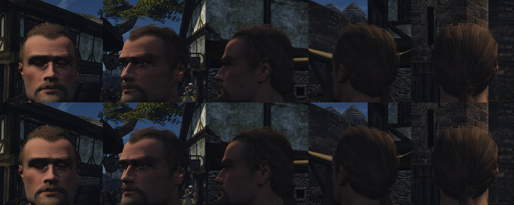

# Почему волосы выглядят плохо и какие технологии волос есть

2026-11-10. Пользователь отклонил вид причёски на кадрах [шага 2](cards.md#в-игре) и [блика](README.md#шаги-34-как-сделано): «выглядит как налепленное поверх текстур». Это второй отказ по волосам после бровей, поэтому по правилу [`AGENTS.md`](../../../AGENTS.md) дальше не подбор, а разбор причины и обзор. Кода здесь нет.

## Что не так на кадрах

| Что видно | Причина |
|---|---|
| Затылок — «доски» или солома: полосы с одинаковым узором | Атлас нарисован скриптом, а не снят с причёски. Прядь в нём — лента 0,3 мм (4 пикселя пучка) одной ширины и контраста, в пучке десятки лент. У студий в пучке сотни волосков разной густоты. Пучков восемь, а основа из 132 полос берёт три из них: узор повторяется 44 раза |
| Полосы лежат черепицей, крест-накрест, с прямыми торцами | Карточки разложены по одной измеренной поверхности: основа бок о бок, локоны поверх под углом. Объёма нет: все слои в пределах нескольких миллиметров |
| Причёска светится ровно, как крашеная шапка | Нет самозатенения. Это главное: в настоящих волосах верхние пряди светлые, а между ними темно. Блик без теней делает шапку только ярче |
| Спереди волосы кончаются обрезом на лбу | Нет перехода от кожи к волосам: кожа под волосами не выкрашена в цвет корней, коротких редких волосков по краю нет |
| Форма читается шлемом | Нормали карточек взяты с гладкой оболочки, цвет ровный от корня до кончика |

Вывод: технология карточек здесь ни при чём, на ней сделано большинство игр. Плох наш контент: карточки без причёски-источника и без теней. Но и потолок у этого пути есть: хорошие карточки — ручная работа художника на каждую причёску, а нам нужны сотни лиц автоматом.

## Что говорит практика

- **Тени важнее блика.** MachineGames про Indiana Jones: «хорошее самозатенение необходимо», пути R и TT модели Marschner яркие почти при любом свете ([доклад SIGGRAPH 2025](https://www.advances.realtimerendering.com/s2025/content/Strand%20Hair%20in%20IJGC%20-%20Final%20Slides%20(Post-Conference).pdf)). То же писал Karis ([заметка шейдера](README.md#тени-и-самозатенение)). Мы сделали блик раньше теней.
- **Самозатенение можно запечь.** В Indiana Jones карты непрозрачности и воксели отвергли, а видимость считают трассировкой лучей заранее и хранят в вершинах прядей (тот же доклад). Это работает и без карт теней, то есть и на Mac.
- **Карточки делают из причёски прядями.** Порядок у студий: причёска кривыми → запечь пучки в атлас (альфа, глубина, номер пряди, корень, поток) → разложить карточки слоями → шапка с текстурой волос под ними ([80.lv, XGen](https://80.lv/articles/3d-artist-shared-maya-xgen-to-hair-cards-workflow), [80.lv, хвост](https://80.lv/articles/creating-a-ponytail-hairstyle-with-maya-xgen-unreal-engine/)). Мы пропустили первый шаг.
- **Пряди убирают два шага.** MachineGames отказались от карточек у людей: не нужно делать атлас и раскладывать карточки, художник укладывает сами кривые. Карточки остались у двух трупов и у животных.

## Технологии

| Технология | Где | Цена и пределы |
|---|---|---|
| Шапка с текстурой | оригинал Gothic, дальние уровни детализации MetaHuman | дёшево; вблизи плоско |
| Карточки | большинство игр; запасной режим Veilguard на слабых ПК и Series S | качество равно качеству причёски-источника и раскладки; ручной труд |
| Оболочки (shell) | короткий мех, щетина, стрижка под машинку | годится только для короткого |
| Пряди, растеризатор в compute | Frostbite: Veilguard, 50 тыс. прядей на персонажа, 8 причёсок за 3 мс при 60 кадрах и 6,5 мс при 30, память 128 МБ и ещё 300–600 МБ ([EA](https://www.ea.com/technology/news/strand-hair-dragon-age-the-veilguard)). idTech: Indiana Jones, до 65 тыс. прядей (32 тыс. на слабых), не больше 2 млн сегментов в кадре, 1,6–2,4 мс на консолях | лучший вид; свой растеризатор, буфер видимости, месяцы работы движка |
| Пряди из сеток волос | [Bhokare и др. 2024](https://www.cemyuksel.com/research/hairmesh_rendering): 100 персонажей по 100 тыс. прядей за 2 мс на 4090 | нужен MSAA 8×; сетки волос запатентованы |
| TressFX (AMD) | открытый код MIT, последний коммит 2023 | DX12/Vulkan, прозрачность списками на пиксель |
| Гауссовы волосы | исследования | не освещаются нашим светом, нужен отдельный рендер; не для игры |

Инструменты контента:

| Инструмент | Что делает | Доступность |
|---|---|---|
| Кривые волос Blender и узлы геометрии | причёска прядями: интерполяция по направляющим, пучки, завиток, шум | бесплатно, в Blender |
| [DiffLocks](https://difflocks.is.tue.mpg.de/) (CVPR 2025) | 100 тыс. прядей по одной картинке | код открыт, [лицензия](https://difflocks.is.tue.mpg.de/license.html) только для академических исследований |
| [Im2Haircut](https://im2haircut.is.tue.mpg.de) (ICCV 2025), HairStep | пряди по одной картинке | код открыт, лицензия не указана или своя |
| [Perm](https://github.com/c-he/perm) (ICLR 2025) | параметрическая модель причёски | MIT; подгонка под картинку долгая |
| [Strands2Cards](https://kenji-tojo.github.io/publications/strns2cards) (SIGGRAPH Asia 2025) | карточки из прядей автоматически; 342 причёски идут на M3 Pro при 30 кадрах | код на GitHub, лицензия не указана |
| DiffHairCard (TOG 2025) | то же, оптимизацией | кода не нашёл |
| Набор Bystedt для Blender | карточки из кривых и запекание карт | бесплатно, лицензию надо проверить |

Лицензии репозиториев сверены через GitHub 2026-11-10.

## Что умеет наш движок

Подробно — в [заметке шейдера](README.md#3-что-умеет-наш-движок). Для выбора важно:
- отложенный свет с лампами, хешированная альфа под TAA и блик волос уже есть; направление пряди берётся из `v` текстуры, для ленты пряди оно готово;
- compute-шейдеры есть (61), с 32-битными атомарными операциями (VSM); 64-битных и MSAA нет;
- на Mac VSM выключен, M1 Pro слабее 3080 в разы: там годится только то, что не требует своих карт теней;
- части головы — жёсткие примитивы с морф-целями, причёска привязана к кости головы.

## Варианты

Общий первый шаг у всех: **причёска прядями в Blender** — источник правды, 30–60 тыс. кривых, построенных по измеренной поверхности причёски и её потоку. Её рендер в Cycles — эталон, по которому пользователь принимает сам вид волос до движка.

**А. Карточки из причёски.** Пучки атласа запекаются с настоящих прядей, карточки строятся по группам прядей, а не по поверхности. Самозатенение запекается трассировкой в карту или вершины, под волосами — шапка с текстурой корней. Движок: только чтение запечённой тени. Работает на Mac. Риск: автоматическая раскладка карточек — та часть, что уже вышла плохо; готовый Strands2Cards без лицензии.

**Б. Пряди в игре лентами.** Каждая прядь — лента, повёрнутая к камере, в общем G-буфере. Лента не тоньше пикселя, а её покрытие равно настоящей толщине, делённой на пиксель: это та же хешированная альфа под TAA. Блик уже написан. Самозатенение запекается в вершины трассировкой. Уровни детализации — как в Indiana Jones: пряди в случайном порядке, вдали берётся начало списка, пряди толще. Движок: новый вид вершин и ветка шейдера. Цена не измерена: 30 тыс. прядей по 16 сегментов — около миллиона треугольников на голову вблизи. Для Mac и дальних NPC — меньше прядей или шапка.

**В. Пряди своим растеризатором** (как Frostbite и idTech). Лучшее сглаживание, но это новая подсистема на месяцы и не для M1. Сейчас не предлагаю.

## Что предлагаю

Причёска прядями и вариант Б на голове героя. Доводы:
- пропадают атлас и раскладка карточек — два места, где мы дважды ошиблись;
- пряди проще строить автоматически, чем хорошие карточки: поверхность причёски мы уже меряем, а методы «причёска по картинке» выдают именно пряди;
- блик, хеш и TAA переиспользуются;
- если цена лент окажется велика, та же причёска идёт в вариант А.

Шаги, каждый кончается картинкой:
1. Причёска героя 3a прядями в Blender и рендер в Cycles рядом с концептом. Приёмка вида волос до движка.
2. Запечённое самозатенение и ленты в игре: клипы при трёх светах рядом с рендером Cycles.
3. Замер `scripts/perf.sh face` на Ryzen и Mac, уровни детализации, шапка вдали.
4. Борода и линия волос тем же способом; автоматическая причёска по концепту для NPC.

Приёмка — глаз пользователя по клипам; ограничители — цена кадра и мерцание из [заметки шейдера](README.md#приёмка).

## Не проверено

- Цена лент в нашем G-буфере и вид тонких лент под нашим TAA: это покажет шаг 2.
- Лицензии DiffLocks и соседей не разрешают игру напрямую; автоматическая причёска по концепту, возможно, будет своей: поток волос с концепта и модели генератора.
- Как сделаны волосы в ремейке Gothic 2026 года, не выяснял.
