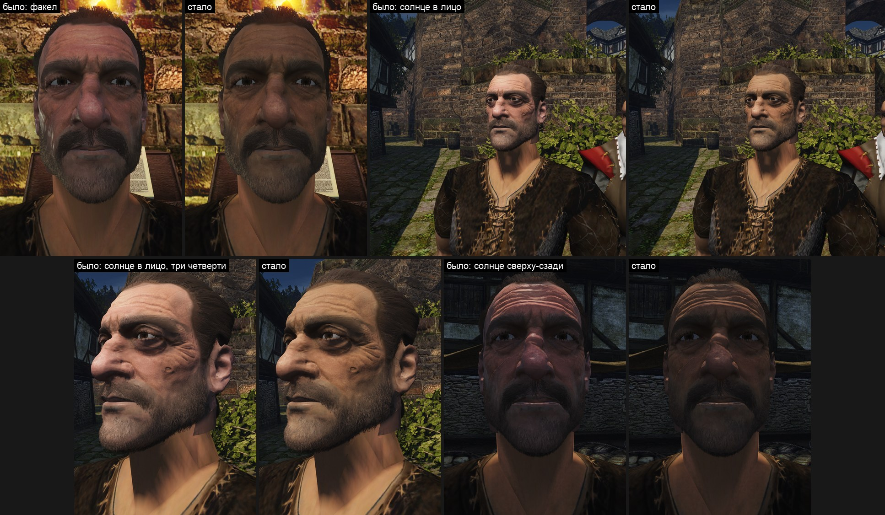
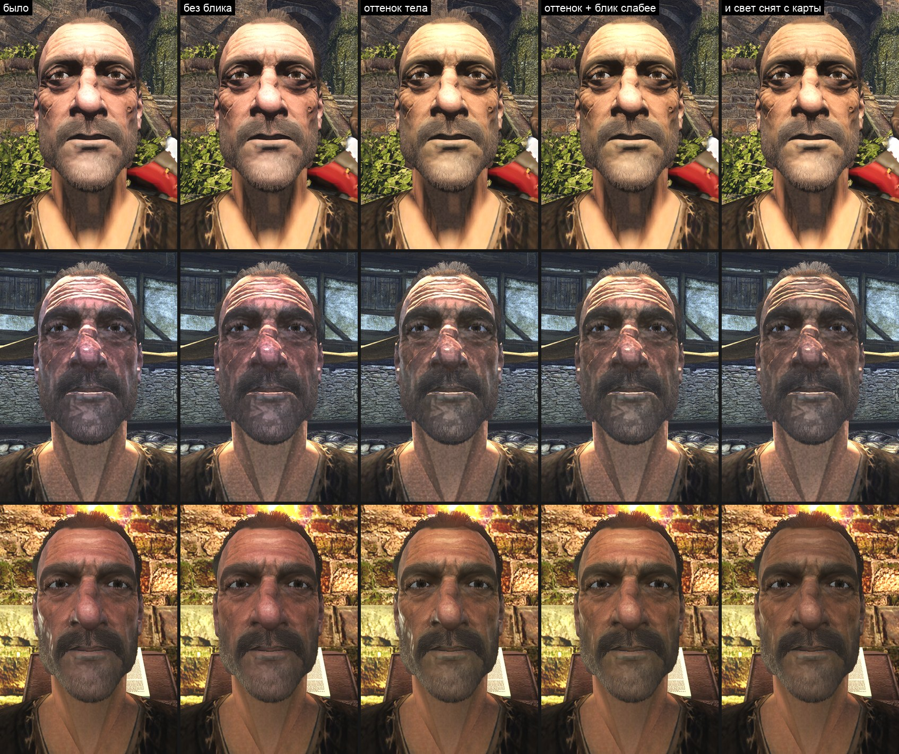
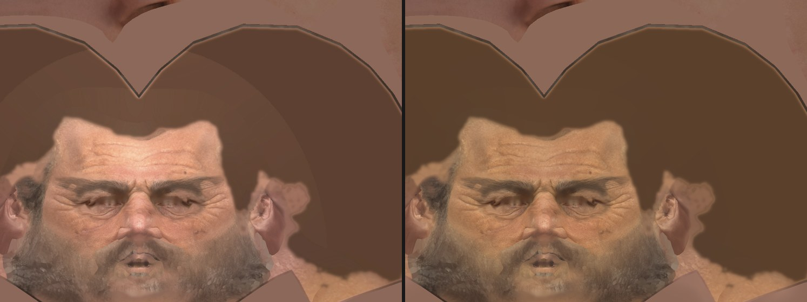
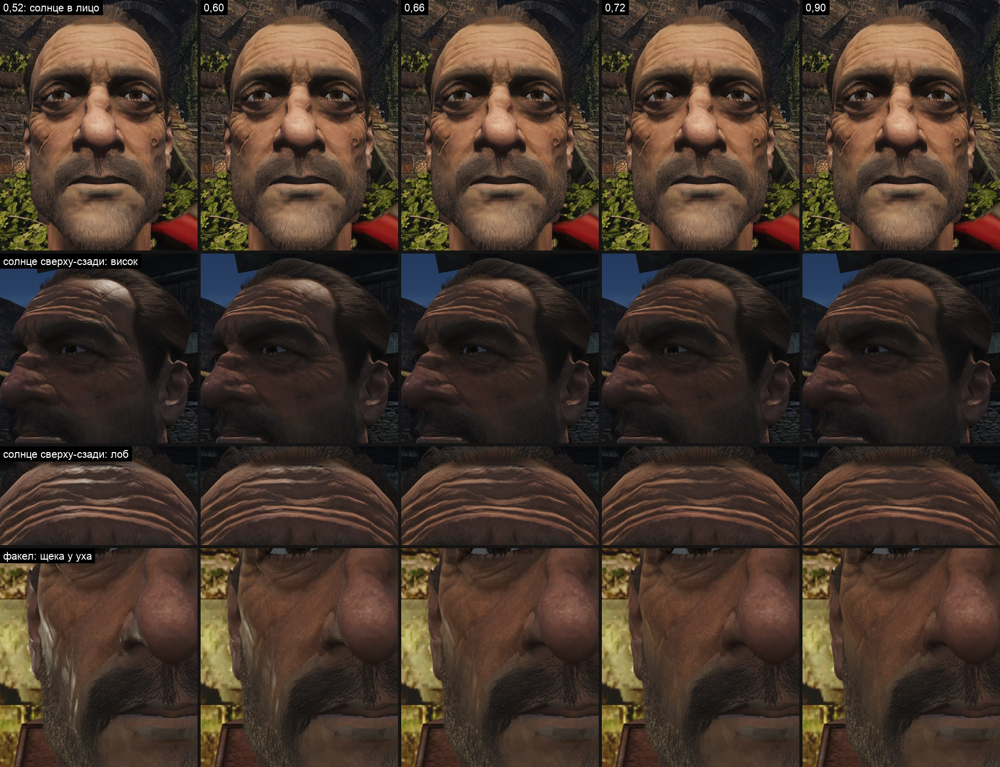
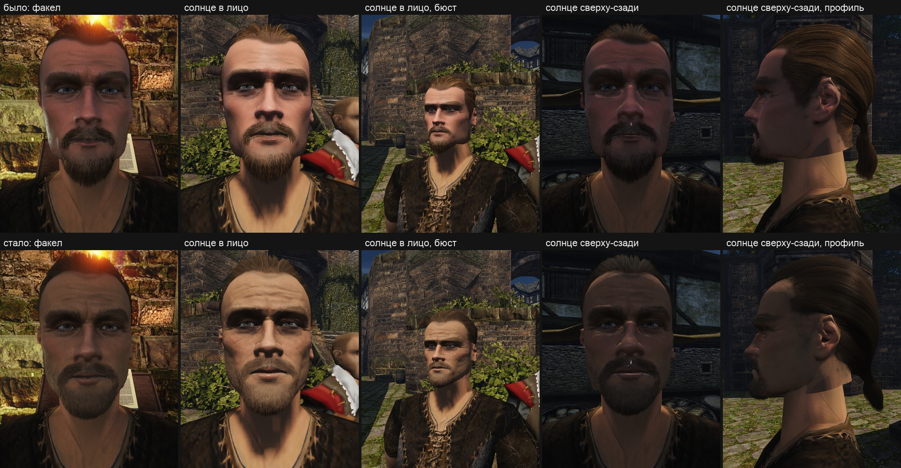
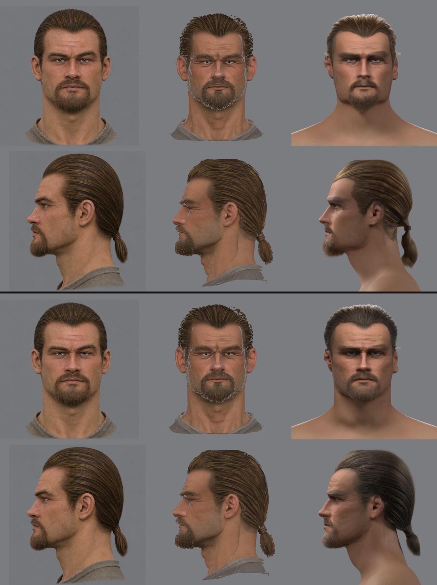

# Кожа головы на солнце

2026-11-13. [Проверка второго лица в игре](../2026-11-npc-pipeline/likeness.md#в-игре-2026-11-13) показала: при факеле лицо читается, а на солнце кожа головы розово-фиолетовая и блестит, шея тела оранжевая и матовая. Пользователь: «Да, давай справлять кожу на солнце». Здесь — разбор причин и правка шага кожи [`skin_material.py`](../../../scripts/content/npc/skin_material.py). Как шаг устроен в целом — [заметка о коже](skin.md).



*Кадры игры как есть, пересняты 2026-11-13 после [правки SSAO](../../engine/2026-11-13-ssao-behind-camera/README.md) и без растяжки яркости стендом — см. [пересчёт](#пересчёт-при-настоящей-экспозиции).*

## Цель и приёмка

Голова и шея тела под одним светом читаются кожей одного человека; лоб на солнце не белее остального лица сверх того, что даёт свет; блик есть, но не белыми полосами. Принимает глаз пользователя по листу «было | стало» при трёх светах. Ограничители, которые меряются по кадрам:

- щёки и шея в одном свете расходятся по долям зелёного и синего к красному не больше чем на 0,07;
- пикселей лица, где выбиты и красный, и зелёный, меньше 1 %. Этот ограничитель оказался пустым: в кадре игры лицо не выбивается вовсе, выбивала его растяжка яркости стенда ([пересчёт](#пересчёт-при-настоящей-экспозиции)).

**Принято 2026-11-13.** По листам «было | стало» и [лесенки шероховатости](#лесенка-шероховатости-при-настоящей-экспозиции), снятым кадром игры, на вопрос «Принимаете кожу с шероховатостью 0,66?» пользователь ответил: «Да, 0,66».

## Что видно и что измерено

Сценарий [`npc-head-look.bench`](../../../scripts/bench/npc-head-look.bench), Ryzen, 1920×1080. К нему добавлены кадры с солнцем в лицо на открытом месте рынка: в прежних кадрах солнце стояло сверху-сзади, лицо было в собственной тени, а шея — на свету, и сравнивать их было нельзя.

Причины разделены опытом: одна и та же голова снята с копиями контента, в каждой заменена одна карта.



*Сверху солнце в лицо, в середине солнце сверху-сзади, снизу факел. Этот лист снят с растяжкой яркости стенда и до правки SSAO: различия между столбцами те же, что в игре, абсолютная яркость и пятна в среднем ряду — нет.*

| Причина | Что измерено | Что даёт её снятие |
|---|---|---|
| **Оттенок карты.** Шаг сводил голову с телом одной яркостью, оттенок оставался от модели генератора | открытая кожа головы (183, 129, 104), тела — (181, 130, 93). Движок пересчитывает цвет текстуры в альбедо нелинейно (`textureAlbedo`): синего у головы выходит на 17 % больше | на прямом солнце голова из бледно-розовой становится загорелой, как шея; в тени доля синего у щёк 0,53 → 0,45 (шея 0,49) |
| **Свет концепта в карте.** Цвет снят с модели генератора вместе со светом концепта | лоб в карте в 1,86 раза светлее щёк; после подгонки яркости он в 1,8 раза светлее кожи тела (0,49 против 0,27) | лоб на солнце был намного светлее щёк: в кадре игры (227, 185, 157) при щеках (127, 82, 68); без запечённого света — (195, 151, 113) |
| **Блик в полную силу.** Шероховатость кожи 0,52, а движок гасит блик своего материала от 0,5 до 0,8 | на пике блик добавляет к диффузу 11 % красного, 21 % зелёного, 35 % синего: кожа белеет. Отражение неба в тени: доля синего у щёк 0,53 → 0,49 без блика | уходят белые полосы на морщинах лба под низким солнцем и белое пятно на щеке у факела |
| **Свет движка** — не трогалось | в тени свет идёт только от неба, он синий; света, отражённого от земли, нет | — |

Блик оказался меньшей из причин: вариант «без блика» на прямом солнце почти не отличается от исходного. Главное — оттенок и запечённый свет.

## Как это решают другие

- **Свет в альбедо не хранят.** У сканов его снимают отдельным шагом: [De-Lighting Tool](https://github.com/Unity-Technologies/DeLightingTool) Unity убирает крупные перепады яркости и оставляет мелкий рисунок. У нас источник — не скан, а модель генератора по нарисованному концепту, но беда та же.
- **Блик кожи слабее, чем у прочих диэлектриков.** Epic ставит коже Specular 0,35 — это 2,8 % отражения в лоб — и шероховатость [от 0,4](https://dev.epicgames.com/documentation/unreal-engine/creating-human-skin-in-unreal-engine), у цифровых людей — [два блика разной ширины](https://docs.unrealengine.com/4.26/Resources/Showcases/DigitalHumans).
- **Отражение окружения размывают по шероховатости.** В [Filament](https://google.github.io/filament/Filament.html) уровень размытия — `r·(2 − r)`: при 0,57 это 0,82 пути до полного размытия.

## Что умеет движок

- Свой материал: GGX, отражение 4 % в лоб для всех диэлектриков; вес блика 1 до шероховатости 0,5 и 0 от 0,8 ([`material_brdf.glsl`](../../../OpenGothic/shader/lighting/material_brdf.glsl)). Тело оригинала — без записи материала: только диффуз.
- Отражение неба в окружающем свете — смесь резкого неба и рассеянного с весом `r²` ([`ambient_light.frag`](../../../OpenGothic/shader/lighting/ambient_light.frag)): при 0,57 резкого неба остаётся 68 %, у Filament при той же шероховатости отражение почти целиком размыто. Вертикальное лицо отражает небо у горизонта, самое светлое.
- Отдельного признака кожи в G-буфере нет: он записан в [шаге 7 плана движка](../2026-11-hero-head/engine-plan.md#7-шейдеры-кожи-глаз-и-волос) вместе с рассеянием.

Вывод: в нынешнем свете движка физически верная шероховатость кожи (0,4–0,55) даёт блик сильнее, чем у настоящей кожи, и рядом с матовым телом он читается пластиком. Пока у кожи нет своего шейдера, её шероховатость стоит внутри полосы, где движок гасит блик.

## Что сделано

Всё — в [`skin_material.py`](../../../scripts/content/npc/skin_material.py), три правки.

1. **Свет снимается с карты.** С открытой кожи убирается 75 % перепада яркости крупнее 12 мм; оттенок не меняется. Тоньше 12 мм — линии морщин, веки, мешки под глазами — остаётся как есть. Лоб теперь светлее щёк в 1,21 раза.
2. **Тон по каналам.** Открытое лицо получает цвет кожи тела: и яркость, и оттенок. Усиление одно на всю голову, поэтому губы, щёки и тени сохраняют своё отличие. Опорная зона шире прежней: лоб, щёки, нос вместо полосы под глазами. Нарисованная на карте щетина получает только яркость: с оттенком кожи серая щетина зеленела.
3. **Шероховатость открытой кожи 0,66** вместо 0,52. Выбрана по лесенке 0,52 / 0,60 / 0,66 / 0,72 / 0,90: при 0,60 белые полосы на лбу ещё видны, при 0,72 лицо уже как матовое. Нос и лоб по-прежнему глаже на 0,05–0,07, губы — 0,38. С солнцем в лицо блик теперь добавляет к коже 1–5 % вместо 2–13 %, под скользящим светом — в 3–5 раз меньше прежнего. Лесенка переснята кадром игры, выбор тот же: [ниже](#лесенка-шероховатости-при-настоящей-экспозиции).



## Что получилось

Второе лицо пересобрано сборщиком; шаг кожи считает 44 с. Числа этой таблицы сняты с кадров, растянутых стендом, — верные в разделе [«Пересчёт при настоящей экспозиции»](#пересчёт-при-настоящей-экспозиции).

| Что | Было | Стало | У шеи тела |
|---|---|---|---|
| Солнце в лицо: лоб | (255, 255, 225) | (255, 228, 175) | (255, 214, 150) |
| Солнце в лицо: выбитых пикселей лица | 2,7 % | 0,3 % | — |
| Солнце в лицо, освещённая кожа без выбитого красного: зелёный и синий к красному | 0,44 и 0,28 | 0,45 и 0,23 | 0,43–0,45 и 0,19–0,20 |
| Солнце сверху-сзади, щёки в тени: зелёный и синий к красному | 0,53 и 0,53 | 0,57–0,60 и 0,42–0,44 | 0,61 и 0,49 |
| Солнце сверху-сзади: выбитых пикселей лица | 3,2 % | 0,9 % | — |
| Факел, щёки: зелёный и синий к красному | 0,41 и 0,28–0,30 | 0,43–0,47 и 0,24–0,27 | 0,50 и 0,27 |
| Карта: лоб к щекам по яркости | 1,86 | 1,21 | — |
| Шероховатость открытой кожи, медиана с рельефом | 0,57 | 0,69 | 0,90 |

Ограничители выполнены: расхождение щёк и шеи не больше 0,07, выбитых пикселей меньше 1 %. Экспозиция движка подстраивается под кадр, поэтому сравнивать можно только отношения внутри одного кадра, а не яркости между кадрами.

Что видно:
- на солнце голова и шея — одного загорелого тона, бледной розовой маски нет;
- лоб светлый, но с цветом и морщинами;
- при факеле ушло белое пятно на щеке у уха, блик на носу и лбу остался мягким;
- под солнцем сверху-сзади лицо всё ещё темнее и холоднее шеи на свету — это свет движка, см. ниже;
- там же по лицу идут тёмные пятна. Здесь они сначала были записаны на свет движка — это неверно: их рисовала [ошибка SSAO](../../engine/2026-11-13-ssao-behind-camera/README.md), от кожи и её карт они не зависят. Исправлена в тот же день; кадры этой заметки сняты до правки.

## Пересчёт при настоящей экспозиции

2026-11-13, после вопроса пользователя про кадр «солнце сверху-сзади». Нашлись две ошибки съёмки, обе не в коже.

- **Стенд растягивал яркость.** Оверлей стенда по умолчанию тянет кадр так, чтобы ярчайшие 2 % стали почти белыми (`overlay bright`), а сценарий [`npc-head-look.bench`](../../../scripts/bench/npc-head-look.bench) его не выключал. Кадры выше в этой заметке и в [проверке лица в игре](../2026-11-npc-pipeline/likeness.md#в-игре-2026-11-13) были светлее кадра игры, и «выбитые» лоб и шея — работа растяжки, а не экспозиции движка. Сценарий теперь выключает оверлей.
- **Пятна на лице в тени** рисовала [ошибка SSAO](../../engine/2026-11-13-ssao-behind-camera/README.md), исправлена.

Обе головы — с картами до правки кожи и с нынешними — сняты заново тем же сценарием: кадр игры, SSAO исправлен. Медианы зон кадра 1920×1080.

| Что | Было | Стало | У шеи тела |
|---|---|---|---|
| Солнце в лицо: лоб | (227, 185, 157) | (195, 151, 113) | (104–125, 67–80, 49–57) |
| Солнце в лицо: щёки | (125–130, 81–84, 67–70) | (119–123, 78–80, 56–57) | то же |
| Солнце в лицо, щёки: зелёный и синий к красному | 0,40 и 0,27 | 0,41 и 0,21 | 0,39–0,41 и 0,20–0,22 |
| Солнце в лицо: лоб ярче щёк | в 4,9 раза | в 3,5 раза | — |
| Солнце сверху-сзади, щёки в тени: зелёный и синий к красному | 0,56–0,58 и 0,59–0,61 | 0,59 и 0,48 | 0,64 и 0,51 |
| Факел, щёки: зелёный и синий к красному | 0,43–0,52 и 0,33–0,43 | 0,45–0,53 и 0,27–0,34 | 0,50 и 0,29 |
| Выбитых пикселей лица | 0 % | 0 % | — |

Что это меняет в выводах:

- **Оттенок сведён** — вывод тот же и по чистым кадрам точнее: щёки и шея расходятся не больше чем на 0,05 при всех трёх светах, до правки синего у щёк было больше на 0,04–0,14.
- **Лоб не выгорал.** В кадре игры он не доходил до белого ни до правки, ни после. Запечённый свет делал его в 4,9 раза ярче щёк, теперь в 3,5. Остаток — 1,21 в самой карте и свет солнца сверху, к которому лоб повёрнут сильнее щёк; по отдельности не мерялось.
- **Числа таблицы «Что получилось»** про лоб, шею и выбитые пиксели сняты с растянутых кадров и абсолютными значениями неверны. Доли каналов там сжаты растяжкой одинаково у головы и шеи, сравнение между ними остаётся в силе.
- **Шероховатость 0,66** выбиралась по растянутым кадрам с пятнами SSAO. Лесенка переснята кадром игры — [следующий раздел](#лесенка-шероховатости-при-настоящей-экспозиции): выбор подтвердился.

## Лесенка шероховатости при настоящей экспозиции

2026-11-13. Пользователь на вопрос, переснять ли лесенку: «да, давай». Шероховатость 0,66 выбиралась по кадрам, которые стенд растягивал по яркости, и с пятнами SSAO на лице.

Пять копий контента второго лица. В каждой шаг кожи посчитан заново со своей шероховатостью открытой кожи: 0,52 / 0,60 / 0,66 / 0,72 / 0,90; всё остальное то же. Копия 0,66 совпала с собранной головой побайтно. Каждая снята сценарием [`npc-head-look.bench`](../../../scripts/bench/npc-head-look.bench): кадр игры, SSAO исправлен, Ryzen, 1920×1080.

Два прогона одного контента дали одинаковые кадры: средняя разница пикселя лица не больше 0,11 уровня из 255, пикселей с разницей больше 4 уровней не больше 0,04 %. Поэтому шаг сравнивается с матовым прямо по пикселям. Матовый — 0,90: движок гасит блик своего материала полностью от 0,8.



*Сверху вниз: солнце в лицо; солнце сверху-сзади, висок; то же, лоб; факел, щека у уха. Кадры игры как есть.*

Что блик добавляет к коже — среднее зоны в линейном свете к тому же в матовом кадре, красный / зелёный / синий:

| Что | 0,52 | 0,60 | 0,66 | 0,72 |
|---|---|---|---|---|
| Солнце в лицо: лоб, нос, щёки, по всем каналам | 2–13 % | 1–8 % | 1–5 % | 0–3 % |
| Солнце сверху-сзади: лоб | 33 / 61 / 78 % | 20 / 35 / 44 % | 10 / 18 / 22 % | 4 / 6 / 7 % |
| Солнце сверху-сзади: щёки | 7 / 16 / 27 % | 4 / 8 / 14 % | 2 / 4 / 6 % | 0 / 1 / 2 % |
| Факел: щёки | 10 / 23 / 34 % | 5 / 11 / 17 % | 2 / 5 / 7 % | 1 / 1 / 2 % |
| Пикселей лица ярче матового в полтора раза и больше, худший из 11 кадров | 1,8 % | 1,0 % | 0,4 % | 0,01 % |
| То же, ярче вдвое и больше | 1,0 % | 0,5 % | 0,02 % | 0 % |
| Самое яркое место к матовому, худший кадр | в 6,7 раза | в 4,1 раза | в 2,4 раза | в 1,5 раза |
| Щёки в тени: синий к красному (у шеи 0,51; матовые 0,45) | 0,51 | 0,51 | 0,48 | 0,45 |
| Щёки у факела: синий к красному (у шеи 0,29; матовые 0,27) | 0,33 | 0,32 | 0,30 | 0,28 |

Что видно:

- **Под прямым солнцем в лицо шаги почти не различаются.** Блик добавляет к зоне лица не больше 13 % и при 0,52; белых полос на лбу там нет ни при одном шаге.
- **Белое даёт скользящий свет.** Солнце сверху-сзади задевает лоб и висок, факел — щёку у уха. При 0,52 там белые пятна и полосы по морщинам, в 4–7 раз ярче матовой кожи. При 0,60 они меньше, но ещё белые.
- **При 0,66** на виске остаётся мягкий отсвет цвета кожи, на щеке у факела — едва заметная светлая полоска. Белого нет.
- **При 0,72** отсвета почти нет, лицо читается матовым, как при 0,90 и как тело.
- **Оттенок** от шага зависит слабо: щёки расходятся с шеей не больше чем на 0,06 на шагах от 0,52 до 0,72; у матового 0,90 в тени — на 0,08 по зелёному. Отражение неба добавляет щекам в тени синего, и с блеском они по синему ближе к шее.

Вывод: **0,66 остаётся** — это первый шаг без белого, и кожа на нём ещё не матовая. Прежний выбор по растянутым кадрам совпал: растяжка меняла яркость кадра, но не порядок шагов. Контент не менялся.

## Голова героя 3a с принятой кожей

2026-11-14. После приёмки кожи на втором лице пользователь на вопрос, пересобрать ли голову героя 3a: «Да, пересобрать». Голова 3a была собрана 12 ноября — до правок кожи и до шагов формы, добавленных позже.

Пересобрана сборщиком как есть, одной командой, с ручными файлами 3a (`params-3a.json`, `picks-3a.json`) и готовыми моделями генератора. Прежняя сборка сохранена копией: `~/.local/share/gothic-ai/mpfb/work/build-backup/hero-3a-20261112`. Обе сняты сценарием [`npc-head-look.bench`](../../../scripts/bench/npc-head-look.bench): кадр игры, SSAO исправлен, тело оригинала.



*Сверху сборка 12 ноября, снизу пересборка. Кадры игры как есть.*

Шаг кожи на 3a: лоб в карте светлее щёк в 1,50 раза → 1,14; усиление по каналам 1,32 / 1,50 / 1,25; шероховатость открытой кожи 0,66, с рельефом медиана 0,67.

Зелёный и синий к красному, медианы зон кадра:

| Что | Было | Стало | У шеи тела |
|---|---|---|---|
| Солнце в лицо: лоб | 0,54 и 0,36 | 0,53 и 0,27 | 0,52 и 0,24 |
| Солнце в лицо: щёки | 0,38 и 0,23 | 0,43 и 0,22 | то же |
| Солнце в лицо: лоб ярче щёк | в 1,74 раза | в 1,29 раза | — |
| Солнце сверху-сзади: лоб | 0,43 и 0,41 | 0,59 и 0,49 | 0,65 и 0,49 |
| Солнце сверху-сзади: щёки | 0,41 и 0,41 | 0,53 и 0,43 | то же |
| Факел: лоб | 0,35 и 0,24 | 0,45 и 0,27 | 0,50 и 0,29 |
| Факел: щёки | 0,34 и 0,25 | 0,42 и 0,26 | то же |

Что видно и что вышло по ограничителю:

- **Голова и шея на солнце — одного загорелого тона.** Бледно-розовой головы над оранжевой шеей нет, белёсый лоб ушёл.
- **Лоб сошёлся с шеей:** расхождение не больше 0,06 при всех трёх светах, было до 0,22.
- **Щёки краснее шеи сверх ограничителя.** По зелёному они расходятся с шеей на 0,09 на солнце, 0,12 в тени и 0,08 у факела при ограничителе 0,07; было 0,14, 0,24 и 0,15. У концепта 3a щёки румянее лба, а шаг кожи даёт одно усиление на всю голову и разницу зон сохраняет. У второго лица щёки и лоб одного тона, там расхождения нет.

Пересборка меняет не только кожу — сборщик целиком пересчитал голову нынешними шагами:



*Сверху сборка 12 ноября, снизу пересборка. Столбцы: концепт, модель генератора, наша голова в Cycles.*

- **Рельеф.** Складки лба и носогубные складки теперь в вершинах и в карте нормалей. Мерки формы те же или чуть лучше: точки лица к концепту — медиана 2,4 → 2,3 мм, нос 2,9 → 2,3 мм.
- **Волосы темнее.** Шкала цвета прядей теперь снимается с концепта: её светлый край был (175, 125, 70), стал (106, 77, 55). На листе похожести волосы темнее и серее концепта.
- **Глаза серее.** Прежняя радужка была нарисованной голубой текстурой; новая берётся с концепта и вышла серо-голубой.
- **Борода светлее и реже.** На солнце она читается светлой щетиной, у концепта борода плотная и темнее. Редкая борода отмечена и у второго лица.
- **Срез головы у шеи** под ухом и тёмная полоса у бровей были и остались.

Пробовалась подмена: пересобранная голова с прежней шкалой цвета волос. Не годится — новые пряди читают шкалу по-своему, волосы и борода выходят жёлто-рыжими.

## Что осталось

- **Свет движка.** В тени лицо освещено только синим небом, отражённого от земли света нет. Это свет всей игры: [план графики](../../../docs/graphics-plan.md).
- **Шейдер кожи** ([шаг 7 плана движка](../2026-11-hero-head/engine-plan.md#7-шейдеры-кожи-глаз-и-волос)): признак кожи, отражение 2,8 % вместо 4 %, размытие отражения неба по шероховатости, рассеяние. С ним шероховатость можно вернуть к измеренной для кожи.
- **Уши** розовее лица: на карте они красные, общий оттенок их не сводит.
- **Нос** темнее и краснее щёк — это цвет концепта, он оставлен.
- **Срез головы** у шеи виден гранью под ухом: шея — [шаг 6 переноса формы](../2026-11-npc-pipeline/shape.md#способ).
- Проверено на двух лицах и на теле оригинала; на своём теле героя не проверялось.
- У головы 3a щёки краснее шеи сверх ограничителя: шаг кожи сводит тон одним усилением на всю голову.
- Лист сверки Cycles рисуется с исходной картой цвета и не изменился.
- Лист «по причинам» при настоящей экспозиции не переснят.
- Лесенка шероховатости снята в полдень и у факела на одном лице. Низкое солнце утра и вечера и лампы города ночью не снимались.

## Команды

```
W=~/.local/share/gothic-ai/mpfb/work/build/face2
python scripts/content/npc/build_head.py ~/.local/share/gothic-ai/content-sources/npc/face2
TEMPEST_WINDOW_SIZE=1920x1080 BENCH_HOST=ryzen OPENGOTHIC_CONTENT=$W/content scripts/bench.sh npc-head-look <папка>
```

Вариант для сравнения — копия `$W/content`, в которой заменена одна карта в `materials/head/` (упаковка — `texpack`).

Лесенка шероховатости: шаг кожи запускается так, как его запускает сборщик (команда — в `$W/material/log.txt`), с другим `ROUGH` и в свою папку; его `skin_orm.png` пакуется в копию контента. Замер и лист по папкам прогонов:

```
python reports/content/2026-11-npc-hair/tools/skin_ladder.py <лист.jpg> --matte 0,90 0,52=<папка> 0,60=<папка> 0,66=<папка> 0,72=<папка> 0,90=<папка>
```

## Журнал

- 2026-11-13 — разбор и правка. Семь вариантов контента сняты в игре: исходный, без блика, с оттенком тела, оба вместе, лесенка шероховатости 0,60 / 0,66 / 0,72. Причины по убыванию: оттенок карты, свет концепта в карте, блик в полную силу. Шаг кожи снимает свет с карты, сводит цвет с телом по каналам, шероховатость 0,66. Второе лицо пересобрано и снято; ждёт оценки пользователя.
- 2026-11-13 — пользователь спросил про кадр «солнце сверху-сзади»: что за странное лицо. Тёмные пятна оказались не светом движка, а ошибкой SSAO — пробы за камерой читались с экрана. [Разбор и правка](../../engine/2026-11-13-ssao-behind-camera/README.md).
- 2026-11-13 — пересчёт при настоящей экспозиции: сценарий проверки не выключал растяжку яркости стенда. «Было» и «стало» пересняты кадром игры с исправленным SSAO. Оттенок сведён — подтверждено; лоб в игре не выгорал, выбитые пиксели были растяжкой.
- 2026-11-13 — лесенка шероховатости переснята кадром игры: 0,52 / 0,60 / 0,66 / 0,72 / 0,90 при трёх светах. Белый блик даёт скользящий свет — солнце сверху-сзади на лбу и виске, факел на щеке; при 0,52 и 0,60 он белый, при 0,66 остаётся отсвет цвета кожи, при 0,72 лицо матовое. 0,66 подтверждена, контент не менялся.
- 2026-11-13 — пользователь принял кожу с шероховатостью 0,66: «Да, 0,66».
- 2026-11-14 — голова героя 3a пересобрана сборщиком с принятой кожей и снята «было | стало». Голова и шея на солнце одного тона, лоб сошёлся с шеей; щёки краснее шеи на 0,08–0,12 по зелёному. Вместе с кожей поменялись рельеф, цвет волос и глаз, борода. Ждёт оценки пользователя.
