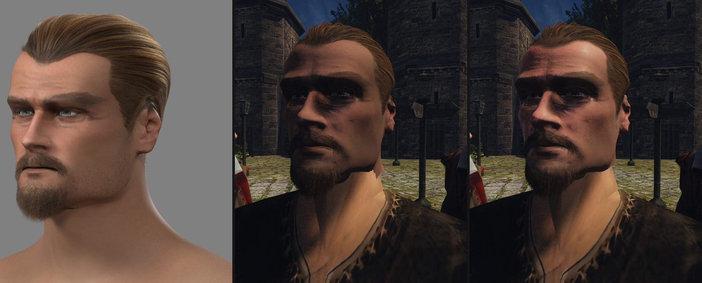
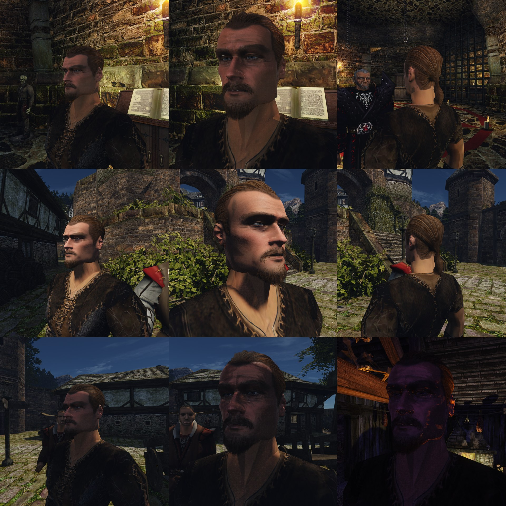
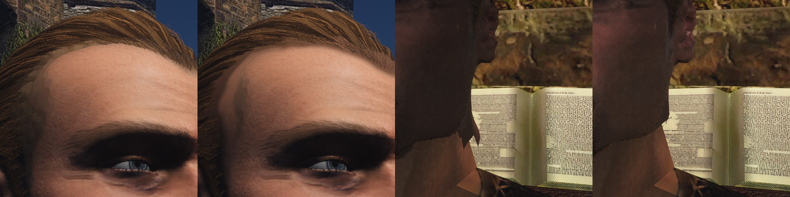
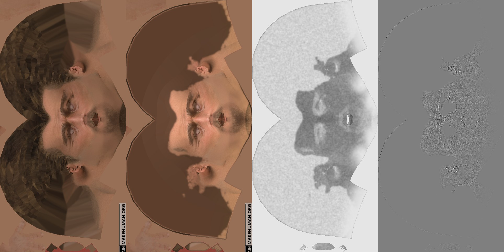

# Кожа головы в игре и стык с шеей

2026-11-11. Пользователь спросил, почему лицо в игре выглядит намного хуже рендера Cycles; [разбор](strands.md#почему-лицо-в-игре-хуже-рендера) назвал свет, чёрную тень движка, кожу без материала и голову темнее тела. На «чинить лицо?» пользователь ответил: «Да, кожу и стык». Здесь — шаг конвейера, который делает из карты цвета головы материал игры, и новый срез головы у шеи. Свет и экспозиция движка сюда не входят.

## Цель

Лицо героя на солнце и у факела читается кожей, а не матовой глиной, и голова сидит на шее тела без тёмной маски и без зубчатого края. Приёмка — глаз пользователя по кадрам стенда при трёх светах рядом с рендером Cycles. Ограничители: шея головы и шея тела на солнце — одного тона; блик не выгорает.

## Эталон: какая кожа на деле

| Что | Число | Источник |
|---|---|---|
| Цвет светлой кожи без света | sRGB (194, 150, 130), яркость 0,35 | патч «light skin» таблицы [ColorChecker](https://en.wikipedia.org/wiki/ColorChecker) |
| Цвет тёмной кожи | sRGB (115, 82, 68), яркость 0,10 | патч «dark skin», там же |
| Блик кожи | Specular 0,35 в шкале Unreal (отражение 2,8 % в лоб) | [Epic, Digital Humans](https://docs.unrealengine.com/4.26/Resources/Showcases/DigitalHumans) |
| Шероховатость | около 0,4, по зонам лица своя; зависит от расстояния, возраста, влажности | [Epic, Human Skin](https://dev.epicgames.com/documentation/unreal-engine/creating-human-skin-in-unreal-engine) |

Карта кожи героя 3a снята с модели генератора. Голая кожа на ней — (150, 100, 77), яркость 0,16: ближе к «тёмной коже» таблицы, чем к светлой, хотя герой светлокожий. В Cycles это не видно: три лампы светят сильнее, чем солнце в игре. Кожа тела оригинала (`HUM_BODY_NAKED_V8_C0`) — (181, 130, 93), яркость 0,27.

## Как делают другие

В Unreal у кожи отдельная модель света: два блика разной ширины, рассеяние под поверхностью, карта шероховатости по лицу и мелкая карта нормалей с порами поверх крупной. Рассеяния у нас нет ни в игре, ни в эталоне Cycles; оно — отдельный шаг движка, не этот.

## Что умеет движок

- У своего материала (`materials.json`) есть карта нормалей и карта ORM: затенение неба, шероховатость, металл. Блик — один, GGX, отражение 4 % в лоб.
- **Блик гаснет с шероховатостью**: полный до 0,5, ноль от 0,8. Запись с одной картой цвета получает шероховатость 1 — чистый Ламберт. Так и была освещена кожа.
- Тело оригинала — без записи: Ламберт без блика.
- Голова стоит на теле оригинала. Шеи у головы оригинала нет: её низ поднимается от подбородка к затылку, шея тела входит внутрь.

## Как сделано

**Материал кожи** — [`skin_material.py`](../../../scripts/content/npc/skin_material.py), numpy. Вход — карта цвета головы, сетка с развёрткой, опорные точки шаблона, текстура тела, срез головы. Рук нет.

- **Тон.** Кожа тела находится в его текстуре по цвету, голая кожа головы — на щеках у носа. Голова умножается на одно число, чтобы яркости сошлись: у героя 1,65. Оттенок лица остаётся своим.
- **Край.** В полосе 4,5 см вдоль кожи от среза цвет головы переходит в цвет тела: на самом срезе они равны. Полоса меряется по сетке, а не по высоте, поэтому на лицо не заходит.
- **Шероховатость** по зонам лица: 0,52 в целом, нос и лоб — 0,45–0,47, губы — 0,38. Нарисованные на коже волосы — матовые. У среза кожа матовая, как тело: блик не обрывается на стыке.
- **Нормали.** Складки — там, где в карте цвета тёмные линии: на 20 % темнее — на 0,1 мм глубже. Поры — шум 0,1–0,3 мм высотой 0,008 мм. Глаза и нарисованные волосы — без рельефа.
- **Кожа под волосами** (`--groom`). Модель генератора нарисовала на карте свои волосы. Под прядями они не нужны: в просветах читаются лоскутами текстуры. Там, где стоят корни прядей (ближе 1,5 мм), рисунок снят, на его месте кожа, затенённая в цвет волос у корней (`--under`, у героя (58, 40, 26)). Просвет в густых волосах читается глубиной, у линии роста тень сходит на нет. Зону бороды так же чистит `beard.py`.

Экспорт головы ([`export_test_head.py`](../2026-11-hero-head/mpfb/export_test_head.py)) берёт карты ключами `--skin-normal` и `--skin-orm` и пишет их в запись кожи.

**Срез головы.** Было: голова кончалась на уровне подбородка, и треугольники ниже него выбрасывались целиком. Это давало зубчатый край и кольцо шеи MPFB шириной 15–17 см вокруг шеи тела.
- Срез — плоскость, а не выбор треугольников: край ровный, формы мимики режутся вместе с сеткой.
- Плоскость — по низу головы оригинала: прямая через нижние углы её вида сбоку. У затылка срез на 3–4 см выше, чем у подбородка, как у оригинала.
- Плоскость пишется в `head.frame.json` (`cut`). По ней шаг кожи меряет полосу края, а [`groom_export.py`](../../../scripts/content/npc/hair/groom_export.py) не берёт волоски, чьи корни остались под срезом.

**Стенд** [`hair-light.bench`](../../../scripts/bench/hair-light.bench) снимает на рынке ещё и лицо, повёрнутое к солнцу: раньше солнце всегда стояло за спиной.

## Проба 1

Голова героя 3a с прядями; контент вне git: `~/.local/share/gothic-ai/content-tests/hero-head-3a-skin6`. Стенд `hair-light.bench`, Ryzen, 1920×1080, VSM. Кадры и клипы вне git: `~/.local/share/gothic-ai/remaster/npc-hair/skin/r3/`.









Числа: голова светлее в 1,65 раза; шероховатость по голове 0,33–0,90, у голой кожи медиана 0,53; наклон нормали — медиана 1,8°, 95 % до 4,2°. Срез: `up = 0,42 − 0,216·forward` см, 435 волосков с корнями под ним не взяты. Шаг кожи считает меньше минуты. Карты: цвет 4096² (11 МБ), нормали 4096² (22 МБ), ORM 1024² (0,7 МБ).

Что видно:
- на солнце и у факела лицо читается кожей: блик на лбу, носу и скулах, складки лба и у глаз;
- голова и шея тела — одного тона, тёмной маски нет;
- край головы ровный и идёт под челюстью; зубцов и кольца вокруг шеи нет;
- на виске и по линии роста под прядями — ровная тень, лоскутов текстуры нет.

## Что нашлось

- **Горизонтальный срез хуже зубчатого.** Первая правка резала голову плоскостью на уровне подбородка: зубцы ушли, но шея MPFB встала «полкой» шириной 15–17 см вокруг шеи тела. У головы оригинала шеи нет вовсе — срез пошёл по её низу.
- **Тёмные острые треугольники на лице — не пряди.** Без прядей они те же; с новой кожей остались. Они видны, когда солнце скользит по щеке. По коду причина — тень солнца: опорная глубина каждого отсчёта тянется вдоль плоскости треугольника, на который падает тень (`vsm_sun_shadow.glsl`, `planeN` из буфера глубины), и на выпуклой плотной сетке соседние треугольники дают разный ответ. Не проверено правкой: это общий код теней, ему нужен свой замер.
- **Плотность корней на карте — не счёт.** Тексели развёртки на затылке крупнее, чем на лице: счёт корней в текселе дал пятнистую подложку. Покрытие считается по расстоянию до ближайшего корня.
- **Поры под низким солнцем искрят.** При высоте 0,012 мм лоб у края тени шёл зерном; оставлено 0,008 мм.

## Что не сделано

- **Тень и экспозиция движка** — прежние: лицо в собственной тени тёмное, глазницы на солнце — провалы. Это свет всей игры, план графики.
- **Тёмные треугольники** на лице при скользящем солнце и **искры у свечи** — тени движка, см. выше.
- **Рассеяния под кожей нет.** Край тени на лице жёсткий.
- **Карта нормалей — не с плотной модели.** Складки взяты из рисунка карты цвета; морщины и надбровья с модели генератора — шаг 3 [конвейера](../../../docs/npc-pipeline.md#3-кожа).
- **Эталон Cycles не перерисован** с новой картой: при прежних лампах она пересветит кожу.
- Цвет тени под волосами задан числом, с концепта не снят. Тело героя — оригинал: со своим телом тон и край считаются так же, но не проверялись.
- На Mac не снималось; цена карт в памяти и в кадре не мерялась.

## Команды

```
W=~/.local/share/gothic-ai/mpfb/work; S=scripts/content/npc; C=<корень контента>; M=$W/skinmat3a/<круг>
B=~/.cache/gothic-ai/base/<отпечаток>/textures/HUM_BODY_NAKED_V8_C0.dds
python $S/skin_material.py $W/skinc3a/uv.npz $W/regc3a/groups.npz $W/regc3a/views.json $W/groom3a/f4/skin_shaved.png \
  $S/template_points.json $B $C/characters/hero/head.frame.json $M --groom $W/groom3a/g15/groom.npz
blender -b $W/probe.blend -P reports/content/2026-11-hero-head/mpfb/export_test_head.py -- $C --hero $W/regc3a/c1 $W/regc3a \
  $W/skin3a/eye_dark.png --skin $M/skin_game.png --skin-normal $M/skin_normal.png --skin-orm $M/skin_orm.png --brows $W/skin3a/brows_none.png
python $S/hair/groom_export.py $C/characters/hero/head.frame.json $W/skinc3a/uv.npz $W/regc3a/groups.npz <папка> \
  --hair $W/groom3a/g15/groom.npz --beard $W/groom3a/f4/beard_groom.npz
```

`head.frame.json` со срезом пишет экспорт головы, поэтому первый раз он идёт до шага кожи с любой картой.
