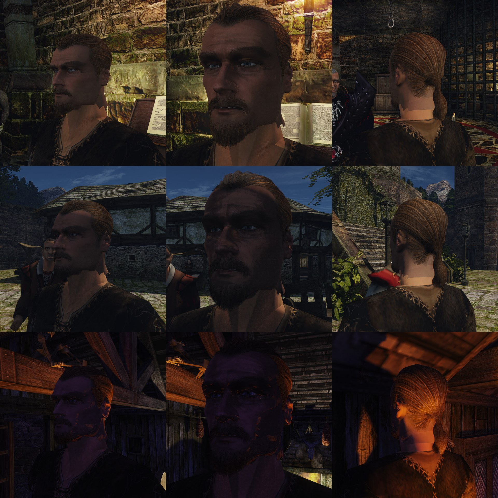
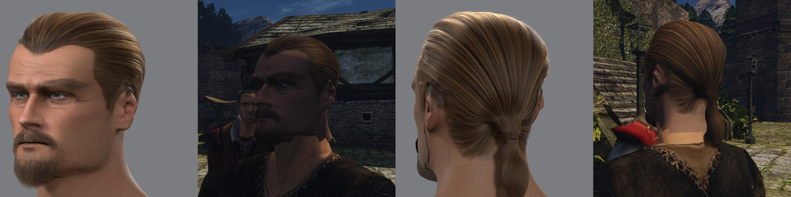
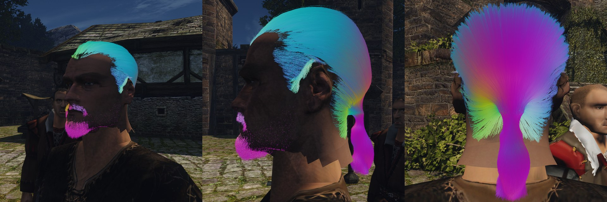

# Пряди в игре лентами

2026-11-11. Шаг 2 пути из [разбора](quality.md#что-предлагаю). Пользователь принял вид [причёски](groom.md) и [бороды](beard.md) в Cycles и сказал: «Да, пряди в игру». Здесь — как пряди попадают в движок и чем рисуются.

## Цель

Причёска и борода героя в игре — те же волоски, что в эталоне Cycles: каждый волос — лента, повёрнутая к камере, в общем G-буфере, со светом ламп, бликом волос и запечённым самозатенением. Приёмка — глаз пользователя по кадрам и клипам при трёх светах рядом с рендером Cycles. Ограничитель — цена кадра (`scripts/perf.sh face`), шаг 3.

## Что взято у других

Числа и источники — в [разборе](quality.md#как-сделано-в-играх-и-в-unreal). Для лент важно:
- **Лента не тоньше пикселя, покрытие — доля волоса в ней.** Волос 0,08 мм с полуметра — шестая часть пикселя. Frostbite и idTech растеризуют такие пряди своим compute-проходом; мы рисуем ленту шириной в пиксель и режем её покрытие хешированной альфой под TAA.
- **Уровни детализации — счётом прядей** (idTech): пряди лежат в случайном порядке, берётся начало списка, оставшиеся пряди толще.
- **Самозатенение запекается** в вершины (idTech): «без хорошего самозатенения волосы не читаются».

## Как сделано

**Экспорт** — [`groom_export.py`](../../../scripts/content/npc/hair/groom_export.py), numpy. Вход — пряди `groom.py` и `beard.py` и рамка головы, которую пишет экспорт головы (`head.frame.json`). Движок только рисует, поэтому всё считается здесь:
- **Счёт.** Длинные волосы перемешаны, взяты первые 40 тысяч из 80, каждый вдвое шире. Волос — 16 точек, короткий — 6, борода — 8, щетина — 3.
- **Нормаль поверхности причёски** в каждой точке: против градиента размытой плотности волос и головы. По ней свет считает волосы как поверхность причёски.
- **Самозатенение**: сколько света доходит до точки сквозь волосы над ней. Из точки идут пять лучей — по нормали и на 40° в стороны — и считают волосы на пути. Сетка плотности для этого не годится: миллиметр зачёсанных волос уже задерживает половину света.
- **Цвет** — полоска-рампа волос (`hair_ramp.png`): игра берёт цвет пряди по её оттенку.

Файл `head.groom`: группы прядей с одним числом точек; на точку 32 байта — место, направление пряди, полуширина, нормаль, свет и оттенок.

**Движок.**
- `characters.json` получает `"groom": "hero/head.groom"`. Загрузчик ([`groommesh.cpp`](../../../OpenGothic/common/graphics/mesh/groommesh.cpp)) делает из каждой точки две вершины на одном месте и кладёт целые пряди в мешлеты по 64 вершины. Сетка головы для этого не годится: у неё предел 65 тысяч вершин.
- Пряди — отдельный объект на кости головы (`MdlVisual::groom`), без физики и без структур трассировки.
- Материал — запись `materials.json` с `"strand": true` (флаг корзины `BK_STRAND`), `albedo` — рампа.
- **Вершинный шейдер** (`strandRibbon`, [`vertex_process.glsl`](../../../OpenGothic/shader/materials/vertex_process.glsl)) разводит две вершины поперёк пряди под прямым углом к направлению на глаз. Ширина — не меньше пикселя на этой глубине, покрытие — доля волоса в ней.
- **Фрагментный шейдер** ([`main.frag`](../../../OpenGothic/shader/materials/main.frag)) берёт цвет из рампы, покрытие режет хешированной альфой. В G-буфер идут нормаль поверхности причёски, бит волос, угол пряди и запечённый свет (`orm.r`). Направление пряди берётся по производным: вдоль ленты координата «край» не меняется.
- **Свет**: блик волос прежний ([шаги 3–4](README.md#шаги-34-как-сделано)); запечённый свет умножает солнце, лампы и небо (`hairShade`).
- **Тени.** Волос тоньше текселя карты теней, поэтому тень бросает доля прядей, выбранная по случайному числу пряди, лентами шириной 2 мм, повёрнутыми к свету. В проход заслонов (HiZ) пряди не идут.
- `OPENGOTHIC_GROOM_SHARE=0.25` — четверть прядей вчетверо шире: для замера цены и дальних голов.

Выключить: убрать `groom` из `characters.json`.

## Проба 1

Голова героя 3a без карточек и без оболочки бороды, с картой кожи без нарисованной бороды; контент вне git: `~/.local/share/gothic-ai/content-tests/hero-head-3a-strands1`. Стенд [`hair-light.bench`](../../../scripts/bench/hair-light.bench), Ryzen, 1920×1080, VSM. Клипы вне git: `~/.local/share/gothic-ai/remaster/npc-hair/strands/r1/`, рядом с карточками — `strands/compare/*-cards-vs-strands.mp4`.

58 898 прядей: 40 000 длинных волос (из 80 597, вдвое шире), 6 453 коротких, 6 194 бороды и усов, 6 251 щетины. 747 тысяч точек, 1,38 млн треугольников, 23 466 мешлетов, файл 24 МБ. Экспорт считает самозатенение 3,5 минуты.

Что видно:
- причёска, хвост, борода, усы и щетина в игре — волоски, как в эталоне: зачёс, золотистые пряди, тёмные просветы между локонами;
- свет ламп и солнца ложится на волосы, блик идёт вдоль прядей; у свечи со спины волосы светятся по краю;
- в игре волосы темнее и контрастнее эталона: в Cycles свет рассеивается внутри причёски, у нас это одно число (`hairShade`);
- швов и «налепленности» карточек нет: сравнение — в клипах `compare/`.

Что нашлось:
- **Знак направления пряди.** Первая проба писала направление от кончика к корню; отладочный вид (`OPENGOTHIC_HAIR_DEBUG=1`) показал это сразу: хвост и борода, которые смотрят вниз, были зелёными. После правки цвет течёт верно и без перевёрнутых пятен, которые были у карточек.

- **Сетка плотности не годится для самозатенения.** При ячейке 2,5 мм все волосы, кроме выбившихся, выходили чёрными: зачёсанные волосы плотнее, чем разрешает сетка. Счёт волос над точкой дал верхний слой светлым, глубину — тёмной.
- **Цвет рампы — не цвет Cycles.** В Cycles три числа — пигмент волоса, свет внутри причёски делает её светлее. В игре рампа — видимый цвет, поэтому она светлее и желтее.
- **Тень причёски на лбу** при солнце сверху крупными ступенями: это разрешение карты теней на лице, лента в карте теней шириной 2 мм.
- **Оранжевые искры на лице у свечи** были и с карточками: это тени лампы на сетке головы, не пряди.

## Что не сделано

- **Борода не следует мимике**: пряди жёстко сидят на кости головы. Когда герой говорит, бородка и усы не двигаются с губами и челюстью.
- Хвост не качается; шнурка на хвосте в игре нет (в Cycles он отдельной сеткой).
- Цена кадра не измерена; уровней детализации по расстоянию нет, только доля прядей вручную.
- На Mac не снималось.
