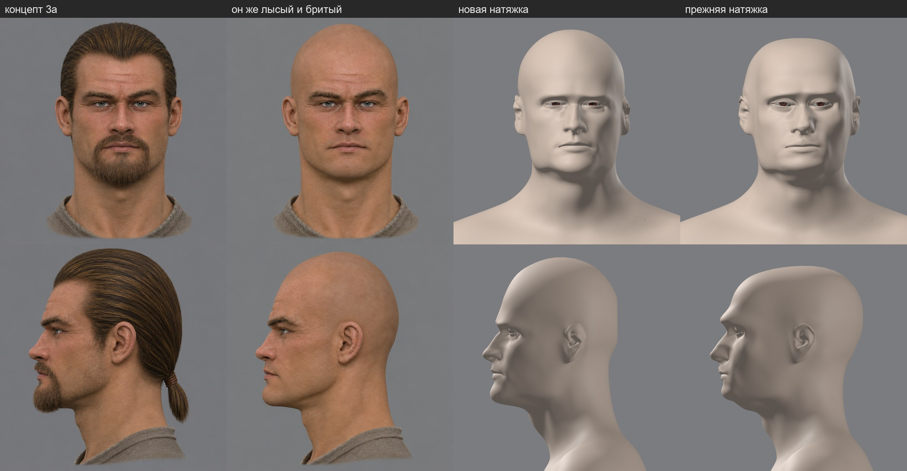
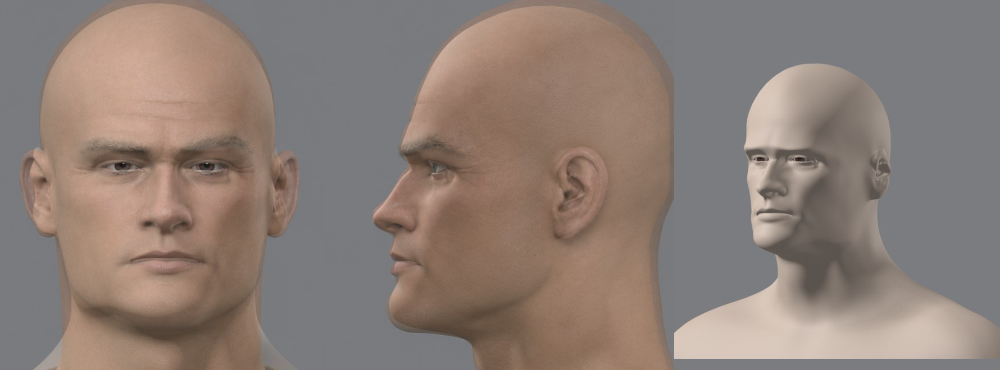
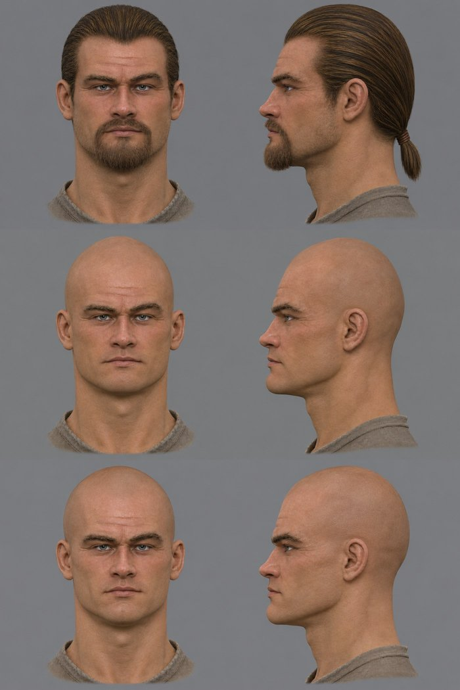
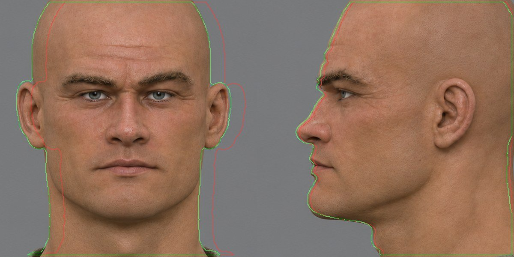
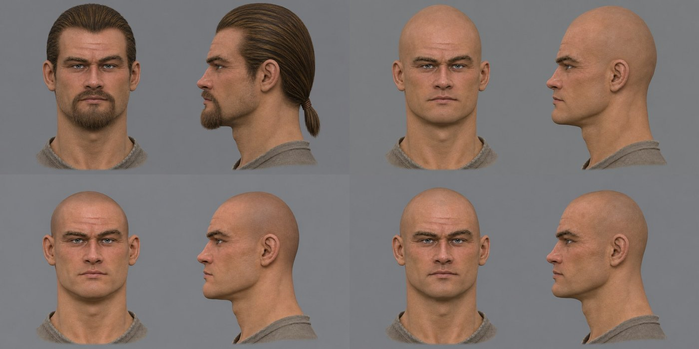
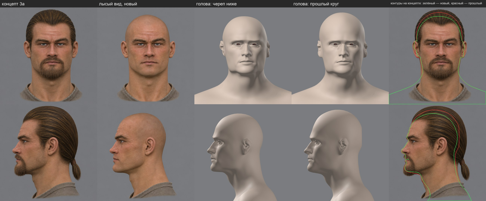

# Конвейер NPC: сквозной проход на герое 3a

План — [`docs/npc-pipeline.md`](../../../docs/npc-pipeline.md). Здесь — что сделано по этапу 0 и что при этом нашлось. Данные и круги лежат вне git, в `~/.local/share/gothic-ai/mpfb/work/regb3a/` и `~/.local/share/gothic-ai/remaster/hero-head/`.

## Форма лица: шаги 1–3 (2026-11-10)

Цель круга — голова героя по концепту 3a без ручных точек на лице. Принимает пользователь по листу на камере концепта.





### Шаг 1. «Лысые» виды

`image_gen` правит лист `ortho-3a`: убирает волосы, хвост, усы, бороду и щетину, остальное оставляет. Промпт — [`prompt3-bald.txt`](../2026-11-hero-head/concept/prompt3-bald.txt), два прогона.



Лицо, кадр и масштаб сохранились в обоих. Точки лица детектора между концептом и «лысым» видом расходятся в среднем на 0,9 и 1,1 мм — это шум самого детектора. Подбородок на «лысом» виде на 6 мм выше: столько добавляла борода. В работу взят первый прогон.

### Шаг 2. Плотная модель

Pixal3D по двум «лысым» видам, те же камеры и seed 1: 3,1 млн вершин, 153 с, окно на `dev-ubuntu` около трёх минут.

Нашлось: **генератор ставит модель по своим границам.** Голова без хвоста оказалась сдвинута на 13,5 мм вбок от концепта, прежняя полная модель — на 1,2–3 мм. [`place_ref.py`](../../../scripts/content/npc/place_ref.py) ставит модель по контурам двух видов концепта: один масштаб и сдвиг.



### Шаг 3. Натяжка

Шаблон — та же голова MPFB, что в круге r4. Решатель прежний, [`reg_solve.py`](../2026-11-hero-head/fit/reg/reg_solve.py), расписание [`sched9.json`](../2026-11-hero-head/fit/reg/sched9.json).

Что изменилось:
- **Данные по всей голове** (`"bald": true`): масок усов, бороды и линии волос нет, череп регистрируется целиком.
- **Точки лица ставит детектор** — MediaPipe Face Landmarker, [`face_points.py`](../../../scripts/content/npc/face_points.py). Цели собирает [`auto_targets.py`](../../../scripts/content/npc/auto_targets.py): веки — по цепочкам вершин края века шаблона, рот — по четырём точкам. Нос, брови и челюсть точек не получают: на лысой модели это обычная поверхность.
- Уши пока по ручным точкам круга r4: детектор ушей не даёт.

Что нашлось по дороге:
- **Нормали модели генератора смотрят внутрь на 42 % поверхности**, на макушке — на 75 %. Решатель сверял нормали со знаком и отбрасывал там данные; так считались и круги r1–r4. Со сверкой без знака кожа легла на модель в среднем в 0,17 мм, 95 % — до 1,1 мм (было 0,5 и 5,3 мм).
- **Прежняя голова держала надбровья на 6–11 мм впереди модели, а виски — до 3 см**: под масками волос данных там не было.
- **Генератор лепит глаза полузакрытыми**: раскрытие 2–3 мм против 7 мм на концепте. Разрез глаза берётся только с концепта.
- **Детектор на глиняном рендере ошибается на миллиметры**: на плотной модели он не нашёл глаз, на шаблоне обводит разрез на 3 мм шире края века с каждой стороны. Вершины шаблона по нему выбирать нельзя — рвётся губа. Поэтому на шаблоне детектор только меряет свою поправку.
- **Камера сверки стояла на глазах головы**, а натяжка их двигает (у 3a — на 6 мм назад). [`render_views.py`](../2026-11-hero-head/fit/render_views.py) теперь умеет стоять на точке шаблона.

### Числа

| Мерка | Новая натяжка | Прежняя (r4) |
|---|---|---|
| Контур анфас против «лысого» концепта: совпадение площадей | 0,930 | 0,903 |
| Контур профиля: совпадение площадей | 0,923 | 0,860 |
| Контур профиля: среднее расстояние | 3,0 мм | 7,1 мм |
| Вывернутые треугольники кожи | 70 | 38 |

Мерка по точкам лица на глиняном рендере круги не различает (2,0 против 2,1 мм в среднем): она заработает на рендере с кожей.

### Что не сделано и что видно

- Заплатка у внутреннего угла левого глаза и 70 вывернутых треугольников: кожа легла на морщины модели слишком плотно.
- Уши тоньше и площе, чем на концепте.
- Лицо концепта стоит на 1,4 мм левее оси головы, глаза сдвинулись несимметрично (−5,2 и +1,7 мм). Так на картинке; выравнивать ли — не решено.
- Формы мимики на новую голову не перенесены, в игру она не выгружалась.
- Цвет, волосы и борода — следующие шаги этапа 0.

## Череп под волосами (2026-11-10)

Пользователь отклонил форму: череп слишком высокий, он взят так, будто у волос нет объёма. Мерка это подтвердила — [`skull_check.py`](../../../scripts/content/npc/skull_check.py) сравнивает лысый вид с концептом: под причёской оставалось 3,4 мм сверху и 6 мм по бокам. Генератор картинок, убирая волосы, заполняет черепом контур причёски.

В промпт добавлено требование: волосы стоят над кожей на 1–1,5 см, череп заметно ниже и уже контура причёски, глаза — на середине высоты головы. Два новых прогона:



| Лысый вид | Череп над глазами к лицу под ними | Место под волосы: сверху / сбоку / сзади, мм | Точки лица от концепта, медиана |
|---|---|---|---|
| первый (прошлый круг) | 1,06 | 3,4 / 6,1 / 15,1 | 0,9 мм |
| третий | 0,85 | 28,5 / 11,4 / 32,9 | 1,5 мм |
| **четвёртый** | 0,92 | 20,9 / 11,2 / 33,6 | 0,8 мм |

Взят четвёртый. Вся цепочка от лысого листа до рендера головы прошла одним запуском, без правок руками.



Череп над глазами стал 104 мм вместо 118. Под причёской концепта у новой головы остаётся 26 мм сверху, 15 мм сбоку и 36 мм сзади. Кожа лежит на плотной модели в среднем в 0,16 мм, вывернутых треугольников 66.

Высота черепа теперь — ручка: лысый вид проверяется меркой до генерации модели, а нужный запас под волосы задаётся словами в промпте.

### Команды

```
W=~/.local/share/gothic-ai/mpfb/work; D=$W/regb3a; F=reports/content/2026-11-hero-head/fit; S=scripts/content/npc
PY=~/.local/share/gothic-ai/mpfb/venv/bin/python; MP=~/.local/share/gothic-ai/mpfb/venv-mp/bin/python

python $F/cutout.py bald.png views/view00_azim000.png 0 0 887; python $F/cutout.py bald.png views/view01_azim090.png 887 0 887
scripts/content/mesh3d/run-mesh3d.sh --model pixal3d --views views --seed 1 --min-free-mib 21000 --max-downtime 1500 --authorization <метка>
blender -b $W/fit3a/base/fit.blend -P $F/reg/reg_export.py -- raw.npz $F/params-3a.json $D
$PY $F/reg/concept_frame.py $D $F/params-3a.json front.png profile.png
$PY $S/place_ref.py $D
$MP $S/face_points.py $D/points concept_front=$D/concept_front.png tmpl_front=$D/lm_mpfb_front.png
$PY $F/reg/lm_pick.py $D $F/reg/picks-3a.json $F/reg/lm_fixed.json 5.8
$PY $S/auto_targets.py $D $D/lid_chains.json $D/points/concept_front.json $D/points/tmpl_front.json $D/lm_fixed.json $D/lm_fixed.json 5.8
$PY $F/reg/reg_solve.py $D $F/reg/sched9.json
```

Детектор живёт в отдельном окружении `venv-mp` (`uv pip install mediapipe`), модель `face_landmarker.task` (3,7 МБ) — в `~/.local/share/gothic-ai/models/mediapipe/`.
