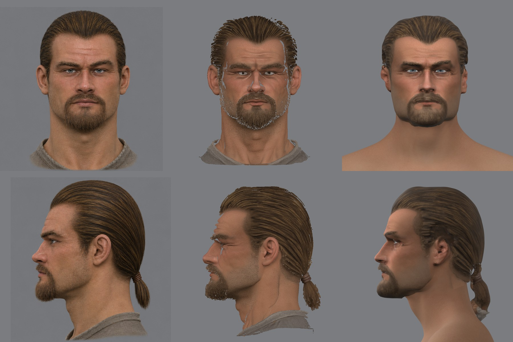
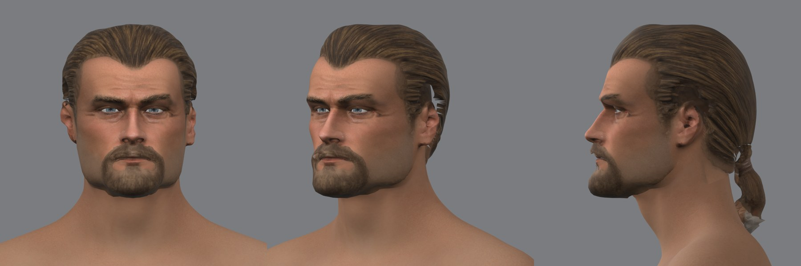
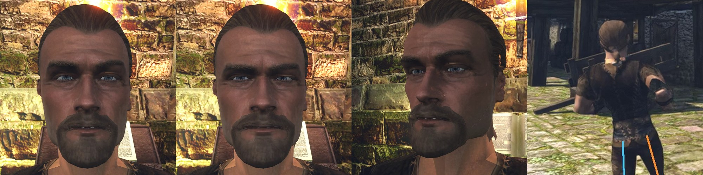

# Конвейер NPC: сквозной проход на герое 3a

План — [`docs/npc-pipeline.md`](../../../docs/npc-pipeline.md). Здесь — что сделано по этапу 0 и что при этом нашлось. Данные и круги лежат вне git, в `~/.local/share/gothic-ai/mpfb/work/regb3a/` и `~/.local/share/gothic-ai/remaster/hero-head/`.

## Форма лица: шаги 1–3 (2026-11-10)

Цель круга — голова героя по концепту 3a без ручных точек на лице. Принимает пользователь по листу на камере концепта.


### Шаг 1. «Лысые» виды

`image_gen` правит лист `ortho-3a`: убирает волосы, хвост, усы, бороду и щетину, остальное оставляет. Промпт — [`prompt3-bald.txt`](../2026-11-hero-head/concept/prompt3-bald.txt), два прогона.


Лицо, кадр и масштаб сохранились в обоих. Точки лица детектора между концептом и «лысым» видом расходятся в среднем на 0,9 и 1,1 мм — это шум самого детектора. Подбородок на «лысом» виде на 6 мм выше: столько добавляла борода. В работу взят первый прогон.

### Шаг 2. Плотная модель

Pixal3D по двум «лысым» видам, те же камеры и seed 1: 3,1 млн вершин, 153 с, окно на `dev-ubuntu` около трёх минут.

Нашлось: **генератор ставит модель по своим границам.** Голова без хвоста оказалась сдвинута на 13,5 мм вбок от концепта, прежняя полная модель — на 1,2–3 мм. [`place_ref.py`](../../../scripts/content/npc/place_ref.py) ставит модель по контурам двух видов концепта: один масштаб и сдвиг.


### Шаг 3. Натяжка

Шаблон — та же голова MPFB, что в круге r4. Решатель прежний, [`reg_solve.py`](../2026-11-hero-head/fit/reg/reg_solve.py), расписание [`sched9.json`](../2026-11-hero-head/fit/reg/sched9.json).

Что изменилось:
- **Данные по всей голове** (`"bald": true`): масок усов, бороды и линии волос нет, череп регистрируется целиком.
- **Точки лица ставит детектор** — MediaPipe Face Landmarker, [`face_points.py`](../../../scripts/content/npc/face_points.py). Цели собирает [`auto_targets.py`](../../../scripts/content/npc/auto_targets.py): веки — по цепочкам вершин края века шаблона, рот — по четырём точкам. Нос, брови и челюсть точек не получают: на лысой модели это обычная поверхность.
- Уши пока по ручным точкам круга r4: детектор ушей не даёт.

Что нашлось по дороге:
- **Нормали модели генератора смотрят внутрь на 42 % поверхности**, на макушке — на 75 %. Решатель сверял нормали со знаком и отбрасывал там данные; так считались и круги r1–r4. Со сверкой без знака кожа легла на модель в среднем в 0,17 мм, 95 % — до 1,1 мм (было 0,5 и 5,3 мм).
- **Прежняя голова держала надбровья на 6–11 мм впереди модели, а виски — до 3 см**: под масками волос данных там не было.
- **Генератор лепит глаза полузакрытыми**: раскрытие 2–3 мм против 7 мм на концепте. Разрез глаза берётся только с концепта.
- **Детектор на глиняном рендере ошибается на миллиметры**: на плотной модели он не нашёл глаз, на шаблоне обводит разрез на 3 мм шире края века с каждой стороны. Вершины шаблона по нему выбирать нельзя — рвётся губа. Поэтому на шаблоне детектор только меряет свою поправку.
- **Камера сверки стояла на глазах головы**, а натяжка их двигает (у 3a — на 6 мм назад). [`render_views.py`](../2026-11-hero-head/fit/render_views.py) теперь умеет стоять на точке шаблона.

### Числа

| Мерка | Новая натяжка | Прежняя (r4) |
|---|---|---|
| Контур анфас против «лысого» концепта: совпадение площадей | 0,930 | 0,903 |
| Контур профиля: совпадение площадей | 0,923 | 0,860 |
| Контур профиля: среднее расстояние | 3,0 мм | 7,1 мм |
| Вывернутые треугольники кожи | 70 | 38 |

Мерка по точкам лица на глиняном рендере круги не различает (2,0 против 2,1 мм в среднем): она заработает на рендере с кожей.

### Что не сделано и что видно

- Заплатка у внутреннего угла левого глаза и 70 вывернутых треугольников: кожа легла на морщины модели слишком плотно.
- Уши тоньше и площе, чем на концепте.
- Лицо концепта стоит на 1,4 мм левее оси головы, глаза сдвинулись несимметрично (−5,2 и +1,7 мм). Так на картинке; выравнивать ли — не решено.
- Формы мимики на новую голову не перенесены, в игру она не выгружалась.
- Цвет, волосы и борода — следующие шаги этапа 0.

## Череп под волосами (2026-11-10)

Пользователь отклонил форму: череп слишком высокий, он взят так, будто у волос нет объёма. Мерка это подтвердила — [`skull_check.py`](../../../scripts/content/npc/skull_check.py) сравнивает лысый вид с концептом: под причёской оставалось 3,4 мм сверху и 6 мм по бокам. Генератор картинок, убирая волосы, заполняет черепом контур причёски.

В промпт добавлено требование: волосы стоят над кожей на 1–1,5 см, череп заметно ниже и уже контура причёски, глаза — на середине высоты головы. Два новых прогона:


| Лысый вид | Череп над глазами к лицу под ними | Место под волосы: сверху / сбоку / сзади, мм | Точки лица от концепта, медиана |
|---|---|---|---|
| первый (прошлый круг) | 1,06 | 3,4 / 6,1 / 15,1 | 0,9 мм |
| третий | 0,85 | 28,5 / 11,4 / 32,9 | 1,5 мм |
| **четвёртый** | 0,92 | 20,9 / 11,2 / 33,6 | 0,8 мм |

Взят четвёртый. Вся цепочка от лысого листа до рендера головы прошла одним запуском, без правок руками.


Череп над глазами стал 104 мм вместо 118. Под причёской концепта у новой головы остаётся 26 мм сверху, 15 мм сбоку и 36 мм сзади. Кожа лежит на плотной модели в среднем в 0,16 мм, вывернутых треугольников 66.

Высота черепа теперь — ручка: лысый вид проверяется меркой до генерации модели, а нужный запас под волосы задаётся словами в промпте.

## Цвет, волосы и борода, голова в игре (2026-11-10)

Пользователь принял высоту черепа. Этим кругом сквозной проход закрыт: голова героя 3a собрана всеми семью шагами и стоит в игре. Цель круга — не качество, а список слабых мест по шагам.







### Что сделано

Инструменты лежат в [`skin/`](../2026-11-hero-head/skin/) заметки головы; первые два круга по коже — в [`skin.md`](../2026-11-hero-head/skin.md).

- **Полная модель встала на новую голову.** Голова натянута на лысую модель, а цвет, волосы и борода берутся с полной. `place_ref.py` ставит полную модель на концепт тем же способом: масштаб 0,989 и сдвиг на 1,7–2 мм. После этого лоб двух моделей расходится в среднем на 0,8 мм, нос и щёки — на 1,1 мм.
- **Тон модели приведён к концепту** — [`tone_ref.py`](../2026-11-hero-head/skin/tone_ref.py). Цвет в вершинах модели темнее и насыщеннее картинки, с которой она сделана: лоб 166/109/85 против 184/126/104. По виду спереди подбирается кривая на каждый канал.
- **Цвет кожи** — [`bake_ref.py`](../2026-11-hero-head/skin/bake_ref.py): тексель берёт цвет ближайших точек модели. Полоса глаз и бровей берётся с концепта, вид спереди: генератор лепит глаза полузакрытыми, а веки головы натянуты по линиям век концепта.
- **Борода** — [`beard_shell.py`](../2026-11-hero-head/skin/beard_shell.py). На бритом подбородке борода полной модели стоит над кожей на 5 мм в среднем и до 12 мм, краской её силуэт не взять. Оболочка — копия треугольников кожи низа лица, вынесенная на поверхность бороды лучами из середины челюсти; край режется прозрачностью. Выгрузка привязывает оболочку к коже: она идёт за 50 формами мимики.
- **Волосы** — прежний `hair_cut.py`: шапка и хвост, жёсткая часть.
- **Выгрузка** — `export_test_head.py` с ключами `--hair` и `--beard`. Формы мимики и моргание переносятся сдвигами, как у прежней головы.

### Числа

| Мерка | Значение |
|---|---|
| Цвет на листе, концепт / наша голова: лоб | 189/132/110 и 191/134/107 |
| щека | 165/110/85 и 160/108/86 |
| борода | 93/68/50 и 89/70/55 |
| Карта кожи | 4096 px, на голову 3,0 млн текселей, 75 % взято с модели, остальное заполнено от соседей |
| Борода | 509 вершин, 846 треугольников, 50 форм |
| Волосы | 9 453 вершины, 18 220 треугольников |
| Голова в игре | `head.glb` 7,4 МБ, 9 частей, 67 форм лица |

### Слабые места по шагам

Это и есть итог этапа 0. Больше всего брака дают шаги 5 и 4.

| Шаг | Что плохо | Чем лечится |
|---|---|---|
| 1. Концепт | Лысый вид заполняет черепом контур причёски | запас под волосы в промпте и `skull_check.py` — сделано |
| 2. Плотная модель | Глаза полузакрыты; низ бороды не вылеплен и закрашен тенью; волосы — рваная слоёная оболочка; цвет темнее концепта; нормали в обе стороны; модель стоит по своим границам | разрез глаз и полоса глаз — с концепта; тон и постановка — сделано; волосы и борода с модели годятся только как временные |
| 3. Натяжка | Уши тоньше и площе концепта и стоят по ручным точкам; заплатка у внутреннего угла левого глаза; формы мимики перенесены сдвигами | этап 2 (уши) и этап 1 (перенос деформации) |
| 4. Кожа | В цвете остался свет концепта: тени под бровями, носом и губой. Полоса глаз читается чуть темнее лица, у висков виден её край. Карты нормалей нет. Шея головы и тело оригинала разного цвета, шов виден | этап 3: цвет без света, нормали, общий тон шеи и тела |
| 5. Волосы и борода | Шапка волос — шлем с размазанной текстурой, за ушами разрывы, у кончика хвоста серые пятна рубахи, 18 тысяч треугольников. Борода — мягкая оболочка с тёмным низом и жёстким краем | этап 4: шейдер волос и библиотека карточек |
| 6. Сборка | Девять команд руками. Волосы отличаются от кожи по цвету, пороги сняты с этой модели: для чёрных, светлых и седых волос они не подойдут | этап 5; волосы и бороду отделять по форме — там, где полная модель стоит над лысой |
| 7. В игре | Под факелом лицо темнее и серее, чем в Blender; борода плоская | шейдеры кожи и волос |

Находка для шага 6: тёмный низ бороды цветовой порог принял за серую рубаху, и борода обрывалась на подбородке. Разница двух моделей — лысой и полной — отделяет волосы без порогов по цвету; это следующий способ.

## Команды

Форма:

```
W=~/.local/share/gothic-ai/mpfb/work; D=$W/regb3a; F=reports/content/2026-11-hero-head/fit; S=scripts/content/npc
PY=~/.local/share/gothic-ai/mpfb/venv/bin/python; MP=~/.local/share/gothic-ai/mpfb/venv-mp/bin/python

python $F/cutout.py bald.png views/view00_azim000.png 0 0 887; python $F/cutout.py bald.png views/view01_azim090.png 887 0 887
scripts/content/mesh3d/run-mesh3d.sh --model pixal3d --views views --seed 1 --min-free-mib 21000 --max-downtime 1500 --authorization <метка>
blender -b $W/fit3a/base/fit.blend -P $F/reg/reg_export.py -- raw.npz $F/params-3a.json $D
$PY $F/reg/concept_frame.py $D $F/params-3a.json front.png profile.png
$PY $S/place_ref.py $D $F/params-3a.json raw.npz front.png profile.png
$MP $S/face_points.py $D/points concept_front=$D/concept_front.png tmpl_front=$D/lm_mpfb_front.png
$PY $F/reg/lm_pick.py $D $F/reg/picks-3a.json $F/reg/lm_fixed.json 5.8
$PY $S/auto_targets.py $D $D/lid_chains.json $D/points/concept_front.json $D/points/tmpl_front.json $D/lm_fixed.json $D/lm_fixed.json 5.8
$PY $F/reg/reg_solve.py $D $F/reg/sched9.json
```

Детектор живёт в отдельном окружении `venv-mp` (`uv pip install mediapipe`), модель `face_landmarker.task` (3,7 МБ) — в `~/.local/share/gothic-ai/models/mediapipe/`.

Цвет, волосы, борода и выгрузка (`K` — папка круга, `R=$W/regc3a` — натяжка, `F3=$W/regf3a` — постановка полной модели, `RAW` — `raw.npz` полной модели):

```
H=reports/content/2026-11-hero-head; M="--place $F3/place.json --tone $F3/tone.json"
$PY $S/place_ref.py $F3 $H/fit/params-3a.json $RAW front_ref.png profile_ref.png   # ref.npz полной модели, views.json и кадры концепта с волосами
$PY $H/skin/tone_ref.py $R/views.json $H/fit/params-3a.json $RAW front_ref.png $F3/tone.json --place $F3/place.json
blender -b $R/c1/reg.blend -P $H/skin/dump_uv.py -- uv.npz
$PY $H/skin/beard_shell.py uv.npz $R/groups.npz $R/views.json $H/fit/params-3a.json $RAW $K 1024 $M
$PY $H/skin/bake_ref.py uv.npz $R/groups.npz $R/views.json $H/fit/params-3a.json $RAW <кожа MPFB>.png $K 4096 $M \
  --offsets $K/beard.npz --front front_ref.png $R/lid_chains.json
$PY $H/skin/hair_cut.py $R/views.json $H/fit/params-3a.json $RAW $K 2048 $M
blender -b $R/c1/reg_sub.blend -P $H/skin/render_skin.py -- $R/views.json $K/skin.png $K s \
  $K/hair.npz $K/hair.png $K/beard.npz $K/beard.png --eye eye.png
$PY $H/skin/likeness.py $R/views.json $H/fit/params-3a.json $RAW front_ref.png profile_ref.png $K $K/likeness.jpg $M
blender -b $W/probe.blend -P $H/mpfb/export_test_head.py -- <каталог контента> --hero $R/c1 $R eye.png \
  --skin $K/skin.png --brows brows_none.png --hair $K/hair.npz $K/hair.png --beard $K/beard.npz $K/beard.png
TEMPEST_WINDOW_SIZE=1920x1080 BENCH_HOST=ryzen OPENGOTHIC_CONTENT=<каталог контента> \
  scripts/bench.sh scripts/bench/hero-head.bench <папка клипов>
```
