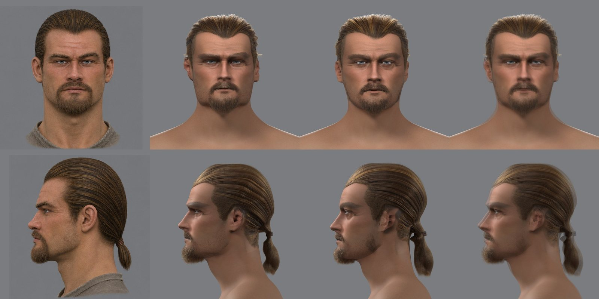
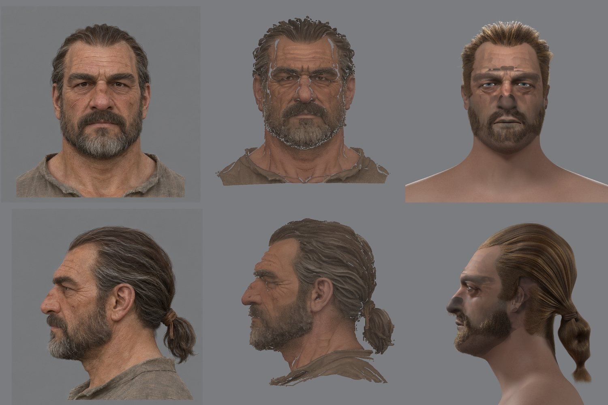
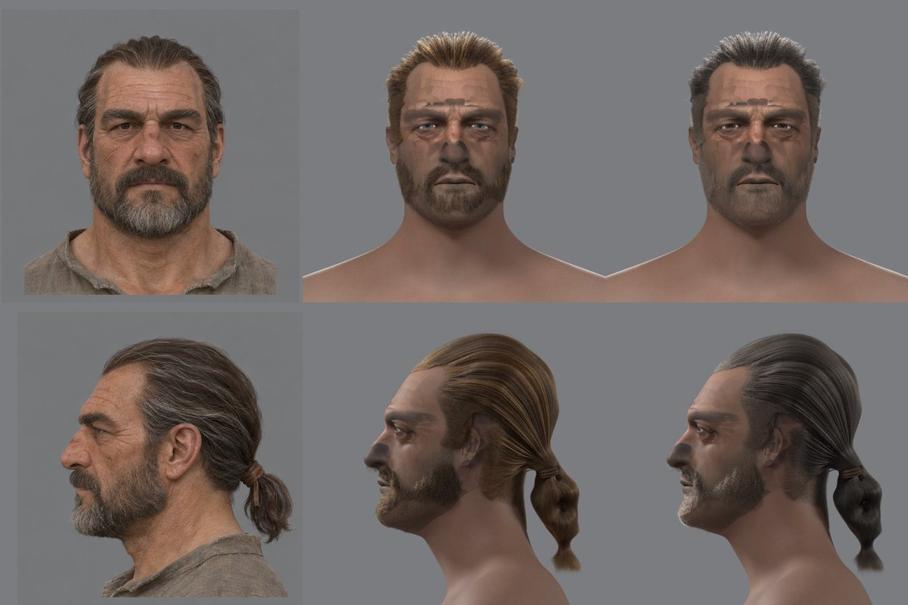

# Сборка головы одной командой

2026-11-12. Этап 5 [конвейера NPC](../../../docs/npc-pipeline.md#5-сборка-одной-командой). Пользователь спросил, когда голова с телом будет получаться по фото автоматически, и выбрал начать со сборки головы одной командой.

## Цель

Вход — папка концепта: лист с видами спереди и сбоку, тот же лист «лысым» и короткий `npc.json`. Выход:
- голова в каталоге контента;
- строка в `characters.json`;
- пряди;
- лист сверки с концептом на одной камере;
- мерки брака в `measures.json`.

Всё делает одна команда. Сбой шага останавливает сборку и называет шаг с причиной. Повторный запуск пропускает готовые шаги, если их входы не менялись.

Приёмка — тремя кругами:
- **А. Повтор 3a.** Команда собирает голову 3a из её папки. Ручные файлы круга пока допускаются (`params-3a.json`, `picks-3a.json`). Мерки должны совпасть с принятой головой: контур, складки, расстояние до модели, цвет на листе.
- **Б. 3a без ручных файлов.** Параметры кадра, точки профиля и уши ставятся сами. Мерки — не хуже круга А в пределах шума: совпадение контуров не ниже на 0,01, контур профиля не дальше на 0,5 мм. Лист сверки видит пользователь.
- **В. Второе лицо.** Новый концепт через `image_gen`, генерация плотной модели на `dev-ubuntu` (одно окно видеокарты, его разрешает пользователь), голова в игре. Пользователь судит по листу и клипу. Список брака по шагам решает, что делать дальше.

## Цепочка сейчас

Шаги этапа 0 и волос запускались по одному, около тридцати команд ([этап 0](README.md#команды), заметки [прядей](../2026-11-npc-hair/groom.md#команды), [бороды](../2026-11-npc-hair/beard.md#команды), [кожи](../2026-11-npc-hair/skin.md#команды), [бровей](../2026-11-npc-hair/brows.md#команды)).

| Шаг | Скрипты | Что задано руками или только для 3a |
|---|---|---|
| Кадры концепта | `cutout.py`, `skull_check.py` | квадраты обрезки — числами в команде |
| Плотные модели | `run-mesh3d.sh` (Pixal3D) | окно видеокарты — метка разрешения на каждый запуск |
| Заготовка MPFB | `fit_head.py` | `params-3a.json`: пол, возраст, 27 подобранных форм, глаза в пикселях концепта, центры обрезки |
| Натяжка | `reg_export`, `concept_frame`, `place_ref`, `face_points`, `lm_pick`, `eye_lines`, `auto_targets`, `reg_solve`, `head_relief`, `head_outline`, `reg_apply`, `subsurf`, `blink_build` | `picks-3a.json`: уши и средняя линия профиля руками |
| Полная модель | `place_ref`, `place_face`, `tone_ref` | — |
| Кожа | `dump_uv`, `beard_layer`, `bake_ref`, `skin_material`, `brow_paint` | пороги цвета кожи сняты с 3a |
| Волосы | `hair_layer`, `groom`, `beard` | причёска одна — зачёсанная в хвост; линия роста и край бороды — по цвету карты кожи |
| Выгрузка | `export_test_head.py`, `groom_export.py` | только герой: пишет `hero/head.glb` и затирает `characters.json` |
| Сверка | `render_skin`, `likeness` | — |

## Что нужно сделать, кроме склейки

- **Параметры кадра без рук.** Глаза и межзрачковое расстояние — по точкам детектора на виде спереди; глаз в профиле — по силуэту и высоте глаз спереди; центры обрезки — по рамке головы на листе. Пол и возраст — из `npc.json`. Подобранные формы не нужны: форму даёт натяжка.
- **Точки профиля без рук.** Кончик носа, основание носа, переносица и надбровье лежат на силуэте профиля, их можно найти по его изгибам. Уши детектор не даёт. Сначала сравнить натяжку без точек ушей с прежней, затем решить.
- **Волосы и борода — по разнице лысой и полной моделей, а не по цвету.** Это находка этапа 0: пороги 3a не подойдут к чёрным, светлым и седым волосам.
- **Выгрузка любого NPC:** имя экземпляра, своя папка, дописывание в `characters.json`.
- **Причёска.** `groom.py` умеет одну причёску — хвост. Для другого лица это будет главный брак до библиотеки причёсок; на круге В концепт с хвостом или короткими волосами покажет, где предел.

## Как будет устроено

`scripts/content/npc/build_head.py <папка концепта> --content <каталог> [--work <папка>]`. Шаги — список с явными входами и выходами. Каждый пишет в свою папку рабочего каталога метку с отпечатком входов, аргументов и текста скриптов; совпала — шаг пропускается. Генерация плотной модели берётся из кэша по отпечатку видов; если кэша нет, команда останавливается и просит метку окна (`--gpu-authorization`).

Сделано: [`build_head.py`](../../../scripts/content/npc/build_head.py) — 21 шаг, `--list` их печатает, `--from <шаг>` и `--only <шаг>` перезапускают. Кадр без рук — [`auto_params.py`](../../../scripts/content/npc/auto_params.py), мерки — [`head_measures.py`](../../../scripts/content/npc/head_measures.py). Без `picks` цели натяжки — веки и рот (`auto_targets.py --no-hand`) и край ушей (`ear_points.py`). Без `mesh` плотные модели берутся из кэша `work/build/_mesh` по отпечатку видов или генерируются: `--gpu-authorization <метка>` запускает `run-mesh3d.sh` дважды (полная и лысая) и забирает `raw.npz` с `dev-ubuntu`. Лист любой ширины дополняется фоном до двух квадратов.

Кадр концепта без рук:
- глаза и масштаб — зрачки детектора на виде спереди, среднее полного и лысого листов;
- глаз в профиле — на высоте глаз спереди; по глубине — так, чтобы линия лица шаблона от 5 мм под глазом до 10 мм над ним легла на линию лысого концепта. Детектор на профиле глаз не находит: промах около 25 px. По всему силуэту совмещать нельзя: затылок шаблона на 2 см длиннее;
- центр плотной модели — середина рамки видов, которые видел генератор. Дальше её уточняет `place_ref.py`.

## Круги А и Б: голова 3a



Мак, M1 Pro. Сборка с нуля — 14 минут: кожа — 4–7 минут, пряди — 2–3, лист в Cycles — 1,5. Повторный запуск без правок — секунды.

| Мерка | Принятая голова | А, ручные файлы | Б, без них |
|---|---|---|---|
| Кожа от лысой модели, медиана / 95 %, мм | 0,163 / 1,11 | 0,16 / 1,12 | 0,16 / 0,96 |
| Вывернутые треугольники кожи | 66 | 78 | 48 |
| Точки лица от концепта на листе, медиана, мм | — | 2,4 | 1,5 |
| глаза / брови | — | 0,5–0,8 / 0,6–0,9 | 0,3–0,7 / 0,5–1,7 |
| губы / нос / челюсть | — | 3,2–4,3 / 2,9 / 6,5 | 2,6–2,9 / 1,4 / 8,6 |

Что видно:
- **А повторяет принятую голову.** Рендер с прядями от прежнего не отличить на глаз. Срез шеи в игре сдвинут на 0,8 мм. Опорных точек 18 вместо 14: средняя линия профиля из ручного файла, в принятом круге её не было.
- **Б не хуже А.** Детектор дал межзрачковое расстояние на 2 % меньше ручного, поэтому голова на 2 % крупнее. Глаз в профиле стал на 5,8 мм ближе к лицу, потому что у шаблона без подобранных форм ниже надбровье. Натяжка это выбрала.
- Челюсть у Б дальше от концепта (8,6 мм): без ручных точек ушей и подобранных форм низ лица шире. На листе это заметно мало.
- Брови на нашем рендере темнее и плотнее концепта в обоих кругах — так было и у принятой головы.

## Круг В: второе лицо (2026-11-12)

Пользователь разрешил окно видеокарты. Лицо своё, без опоры на картинку: портовый работник лет пятидесяти. Тёмные волосы с проседью собраны в короткий хвост, полная короткая борода с сединой на подбородке, нос сломан. Хвост оставлен намеренно: другой причёски `groom.py` не знает. Новые для сборщика здесь цвет волос, борода, возраст и форма лица.

Концепт — два прогона `image_gen`, промпты и листы лежат вне git, в `~/.local/share/gothic-ai/remaster/npc-face2/`:
- первый лист вышел тесным: волосы и кончик хвоста касались краёв. Во втором в промпт добавлены поля вокруг головы;
- лысый лист — правка второго. Запас под волосы 15,6 / 12,5 / 36 мм (у 3a 21 / 11 / 34). Лицо сохранено.

Сборка — одна команда с `--gpu-authorization`. Генерация двух плотных моделей заняла 8 минут: два окна видеокарты, сервисы `dev-ubuntu` вернулись сами. Вся сборка — 28 минут, первая попытка запекания кожи — 25 минут (Mac был занят), вторая — 8.



| Мерка | 3a, круг Б | Второе лицо |
|---|---|---|
| Кожа от лысой модели, медиана / 95 %, мм | 0,16 / 0,96 | 0,17 / 1,16 |
| Вывернутые треугольники кожи | 48 | 89 |
| Точки лица от концепта, медиана, мм | 1,5 | 2,3 |
| брови / губы / челюсть, мм | 0,5–1,7 / 2,6–2,9 / 8,6 | 1,9–2,7 / 2,6–4,4 / 11,5 |

Что нашлось по шагам. Форма лица, нос и борода узнаются; цвет испорчен.

| Шаг | Брак | Причина | Чем лечится |
|---|---|---|---|
| Сборщик | Падал на выгрузке: у второго лица были свои возраст и вес | Выгрузка садит голову на тело пробника MPFB и сверяет его ниже шеи | Исправлено: тело всегда пробника, `npc.json` с другим телом отклоняется сразу. Варианты тела — этап 1 |
| Сборщик | Генератор видел вид 887 px, масштаб модели был зашит под 3a | — | Исправлено: масштаб — от размера вида |
| Волосы | Рыжие вместо тёмных с проседью; у бороды нет седины | Шкала цвета прядей зашита под 3a в `groom_export.py` и `groom_render.py` | Исправлено: цвет каждой пряди и шкала — с концепта (раздел ниже) |
| Глаза | Голубые вместо карих | Одна карта глаза для всех, `eye_dark.png` | Исправлено: радужка перекрашена в цвет концепта |
| Кожа | Тёмные пятна на лбу, у глаз и носа | Полная модель стояла на 15 мм выше головы: [ошибка сборщика](shape.md#ошибка-сборщика-модель-со-сдвигом) | Исправлено: шаги `reg` и `full` не берут модель прошлого запуска |
| Кожа | Тёмная полоса от виска к щеке | В цвет попали волосы модели | Этап 3: волосы от кожи — по разнице лысой и полной моделей |
| Натяжка | В фасе голова ниже глаз уже концепта на 15–22 мм: малые уши, узкая челюсть | Веса натяжки подобраны под 3a, ушей без ручных точек ничто не держит | Исправлено: [вся лысая голова — данные, уши по автоматическим точкам](shape.md#шаг-2-натяжка-по-всей-лысой-голове-сделано-2026-11-12) |
| Хвост | Тремя «сосисками», в полтора раза длиннее концепта | Рамка хвоста с числами 3a взяла половину хвоста и рубаху за ним | Исправлено: [хвост находится по форме и режется по шнуру](shape.md#шаги-4-и-5-волосы-и-борода-слоем-между-головой-и-полной-моделью-2026-11-13) |
| Волосы | Причёска тоньше концепта на 3–10 мм, плоская | Полная модель стояла мимо головы; слой прядей рос от любого края маски | Исправлено: [слой между головой и полной моделью, пряди его заполняют](shape.md#шаги-4-и-5-волосы-и-борода-слоем-между-головой-и-полной-моделью-2026-11-13) |
| Борода | Редкая, на щеках щетина | Отступы бороды завышены сдвигом модели, «борода или щетина» решалась по одной толщине | Исправлено: [слой над кожей и плотность покрытия](shape.md#шаги-4-и-5-волосы-и-борода-слоем-между-головой-и-полной-моделью-2026-11-13); спереди у губ объём теряет сам генератор |
| Челюсть | Шире концепта (11,5 мм по точкам детектора) | Без точек ушей и подобранных форм низ лица держится только поверхностью | Исправлено шагами 2 и 3 переноса формы: 3,5 мм |
| Форма | Голова в профиль на 2 мм меньше лысого концепта, низ подбородка выше на 4 мм, нижняя губа на 2–5 мм позади | Кадр постановки обрезал темя и затылок; грани крупной сетки черепа режут под моделью; генератор сгладил подбородок и губу | Исправлено: [постановка по целым видам и проход по контуру концепта](shape.md#шаг-3-голова-по-контуру-концепта-2026-11-13) |
| Лицо | Сглажены носогубные и межбровные складки, надбровье; глаза открыты на 5,3 мм вместо 6,6; радужка 12,4 мм вместо 10,4 | Натяжка перекрывает складки у́же граней; веки ставились по разнице двух чтений детектора; радужка шаблона одна на всех | Исправлено: [рельеф модели в вершины и карту нормалей, веки и радужка по концепту](likeness.md) |

### Цвет волос, бороды и глаз из концепта

Новый шаг сборки `colour` (`concept_colours.py`) стоит после бороды. Он снимает цвет с листа концепта и раскладывает его по прядям, а не задаёт одну шкалу на всех.

- **Где волосы на виде.** На фасе — где полный лист отличается от лысого и пиксель похож на волосы. Лысый профиль — другая генерация и на полный не ложится, поэтому на профиле волосы узнаются только по виду. «Похож» — голос 15 ближайших пикселей фаса по яркости, цветности и текстуре. Край маски отрезан на 4 px: цвет размыт на 2,5 px, и в последних пикселях волос сидит кожа.
- **Цвет пряди.** Три точки пряди проецируются на фас и профиль. Фас видит то, что смотрит на него, профиль — бок и затылок. Точка рядом с волосами, но на коже, берёт ближайший пиксель волос в пределах 4 мм: кромка причёски лежит на несколько миллиметров внутри кромки концепта. Цвет сглаживается по соседям в 6 мм. Короткие волоски у кромки и щетина лежат на коже по замыслу, поэтому своей пробы у них нет: они берут цвет ближайших волос или бороды. Так же поступает прядь, чей цвет похож на кожу этого концепта: такая проба задела ухо или шею.
- **Шкала.** Пряди ранжируются по яркости. Ранг пряди — её место на шкале, плюс немного прежнего разброса прядей. Шкала — цвета этих рангов. Волосы и борода делят одну шкалу, поэтому седина висков и подбородка остаётся на своих местах.
- **Яркость.** Вид концепта — это цвет волоса, умноженный на свет и тень волос над ним, а рендер и игра освещают пряди ещё раз. Усиление 1,2 выбрано так, чтобы рендер Cycles второго лица совпал с концептом по яркости волос головы: при 1,0 рендер даёт 0,91 яркости концепта, при 1,6 — 1,16. Принятая голова 3a в 1,5 раза светлее своего концепта: её шкалу подбирали на глаз.
- **Пигмент для Cycles.** Волос Cycles светлее своего пигмента: свет рассеивается внутри. Яркость переводится подгонкой по двум ручным шкалам 3a. Оттенок не трогается: подгонка по каналам переносила золото 3a на седину, и края бороды выходили золотыми.
- **Радужка.** Центр и кольцо радужки берутся по точкам детектора 468–477 на полном и лысом фасе. Цвет — медиана среднего кольца под верхним веком, без бликов. Радужка карты глаза перекрашивается в этот цвет, рисунок шаблона остаётся яркостью. У 3a выходит серый (70, 69, 66), у второго лица — карий (56, 40, 28).



Чем проверено — рендер второго лица против концепта на одной камере (`sheet/likeness.jpg`) и сводка `colour/colour.jpg`: концепт, пряди в новых цветах, шкала, радужка. После сборки яркость волос головы на рендере — 0,96 от концепта (было 1,07, но рыжим). Пересборка с шага цвета заняла 12 минут: кожа и голова пропущены по отпечаткам, пряди для игры — 8 минут.

## Что не сделано

- **Лысый лист** делает `image_gen` до сборки, вне команды.
- **Запекание кожи долгое** на модели с плечами: модель не обрезается до головы перед поиском ближайших точек.
- **Выгрузка — только `PC_HERO`.** `export_test_head.py` пишет `hero/head.glb` и материалы `OWN_HERO_HEAD_*`.
- **Причёска одна — хвост.** У другого лица она будет главным браком до библиотеки причёсок.
- **Линия роста волос и край бороды — по цвету карты кожи.** Объём волос и бороды уже берётся слоем между головой и полной моделью ([шаги 4 и 5](shape.md#шаги-4-и-5-волосы-и-борода-слоем-между-головой-и-полной-моделью-2026-11-13)), а где у края растут тонкие волосы, решают пороги цвета 3a в `groom.py` и относительный цвет в `beard.py`.
- **Срез у шеи виден, борода реже концепта** — [проверка второго лица в игре](likeness.md#в-игре-2026-11-13). Кожа головы на солнце исправлена: [разбор](../2026-11-npc-hair/skin-sun.md).
- **Шея** — шаг 6 [заметки о переносе формы](shape.md#способ). Контур лысой головы уже лежит на концепте ([шаг 3](shape.md#шаг-3-голова-по-контуру-концепта-2026-11-13)).
- **Форма причёски — с модели, а не с концепта.** У генератора волосы шире по бокам и площе сзади, чем на концепте; контур с волосами — в 2,1–2,4 мм от концепта.
- **Волосы модели в цвете кожи** — тёмная полоса от виска к щеке: этап 3.
- **Голова 3a не пересобрана с новым цветом.** Её концепт даёт шкалу темнее принятой (усиление выбрано по второму лицу) и серые глаза вместо голубых. Пересобрать её и показать — отдельный шаг.
- Отпечаток большого файла (больше 4 МБ) — размер и время, а не содержимое. Перезапуск шага поэтому перезапускает всё после него, даже если файл вышел тем же.

## Журнал

- 2026-11-12 — план; круги А и Б на голове 3a пройдены.
- 2026-11-12 — круг В: второе лицо собрано одной командой, с генерацией моделей, за 28 минут. Форма узнаётся, цвет волос, глаз и кожи — нет: шкала волос и карта глаза зашиты под 3a. Сборщик теперь сам генерирует модели (`--gpu-authorization`), принимает лист любой ширины и держит тело пробника.
- 2026-11-12 — цвет из концепта: шаг `colour` (`concept_colours.py`). Цвет каждой пряди снимается с фаса и профиля, шкала строится по этим цветам, радужка перекрашивается в цвет концепта. У второго лица волосы тёмные с проседью, седина на подбородке, глаза карие. `groom_export.py` и `groom_render.py` принимают шкалу (`--ramp`).

- 2026-11-12 — [перенос формы](shape.md): на втором лице измерено, где уходит форма. Найдена ошибка сборщика: повторный запуск шага ставил на концепт модель прошлого запуска, и волосы, борода и цвет кожи ложились на 15 мм выше головы. Исправлено, коробка обрезки модели расширена назад, второе лицо пересобрано; мерки формы считает `shape_report.py`.
- 2026-11-12 — шаг 2 переноса формы: натяжка тянет к лысой модели всю кожу головы, ткань отделяется по цвету, уши ставятся по точкам края, которые находит `ear_points.py`; причёска не ложится на уши. Ширина второго лица в фасе — в 0–2,4 мм на сторону от модели на всех высотах.
- 2026-11-13 — шаги 4 и 5 переноса формы: полная модель ставится на голову по лицу и контуру волос (`place_face.py`), волосы и борода — слой между головой и полной моделью (`hair_layer.py`, `beard_layer.py`), хвост находится по форме, пряди заполняют слой. Контур второго лица с волосами — в среднем в 2,2–2,3 мм от концепта вместо 4,6–6,9. Сборщик получил шаг `shape` — лист и мерки формы.
- 2026-11-13 — шаг 3 переноса формы: обе модели ставятся на концепт по контурам целых видов (`place_ref.py`, `place_face.py`), новый шаг `outline` (`head_outline.py`) кладёт грани на модель и контур головы на контур концепта. Шагов 20. Контур лысой головы — в 0,45–0,6 мм от концепта вместо 1,3–1,7; пересборка второго лица с шага `outline` — 44 минуты на загруженном Mac, из них 24 — запекание кожи.
- 2026-11-13 — [складки и глаза](likeness.md): шаг `relief` (`head_relief.py`) переносит рельеф лысой модели в вершины, остаток идёт в карту нормалей; веки ставятся по линиям, прочитанным с концепта (`eye_lines.py`), радужка — по его размеру; лист сверки снимается при свете концепта. Шагов 21.
- 2026-11-13 — [второе лицо в игре](likeness.md#в-игре-2026-11-13): сценарий стенда `npc-head-look`; рельеф в карте нормалей давал блики на морщинах, шероховатость кожи теперь растёт с рельефом (`skin_material.py`).

## Команды

```
PY=~/.local/share/gothic-ai/mpfb/venv/bin/python
$PY scripts/content/npc/build_head.py <папка концепта с npc.json> [--content <каталог контента>]
$PY scripts/content/npc/build_head.py <папка> --list          # шаги
$PY scripts/content/npc/build_head.py <папка> --from skin     # с шага, остальное по отпечаткам
$PY scripts/content/npc/shape_report.py <рабочая папка сборки>  # лист и мерки формы по шагам: shape/shape.jpg, shape.json; последний шаг сборки делает это сам
```

Папки кругов вне git: `~/.local/share/gothic-ai/content-sources/npc/hero-3a{,-auto}/npc.json`, работа — `~/.local/share/gothic-ai/mpfb/work/build/`.
