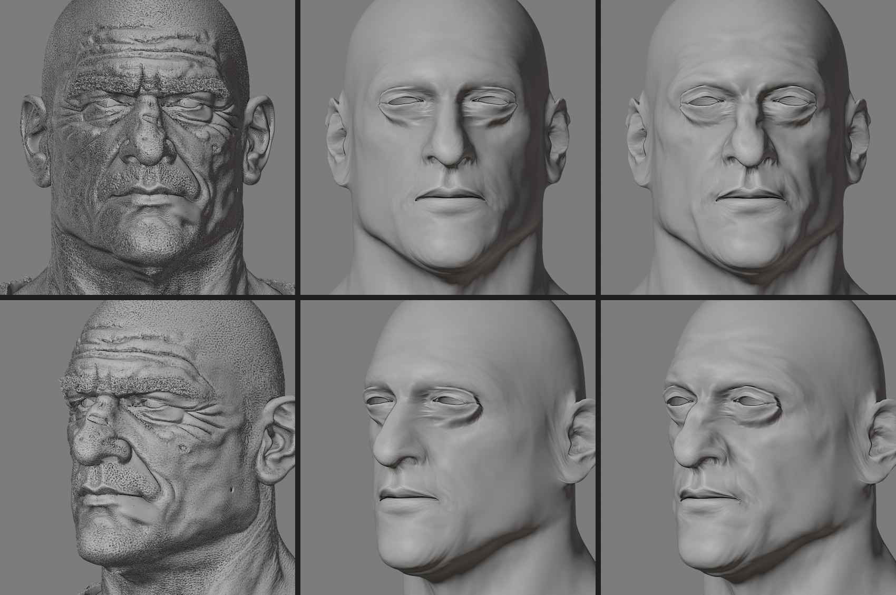
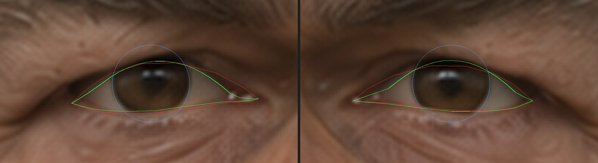
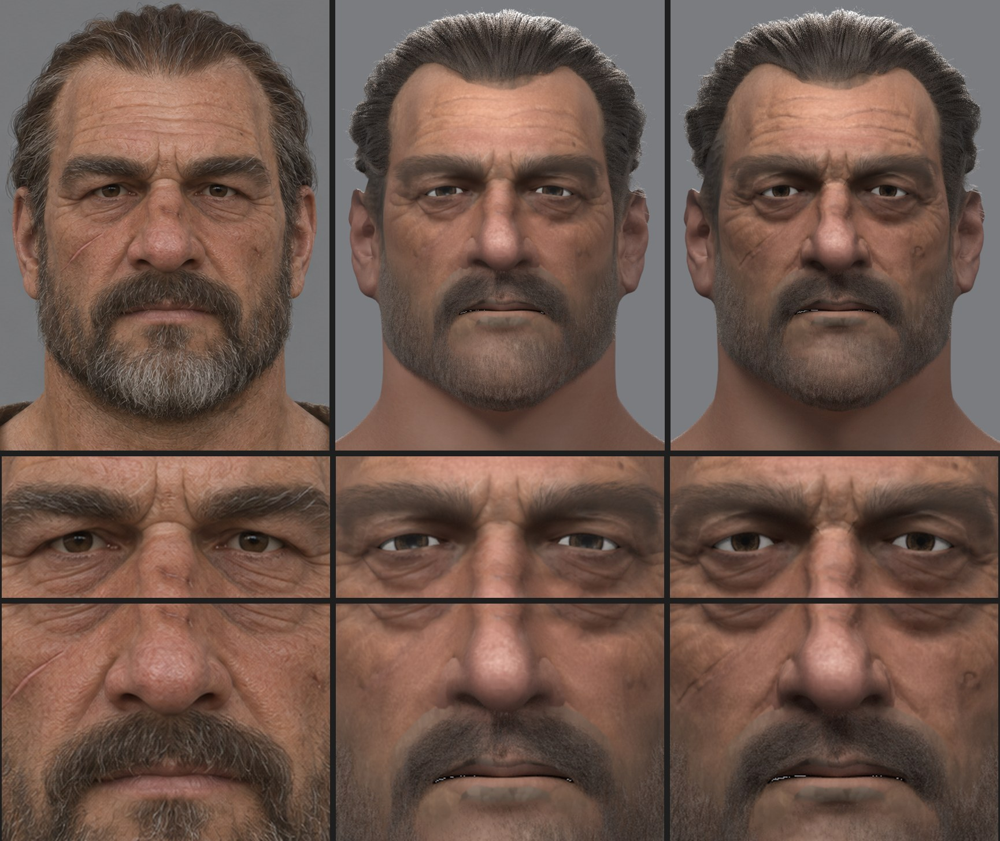
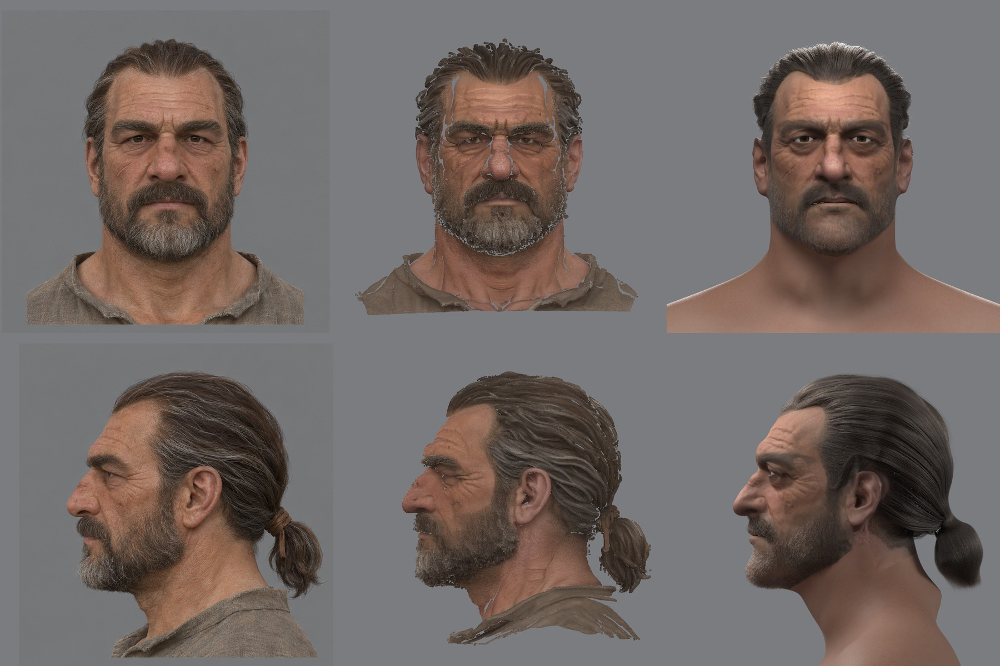
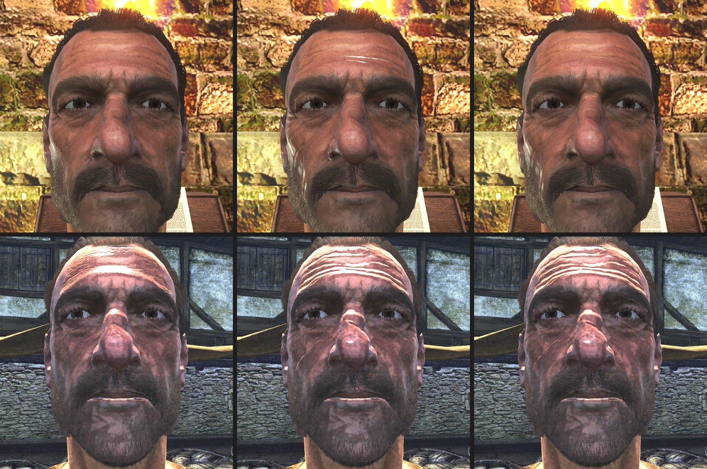
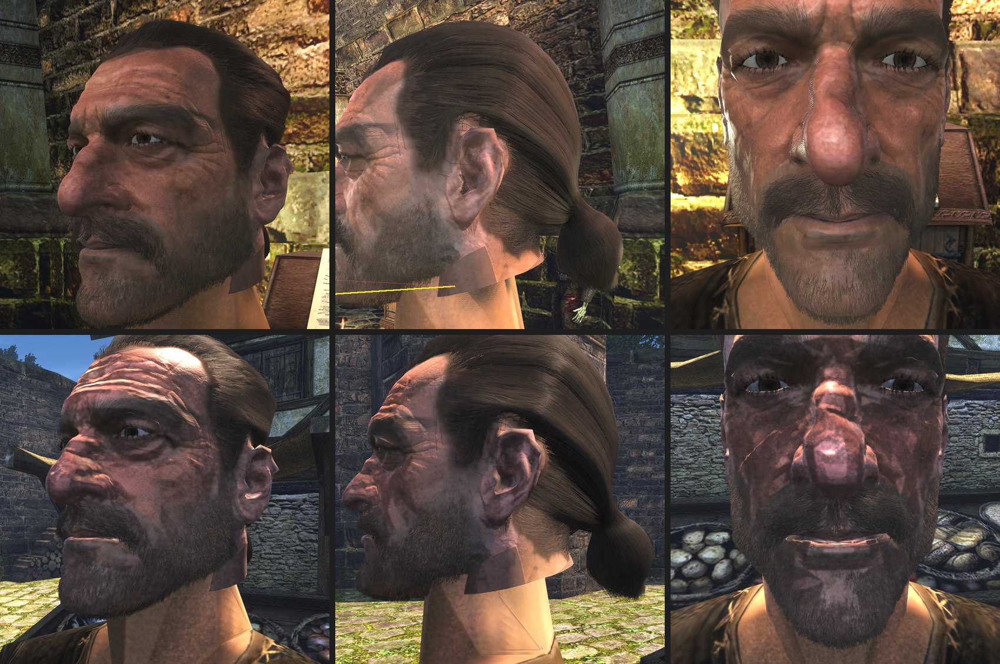
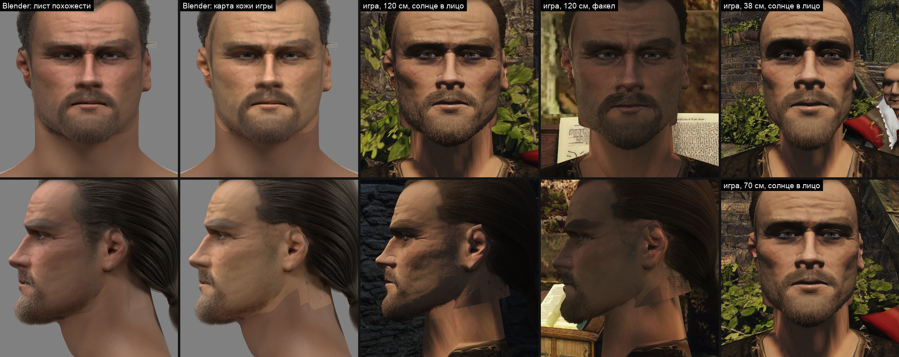
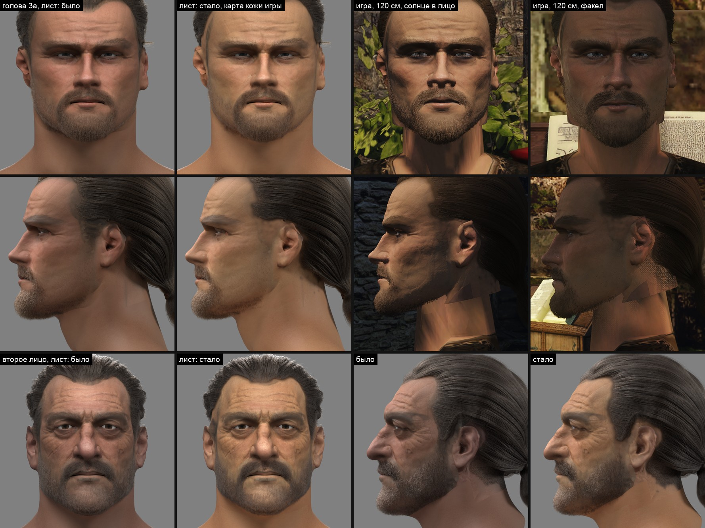
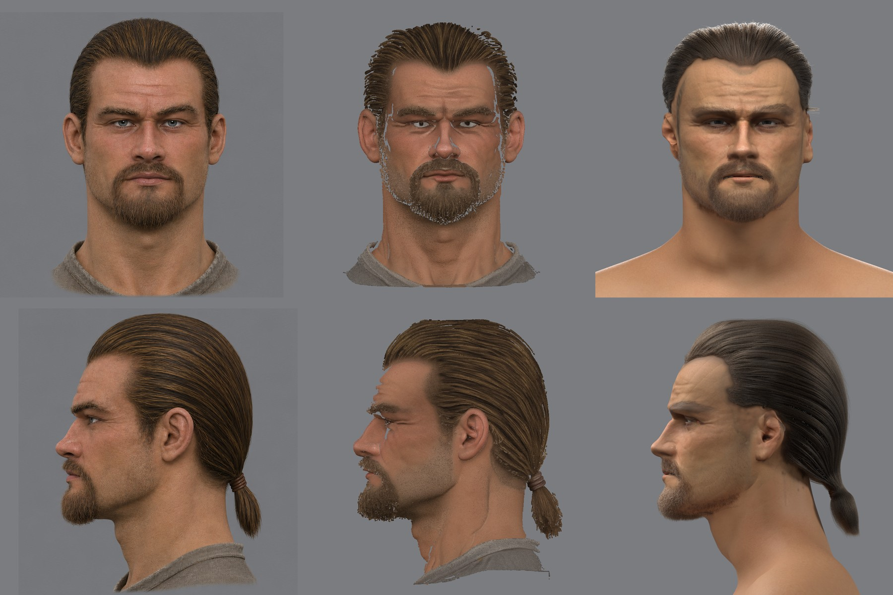

# Похожесть после переноса в 3D: складки и глаза

Заметка к [конвейеру NPC](../../../docs/npc-pipeline.md), продолжение [переноса формы](shape.md). Проверено на втором лице (`face2`).

## Что увидел пользователь

2026-11-13, по листу сверки «концепт | наша голова»: после переноса в 3D похожесть заметно теряется. Пропадают черты лица и мимики: носогубные складки, размер зрачков, форма глаз, прищур.

Замеры контура это не ловили: контур лысой головы лежит на концепте в пределах 0,6 мм, а лицо внутри контура — другое.

## Что измерено

| Черта | Концепт | Плотная модель | Наша голова до правки |
|---|---|---|---|
| Раскрытие век у радужки | 6,6 и 6,9 мм | глаза полузакрыты, не источник | 5,3 мм по сетке, щель с острыми углами |
| Диаметр радужки | 10,4 мм | — | 12,4 мм |
| Носогубная складка | видна | глубже поверхности головы на 2–3 мм | сглажена |
| Плотная модель над поверхностью головы, среднее по модулю | — | — | 0,50 мм; 95 % точек — до 1,5 мм |
| То же у носогубной складки | — | — | 0,59 мм; 95 % — до 2,1 мм |
| Надбровье, межбровные складки, складки у углов рта | видны | есть в геометрии | сглажены |

Размеры — в масштабе кадра концепта (61,5 мм между зрачками). Раскрытие и радужку концепта читает [`eye_lines.py`](../../../scripts/content/npc/eye_lines.py), рельеф — [`head_relief.py`](../../../scripts/content/npc/head_relief.py).

*Слева плотная лысая модель генератора, в середине голова после натяжки, справа она же после переноса рельефа в вершины. Один свет, без цвета.*

## Причины

**1. Натяжка смотрит только от головы к модели.** `reg_solve.py` просит каждую вершину головы лечь на ближайшую точку модели. Над складкой у́же грани ближайшая точка модели — её берег, поэтому голова перекрывает складку мостом. Замер «вершины на модели, медиана 0,16 мм» при этом честный: вершины действительно лежат на модели. Обратный замер, от точек модели к граням головы, показывает потерю: 0,50 мм в среднем, складки — 2–3 мм.

**2. Карта нормалей не знала о модели.** `skin_material.py` делал складки из тёмных линий цвета кожи, до 0,15 мм глубиной. Под бородой цвет кожи закрашен ровным тоном (`beard.py`), поэтому носогубных складок там не было ни в цвете, ни в нормалях. Лист сверки рисовался вообще без рельефа кожи.

**3. Детектор лица читает почти один и тот же глаз, что бы ни было нарисовано.**

| Картинка | Раскрытие на самом деле | Читает детектор |
|---|---|---|
| Концепт | 7,0 мм по картинке | 6,7 и 6,0 мм |
| Глиняный рендер шаблона | 7,6 мм по сетке | 9,0 мм |
| Рендер нашей головы | 5,3 мм по сетке | 6,2 мм |

`auto_targets.py` двигал веки на разницу двух чтений, концепта и шаблона: 7,6 − (9,0 − 6,7) = 5,3 мм. Прищур концепта превратился в узкую щель. Замер `face_mm` в `measures.json` той же ошибки не видел: он сравнивал два чтения того же детектора.

**4. Радужка шаблона одного размера для всех.** Карта глаза MPFB перекрашивалась в цвет концепта, а размер не трогался: 12,4 мм против 10,4 мм на концепте. Из-за узкой щели и крупной радужки белок оставался двумя яркими треугольниками по бокам.

## Как это решают другие

- **Перенос деталей после натяжки** — обычный шаг в R3DS Wrap и ZWrap: сетку подразделяют, проецируют на скан, а разницу запекают в карту смещения или нормалей. Ловушка та же, что у нас: проекция по ближайшей точке сглаживает узкие складки, поэтому проецируют со стороны скана или по нормали.
- **Глаза** в таких конвейерах ставят руками или по разметке, а не по детектору лица: его контур века — оценка по модели лица. Размер радужки берут с фотографии.

## Способ

1. **Рельеф модели в вершины** — шаг `relief` сборщика после `solve`, [`head_relief.py`](../../../scripts/content/npc/head_relief.py). Каждая точка лысой модели находит своё место на гранях головы и высоту над ним по нормали грани. Вершины сдвигаются по нормалям так, чтобы грани в среднем приняли эти высоты. Складка между двумя рядами вершин становится настоящей складкой. Проход заменил первую половину `head_outline.py` (грани на модель): тот смотрел от головы к модели.
2. **Контур концепта после рельефа.** `head_outline.py` получает голову шага `relief` (`--reg`) и двигает её плавно, вместе со складками.
3. **Остаток рельефа в карту нормалей.** То, что мельче граней, `head_relief.py` пишет в `samples.npz`: места на гранях и высота модели над ними. `skin_material.py --relief` кладёт эти высоты в развёртку и добавляет к высоте карты нормалей. Берётся рельеф шире полумиллиметра (мельче — зерно генератора) и без того, что меняется на сантиметрах. Та же высота идёт бугром в рендер листа сверки (`groom_render.py --height`).
4. **Веки по самой картинке** — [`eye_lines.py`](../../../scripts/content/npc/eye_lines.py). Верхнее веко читается над белком по обе стороны радужки: верх того, что бледнее и холоднее кожи вокруг глаза. Над радужкой его не прочитать (тёмная радужка сливается с ресницами), там линия — кривая через обе стороны. Нижнее веко — контур детектора, сдвинутый туда, где под радужкой картинка светлеет. `auto_targets.py` берёт высоту середины века с этих линий, а не из разницы двух чтений детектора; у концов цепочки вершин остаётся прежнее правило.
5. **Радужка по размеру концепта.** `concept_colours.py` стягивает карту глаза к зрачку: диаметр радужки на концепте делится на 12,45 мм — диаметр, который тот же замер даёт на рендере шаблона. Зрачок сохраняет свою долю радужки.

Не двигаются рельефом: веки и кожа у глаз (у модели глаза полузакрыты), брови слабее остального (на модели это волосы), уши и кожа в 12 мм от них, точки рта, кожа у ворота.

## Приёмка

Глазом пользователя по листу сверки «концепт | модель | наша голова» и по крупным планам глаз и середины лица. Числа — ограждения, не приёмка:

- раскрытие век по сетке против концепта — в пределах 0,5 мм;
- диаметр радужки на рендере против концепта — в пределах 0,5 мм;
- плотная модель над гранями головы у носогубной складки — 95 % точек в пределах 1 мм;
- контур лысой головы против концепта не хуже прежнего (0,62 мм в фасе, 0,47 мм в профиле).

Числа пишет шаг `measures` в `measures.json`: разделы `relief` и `eyes`.

## Что сделано (2026-11-13)

- [`head_relief.py`](../../../scripts/content/npc/head_relief.py) — шаг `relief` сборщика между `solve` и `outline`. Три прохода по 1,85 млн точек модели, 7 секунд.
- [`head_outline.py`](../../../scripts/content/npc/head_outline.py) берёт голову шага `relief` (`--reg`). Его проход «грани на модель» теперь почти ничего не двигает (медиана 0,01 мм): эту работу сделал рельеф.
- [`skin_material.py`](../../../scripts/content/npc/skin_material.py) `--relief` — рельеф модели в карте нормалей и `skin_height.png` для листа сверки.
- [`eye_lines.py`](../../../scripts/content/npc/eye_lines.py) — линии век, круг и цвет радужки с картинки; лист проверки `reg/eyes.jpg`.
- [`auto_targets.py`](../../../scripts/content/npc/auto_targets.py) — высота середины века по линиям концепта.
- [`concept_colours.py`](../../../scripts/content/npc/concept_colours.py) — радужка в карте глаза по размеру концепта.
- [`groom_render.py`](../../../scripts/content/npc/hair/groom_render.py) `--height`, `--light portrait` — рельеф кожи бугром и свет концепта в листе сверки.
- [`head_measures.py`](../../../scripts/content/npc/head_measures.py) — разделы `relief` и `eyes` в `measures.json`. Раскрытие нашей головы берётся с сетки, а не с рендера.
- Сборщик: 21 шаг.

*Зелёным — линии век по картинке, красным — контур детектора, синим — круг радужки. По зелёным линиям ставятся веки головы.*

### Два решения по виду

- **Рельеф в карте нормалей — вполовину высоты модели.** Те же морщины уже есть в цвете кожи тёмными линиями: это свет концепта, запечённый в цвет модели. В полную высоту обе записи вместе читались как трещины.
- **Лист сверки снимается при свете концепта** (`--light portrait`). Ключевой свет поднят с 30° до 45° над горизонтом и стал шире, небо слабее, блик глаза — как в игре (F0 0,02). При прежнем свете брови не затеняли глаза, белки светились, а на тёмной радужке лежала серая пелена неба: карие глаза выходили серыми. Рендеры волос вне сборщика идут с прежним светом.

## Что получилось

*Слева концепт, в середине голова до правки, справа после. Средняя снята при прежнем свете листа, правая — при свете концепта.*

| Мерка | Было | Стало | Концепт |
|---|---|---|---|
| Раскрытие век по сетке, правый и левый глаз | 5,3 и 5,1 мм | 6,5 и 6,5 мм | 7,1 и 6,4 мм по полному виду; 6,6 и 6,9 по лысому |
| Диаметр радужки на рендере | 12,4 мм | 10,4 и 10,2 мм | 10,5 и 10,3 мм |
| Цвет радужки на рендере, sRGB | (98, 74, 65) | (55, 41, 31) | (55, 39, 27) |
| Модель над гранями головы, всё лицо: среднее по модулю / 95 % точек | 0,50 / 1,51 мм | 0,28 / 0,83 мм | — |
| То же у носогубной складки | 0,59 / 2,09 мм | 0,33 / 0,97 мм | — |
| То же на надбровье | 0,59 / 1,99 мм | 0,43 / 1,37 мм | — |
| Контур лысой головы против концепта, фас / профиль | 0,62 / 0,47 мм | 0,63 / 0,46 мм | — |
| Наклон нормалей кожи в карте игры: 95 % / 99 % текселей головы | 3,1° / 5,6° | 6,1° / 14,1° | — |
| Шероховатость открытой кожи в карте игры, медиана | 0,52 | 0,57 | — |
| Точки детектора лица, медиана | 1,6 мм | 1,6 мм | — |
| Вывернутые треугольники кожи / согнутые больше 60° | 50 / 144 | 62 / 184 | — |

Цвет радужки сошёлся из-за света листа, а не из-за карты: цвет в карте глаза прежний.

Вершины сдвинулись на 0,19 мм по медиане, 95 % — до 1,2 мм, самая дальняя — на 3,1 мм у крыла носа. Вывернутых треугольников стало больше на 12, три из них — у угла рта, где модель даёт глубокую ямку.

## В игре (2026-11-13)

Сценарий стенда [`npc-head-look.bench`](../../../scripts/bench/npc-head-look.bench): лицо героя в фас, три четверти и профиль и крупно глаза, при факеле в башне Ксардаса и на полуденном солнце у рынка, 1920×1080 на Ryzen. Голова стоит на теле оригинала. Чтобы отделить новое от прежнего, тот же сценарий снят с копией контента, где карта нормалей кожи собрана без рельефа модели.

*Сверху при факеле, снизу на солнце. Слева карта нормалей без рельефа модели, в середине с рельефом, справа с рельефом и шероховатостью по нему — так собирает сборщик. Геометрия во всех трёх одна, новая.*

*Собранная голова: три четверти, профиль, глаза. В профиль виден срез головы поверх шеи тела; на солнце кожа головы розово-фиолетовая, шея оранжевая. Жёлтая линия в профиле — отладочный луч взгляда стенда.*

Оба листа сняты с растяжкой яркости стенда: сценарий до 2026-11-13 не выключал оверлей, и кадры светлее кадра игры. Различия между столбцами и то, что видно на лице, от этого не зависят; яркость и выбитые места — зависят. Кадры игры как есть — в [пересчёте заметки о коже](../2026-11-npc-hair/skin-sun.md#пересчёт-при-настоящей-экспозиции).

| Что видно | Откуда | Что сделано |
|---|---|---|
| Хмурые брови, носогубные складки, надбровье, карие глаза нужного размера: при факеле лицо читается как человек с концепта | рельеф в вершинах, веки и радужка по концепту | — |
| Резкие белые блики на гребнях морщин лба и щеки | рельеф в карте нормалей: гребень морщины при гладкой коже блестит полосой | Исправлено: морщинистая кожа шероховатее. В шероховатость идёт разброс нормалей полного рельефа модели в пределах 2 мм; медиана по открытой коже 0,52 → 0,57, на складках до +0,22 |
| На солнце кожа головы розово-фиолетовая и блестит, шея тела оранжевая и матовая | было и без рельефа: оттенок карты не сведён с телом, в карте запечён свет концепта, блик идёт в полную силу | Исправлено следующим шагом: [кожа на солнце](../2026-11-npc-hair/skin-sun.md) |
| Белое пятно блика на щеке у уха | было и без рельефа: блик в полную силу при скользящем свете | Исправлено там же |
| Низ головы виден плоскими гранями поверх шеи тела | шея второго лица толще шеи тела; [шаг 6 переноса формы](shape.md#способ) не сделан | не трогалось |
| Борода редкая, как на листе сверки | правило «борода или щетина» | не трогалось |

## Blender и игра: почему голова выглядит по-разному (2026-11-14)

Пользователь по листу похожести и кадрам игры головы 3a: «достаточно большая разница… Это у нас что-то с движком не то, что он воспроизводит модель не так, как она есть у нас смоделированная?»

Движок рисует ту же голову. Лист и кадры игры отличались пятью вещами разом: объективом, светом, картой кожи, масштабом и телом. Чтобы их разделить, голова 3a снята в игре так, как её ставит лист — анфас и в профиль со 120 см, сценарий [`npc-head-sheet.bench`](../../../scripts/bench/npc-head-sheet.bench), окно 3840×2160, — а плитка листа отрисована в Cycles ещё раз, с игровой картой кожи.

*Один масштаб: между зрачками 110 пикселей. Кадры игры как есть.*

Точки лица детектора на каждой картинке наложены на точки плитки листа сдвигом, поворотом и масштабом; яркости — к яркости щёк, в линейном свете ([`blender_vs_game.py`](tools/blender_vs_game.py)).

| Картинка | Точки лица, медиана | Челюсть | Ширина лица к высоте | Глазница к щекам | Борода на подбородке к щекам |
|---|---|---|---|---|---|
| Blender, плитка листа | — | — | 0,94 | 0,31 | 0,30 |
| Blender, карта кожи игры | 0,3 мм | 0,5 мм | 0,94 | 0,29 | 0,22 |
| Игра, 120 см, солнце в лицо | 0,8 мм | 2,4 мм | 0,91 | 0,08 | 0,22 |
| Игра, 120 см, факел | 1,4 мм | 2,8 мм | 0,90 | 0,26 | 0,31 |
| Игра, 70 см, солнце в лицо | 1,3 мм | 3,7 мм | 0,88 | 0,06 | 0,32 |
| Игра, 38 см, солнце в лицо | 2,6 мм | 8,3 мм | 0,80 | 0,04 | 0,69 |

Причины по убыванию:

1. **Объектив.** Камера листа ортографическая, как у концепта. Кадры проверки снимались с 38 см широким объективом игры (по умолчанию 67,5° по вертикали): с такого расстояния челюсть и уши уходят назад, лоб и нос выпирают. Лицо на кадре на 15 % у́же, брови сдвигаются на 6 мм, челюсть на 8 мм. Со 120 см точки лица ложатся на плитку листа с медианой 0,8 мм.
2. **Свет.** На листе три мягких источника и серое небо: тени заполнены. В игре — одно жёсткое солнце сверху и синее небо, отражённого от земли света нет. Бровь бросает тень на глазницу, и под полуденным солнцем глазница в 4–7 раз темнее, чем на листе; у факела — почти как на листе.
3. **Карта кожи.** Лист рисует исходную карту — розовее, со светом концепта. Игра получает карту после [шага кожи](../2026-11-npc-hair/skin-sun.md): свет снят, тон подогнан к телу Готики. С игровой картой плитка листа светлее и желтее, на глаз ближе к кадру игры; по оттенку щёк числа этого не показывают — свет игры красит кожу сильнее, чем различались карты ([таблица ниже](#лист-рисует-карту-кожи-игры)). Это изъян листа, а не движка.
4. **Масштаб для бороды.** Пряди одни и те же. В масштабе листа борода в игре читается так же плотно, как в Cycles: подбородок темнее щёк в те же 3–4,5 раза. На крупном плане с 38 см между прядями видна кожа: подбородок вдвое-втрое светлее. Прядей мало для крупного плана.
5. **Тело.** На листе шея шаблона MPFB, в игре — тело Готики: другой цвет и грань среза под ухом.

Ещё видно на затылке под хвостом, это две разные вещи:

- **Мелкая частая сетка точек при факеле в профиль.** В карте кожи её нет, Cycles с той же картой её не рисует, при солнце на том же месте её нет. Это рисует движок; причина не разбиралась.
- **Несколько отдельных тёмных точек у линии волос.** Они стоят в игровой карте кожи, в исходной их нет: шаг кожи затемняет кожу под волосами вокруг корней прядей, а у края причёски корни стоят поодиночке — выходит точка тени на каждый корень. Видны в игре при солнце и на листе с игровой картой. Не исправлено.

Что из этого изъян и чей:

- **Съёмка.** Кадры с 38 см годятся судить о коже, но не о похожести: сравнивать с концептом надо кадры со 120 см.
- **Лист похожести** должен рисовать карту кожи, которую получает игра. Исправлено тем же днём, [ниже](#лист-рисует-карту-кожи-игры).
- **Свет движка** без заполнения теней — [план графики](../../../docs/graphics-plan.md).
- **Плотность бороды** для крупного плана и **срез у шеи** уже записаны ниже.

Кроме листа, ничего из этого здесь не исправлялось.

### Лист рисует карту кожи игры

Решение пользователя 2026-11-14: «Да, исправить».

Шаг `sheet` рисовал нашу голову с картой до шага кожи. Причина была в шее: у игровой карты край головы уходит в цвет тела Готики, а тело Blender под срезом оставалось в исходном цвете, и на шее выходила ступенька. Теперь шаг кожи пишет ещё одну карту, `skin_sheet.png`, и лист рисует её:

- **Голова** — те же тексели, что в `skin_game.png`.
- **Шея и плечи тела Blender**, которых в игре нет, приведены к цвету тела игры: один множитель по каналам, снятый с кожи шеи и плеч в 12 см под срезом.
- **В 4 см под срезом** цвет сходится с цветом тела так же, как над срезом: срез не виден ступенькой.

Игровые файлы от правки не меняются: после пересборки контент обеих голов совпал с прежним побайтно.

*Голова 3a: плитка листа до правки, после правки, игра со 120 см при солнце и при факеле; один масштаб. Нижний ряд — второе лицо до и после.*

*Лист головы 3a после правки. Столбцы: концепт, модель генератора, наша голова в Cycles.*

Что лист теперь показывает до игры:

- свет концепта снят с карты: в карте 3a лоб светлее щёк в 1,14 раза, а не в 1,5;
- голова светлее и желтее, шея того же тона;
- тень под волосами у линии волос, на висках и затылке;
- отдельные точки тени на затылке, см. выше.

Числа на голове 3a, анфас ([`blender_vs_game.py`](tools/blender_vs_game.py)):

| Картинка | Щёки: зелёный к красному | Щёки: синий к красному | Борода на подбородке к щекам |
|---|---|---|---|
| Лист до правки | 0,43 | 0,26 | 0,30 |
| Лист после правки | 0,47 | 0,23 | 0,24 |
| Игра, 120 см, солнце в лицо | 0,40 | 0,20 | 0,22 |
| Игра, 120 см, факел | 0,46 | 0,26 | 0,31 |

По оттенку щёк лист не стал ближе к кадрам игры: солнце и факел красят кожу сильнее, чем различались карты. Правка даёт другое: лист и игра рисуют одни тексели, и разницу между ними теперь дают только свет, объектив, блик и тело.

Точки лица на плитке от правки не сдвинулись: 0,3 мм по медиане против прежней плитки — шум детектора. Мерка «точки лица от концепта»: у 3a 2,3 → 2,2 мм, у второго лица 1,6 → 1,6 мм; у второго лица группа челюсти 3,3 → 4,4 мм — детектор иначе ставит контур челюсти на посветлевшей шее.

Чего лист по-прежнему не берёт из игры:

- **блик** — в Blender шероховатость кожи одна, 0,6, а не карта шероховатости игры;
- **свет и объектив** — три мягких источника и камера без перспективы;
- **тело** — шаблон MPFB вместо тела Готики, без среза.

Первый замер множителя для тела брал кожу в 3 см под срезом. На втором лице там оказалось несколько тёмных текселей тени модели, и тело вышло пересвеченным вчетверо; на 3a это было незаметно. Замер переведён на всю шею и плечи.

## Что осталось

- **Кожа головы на солнце** исправлена отдельным шагом — [разбор и кадры](../2026-11-npc-hair/skin-sun.md). Осталось от света движка: под солнцем сверху-сзади лицо в синей тени. Тёмные пятна на лице в тени рисовала [ошибка SSAO](../../engine/2026-11-13-ssao-behind-camera/README.md), исправлена 2026-11-13.
- **Срез головы у шеи** виден гранями: шея — шаг 6 [переноса формы](shape.md#способ).
- **Борода и усы реже концепта, губы видны.** Это правило «борода или щетина» и плотность прядей, см. [шаги 4 и 5](shape.md#шаги-4-и-5-волосы-и-борода-слоем-между-головой-и-полной-моделью-2026-11-13). Для похожести это теперь самое заметное отличие.
- **Голова героя 3a пересобрана** с этими шагами 2026-11-14: [кадры и мерки](../2026-11-npc-hair/skin-sun.md#голова-героя-3a-с-принятой-кожей).
- **Белые точки в щели губ** на листе сверки — зубы видны между губами. Было и до правки.
- **Белок в игре.** Тень век на глазном яблоке — задача [шейдера глаза](../2026-11-hero-head/eye-shader.md); лист сверки получил её светом.
- **Верхнее веко над радужкой — оценка.** Край века там не виден, линия идёт по кривой через белок по бокам; точность около полумиллиметра. Проверено на одном лице: карие глаза, светлая кожа. Когда радужка не темнее века или белок не отличить от кожи, остаётся контур детектора.
- **Углы глаз.** У концепта наружный угол прикрыт складкой века, у нас виден белок до самого угла. Концы цепочек век ставятся по прежнему правилу.
- **Цвет кожи размыт против концепта**, шрам на щеке пришёл только рельефом. Цвет берётся с вершин полной модели, под бородой закрашен.
- **Рельеф под волосами и на бровях** в карту не идёт: на модели там волосы.

## Журнал

- 2026-11-13 — сценарий `npc-head-look` выключает оверлей стенда: до этого кадры проверки были растянуты по яркости. Лицо переснято кадром игры, числа — в [заметке о коже](../2026-11-npc-hair/skin-sun.md#пересчёт-при-настоящей-экспозиции).
- 2026-11-13 — пользователь заметил потерю похожести: складки, глаза. Разбор причин, шаг `relief`, веки и радужка по концепту, рельеф в карте нормалей, свет концепта в листе сверки. Второе лицо пересобрано; в игре не проверено.
- 2026-11-13 — [кожа на солнце](../2026-11-npc-hair/skin-sun.md) по решению пользователя: оттенок головы сведён с телом, свет концепта снят с карты цвета, блик слабее; сценарий снимает и солнце в лицо.
- 2026-11-13 — проверка в игре по решению пользователя: сценарий `npc-head-look`, кадры при факеле и на солнце, контроль без рельефа в карте нормалей. Рельеф давал резкие блики на морщинах — шероховатость теперь растёт с рельефом. Тон кожи на солнце, блик щеки и срез у шеи были и без рельефа.
- 2026-11-14 — вопрос пользователя, почему голова в игре не похожа на лист: движок рисует ту же голову (со 120 см точки лица в 0,8 мм от плитки листа); разницу дают объектив крупного плана, жёсткий свет без заполнения, исходная карта кожи на листе, масштаб для бороды и тело. Сценарий `npc-head-sheet.bench`.
- 2026-11-14 — лист похожести рисует карту кожи игры (решение пользователя): `skin_sheet.png` шага кожи, шея и плечи Blender в цвете тела игры. Обе головы пересобраны, игровые файлы совпали побайтно. Сетка точек при факеле — от движка, в карте только отдельные точки у линии волос.
