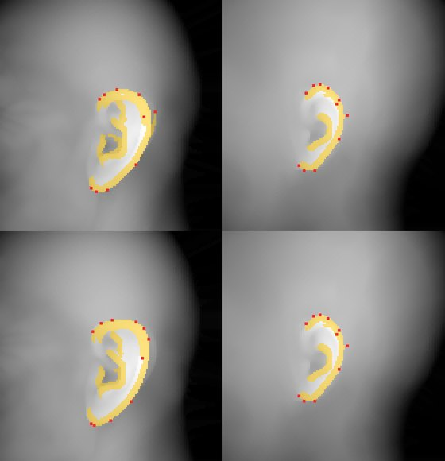
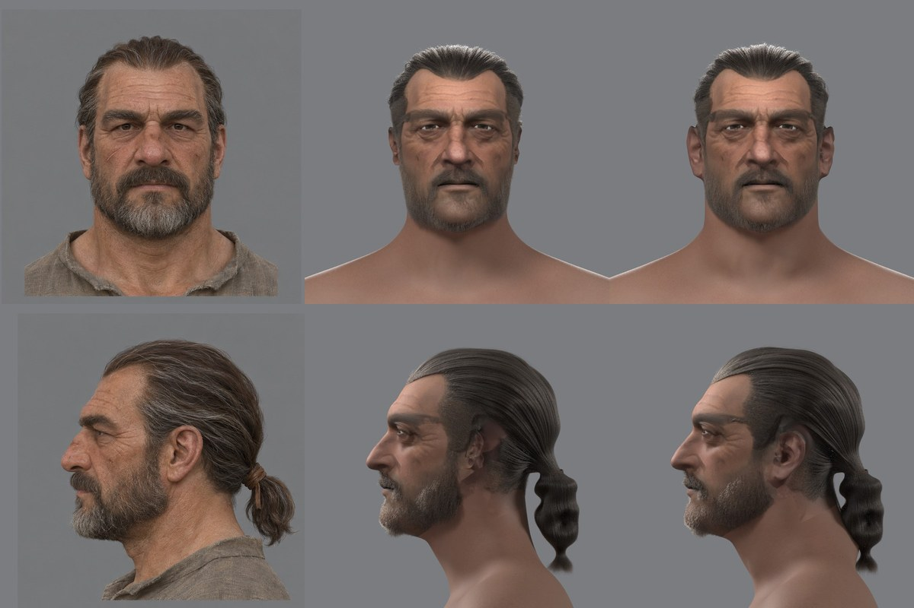
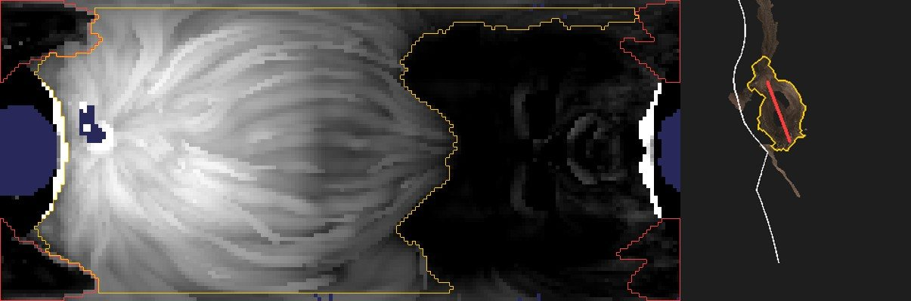
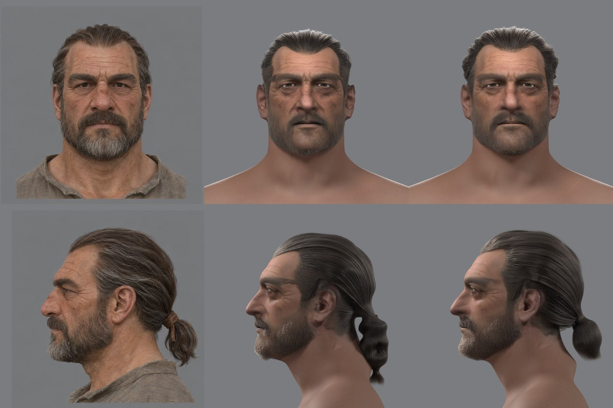
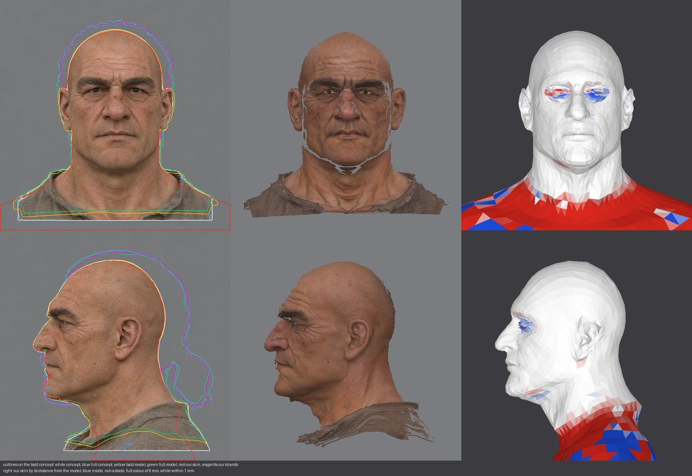

# Перенос формы с концепта в голову: где она теряется (2026-11-12)

Зачем: на втором лице пользователь увидел, что в 3D меняются череп, объём волос и форма лица, хотя на концепте лысый и полный листы сходятся. Вопрос — как переносить форму без потерь и нужны ли для этого готовые модели. Его схема: генератор (Pixal3D, Tripo) даёт сетку, сетку надо грамотно перенести на голову с мимикой, не теряя форму и размеры.

Эта схема — наша: шаги 2 и 3 [конвейера](../../../docs/npc-pipeline.md#схема). Поэтому сначала измерено, на каком шаге форма уходит, и только потом сравнены способы.

## Что измерено на втором лице

Все три вещи сведены в камеры концепта (фас и профиль) инструментом [`shape_report.py`](../../../scripts/content/npc/shape_report.py): лысый концепт, лысая модель генератора в своих цветах, наша голова после натяжки. Справа наша кожа покрашена по отступу от модели: белое — в пределах 1 мм, синее — внутри, красное — снаружи.

| Переход | Что сравнивалось | Итог |
|---|---|---|
| Полный концепт → лысый концепт | 478 точек лица детектора на фасах | медиана 0,9 мм, наибольшее 3,2 мм: лысый лист сохраняет лицо |
| Лысый концепт → модель генератора | контуры в фасе и профиле | контур сходится: расхождение площадей 1,7 % в фасе и 1,1 % в профиле; наклона нет (поворот на 2° ухудшает вдвое). Подбородок модели кончается на 3–5 мм выше, уши шире на 2 мм с каждой стороны |
| Модель генератора → наша голова, расстояние | кожа до поверхности модели | лоб и свод 0,2 мм, лицо 0,4 мм, щёки 0,3 мм, затылок 0,1 мм (медианы модуля); углы челюсти 1,4 мм и 7 мм у 10 % вершин; шея — тело шаблона, до 17 мм |
| Модель генератора → наша голова, контур в фасе | ширина головы по высоте под глазами | на уровне ушей наша голова уже концепта на 22 мм (153 против 175 мм), на уровне челюсти — на 15 мм (121 против 136 мм) |
| Полная модель → волосы, борода, цвет кожи | положение полной модели на голове | в сборке, которую видел пользователь, — сдвиг на 15 мм вверх и 3,5 мм вперёд, ошибка сборщика (ниже) |
| Полный концепт → причёска | толщина волос над черепом в профиле, от лба к затылку | концепт 10–37 мм; до исправления наша была толще на макушке на 9–15 мм и тоньше на затылке на 11 мм; после — тоньше концепта на 4–8 мм по всей дуге |

Что из этого следует:
- **Лицо и череп переносятся точно.** Там, где натяжка тянет кожу к модели, отступ — доли миллиметра.
- **Уши и углы челюсти не дотянуты.** Расстояние до модели этого не видит: вершины уха лежат на модели, но не доходят до края её уха. Видит контур: в фасе голова ниже глаз уже концепта на 15–22 мм. Причина — веса натяжки подобраны под 3a, у которого на модели была борода: лицо считается данными только в овале спереди, до 30 мм за плоскостью глаз, а уши держатся ручными точками, которых у второго лица нет.
- **Шея и плечи — шаблонные.** Шея тела пробника толще и шире шеи концепта вперёд-назад и уже по бокам.
- **Подбородок короче на 3–5 мм уже у генератора.** Это единственное заметное расхождение модели с концептом по контуру.
- **Волос меньше, чем на концепте.** После исправления слой волос ровно на 4–8 мм тоньше концепта: внешняя поверхность берётся по девяностому процентилю точек волос модели, а полная модель после постановки вышла на 2,3 % меньше лысой.

## Ошибка сборщика: модель со сдвигом

`place_ref.py` хранит модель «как выгружена» в `ref_unplaced.npz` и берёт её оттуда, если файл есть. Шаг `reg` второго лица запускался дважды, с разным началом координат модели в `params.json`; второй запуск поставил на концепт модель первого. Натяжка шла по ней, поэтому кожа легла верно. Но волосы, борода и цвет кожи берут модель заново, с новым началом и старой поправкой постановки — и ложились на 15 мм выше головы и на 3,5 мм ближе к лицу.

Что это давало на листе: причёска выше концепта на макушке и ниже на затылке, брови модели запечены полосой на лбу, тени глаз и носа сдвинуты.

Исправлено: шаги `reg` и `full` удаляют `ref_unplaced.npz` перед выгрузкой. Заодно расширена коробка, которой `reg_export.py` обрезает модель до головы: её задний край стоял в 160 мм за глазом шаблона и после постановки срезал 7 мм затылка второго лица; теперь 200 мм. Контур черепа в профиле после этого идёт в 1–3 мм от лысого концепта по всей дуге, затылок был в 5–6 мм.

Второе лицо пересобрано с шага `reg` за 46 минут на загруженном Mac. Слева концепт, в середине прежняя сборка, справа новая:

Что изменилось: полоса бровей ушла со лба, брови детектора легли в 0,9 мм от концепта (было 3,4 и 1,8 мм), пятно на носу пропало, причёска лежит плоско, как на концепте, слой волос над кожей — 11 мм в медиане вместо 20,5. Что осталось: тёмная полоса от виска к щеке (в цвет кожи попали волосы модели), малые уши, узкая челюсть, тонкая борода, шея пробника, хвост «сосисками».

## Как это решают другие

- **Схема та же.** Свежие работы делят голову так же, как мы: лысая голова на сетке с мимикой и волосы отдельным слоем ([One-shot Compositional 3D Head Avatars](https://yuansun-xjtu.github.io/CompHairHead.io/), [HairPort](https://github.com/deepmancer/HairPort)). Автоматический риг любой сетки тоже начинается с натяжки шаблона по плотным точкам и переноса форм деформациями: [OmniFaceRig](https://arxiv.org/abs/2606.08043), [RigAnyFace](https://arxiv.org/abs/2511.18601).
- **Готового кода нет.** У OmniFaceRig и RigAnyFace не выложены ни код, ни веса; про TopoRig поиск ничего не дал.
- **Волосы по картинке.** [DiffLocks](https://github.com/Meshcapade/difflocks) — картинка → около 100 тысяч прядей, код и веса выложены, но лицензия «только некоммерческие исследования» и распространяется на результаты: в открытый репозиторий нельзя. [Im2Haircut](https://github.com/Vanessik/Im2Haircut) — CC BY-NC-SA. [HairLRM](https://arxiv.org/abs/2606.15238) строит пряди по сетке генератора, то есть ровно наш случай; код не найден.
- **Платные и закрытые** — в [обзоре 2026-11-10](../2026-11-hero-head/auto-tools.md): KeenFace, Headshot, аддоны Blender. Отклонены пользователем: платить за голову нельзя.
- **Ловушки, общие для всех натяжек:** уши (в ручных инструментах на них ставят по десятку точек), скольжение сетки вдоль поверхности, внутренность рта и глаз, формы мимики на лице других пропорций.

## Что умеют наши инструменты

- Натяжка (`reg_solve.py`, нежёсткий ICP по Amberg) точна там, где ей разрешено тянуть. Веса и рамки заданы числами в пикселях кадра 3a: овал лица, коробки бровей, усов, ушей.
- Точки лица ставит детектор только на веки и рот. Ушей, линии челюсти и подбородка среди целей нет.
- Причёска: внешняя поверхность волос снимается с полной модели по порогам цвета 3a и числам положения хвоста; способ укладки один — назад в хвост.
- Борода — оболочка по тем же порогам цвета, объёма у неё нет.
- Формы мимики переносятся сдвигами вершин; у рта расхождение 16–21 мм ([разбор](../2026-11-hero-head/face-shapes.md)).
- Мерок формы по шагам в сборке не было: `measures.json` считал отступ кожи от модели и точки детектора на готовом листе. Первая не видит недотянутых ушей, вторая зависит от текстуры.

## Способ

Специализированная модель здесь не нужна и недоступна: потери сидят не в идее, а в трёх местах нашего же переноса. Порядок — по величине потери на листе.

1. **Мерки формы в сборке.** `shape_report.py` после каждой сборки: лист и числа по шагам. Сделано, это последний шаг сборщика (`shape`).
2. **Натяжка по всей лысой голове.** Сделано, раздел ниже.
3. **Голова по контуру концепта.** Лысая модель ставится на концепт в кадре, который обрезает темя и затылок, поэтому голова в профиль на 2 мм меньше концепта по всей дуге ([ниже](#что-вскрылось)). Сначала — постановка лысой модели по целым видам концепта. Затем там, где модель расходится с концептом (подбородок короче на 3–5 мм), последний проход натяжки тянет контурные вершины к контуру концепта в фасе и профиле.
4. **Объём волос — по разнице полной и лысой моделей**, а не по цвету: внешняя поверхность волос — это полная модель там, где она выше лысой. Пряди заполняют этот слой. Мерка — толщина волос по направлениям, как на листе. Сделано, раздел ниже.
5. **Объём бороды** — так же, слоем между лысой и полной моделями. Сделано там же.
6. **Шея.** Сейчас шея — тело пробника. Нужна шея концепта до ворота и переход к кольцу тела.
7. **Формы мимики переносом деформаций** (Sumner и Popović) вместо сдвигов — отдельная задача, после формы.

Сравнение генераторов (Pixal3D, Tripo, Hunyuan3D) на одном листе этими же мерками имеет смысл после шага 2: сейчас расхождение модели с концептом меньше потерь нашего переноса.

## Шаг 2: натяжка по всей лысой голове (сделано 2026-11-12)

Что изменено:
- **Вся кожа лысой модели — данные** (`reg_solve.py`, режим `bald`): свод, щёки до ушей, челюсть с углами, подчелюстная область, шея до ворота. Раньше кожу тянул только овал лица спереди и свод.
- **Ткань не тянет.** Рубаха модели отделяется от кожи по цвету: точки, которые по отношению каналов ближе к низу боков модели, чем к лицу, собранные в один кусок снизу. На втором лице ворот найден на 126–130 мм под глазами сзади и с боков и на 171–173 мм спереди. Край, по которому `reg_export.py` обрезал модель, тоже не данные. Для этого `ref.npz` несёт цвета модели.
- **Уши — по автоматическим точкам края** ([`ear_points.py`](../../../scripts/content/npc/ear_points.py)). Ухо ищется одинаково на модели и на шаблоне, сбоку: карта «как далеко поверхность от середины головы» открывается диском шире уха; ухо — то, что стоит над открытой картой, а его край — где карта ещё и обрывается на 5 мм за 3 мм. Край обходится по направлениям от верха через зад к мочке в рамке самого уха; вершина шаблона берёт точку модели того же направления. Ещё одна пара — самая выступающая точка уха. На втором лице ухо модели 41×64 мм против 28×53 мм у шаблона и стоит на 13 мм дальше назад; по 11 точек на ухо.

Ширина головы в фасе по высотам под глазами, мм (суммарно, на сторону — вдвое меньше):

| Высота | 20 | 30 | 40 | 50 | 60 | 70 | 80 | 90 | 100 | 110 |
|---|---|---|---|---|---|---|---|---|---|---|
| концепт | 175,4 | 172,6 | 168,6 | 161,4 | 154,6 | 136,6 | 135,8 | 135,0 | 134,6 | 134,6 |
| модель | 180,2 | 177,0 | 172,2 | 163,8 | 154,2 | 135,0 | 136,6 | 136,2 | 135,4 | 135,4 |
| наша, было | 153,4 | 151,0 | 148,2 | 135,0 | 129,4 | 125,4 | 121,0 | 118,6 | 117,8 | 119,8 |
| наша, стало | 175,4 | 174,2 | 170,6 | 163,8 | 149,8 | 135,0 | 134,2 | 135,0 | 135,0 | 136,2 |

Худшие места — верх уха и мочка: 2,4 и 2,2 мм на сторону от модели. Отступ кожи от модели в углах челюсти — 0,1 мм в медиане (было 1,4 мм и 7 мм у десятой части вершин); лицо, свод и затылок не изменились. Вывернутых треугольников кожи 55 вместо 92. Точки лица детектора на листе: медиана 1,5 мм от концепта вместо 1,9, челюсть 6,3 вместо 8,3 мм.

Что пробовалось и отброшено:
- точки на гребне завитка вместо кромки: кромка осталась без опоры, мочки вышли на 10 мм короче;
- точки чаще, через 15°: середина уха уже на 4 мм;
- ослабление точек к концу натяжки, чтобы ухо само село на модель: мочки возвращаются назад на 9 мм с каждой стороны. Точки держатся до конца.

Что вскрылось: с ушами настоящего размера у висков вбок торчали пучки коротких прядей, 178 штук. Причёска строит поверхность кожи лучами из центра головы только рядом с волосами, а в остальные ячейки копирует радиус ближайшей известной; у второго лица ближайшими были ячейки уха, и «кожа» возле него выходила на 2 см дальше головы. Своё правило «ухо — кожа дальше 84 мм от середины» у широкой головы ловило только край уха. Теперь `ear_points.py` пишет маску уха шаблона (`ears.npz`), а `groom.py` по ней не берёт радиус с уха, не растит на нём корни и не считает его измеренной поверхностью волос. Прядей дальше 85 мм вбок — 0, самая широкая точка волос над глазами — 83 мм.

Слева концепт, в середине сборка до шага 2, справа после:

## Шаги 4 и 5: волосы и борода слоем между головой и полной моделью (2026-11-13)

Замысел: волосы там, где полная модель стоит над нашей головой, и такой толщины, на сколько она над ней стоит. Сначала измерено, где объём терялся.

### Где терялся объём волос

| Место | Что сравнивалось | Потеря |
|---|---|---|
| Постановка полной модели | лицо модели и наша кожа от бровей до основания носа | модель стояла на 3,9 мм впереди головы и на 3,2 мм ниже; на темени и затылке волосы выходили тоньше на эти же миллиметры |
| Съём поверхности волос | поверхность шапки и внешняя поверхность модели по ячейкам | до 1 мм: порог цвета и процентиль объём не теряли |
| Пряди | внешний уровень прядей и поверхность модели | медиана 5,9 мм, в 60 % ячеек больше 5 мм; у ушей, на затылке и у узла хвоста 10–25 мм |
| Хвост | рамка хвоста с числами 3a | в хвост попала его половина и рубаха за ним: 123 мм вместо 78, радиус 16–23 мм вместо 23–30 |

Причины:
- **Кадр постановки обрезает голову.** `place_ref.py` сравнивает контуры в кадре натяжки — 24 см вокруг лица. Кадр кончается в 9 см над глазами и в 15 см за ними: темя и затылок, по которым виден масштаб, в него не попадают. Масштаб подбирался по ширине и лицу, сдвиг вдоль взгляда контур вообще не держит.
- **Слой рос от любого края маски.** `groom.py` ограничивал слой расстоянием до края маски, 0,45 мм на миллиметр. Для линии роста это верно. Но край маски — это ещё уши, затылок и узел хвоста, где волосы не начинаются, а проходят. К тому же прядь набирала свой уровень слоя за 30 мм пути от корня.
- **Хвост искался по числам 3a.** У второго лица генератор повесил хвост на 24 мм левее середины головы: рамка ±40 мм взяла его половину. Рубаха у второго лица не серая, и проверка цвета её не отсекла.

### Что сделано

- **Полная модель ставится на голову** ([`place_face.py`](../../../scripts/content/npc/place_face.py)), последним действием шага `full`. Сдвиг — по открытому лицу: точки модели от бровей до основания носа тянутся к нашей коже по её нормалям; брови и ресницы весят мало. Масштаб лицо не держит: ±2 % меняют невязку лица на 0,05 мм, а волосы на затылке сдвигают на 4 мм. Поэтому масштаб перебирается, для каждого сдвиг подгоняется по лицу, и остаётся тот, при котором контур головы с волосами выше линии глаз лучше всего лежит на полном концепте в обоих целых видах. У второго лица вышло +0,75 %, у героя 3a +2 %; минимум острый.
- **Слой волос** ([`hair_layer.py`](../../../scripts/content/npc/hair/hair_layer.py) вместо `hair_cut.py`). На той же сетке направлений вокруг центра черепа: кожа ячейки — самая внешняя точка нашей кожи, волосы — внешняя поверхность модели (97 % её точек лежат внутри). Волосы там, где модель стоит над кожей на 3 мм, выше глаз или за ушами, до затылка, не на ухе. Цвет не спрашивается.
- **Хвост по форме.** В срезе модели на 2 см в обе стороны от середины, сбоку, волосы головы — полоса толщиной в сантиметр, а хвост — ком на ней. Ком — то, что остаётся от точек за головой, если убрать всё у́же 2 см. Срез переносится в середину кома, где бы генератор его ни повесил. Хвост — ком от перехвата (шнура): кольцо, которое глубже всего лежит под самыми широкими кольцами по обе стороны. Хвост ставится в середину головы. У второго лица ком 117 мм, из них 39 мм — узел над шнуром; хвост 78 мм, на концепте около 90.

  
- **Пряди заполняют слой** (`groom.py`). Слой — то, что измерено, до самого края. Прядь выходит на свой уровень за 8 мм пути от корня (63 %). Три правила появились по листу:
  - уровень пряди считается вниз от внешней поверхности, в пределах 12 мм: причёска — оболочка в сантиметр, а где слой толще (4 см над затылком, где волосы уходят к узлу), под ней воздух. Размазанные по всему слою, пряди там просвечивали;
  - рядом с ухом волосы прижаты к голове и набирают высоту 0,6 мм на миллиметр. Пряди обходят ухо, и за ним остаётся след; на полной высоте слоя он был щелью от уха до узла, в которую видно тёмное нутро причёски;
  - короткие волоски линии роста и те, что кончаются у уха, остаются у кожи (до 2,5 мм).
- **Слой бороды** ([`beard_layer.py`](../../../scripts/content/npc/hair/beard_layer.py) вместо `beard_shell.py`): на сколько полная модель стоит над кожей нижней части лица, по лучам из середины челюсти. Поверхность — дальний конец первого куска модели на луче; кусок, который начинается на 5 мм дальше, — уже шея или ворот.
- **Мерки** (`shape_report.py`): толщина волос теперь и у полной модели над нашей кожей — видно, что потерял генератор, а что пряди; борода по высотам под глазами; маска кожи — только кожа (у шаблона на темени стоит метка сустава, она давала ноль волос в направлении «вверх»).

### Толщина волос

Толщина по силуэту на камерах концепта, мм. Концепт — полный контур минус лысый; модель — контур полной модели минус наша кожа; пряди — наши пряди минус наша кожа. Направление: 0 — вверх; в фасе плюс — вправо, в профиле плюс — назад.

| Профиль, направление | −45° | −30° | −15° | 0° | +15° | +30° | +45° | +60° | +75° | +90° | +105° |
|---|---|---|---|---|---|---|---|---|---|---|---|
| концепт | 2,6 | 10,2 | 12,4 | 14,0 | 15,6 | 21,2 | 26,2 | 32,2 | 34,8 | 36,7 | 35,2 |
| полная модель над нашей кожей | 1,4 | 9,8 | 13,0 | 13,6 | 12,8 | 21,6 | 29,0 | 36,9 | 36,4 | 35,2 | 33,4 |
| пряди, было | 4,0 | 5,0 | 8,4 | 8,4 | 9,8 | 16,2 | 21,8 | 26,8 | 27,8 | 28,4 | 27,6 |
| пряди, стало | 0,0 | 6,0 | 11,4 | 13,2 | 16,2 | 23,6 | 30,6 | 37,9 | 37,1 | 38,3 | 36,4 |
| контур с волосами против полного концепта, было | −0,2 | −6,2 | −5,4 | −6,8 | −8,4 | −7,8 | −6,8 | −7,2 | −7,8 | −9,9 | −9,2 |
| контур с волосами против полного концепта, стало | −4,2 | −5,2 | −2,4 | −2,0 | −2,0 | −0,4 | +2,0 | +4,0 | +1,6 | 0,0 | −0,4 |

| Фас, направление | −75° | −60° | −45° | −30° | −15° | 0° | +15° | +30° | +45° | +60° | +75° |
|---|---|---|---|---|---|---|---|---|---|---|---|
| концепт | 12,4 | 13,2 | 12,4 | 13,4 | 12,4 | 12,0 | 15,2 | 12,6 | 13,6 | 15,8 | 14,2 |
| полная модель над нашей кожей | 15,0 | 16,6 | 14,8 | 18,2 | 14,2 | 9,6 | 13,0 | 13,0 | 20,2 | 18,4 | 15,0 |
| пряди, было | 8,8 | 9,8 | 9,0 | 10,4 | 8,6 | — | 9,2 | 10,6 | 12,2 | 13,4 | 10,4 |
| пряди, стало | 10,0 | 14,8 | 16,0 | 16,4 | 14,2 | 12,4 | 14,2 | 16,8 | 19,2 | 21,2 | 12,0 |
| контур с волосами против полного концепта, было | −4,2 | −4,0 | −5,2 | −5,0 | −6,2 | — | −8,2 | −3,8 | −3,0 | −2,8 | −3,4 |
| контур с волосами против полного концепта, стало | −3,0 | +1,0 | +1,8 | +1,0 | −0,6 | −2,0 | −3,2 | +2,4 | +4,0 | +5,0 | −1,8 |

Контур головы с волосами против полного концепта: в фасе — от −3,2 до +5,0 мм, в среднем 2,3 мм по модулю (было от −8,2 до −2,8, в среднем 4,6); в профиле — от −5,2 до +4,0 мм, в среднем 2,2 мм по модулю (было от −9,9 до −0,2, в среднем 6,9). Пряди не доходят до поверхности модели на 1,2 мм в медиане (было 5,9 мм); больше 5 мм — в 19 % ячеек, почти все рядом с ушами, где волосы прижаты намеренно. Слой над кожей — 15,9 мм в медиане вместо 11,2.

Где ещё расходится: у линии роста надо лбом пряди ниже концепта на 4–5 мм (профиль, −45° и −30°): корни там только начинают подниматься, а наш лоб на 2 мм позади концепта. Над лбом по центру модель сама ниже концепта на 4–5 мм (фас, 0° и +15°).

Слева концепт, в середине сборка до шага, справа после:

### Борода

После постановки по лицу полная модель стоит над нашей кожей так (медиана и девятая десятая, мм): верхняя губа 1,3 и 4,5; подбородок спереди 1,3 и 2,5; под подбородком 2,1 и 6,5; щёки и челюсть 3,4 и 4,4. Прежние отступы (медиана 5,1 мм) были завышены сдвигом модели на 3,9 мм вперёд.

Спереди подбородка слоя почти нет, хотя борода там самая густая. Причина в лысом листе: генератор картинок сбрил бороду, но оставил подбородок в её размер. Полный контур концепта на высотах 100–108 мм под глазами лежит на 1–4 мм **позади** лысого. Объём бороды там уже сидит в коже.

Поэтому «борода или щетина» по одной толщине слоя не решается. Правила в `beard.py`:
- борода — где слой толще 2,5 мм (щетина — до 1 мм: это зазор двух генераций одного лица) **или** где карта кожи сплошь в цвет волос;
- волос бороды кончается на измеренной поверхности: чем тоньше слой, тем положе он лежит (от 42° до 12°). Длина — как раньше, 1,8 толщины слоя, не короче 6 мм.

| Фас, высота под глазами, мм | 50 | 60 | 70 | 80 | 90 | 100 | 110 | 120 | 130 |
|---|---|---|---|---|---|---|---|---|---|
| концепт: борода на сторону | 0,4 | 0,8 | 4,6 | 4,6 | 1,4 | 2,0 | 2,2 | 0,2 | 0,0 |
| полная модель над нашей кожей | −1,6 | −1,6 | 3,8 | 2,2 | 1,0 | 1,4 | 0,8 | 4,0 | 25,8 |
| наши волоски | 0,0 | 0,0 | 0,8 | 0,0 | 0,0 | 0,0 | 0,0 | 0,0 | 0,0 |

| Профиль, высота под глазами, мм | 50 | 60 | 70 | 80 | 90 | 100 | 110 | 120 | 130 |
|---|---|---|---|---|---|---|---|---|---|
| концепт: борода вперёд | 2,4 | 6,8 | 4,4 | 1,6 | 4,0 | −1,2 | −2,0 | 6,0 | 22,4 |
| полная модель над нашей кожей | 2,0 | 0,4 | −0,4 | 4,8 | 0,4 | −0,8 | −0,0 | 13,2 | −3,6 |
| наши волоски | 3,2 | 1,6 | −0,0 | 2,4 | 1,2 | 0,8 | 1,6 | 16,4 | −0,0 |

| Под подбородком, мм позади его кончика | 20 | 30 | 40 | 50 |
|---|---|---|---|---|
| концепт: борода вниз | 5,6 | 5,2 | 3,6 | 1,6 |
| полная модель над нашей кожей | 6,8 | 2,0 | −1,6 | −2,8 |
| наши волоски | 6,0 | 5,6 | 2,4 | 0,0 |

Под подбородком волоски дают 2,4–6,0 мм при 3,6–5,6 мм у концепта. Спереди на высоте губ и под ними (60–70 мм под глазами) бороды концепта нет ни у модели, ни у нас: 4–7 мм против 0–2. По бокам челюсти в фасе контур держит шея: она у нас той же ширины, что челюсть, и борода за неё не выступает. Волосков бороды 15,5 тысячи вместо 10,5, щетины 1,1 тысячи вместо 3,8; длина волоска бороды 5,6 мм в медиане.

### Что вскрылось

- **Наша голова в профиль на 2 мм меньше лысого концепта по всей дуге.** Линия лица от лба до кончика носа — на 2,0 мм позади концепта (медиана), темя ниже на 1,2–2,6 мм, затылок ближе на 1,6 мм. В фасе ширина совпадает, а темя ниже на 2,4 мм. Причина та же, что у полной модели: кадр постановки не видит темени и затылка, и масштаб лысой модели подобран по ширине. Сама модель чуть сплюснута относительно концепта: одним масштабом оба вида не свести. Полный и лысый листы концепта при этом совпадают по лицу до 0,4 мм. Проба на целых видах (от темени до 60 мм под глазами, доля несовпадения контуров): как стоит — фас 0,022, профиль 0,020; один масштаб +0,7 % — 0,021 и 0,009; три масштаба (ширина −1,4 %, глубина +1,1 %, высота +1,2 %) — 0,013 и 0,009. Это шаг 3 способа; он меняет всю голову, поэтому сюда не вошёл.
- **Генератор теряет чуб и усы.** Над лбом полная модель ниже концепта на 4–5 мм (в фасе направления 0° и +15°, в профиле +15°): волосы, зачёсанные вверх от линии роста, модель кладёт плоско. Над губой и под ней концепт выступает перед лысым контуром на 5–7 мм, полная модель над нашей кожей — на 0–3 мм. Слой между моделями этого не вернёт; вернуть может только контур концепта.
- **Голова 3a.** Её полная модель стояла на 2 % мельче. С новой постановкой слой волос героя на 4,7 мм толще принятого (медиана), хвост по форме — 62 мм от шнура вместо 99 мм по рамке. Голова героя не пересобиралась: её вид принят, новую надо показать.

## Приёмка

- Числа: `shape.json` — ширина в фасе и линия лица в профиле по высотам, отступ кожи по частям головы, толщина волос и контур с волосами по направлениям, борода по высотам.
- Глаз пользователя: лист сверки `likeness.jpg` на камере концепта и лист `shape.jpg`.

## Журнал

- 2026-11-12 — замеры на втором лице; найдена и исправлена ошибка сборщика со старой моделью; расширена коробка обрезки; написан `shape_report.py`; второе лицо пересобрано. Шаги 2–7 способа ждут решения пользователя.
- 2026-11-12 — шаг 2 по решению пользователя: натяжка по всей лысой голове, уши по автоматическим точкам края, ткань отделяется по цвету. Контур в фасе — в 0–2,4 мм на сторону от модели на всех высотах; второе лицо пересобрано.
- 2026-11-13 — шаги 4 и 5 по решению пользователя: волосы и борода — слой между головой и полной моделью, без порогов цвета. Полная модель ставится на голову по лицу и контуру волос, хвост находится по форме, пряди заполняют слой. Контур с волосами — в среднем в 2,2–2,3 мм от полного концепта вместо 4,6–6,9; второе лицо пересобрано. Вскрылось: голова в профиль на 2 мм меньше концепта — кадр постановки обрезает темя и затылок.
