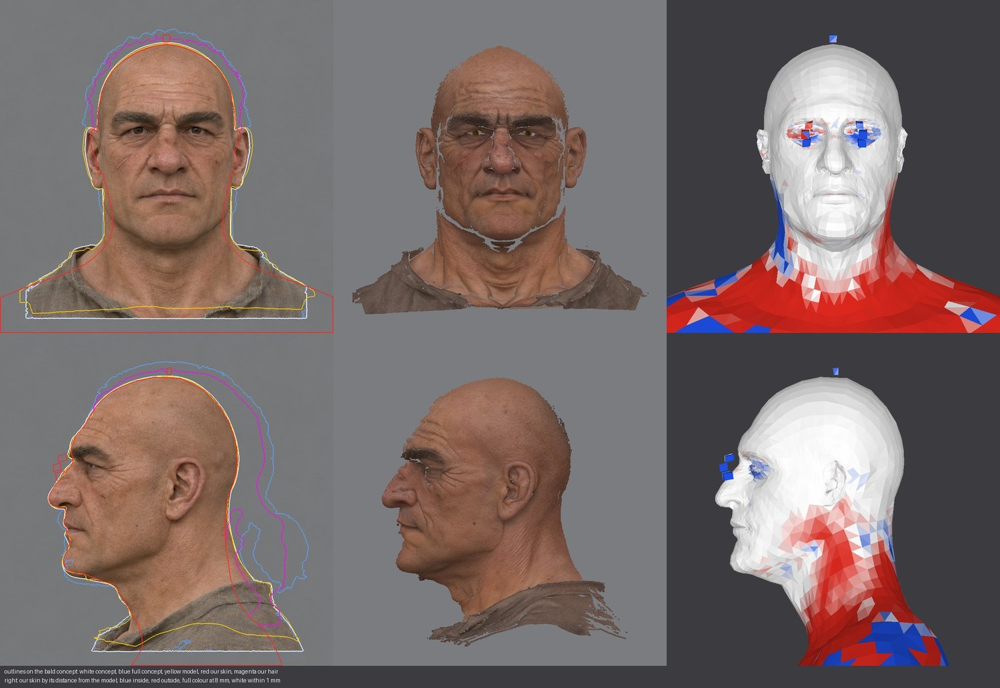
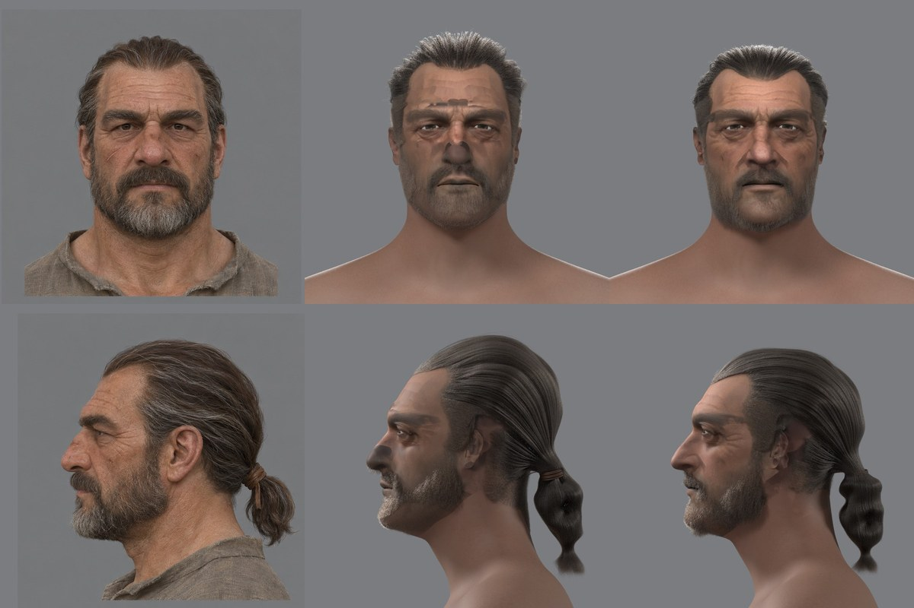

# Перенос формы с концепта в голову: где она теряется (2026-11-12)

Зачем: на втором лице пользователь увидел, что в 3D меняются череп, объём волос и форма лица, хотя на концепте лысый и полный листы сходятся. Вопрос — как переносить форму без потерь и нужны ли для этого готовые модели. Его схема: генератор (Pixal3D, Tripo) даёт сетку, сетку надо грамотно перенести на голову с мимикой, не теряя форму и размеры.

Эта схема — наша: шаги 2 и 3 [конвейера](../../../docs/npc-pipeline.md#схема). Поэтому сначала измерено, на каком шаге форма уходит, и только потом сравнены способы.

## Что измерено на втором лице

Все три вещи сведены в камеры концепта (фас и профиль) инструментом [`shape_report.py`](../../../scripts/content/npc/shape_report.py): лысый концепт, лысая модель генератора в своих цветах, наша голова после натяжки. Справа наша кожа покрашена по отступу от модели: белое — в пределах 1 мм, синее — внутри, красное — снаружи.

| Переход | Что сравнивалось | Итог |
|---|---|---|
| Полный концепт → лысый концепт | 478 точек лица детектора на фасах | медиана 0,9 мм, наибольшее 3,2 мм: лысый лист сохраняет лицо |
| Лысый концепт → модель генератора | контуры в фасе и профиле | контур сходится: расхождение площадей 1,7 % в фасе и 1,1 % в профиле; наклона нет (поворот на 2° ухудшает вдвое). Подбородок модели кончается на 3–5 мм выше, уши шире на 2 мм с каждой стороны |
| Модель генератора → наша голова, расстояние | кожа до поверхности модели | лоб и свод 0,2 мм, лицо 0,4 мм, щёки 0,3 мм, затылок 0,1 мм (медианы модуля); углы челюсти 1,4 мм и 7 мм у 10 % вершин; шея — тело шаблона, до 17 мм |
| Модель генератора → наша голова, контур в фасе | ширина головы по высоте под глазами | на уровне ушей наша голова уже концепта на 22 мм (153 против 175 мм), на уровне челюсти — на 15 мм (121 против 136 мм) |
| Полная модель → волосы, борода, цвет кожи | положение полной модели на голове | в сборке, которую видел пользователь, — сдвиг на 15 мм вверх и 3,5 мм вперёд, ошибка сборщика (ниже) |
| Полный концепт → причёска | толщина волос над черепом в профиле, от лба к затылку | концепт 10–37 мм; до исправления наша была толще на макушке на 9–15 мм и тоньше на затылке на 11 мм; после — тоньше концепта на 4–8 мм по всей дуге |

Что из этого следует:
- **Лицо и череп переносятся точно.** Там, где натяжка тянет кожу к модели, отступ — доли миллиметра.
- **Уши и углы челюсти не дотянуты.** Расстояние до модели этого не видит: вершины уха лежат на модели, но не доходят до края её уха. Видит контур: в фасе голова ниже глаз уже концепта на 15–22 мм. Причина — веса натяжки подобраны под 3a, у которого на модели была борода: лицо считается данными только в овале спереди, до 30 мм за плоскостью глаз, а уши держатся ручными точками, которых у второго лица нет.
- **Шея и плечи — шаблонные.** Шея тела пробника толще и шире шеи концепта вперёд-назад и уже по бокам.
- **Подбородок короче на 3–5 мм уже у генератора.** Это единственное заметное расхождение модели с концептом по контуру.
- **Волос меньше, чем на концепте.** После исправления слой волос ровно на 4–8 мм тоньше концепта: внешняя поверхность берётся по девяностому процентилю точек волос модели, а полная модель после постановки вышла на 2,3 % меньше лысой.

## Ошибка сборщика: модель со сдвигом

`place_ref.py` хранит модель «как выгружена» в `ref_unplaced.npz` и берёт её оттуда, если файл есть. Шаг `reg` второго лица запускался дважды, с разным началом координат модели в `params.json`; второй запуск поставил на концепт модель первого. Натяжка шла по ней, поэтому кожа легла верно. Но волосы, борода и цвет кожи берут модель заново, с новым началом и старой поправкой постановки — и ложились на 15 мм выше головы и на 3,5 мм ближе к лицу.

Что это давало на листе: причёска выше концепта на макушке и ниже на затылке, брови модели запечены полосой на лбу, тени глаз и носа сдвинуты.

Исправлено: шаги `reg` и `full` удаляют `ref_unplaced.npz` перед выгрузкой. Заодно расширена коробка, которой `reg_export.py` обрезает модель до головы: её задний край стоял в 160 мм за глазом шаблона и после постановки срезал 7 мм затылка второго лица; теперь 200 мм. Контур черепа в профиле после этого идёт в 1–3 мм от лысого концепта по всей дуге, затылок был в 5–6 мм.

Второе лицо пересобрано с шага `reg` за 46 минут на загруженном Mac. Слева концепт, в середине прежняя сборка, справа новая:

Что изменилось: полоса бровей ушла со лба, брови детектора легли в 0,9 мм от концепта (было 3,4 и 1,8 мм), пятно на носу пропало, причёска лежит плоско, как на концепте, слой волос над кожей — 11 мм в медиане вместо 20,5. Что осталось: тёмная полоса от виска к щеке (в цвет кожи попали волосы модели), малые уши, узкая челюсть, тонкая борода, шея пробника, хвост «сосисками».

## Как это решают другие

- **Схема та же.** Свежие работы делят голову так же, как мы: лысая голова на сетке с мимикой и волосы отдельным слоем ([One-shot Compositional 3D Head Avatars](https://yuansun-xjtu.github.io/CompHairHead.io/), [HairPort](https://github.com/deepmancer/HairPort)). Автоматический риг любой сетки тоже начинается с натяжки шаблона по плотным точкам и переноса форм деформациями: [OmniFaceRig](https://arxiv.org/abs/2606.08043), [RigAnyFace](https://arxiv.org/abs/2511.18601).
- **Готового кода нет.** У OmniFaceRig и RigAnyFace не выложены ни код, ни веса; про TopoRig поиск ничего не дал.
- **Волосы по картинке.** [DiffLocks](https://github.com/Meshcapade/difflocks) — картинка → около 100 тысяч прядей, код и веса выложены, но лицензия «только некоммерческие исследования» и распространяется на результаты: в открытый репозиторий нельзя. [Im2Haircut](https://github.com/Vanessik/Im2Haircut) — CC BY-NC-SA. [HairLRM](https://arxiv.org/abs/2606.15238) строит пряди по сетке генератора, то есть ровно наш случай; код не найден.
- **Платные и закрытые** — в [обзоре 2026-11-10](../2026-11-hero-head/auto-tools.md): KeenFace, Headshot, аддоны Blender. Отклонены пользователем: платить за голову нельзя.
- **Ловушки, общие для всех натяжек:** уши (в ручных инструментах на них ставят по десятку точек), скольжение сетки вдоль поверхности, внутренность рта и глаз, формы мимики на лице других пропорций.

## Что умеют наши инструменты

- Натяжка (`reg_solve.py`, нежёсткий ICP по Amberg) точна там, где ей разрешено тянуть. Веса и рамки заданы числами в пикселях кадра 3a: овал лица, коробки бровей, усов, ушей.
- Точки лица ставит детектор только на веки и рот. Ушей, линии челюсти и подбородка среди целей нет.
- Причёска: внешняя поверхность волос снимается с полной модели по порогам цвета 3a и числам положения хвоста; способ укладки один — назад в хвост.
- Борода — оболочка по тем же порогам цвета, объёма у неё нет.
- Формы мимики переносятся сдвигами вершин; у рта расхождение 16–21 мм ([разбор](../2026-11-hero-head/face-shapes.md)).
- Мерок формы по шагам в сборке не было: `measures.json` считал отступ кожи от модели и точки детектора на готовом листе. Первая не видит недотянутых ушей, вторая зависит от текстуры.

## Способ

Специализированная модель здесь не нужна и недоступна: потери сидят не в идее, а в трёх местах нашего же переноса. Порядок — по величине потери на листе.

1. **Мерки формы в сборке.** `shape_report.py` после каждой сборки: лист и числа по шагам. Сделано, шагом сборщика ещё не подключён.
2. **Натяжка по всей лысой голове.** Лысая модель — кожа целиком, поэтому данными становится вся голова до ворота: щёки, углы челюсти, подчелюстная область, шея. Уши — по автоматическим точкам: край уха в профиле модели даёт верх, низ, зад и козелок. Цель: контур нашей головы в фасе и профиле в пределах 2 мм от модели на всех высотах.
3. **Подбородок и челюсть по контуру концепта.** Там, где модель расходится с концептом (подбородок короче на 3–5 мм), последний проход натяжки тянет контурные вершины к контуру концепта в фасе и профиле.
4. **Объём волос — по разнице полной и лысой моделей**, а не по цвету: внешняя поверхность волос — это полная модель там, где она выше лысой. Пряди заполняют этот слой. Мерка — толщина волос по направлениям, как на листе.
5. **Объём бороды** — так же, слоем между лысой и полной моделями.
6. **Шея.** Сейчас шея — тело пробника. Нужна шея концепта до ворота и переход к кольцу тела.
7. **Формы мимики переносом деформаций** (Sumner и Popović) вместо сдвигов — отдельная задача, после формы.

Сравнение генераторов (Pixal3D, Tripo, Hunyuan3D) на одном листе этими же мерками имеет смысл после шага 2: сейчас расхождение модели с концептом меньше потерь нашего переноса.

## Приёмка

- Числа: `shape.json` — ширина в фасе и линия лица в профиле по высотам, отступ кожи по частям головы, толщина волос по направлениям.
- Глаз пользователя: лист сверки `likeness.jpg` на камере концепта и лист `shape.jpg`.

## Журнал

- 2026-11-12 — замеры на втором лице; найдена и исправлена ошибка сборщика со старой моделью; расширена коробка обрезки; написан `shape_report.py`; второе лицо пересобрано. Шаги 2–7 способа ждут решения пользователя.
