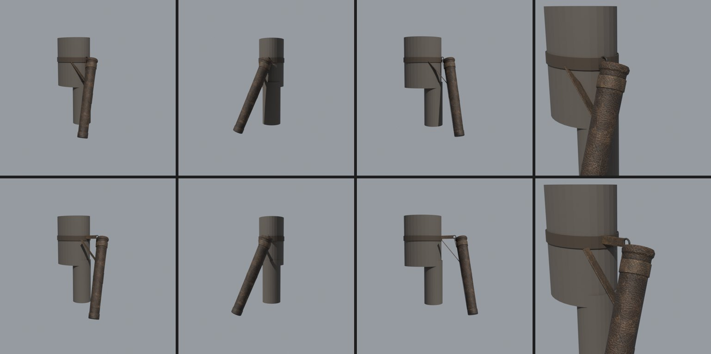
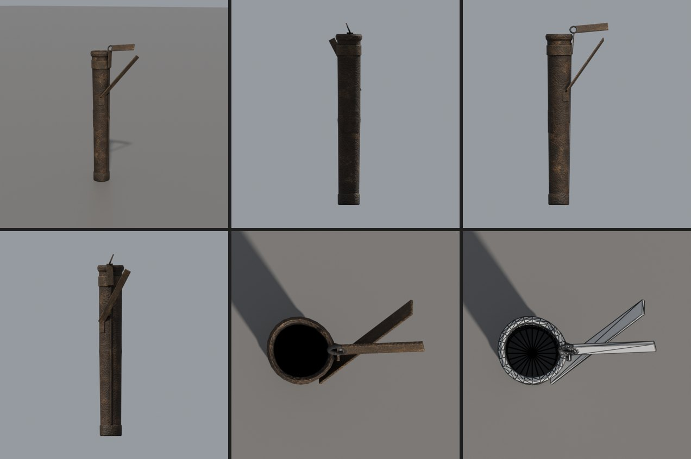
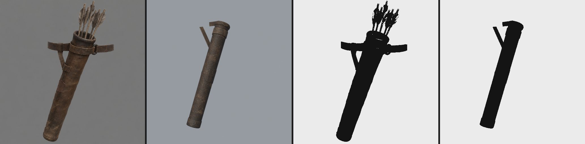
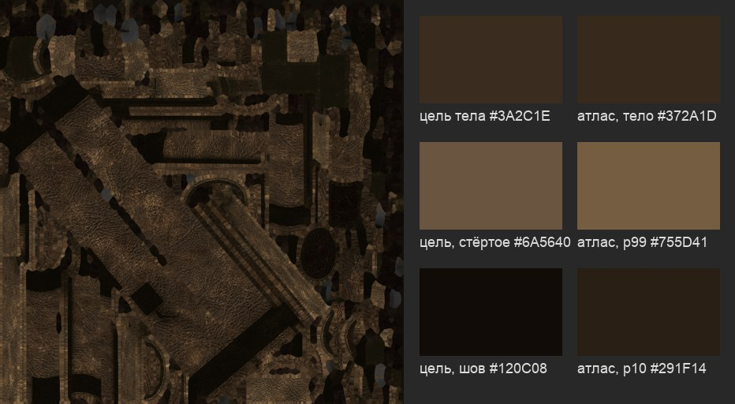

# Колчан лучника: замысел

4 ноября 2026 года. Своя перезарядка лука берёт стрелу из колчана ([заметка](../../archery/2026-11-04-reload-from-quiver/README.md)). На моделях G2 колчана нет, это новый вид предмета. Пользователь выбрал место: на поясе, на правом бедре (вариант А заметки, решение 2026-11-04). Пользователь выбрал вариант 1, трубку охотника без меховой оторочки (2026-11-04); модель — в разделе [«Модель»](#модель). Работа по скиллам [`object-design`](../../../.claude/skills/object-design/SKILL.md) и [`blender-3d`](../../../.claude/skills/blender-3d/SKILL.md); три варианта концепта и оценка — в [`concepts.md`](concepts.md).

Оригинала нет, поэтому листа замысла оригинала и пар «оригинал | наше» не будет. Предмет свой целиком: в генератор не шло ничего из Gothic, только текст и средние цвета кожи броней числами.

## Карточка замысла

**Роль в игре.** Носимое снаряжение, не MOB и не предмет инвентаря. Колчан видно на правом бедре, когда у персонажа есть лук и стрелы. Он показывает:
- кто перед игроком стрелок — издалека, ещё до того, как лук снят со спины;
- сколько у него стрел: 4–5 ступеней наполнения, на нуле колчан пуст;
- откуда рука берёт стрелу в перезарядке.

Колчан — рабочая вещь, а не знак звания. Он говорит о бедности и ремесле: сделан руками самим охотником или шорником Хориниса, носится годами, чинится.

**Носители.** Охотники, бандиты и наёмники Хориниса. Герой — поверх любой брони, от лохмотьев до доспеха паладина. Поэтому колчан один на всех и в цвете брони не участвует: тёмная кожа, которая не спорит ни с тряпьём, ни с железом.

**Место и вид.**
- Устье на высоте ремня, около 105 см, сбоку-сзади правого бедра.
- Ось отклонена назад на 20–25° и наружу на 5–10°; дно на высоте 39–46 см, позади бедра.
- Над устьем видно 25–30 см стрелы: оперение и хвостовик, вверх и чуть вперёд.
- Колчан жёстко на `BIP01 PELVIS`: он не качается и не бьёт по ноге в беге. Конструкция должна это объяснять: подвес короткий и тугой.
- Игрок видит колчан в 2–6 м, чаще со спины и сбоку в позе прицела, в лесу и в городе, днём и у костра.

**Сохранить** — от мира Готики, оригинала у предмета нет:
- силуэт охотника: лук на спине, колчан на правом бедре, меч на левом;
- грубая, тёмная, практичная кожа, как у броней охотников и наёмников;
- мера детали брони G2: крупные формы, шов и ремень читаются, мелкий узор нет.

**Улучшить** — что даёт свой предмет:
- колчан вообще есть, перезарядка правдива;
- объём: толщина кожи у устья, ремни и пряжки объёмом, а не нарисованы;
- видно, сколько стрел.

**Происхождение.** Местное ремесло позднего средневековья. Кожу дубит и шьёт сам охотник или городской шорник; дерево — орешник, ива, береста из леса у города; железо — одно кольцо или пряжка от кузнеца. Колчану годы: его носят в лесу и в стычках, кладут на землю у костра, мочат под дождём.

**Конструкция по частям** — общая для вариантов, детали у каждого свои ([`concepts.md`](concepts.md)).

| Часть | Размер, см | Что делает |
|---|---|---|
| тело | длина 65–70; устье 9–10, у дна 7–8 | держит стрелы; стрела 94 см, наконечник у дна, над устьем 25–30 |
| устье | обод 1–2 толщиной | держит форму, по нему скользит стрела; самое стёртое место |
| дно | диск или стакан 7–8, высота 3–5 | держит наконечники, принимает удар о землю; самое грязное |
| подвес | 8–15 от устья до ремня | связывает колчан с поясом жёстко, без качания |
| второй крепёж | на 1/3–1/2 длины | держит наклон дна назад; к ремню сзади или ко второй точке пояса, не к ноге |
| пояс | ширина 4–5, участок 30–40 | ремень персонажа; в модели — только накладка подвеса, сам ремень даёт броня |

Ступени наполнения рисует движок мешем стрелы `ITRW_ARROW`, поэтому модель — только тело, ремни и крепление, без стрел. Внутри устья видна тёмная пустота: при нуле стрел колчан пуст.

Броня: колчан раздвигают под броню по замеру меша (`BDT_H/M` до 13 см, `RAVEN`, `MIL_M`, `PIR_H` 7–9 см; полы мантий `KDF`, `NOV_L`, `SLD_L` сзади). Движок отодвигает его наружу, пока до ближайшей точки брони не останется 2 см (`Quiver::fit`, ветка `claude/quiver-mount`). Одной длины ремня на все брони нет, поэтому **оба ремня идут к телу с запасом: верх уходит под пояс и в броню**. Ремень от кольца и ремень наклона тянутся на 13 см к телу, ровно по горизонтали мира. Близкая броня прячет их концы, а колчан, отодвинутый до 11–13 см, по-прежнему висит на ремнях, а не в воздухе ([раздел «Модель»](#модель)).

**Материал и старение.** Толстая растительного дубления кожа; дерево — орешник или ива; железо — одно кольцо, пряжка или крюк. Кожа темнеет от рук и жира у устья, светлеет и трескается на сгибах ремней, у дна вытерта о землю и в засохшей грязи. Нитка шва потемнела почти до цвета кожи. Железо тёмное, в окалине, без блеска.

**Цвет** — относительно брони, а не ярче её. Средние цвета кожи броней G2 по текстурам (средний sRGB; тёмная пятая часть, середина, светлая пятая часть):

| Текстура | Среднее | Тёмное | Середина | Светлое |
|---|---|---|---|---|
| `HUM_ORGS_ARMOR_V0` | `#4A3D2D` | `#080504` | `#433524` | `#A48E70` |
| `HUM_ORGM_ARMOR_V0` | `#302619` | `#070402` | `#2D2215` | `#62523D` |
| `ARMOR_RANGER` | `#2E1D16` | `#020100` | `#2B1B14` | `#624131` |
| `ARMOR_SLD_M` | `#3A352C` | `#040302` | `#312B20` | `#8C867B` |

Отсюда цель колчана: кожа `#3A2C1E` в середине, вытертые кромки `#6A5640`, шов и щели `#120C08`, ремни на тон светлее тела `#4A3A28`, железо `#2A2826`. Тело не светлее брони охотника, иначе колчан станет пятном на бедре.

**Чего избегать** — штампы, к которым тянут генератор и привычка:
- колчан Робин Гуда и эльфа: тиснёный узор, бахрома, перья-подвески, медные заклёпки рядами, блестящая рыжая кожа;
- спортивный или современный колчан: ровная цилиндрическая труба, пластик, нейлон, карабины, липучки, клеймо мастера;
- колчан за спиной через плечо — у нас другое место;
- чистая новая кожа одного тона, ровные машинные строчки, светлая обводка кромок;
- металл на каждом шве: окованное дно, уголки, кольца по всей длине;
- открытый «ящик» с десятками стрел — у нас 4–5 ступеней, стрел немного;
- крышка или клапан на устье: рука берёт стрелу без помех;
- колчан, привязанный к ноге ниже колена: он у нас жёстко на тазу.

## Как принимаем

- **Концепт** (этот ход): пользователь выбирает вариант по виду 3/4, листу видов и кадру «на месте» — [`concepts.md`](concepts.md).
- **Модель** (следующий ход): рендер с ракурса концепта рядом с ним; проверка логики вещи из `blender-3d` — из чего собран, на чём висит, как держит наклон, где вынимается стрела.
- **В игре**: клип перезарядки по [приёмке заметки](../../archery/2026-11-04-reload-from-quiver/README.md#приёмка) — колчан на бедре в позе прицела, беге и приседе, не проходит сквозь броню и ногу, ступени наполнения читаются с 3–5 м.

## Модель

Вариант 1, трубка охотника, без меховой оторочки (выбор пользователя 2026-11-04). Собрана в Blender 5.2 по скиллу [`blender-3d`](../../../.claude/skills/blender-3d/SKILL.md), скрипт — [`quiver.py`](../../../scripts/content/mesh3d/blender/quiver.py) с настройкой [`quiver.json`](../../../scripts/content/mesh3d/blender/quiver.json).

**Состав.** Стрел в модели нет: их рисует движок мешем стрелы по ступеням.

| Часть | Как сделана | Зона |
|---|---|---|
| тело | вращение профиля, 24 стороны, на несколько миллиметров не круглое; сужение 9,5 → 8 см; обруч под кожей на 34 см — валик 2 мм; обод — валик +7 мм; шов из двух полос со стороны тела | кожа |
| полость | внутренняя стенка от устья вниз на 30 см, там глухое тёмное дно; ниже — сплошное тело | полость, почти чёрная |
| дно | стакан из кожи высотой 4,5 см поверх конца трубы | кожа |
| заплата | кривая накладка 7 × 9 см снаружи, на 30–39 см от устья | кожа |
| подвес | пояс-манжета 4 см под устьем; от неё по стороне тела язычок вверх к кольцу; от кольца ремень 13 см к телу, лицом наружу, как пояс | ремни, железо |
| кольцо | тор 3,5 см снаружи, прут 7 мм, на 2 см выше устья, в плоскости язычка и ремня к поясу | железо |
| ремень наклона | накладка со стежком на 23 см от устья, сзади-сбоку; ремень к поясу за бедром: 13 см к телу и 7 см назад | ремни |

**Числа.**

| | |
|---|---|
| треугольники | 1908 (бюджет 2500): кожа и ремни 1740, железо 168 |
| длина | 68 см от обода до дна стакана |
| устье | 9,5 см снаружи, обод до 10,9 см; внутри 8,7 см |
| дно | 8 см, стакан 8,6 см |
| bbox glTF, м | x −0,055…0,198, y −0,680…0,050, z −0,081…0,054 (ремни к телу — до x 0,198) |
| открытые рёбра, вывернутые части | 0 и 0 (`metrics.json`: все 11 частей проверены по отдельности; `volume_check.py` сваривает две полосы шва, которые сходятся торцами на 33 см, в одну и насчитывает 10 частей, 0 вывернуто) |
| glTF Validator 2.0.0-dev.3.10 | 0 ошибок, 0 предупреждений, 2 сообщения `UNUSED_OBJECT` |
| атлас | 1024², покрытие 56 %; полость ужата в развёртке до 0,3 масштаба |

**Устье в осях модели** (glTF, метры): центр устья — начало координат `(0, 0, 0)`. Ось колчана — `−Y`, дно на `y = −0,68`. `+Z` — вперёд по ходу носителя, `+X` — к телу носителя: glTF правый, а загрузчик отражает X, поэтому наружу от правого бедра — `−X`. Это рамка `Quiver` из `quiver.h` ветки `claude/quiver-mount`: наклон назад 22,5° и наружу 7,5° и место на `BIP01 PELVIS` задаёт движок, в модель они не запечены. От наклона в модели зависят только ремни: они идут к поясу по горизонтали мира. Вектор вверх мира в осях Blender модели — `(−0,13; 0,38; 0,92)`, к телу — `(0,99; 0,05; 0,12)`. Скрипт считает их по той же формуле, что `Quiver::fit`.

«+X к телу» верно для скелета, у которого правая сторона +X, а лицо +Z. Так у людей G2 (`HUMANS.MDH`): `ZS_SWORD` на левом бедре на x −17,5 ([слоты скелета](../../archery/2026-11-04-reload-from-quiver/README.md#слоты-скелета-g2)). `Quiver::fit` строит базис `x = y × z` и для зеркального скелета (`R THIGH` левее `L THIGH`) перевернёт `right`. Тогда +X glTF уйдёт наружу, и ремни будут торчать от бедра. `quiver.py` считает только скелет людей. Колчан носят лучники-люди, поэтому другой случай не поддержан.

**Броня.** Движок ставит колчан в 2 см от ближайшей точки брони. Пояс у бёдер не всегда ближе всего: у `BDT_H` колчан уходит наружу до 13 см. Поэтому ремень от кольца и ремень наклона идут к телу на 13 см (`reach`), по горизонтали мира, и кончаются в броне под поясом. При близкой броне их концы скрыты, при отодвинутом колчане видны ремни до пояса. Проверено на макете бедра и пояса при сдвиге 0 и 11 см ([`quiver_place.py`](../../../scripts/content/mesh3d/blender/quiver_place.py)):



Ограничение. Ремни прямые и жёсткие: при сдвиге больше 13 см ремень не дотянется, при броне с выступом у пояса конец ремня может выйти из брони с другой стороны. Это проверят кадры в игре, когда сольются обе ветки.

**Виды.** Сверху вниз и слева направо: 3/4; снаружи, со стороны −X; спереди; со стороны тела, +X; сверху, тёмная полость; каркас. Изнанку, видимую камере, `compare.py` залил бы пурпуром (`backfaces`); её нет.



**Рядом с концептом.** Модель висит в наклоне движка без макета, камера примерно с ракурса вида 3/4 концепта (`quiver_place.py`, `"stand_in": false`). Слева направо: концепт, модель, их силуэты.



Силуэт тот же: узкая труба с ободом, манжета под устьем, ремень наклона к поясу, стакан дна.

Отличия:
- Труба у концепта толще: диаметр около 0,17 длины, у модели 0,14 (9,5 × 68 см). Размеры — по карточке и рамке движка: где концепт и цель спорят, побеждает цель (`blender-3d`).
- Пояса на концепте модель не несёт: его даёт броня. От подвеса видны язычок с кольцом и ремни к телу.
- Ремень наклона на концепте идёт вдоль трубы с двумя стежками, у модели он отходит от накладки к поясу.
- Кожа модели темнее и ровнее, как требует цель цвета; заплата и шов с этой стороны не видны.

**Цвет.** Плитки — своя кожа и своё железо набора рынка (`market-set/tiles`). Атлас запечён [`bake_atlas.py`](../../../scripts/content/mesh3d/blender/bake_atlas.py) по [`quiver-atlas.json`](../../../scripts/content/mesh3d/blender/quiver-atlas.json). Цели — числа карточки, не концепт: тело `#3A2C1E`, ремни `#4A3A28`, железо `#2A2826`, полость `#120C08`. Цель держат открытые тексели с AO ≥ 0,5. Перекрёстная проверка по альбедо атласа: тело `#372A1D`; светлая десятая часть `#55432F` при стёртой кромке `#6A5640` в карточке; тёмная десятая часть `#2A1F14` при шве `#120C08`. Кромки и швы вышли мягче карточки, среднее — в цели. Металличность железа ×0,3: ржавое и грязное.



**Логика вещи.** Вещь собрана так:
- Труба из толстой вареной кожи, форму держат обруч под кожей и обод. Шов на стороне тела, его не видно снаружи. Дно — кожаный стакан на конце: о землю бьётся он и в грязи он.
- Колчан висит на манжете под устьем: язычок поднимается к кольцу, кольцо держит ремень, обёрнутый вокруг пояса.
- Наклон дном назад держит второй ремень: от трети длины к поясу за бедром.
- Стрела выходит из открытого устья без клапана. Кольцо выше обода, но в стороне тела, мимо руки.
- Колчан носят под дождём: низ темнее и грязнее.

**Файлы.**
- Тело `ITRW_QUIVER`: `~/.local/share/gothic-ai/content-staging/quiver/content/`, корень контента для `OPENGOTHIC_CONTENT`. В нём:
  - `meshes/meshes.json`: `ITRW_QUIVER → quiver/model.glb`;
  - `meshes/quiver/model.glb`, SHA-256 `bb50dd08984582c3…`;
  - `materials/materials.json`: `OWN_QUIVER_LEATHER.TGA`, `OWN_QUIVER_IRON.TGA` → `materials/quiver/{albedo,normal,orm}.dds`.
- Заглушка ветки `quiver-mount` (`quiver_stub.py`) пишет ту же запись `ITRW_QUIVER` в `meshes.json` со своим `quiver-stub/model.glb`. Замена — смена файла: запись `ITRW_QUIVER` указывает на `quiver/model.glb`, к ключам `materials.json` добавляются два ключа колчана. Движок не меняется.
- Рабочие файлы: `content-staging/quiver/build/` — `model.glb` с UV плиток, `metrics.json`, `quiver.blend`; `atlas/` — атлас и его карты; `renders/`.
- Пересборка с корня репозитория:

```sh
B=/Applications/Blender.app/Contents/MacOS/Blender; ST=~/.local/share/gothic-ai/content-staging/quiver
uv run --no-project --with numpy --with pillow --with scipy python scripts/content/mesh3d/market_tiles.py \
  --spec scripts/content/mesh3d/blender/quiver-tiles.json
$B -b --factory-startup -P scripts/content/mesh3d/blender/quiver.py -- scripts/content/mesh3d/blender/quiver.json $ST/build
$B -b --factory-startup -P scripts/content/mesh3d/blender/bake_atlas.py -- scripts/content/mesh3d/blender/quiver-atlas.json $ST/atlas
uv run --no-project --with numpy --with pillow python scripts/content/mesh3d/pack_prop.py \
  --bake $ST/atlas --visual ITRW_QUIVER --name quiver --output $ST/content
```

Кадры в игре — после слияния этой ветки и `claude/quiver-mount`.
