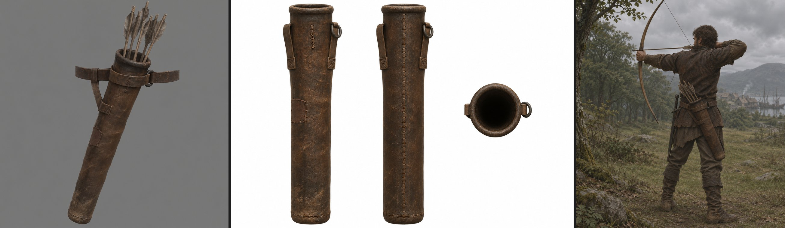
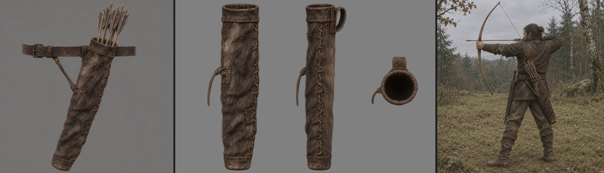
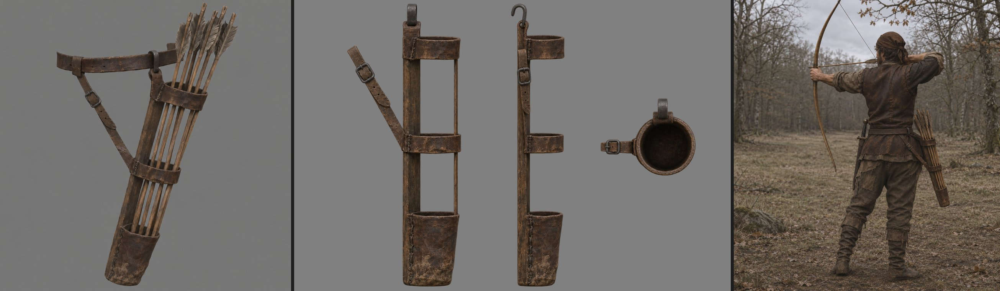

# Колчан: три концепта на выбор

Замысел и карточка — [README.md](README.md). Все картинки — `image_gen` в свежем треде Codex (scout `codex-worker` в пустом каталоге), по одному треду на вариант. В генератор шёл только текст. Оценка моя.

На каждом листе слева направо: вид 3/4 со стрелами, лист видов спереди, сбоку и сверху без стрел (правка вида 3/4), кадр «на месте» — лучник со спины-справа в позе прицела.

**Как шло.** Один бриф на вариант: общая часть, блок варианта и порядок трёх картинок (ниже). Первые кадры «на месте» у всех трёх вариантов вышли с дном колчана вперёд, по ходу выстрела, а у первого ещё и длиной до икры ([первая попытка](inplace-attempt-1.jpg)). Правка одной фразой в тех же тредах дала верный наклон: дно назад за бедро. Лист видов варианта 1 генератор отклонил по фильтру насилия, пока в промпте были колчан и стрелы; переписанный как «кожаный футляр-труба» прошёл.

Цвет тела снят средним по участку вида 3/4. Все три светлее цели `#3A2C1E` на 15–20 единиц и чуть серее, но не рыжие; в модели цель — числа карточки.

## Рекомендация

**Вариант 1, трубка охотника.** Читается за секунду как колчан Хориниса, подходит всем носителям от бандита до паладина, легче всех раздвигается под броню удлинением подвеса и строится проще всех. Мех варианта 2 хорош по духу, но дорог и в игре на 3–6 м почти не виден. Открытая колодка варианта 3 лучше показывает число стрел, но открывает все огрехи стрел движка, а пустая читается хуже.

Если хочется больше характера, можно взять трубку варианта 1 с меховой оторочкой устья из варианта 2: узкая полоса меха у обода видна, а дорогой материал занимает 10 см вместо 68.

## Вариант 1. Трубка охотника



**Замысел.** Жёсткая закрытая труба из толстой вареной кожи на деревянном дне и двух ивовых обручах внутри; свой короткий подвес — ремешок под устьем с железным кольцом и второй ремешок на трети длины к поясу.
Вещь, которую охотник шьёт себе раз на годы: держит форму, не мнётся под стрелами, просто чинится заплатой.

**Картинки** (исходники вне git, только чтение, рядом JSON с промптом и SHA-256):
- вид 3/4 — `~/.local/share/gothic-ai/content-sources/quiver/concept-tube-threequarter-attempt-1.png`;
- лист видов — `~/.local/share/gothic-ai/content-sources/quiver/concept-tube-views-attempt-1.png`;
- на месте — `~/.local/share/gothic-ai/content-sources/quiver/concept-tube-inplace-attempt-2.png` (первая попытка `…-inplace-attempt-1.png` отклонена: дно вперёд).

**Оценка.**
- Сразу читается как колчан и как вещь Готики: грубая тёмная кожа, заплаты, ручной шов, без украшений. Ни одного штампа из списка.
- Силуэт простой и узкий: тело 68 см, устье чуть шире дна. На бедре он почти не выступает и легко раздвигается под броню: подвес — короткий ремень с кольцом, его можно удлинить на 13 см без новой детали.
- Лист видов чистый и согласован с видом 3/4: два ремешка, кольцо, шов сзади, сшитое дно. Модель снимается с него прямо.
- Кадр на месте после правки верен: дно назад за бедро, устье у ремня, длина до подколенной впадины.
- Цвет тела в концепте `#4E4038` против цели `#3A2C1E`: светлее на 20 единиц и чуть серее, но не рыжий. В модели цель — числа карточки.
- Слабое место: гладкая труба на дальней дистанции — одно тёмное пятно; читаемость дают устье и стрелы над ним.
- Строится проще всех: цилиндр с конусом, обод, дно, два ремня, кольцо; 400–700 треугольников.

<details><summary>Блок варианта в брифе</summary>

```text
VARIANT — "HUNTER'S TUBE": a rigid, closed tube of thick vegetable-tanned leather, moulded hard (boiled leather) over a round wooden bottom disc and two thin hazel withy hoops sewn inside (one under the mouth, one at mid-length; they show only as gentle rings under the leather). One vertical saddle-stitched seam runs down the back side, against the body. The mouth has a thick rolled leather rim, darkest and most rubbed. The bottom is a short stitched leather cap over the wooden disc. Attachment: its own short hanger — a 4 cm wide leather strap loops around the tube just below the mouth and ends in a small dark iron ring; a second, shorter strap from the tube at one third of its length goes up to the same belt behind the hip, holding the tilt. The archer's belt runs through both. Simple, sturdy, slightly lopsided, handmade.
```

</details>

<details><summary>Промпт image_gen как отправлен: вид 3/4</summary>

```text
Use case: stylized-concept
Asset type: realistic game-asset concept, IMAGE 1 of a consistent three-image set.
Create one square image of a single leather archer's quiver, variant HUNTER'S TUBE, alone with exactly five arrows and a short section of the archer's own waist belt passing through its two attachment points. No human. Three-quarter view from slightly above, whole object including arrow nocks and bottom fully in frame with breathing room, suspended in the position in which it hangs at the RIGHT hip, slightly behind the hip. Plain neutral mid-grey background, soft studio light like overcast daylight, no pedestal.

WORLD AND STYLE: late-medieval poor colonial island port town and its forests. Everything handmade, old, used for years and repaired. Painterly-realistic game-asset concept rendering, restrained material detail, dark warm low-saturation palette, soft diffuse light. Simple, sturdy, slightly lopsided. No glossy fantasy or theatrical movie-prop styling.

PRECISE PROPORTIONS: leather body total length 68 cm, round mouth 10 cm across, bottom 7.5 cm across, gently tapering rather than a perfect cylinder. Slim elongated body, length 6.8 times mouth diameter. Arrows are 94 cm long, stored point-down with points hidden; only 27 cm of each arrow is visible above the mouth, including plain wooden shaft, grey-brown feather fletching and a nock. Five arrows only, loosely grouped, no full bundle. The visible arrow length is about 40 percent of the leather body length.

CONSTRUCTION: rigid enclosed-wall tube of thick vegetable-tanned leather, moulded hard as boiled leather over a round wooden bottom disc. Mouth open and uncovered, bottom closed. Two thin hazel withy hoops sewn INSIDE, one just beneath the mouth and one at mid-length, visible only as two gentle rounded rings beneath the leather, not external metal bands. One vertical hand saddle-stitched seam down the back, facing the wearer's body. Thick rolled leather mouth rim, darkest and heavily rubbed. Short stitched leather bottom cap over the wooden disc, no exposed metal bottom.

ATTACHMENT AND HANG: own short hanger made from a 4 cm wide leather strap loop around the tube just below its mouth, ending in one small dark matt iron ring. A second shorter stabilizing strap runs from the tube one third of the way down up to the same waist belt behind the hip. Show the short belt section running through BOTH attachment straps, held short and tight. Mouth sits at belt height, equivalent to 105 cm above ground when worn. Body tilted 20-25 degrees from vertical, bottom pointing backwards and slightly outwards, fletchings pointing up and slightly forwards. Keep this directional relationship physically coherent, no dangling long shoulder harness.

VISIBLE sRGB COLOURS under the rendered lighting: main leather mid-tone #3A2C1E, rubbed mouth and worn surfaces no lighter than #6A5640, seams and crevices #120C08, attachment straps #4A3A28, small iron ring #2A2826 dark and matt. These numbers describe the final visible object, not merely unlit base materials. Do not make leather lighter, more orange, redder or more saturated. Mouth has accumulated dark hand grease; strap bends are cracked with restrained lighter wear; bottom scuffed and caked with dry mud. Dark uneven thread almost the colour of the leather, occasional practical repairs. No bright edge outline.

AVOID: Robin Hood or elf styling; tooling, embossing, decoration, fringe, hanging feathers, rows of brass rivets, shiny orange leather; modern or sport quiver; plastic, nylon, carabiners, maker's stamp; back or shoulder quiver; brand-new uniform leather, machine-even stitches; metal along seams, metal bottom cap or corners; lid, mouth flap, leg ties; dozens of arrows; extra objects; text, labels, measurement graphics, watermark.
```

</details>

<details><summary>Промпт image_gen как отправлен: лист видов</summary>

```text
Orthographic product view sheet of the same old handmade hard leather tube case from the reference, empty, with its own two short leather straps and small dark iron ring, but without the belt and without anything inside. Three views side by side on a plain white background: front view, side view, and top view looking into the dark empty opening. Tube upright, axis vertical, same scale in front and side views, same proportions (68 cm long, 10 cm opening, 7.5 cm bottom), same rolled rim, stitched back seam, stitched bottom cap, wear and dark colours (#3A2C1E body, #6A5640 rubbed edges, #4A3A28 straps). No labels, no text, no shadows.
```

</details>

<details><summary>Промпт image_gen как отправлен: на месте</summary>

```text
Use the first reference as the leather tube case object reference and the second reference as the scene to edit. Keep the second reference's person, pose, clothing, surroundings, lighting, camera and framing unchanged.

Correct only the leather case hanging at the person's right hip: keep its opening anchored at the waist belt, then turn its long axis 20-25 degrees from vertical so the lower end points down and towards IMAGE-RIGHT, behind the right thigh. The opening is the upper-left endpoint; the closed bottom is the lower-right endpoint. The upper contents continue the same axis upwards towards IMAGE-LEFT. The person continues facing and aiming IMAGE-LEFT.

Adjust the case's displayed length so its bottom ends just above the back of the knee, approximately 42 cm above ground, not lower. Keep the short tight hanger, both short straps, the same small dark iron ring, four or five items inside, all other equipment, and the same dark muted colours and worn leather details. Preserve everything else. No text or labels.
```

</details>

<details><summary>Промпт image_gen как отправлен: на месте, попытка 1</summary>

```text
Use case: compositing
Asset type: painterly-realistic game concept, IMAGE 3.
Input image 1 is the exact object reference. Show the SAME HUNTER'S TUBE leather quiver from the reference worn by a rugged late-medieval hunter in a forest clearing on an overcast day. Preserve its exact identity, taper, rolled mouth rim, small matte iron ring, two short attachment straps, handmade seams and repairs, wear, muddy bottom, materials and dark colours. Create a full-figure scene, camera at chest height approximately 3 metres away, positioned behind the hunter and to his RIGHT, clearly showing his anatomical right hip. Entire hunter, boots, bow, quiver and arrow nocks inside the frame.

POSE: he is aiming a plain wooden longbow. His LEFT arm extends forward holding the bow in his LEFT hand; his RIGHT hand draws the string back to his cheek. Anatomically coherent hands, bowstring and nocked arrow. He faces forward and slightly toward the left of the composition. A sword in its plain scabbard hangs on his anatomical LEFT hip, on the far side from the camera, visible as the view permits. Rugged practical hunter wearing an old dark brown leather jerkin, rough trousers and worn boots. No combat scene, no visible target or other people.

CRITICAL RIGHT-HIP PLACEMENT: quiver on the hunter's OWN waist belt at his anatomical RIGHT hip, slightly behind the hip, on the near side to the camera. The open mouth is at waist-belt height, about 105 cm above the ground, never up at chest or shoulder height. Its rigid 68 cm body tilts 20-25 degrees back from vertical and slightly outward: bottom projects behind him, while the mouth and exposed fletchings lean upward and slightly forward. With this real length and waist position the bottom reaches roughly the upper calf, about 42 cm above the ground. Short tight suspension through BOTH attachment straps, no swinging long hanger. One 4 cm wide strap circles just beneath the mouth and ends at one small dark matte iron ring; the other short stabilizing strap rises from one third of the body length to the same belt behind the hip. Both are threaded onto his own waist belt. No strap over shoulders or around legs.

QUIVER AND ARROWS: thick vegetable-tanned boiled-leather rigid enclosed-wall tube, 68 cm total body length, round mouth 10 cm diameter, bottom 7.5 cm diameter. Slight taper and handmade asymmetry. Thick rolled dark greasy rim around an uncovered opening. One structural vertical hand saddle-stitched rear seam against the wearer. Wooden bottom disc covered by a short stitched leather cap. Two internal thin hazel withy hoops beneath the mouth and at mid-length show only as gentle underlying rings. Exactly FIVE spare arrows in the quiver, point-down with points hidden. Each is 94 cm long with ONLY 27 cm above the mouth, plain wooden shafts, grey-brown feather fletching and a nock. No full bundle. Exposed arrows continue the tube axis upward and slightly forward.

WORLD, LIGHT AND COLOUR: poor late-medieval colonial island port town and surrounding forests; handmade belongings used for years and repaired. Soft overcast daylight, realistic game-asset concept with painterly-realistic rendering, muted dark warm low-saturation colours, subdued forest background. Final visible sRGB quiver body #3A2C1E, rubbed leather at most #6A5640, seams #120C08, straps #4A3A28, matte iron #2A2826. The quiver is as dark as or darker than his clothes; do not brighten or redden it to stand out. Dark greasy mouth, cracked strap bends with restrained worn areas, scuffed bottom caked in dry mud, dark uneven thread nearly the leather colour. No glowing rim light.

AVOID: mirrored bow grip or draw; quiver at the left hip, chest or back; shoulder quiver; waist mouth positioned too high; straight-vertical or forward-pointing bottom; leg ties; too many arrows; Robin Hood or elf styling; glossy fantasy or movie-prop look; ornament, embossing, fringe, hanging feathers, brass rivet rows, shiny orange leather, plastic, nylon, carabiners, maker's stamp; perfect cylinder, new uniform leather, machine-even stitches, bright edge outline; metal seams, metal bottom cap or corners; mouth lid or flap; text, labels, watermark.
```

</details>

## Вариант 2. Меховой мешок



**Замысел.** Мягкий мешок из шкуры мехом наружу, устье держит ивовое кольцо в кожаной манжете, дно — жёсткий кожаный стакан; ремень пояса продет прямо в петлю на манжете, второй шнурок от середины идёт назад к поясу.
Колчан траппера: сделан из того, что сам добыл. Самый «лесной» и бедный.

**Картинки** (исходники вне git, только чтение, рядом JSON с промптом и SHA-256):
- вид 3/4 — `~/.local/share/gothic-ai/content-sources/quiver/concept-fursack-threequarter-attempt-1.png`;
- лист видов — `~/.local/share/gothic-ai/content-sources/quiver/concept-fursack-views-attempt-1.png`;
- на месте — `~/.local/share/gothic-ai/content-sources/quiver/concept-fursack-inplace-attempt-2.png` (первая попытка `…-inplace-attempt-1.png` отклонена: дно вперёд).

**Оценка.**
- Самый «готический» по духу: мех, сыромятная шнуровка, заплата, как шкуры на охотниках Хориниса. Колчан охотника, а не воина.
- Петля на пояс — самое честное крепление для «жёстко на тазу»: мешок прижат к ремню, качаться нечему.
- Минусы для игры:
  - мех — дорогой материал: нужна оболочка с альфой или запечённые в нормали пряди, иначе это гладкая бурая труба; на 3–6 м мех читается в основном силуэтом и цветом;
  - в кадре на месте после правки мех почти пропал и мешок читается как кожа со шнуровкой — генератор сам не держит мех на малой дистанции, это же будет в игре;
  - мягкий мешок должен мяться, а у нас он жёсткий на тазу и не деформируется — мягкость будет только в форме;
  - на паладине в доспехе меховой мешок спорит с бронёй сильнее, чем кожаная труба.
- Лист видов хороший: манжета, петля, шнуровка сбоку, стакан дна.
- Цвет `#4E443E` — светлее цели и серее; мех в модели темнее.

<details><summary>Блок варианта в брифе</summary>

```text
VARIANT — "FUR SACK": a soft, closed sack of rough hide worn hair-side out (short dark brown-grey wolf or deer fur, patchy and matted, worn bald at the mouth and along the back where it rubs the hip). It sags a little between its stiff parts: the mouth is held open by a bent willow ring sewn inside a folded leather band, and the bottom is a stitched hard leather cup 4 cm high, scuffed and muddy. No separate hanger: a wide leather belt loop is sewn to the back of the mouth band, and the archer's waist belt passes straight through it; a short leather thong from the middle of the sack is tied back to the belt behind the hip to hold the tilt. Crude rawhide lacing up one side. Looks like a trapper made it himself from what he hunted.
```

</details>

<details><summary>Промпт image_gen как отправлен: вид 3/4</summary>

```text
Create IMAGE 1 of a three-image concept series: one specific handmade "FUR SACK" belt quiver for an archer in a realistic late-medieval game set around a poor colonial island port town and its forests. Generate a square image.

Composition: show only the whole quiver and its arrows, in a three-quarter view from slightly above, against a plain neutral mid-grey background under soft studio light with the quality of overcast daylight. Frame the entire object including every arrow nock, the bottom, and a short piece of the archer's old leather waist belt threaded horizontally straight through the attachment. No person. Show the object suspended in its natural worn position, not resting on the ground: mouth at the belt, its long axis tilted 20-25 degrees from vertical so the bottom points backwards and slightly outwards, and the arrow fletchings point up and slightly forwards. The belt attachment holds it short and tight. The belt segment and rearward stabilizing thong make the mounting understandable.

Exact object proportions: quiver body length 68 cm, mouth 10 cm across, bottom 7.5 cm across, gently tapering. It is a narrow elongated soft sack, not a rigid cylinder. It holds exactly five arrows point-down. Each complete arrow is 94 cm long; only the upper 27 cm projects above the mouth, approximately 40 percent of the quiver body length. The visible parts are plain wooden shafts, grey-brown feather fletching and simple nocks. Arrowheads stay hidden inside. Do not exaggerate exposed arrow length or the size of the feather cluster.

Construction: a closed-bottom soft sack made from rough hide, hair-side out, with short dark brown-grey wolf or deer fur, patchy and matted, worn bald at the mouth and along the back where it rubs the right hip. The soft hide sags a little between the stiff parts. A bent willow ring sewn inside a folded leather mouth band holds the mouth open; the ring is concealed. The bottom is a stitched hard leather cup exactly 4 cm high, scuffed and caked with dry mud. Crude irregular rawhide lacing runs up one side. No separate hanger: one wide leather belt loop is sewn directly to the back of the mouth band, and the archer's own waist belt passes straight through that loop, positioning the mouth at belt height. One short leather thong runs from the middle of the sack back to the belt behind the hip to maintain the backward tilt. No long suspension straps and no leg ties. Looks like a trapper made it himself from what he hunted, then used and repaired it for years.

Colour and wear: dark, warm, low-saturation painterly-realistic game-asset concept rendering. The short fur is very dark, muted brown-grey. The exposed leather body and bands visually match sRGB #3A2C1E; limited rubbed mouth and worn leather areas #6A5640; seams and crevices #120C08; straps #4A3A28. Any iron, if present, is minimal, dark matt #2A2826. Do not make the quiver leather lighter or redder than these specified colours, and do not add bright edge outlines. The mouth is darkened by hands and grease. Strap bends are cracked and locally lighter. Stitching thread is darkened nearly to the leather colour. Mud at the bottom is dry and muted, not pale. Everything is old, handmade, irregular, practical, and repaired. Soft restrained illumination, no glossy highlights.

Avoid: Robin Hood or elf styling; glossy fantasy or a movie prop look; tooled or embossed patterns; fringe; hanging feathers; rows of brass rivets; shiny orange or red leather; modern or sport equipment; perfect cylindrical tubes; plastic; nylon; carabiners; maker's stamps; shoulder or back-quiver straps; brand-new uniform leather; machine-even stitching; light outlines on edges; metal on every seam; metal bottom caps or corners; a lid or flap over the mouth; leg ties; large bundles or dozens of arrows; extra objects; text, dimension marks, labels, logos, watermark.
```

</details>

<details><summary>Промпт image_gen как отправлен: лист видов</summary>

```text
Edit the reference image, IMAGE 1, into IMAGE 2: a clean orthographic game-asset view sheet of exactly the SAME "FUR SACK" quiver. This is a view conversion of the reference object, not a redesign. Use the supplied reference image to lock its identity, outline, materials, colour, wear, crude rawhide side lacing, folded mouth band, direct sewn rear belt loop, short middle stabilizing thong, and stitched bottom cup.

Show three separate views side by side, with generous clear spacing and the complete silhouette of every view visible: a true orthographic front view on the left, a true orthographic side view in the middle, and a true orthographic top view on the right looking straight down into the empty dark mouth. Front and side are upright with the body axis vertical and matching scale, mouth and bottom aligned in height. The top view is at the same scale, so its 10 cm-wide mouth is small beside the 68 cm-tall front and side views. Do not use a perspective three-quarter view. The front and side retain the reference's soft, slightly irregular and gently sagging sack shape. The side view reveals the wide leather loop sewn directly to the back of the mouth band.

Remove every arrow and the entire waist belt. Keep the quiver's integral sewn belt loop and the short stabilizing thong attached at mid-body, with the free end untied because the belt is absent. The mouth remains uncovered and open, showing a dark empty interior. There is no lid or flap. The bent willow mouth ring remains sewn inside the folded leather band, concealed within it. The bottom remains closed.

Preserve exact physical proportions: 68 cm total body length, 10 cm across the mouth, 7.5 cm across the bottom, slight taper; stitched hard-leather bottom cup 4 cm high. Short dark brown-grey wolf or deer fur, hair-side out, patchy and matted, bald and rubbed at the mouth and along the hip-contact back. Preserve the reference's irregular handmade rawhide seam and repair marks. The leather is greasy-dark at the mouth, cracked at bends, and scuffed and dry-muddy at the bottom. Thread is almost the leather colour.

Colour remains dark, warm and low-saturation, with painterly-realistic game-asset rendering and restrained soft diffuse illumination. Leather body and bands sRGB #3A2C1E, limited rubbed areas #6A5640, deep seams #120C08, straps #4A3A28; any minimal iron #2A2826, dark and matt. Do not brighten, redden, beautify or make the object glossy. No bright contour outlines or pale stitching.

Use a genuinely transparent background with alpha around all three views and through the loop openings. No backdrop, no grey field, no painted checkerboard, no floor, no cast shadow or contact-shadow plane. No text, labels, measurements, dimension marks, arrows, legends, logos or watermark.

Do not introduce decoration, tooling, embossing, fringe, hanging feathers, brass rivet rows, orange leather, plastic, nylon, carabiners, stamps, separate hangers, long suspension straps, shoulder straps, leg ties, metal seam trim, metal bottom caps, metal corners, or extra objects. Preserve the identity of this practical, repeatedly repaired quiver handmade by a trapper in a poor late-medieval colonial island settlement.
```

</details>

<details><summary>Промпт image_gen как отправлен: на месте</summary>

```text
Make a localized equipment-placement correction to the second reference image. The first reference is the original quiver and supplies its exact object identity: the same dark, worn fur sack, leather mouth band, rawhide side lacing, small stitched leather bottom cup, direct sewn belt loop and short stabilizing thong. The second reference supplies the complete scene. Preserve its person, pose, equipment, clothing, forest, lighting, camera and framing. Do not mirror the image.

Change only the quiver's tilt and apparent length. Pivot at its existing mouth attachment on the right waist belt. The person faces image-LEFT. The quiver must slope from its mouth at UPPER LEFT to its bottom at LOWER RIGHT. Its bottom points backwards, towards image-RIGHT, behind the back of the person's right thigh. Its mouth and the five stored arrows lean up and slightly image-LEFT, forwards. Rotate the sack and its contents together. The axis is 20-25 degrees from vertical.

Keep the mouth at belt height, about 105 cm above ground, with the short, tight attachment. The bottom ends just above the BACK of the right knee, about 42 cm above ground; it must not reach lower or cross the front of the thigh. Preserve the 68 cm narrow tapered body, 10 cm mouth and 7.5 cm bottom. Only 27 cm of each stored arrow projects above the mouth. Adjust the middle thong naturally to hold this backward tilt. Preserve all other details and the same dark muted colours. No text, labels or watermark.
```

</details>

<details><summary>Промпт image_gen как отправлен: на месте, попытка 1</summary>

```text
Create IMAGE 3, using the supplied IMAGE 1 as the exact reference for the quiver: place that SAME handmade "FUR SACK" quiver on a rugged late-medieval hunter in a forest clearing on an overcast day. Preserve the quiver's identity, construction, dark materials, patchy fur, wear, crude side lacing, folded mouth band, direct sewn belt loop, short middle stabilizing thong, and small leather bottom cup. This is the same object in use, not another quiver design.

Camera and framing: camera at chest height, 3 metres from the hunter, viewing him from behind and to HIS RIGHT side. Show his entire full figure, both boots, full bow and all equipment with clear space around them. The near side of the hunter is his anatomical right side, making the right-hip quiver clearly visible. He is aiming toward the left side of the picture, with his back partly toward the viewer. He wears a worn dark brown leather jerkin, rough trousers and old boots, practical and repeatedly repaired. No decorative fantasy costume.

Archery pose: he is at full draw with a plain wooden longbow. His LEFT arm is extended forward holding the bow, and his RIGHT hand draws the string to his cheek. A single shooting arrow is nocked on the string, level and aimed forward. Make the anatomy, bow grip, arrow placement and drawn string coherent. A sword in a plain scabbard hangs on HIS LEFT hip, the far side, visible where the view permits. Do not swap the weapon sides.

Mounting and scale are critical: the reference quiver hangs on the hunter's own waist belt at HIS RIGHT hip, slightly behind the hip. Its mouth is exactly at waist-belt height, approximately 105 cm above the ground, with the wide belt loop sewn directly to the back of the mouth band and the belt passing straight through it. There is no separate hanger and no drop between belt and mouth. It hangs short and tight to the hip. The 68 cm-long body is tilted 20-25 degrees backward from vertical, its bottom behind the thigh and slightly outwards; its five stored arrows lean upward and slightly forward. A short leather thong from mid-sack ties back to the belt behind the hip to hold that tilt. It does not attach to the leg. Do not hang the mouth below the belt or put it on his back.

Quiver dimensions: body 68 cm long, mouth 10 cm across, bottom 7.5 cm across, slight taper. Exactly five arrows remain in the quiver, point-down; each arrow is 94 cm overall and only 27 cm shows above the mouth. Their visible parts are plain wooden shafts, grey-brown feather fletching and simple nocks. Keep the quiver at these human-scale proportions, narrow and elongated, rather than making it a giant container or a small pouch.

Construction from the reference: soft closed-bottom rough hide sack, hair-side out, short dark brown-grey wolf or deer fur, patchy and matted, bald at the mouth and along the hip-contact back. The sack sags a little between stiff parts. A bent willow ring concealed inside a folded leather mouth band holds it open. A stitched hard-leather bottom cup only 4 cm high is scuffed and caked with muted dry mud. Crude rawhide lacing up one side, darkened irregular thread, greasy dark mouth, cracked strap bends and old repairs. Looks made by a trapper from what he hunted.

Style and lighting: realistic game-asset concept, painterly-realistic rendering, handmade and used for years, in the forests near a poor late-medieval colonial island port town. Soft overcast daylight; dark, warm, muted, low-saturation colours throughout. The quiver must not appear lighter than his dark clothes. Leather body and bands visually match sRGB #3A2C1E, limited rubbed mouth and wear #6A5640, seams and crevices #120C08, straps #4A3A28, any minimal iron dark matt #2A2826. No brighter or redder leather, no bright rim lighting, pale edge outline, glossy highlights or dramatic cinematic lighting.

Avoid: Robin Hood or elf styling; glossy fantasy; a movie prop look; tooled or embossed decoration; fringe; hanging feathers; brass rivet rows; shiny orange leather; modern or sport quiver; a perfect cylindrical tube; plastic, nylon, carabiners, maker's stamp; shoulder or back quiver; brand-new uniform materials; machine-even stitching; metal on every seam, metal-capped bottom, metal corners; mouth lid or flap; leg ties; large arrow bundles; extra people; text, labels, logos, dimension marks or watermark.
```

</details>

## Вариант 3. Открытая колодка



**Замысел.** Полуоткрытый колчан: деревянная планка-хребет вдоль тела, кожаный стакан для наконечников внизу и два кожаных пояса; спереди открыт, древки стрел видны по всей длине. Висит на кованом крюке, второй ремень с пряжкой держит наклон.
Снаряжение наёмника или ополченца: функционально, ремонтопригодно, без лишней кожи.

**Картинки** (исходники вне git, только чтение, рядом JSON с промптом и SHA-256):
- вид 3/4 — `~/.local/share/gothic-ai/content-sources/quiver/concept-frame-threequarter-attempt-1.png`;
- лист видов — `~/.local/share/gothic-ai/content-sources/quiver/concept-frame-views-attempt-1.png`;
- на месте — `~/.local/share/gothic-ai/content-sources/quiver/concept-frame-inplace-attempt-2.png` (первая попытка `…-inplace-attempt-1.png` отклонена: дно вперёд).

**Оценка.**
- Самый необычный силуэт и лучше всех показывает число стрел: древки видны целиком, ступени наполнения читаются с любой стороны.
- Минусы:
  - стрелы в колчане движок рисует мешем `ITRW_ARROW`; у закрытых вариантов видно только оперение, а здесь — древки по всей длине. Любой огрех их раскладки (проход сквозь пояс, стрелы в одной точке) виден сразу;
  - пустой колчан — «лестница» из планки и поясов, читается хуже пустой трубы;
  - в листе видов подвес то кольцо, то крюк — генератор не согласовал; в модели — крюк;
  - в листе видов появился тонкий пруток по переднему краю, которого нет в виде 3/4 и в брифе: в модели его нет.
- В кадре на месте после правки наклон верный; колчан отходит от бедра дальше других — запас под броню есть сразу.
- Цвет `#483A32` — ближе всех к цели.
- Дух: строже и «военнее»; для бандитов и наёмников уместно, для охотника меньше.

<details><summary>Блок варианта в брифе</summary>

```text
VARIANT — "OPEN FRAME": a half-open quiver. A narrow split-wood spine board (6 cm wide, ash or hazel, worn smooth and dark) runs the full length on the side against the body. Fixed to it: a deep stitched leather cup at the bottom (12 cm high) that holds the arrow points, and two leather bands round the arrows — one forming the mouth ring, one at mid-length. The front and outer side are open between the bands, so the plain wooden arrow shafts are visible along their whole length inside the frame. Attachment: a short, stiff leather tab with a forged dark iron belt hook at the top of the spine board, hooked over the belt; a second leather strap with a small iron buckle at the mid band goes back to the belt behind the hip to hold the tilt. Practical mercenary or militia kit: plain, functional, a little battered.
```

</details>

<details><summary>Промпт image_gen как отправлен: вид 3/4</summary>

```text
Use case: stylized-concept.
Create IMAGE 1: one realistic game-asset concept of a handmade OPEN FRAME hip quiver, square composition, isolated on a plain neutral mid-grey background in soft diffuse studio light. Three-quarter view from slightly above, whole object including arrow nocks and bottom fully inside the frame. Show only the quiver, five arrows and a short fragment of the archer's own waist belt through its attachments; no wearer, stand or other objects. Pose it suspended exactly as worn at the RIGHT hip slightly behind the hip: mouth at belt height, lower end tilted backwards 20-25 degrees from vertical and slightly outwards, fletchings up and slightly forwards. The short attachments hold it close to the belt.

World and rendering: a poor late-medieval colonial island port town and its forests; practical mercenary or militia equipment, old, handmade, used for years and repaired. Painterly-realistic game-asset rendering, dark warm low-saturation materials, restrained soft overcast-style lighting, no glossy fantasy or movie-prop styling.

Construction and scale: quiver body 68 cm from mouth to bottom, mouth 10 cm across, bottom 7.5 cm across, subtly tapered. A single narrow split-wood spine board 6 cm wide, worn smooth dark ash or hazel, runs the FULL 68 cm length on the side against the wearer's body. Fixed to this board are ONLY a deep stitched leather bottom cup 12 cm high and TWO separate leather bands encircling the arrows: one at the mouth and one at mid-length. Between the cup and the middle band, and between the middle band and the mouth band, the front and outer side are COMPLETELY OPEN AIR. This is a skeletal open frame, never a leather tube, pouch or sheath. Through the two long open spaces the wooden arrow shafts are clearly visible down to the cup; background is visible between the shafts. Five loosely spaced plain wooden arrows, each 94 cm long, seated point-down inside the cup with the points concealed. Only the uppermost 27 cm of each arrow projects above the mouth, with grey-brown feather fletching and a simple nock. No extra arrow shafts or heads.

Attachment: at the top of the spine, a short stiff leather tab carries a forged dark matt iron hook hooked OVER the waist belt. A second leather strap attached to the middle band runs diagonally UP and BACK to the same waist belt behind the hip, with a small dark iron buckle, bracing the backward tilt. Keep this strap clearly separate from the arrows and board.

Visible sRGB colour targets under this lighting: main leather mid-tone #3A2C1E; rubbed mouth and worn patches #6A5640; seams and crevices #120C08; straps #4A3A28; iron #2A2826. Do not make the leather lighter or redder than these targets. Wood dark and weathered. Mouth darkened by hands and grease, strap bends cracked with muted lighter wear, bottom scuffed and caked in dry mud, irregular hand stitching with thread darkened almost to leather colour. No continuous pale edge highlights.

Avoid: Robin Hood or elf styling, tooling, embossing, fringe, decorative hanging feathers, brass rivet rows, shiny orange leather, modern or sport equipment, perfect cylindrical tube, plastic, nylon, carabiners, maker's stamp, shoulder or back straps, new uniform leather, machine-even stitches, metal on seams, metal bottom caps or corners, lid, flap, leg ties, full arrow bundles. No text, labels, dimensions, diagrams, watermark or border.
```

</details>

<details><summary>Промпт image_gen как отправлен: лист видов</summary>

```text
Make a transparent-background orthographic model sheet of the exact handmade leather-and-wood quiver in the reference image. Remove all five arrows and remove the waist belt. Keep the empty object, its iron hook, leather tab, stabilizing strap and small buckle. Show FRONT, SIDE and TOP projections side by side, without writing those names or any other text. Front and side stand upright, long axis vertical, matching scale, mouth and bottom aligned. Top looks straight down through the empty mouth into the dark cup. Use parallel projection, not perspective. Transparent alpha must also show through the large open spaces.

Preserve this exact construction and appearance: 68 cm full-length dark wooden spine 6 cm wide; 10 cm mouth; 7.5 cm bottom; stitched leather bottom cup 12 cm high; exactly two leather bands, at mouth and midpoint; completely open front and outer side between bands and cup. Retain the same irregular stitching, old repairs, cracked straps, greasy mouth, scuffed muddy cup and matte dark hardware. Leather #3A2C1E, rubbed patches #6A5640, crevices #120C08, straps #4A3A28, iron #2A2826. No lighter or redder leather. Same painterly-realistic game-asset rendering in soft neutral light. Whole objects fully visible. No arrows, belt, person, scenery, added parts, opaque background, checkerboard, shadows on background, labels, dimensions, watermark or border.
```

</details>

<details><summary>Промпт image_gen как отправлен: на месте</summary>

```text
Edit IMAGE 3 using both supplied references. Reference image 1 is the isolated quiver: use it ONLY to preserve the exact object's open-frame construction, materials, wear and fittings, not its orientation. Reference image 2 is the previous hunter scene: use it as the edit target and preserve the same hunter, exact archery pose, clothing, forest clearing, overcast light, framing, camera position and viewpoint.

Change ONLY the quiver's tilt and displayed length, adjusting its own attached straps and stored arrows with it. The hunter aims towards IMAGE-LEFT. Anchor the quiver mouth directly at the belt on HIS RIGHT hip, slightly behind the hip, with a short tight hanger. From mouth to bottom, the quiver must slope DOWN AND TOWARDS IMAGE-RIGHT, 20-25 degrees from vertical. Its centerline makes a backslash shape: mouth at upper-left, bottom cup at lower-right. The bottom is clearly farther RIGHT in the image than the mouth. This places the bottom BEHIND the back of his right thigh, away from the direction he aims. Do not copy the quiver's forward-pointing tilt from either reference. The fletchings extend UP AND TOWARDS IMAGE-LEFT from the mouth, slightly forwards. Rotate the spine, both leather bands, bottom cup and all stored arrows together into this corrected axis.

Correct the quiver's extent: mouth at waist-belt height, approximately 105 cm above the ground; the lowest point of the bottom cup ends just ABOVE THE BACK OF THE KNEE, approximately 42 cm above the ground. It must not descend below that point or cross the front of the thigh. Maintain a body length of about 68 cm, a 10 cm mouth and 7.5 cm bottom, with the backward tilt accounting for the shorter vertical drop. Keep it close to the right hip and slightly outward. The stabilizing strap remains attached to the middle band and returns to the belt behind the hip.

Preserve the exact open-frame design: full-length dark wood spine on the body-facing side, 12 cm deep stitched leather bottom cup, exactly two leather bands at mouth and midpoint, completely open intervals showing the wooden shafts. Keep five arrows stored point-down, only 27 cm of each projecting above the mouth, plain wooden shafts with grey-brown fletching and nocks. Keep the sword sheathed on HIS LEFT hip.

Everything else stays as in the scene reference, including the hunter's left arm holding the plain longbow towards image-left, right hand drawing to his cheek, and the arrow on the string. Preserve the painterly-realistic rendering and dark muted colours. Quiver leather remains no lighter than his clothes: body #3A2C1E, rubbed wear #6A5640, crevices #120C08, straps #4A3A28, matt iron #2A2826. No new objects, redesign, text, labels, annotations or watermark.
```

</details>

<details><summary>Промпт image_gen как отправлен: на месте, попытка 1</summary>

```text
Use case: compositing.
Create IMAGE 3, using the supplied IMAGE 1 as the exact object reference for the quiver. Show the SAME individual handmade open-frame quiver worn by a rugged late-medieval hunter practicing archery in an empty forest clearing on an overcast day. No other people, animals, targets, conflict or injury.

Full figure visible, including boots, head and entire bow. Camera at chest height, about 3 metres away, behind the hunter and to HIS RIGHT side, giving a clear rear-right three-quarter view of his right hip and quiver. He wears a worn dark brown leather jerkin, rough trousers and boots, practical old repaired clothes belonging to a poor colonial island port and its forests. His body faces toward the left depth of the clearing. Correct right-handed longbow stance: his LEFT arm extends forward holding a plain wooden longbow; his RIGHT hand draws the string to his right cheek. One practice arrow is nocked on the drawn string, pointing forward into empty woodland. Natural anatomy, two arms and two hands. A plain sword rests fully enclosed in its scabbard on HIS LEFT hip; only a restrained glimpse is needed from this angle.

The referenced quiver hangs from his own WAIST BELT at HIS RIGHT hip, slightly behind the hip. Its mouth is directly at belt height, about 105 cm above the ground, never up near the ribs. The 68 cm body extends toward the lower leg, bottom tilted BACKWARDS 20-25 degrees from vertical and slightly outward, arrow fletchings up and slightly FORWARDS. Keep it short and tight at the belt with the hook and bracing strap, not dangling from long suspension straps. No ties around the leg.

Preserve the exact reference quiver: one smooth dark split-wood spine board, 6 cm wide and full 68 cm long, on the side touching the hunter; one stitched leather bottom cup 12 cm high, 7.5 cm across at the bottom; exactly TWO encircling leather bands, one forming the 10 cm mouth and one halfway down. Front and outer side are fully OPEN between the mouth band, middle band and bottom cup, showing the plain wooden shafts along the frame. No continuous leather tube. At the spine top, a short stiff leather tab carries a forged matt dark iron hook over the waist belt. A separate strap with a small dark iron buckle runs from the mid-band diagonally up and back to the belt behind his hip to brace the tilt. Do not mirror, redesign or add fittings.

Keep exactly FIVE arrows in the quiver, separate from the one on the bow. Each stored arrow is 94 cm long, point-down into the cup; only 27 cm projects above the mouth. Plain wooden shafts, grey-brown feather fletching, simple nocks. The shafts remain visible through both open sections.

Painterly-realistic game concept rendering, soft overcast daylight, muted dark warm low-saturation palette, weathered forest environment. The quiver must be no lighter than the hunter's dark clothes. Visible sRGB material targets: leather #3A2C1E, worn mouth and rubbed areas #6A5640, crevices #120C08, straps #4A3A28, matt iron #2A2826. Do not make leather lighter or redder. Preserve greasy dark mouth, cracked strap bends, irregular near-leather-colour thread and dry mud on the scuffed bottom. No glossy rim lighting.

Avoid elf or Robin Hood styling, decorative tooling, embossing, fringe, hanging feathers, brass rivet rows, bright orange leather, modern or sport equipment, plastic, nylon, carabiners, stamps, new uniform materials, machine-even stitching, metal seam trims, metal bottom cap, lid, flap, back quiver or shoulder suspension, leg ties, crowded arrow bundles. No text, labels or watermark.
```

</details>

## Бриф

Первое сообщение каждого треда: строка «Use the image_gen tool to make concept images of one object, a leather quiver for an archer in a game. The brief:», общая часть, блок варианта (выше) и порядок картинок.

<details><summary>Общая часть</summary>

```text
STYLE AND WORLD: late-medieval, poor colonial island port town and its forests. Everything is handmade, old, used for years and repaired. Dark, warm, low-saturation palette. Realistic game-asset concept, painterly-realistic rendering, soft overcast daylight. Not glossy fantasy, not a movie prop.

SIZE: total body length 68 cm, mouth 10 cm across, bottom 7.5 cm across (slight taper). It holds arrows 94 cm long point-down; only 27 cm of each arrow shows above the mouth: plain wooden shafts with grey-brown feather fletching and a nock. 4-5 arrows only, not a full bundle.

HOW IT IS WORN: on the archer's own waist belt at the RIGHT hip, slightly behind the hip. Mouth at belt height (about 105 cm above ground). The body tilts so the bottom points backwards 20-25 degrees from vertical and slightly outwards; fletchings point up and slightly forwards. It hangs short and tight on the belt so it does not swing.

COLOUR (what the eye sees in the game scene, sRGB): leather body mid-tone #3A2C1E, worn edges and rubbed mouth #6A5640, seams and crevices #120C08, straps one shade lighter than the body #4A3A28, iron #2A2826 dark and matt. The quiver must not be lighter or redder than these numbers.

WEAR: darkened by hands and grease at the mouth, cracked and lighter on strap bends, bottom scuffed and caked with dry mud. Thread darkened almost to the leather colour.

AVOID: Robin Hood or elf quiver; tooled or embossed patterns, fringe, hanging feathers, rows of brass rivets, shiny orange leather; modern or sport quiver, perfect cylinder tube, plastic, nylon, carabiners, maker's stamp; back quiver over the shoulder; brand-new uniform leather, machine-even stitching, light outline on edges; metal on every seam, metal-capped bottom, metal corners; lid or flap over the mouth; ties around the leg; dozens of arrows; text, labels, watermark.
```

</details>

<details><summary>Порядок картинок</summary>

```text
MAKE THREE IMAGES WITH image_gen, in this order, in this thread:

IMAGE 1 — the quiver alone, three-quarter view from slightly above, standing as it hangs (tilted as described), with 4-5 arrows in it and a short piece of the archer's leather belt through its attachment. Plain neutral mid-grey background, soft studio light, the whole object in frame, square image.

IMAGE 2 — edit IMAGE 1 (use it as the reference so it is the same object): an orthographic view sheet of the SAME quiver WITHOUT arrows and without the belt, upright (axis vertical): front view, side view and top view (looking into the empty dark mouth), side by side on a transparent background, same proportions, same construction, no labels, no text.

IMAGE 3 — the same quiver in place: a rugged late-medieval hunter in worn dark brown leather jerkin, rough trousers and boots, seen from behind and to his right side, in a forest clearing at overcast day. He is aiming a plain wooden longbow: left arm extended forward holding the bow, right hand drawing the string to his cheek. The quiver hangs on his belt at his RIGHT hip, slightly behind, mouth at belt height, bottom tilted backwards; 4-5 arrows with fletchings pointing up and slightly forwards. A sword in its scabbard on his LEFT hip. Camera at chest height, 3 metres away, full figure visible. Muted, dark, low-saturation colours; the quiver is not lighter than his clothes.

Save the three images as quiver-1-threequarter.png, quiver-2-views.png, quiver-3-in-place.png in this directory.

REPLY ONLY WITH: the absolute path of each saved file, and for each image the exact prompt text you sent to image_gen. Do not assess or describe the images.
```

</details>

<details><summary>Правка кадра «на месте» (все три треда)</summary>

```text
One correction, then reply exactly as before (absolute path of the saved file and the exact prompt you sent; no assessment).

Make IMAGE 3 again with image_gen, using your IMAGE 1 as the object reference and your previous IMAGE 3 as the scene reference. Same hunter, same pose, same place, same camera. Fix only the tilt and length of the quiver:
- The hunter aims towards image-LEFT. The quiver's BOTTOM must point down and towards image-RIGHT, i.e. BEHIND him, away from the direction he aims. Its mouth and the fletchings lean towards image-LEFT, i.e. up and slightly forwards. In the previous image the bottom pointed forwards; that is wrong.
- Tilt: the quiver axis is 20-25 degrees from vertical, bottom backwards, behind the back of his right thigh, not across the front of the thigh.
- Length: mouth at the belt, bottom ends just above the back of the knee, about 42 cm above the ground — not lower.
- Everything else stays: right hip, short tight hanger, 4-5 arrows, sword on the left hip, dark muted colours.
```

</details>

<details><summary>Новый лист видов варианта 1</summary>

```text
Make IMAGE 2 again with image_gen, as an edit of your IMAGE 1 (the reference). Plain product description, nothing else:

Orthographic product view sheet of the same old handmade hard leather tube case from the reference, empty, with its own two short leather straps and small dark iron ring, but without the belt and without anything inside. Three views side by side on a plain white background: front view, side view, and top view looking into the dark empty opening. Tube upright, axis vertical, same scale in front and side views, same proportions (68 cm long, 10 cm opening, 7.5 cm bottom), same rolled rim, stitched back seam, stitched bottom cap, wear and dark colours (#3A2C1E body, #6A5640 rubbed edges, #4A3A28 straps). No labels, no text, no shadows.

Reply only with the absolute path of the saved file and the exact prompt you sent; no assessment. Then also do the correction below.
```

</details>

