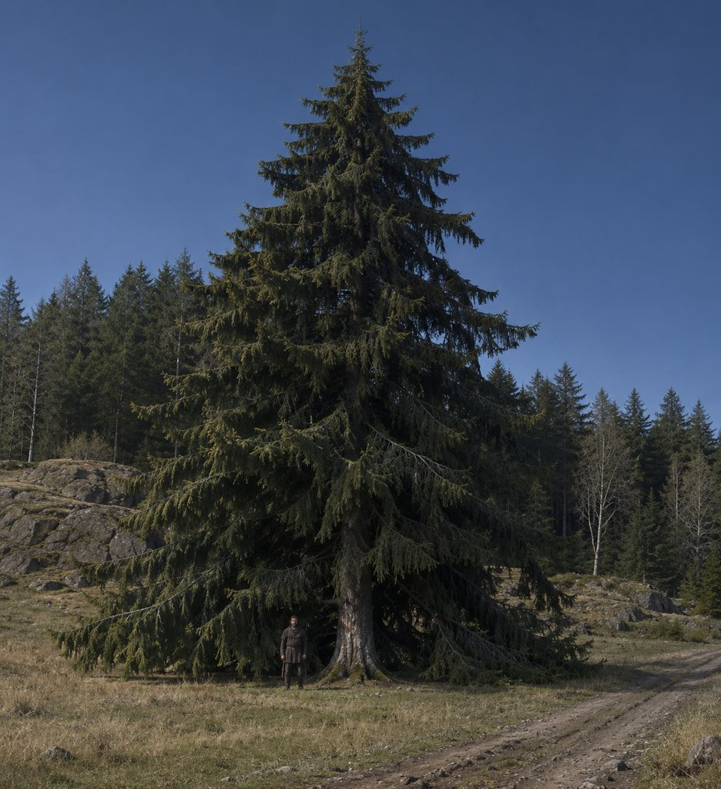
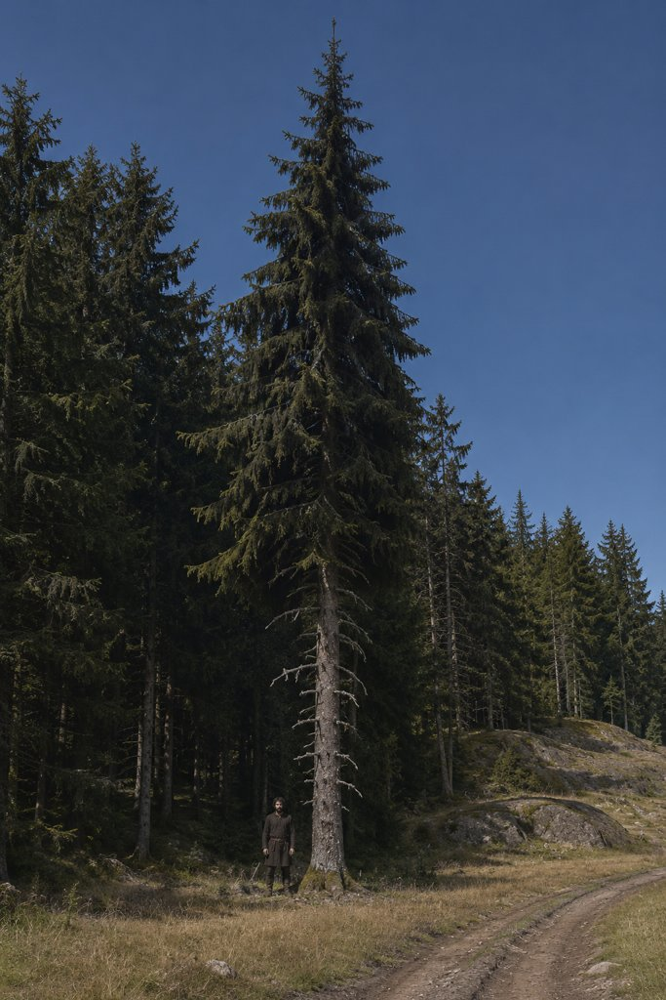

# Ель: замысел

Дата: 2026-11-16. Статус: лист замысла написан, концепты ждут выбора пользователя. Первая порода [современных деревьев](../../../engine/2026-11-16-modern-trees/README.md) (решение пользователя 2026-11-16).

## Замысел

### Роль в игре

- **Ель — главное дерево острова:** 1 144 из 2 344 деревьев и ещё 215 высоких елей. Где стоят ели, там лес.
- **Что она говорит игроку:** здесь дикая, сырая и тёмная земля вне города. Еловый лес — место, где не видно далеко и где ждёшь волка.
- **Игровые ограничения:** ствол — коллизия, хвоя — нет. Нижние ветви закрывают обзор на уровне глаз: за елью прячется враг и прячется игрок. 37 точек путей проходят ближе 2 м к стволу, поэтому ветви у земли не должны читаться стеной.

### Место

- **Соседи:** лесная подстилка из бурой хвои и листьев, папоротник, серо-бурая скала, трава луга у дороги.
- **Свет:** на опушке — солнце сверху и сбоку; в лесу — глубокая тень с редкими пятнами света.
- **Дистанция:** от 2 м (игрок идёт сквозь ветви) до сотен метров (стена леса на склоне).

Цвета, снятые с кадров оригинала ([`onar-road.jpg`](../../2026-11-landscape-pilot/shots/onar-road.jpg), [`forest.jpg`](../../2026-11-landscape-pilot/shots/forest.jpg)); области взяты грубо, это ограничители:

| Что | Среднее | Светлое | Тёмное |
|---|---|---|---|
| Ель на опушке днём | `#161d22` | `#3a474e` | `#0c1115` |
| Ель в лесу в тени | `#0a0e0d` | `#0e1310` | `#070b0a` |
| Трава на солнце | `#4f472e` | `#675c45` | `#26251a` |
| Скала на солнце | `#5a4c3b` | `#8e7e68` | `#211a14` |
| Подстилка в лесу | `#13130f` | `#1b1b17` | `#0b0b08` |

Текстура хвои оригинала в среднем `(33, 40, 8)`: жёлто-оливковая, синего нет. В кадре ель холоднее и темнее текстуры: её красит небо.

### Чем оригинал читается

Сохранить:

- **Силуэт:** широкий конус с юбкой до самой земли, ярусы ветвей свисают лапами.
- **Тёмное пятно:** ель темнее травы, скалы и неба — самое тёмное в пейзаже после тени.
- **Гамма:** тёмная оливково-зелёная хвоя, на солнце жёлто-оливковые края; кора холодная серо-бурая.
- **Плотность:** сквозь крону почти не видно неба.

Улучшить:

- **Крона из 75 треугольников:** ярусы — плоские диски, лапы нарисованы на них. Нужны настоящие ветви и объём.
- **Ствол** — трёхгранная призма без корней: нужен круглый ствол с корневыми лапами и сухими сучьями внизу.
- **Пропорция:** 12 м в высоту при 11 м в ширину. У настоящей ели такой ширины высота 18–25 м.
- **Одинаковость:** одна модель на 1 144 дерева.

### Происхождение

Ель обыкновенная, выросшая сама: никто её не сажал и не ухаживал. Возраст 40–80 лет. На опушке и у дороги ветви живые до земли; в лесу нижние ветви отмерли от тени и торчат сухими сучьями в лишайнике. Кора чешуйчатая, серо-бурая, с потёками смолы; у корня мох. Хвоя 1–2,5 см, тёмная сверху; молодые концы лап светлее.

### Конструкция

| Часть | Размер |
|---|---|
| Высота | 18 м (вариант А), 12 м (вариант Б), 22 м (вариант В) |
| Ширина кроны у земли | 9–10 м (А, Б), 7 м (В) |
| Ствол у земли | 0,5–0,7 м, корневые лапы до 1,2 м |
| Ярусы ветвей | мутовки через 0,5–0,8 м; ветви первого порядка от 4,5 м внизу до 0,5 м у вершины |
| Лапы | ветви второго порядка свисают с первых на 0,5–1,5 м |
| Вершина | один прямой побег 0,6–1 м |

Экземпляры ставятся с масштабом так, чтобы ширина кроны совпала с шириной ели оригинала на этом месте: площадь под кронами и темнота леса сохраняются.

### Материал и цвет

- **Хвоя:** темнее травы луга и холоднее её; на солнце — оливковая, без изумрудного и без синего елового «серебра».
- **Кора:** холодная серо-бурая, темнее скалы; мох у корня того же тона, что мох на камнях пилота.
- **Сухие сучья:** серые, светлее коры.

### Чего избегать

- рождественская ёлка: ровный конус, одинаковые ярусы, пушистая и симметричная;
- яркая, изумрудная или голубая хвоя;
- «фэнтези-дерево»: витой ствол, светящийся мох, гигантские корни;
- стриженая плотная поверхность кроны без просветов между ярусами;
- сосна или кедр вместо ели: зонтик наверху и голый ствол (это высокая ель оригинала, отдельный вид);
- снег, шишки гирляндами, солнечные лучи сквозь туман как на открытке.

## Варианты концепта

| Вариант | Что это | Зачем |
|---|---|---|
| А | ель в природной пропорции: 18 × 10 м, юбка до земли | как в жизни; ширина оригинала сохранена, высота больше |
| Б | приземистая широкая ель 12 × 10 м, тяжёлые нижние ветви лежат на земле | пропорция оригинала буквально |
| В | лесная ель 22 × 7 м: сухие сучья внизу, живая крона с 6 м | для глубины леса; открывает обзор у земли |

## Концепты

Сняты 2026-11-16 через `image_gen`, по одному кадру «дерево на своём месте» на вариант. Полные PNG — вне git, в `~/.local/share/gothic-ai/content-sources/trees-fir/fir-concept-{a,b,c}-scene.png`.

| А: природная пропорция | Б: пропорция оригинала | В: лесная |
|---|---|---|
|  |  |  |

Суждение:

- **Форма** во всех трёх — ель, а не ёлка с открытки: ярусы неровные, лапы свисают, между ярусами тень.
- **А** читается самой «настоящей»; юбка до земли и ширина оригинала сохранены.
- **Б** ближе всех к силуэту оригинала, но такая ель в жизни — редкое старое одиночное дерево; тысяча таких подряд будет выглядеть странно.
- **В** открывает обзор у земли и даёт вертикали стволов; на опушке одна она смотрится голой.
- **Цвет** у генератора зеленее и светлее замера сцены (`#161d22`): палитру модели берём из замера, а не с концепта.

Общая часть промпта (у вариантов отличается первое предложение — порода, высота, ширина, нижние ветви):

> Wild self-seeded tree, 40 to 80 years old, never tended. Whorls of branches every 0.5 to 0.8 m, each bough carrying hanging secondary sprays of short dark needles, visible gaps of shadow between the tiers, irregular: a few boughs longer, one side slightly thinner, a single straight leader shoot at the top. Trunk 0.6 m thick at the ground with low root flares, scaly cold grey-brown bark with resin streaks and a little moss at the foot. Needle colour is dark, cold and muted: the tree is the darkest thing in the landscape, average #161d22, sunlit edges of the sprays olive #3a472e, deep shadow inside the crown #0c1115; no emerald, no blue-silver, no bright green. Setting: edge of a wild forest on a temperate island, late medieval, a rutted dirt road and a meadow of dry yellow-green grass #4f472e, weathered grey-brown rock outcrops #5a4c3b, dark forest behind, clear midday sun from the upper left, deep blue sky #2a4469. A man 1.8 m tall in dark clothes stands at the foot of the tree for scale. Realistic, like a photograph of a real place, slightly grim and plain, muted low saturation, natural contrast. The whole tree is in frame from the ground to the tip, seen from 30 m away at eye height. Not a Christmas tree: no perfect cone, no symmetric even tiers, no fluffy trimmed surface. No fantasy shapes, no twisted trunk, no glowing moss, no giant roots, no snow, no cones in garlands, no god rays, no fog, no text, no logos.

- А: «One Norway spruce in its natural proportion, 18 m tall and 10 m wide at the base, a broad cone with a living skirt of branches reaching down to the ground; the lowest boughs are 4.5 m long and droop until their tips touch the grass.»
- Б: «One old squat Norway spruce, only 12 m tall but 10 m wide at the base, almost as wide as it is tall, very heavy long lower boughs resting on the ground and sweeping outward, a blunt broad pyramid.»
- В: «One forest-grown Norway spruce, 22 m tall and 7 m wide, a narrow tall crown; the lowest 6 m of the trunk carry only dead bare grey snags and stubs with pale lichen, the living dark crown starts 6 m above the ground, so one can see under it. It stands just inside the forest edge among other dark spruces.»
