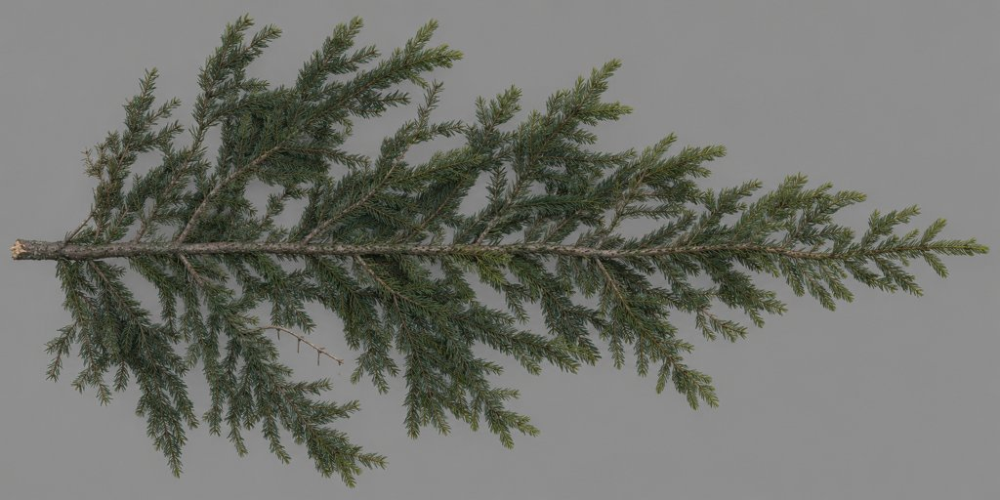
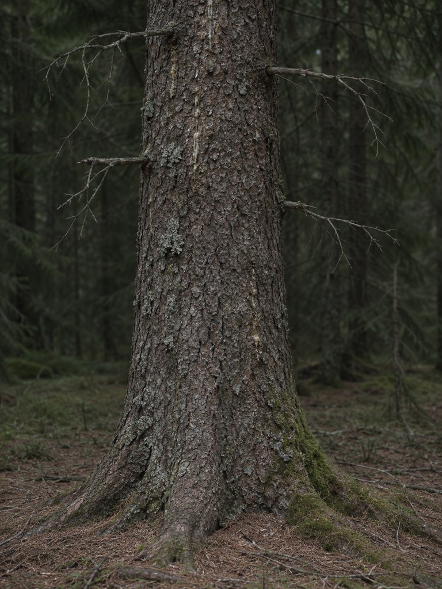
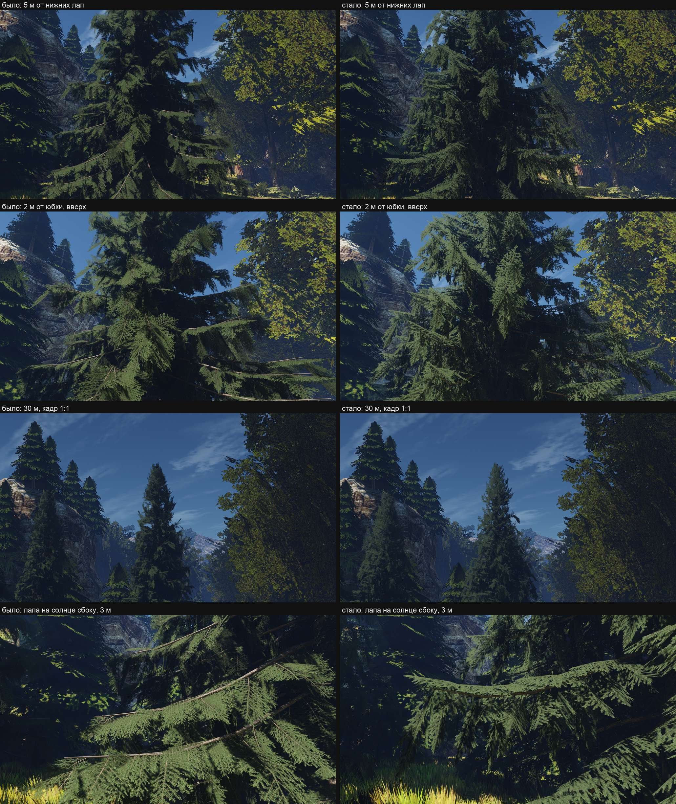
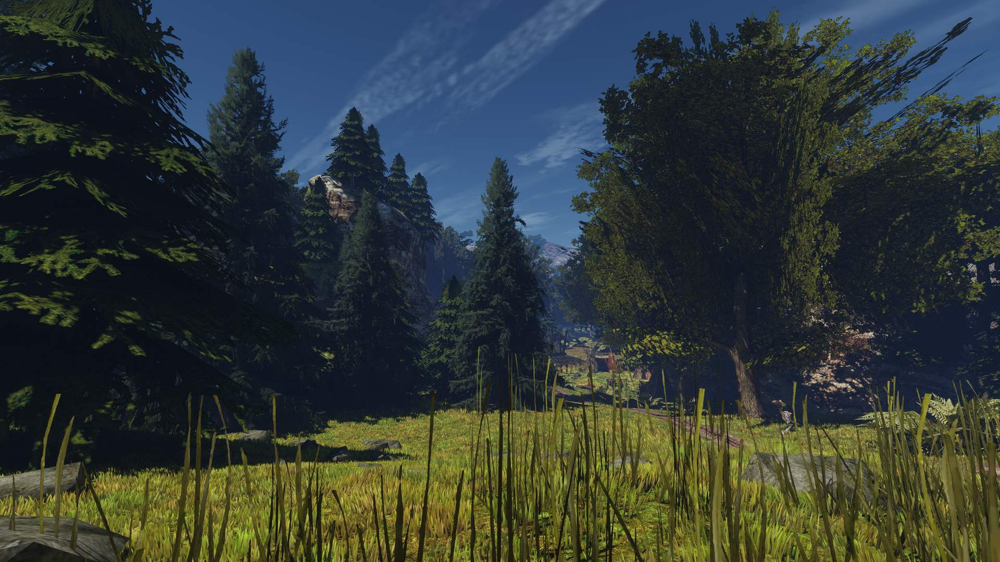
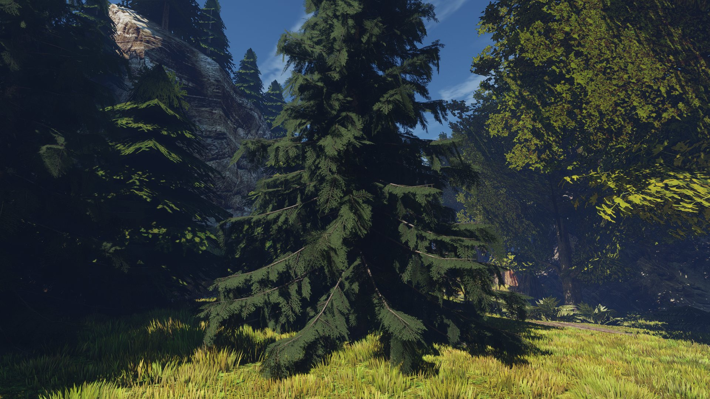
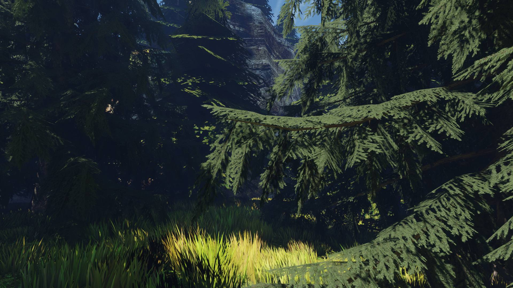

# Ель: замысел и модель

Дата: 2026-11-16, модель — 2026-11-17. Статус: пользователь 2026-11-16 выбрал варианты А и В; ближний уровень ели А построен и снят в игре на пробе ([«Модель»](#модель)), приёмка вида — за ведущим и пользователем. Первая порода [современных деревьев](../../../engine/2026-11-16-modern-trees/README.md) (решение пользователя 2026-11-16).

## Замысел

### Роль в игре

- **Ель — главное дерево острова:** 1 144 из 2 344 деревьев и ещё 215 высоких елей. Где стоят ели, там лес.
- **Что она говорит игроку:** здесь дикая, сырая и тёмная земля вне города. Еловый лес — место, где не видно далеко и где ждёшь волка.
- **Игровые ограничения:** ствол — коллизия, хвоя — нет. Нижние ветви закрывают обзор на уровне глаз: за елью прячется враг и прячется игрок. 37 точек путей проходят ближе 2 м к стволу, поэтому ветви у земли не должны читаться стеной.

### Место

- **Соседи:** лесная подстилка из бурой хвои и листьев, папоротник, серо-бурая скала, трава луга у дороги.
- **Свет:** на опушке — солнце сверху и сбоку; в лесу — глубокая тень с редкими пятнами света.
- **Дистанция:** от 2 м (игрок идёт сквозь ветви) до сотен метров (стена леса на склоне).

Цвета, снятые с кадров оригинала ([`onar-road.jpg`](../../2026-11-landscape-pilot/shots/onar-road.jpg), [`forest.jpg`](../../2026-11-landscape-pilot/shots/forest.jpg)); области взяты грубо, это ограничители:

| Что | Среднее | Светлое | Тёмное |
|---|---|---|---|
| Ель на опушке днём | `#161d22` | `#3a474e` | `#0c1115` |
| Ель в лесу в тени | `#0a0e0d` | `#0e1310` | `#070b0a` |
| Трава на солнце | `#4f472e` | `#675c45` | `#26251a` |
| Скала на солнце | `#5a4c3b` | `#8e7e68` | `#211a14` |
| Подстилка в лесу | `#13130f` | `#1b1b17` | `#0b0b08` |

Текстура хвои оригинала в среднем `(33, 40, 8)`: жёлто-оливковая, синего нет. В кадре ель холоднее и темнее текстуры: её красит небо.

### Чем оригинал читается

Сохранить:

- **Силуэт:** широкий конус с юбкой до самой земли, ярусы ветвей свисают лапами.
- **Тёмное пятно:** ель темнее травы, скалы и неба — самое тёмное в пейзаже после тени.
- **Гамма:** тёмная оливково-зелёная хвоя, на солнце жёлто-оливковые края; кора холодная серо-бурая.
- **Плотность:** сквозь крону почти не видно неба.

Улучшить:

- **Крона из 75 треугольников:** ярусы — плоские диски, лапы нарисованы на них. Нужны настоящие ветви и объём.
- **Ствол** — трёхгранная призма без корней: нужен круглый ствол с корневыми лапами и сухими сучьями внизу.
- **Пропорция:** 12 м в высоту при 11 м в ширину. У настоящей ели такой ширины высота 18–25 м.
- **Одинаковость:** одна модель на 1 144 дерева.

### Происхождение

Ель обыкновенная, выросшая сама: никто её не сажал и не ухаживал. Возраст 40–80 лет. На опушке и у дороги ветви живые до земли; в лесу нижние ветви отмерли от тени и торчат сухими сучьями в лишайнике. Кора чешуйчатая, серо-бурая, с потёками смолы; у корня мох. Хвоя 1–2,5 см, тёмная сверху; молодые концы лап светлее.

### Конструкция

| Часть | Размер |
|---|---|
| Высота | 18 м (вариант А), 12 м (вариант Б), 22 м (вариант В) |
| Ширина кроны у земли | 9–10 м (А, Б), 7 м (В) |
| Ствол у земли | 0,5–0,7 м, корневые лапы до 1,2 м |
| Ярусы ветвей | мутовки через 0,5–0,8 м; ветви первого порядка от 4,5 м внизу до 0,5 м у вершины |
| Лапы | ветви второго порядка свисают с первых на 0,5–1,5 м |
| Вершина | один прямой побег 0,6–1 м |

Экземпляры ставятся с масштабом так, чтобы ширина кроны совпала с шириной ели оригинала на этом месте: площадь под кронами и темнота леса сохраняются.

### Материал и цвет

- **Хвоя:** темнее травы луга и холоднее её; на солнце — оливковая, без изумрудного и без синего елового «серебра».
- **Кора:** холодная серо-бурая, темнее скалы; мох у корня того же тона, что мох на камнях пилота.
- **Сухие сучья:** серые, светлее коры.

### Чего избегать

- рождественская ёлка: ровный конус, одинаковые ярусы, пушистая и симметричная;
- яркая, изумрудная или голубая хвоя;
- «фэнтези-дерево»: витой ствол, светящийся мох, гигантские корни;
- стриженая плотная поверхность кроны без просветов между ярусами;
- сосна или кедр вместо ели: зонтик наверху и голый ствол (это высокая ель оригинала, отдельный вид);
- снег, шишки гирляндами, солнечные лучи сквозь туман как на открытке.

## Варианты концепта

| Вариант | Что это | Зачем |
|---|---|---|
| А | ель в природной пропорции: 18 × 10 м, юбка до земли | как в жизни; ширина оригинала сохранена, высота больше |
| Б | приземистая широкая ель 12 × 10 м, тяжёлые нижние ветви лежат на земле | пропорция оригинала буквально |
| В | лесная ель 22 × 7 м: сухие сучья внизу, живая крона с 6 м | для глубины леса; открывает обзор у земли |

## Концепты

Сняты 2026-11-16 через `image_gen`, по одному кадру «дерево на своём месте» на вариант. Полные PNG — вне git, в `~/.local/share/gothic-ai/content-sources/trees-fir/fir-concept-{a,b,c}-scene.png`. Записи всех пяти концептов (три сцены, лапа, комель) — в реестре [`data/content/registry.jsonl`](../../../../data/content/registry.jsonl), `trees-fir-concept-*`.

| А: природная пропорция | Б: пропорция оригинала | В: лесная |
|---|---|---|
|  |  |  |

**Выбор пользователя, 2026-11-16: «А и В».** А — ель опушек и дорог, В — ель глубины леса. Вариант Б не делаем.

Суждение:

- **Форма** во всех трёх — ель, а не ёлка с открытки: ярусы неровные, лапы свисают, между ярусами тень.
- **А** читается самой «настоящей»; юбка до земли и ширина оригинала сохранены.
- **Б** ближе всех к силуэту оригинала, но такая ель в жизни — редкое старое одиночное дерево; тысяча таких подряд будет выглядеть странно.
- **В** открывает обзор у земли и даёт вертикали стволов; на опушке одна она смотрится голой.
- **Цвет** у генератора зеленее и светлее замера сцены (`#161d22`): палитру модели берём из замера, а не с концепта.

Общая часть промпта (у вариантов отличается первое предложение — порода, высота, ширина, нижние ветви):

> Wild self-seeded tree, 40 to 80 years old, never tended. Whorls of branches every 0.5 to 0.8 m, each bough carrying hanging secondary sprays of short dark needles, visible gaps of shadow between the tiers, irregular: a few boughs longer, one side slightly thinner, a single straight leader shoot at the top. Trunk 0.6 m thick at the ground with low root flares, scaly cold grey-brown bark with resin streaks and a little moss at the foot. Needle colour is dark, cold and muted: the tree is the darkest thing in the landscape, average #161d22, sunlit edges of the sprays olive #3a472e, deep shadow inside the crown #0c1115; no emerald, no blue-silver, no bright green. Setting: edge of a wild forest on a temperate island, late medieval, a rutted dirt road and a meadow of dry yellow-green grass #4f472e, weathered grey-brown rock outcrops #5a4c3b, dark forest behind, clear midday sun from the upper left, deep blue sky #2a4469. A man 1.8 m tall in dark clothes stands at the foot of the tree for scale. Realistic, like a photograph of a real place, slightly grim and plain, muted low saturation, natural contrast. The whole tree is in frame from the ground to the tip, seen from 30 m away at eye height. Not a Christmas tree: no perfect cone, no symmetric even tiers, no fluffy trimmed surface. No fantasy shapes, no twisted trunk, no glowing moss, no giant roots, no snow, no cones in garlands, no god rays, no fog, no text, no logos.

- А: «One Norway spruce in its natural proportion, 18 m tall and 10 m wide at the base, a broad cone with a living skirt of branches reaching down to the ground; the lowest boughs are 4.5 m long and droop until their tips touch the grass.»
- Б: «One old squat Norway spruce, only 12 m tall but 10 m wide at the base, almost as wide as it is tall, very heavy long lower boughs resting on the ground and sweeping outward, a blunt broad pyramid.»
- В: «One forest-grown Norway spruce, 22 m tall and 7 m wide, a narrow tall crown; the lowest 6 m of the trunk carry only dead bare grey snags and stubs with pale lichen, the living dark crown starts 6 m above the ground, so one can see under it. It stands just inside the forest edge among other dark spruces.»

### Лапа и комель

Рабочие концепты для модели, 2026-11-16: лапа сверху — для атласа веток, комель — для коры, корневых лап и сухих сучьев. Листа видов спереди, сбоку и сверху у дерева нет: его форму задают числа конструкции, а не контур. Полные PNG — `fir-concept-bough.png` и `fir-concept-foot.png` там же.

| Лапа | Комель |
|---|---|
|  |  |

- Лапа: «One single bough of a wild Norway spruce cut from the tree and laid flat, photographed straight from above, orthographic top-down view, on a plain uniform mid-grey background. The bough is 2.5 m long, the main woody branch runs horizontally from the cut end at the left edge to the tip at the right; from it grow side branches left and right in a flat herringbone fan, each with smaller twigs densely covered in short dark needles 1.5 to 2 cm long; the fan is 1.2 m wide at its widest and narrows to the tip; the outer shoots are slightly lighter. Irregular and natural: uneven side branches, a few gaps, one broken dry twig. Needles dark cold muted green, average #1c2620, lighter shoot tips olive #3a472e; bark of the branch grey-brown #4a4038. Even soft overcast light, no cast shadow on the background, no highlights, sharp focus over the whole bough, the whole bough inside the frame with a margin. Realistic photograph for a botanical reference. No cones, no snow, no text, no logos, no hands, no tools.»
- Комель: «The foot of an old wild Norway spruce trunk seen from 3 m away at eye height, the lowest 2.5 m of the trunk in frame. Trunk 0.6 m thick, slightly tapering, low root flares spreading 1.2 m into a floor of brown fallen needles and a little moss; bark of thin round scales, cold grey-brown #4a4038 with darker cracks #1f1a16, a few pale resin streaks and patches of grey-green lichen, moss on the root flares on one side. Four dead bare branch stubs and thin dry grey twigs stick out of the trunk at 1.5 to 2.5 m. Dim even forest shade, no direct sun, dark blurred spruce forest behind. Realistic photograph, plain and slightly grim, muted low saturation. No fantasy shapes, no twisted trunk, no glowing moss, no mushrooms, no people, no text, no logos.»

## Модель

Ель А, ближний уровень, 2026-11-17. Строится скриптом без ручных шагов; случайное зерно даёт другое дерево той же породы. В тот же день лапы переделаны одним кругом правки по решению пользователя: что изменилось и что осталось плохо — в разделе [«Круг правки лап»](#круг-правки-лап).


Лист: концепт А; рендер Blender с точки концепта (30 м, глаз на высоте роста, фигура 1,8 м у ствола) и тот же вид через четверть оборота; нижние лапы с 3 м; два вида сбоку без земли, по которым считается плотность.

### Что построено

- **Форма** — [`fir_tree.py`](../../../../scripts/content/mesh3d/blender/fir_tree.py) по числам таблицы «Конструкция», числа варианта — в [`fir.json`](../../../../scripts/content/mesh3d/blender/fir.json). Ствол и ветви первого порядка — геометрия: прямой ствол с пятью корневыми лапами, 235 ветвей мутовками и между ними, 4 сухих сучка под кроной. Ветвь провисает, конец приподнят; её нормали смотрят вниз, поэтому солнце её не высвечивает — это кора в тени кроны, текстура коры та же.
- **Лапы** — 3 612 карточек атласа. Карточка не лежит в одной плоскости: два крыла опущены от хребта сводом, хребет провисает с поднятым концом, длинная карточка согнута ещё раз посередине. У висящей лапы и у веера на конце ветви есть третье крыло поперёк двух первых, так что ребром к камере они не встают ни с какой стороны.
- **Ветвь под лапами.** Над осью каждой ветви от конца до первых 30 % длины лежит «крыша» из вееров внахлёст, как черепица: сверху ось закрыта побегами, голая она только в глубине кроны у ствола. Вокруг оси по очереди идут наклонные лапы и висящие — вдоль ветви и поперёк неё; в вершине кроны висящие стоят на ветви. На самом стволе — короткие лапы («рукав»).
- **Сторонний генератор деревьев (Sapling, MTree) не используется.** Форму задают числа таблицы, а разметку ветра в вершине, карточки и юбку на земле всё равно пишет свой код. Генератор на NumPy работает и без Blender, поэтому ель собирается и проверяется тестом в CI.
- **Атлас лап** — [`fir_boughs.py`](../../../../scripts/content/mesh3d/blender/fir_boughs.py): девять лап шести видов (веер, две висящие, две боковые, редкая из глубины кроны, два концевых побега, короткие побеги для верха оси) собраны геометрией и сняты сверху. Побег — ёршик: хвоинки 13–19 мм стоят вокруг него, кроме нижней четверти. Боковые побеги уходят от оси вниз и свисают, концы приподняты. Кроме цвета запекаются доля неба над точкой (тень между побегами и под ними) и высота; нормаль считается из высоты. Лист 2048 px, 1000 px на метр, каждая лапа — в размере своей карточки. Концепт лапы — эталон повадки, картинка не используется.
- **Кора** — [`fir_bark.py`](../../../../scripts/content/mesh3d/blender/fir_bark.py): чешуи, лишайник, потёки смолы, мох у комля, тоже геометрией. Лист 2 × 4 м: нижние 40 % — комель, один раз; верх повторяется по стволу и ветвям.
- **Текстуры** — [`fir_set.py textures`](../../../../scripts/content/fir_set.py): по три DDS на материал (цвет, нормаль, ORM), 2048 px. Покрытие атласа 18,2 % на всех 12 уровнях. Запечённая тень между побегами и в трещинах коры внесена в цвет: карта AO в движке гасит только свет неба. Света хвои прижаты: светлая десятая часть листа — 1,3 от среднего.
- **Файл** — [`fir.py`](../../../../scripts/content/mesh3d/blender/fir.py) пишет GLB (1,27 МБ), `metrics.json`, картинку плотности и `.blend`. Два материала: `OWN_TREE_FIR_BARK` и `OWN_TREE_FIR_BOUGHS`. Начало координат — центр ствола на земле.
- **Стороны карточки.** Треугольник карточки записан один раз, а запись материала лап несёт `"two_sided": "same"`: движок рисует обе стороны, даёт от них тень и освещает их одной нормалью ([двусторонние материалы](../../../engine/2026-11-16-modern-trees/two-sided.md), 2026-11-17). До этого каждый треугольник писался дважды с обратным обходом по тем же вершинам; этот режим остался под флагом `--pairs` у `fir.py` и `fir_set.py probe`. Вид ели от замены не изменился. Нормали карточек — от оболочки кроны с долей собственной (35 %), чтобы крылья одной лапы освещались по-разному.
- **Ветер** — `COLOR_0`, четыре нормированных байта, раскладка [ветра дерева](../../../engine/2026-11-16-modern-trees/tree-wind.md): R — вес ветви, G — фаза ветви, B — дрожь листа, A — открытость кроны. Обе записи материалов несут `"foliage": {"anchor": "tree", "wind": 1}`; у лап ещё `flutter: 1` и `translucency: 0.35`. Эти значения круг правки лап не менял.

### Числа

Ель А, зерно 7; всё прочитано обратно из записанного файла ([`tree_check.py`](../../../../scripts/content/mesh3d/blender/tree_check.py), [`tree_density.py`](../../../../scripts/content/mesh3d/blender/tree_density.py)).

| Что | Число | Цель |
|---|---|---|
| Рисуемые треугольники | 26 759: кора 6 422, лапы 20 337 под двусторонним материалом (с двойниками, `--pairs`, — 47 096) | до 50 000 |
| Вершины | 30 670 | — |
| Высота | 18,07 м | 18 ± 0,5 м |
| Ширина кроны у земли | 9,48 и 9,44 м | 9–10 м по обеим осям |
| Ствол | 0,59 м над корневыми лапами, 0,97 м с лапами у земли; корни расходятся на 1,19 м | 0,5–0,7 м, лапы до 1,2 м |
| Вывернутые части | 0 из 240 замкнутых | 0 |
| glTF Validator | 0 ошибок, 0 предупреждений | без ошибок |

Бюджет поднят с 45 000 до 50 000 заданием круга правки. Карточек стало меньше (3 612 против 4 090), треугольников на карточку — больше: свод, сгиб и третье крыло.

Плотность кроны — по двум видам сбоку через 90°, без земли, выше 3 м:

| Что | Вдоль Y | Вдоль X | Предел |
|---|---|---|---|
| Фон внутри контура кроны | 10,0 % | 9,2 % | 15 % |
| Ствол открыт, доля длины | 4,6 % | 4,5 % | 10 % |

Как считается: вид рисуется из файла, 48 пикселей на метр, 3 × 3 луча на пиксель; карточка есть там, где есть покрытие атласа. Контур кроны — картинка дерева, замкнутая диском 0,1 м, с залитыми дырами: он повторяет выемки между ярусами и берёт все просветы внутри. Строка ствола открыта, если больше половины его ширины ничем не закрыто. Мера откалибрована по концепту А: его картинка — 47 пикселей на метр, верхняя треть на фоне неба даёт 5,3–5,9 %. С диском 0,4 м, который перекрывает выемки между ярусами, у концепта выходит 17–20 %. У первой модели та же мера по рендерам Blender без земли давала 10,5 и 11,4 % — счёт по файлу и по картинке сходился; у новой модели по рендерам она не пересчитывалась.

Плоскости лап и укрытие осей считает [`fir_tree.py`](../../../../scripts/content/mesh3d/blender/fir_tree.py) (`card_planes`, `axis_cover`), пределы — в `cards.rules` конфига; при нарушении `fir.py` выходит с кодом 1.

| Роль карточки | Сколько | Наименьший разворот плоскостей | Предел |
|---|---|---|---|
| Веер на конце ветви | 235 | 62,5° | не меньше 45° |
| Висящая лапа | 1 065 | 61,2° | не меньше 45° |
| Крыша над осью | 649 | 33,1° | не меньше 20° |
| Боковая лапа | 1 266 | 39,8° | не меньше 20° |
| Рукав на стволе | 389 | 33,7° | не меньше 20° |
| Лапы вершины | 8 | 43,6° | не меньше 20° |

- **Разворот плоскостей** лапы — наибольший угол между плоскостями двух её треугольников, от 0 до 90°. У плоского листа он 0°. В таблице — худшая карточка каждой роли.
- **Укрытие оси.** Ось каждой живой ветви берётся точками через 0,1 м от 30 % её длины до конца; ближе к стволу — глубина кроны, там ось может быть голой. Точка укрыта, если при взгляде строго сверху над верхом ветви в этом месте лежит карточка той же ветви и покрытие атласа там сплошное. Укрыто 93,3 % из 3 568 точек при пределе 85 %; у худшей ветви — 66,7 %.

Раскладка `COLOR_0`: у ствола R = G = B = 0 и A = 255 во всех 435 вершинах; у 239 ветвей и сучков 239 своих фаз, R растёт вдоль ветви от нуля у ствола (корреляция с длиной не ниже 0,999); у всех 3 612 карточек фаза своей ветви, одна вершина-черенок с B = 0 на оси ветви (не дальше 2,9 см от неё), B = 255 на свободном крае и вершины с B между ними — дрожь нарастает, а не включается ступенькой; каждый из 20 337 треугольников карточек записан один раз (в режиме пар все 20 337 пар целы); открытость A растёт от ствола к контуру кроны (корреляция 0,94).

Тест [`test_fir_tree.py`](../../../../scripts/content/mesh3d/blender/test_fir_tree.py) собирает ель без Blender и держит размер, бюджет, плотность, раскладку, разворот плоскостей по ролям и укрытие осей; отдельно проверяет, что плоская карточка меряется как 0°, а ветвь в стороне от своей карточки — как голая.

### Круг правки лап

Первый вид ведущий не принял: рисунок лапы плоский, как папоротник; карточка — плоский лист; оси ветвей светлые и прямые; хвоя вблизи на солнце светлее и зеленее замера.



Слева — набор `fir-probe-1`, справа — `fir-probe-2`: те же места, зёрна и камеры, полдень, по одному прогону [`fir-probe.bench`](../../../../scripts/bench/fir-probe.bench) на Ryzen, 2560 × 1440.

**Что сделано и почему**

- **Рисунок лапы.** Побеги с хвоей вокруг, свисающие боковые веточки, тень между побегами и нормаль из настоящей высоты — в атласе, как описано выше.
- **Размер листа не менялся, раскладка другая.** 2048 px оставлен, плотность поднята с 700 до 1000 px на метр, лап девять вместо семи, каждая мельче и в размере своей карточки. Причина: с 5 м экран 1440p даёт 215 px на метр. Хвоинка на нём меньше пикселя при любом листе, а побег толщиной 3 см — 6 пикселей. Лист 4096 px добавил бы вчетверо памяти и деталь, которую с 5 м не видно.
- **Рисунок сделан ажурным.** Первая попытка — плотная лапа со сплошным покрытием внутри контура — дала на рендере «зелёную бумагу»: карточка читалась сплошной пластиной, что бы на ней ни было нарисовано. Лапа собрана заново по годовым узлам: толстые побеги ёлочкой и просветы между ними. Покрытие листа упало с 25,3 до 18,2 %.
- **Запекание — на Mac.** Атлас считается около 25 секунд (Cycles, 48 проходов), поэтому очередь Ryzen не занималась.
- **Карточки и ветви** — свод, сгиб, третье крыло, крыша над осью и нормали ветвей, как в «Что построено».
- **Цвет: сначала причина.** Кадр с `translucency: 0` против `0.35` на том же наборе: медиана и светлые 10 % ели с 5 м — `(26, 34, 37)` и `(94, 108, 86)` против `(26, 34, 38)` и `(93, 108, 86)`. Просвет ни при чём. В старом атласе светлая десятая часть была в 1,8–2,1 раза светлее среднего: молодой прирост вдвое светлее хвои и светлые веточки. Теперь прирост светлее в 1,3 раза, веточки темнее хвои, света прижаты при упаковке; средний цвет хвои `(31, 38, 24)` вместо `(33, 40, 23)`.

**Что видно в парах** — смотрел сам, полные кадры: [5 м](shots/game-near.jpg), [2 м](shots/game-close.jpg), [30 м](shots/game-far.jpg), [лапа сбоку](shots/game-bough.jpg).

- **5 м.** Папоротника нет: ярусы читаются еловыми, с ветвей свисает бахрома веточек, между ярусами тень. Светлых палок над лапами нет. Хвоя темнее и серее. Но одиночные крупные висящие лапы, повёрнутые лицом к камере (верх середины кадра), читаются плоским остроконечным пером. Освещённая карточка — ровное светлое пятно с зубчатым краем: объёма хвои вокруг побега с 5 м не видно, видна только ажурность.
- **2 м, вверх.** Ребром к камере листов нет. Крупные висящие лапы на солнце — бледные плоские перья: плоскость лица карточки читается.
- **3 м, лапа сбоку.** Ось тёмная и лежит под крышей побегов, с неё свисают веточки, свод даёт ветви толщину. Сами карточки — вырезки с размытой хвоей; на крыльях под скользящим углом рисунок тянется полосами.
- **30 м.** Ель читается елью, как и раньше; контур чуть более рваный, вершина реже. Тон тот же.

**Итог: частично.** Папоротник, листы ребром и светлые оси ушли. Объём хвои с 5 м лапы не получили: крупная висящая лапа всё ещё читается плоской. Круг один, дальше подбором не шёл. Во что упирается:

- **Свет движка.** Карточка освещается одной нормалью на обе стороны и целиком: побег не бросает тень на соседний. Запечённая тень даёт внутри рисунка перепад около 1,3 раза, а солнце против тени в кадре — около 3,4 раза (светлые 10 % `(89, 105, 86)` при медиане `(24, 31, 36)`). Поэтому на солнце карточка — ровное светлое пятно, в тени — ровное тёмное, и объём, который в жизни рисует свет, не читается. Нормаль из высоты с 5 м усредняется уровнями текстуры.
- **Число карточек.** Висящая лапа 0,9 × 0,44 м — одна картинка на трёх крыльях. Чтобы она стала гроздью, её надо набирать из трёх-четырёх мелких побегов под разными углами: по грубому счёту это около 13 000 рисуемых треугольников сверх бюджета 50 000. Двусторонние материалы освободили бы 20 337.
- **Атлас не упирается:** хвоинку с 5 м экран не показывает ни при 2048, ни при 4096 px.

**Цвет в кадрах** (sRGB; области грубые, небо вычтено; «было» и «стало» — в одних и тех же областях, поэтому числа «было» немного отличаются от первой таблицы ниже):

| Что | Медиана, было | Светлые 10 %, было | Медиана, стало | Светлые 10 %, стало |
|---|---|---|---|---|
| Ель А с 30 м | `(21, 28, 39)` | `(74, 89, 85)` | `(22, 30, 39)` | `(70, 86, 86)` |
| Ели оригинала в том же кадре | `(21, 33, 48)` | `(61, 77, 61)` | `(21, 33, 48)` | `(61, 77, 61)` |
| Ель А с 5 м, вся крона с краем | `(26, 34, 38)` | `(93, 108, 86)` | `(24, 31, 36)` | `(89, 105, 86)` |
| Ель А с 5 м, середина кроны | `(21, 28, 34)` | `(85, 97, 70)` | `(19, 26, 33)` | `(77, 91, 68)` |
| Лапа на солнце с 3 м | `(46, 54, 42)` | `(138, 149, 101)` | `(21, 27, 32)` | `(115, 131, 87)` |
| Цель с 5 м | `(22–27, 30–35, 34–40)` | не светлее `(80, 92, 80)` | | |
| Замер сцены оригинала | `(22, 29, 34)` | `(58, 71, 78)` | | |

- **Цель по светам не достигнута.** По всей кроне светлые 10 % стали темнее на 3–4 единицы и остались выше цели на 9–13. В середине кроны, без края на фоне неба и соседних деревьев, красный и зелёный легли на цель, но синего мало: хвоя на солнце по-прежнему оливковая и зеленее замера. Медиана по всей кроне в цели.
- **Кадр с 3 м** сравнивает разные лапы: геометрия другая, и в кадр «стало» попало больше тени, отсюда тёмная медиана. Света там упали на 14–23 единицы — вблизи светлые кончики побегов были видны по отдельности.
- **С 30 м** ель не потемнела: медиана на 1–2 единицы светлее прежней. Она в пределах елей оригинала из первой таблицы (от `(17, 25, 37)` до `(23, 33, 48)`); ели на скале в этой области синее и немного светлее по медиане — они дальше и в дымке.
- **Почему света остались.** Атлас давал малую часть: с 5 м текстура усреднена, и светлые 10 % кадра — это средний цвет хвои под прямым солнцем на карточках, чьи нормали смотрят вверх. Оценка, не замер: чтобы уложить всю крону в цель, средний цвет надо затемнить примерно на четверть, и медиана уйдёт к `(21, 27, 32)`, ниже своей цели. Обе цели вместе при нынешнем свете не сходятся. Оттенок дают оливковый средний цвет и тёплое солнце; замер сцены снят с дальней ели, которую красит небо.

### В игре

Набор-проба `fir-probe-3` (`fir_set.py probe`, вне git): пять елей слоем предметов без коллизии на северной кромке луга к востоку от таверны, в 5–8 м южнее елей оригинала. У слоя предметов нет масштаба, поэтому каждый размер — свой GLB. Места, зёрна и масштабы те же, что у `fir-probe-1` и `fir-probe-2`. У `fir-probe-2` карточки записаны парами: те же ели весят 48 106, 46 880, 45 636, 47 096 и 44 814 треугольников, всего 232 532 против 132 106.

| Ель | Зерно | Масштаб | Высота | Треугольники | Фон в кроне | Ствол открыт | Оси укрыты |
|---|---|---|---|---|---|---|---|
| 1 | 33 | 1,2 | 21,7 м | 27 334 | 10,8 % | 7,5 % | 93,1 % |
| 2 | 21 | 1,1 | 19,8 м | 26 626 | 11,6 % | 5,1 % | 93,6 % |
| 3 | 48 | 0,8 | 14,4 м | 25 916 | 10,9 % | 5,3 % | 93,5 % |
| 4 — ель А | 7 | 1,0 | 18,1 м | 26 759 | 10,0 % | 4,6 % | 93,3 % |
| 5 | 59 | 0,9 | 16,2 м | 25 471 | 11,0 % | 8,3 % | 93,4 % |

У всех пяти наименьший разворот плоскостей — 60,3° у висящих лап, 62,3° у концевых вееров и 30,7° у остальных ролей.

Съёмка — [`fir-probe.bench`](../../../../scripts/bench/fir-probe.bench) на Ryzen, полдень, 2560 × 1440, в затишье после порыва. Полуденное солнце движка стоит на западе (−x) на высоте 57°, поэтому камеры смотрят на северо-восток. Кадры ниже — `fir-probe-2`; кадры `fir-probe-3` совпали с ними до шума прогона ([пары кадров и числа](../../../engine/2026-11-16-modern-trees/two-sided.md#ель)).

| 30 м | 5 м от нижних лап |
|---|---|
|  |  |

| 2 м от юбки, вверх в нижние ярусы | Лапа на солнце сбоку, 3 м |
|---|---|
|  |  |

- **30 м:** ель А — в центре кадра между елями оригинала на скале и большим деревом справа; слева от неё ель 3. Читается елью: ярусы свисают, вершина — один побег, ствол виден только у земли. Низ закрыт стеблями травы у камеры.
- **5 м и ближе** — в разделе [«Круг правки лап»](#круг-правки-лап).
- **Прогоны первой модели.** Первый (2026-11-17, 01:43–01:48) снял кадры из-под крон больших деревьев оригинала и против солнца: ели были не видны или в контровом свете. Ели и камеры переставлены под полуденное солнце, второй прогон (01:55–01:56) дал кадры первой модели.
- **Прогоны круга правки лап:** `fir-probe-1` с четвёртой камерой (07:26 UTC), он же с `translucency: 0` для поиска причины цвета, `fir-probe-2` (08:09 UTC).

Цвет первой модели в кадрах игры (sRGB; области взяты грубо, небо вычтено):

| Что | Медиана | Светлые 10 % |
|---|---|---|
| Ель А с 30 м | `(22, 30, 40)` | `(78, 92, 86)` |
| Ели оригинала в том же кадре | от `(17, 25, 37)` до `(23, 33, 48)` | от `(46, 56, 54)` до `(93, 96, 83)` |
| Ель А с 5 м | `(27, 35, 38)` | `(101, 114, 85)` |
| Трава луга на солнце, среднее | `(143, 139, 57)` | — |
| Замер сцены оригинала (выше) | `(22, 29, 34)` | `(58, 71, 78)` |

### Отличия от замысла

- **Цвет.** Палитра взята из замера сцены, не с концепта: средний цвет хвои в текстуре `(31, 38, 24)`, коры выше комля — `(74, 64, 56)`. С 30 м ель стоит в тоне елей оригинала и замера. Вблизи на солнце лапы светлее «светлого» замера и зеленее его — числа в круге правки лап. Ель темнее травы, изумрудного и синего нет.
- **Плотность кроны.** Фон виден на 10 % контура против 5 % у концепта. Тёмную массу дают лапы второго порядка и рукав на стволе; выемки между ярусами оставлены намеренно — это антиархетип «стриженая поверхность».
- **Ширина.** На картинке концепта ель при высоте 18 м была бы шириной около 14,6 м. Модель держит таблицу конструкции: 9–10 м.
- **Лапы вблизи.** Объёма хвои вокруг побега с 5 м нет: крупная висящая лапа читается плоским пером, освещённая карточка — ровным пятном. Причины — в круге правки лап.
- **Ствол у земли** с корневыми лапами шире 0,7 м; сам ствол над ними — 0,59 м.

### Ограничения

- Только ближний уровень: каждая ель — 25–27 тыс. треугольников на любой дистанции. Уровни 1–3, импостер и цена кадра — следующие задачи.
- Двойников больше нет ([двусторонние материалы](../../../engine/2026-11-16-modern-trees/two-sided.md)), но освободившиеся 20 337 треугольников пока не заняты: гроздья из мелких побегов вместо плоской висящей лапы — следующий круг.
- Движок пока не читает открытость кроны (A) и не затеняет по ней глубину кроны.
- Значения `wind`, `flutter` и `translucency` — первые, клипом не подобраны: здесь сняты только стоп-кадры в затишье. Движение принимают отдельно; у новых карточек оно не снималось.
- Проба стоит без коллизии и рядом с елями оригинала; замена деревьев мира — отдельная задача.
- Ель В и вариации по возрасту не построены.

### Как повторить

```sh
B=/Applications/Blender.app/Contents/MacOS/Blender
D=scripts/content/mesh3d/blender
U="uv run --no-project --with numpy --with pillow --with scipy python"
$B -b --factory-startup --python-exit-code 1 -P $D/fir_boughs.py -- --out $WORK/boughs
$B -b --factory-startup --python-exit-code 1 -P $D/fir_bark.py -- --out $WORK/bark
$U scripts/content/fir_set.py textures --boughs $WORK/boughs --bark $WORK/bark --out $WORK/tex
$B -b --factory-startup --python-exit-code 1 -P $D/fir.py -- --out $WORK/fir-a
$B -b --factory-startup --python-exit-code 1 -P $D/fir_views.py -- --glb $WORK/fir-a/fir-a.glb --out $WORK/views \
  --boughs $WORK/tex/boughs.png --boughs-normal $WORK/tex/boughs-normal.png \
  --bark $WORK/tex/bark.png --bark-normal $WORK/tex/bark-normal.png
$U scripts/content/fir_set.py probe fir-probe-3 --textures $WORK/tex
OPENGOTHIC_CONTENT=$HOME/.local/share/gothic-ai/remaster/trees-fir/fir-probe-3 TEMPEST_WINDOW_SIZE=2560x1440 \
  BENCH_HOST=ryzen scripts/bench.sh fir-probe /absolute/out
```

`$WORK` — абсолютный путь вне git. `fir.py` без Blender (`python fir.py --out …`) пишет то же, кроме `.blend`. Маска покрытия атласа для счёта плотности и укрытия осей лежит в git: [`fir-boughs-mask.npz`](../../../../scripts/content/mesh3d/blender/fir-boughs-mask.npz); после пересборки атласа её копируют из `$WORK/tex/boughs-mask.npz`. `probe` не пишет поверх готового набора: новому набору нужно новое имя.
