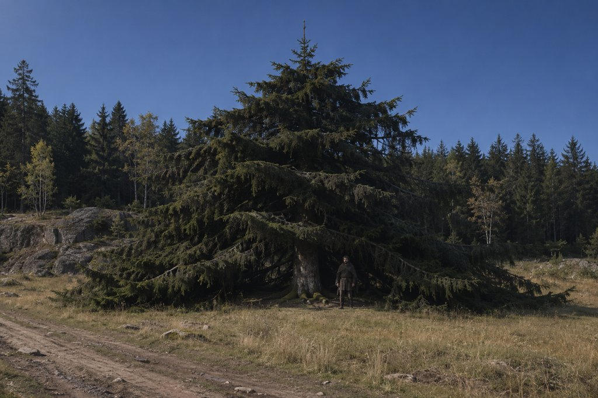
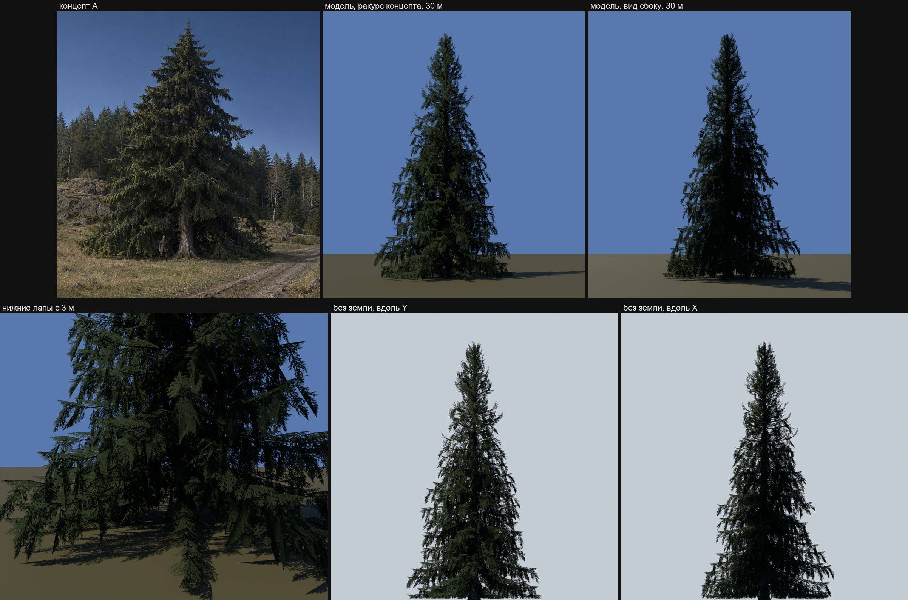
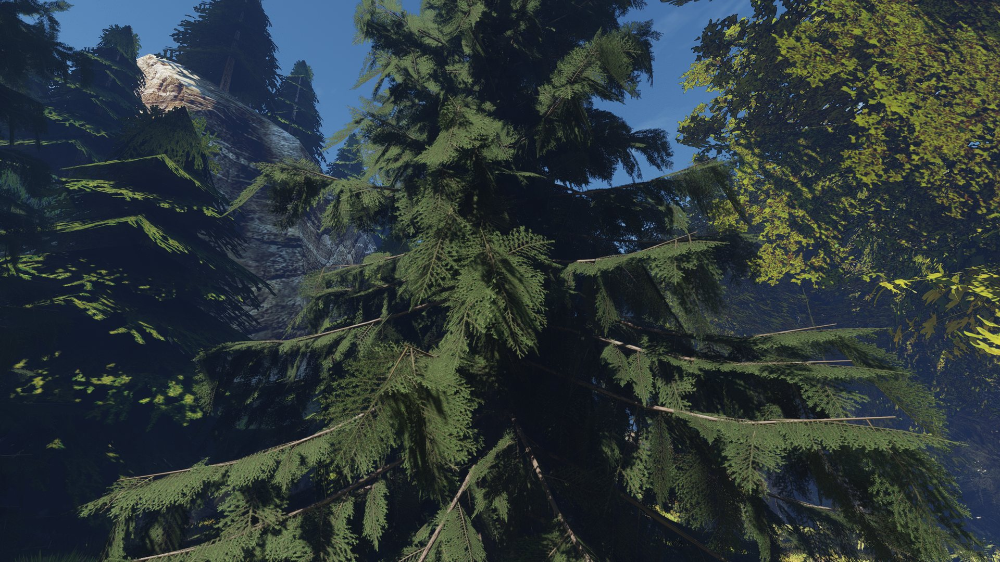

# Ель: замысел и модель

Дата: 2026-11-16, модель — 2026-11-17. Статус: пользователь 2026-11-16 выбрал варианты А и В; ближний уровень ели А построен и снят в игре на пробе ([«Модель»](#модель)), приёмка вида — за ведущим и пользователем. Первая порода [современных деревьев](../../../engine/2026-11-16-modern-trees/README.md) (решение пользователя 2026-11-16).

## Замысел

### Роль в игре

- **Ель — главное дерево острова:** 1 144 из 2 344 деревьев и ещё 215 высоких елей. Где стоят ели, там лес.
- **Что она говорит игроку:** здесь дикая, сырая и тёмная земля вне города. Еловый лес — место, где не видно далеко и где ждёшь волка.
- **Игровые ограничения:** ствол — коллизия, хвоя — нет. Нижние ветви закрывают обзор на уровне глаз: за елью прячется враг и прячется игрок. 37 точек путей проходят ближе 2 м к стволу, поэтому ветви у земли не должны читаться стеной.

### Место

- **Соседи:** лесная подстилка из бурой хвои и листьев, папоротник, серо-бурая скала, трава луга у дороги.
- **Свет:** на опушке — солнце сверху и сбоку; в лесу — глубокая тень с редкими пятнами света.
- **Дистанция:** от 2 м (игрок идёт сквозь ветви) до сотен метров (стена леса на склоне).

Цвета, снятые с кадров оригинала ([`onar-road.jpg`](../../2026-11-landscape-pilot/shots/onar-road.jpg), [`forest.jpg`](../../2026-11-landscape-pilot/shots/forest.jpg)); области взяты грубо, это ограничители:

| Что | Среднее | Светлое | Тёмное |
|---|---|---|---|
| Ель на опушке днём | `#161d22` | `#3a474e` | `#0c1115` |
| Ель в лесу в тени | `#0a0e0d` | `#0e1310` | `#070b0a` |
| Трава на солнце | `#4f472e` | `#675c45` | `#26251a` |
| Скала на солнце | `#5a4c3b` | `#8e7e68` | `#211a14` |
| Подстилка в лесу | `#13130f` | `#1b1b17` | `#0b0b08` |

Текстура хвои оригинала в среднем `(33, 40, 8)`: жёлто-оливковая, синего нет. В кадре ель холоднее и темнее текстуры: её красит небо.

### Чем оригинал читается

Сохранить:

- **Силуэт:** широкий конус с юбкой до самой земли, ярусы ветвей свисают лапами.
- **Тёмное пятно:** ель темнее травы, скалы и неба — самое тёмное в пейзаже после тени.
- **Гамма:** тёмная оливково-зелёная хвоя, на солнце жёлто-оливковые края; кора холодная серо-бурая.
- **Плотность:** сквозь крону почти не видно неба.

Улучшить:

- **Крона из 75 треугольников:** ярусы — плоские диски, лапы нарисованы на них. Нужны настоящие ветви и объём.
- **Ствол** — трёхгранная призма без корней: нужен круглый ствол с корневыми лапами и сухими сучьями внизу.
- **Пропорция:** 12 м в высоту при 11 м в ширину. У настоящей ели такой ширины высота 18–25 м.
- **Одинаковость:** одна модель на 1 144 дерева.

### Происхождение

Ель обыкновенная, выросшая сама: никто её не сажал и не ухаживал. Возраст 40–80 лет. На опушке и у дороги ветви живые до земли; в лесу нижние ветви отмерли от тени и торчат сухими сучьями в лишайнике. Кора чешуйчатая, серо-бурая, с потёками смолы; у корня мох. Хвоя 1–2,5 см, тёмная сверху; молодые концы лап светлее.

### Конструкция

| Часть | Размер |
|---|---|
| Высота | 18 м (вариант А), 12 м (вариант Б), 22 м (вариант В) |
| Ширина кроны у земли | 9–10 м (А, Б), 7 м (В) |
| Ствол у земли | 0,5–0,7 м, корневые лапы до 1,2 м |
| Ярусы ветвей | мутовки через 0,5–0,8 м; ветви первого порядка от 4,5 м внизу до 0,5 м у вершины |
| Лапы | ветви второго порядка свисают с первых на 0,5–1,5 м |
| Вершина | один прямой побег 0,6–1 м |

Экземпляры ставятся с масштабом так, чтобы ширина кроны совпала с шириной ели оригинала на этом месте: площадь под кронами и темнота леса сохраняются.

### Материал и цвет

- **Хвоя:** темнее травы луга и холоднее её; на солнце — оливковая, без изумрудного и без синего елового «серебра».
- **Кора:** холодная серо-бурая, темнее скалы; мох у корня того же тона, что мох на камнях пилота.
- **Сухие сучья:** серые, светлее коры.

### Чего избегать

- рождественская ёлка: ровный конус, одинаковые ярусы, пушистая и симметричная;
- яркая, изумрудная или голубая хвоя;
- «фэнтези-дерево»: витой ствол, светящийся мох, гигантские корни;
- стриженая плотная поверхность кроны без просветов между ярусами;
- сосна или кедр вместо ели: зонтик наверху и голый ствол (это высокая ель оригинала, отдельный вид);
- снег, шишки гирляндами, солнечные лучи сквозь туман как на открытке.

## Варианты концепта

| Вариант | Что это | Зачем |
|---|---|---|
| А | ель в природной пропорции: 18 × 10 м, юбка до земли | как в жизни; ширина оригинала сохранена, высота больше |
| Б | приземистая широкая ель 12 × 10 м, тяжёлые нижние ветви лежат на земле | пропорция оригинала буквально |
| В | лесная ель 22 × 7 м: сухие сучья внизу, живая крона с 6 м | для глубины леса; открывает обзор у земли |

## Концепты

Сняты 2026-11-16 через `image_gen`, по одному кадру «дерево на своём месте» на вариант. Полные PNG — вне git, в `~/.local/share/gothic-ai/content-sources/trees-fir/fir-concept-{a,b,c}-scene.png`. Записи всех пяти концептов (три сцены, лапа, комель) — в реестре [`data/content/registry.jsonl`](../../../../data/content/registry.jsonl), `trees-fir-concept-*`.

| А: природная пропорция | Б: пропорция оригинала | В: лесная |
|---|---|---|
|  |  |  |

**Выбор пользователя, 2026-11-16: «А и В».** А — ель опушек и дорог, В — ель глубины леса. Вариант Б не делаем.

Суждение:

- **Форма** во всех трёх — ель, а не ёлка с открытки: ярусы неровные, лапы свисают, между ярусами тень.
- **А** читается самой «настоящей»; юбка до земли и ширина оригинала сохранены.
- **Б** ближе всех к силуэту оригинала, но такая ель в жизни — редкое старое одиночное дерево; тысяча таких подряд будет выглядеть странно.
- **В** открывает обзор у земли и даёт вертикали стволов; на опушке одна она смотрится голой.
- **Цвет** у генератора зеленее и светлее замера сцены (`#161d22`): палитру модели берём из замера, а не с концепта.

Общая часть промпта (у вариантов отличается первое предложение — порода, высота, ширина, нижние ветви):

> Wild self-seeded tree, 40 to 80 years old, never tended. Whorls of branches every 0.5 to 0.8 m, each bough carrying hanging secondary sprays of short dark needles, visible gaps of shadow between the tiers, irregular: a few boughs longer, one side slightly thinner, a single straight leader shoot at the top. Trunk 0.6 m thick at the ground with low root flares, scaly cold grey-brown bark with resin streaks and a little moss at the foot. Needle colour is dark, cold and muted: the tree is the darkest thing in the landscape, average #161d22, sunlit edges of the sprays olive #3a472e, deep shadow inside the crown #0c1115; no emerald, no blue-silver, no bright green. Setting: edge of a wild forest on a temperate island, late medieval, a rutted dirt road and a meadow of dry yellow-green grass #4f472e, weathered grey-brown rock outcrops #5a4c3b, dark forest behind, clear midday sun from the upper left, deep blue sky #2a4469. A man 1.8 m tall in dark clothes stands at the foot of the tree for scale. Realistic, like a photograph of a real place, slightly grim and plain, muted low saturation, natural contrast. The whole tree is in frame from the ground to the tip, seen from 30 m away at eye height. Not a Christmas tree: no perfect cone, no symmetric even tiers, no fluffy trimmed surface. No fantasy shapes, no twisted trunk, no glowing moss, no giant roots, no snow, no cones in garlands, no god rays, no fog, no text, no logos.

- А: «One Norway spruce in its natural proportion, 18 m tall and 10 m wide at the base, a broad cone with a living skirt of branches reaching down to the ground; the lowest boughs are 4.5 m long and droop until their tips touch the grass.»
- Б: «One old squat Norway spruce, only 12 m tall but 10 m wide at the base, almost as wide as it is tall, very heavy long lower boughs resting on the ground and sweeping outward, a blunt broad pyramid.»
- В: «One forest-grown Norway spruce, 22 m tall and 7 m wide, a narrow tall crown; the lowest 6 m of the trunk carry only dead bare grey snags and stubs with pale lichen, the living dark crown starts 6 m above the ground, so one can see under it. It stands just inside the forest edge among other dark spruces.»

### Лапа и комель

Рабочие концепты для модели, 2026-11-16: лапа сверху — для атласа веток, комель — для коры, корневых лап и сухих сучьев. Листа видов спереди, сбоку и сверху у дерева нет: его форму задают числа конструкции, а не контур. Полные PNG — `fir-concept-bough.png` и `fir-concept-foot.png` там же.

| Лапа | Комель |
|---|---|
|  |  |

- Лапа: «One single bough of a wild Norway spruce cut from the tree and laid flat, photographed straight from above, orthographic top-down view, on a plain uniform mid-grey background. The bough is 2.5 m long, the main woody branch runs horizontally from the cut end at the left edge to the tip at the right; from it grow side branches left and right in a flat herringbone fan, each with smaller twigs densely covered in short dark needles 1.5 to 2 cm long; the fan is 1.2 m wide at its widest and narrows to the tip; the outer shoots are slightly lighter. Irregular and natural: uneven side branches, a few gaps, one broken dry twig. Needles dark cold muted green, average #1c2620, lighter shoot tips olive #3a472e; bark of the branch grey-brown #4a4038. Even soft overcast light, no cast shadow on the background, no highlights, sharp focus over the whole bough, the whole bough inside the frame with a margin. Realistic photograph for a botanical reference. No cones, no snow, no text, no logos, no hands, no tools.»
- Комель: «The foot of an old wild Norway spruce trunk seen from 3 m away at eye height, the lowest 2.5 m of the trunk in frame. Trunk 0.6 m thick, slightly tapering, low root flares spreading 1.2 m into a floor of brown fallen needles and a little moss; bark of thin round scales, cold grey-brown #4a4038 with darker cracks #1f1a16, a few pale resin streaks and patches of grey-green lichen, moss on the root flares on one side. Four dead bare branch stubs and thin dry grey twigs stick out of the trunk at 1.5 to 2.5 m. Dim even forest shade, no direct sun, dark blurred spruce forest behind. Realistic photograph, plain and slightly grim, muted low saturation. No fantasy shapes, no twisted trunk, no glowing moss, no mushrooms, no people, no text, no logos.»

## Модель

Ель А, ближний уровень, 2026-11-17. Строится скриптом без ручных шагов; случайное зерно даёт другое дерево той же породы.



Лист: концепт А; рендер Blender с точки концепта (30 м, глаз на высоте роста, фигура 1,8 м у ствола) и тот же вид через четверть оборота; нижние лапы с 3 м; два вида сбоку без земли, по которым считается плотность.

### Что построено

- **Форма** — [`fir_tree.py`](../../../../scripts/content/mesh3d/blender/fir_tree.py) по числам таблицы «Конструкция», числа варианта — в [`fir.json`](../../../../scripts/content/mesh3d/blender/fir.json). Ствол и ветви первого порядка — геометрия: прямой ствол с пятью корневыми лапами, 242 ветви мутовками и между ними, 4 сухих сучка под кроной. Лапы — 4 090 карточек атласа, вырезанных по контуру (6–8 вершин), изогнутых по длине. Масса кроны — второй порядок: карточки вокруг оси каждой ветви полосами (ровные, наклонные, висящие вдоль ветви и поперёк неё), веера на концах, короткие лапы на самом стволе («рукав»).
- **Сторонний генератор деревьев (Sapling, MTree) не используется.** Форму задают числа таблицы, а разметку ветра в вершине, карточки с двойниками и юбку на земле всё равно пишет свой код. Генератор на NumPy работает и без Blender, поэтому ель собирается и проверяется тестом в CI.
- **Атлас лап** — [`fir_boughs.py`](../../../../scripts/content/mesh3d/blender/fir_boughs.py): семь лап пяти видов (веер, две висящие, боковая, редкая из глубины кроны, два концевых побега) собраны геометрией до хвоинки 1,5–2 см и сняты сверху. Концепт лапы — эталон повадки, картинка не используется. 2048 px, 700 px на метр.
- **Кора** — [`fir_bark.py`](../../../../scripts/content/mesh3d/blender/fir_bark.py): чешуи, лишайник, потёки смолы, мох у комля, тоже геометрией. Лист 2 × 4 м: нижние 40 % — комель, один раз; верх повторяется по стволу и ветвям.
- **Текстуры** — [`fir_set.py textures`](../../../../scripts/content/fir_set.py): по три DDS на материал (цвет, нормаль, ORM), 2048 px. Покрытие атласа 25,3 % на всех 12 уровнях. Запечённая тень между хвоинками и в трещинах коры внесена в цвет: карта AO в движке гасит только свет неба.
- **Файл** — [`fir.py`](../../../../scripts/content/mesh3d/blender/fir.py) пишет GLB (1,34 МБ), `metrics.json`, картинку плотности и `.blend`. Два материала: `OWN_TREE_FIR_BARK` и `OWN_TREE_FIR_BOUGHS`. Начало координат — центр ствола на земле.
- **Двойники.** Двусторонних материалов в движке нет, поэтому каждый треугольник карточки записан дважды с обратным обходом по тем же вершинам. Нормали карточек — от оболочки кроны с долей собственной.
- **Ветер** — `COLOR_0`, четыре нормированных байта, раскладка [ветра дерева](../../../engine/2026-11-16-modern-trees/tree-wind.md): R — вес ветви, G — фаза ветви, B — дрожь листа, A — открытость кроны. Обе записи материалов несут `"foliage": {"anchor": "tree", "wind": 1}`; у лап ещё `flutter: 1` и `translucency: 0.35`.

### Числа

Ель А, зерно 7; всё прочитано обратно из записанного файла ([`tree_check.py`](../../../../scripts/content/mesh3d/blender/tree_check.py), [`tree_density.py`](../../../../scripts/content/mesh3d/blender/tree_density.py)).

| Что | Число | Цель |
|---|---|---|
| Рисуемые треугольники | 43 024: кора 5 832, лапы 37 192 (18 596 с двойниками) | до 45 000 |
| Вершины | 30 116 | — |
| Высота | 18,09 м | 18 ± 0,5 м |
| Ширина кроны у земли | 9,21 и 9,67 м | 9–10 м по обеим осям |
| Ствол | 0,59 м над корневыми лапами, 0,97 м с лапами у земли; корни расходятся на 1,19 м | 0,5–0,7 м, лапы до 1,2 м |
| Вывернутые части | 0 из 247 замкнутых | 0 |
| glTF Validator | 0 ошибок, 0 предупреждений | без ошибок |

Плотность кроны — по двум видам сбоку через 90°, без земли, выше 3 м:

| Что | Вдоль Y | Вдоль X | Предел |
|---|---|---|---|
| Фон внутри контура кроны | 9,7 % | 9,6 % | 15 % |
| Ствол открыт, доля длины | 6,0 % | 4,5 % | 10 % |

Как считается: вид рисуется из файла, 48 пикселей на метр, 3 × 3 луча на пиксель; карточка есть там, где есть покрытие атласа. Контур кроны — картинка дерева, замкнутая диском 0,1 м, с залитыми дырами: он повторяет выемки между ярусами и берёт все просветы внутри. Строка ствола открыта, если больше половины его ширины ничем не закрыто. Мера откалибрована по концепту А: его картинка — 47 пикселей на метр, верхняя треть на фоне неба даёт 5,3–5,9 %. С диском 0,4 м, который перекрывает выемки между ярусами, у концепта выходит 17–20 %, у модели на рендерах — 16,0 и 17,3 %. Та же мера по рендерам Blender без земли даёт 10,5 и 11,4 % (диск 0,1 м): счёт по файлу и по картинке сходится.

Раскладка `COLOR_0`: у ствола R = G = B = 0 и A = 255 во всех 435 вершинах; у 246 ветвей и сучков 246 своих фаз, R растёт вдоль ветви от нуля у ствола (корреляция с длиной не ниже 0,999); у всех 4 090 карточек фаза своей ветви, одна вершина-черенок с B = 0 на оси ветви и B = 255 на свободном крае; все 18 596 пар треугольников целы; открытость A растёт от ствола к контуру кроны (корреляция 0,94).

Тест [`test_fir_tree.py`](../../../../scripts/content/mesh3d/blender/test_fir_tree.py) собирает ель без Blender и держит размер, бюджет, плотность и раскладку.

### В игре

Набор-проба `fir-probe-1` (`fir_set.py probe`, вне git): пять елей слоем предметов без коллизии на северной кромке луга к востоку от таверны, в 5–8 м южнее елей оригинала. У слоя предметов нет масштаба, поэтому каждый размер — свой GLB.

| Ель | Зерно | Масштаб | Высота | Треугольники | Фон в кроне | Ствол открыт |
|---|---|---|---|---|---|---|
| 1 | 33 | 1,2 | 21,8 м | 43 262 | 10,1 % | 4,7 % |
| 2 | 21 | 1,1 | 19,8 м | 42 796 | 9,9 % | 5,2 % |
| 3 | 48 | 0,8 | 14,5 м | 42 480 | 11,7 % | 3,4 % |
| 4 — ель А | 7 | 1,0 | 18,1 м | 43 024 | 9,7 % | 6,0 % |
| 5 | 59 | 0,9 | 16,4 м | 41 228 | 10,4 % | 3,2 % |

Съёмка — [`fir-probe.bench`](../../../../scripts/bench/fir-probe.bench) на Ryzen, полдень, 2560 × 1440, в затишье после порыва. Полуденное солнце движка стоит на западе (−x) на высоте 57°, поэтому камеры смотрят на северо-восток.

| 30 м | 5 м от нижних лап |
|---|---|
|  |  |



- **30 м:** ель А — в центре кадра между елями оригинала на скале и большим деревом справа; слева от неё ель 3. Читается елью: ярусы свисают, вершина — один побег, ствол виден только у земли. Низ закрыт стеблями травы у камеры.
- **5 м:** лапы лежат слоями, между ярусами тень, на свету хвоя оливково-зелёная. Юбка лежит на траве. Оси ветвей на солнце светлее хвои и заметны.
- **Прогонов два.** Первый (2026-11-17, 01:43–01:48) снял кадры из-под крон больших деревьев оригинала и против солнца: ели были не видны или в контровом свете. Ели и камеры переставлены под полуденное солнце, второй прогон (01:55–01:56) — кадры выше. Модель и текстуры между прогонами не менялись.
- **Круг правки цвета не понадобился.** Числа — ниже.

Цвет в кадрах игры (sRGB; области взяты грубо, небо вычтено):

| Что | Медиана | Светлые 10 % |
|---|---|---|
| Ель А с 30 м | `(22, 30, 40)` | `(78, 92, 86)` |
| Ели оригинала в том же кадре | от `(17, 25, 37)` до `(23, 33, 48)` | от `(46, 56, 54)` до `(93, 96, 83)` |
| Ель А с 5 м | `(27, 35, 38)` | `(101, 114, 85)` |
| Трава луга на солнце, среднее | `(143, 139, 57)` | — |
| Замер сцены оригинала (выше) | `(22, 29, 34)` | `(58, 71, 78)` |

### Отличия от замысла

- **Цвет.** Палитра взята из замера сцены, не с концепта: средний цвет хвои в текстуре `(33, 40, 23)`, коры выше комля — `(74, 64, 56)`. С 30 м ель стоит в тоне елей оригинала и замера. Вблизи на солнце лапы светлее «светлого» замера и зеленее его: замер снят с дальней ели, которую красит небо. Ель темнее травы, изумрудного и синего нет.
- **Плотность кроны.** Фон виден на 10 % контура против 5 % у концепта. Тёмную массу дают лапы второго порядка и рукав на стволе; выемки между ярусами оставлены намеренно — это антиархетип «стриженая поверхность».
- **Ширина.** На картинке концепта ель при высоте 18 м была бы шириной около 14,6 м. Модель держит таблицу конструкции: 9–10 м.
- **Лапы вблизи.** С 5 м карточки лежат в разных плоскостях, плоского листа длиннее 1 м в кадре нет — это оценка на глаз, не замер. Но рисунок карточки плоский: побеги с хвоей в одной плоскости похожи на папоротник или тую, объёма хвои вокруг побега нет. Над лапами видны голые светлые оси ветвей. С 2 м (третий кадр) веера на концах ветвей читаются плоскими листами. Хвоинка в атласе — 10–14 пикселей в длину.
- **Ствол у земли** с корневыми лапами шире 0,7 м; сам ствол над ними — 0,59 м.

### Ограничения

- Только ближний уровень: каждая ель — 41–43 тыс. треугольников на любой дистанции. Уровни 1–3, импостер и цена кадра — следующие задачи.
- Половина треугольников лап — двойники: с двусторонними материалами в движке их станет 18 596.
- Движок пока не читает открытость кроны (A).
- Значения `wind`, `flutter` и `translucency` — первые, клипом не подобраны: здесь сняты только стоп-кадры в затишье. Движение принимают отдельно.
- Проба стоит без коллизии и рядом с елями оригинала; замена деревьев мира — отдельная задача.
- Ель В и вариации по возрасту не построены.

### Как повторить

```sh
B=/Applications/Blender.app/Contents/MacOS/Blender
D=scripts/content/mesh3d/blender
U="uv run --no-project --with numpy --with pillow --with scipy python"
$B -b --factory-startup --python-exit-code 1 -P $D/fir_boughs.py -- --out $WORK/boughs
$B -b --factory-startup --python-exit-code 1 -P $D/fir_bark.py -- --out $WORK/bark
$U scripts/content/fir_set.py textures --boughs $WORK/boughs --bark $WORK/bark --out $WORK/tex
$B -b --factory-startup --python-exit-code 1 -P $D/fir.py -- --out $WORK/fir-a
$B -b --factory-startup --python-exit-code 1 -P $D/fir_views.py -- --glb $WORK/fir-a/fir-a.glb --out $WORK/views \
  --boughs $WORK/tex/boughs.png --boughs-normal $WORK/tex/boughs-normal.png \
  --bark $WORK/tex/bark.png --bark-normal $WORK/tex/bark-normal.png
$U scripts/content/fir_set.py probe fir-probe-1 --textures $WORK/tex
OPENGOTHIC_CONTENT=$HOME/.local/share/gothic-ai/remaster/trees-fir/fir-probe-1 TEMPEST_WINDOW_SIZE=2560x1440 \
  BENCH_HOST=ryzen scripts/bench.sh fir-probe /absolute/out
```

`$WORK` — абсолютный путь вне git. `fir.py` без Blender (`python fir.py --out …`) пишет то же, кроме `.blend`. Маска покрытия атласа для счёта плотности лежит в git: [`fir-boughs-mask.npz`](../../../../scripts/content/mesh3d/blender/fir-boughs-mask.npz); после пересборки атласа её копируют из `$WORK/tex/boughs-mask.npz`.
