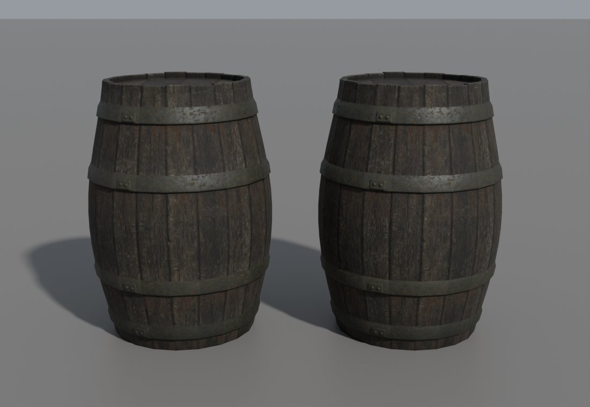
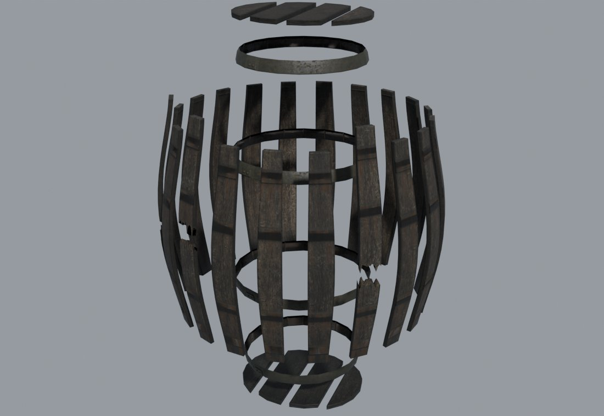
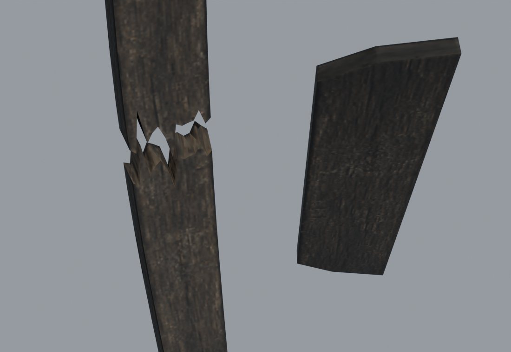

# Деревянные вещи ломаются как дерево: исследование

2026-11-05. Своя бочка `NW_HARBOUR_BARREL_01` и свой ящик `NW_HARBOUR_CRATE_01` (набор `working-11`, PR #964) ломаются на 12 сплошных глыб. Пользователь: «как будто полностью сделаны из материала. Должны ломаться как доски». Это главная беда. То, что осколки остаются стоять стопкой (трение 0,75 у дерева с железом), — меньшая.

## Цель

Удар, который ломает вещь, разбирает её на те детали, из которых она сделана:
- ящик — на доски и бруски;
- бочка — на клёпки, доски днищ и обручи.

Внутри у обеих пусто, глыб нет. Детали падают и ложатся, как настоящие: доски плашмя, клёпки на выпуклый бок, обручи кольцами. Стоящей стопки не остаётся.

## Как ломается на деле

**Дерево колется вдоль волокон, а не поперёк.** Прочность на растяжение поперёк волокон — около 1/20 прочности вдоль ([Frattura ed Integrità Strutturale](https://www.gruppofrattura.it/pdf/fig/numero39/64)). Трещине вдоль волокон нужна в 6–9 раз меньшая вязкость разрушения: 0,31–0,41 против 2,4–2,7 МПа·√м у сухой дугласовой пихты ([Schniewind & Centeno 1973](https://wfs.swst.org/index.php/wfs/article/view/1474)). Раскол вдоль волокон длинный и ровный. Излом поперёк рваный, с торчащими волокнами ([Record 1914](https://chestofbooks.com/home-improvement/woodworking/Mechanical-Properties-of-Wood/Failures-In-Timber-Beams.html)).

**Ящик сначала рвётся в стыках.** В испытаниях в барабане гвозди выходят, доски срываются через шляпки, и только потом колются или ломаются торцы и бока ([CSIR 1932](https://www.irg-wp.com/ARA/CSIRO%20FP%20NL/1932.pdf)). Из торцевого волокна гвоздь выходит при силе до 50% меньшей ([FDM](https://www.woodworkingnetwork.com/magazine/fdmc-magazine/joint-strength)). Доски по стандарту: бока 9,5–12,7 мм, торцы 16–25 мм, гвозди не реже чем через 150 мм ([A-A-1234A](https://boxescartonscrates.emilspec.com/A-A-1234/index.html), [IS 10687](https://infralens.in/code/IS-10687-1983)). Размеров обломков никто не мерил. Вывод: большинство досок отлетает целиком. Ударенная доска колется вдоль на 2–3 полосы и ломается поперёк только у места удара.

**Бочку держат только обручи.** Гвоздей и клея в ней нет ([World Cooperage](https://www.worldcooperage.com/?p=671)). Сними обручи — и она, скорее всего, развалится ([пример](https://winebarrelchair.blogspot.com/2015/09/barrel-disassembly.html)). Ближайшая по размеру настоящая — бочка 500 л:
- длина 105 см, пузо 96 см;
- клёпки толщиной 27 мм, 8 обручей ([Canton](https://cantoncooperage.com/500L-puncheon)).

У бочки 80 см по пузу было бы 28–34 клёпки шириной 7,5–9 см. Днище — из 2–6 досок на шкантах ([Fine Woodworking](https://www.finewoodworking.com/2021/09/06/coopers-planes), [Oxford Companion to Wine](https://app.ckbk.com/reference/wine05383c02s001e037e005/the-heads)). Описания разбитой бочки не нашлось. Вывод: обручи остаются кольцами и спадают, клёпки выходят целыми и изогнутыми, ломаются только ударенные. Днище выпадает из паза и рассыпается на доски.

## Как делают другие

- **Source (Half-Life 2).**
  - Обломки рисуются руками для каждой модели. Иначе берётся общий набор вроде `WoodChunks` ([Valve](https://developer.valvesoftware.com/wiki/Prop_Data)).
  - Обломок получает скорость родителя в своей точке, его вращение и ещё около 2,5 м/с от центра (`defBurstScale = 100`). Сила удара прикладывается к родителю до поломки, поэтому обломки летят по удару ([props_shared.cpp](https://github.com/ValveSoftware/source-sdk-2013/blob/master/src/game/shared/props_shared.cpp)).
- **Houdini, RBD Material Fracture, тип Wood** — лучшая модель дерева ([SideFX](https://www.sidefx.com/docs/houdini/destruction/wood.html)): резы вдоль длинной оси и поперёк, щепа, отдельная прочность склейки вдоль волокон и поперёк.
- **Unreal Chaos.** Инструмента для досок нет. Сетка с шумом даёт «длинные корявые блоки» ([форум UE](https://forums.unrealengine.com/t/chaos-fracturing-wood-splinters/152541)).
- **NVIDIA Blast** подрезает оболочки друг о друга, чтобы куски не разлетались взрывом ([SDK](https://nvidia-omniverse.github.io/PhysX/blast/docs/api/extensions/ext_authoring.html)).
- **Сколько кусков.** Чисел для ящиков и бочек не опубликовано. Один разработчик снизил число со ~100 кусков на предмет до 10–20 ([itch.io](https://itch.io/post/8925756)).

**Ловушки.**
- **Изогнутое и кольцо.** Выпуклая оболочка изогнутой клёпки толще её дерева раза в 4: прогиб у бочки 500 л — 8,4 см на 2,7 см дерева. У обруча оболочка — сплошной диск. Поэтому обоим нужна составная форма ([Godot](https://forum.godotengine.org/t/im-having-a-matryoshka-problem/69939)).
- **Тонкие доски.** Допуск проникновения Jolt — 2 см, это толщина нашей доски. Длинное тонкое тело с быстрым вращением может проскочить даже с `LinearCast` ([Jolt](https://jrouwe.github.io/JoltPhysics/index.html)). Скругление оболочки у нас уже 1 мм.
- **Взрыв при появлении.** Куски, появившиеся друг в друге, отталкиваются с лишней скоростью ([APEX](https://dev.epicgames.com/documentation/en-us/unreal-engine/python-api/class/DestructibleAdvancedParameters)).
- **Ровный толчок во все стороны** выглядит как лопнувшая подарочная коробка: крупные лёгкие куски улетают слишком далеко ([r/IndieGaming](https://www.reddit.com/r/IndieGaming/comments/1js1x0b/)).
- **Глыбы с ровной внутренностью** читаются как сплошной материал. Торцам и сколам нужны торцевое волокно и щепа.

## Что у нас: по коду

**Резка.** `scripts/fracture/fracture.py` делит выпуклую оболочку меша на ячейки Вороного: 12 штук, seed 601. Для пустотелого ящика или бочки оболочка — сплошное тело, поэтому куски выходят глыбами. Ограды режутся «по доскам» (`fracture_boards`): связные части меша, но каждая доска снова делится на ячейки. Проверка `validate` требует, чтобы каждый кусок был замкнутым и выпуклым, а кусков было от 8 до 20.

**Формат и загрузка** (`common/physics/fracture.cpp`).
- Кусок — список треугольников с текстурой, нормалью и UV каждой вершины. Физика берёт выпуклую оболочку его точек (`JPH::ConvexHullShape`). Сам рисунок куска может быть любым, в том числе невыпуклым.
- Загрузчик принимает от 8 до 20 кусков. Так же ограничено сохранение: `pieceCount>20` в `DynamicWorld`.

**Поломка** (`DynamicWorld::breakMovableVob`).
- Все куски появляются разом, в позе целого тела.
- Каждый получает его скорость и ещё 40 см/с от центра масс.
- Масса куска — масса вещи, умноженная на долю его объёма.
- Трение у всех кусков одно, у целого тела. Это среднее по подмешам без весов: у наших дерева (0,4) с железом (1,1) выходит 0,75.
- Затухание осколков 0,4 / 0,6, движение `LinearCast`: тонкий кусок не проскочит сквозь пол.
- Через 30 игровых минут или дальше 30 м остаются три крупнейших куска.

**Вид** (`ObjVisual::FractureView`). До 2026-11-08 куски рисовались только цветовой текстурой (`Material::setAlbedo`), без карт нормалей и шероховатости целой вещи, партиями до 20 треугольников на материал куска. Теперь — [полным материалом](#вид-кусков-полный-материал-и-партии), по виду на кусок.

**Наши модели.** Обе построены скриптами Blender (их пишет Claude): `scripts/content/mesh3d/blender/barrel.py` и `harbour_crate.py`.
- **Ящик** (`rigging-crate/model.glb`, 120 × 100 × 100 см). 28 досок толщиной 2,2 см, шириной 7–24 см и длиной 90–112 см, 4 бруска 3 × 9 × 100 см, 30 гвоздей — открытые шляпки из 3 треугольников. Каждая доска — отдельный замкнутый брусок. Внутри — сплошной тёмный «короб» 108 × 97 × 90 см: он закрывает щели и пролом в доске. Глыбы дают именно он и общая оболочка.
- **Бочка** (`mesh3d-barrel-atlas/model.glb`, 80 × 111 × 80 см). Параметры — `barrel.json`: 20 клёпок, по грани на клёпку, крышка из 4 досок, 4 обруча. Корпус — три пояса между обручами, днища — диски. Всё это односторонняя оболочка без толщины, клёпок как отдельных деталей нет. Над крышкой стоят 20 отдельных торцов клёпок, у обручей — накладки и заклёпки.

## Способ

Обломки — настоящие детали предмета, как гибы Source. Их строит тот же скрипт Blender, что и модель, а не резка Вороного по оболочке. Вид целой вещи не меняется.

1. **Обломки из генератора** (Claude, Blender).
   - `barrel.py` и `harbour_crate.py` рядом с `model.glb` пишут `model.debris.glb`: по объекту на деталь. Каждая деталь — замкнутое тело с настоящей толщиной, торцевым волокном на концах и сколах, с UV того же атласа.
   - **Ящик:** доски и бруски как есть, гвозди — на своих досках. «Короб» в обломки не идёт: внутри ящика пусто. Несколько досок по фиксированному seed колются вдоль на 2–3 полосы, одна-две ломаются поперёк с рваным краем.
   - **Бочка:** 20 клёпок по профилю пуза, толщиной около 2,5 см, вместе со своими торцами над крышкой. Днища — по 4 доски. Обручи — кольцами, с накладкой и заклёпками. Две-три клёпки ломаются поперёк.
   - Число и вид клёпок, досок и обручей берутся из модели. Настоящие бочки 500 л — только ориентир.
2. **Резка** (`scripts/fracture/`). `fracture.sh content` находит `model.debris.glb` и пишет `.fracture` версии 3:
   - рисунок куска — треугольники детали как есть, с её UV и сглаженными нормалями;
   - физика — одна или несколько выпуклых оболочек: доска — одна, клёпка — 2–3 отрезка по длине, обруч — 8–12;
   - проверка — деталь замкнута, каждая оболочка не дальше нескольких миллиметров от детали.

   Без `model.debris.glb` остаётся прежняя резка. `building_set.py enable` принимает версию 3.
3. **Движок.** Физику может делать исполнитель, вид — Claude.
   - **Формат 3:** до 64 кусков вместо 20 — в загрузке, сохранении и `validate`. Кусок может быть составной формой Jolt. Сейв со старой нарезкой не должен ломать загрузку.
   - **Трение и звук куска — по его материалу:** дерево 0,4, железо 1,1, а не среднее целого тела. Это заодно закрывает задачу о стопке.
   - **Полный материал куска:** цвет, нормали и шероховатость (`loadMaterialMaps`), как у целой вещи.
   - **Движение — по удару:** скорость тела в точке куска, вращение, толчок по направлению удара, небольшой разлёт с пределом скорости. Числа подбираются по клипу; ориентир Source — около 2,5 м/с.
4. **Стенд и клип.** `own-content-fracture` с камерой сбоку и вблизи. Пары «сейчас | новое» для бочки и ящика.

Оригинальные ящики и бочки остаются на прежней резке: их меши — одна оболочка без деталей. Ограды уже режутся по доскам, но каждая доска делится на глыбы; раскол вдоль волокон для них — отдельный шаг.

## Формат 3

Соседний `model.fracture` относится к байтам своего `model.glb`. Текст ASCII, числа в C-локали, разделители — пробелы и переводы строк:

```text
GOTHIC_FRACTURE 3
source <GLB bytes> <GLB crc32, hex>
pieces <N>
piece <volume> <cx> <cy> <cz> <group> <H> <T>
hull <P>
<x> <y> <z>
tri <texture>
<x> <y> <z> <nx> <ny> <nz> <u> <v>
```

- `N` — 2–64 куска. После каждого `piece` идут `H` оболочек (по `P` строк точек), затем `T` треугольников (по 3 строки вершин).
- Координаты — сантиметры исходного визуала, как в версиях 1–2; позы совпадают с целой вещью. `volume` — положительный конечный объём дерева или железа в см³, `cx cy cz` — центр этого объёма. Масса — масса вещи × `volume` / сумму объёмов.
- `group` — `WOOD`, `METAL`, `STONE`, `CLAY`, `EARTH`, `WATER`, `SNOW` или `UNDEF`: `extras.group` материала GLB с наибольшей площадью в куске. Трение, профиль шума и плавучесть обломка берутся из этой группы, включая восстановление сейва.
- `H` — 1–16 оболочек, `P` — 4–256 конечных точек с ненулевым объёмом. При `H=1` — `ConvexHullShape` со скруглением 1 мм; при `H>1` — `StaticCompoundShape` из таких оболочек. Оболочки одного куска могут пересекаться; между разными кусками резка обещает пересечение не больше 2 мм.
- `T` — 1–20000 треугольников. Рисунок независим от оболочек, может быть открытым и невыпуклым. Обход против часовой стрелки снаружи, нормали могут быть сглаженными; `texture` — имя материала GLB с `.TGA`. Все компоненты вершин конечны.
- Размер и CRC32 `source` должны совпасть с успешно загруженным GLB; обрезанный файл, неизвестная группа и лишние данные отклоняются. Свои GLB принимают версии 2 и 3, оригиналы — только 1. У версий 1–2 остаются прежние 8–20 кусков, формы и физика. Сейв принимает до 64 кусков; несовпадение числа с текущим сайдкаром пропускает обломки.

Движение версии 3 наследует скорость тела в центре масс каждого куска `v + ω × r`. К ней добавляются толчок по нормализованному направлению удара `hit × exp(−d / falloff)` (расстояние `d` от точки удара до центра масс куска в см) и `outward` от центра масс тела. Сумма этих добавок ограничена `cap`. Направление приходит из луча ближнего боя, полёта стрелы или силы толчка; столкновение направления не задаёт. Добавочное вращение — вокруг `направление × r`, до `spin` рад/с; величина `spin × (1 + индекс % 8) / 8`, без случайных чисел. При нулевой оси добавочного вращения нет. Версии 1–2 сохраняют прежние 40 см/с наружу и вращение тела.

Числа собраны в `FractureMotion` (`dynamicworld.cpp`): `hit=150`, `falloff=60`, `outward=120`, `spin=3`, `cap=200` (скорости в см/с, расстояние в см; до 2026-11-08 — 250/45/60/4/450, [подбор](#клип-было--стало-и-ограждения)). Переменная `OPENGOTHIC_FRACTURE_MOTION="hit=150,falloff=60,outward=120,spin=3,cap=200"` разбирается один раз при создании `DynamicWorld`; пропущенные поля сохраняют умолчания, пробелы вокруг ключей и значений допускаются. Значения конечны и неотрицательны, `falloff>0`; при ошибке `Tempest::Log::e` пишет причину и весь набор возвращается к умолчаниям, поломка продолжается. Разрушение целиком выключает `[GAME] destruction=0`.

Контракты: `gothic-mesh-gltf-test` — загрузка, группы, составные формы и пределы; `gothic-physics-contract` — движение, материалы и сейв; `scripts/content/test_building_set.py` — свежесть кэшей версий 2/3. Резка и отрисовка полного материала — отдельные задачи; физический контракт не заменяет приёмку вида по клипу.

## Вид кусков: полный материал и партии

Сделано 2026-11-08 (пункт 3 способа, «Полный материал куска»).

- **Материал.** Треугольник куска с ключом текстуры получает копию `Material` подмеша целой вещи с тем же ключом: цвет, нормали, ORM, масштаб UV, `antitile` и альфа — как их собрал загрузчик из `materials.json` для целого GLB или оригинального MRM. Ключа нет у целой вещи — материал собирается по ключу тем же путём (`Resources::loadMaterial`). Касательные шейдер строит по производным позиции и UV, как у целых мешей; нормали вершин берутся из файла.
- **Партии.** Кусок — один `ProtoMesh` из `PackedMesh` (мешлеты по 64 вершины), подмеш на материал. Одинаковые углы треугольников склеиваются, поэтому мешлеты заполнены. Поза — матрица вида, скрытие — как раньше.
- **Число видов на одну разбитую вещь** (`MeshObjects::Mesh`; «подмешей» — сколько из них материалов):

  | Вещь | Сайдкар | Кусков | Треугольников | Видов до | Видов после (подмешей) |
  |---|---|---|---|---|---|
  | Ящик оригинала `NW_HARBOUR_CRATE_01` | 1 | 12 | 280 | 27 | 12 (21) |
  | Бочка оригинала `NW_HARBOUR_BARREL_01` | 1 | 12 | 484 | 29 | 12 (12) |
  | Свой ящик `rigging-crate`, резка Вороного | 2 | 12 | 706 | 42 | 12 (12) |
  | Своя бочка `mesh3d-barrel-atlas` | 2 | 12 | 1880 | 104 | 12 (22) |
  | Свой ящик `rigging-crate`, обломки генератора | 3 | 38 | 1090 | 83 | 38 (54) |

- **Кадры** (`piece-render/`, свой ящик порта, `working-11-v3`, полдень, камера `cam world 230 140` над героем, сценарий — тот же удар, что `own-content-fracture`):
  - [`crate-w90-whole-pieces.jpg`](piece-render/crate-w90-whole-pieces.jpg), [`crate-w0-whole-pieces.jpg`](piece-render/crate-w0-whole-pieces.jpg) — «целая | куски»: доски того же замшелого дерева, с теми же пятнами мха и кромками;
  - [`crate-w90-albedo-full.jpg`](piece-render/crate-w90-albedo-full.jpg) — те же куски «только цвет (main) | полный материал»; [`crate-w90-diff-x10.jpg`](piece-render/crate-w90-diff-x10.jpg) — их разница ×10: она лежит только на досках (зерно, кромки), кадр целой вещи совпадает до пикселя. На полуденном свету разница тонкая, как и у целой вещи.
  - С сайдкаром 2 (резка Вороного по оболочке) куски и в main, и с полным материалом видны лоскутами: крышки ячеек текстурируются плоской проекцией атласа. Это резка, а не отрисовка; деревом куски читаются только с обломками генератора (формат 3).

## Приёмка

Вид принимает пользователь по клипу, а не по кадру. Числа — только ограждения на стенде:
- ни одного куска-глыбы: каждый кусок — деталь из списка генератора, его объём не больше объёма самой большой доски или клёпки;
- через 5 с вещь распалась: клёпки лежат (ни одна не стоит ближе 30° к вертикали), медиана смещения кусков не меньше 30 см (у оригиналов сейчас 81 и 88 см, у наших 5 и 7 см); С 2026-11-09 это ограждение только для вещей без связей: со связями вещь ломается частями, её ограждения — в [заметке о связях](../../physics/2026-11-destruction-bonds/README.md#приёмка). Там же вердикт: эталон дерева принят;
- через 15 с все куски спят. Проникновение в землю и друг в друга — не больше 1 см. Никто не провалился и не дрожит;
- пять разбитых вещей в кадре: физика p95 не больше 2 мс, рост кадра записан;
- кусок вблизи читается тем же деревом, что целая вещь: пара кадров «целая | обломки» с полным материалом.

## Обломки бочки

2026-11-05. Пункт 1 «Способа» для бочки. Обломки строит тот же `barrel.py` с ключом `debris` в [`barrel.json`](../../../scripts/content/mesh3d/blender/barrel.json): те же углы клёпок, уровни, профиль и seed, что у целой. Детали — [`barrel_debris.py`](../../../scripts/content/mesh3d/blender/barrel_debris.py). Целая `model.glb` при тех же настройках не изменилась ни на байт (SHA-256 `cae24a5a…` до и после). Повторная сборка даёт тот же `model.debris.glb` (`2805351f…`), повторное запекание — те же атлас и GLB. Путь концепта в `barrel.json` поправлен на `mesh3d-pilot/2026-10-20-pilot/`: PNG переехал, и по прежнему пути бочка не собиралась.

**Куски — 35 узлов glTF, 4858 треугольников** (целая — 1376):
- **20 клёпок толщиной 2,5 см**, каждая от земли до своего торца над крышкой. Наружная грань — грань целой бочки. Ниже крышки клёпки стоят с зазором 0,5 мм. Венец над крышкой — как отдельные торцы у целой, с зазором 1,5 мм. Наружная и внутренняя стороны получают гладкие нормали целой бочки: отдельная клёпка иначе выглядит гранёной.
- **3 клёпки сломаны поперёк** по seed 7: `stave-12`, `stave-14`, `stave-18` на высоте 0,44–0,58 м, в поясе между вторым и третьим обручем. Край рваный: 14 колонок по ширине со своими высотами, волокна внутренней стороны рвутся на другой высоте, чем наружной, а на наружной стороне торчат одна-две щепы длиной 3,5–6 см. Половины — отдельные куски (`stave-12` и `stave-12-top`), поверхность излома у них общая. Колонки по ширине идут только до ближайшего уровня от излома, дальше клёпка снова в одну грань шириной: так 6 половин занимают 1334 треугольника, а не 3570.
- **8 досок днищ толщиной 2,5 см:** крышка `lid-1…4` и дно `bottom-1…4`, разрезаны там же, где доски крышки у целой. Каждая доска — призма по внутреннему многоугольнику клёпок у грани днища целой бочки (зазор 0,3 мм). Там она касается клёпок, в остальной толщине отходит от них до 8 мм — как скошенный край настоящего днища.
- **4 обруча** — замкнутые кольца: оболочка и полки целой бочки плюс внутренняя сторона, лежащая на клёпках, с накладкой и двумя заклёпками.

**Проверки сборки** (`metrics.json`, раздел `debris`, и `volume_check.py` по запечённому GLB):
- 0 открытых рёбер, 0 вывернутых оболочек. После сварки по позиции каждый из 35 узлов замкнут: 47 оболочек вместе с накладками и заклёпками.
- Наибольшее взаимное проникновение кусков — 0,04 мм (обруч на клёпке). Внутри бочки пусто: 76 л дерева и железа.
- Наружная поверхность против целой бочки: обломки отходят от неё не больше чем на 0,32 мм, видимые грани целой лежат на обломках с точностью 0,25 мм.
- Самый большой кусок — целая клёпка, 3,3 л.

**Атлас** — [`barrel-debris-atlas.json`](../../../scripts/content/mesh3d/blender/barrel-debris-atlas.json), запекает `bake_atlas.py` с плитками, целями цвета и износом из `barrel-atlas.json`. Грани, которые показывает целая бочка, сохраняют её зоны и UV плитки, тон каждой клёпки и доски — тот же номер детали. Поэтому собранные обломки читаются той же бочкой. Свои зоны получили грани, которых у целой нет:
- `INNER` — внутренняя сторона клёпок, стыки, пояса под обручами, изнанка и кромки досок, низ клёпок. Плитка клёпок, цвет — 0,75 от наружного;
- `END` — излом: торцевое волокно из плитки спила `market-set` (годичные кольца поперёк ширины клёпки), светлое свежее дерево;
- `RUST` — внутренняя сторона обручей, темнее наружной.

Грани, которые в позе целой бочки касаются другого куска, запекаются почти чёрными. Когда бочка разваливается, их видно, поэтому `ao_floor` держит их AO не ниже 0,6. Ключи материалов — `OWN_BARREL_HARBOUR_DEBRIS_WOOD` (`WOOD`) и `OWN_BARREL_HARBOUR_DEBRIS_IRON` (`METAL`). Атлас 2048², заполнен на 33%. Плотность на наружных гранях клёпок в 1,15 раза выше, чем у целой бочки на 1024². В DDS это 11 МБ с мипами (целая — 2,8 МБ).

**Упаковка.** В игре бочка набора `working-11` — часть `barrel-wear-metal0` (её внутренняя папка тоже называется `mesh3d-barrel-atlas`). Старая папка `content-staging/mesh3d-barrel-atlas` — запекание 21 октября, ещё с металлическими обручами. `pack_prop.py --debris` положил обломки в обе: `meshes/mesh3d-barrel-atlas/model.debris.glb` рядом с `model.glb`, атлас — в `materials/mesh3d-barrel-atlas-debris/`, два ключа дописаны в `materials.json`. Файлы целой бочки в обеих папках не изменились (сверка SHA-256 до и после). Изменённый `bake_atlas.py` перезапекает целую бочку по `barrel-atlas.json` бит в бит как `barrel-wear-metal0`: GLB и все три DDS.

**Виды** (Cycles, один свет, [`debris_views.py`](../../../scripts/content/mesh3d/blender/debris_views.py)):



Слева целая, справа 35 кусков в позе целой. Силуэт, обручи с накладками, венец и тон совпадают. Средняя яркость тела в кадре — 0,0342 и 0,0337 (−1,5%). Видна разница: между клёпками обломков тонкие тёмные швы (зазор 0,5 мм), у целой — только нарисованные.



Клёпки разнесены от оси, обручи разведены по высоте, крышка поднята, дно опущено. Три клёпки сломаны с рваным краем. На каждой клёпке видны тёмные пояса там, где лежали обручи: зона `INNER` и потёк ржавчины. Обручи — кольца с накладкой, доски днищ — отдельные доски.



Сломанная клёпка повёрнута внутренней стороной к камере, верхняя половина поднята на 5 см. Внутренняя сторона — тёмное дерево с волокном, темнее наружной. На изломе — светлое свежее дерево с зубцами и щепой. Справа доска крышки изнанкой: тоже дерево, кромки темнее.

Что дальше: резка версии 3 и движок (пункты 2–3) — другие задачи. В игре сравнить кадры «целая | обломки» с полным материалом. Если швы 0,5 мм между клёпками в кадре заметны, сузить `joint_gap`.

## Резка версии 3 и обломки ящика

2026-11-08, ветка `codex/fracture-v3-cut`. Пункты 1 (ящик) и 2 «Способа» сделаны; движок, обломки бочки и полный материал кусков — другие задачи.

**Обломки ящика** — `scripts/content/mesh3d/crate_debris.py`, из запечённой модели (`atlas/model.glb`) и её атласа; ни модель, ни атлас не меняются. Запуск — `rigging_set.py debris`, seed 7 в `ITEMS['crate']`; повтор даёт те же байты.
- 32 детали без тёмного короба: 20 досок стен, 6 досок крышки, 4 стойки, 2 бруска. Каждая — узел glTF со своим именем (`plank-side-a-2-strip-1`, `post-al`, `lid-4`). 30 шляпок гвоздей — на ближайшей детали, внутри её контура.
- По seed 7 четыре доски расколоты вдоль: `plank-end-b-5`, `plank-side-a-1` (на 3 полосы), `plank-side-a-2`, `plank-side-b-2`. Одна сломана поперёк: `plank-end-a-1`. Итого 38 кусков, 1122 треугольника.
- **Раскол** почти прямой: дрейф поперёк доски до 1,2 см от торца до торца, извилина ±1,5 мм, наклон через толщину 2 мм. Полосы не уже 4 см и не ближе 1,5 см к гвоздю.
- **Излом.** Неровные зубцы шагом около 2 см и высотой от 2 до 4 см поперёк доски, плюс одна узкая щепа 5–8 см. Впадины половины лежат на одной прямой, вершины — на другой, наклон через толщину 1,5–3 мм одинаков по всему излому. Поэтому каждая грань плоская, а тело и каждый зуб выпуклы. Две щепы давали до 18 оболочек на половину, одна — не больше 7.
- **UV.** Новые грани берут острова той же доски, без растяжения: раскол — отображение длинной кромки, грань излома — отображение торца, уложенное вдоль грани. Наклон даёт не больше 1% растяжения. Тыльные грани досок в атласе почти чёрные: линейная яркость 0,0005–0,004 против 0,013–0,058 у лицевых. Часть кромок и торцов, закрытых соседями, тоже тёмная. Грань с островом темнее 0,004 берёт остров противоположной грани, иначе — полосу лицевой того же размера.
- **Чего не исправить без атласа.** На лицевых гранях запечены тёмные полосы под бруском и стойками. В обломках они видны (снимок раскола справа).

**Резка версии 3** — `scripts/fracture/debris.py`, вызывается из `fracture.sh content`, когда рядом с `model.glb` лежит `model.debris.glb`. `source` — байты `model.glb`. Без обломков остаётся версия 2.
- Экстрактор `fracture-gltf-extract --nodes` отдаёт треугольники каждого узла через `loadGltfMeshNodes` движка с группой материала. Резка разворачивает обход в правило кэша (наружу против часовой, как версии 1 и 2).
- Кусок делится на замкнутые детали и открытые мелочи; мелочи идут только в рисунок.
- Деталь с лишним объёмом оболочки больше 10% делится плоскостью посередине главной оси. У дуги это радиальный срез, поэтому клёпка и кольцо делятся на дуги, а не на клинья. С 2026-11-08 это правило заменено [правилом формы](#правило-формы-и-резка-бочки).
- Каждая оболочка ужата на 1,5 мм. Пары оболочек разных кусков проверяются вписанным шаром пересечения (`linprog`). Где диаметр шара больше 2 мм, оболочка режется дальше: по плоскостям граней чужой оболочки, по продолжениям своих граней у вогнутых рёбер, по плоскостям через две впадины. Плоскость грани ставится на 0,1 мм снаружи грани. Изнутри она отрезала бы плёнку грани, и эта ячейка с нулевым объёмом раздувала оболочку.
- Больше 16 оболочек на кусок — ошибка с именем куска.

**Числа прогона** — копия `working-11-v3`, `fracture.sh content` и повтор `--verify` дают те же байты.

| | ящик, версия 3 | бочка |
|---|---|---|
| куски | 38 | 12, версия 2 побайтно как в `working-11` |
| оболочки | 48: 36 досок по одной, половины ломаной — 6 и 6 | — |
| наибольший кусок | 5747 см³ — целая доска стены 112 × 23,3 × 2,2 см, самая большая в ящике | — |
| наибольшее пересечение | 0,61 мм (доски модели входят друг в друга до 3,6 мм) | — |
| оболочки / дерево по объёму | 0,848: ужатие 1,5 мм на доске 2,2 см | — |
| время | 2–4 с | 1–1,7 с |

Устойчивость излома: 24 случайных seed половин доски 90 × 22 × 2,2 см — 24 делятся, от 4 до 7 оболочек на половину. Кольцо R = 10 см толщиной 6 см делится на 8 дуг, R = 15 × 3 — на 16.

**Ограничение для бочки.** Обруч `barrel.json` (толщина 0,8 см, радиус около 40 см) по правилу «≤10% лишнего объёма на оболочку» требует около 41 дуги. В 16 оболочек он не уложится. Проба на обломках бочки из раздела выше (`barrel-wear-metal0`, 35 узлов, 4858 треугольников) 2026-11-08 отказала ещё раньше: `stave-18-top: a detail cannot be cut below 10% hull excess`. Верх сломанной клёпки с 14 колонками рваного края не делится срезом посередине оси и вырезами у вогнутых рёбер. Нужно решение: ослабить правило для тонких и рваных деталей (например, отступ оболочки от детали до нескольких миллиметров) или строить такие детали из выпуклых частей, как излом ящика.

Решение пользователя — [правило формы](#правило-формы-и-резка-бочки) ниже.

**Снимки** — `scripts/content/mesh3d/blender/debris_view.py`, только цвет атласа, как сейчас рисует `FractureView`:
- [разнесённый вид](crate-debris-exploded.jpg);
- [крупно](crate-debris-closeup.jpg): излом `plank-end-a-1`, половины разведены на 3 см, и три полосы `plank-side-a-1`.

Каждый кусок читается деревом той же вещи, внутри ящика пусто. Пробы в игре и клип — шаг 4 «Способа», после движка.

## Правило формы и резка бочки

2026-11-08, ветка `codex/barrel-cut-v3`. Решение пользователя: физическая форма куска — приближение детали, а не её точная копия. Правило 10% лишнего объёма снято.

**Правило** (`scripts/fracture/debris.py`):
- Ни одна точка оболочки не стоит дальше 8 мм снаружи поверхности детали. Оболочки куска вместе покрывают не меньше 85% объёма каждой его детали. Для кольца порог — 70% (`RING_COVER`, решение пользователя 2026-11-08, ниже).
- **Кусок с изломом.** Зубцы и щепа за линией впадин — только рисунок; оболочки строятся по телу до этой линии.
  - Линия впадин — плоскость под всеми точками излома, которая идёт выше всего под его серединой. Это нижняя огибающая зубцов, её решает `linprog`.
  - Точки излома — вершины торцевых граней и острых, круче 15°, вогнутых рёбер у конца детали. У целых клёпок вогнутые рёбра не круче 3,6°, у сломанных — до 158°.
  - Паз уже 16 мм, след щепы второй половины, линию не опускает: оболочка перекрывает его с отходом меньше 8 мм. Окно — круг в плоскости излома, поэтому наружные и внутренние волокна, порванные на разной высоте, не смешиваются.
- **Гнутая деталь** (клёпка) делится на наименьшее число равных отрезков по длине, при котором оболочка каждого стоит в пределах 8 мм. Целая клёпка одной оболочкой стоит на 87 мм снаружи: это её прогиб.
- **Обруч** — замкнутое кольцо (эйлерова характеристика 0). Он делится на 16 дуг, по одной призме на дугу.
  - Дуги режутся у углов многоугольника клёпок: из 20 углов выходят 12 дуг в одну грань и 4 дуги через угол.
  - Призма лежит на наружной стороне кольца. Её внутреннюю сторону срезает плоскость на 2 мм внутри самой дальней точки внутренней поверхности дуги. Поэтому в клёпки призма заходит не дальше 2 мм.
- **Мелкая деталь** — заклёпка или накладка обруча, меньше 2% самой большой детали куска. Она входит в оболочку ближайшей дуги или отрезка. У обруча эта дуга стоит на 6 мм снаружи: шатёр над заклёпками.
- **Прежние пределы не изменились:** пересечение разных кусков не больше 2 мм, не больше 16 оболочек на кусок, формат 3 тот же. Ужатие 1,5 мм тоже осталось; правило формы считается до него.
- Где правило не выполнить, резка падает с именем куска и числами. Например: `stave: hulls stand 36.3 mm outside the detail (limit 8 mm) within 1 hulls`, `hulls cover 0.830 of a detail (least 0.85)`, `overlap by 7.0 mm`.

**Как меряет `validate`** — по байтам файла:
- **Отход** — по записанным оболочкам, их берёт физика. Точки граней берутся через 8 мм, вокруг 16 самых дальних — через 1 мм. Точка внутри детали считается за 0.
- **Глубина внутрь обруча** — те же точки, если ближайшая к ним грань — внутренняя сторона обруча.
- **Покрытие** — по форме до ужатия: записанные плоскости отодвинуты обратно на 1,5 мм. Само ужатие отняло бы 14% у доски 2,2 см. Грани меньше 0,01 мм² отбрасываются: у тонких концов дуг точки float32 дают qhull узкие фаски вдоль острых рёбер, и они срезали бы кромку. Объём считается по прямым через деталь с шагом 2 мм, на каждой прямой точно. Для обруча он совпадает с точным объёмом дуг до 0,0001.
- **Печать.** Класс куска — по его самой большой детали: доска, гнутая, с изломом, кольцо. Для каждого класса печатаются число кусков и оболочек, наибольший отход, наименьшее покрытие, наибольшее пересечение, у кольца — глубина внутрь.
- **Порог покрытия** берётся по классу самой детали, а не куска. Заклёпки и накладка обруча проверяются как свои детали, на 85%; их покрытие идёт в строку их класса.

**Числа резки** — набор `working-12`, `fracture.sh content`, повтор `--verify` дал те же байты:

| класс | куски | оболочки | отход, мм | покрытие | пересечение, мм |
|---|---|---|---|---|---|
| бочка: доски днищ | 8 | 8 | 0,00 | 1,000 | 0,00 |
| бочка: клёпки | 17 | 74 | 6,22 | 1,000 | 0,78 |
| бочка: клёпки с изломом | 6 | 14 | 5,13 | 0,900 | 1,68 |
| бочка: обручи | 4 | 64 | 4,41, внутрь 0,49 | 0,728 | 1,68 |
| ящик: доски | 34 | 34 | 0,82 | 1,000 | 0,61 |
| ящик: полосы раскола с извилиной | 2 | 2 | 0,86 | 1,000 | 0,00 |
| ящик: половины ломаной доски | 2 | 2 | 4,11 | 0,956 | 0,00 |

- **Бочка:** 35 кусков, 160 оболочек.
  - Клёпка — 4 отрезка, каждый стоит в пределах 7,7 мм. У шести клёпок есть пятая оболочка: её дал разрез пересечения с соседним куском.
  - У сломанных клёпок тело до линии впадин — от 0,900 до 0,972 объёма.
  - Наибольший кусок — 3254 см³. Оболочки к дереву после ужатия — 0,899.
  - Время — 14 с: резка 7 с, проверка 7 с.
- **Ящик:** 38 кусков, 38 оболочек вместо прежних 48: у половин ломаной доски теперь по одной оболочке тела вместо шести. Пересечение 0,61 мм, оболочки к дереву 0,847, время 2 с.
- **SHA-256:** `model.fracture` бочки `db1aab81…`, ящика `35577ff8…`.
- **Устойчивость излома.** Половины доски 90 × 22 × 2,2 см от `crate_debris.broken`, 24 случайных seed: все 48 режутся, у каждой одна оболочка, покрытие 0,878–0,977, отход до 4,6 мм. Без закрытия узких пазов покрытие двух половин падало до 0,830 и 0,838.

**Порог 70% для кольца.** Обручи покрывают 0,728–0,749, и 85% им не достичь. Решение пользователя 2026-11-08: для кольца порог 0,70. Отход кольца и так ограничен: 8 мм наружу и 2 мм в клёпки. Ниже 0,70 резка падает с именем куска: обруч 8 мм на 24 клёпках даёт 0,696, и тест ждёт `hoop: hulls cover 0.69… of a detail (least 0.7)`. Почему 85% не достичь:
- Это предел 16 выпуклых призм на поясе толщиной 8 мм, если в клёпки можно зайти не глубже 2 мм.
- Дуга в одну грань многоугольника выпукла и покрывается целиком. Дуга через угол у своих концов отходит от плоскости на sin 9° на сантиметр. На глубине 2 мм она теряет почти всю толщину уже в 6 см от угла и покрывается примерно на 40%.
- 12 дуг по 100% и 4 дуги по 40% дают около 0,75. Равные дуги по 22,5° дают меньше, 0,63–0,74.
- Поднять покрытие можно только двумя способами: больше 16 оболочек обручу или глубина в клёпки больше 2 мм. Оба отклонены.

**Набор `working-12`** собран `building_set.py compose` из тех же двенадцати частей, что `working-11`.
- Обломки бочки пришли с `barrel-wear-metal0`.
- В `rigging-26` обломков ящика нет. Их `model.debris.glb` скопирован рядом с ящиком из `rigging-build/crate/atlas/` так же, как в `working-11-v3`. Его SHA-256 и источник дописаны в `composition.json`.
- `.convex-parts` трёх предметов мебели сделал `convex-parts.sh content`. `stale_caches` набора пуст. `enable` не запускался.

## Клип «было | стало» и ограждения

2026-11-08, ветка `codex/wood-clip`. Шаг 1 [системы разрушения](../../physics/2026-11-destruction-system/README.md#порядок-работ) — эталон дерева. Вид принимает пользователь по клипу. Ниже — что видно на клипе и числа ограждений.

**Стенд** — [`own-wood-fracture-clip`](../../../scripts/bench/own-wood-fracture-clip.bench), рядом с `own-content-fracture`. Удар тот же: герой бьёт одноручным оружием в сторону +z, бочку, потом ящик, `seed 73013`, полдень, одна арена. Прогоны на Ryzen, окно 1280×720, наборы `working-11` и `working-12`:

```sh
WORLD=NEWWORLD.ZEN MOVABLE_VOBS=1 DESTRUCTION=1 GOTHIC_AI=0 OPENGOTHIC_TEXTURES= TEMPEST_WINDOW_SIZE=1280x720 \
  OPENGOTHIC_CONTENT=~/.local/share/gothic-ai/content-staging/working-12 BENCH_HOST=ryzen \
  scripts/bench.sh own-wood-fracture-clip /absolute/out
```

- **Камеры.** Сбоку и чуть сверху: 3 м до центра вещи, на 1 м выше него, в кадре герой и всё место, куда летят куски. Вблизи — 2,2 м спереди-сбоку, с одной точки «целая» и «куски» через 15 с. Камеру ставит `destruction2 view <камера xyz> <цель xyz>`: сантиметры от центра вещи.
- **Запись** — от замаха до 11 с после поломки. Лежащие куски v3 неподвижны к 2–5 с, засыпают между 5 и 13 с.
- **Замеры** — событие `destruction2_pieces` через 0,5, 1, 2, 5, 13 и 15 с после поломки ([`testbench_fracture_pieces.cpp`](../../../OpenGothic/common/testbench_fracture_pieces.cpp)):
  - **смещение** — путь центра объёма куска, а не начала его координат. Старое `max_displacement_cm` в `destruction2 checkpoint` меряет начало координат. Поворот куска там считается смещением: у ящика v3 это 131 см против 76 см по центрам;
  - **«стоит»** — плоский кусок, у которого широкая грань ближе 30° к вертикали. Плоский — тоньше 0,35 средней стороны. Клёпка плоская всегда, её толщина отсчитывается от оси бочки: прогиб клёпки сравним с её шириной;
  - **проникновение** — `CollideShape` Jolt: оболочка куска против плоскости земли под ним и против оболочек соседей. Отдельно меряется видимое: вершины рисунка под землёй;
  - **дрожь** — путь центра с 13 по 15 с;
  - **провал** — центр куска больше чем на 1 см ниже земли под ним. Провалившиеся куски не входят в медиану смещения, счёт «стоит» и дрожь.

**Клипы** (до 20 с, слева «было», справа «стало»; поломка на 1,5 с, после дубля — пары вблизи «целая | куски» каждой стороны):
- [`clips/barrel-was-now.mp4`](clips/barrel-was-now.mp4) — бочка;
- [`clips/crate-was-now.mp4`](clips/crate-was-now.mp4) — ящик;
- [`clips/motion-default-tuned.mp4`](clips/motion-default-tuned.mp4) — «стало» с прежним и подобранным разлётом, бочка и ящик.

Собирает [`clips/make_clip.py`](clips/make_clip.py) по выходным папкам стенда: `uv run --with pillow python3 make_clip.py OUT ITEM LEFT "подпись" RIGHT "подпись"`.

**Ограждения «было | стало»** — v2 `working-11` и v3 `working-12`, движок после [починки физики обломков](#починка-физики-обломков) (2026-11-08): допуск 0,5 см, куски 3 без свёртки контактов, обручи сквозь дерево своей поломки, разлёт 150/60/120/3/200. В скобках — v3 до починки, с разлётом 250/45/60/4/450.

| Ограждение | бочка, было | бочка, стало | ящик, было | ящик, стало | порог |
|---|---|---|---|---|---|
| Кусков | 12 | 35 | 12 | 38 | — |
| Распад: медиана смещения через 5 с, см | 7,6 | **80,7** (70,0) | 1,2 | **82,4** (75,6 лежащих) | ≥30 |
| Плоские куски стоят ближе 30° к вертикали, через 15 с | плоских нет | 0 из 35 (2) | плоских нет | 0 из 29 (1 из 17) | 0 |
| Провалились сквозь землю | 0 | **0** | 0 | **0** (14 из 38) | 0 |
| Спят через 15 с | 12/12 | 35/35 | 12/12 | 38/38 (24/24 лежащих) | все |
| Проникновение в землю: оболочка по контакту Jolt, см | 0,43 | **0,50** | 0,48 | **0,50** | ≤1 |
| Оболочка по плоскости под центром / рисунок по земле под вершинами, см | 0,43 / 0,43 | 0,50 / **2,50** | 0,48 / 0,48 | 1,22 / 1,00 | ≤1 |
| Проникновение кусков друг в друга, см | 0,55 | 0,39 (2,00) | 0,11 | 0,50 (1,59) | ≤1 |
| Обручи на земле, а не на клёпках | — | 4 из 4 | — | — | все |
| Дрожь 13→15 с, см | 0 | 0 | 0 | 0 | 0 |
| Крупнейший кусок к медиане | 2,07 | 1,54 | 1,86 | 1,88 | ≥4 |

Как мерить проникновение в землю:
- **Оболочка — по контакту Jolt.** Стенд берёт `CollideShape` куска против ландшафта и статики (`DynamicWorld::fragmentGroundPenetration`).
- **Прежний замер по плоскости** (касательная к земле под центром куска) ошибается у длинных кусков на неровной земле. У доски ящика длиной 1 м плоскость даёт 1,22 см, контакт Jolt — 0.
- **Рисунок — по земле под каждой вершиной у земли.** Прежнее поле `visible_floor_penetration_cm` (по плоскости) в событии осталось.
- **Бочка, 2,5 см.** Это две половинки сломанных клёпок, куски 7 и 10: их оболочки в земле на 0,5 и 0 см. У всех шести половинок трёх сломанных клёпок (куски 2, 3, 7, 8, 10, 11) рисунок выходит за оболочки на 4,8–7,4 см: зубцы излома оболочкой не покрыты. У остальных кусков — не больше 0,23 см. Это резка, в этой задаче она не трогалась.

У оригиналов в заметке о системе — 81 и 88 см. Наши v2 на этом стенде — 7,4 и 1,2 см по центрам (7,2 и 1,5 по `max_displacement_cm`); в той заметке было 5 и 7 см.

**Бюджет** — готовые стенды `destruction-off` и `destruction-on` ([`destruction_compare.py performance`](../../../scripts/destruction_compare.py)). Огненный шар разбивает разом пять вещей, все пять в кадре: три ящика и две бочки набора. Окно — 30 с обычных кадров, Ryzen, `RYZEN_BENCH_CLASS=quiet`.

| | без разрушения | было, v2 | стало, v3 | стало, подобранный разлёт | после починки, v3 |
|---|---|---|---|---|---|
| Физика p95, мс (порог 2) | 0,69 | 1,12 | **2,12** | 1,91 | **1,80** (без: 0,70) |
| Физика, среднее, мс | 0,41 | 0,50 | 0,90 | 0,85 | 0,71 (без: 0,41) |
| Средний FPS, падение к «без» | 124–125 | −1,4% | −6,8% | −6,3% | −3,1% (123,0 → 119,2) |
| Кадр p95, мс | 11,4 | 12,0 | 13,6 | 13,1 | 13,0 (без: 11,6) |
| Кадр с поломкой, мс | — | 14,6 | 14,4 | 15,3 | 14,1 |
| Все куски спят через 15 с | — | да | нет | нет | на суше 183/183; в воде 1, спит к 30 с |

После починки (2026-11-08) `destruction_compare.py performance` даёт `pass`: «на суше спят 183/183, в воде 1 (спят к 30 с: 1/1), под землёй 0». Одна клёпка бочки скатывается с края площадки в воду на 12 м ниже ([разбор](#починка-физики-обломков)).

Кадр с поломкой у v2 и v3 одинаков, 14–15 мс: сама замена тела на куски занимает 0,1–0,26 мс (`break_ms`). Первый замер давал 61 и 105 мс. В них входила работа стенда: на каждой поломке он заново читал `.fracture` и строил оболочки кусков для своих замеров. Теперь внутри окна замера стенд этого не делает, и `on` перемерен. Цену v3 дают провалившиеся куски: они падают до конца окна и не засыпают. Разбор журнала больше не требует 8–20 кусков: в формате 3 их до 64. Несон через 15 с он теперь показывает в выводе и в `pass`, а не обрывает разбор.

**Подбор разлёта** — `OPENGOTHIC_FRACTURE_MOTION`, четыре прогона `working-12`:

| hit/falloff/outward/spin/cap | бочка: распад, см / стоят | ящик: распад, см / стоят / провалились |
|---|---|---|
| 0/—/0/0/— (без добавки) | 68,9 / 1 | 2,0 / 23 / 0: ящик стоит, как v2 |
| 250/45/60/4/450 (сейчас) | 70,0 / 2 | 75,6 / 1 / 14 |
| 250/45/150/4/450 | 71,4 / 2 | 89,5 / 2 / 16 |
| 200/60/120/3/300 | 69,6 / 4 | 83,6 / 0 / 9 |
| **150/60/120/3/200** | 70,8 / 3 | 80,5 / 2 / **4** |

Предложение — `hit=150,falloff=60,outward=120,spin=3,cap=200`. С 2026-11-08 это умолчание `FractureMotion` (решение ведущего); 4 провала этой строки убрала [починка допуска](#починка-физики-обломков). Взрывом не выглядит ни один вариант. Распад проходит при любом ненулевом разлёте. Подбор меняет ящик:
- предел 200 см/с вместо 450 сокращает провалы с 14 до 4;
- доски ложатся ровнее, ящик раскладывается в стороны.

Бочку подбор не меняет: наружу её не разносит, она валится набок (ниже).

**Что видно на клипе.**
- **Бочка.** От удара бочка валится в сторону удара. За секунду она ложится сплющенной корзиной: клёпки веером, обручи так и остаются на клёпках. Читается «бочку раздавили», а не «бочка рассыпалась на клёпки». Настоящие обручи спадают, клёпки выходят ([Как ломается на деле](#как-ломается-на-деле)). Наши обручи — замкнутые жёсткие кольца из 16 призм, и клёпки из них не выходят. Ни один разлёт этого не меняет: распад 69–71 см во всех пяти вариантах, и даётся он падением набок. Нужна своя логика для обруча, например толчок вдоль оси бочки или раскрытие ударенного обруча. Это решение пользователя, в задаче не делалось.
- **Бочка лежит.** Клёпки лежат на выпуклом боку, на ребре — 2 из 35, прислонены к куче. Ничего не пропадает, к 5 с всё неподвижно. Зубцы излома трёх сломанных клёпок с 3 м не различить, вблизи — едва. Бочка в тени папоротника темна целой и кусками одинаково. Тёмных швов между клёпками при этом свете не различить.
- **Ящик.** Ящик раскрывается коробкой: доски крышки летят вперёд на 1–1,5 м, стенки падают наружу и ложатся плашмя, падают и стойки. Вблизи доски читаются тем же замшелым деревом, что целый ящик, с теми же пятнами мха. На лицевых сторонах видны запечённые тёмные полосы от брусков (уже известно, [выше](#резка-версии-3-и-обломки-ящика)).
- **Ящик теряет доски — главный изъян.** Около трети досок уходит под землю на глазах: тонкая доска ложится и за секунду погружается в землю. В кадре «куски» вблизи досок заметно меньше, чем было в ящике. Провал двух видов:
  - доски крышки летят со скоростью 3,9 м/с и уходят под землю при падении, к 1 с;
  - доски, лежащие плашмя под другими, тонут при скорости 0–20 см/с, за 1–2 с.

  Без добавочного разлёта не проваливается ничего, но ящик тогда стоит. У бочки провалов нет ни в одном варианте.
- **Вероятная причина провала** — толщина доски против допуска проникновения Jolt. `PhysicsSettings::mPenetrationSlop` в движке не задан, значит действует умолчание 2 см. Оболочка доски — 2,2 см, после ужатия 1,9 см. Лежащие доски сидят в земле на 2,0–2,9 см, то есть на всю свою толщину. Решатель может вытолкнуть такую доску по другую сторону односторонних треугольников земли. Клёпка в 2,5 см не проваливается: её оболочки-отрезки толще дерева на прогиб, до 7,7 мм. Это движок; в задаче он не трогался. Варианты починки:
  - меньший допуск проникновения;
  - наименьшая толщина оболочки 3–4 см в резке;
  - отдельная проверка тонких тел.

  Это тот же риск, что [в ловушках](#как-делают-другие): «Тонкие доски».

**Что не проходило и почему** (до [починки](#починка-физики-обломков); после неё прошли провал, сон и проникновение оболочек):
- **Провал досок ящика.** Нарушает «никто не провалился», «ничего не пропадает на глазах» и сон через 15 с. Отсюда и физика p95 2,12 мс у пяти вещей.
- **Проникновение 2–3 см при пороге 1 см.** Тот же допуск Jolt 2 см: любой лежащий кусок v3 садится на него. У v2 глыбы толще, и проникновение 0,4–0,9 см.
- **«Крупнейший в 4 раза больше медианы».** Детали одного ящика или бочки почти равны: целая клёпка 3,3 л, доски 1–5,7 л. Отношение 1,5–1,9 у v3 и 1,9–2,1 у v2. Для класса «детали» это ограждение недостижимо без щепы и мелких обломков. Щепа — шаг 3 системы.
- **Бочка ложится связкой.** Числом ограждений это не ловится, видно только на клипе.

## Починка физики обломков

2026-11-08, ветка `codex/debris-physics-fix`. Три находки стенда `own-wood-fracture-clip`: доски ящика проваливаются, обручи держат клёпки, разлёт нужен подобранный.

**Причина провала — допуск проникновения, замер.** Опыт без мира: бочка и ящик `working-12` на ровном полу из двух треугольников. Удар — тот же путь `meleeStoppedMovableVob`, разлёт по умолчанию 150/60/120/3/200. Замер — 15 с, центр куска ниже пола и `CollideShape` с полом. Временный код опыта в контракте в ветку не вошёл.

| `mPenetrationSlop`, свёртка контактов кусков | ящик: провалилось / худшее проникновение | бочка: провалилось / худшее |
|---|---|---|
| 2 см (Jolt), есть | **16 из 38** / 2,00 см | 0 / 1,81 см |
| 1 см, есть | 0 / 1,20 | 0 / 1,29 |
| 0,5 см, есть | 0 / 0,81 | 0 / **2,06** |
| 2 см, нет | 10 из 38 / 2,00 | 0 / 1,92 |
| **0,5 см, нет** | **0 / 0,50** | **0 / 0,50** |

На стенде то же: 0,5 см при прежнем разлёте 250/45/60/4/450 — 0 провалов у ящика вместо 14 (этот прогон — ещё с глобальным допуском; кусков он касается так же, как маска слоя ниже). Доска толщиной 1,9 см садится на весь допуск 2 см и уходит за односторонние треугольники земли.

**Вторая причина — свёртка многообразия контактов.** Клёпка и часть досок — составные куски из 2–5 оболочек. Jolt (`mUseManifoldReduction`) сливает контакты всех оболочек с землёй в одно многообразие из четырёх точек, и остальные оболочки тонут без сопротивления: 2,06 см при допуске 0,5. Это не меняли ни 8 шагов положения (2,12 см), ни патч самой глубокой точки для слоя кусков (2,06 см), ни масса в 10 раз меньше (2,03 см).

**Что сделано в движке:**
- Допуск 0,5 см только для кусков. Первая версия ставила 0,5 см глобально и ухудшила стенды рэгдоллов (ниже). По решению пользователя глобальный `mPenetrationSlop` остался 2 см. В вендорный Jolt добавлены `PhysicsSettings::mFineSlopLayers` и `mFinePenetrationSlop` (комментарии `GothicAI:`, по образцу `mDeepestContactLayers`). Контакт, у которого хотя бы одно тело в маске, решается в `ContactConstraintManager::sSolvePositionConstraint` с малым допуском. Тело из маски берёт его же пределом проникновения LinearCast в `PhysicsSystem.cpp`. В маске только `C_Fragment`, допуск `CollisionWorld::fragmentPenetrationSlop` = 0,5 см. Куски всех версий, включая оригиналы v1, получают его; рэгдоллы, предметы и мебель — нет.
- Куски версии 3 создаются без свёртки контактов (`CollisionBody::setFracturePiece`). У v1/v2 и всех прочих тел свёртка прежняя.
- Обручи. Каждой поломке 3 — своя группа Jolt (`CollisionWorld::newFractureGroup`, номера с 2³¹, отдельно от рэгдоллов) и `GroupFilterTable` по кускам (`fractureGroupFilter`): выключены только пары `METAL`–`WOOD`. Свой подкласс фильтра нельзя: Jolt собран без RTTI. Фильтр живёт с куском до конца, сейв его восстанавливает. С землёй, миром, кусками других поломок, рэгдоллами и между собой обручи и дерево сталкиваются как обычно.
- Разлёт по умолчанию — `hit=150,falloff=60,outward=120,spin=3,cap=200`. `OPENGOTHIC_FRACTURE_MOTION` по-прежнему меняет его без сборки.

**Стенд:**
- Числа — в [таблице ограждений](#клип-было--стало-и-ограждения).
- Бочка распадается на 80,7 см, все 4 обруча лежат плашмя на земле (наклон 86–90°). Ниже 1 см над землёй они не поднимаются: лежат не на клёпках.
- Ящик: 0 провалов из 38, все спят.
- Стенд меряет оболочку по контакту Jolt (`max_native_floor_penetration_cm`), рисунок — по земле под вершинами (`max_visible_terrain_penetration_cm`), считает обручи на земле (`metal_on_ground`). Пары `METAL`–`WOOD` одной поломки 3 в проникновение кусков друг в друга не идут.

**Клип** — те же [`clips/barrel-was-now.mp4`](clips/barrel-was-now.mp4) и [`clips/crate-was-now.mp4`](clips/crate-was-now.mp4), пересобраны (слева `working-11`, справа `working-12`). Бочка теперь раскрывается веером клёпок, обручи падают в середину на землю — не «сплющенная корзина». Ящик раскладывается досками, все доски на месте.

**Контракт `gothic-physics-contract`:**
- Стопка из четырёх плит на полу. Плита `METAL` проходит сквозь `WOOD` своей поломки на пол (1,00 см), вторая `METAL` лежит на ней (3,00). Малая `WOOD` проходит обе и лежит на большой (5,00). Та же стопка v2 стоит, как была: 2/5/7/9 см.
- Таблица Jolt пропускает пары `METAL`–`WOOD` другой поломки и обычного тела.
- Умолчания разлёта проверены в отдельном мире, без переменной: предел 200 см/с, вращение 3 рад/с, дальний кусок `120 + 150·e^(−92/60)`. Направление и затухание проверяются прежними явными числами: при новых `outward=120` вклад «наружу» у ближнего куска сильнее удара.
- Малый допуск по слою: доска 4 см, рождённая на 1,5 см в одностороннем полу. Как `C_Fragment` она за 2 с выталкивается до 0,500 см, как `C_Item` остаётся на 1,451 см (её допуск 2 см).
- Тонкие клинки — как на main: без патча самой глубокой точки трость 1644 и рапира 6863 проваливаются на 7-м шаге, с патчем держатся.

**Регрессия «до | после».** Ryzen, `main` (`0dfa5d24`) и ветка, `OPENGOTHIC_CONTENT=` (оригиналы), `GOTHIC_AI=0`. Средний столбец — первая версия с глобальным допуском 0,5 см: `ragdoll-joints` и `furniture-parts` там прогнаны дважды с каждой стороны, числа совпали до знака. Правый — итог, 0,5 см только для `C_Fragment`.

| Стенд | до, `main` | глобально 0,5 см | итог: 0,5 см у кусков |
|---|---|---|---|
| `gothic-physics-contract` | — | проходит после правки контроля 6863 | проходит, контроль клинков как на main |
| `ragdoll-joints`: нарушения анатомии лежащего / за падение | 6 / 25 | 8 / 31 (`slope0` стопа −73°, `cliff` голова вбок −176°) | **6 / 25**, вывод `ragdoll_joints.py` совпал до знака |
| `furniture-parts`: тело под столешницей | 2 части, 10,3 см внутрь, PASS | 0 частей, FAIL | **2 части, 10,27 см, PASS** |
| `furniture-parts`: предметы, зазор оболочки до опоры, см; шаг p95 | −1,15 / −1,15 / −0,06 / −0,06; 0,569 мс | −0,00 / −0,50 / −0,50, дальше стенд не шёл | **как main**; 0,561 мс |
| `destruction` (оригиналы v1), `functional` | **FAIL**: кусок огненного шара сквозь пол таверны (y −29 310 см) | PASS | **PASS**: 24/24 спят, провалов 0 |
| `water-bodies` | PASS, сон 16,2 / 11,4 / 12,2 с | PASS, 16,2 / 11,5 / 12,5 с | **PASS, 16,2 / 11,4 / 12,2 с** — как main |
| `own-wood-fracture-clip`, working-12 | — | 0 провалов, всё спит | те же числа до знака, клипы не менялись |
| `placed-items` | FAIL подготовки: «owned table preparation requires admitted owned and excluded authored Items on one native table» | тот же FAIL | не прогонялся — падает и на `main`, с пустым и штатным контентом |

**Бюджет и клёпка под площадкой** (`destruction-on`, working-12, 0,5 см у кусков):
- Итоговый прогон `destruction-off`/`destruction-on`, разбор `destruction_compare.py performance` — `pass`. Физика p95 1,80 мс (без разрушения 0,70), среднее 0,71, FPS 123,0 → 119,2 (−3,1 %), кадр с поломкой 14,1 мс.
- Сон через 15 с: «на суше спят 183/183, в воде 1 (спят к 30 с: 1/1), под землёй 0».
- Первый прогон после правки допуска: через 15 с спали 183 из 184, не спала одна клёпка бочки. Разбор — стенд с трассировкой `destruction2_start` и `destruction2_fell`: тот же огненный шар, без окна замера.
  - Ни один кусок не рождается в земле: центр над землёй, проникновение оболочки не больше 0,28 см.
  - Через 4,3 с клёпка 13 катится по склону: 3,5 м/с, на 22 см над землёй, оболочка не в земле. Кадром позже под её центром нет земли на 4 м вниз: она скатилась с края площадки.
  - Через 13–40 с она лежит на 12 м ниже площадки. Над ней на 20 м нет никакой поверхности, дно на 13,7 м ниже, `waterRay` даёт воду на уровне её центра. Она плавает.
  - К 40 с она спит, все 184 куска спят. Поплавок засыпает так: 2 с почти без движения разрешают сон, потом ещё 2 с — сон Jolt. Упав в воду на 5–7 с, к 15 с он не успевает.
  - Это не провал сквозь землю и не резка: огненный шар разносит клёпки на 10–13 м, а площадка `five` стоит у обрыва над водой.
- **Ворота сна (решение пользователя).** Куски на суше обязаны спать через 15 с. Кусок, который на 15 с в воде (`waterRay` от центра масс, поверхность не ниже 50 см под ним), считается отдельно. Он проходит, если над ним в пределах 20 м нет поверхности, то есть он не под землёй. Его сон на последней отметке (в `destruction-on` — 30 с) идёт в строку итога. Стенд пишет у каждого куска на отметках `center_cm`, `in_water`, `under_ground`.
- **Уборка кусков.** Движок убирает спящие куски, истёкшие или дальше 30 м от героя (`cleanupFragments`). Стенд пишет об этом `destruction_fragment_retired` с причиной и расстоянием. Разбор не считает такой кусок потерей, а пропажу без уборки называет явно: «pieces [...] of ... lost without cleanup». На прогоне, где уборка ещё не писалась, разбор так и падает: шесть кусков к 30 с. Тест — `scripts/tests/test_destruction_compare.py`.

**Регрессия рэгдоллов — решено:** малый допуск только для кусков (решение пользователя 2026-11-08).
