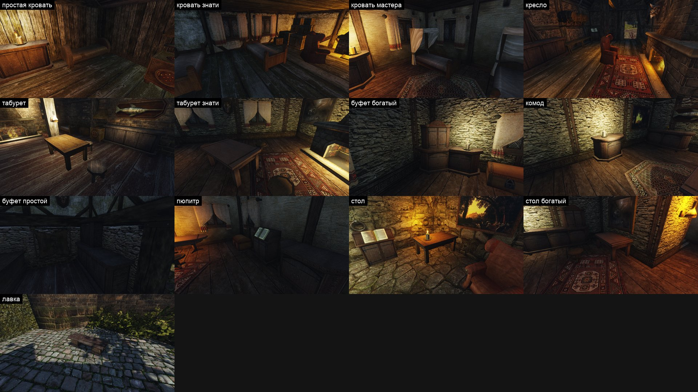

# Замысел оригинала: мебель дома

Ассет `city-furniture`, набор предметов, строка 21 [очереди](../../../../docs/remaster-pipeline.md#очередь-переделки). Просьба пользователя 2026-11-02: после фонаря — «мебель». Набор — первый блок [списка кандидатов](../../2026-10-prop-candidates.md): 13 визуалов, около 600 копий, почти все мобы.

Источники:
- кадры оригинала — 25 камер ([cameras.json](cameras.json), [`city-furniture.bench`](../../../../scripts/content/city-furniture.bench)), полдень, обычный FOV, NPC скрыты, сняты на Mac с рабочим контентом `working-8`, `~/.local/share/gothic-ai/remaster/city-furniture/survey/original/`. Глаз — на ближайшей точке пути в 1,7–4 м от предмета, на 1,6 м над ней: так камера всегда в комнате;
- геометрия — `furniture_targets.py` (`data/content/mesh3d-furniture.json`): габарит, треугольники, узлы `ZS_POS*`; рендеры мешей с четырёх сторон в Blender, только для себя;
- текстуры — `original_view.py` в родном размере.

Кадры и текстуры оригинала генератору не подаются.

## Что в наборе

Подмена — по имени визуала через `meshes/meshes.json`. У мобов сохраняются узлы `ZS_POS*`: на них NPC садятся, ложатся, читают.

| Визуал | Что это на деле | Копий в городе / вне | Габарит, м (ш × в × г) | Треуг. | Текстуры |
|---|---|---:|---|---:|---|
| `CHAIR_NW_NORMAL_01` | табурет: восьмигранное сиденье из досок, по кромке окованное железной полосой на заклёпках, на трёх квадратных ногах враспор, моб | 47 / 57 | 0,62 × 0,50 × 0,62 | 65 | `OBJ_CITY_TABLEPEASANT_01` |
| `CHAIR_NW_EDEL_01` | табурет знати: то же окованное сиденье, верх гранёный, на квадратной стойке с крестовиной из четырёх плоских лап, стыки в железных скобах, моб | 23 / 6 | 0,61 × 0,57 × 0,61 | 140 | `OBJ_CITY_TABLENORMAL_01` |
| `THRONE_NW_CITY_01` | кресло с «ушами», целиком обитое красно-бурой кожей: высокая спинка с двумя валиками-завитками наверху, загнутыми назад, подлокотники-валики, юбка до пола без видимых ножек; на торцах подлокотников латунные бляхи с головой льва | 24 / 18 | 1,03 × 1,52 × 0,97 | 344 | `OBJ_CITY_THRONE_01` |
| `BEDHIGH_NW_NORMAL_01` | простая кровать: короб, изголовье и изножье — толстые полукруглые щиты одной высоты, тюфяк оливковым полотном с заплатами | 48 / 55 | 2,70 × 0,98 × 1,19 | 160 | `OBJ_CITY_BEDNORMAL_01`, `OBJ_CITY_GALLOW_01` |
| `BEDHIGH_NW_EDEL_01` | кровать знати: четыре квадратные стойки с пирамидальными навершиями чуть выше щитов, между ними сплошные дощатые изголовье и изножье, царги; светлое полотно с зелёной каймой | 26 / 0 | 2,58 × 0,94 × 1,28 | 256 | `OBJ_CITY_BEDEDEL_01`, `OBJ_CITY_TABLENORMAL_01` |
| `BEDHIGH_NW_MASTER_01` | кровать мастера: стойки с навершиями в ногах, арочное изголовье, над изголовьем короб полога до 2,15 м, обтянутый светлой тканью, занавеси свисают и подвязаны у передних углов короба | 18 / 10 | 2,57 × 2,15 × 1,42 | 388 | `OBJ_CITY_BEDEDEL_01`, `OBJ_CITY_TABLENORMAL_01`, `NW_SHIP_SAIL_02` |
| `NW_CITY_CUPBOARD_POOR_01` | простой буфет: прямоугольный в плане, нижний ярус глубже верхнего, уступ, плоский верх с карнизом; по две дощатые дверцы в ярусе с маленькими ручками, без длинных петель; ножки-бруски | 30 / 22 | 1,80 × 2,47 × 0,85 | 156 | `OBJ_CITY_CUPBOARDPOORICH_01` |
| `NW_CITY_CUPBOARD_RICH_01` | богатый буфет: двухъярусный, многогранный в плане (передние углы скошены у обоих ярусов), нижний глубже; дощатые дверцы с длинными железными полосами-петлями, у нижних арочный верх; резные боковины; низкий резной полукруглый гребень над карнизом; цоколь на шарах | 31 / 7 | 1,80 × 2,53 × 0,90 | 332 | `OBJ_CITY_CUPBOARDPOORICH_01` |
| `NW_CITY_CUPBOARD_RICH_02` | комод: низкий, многогранный в плане (передние углы скошены), две дощатые дверцы с арочным верхом и полосами-петлями, резные боковины и скосы, выступающая столешница, цоколь на шарах | 49 / 20 | 1,80 × 1,25 × 0,90 | 240 | `OBJ_CITY_CUPBOARDPOORICH_01` |
| `BOOK_NW_CITY_CUPBOARD_01` | пюпитр: широкий шкафчик на резном цоколе, две дощатые дверцы с полосами-петлями и ручками-кольцами, верх скошен во всю ширину, на скосе раскрытая книга, моб | 21 / 20 | 1,25 × 1,57 × 0,81 | 130 | `OBJ_CITY_CUPBOARDPOORICH_01`, `MODIBOOKLET01` |
| `NW_CITY_TABLE_NORMAL_01` | стол: дощатая столешница на четырёх квадратных ногах с царгой; кромка столешницы окована железной полосой на заклёпках, верх ног в железных угольниках | 11 / 6 | 2,00 × 0,90 × 1,20 | 76 | `OBJ_CITY_TABLENORMAL_01` |
| `NW_CITY_TABLE_RICH_02` | тот же стол на прямых квадратных ногах, столешница светлее, с резной кромкой и тёмной полосой-рамкой по краю верха | 24 / 1 | 2,00 × 0,90 × 1,20 | 76 | `OBJ_CITY_TABLERICH_01` |
| `BENCH_NW_CITY_02` | лавка: толстая тёмная доска со скошенными кромками на двух трапециевидных каменных тумбах, моб на четверых | 15 / 0 | 2,00 × 0,50 × 0,76 | 64 | `NW_CITY_BODENDIELEN_02`, `NW_MISC_STRONG_STONEWALL_TOP_01` |

Имена визуалов обманчивы: «стул» — табурет, «трон» — кресло, «шкаф с книгой» — пюпитр, «богатый шкаф 02» — комод. Модель встаёт во все места визуала сразу, в том числе на фермы и в монастырь. Это общий предмет (правило О1 [арт-библии](../../../../docs/khorinis-art-bible.md#общие-материалы)): он делается по замыслу оригинала для всех мест.

Рядом уже есть свои модели того же быта ([кандидаты](../../2026-10-prop-candidates.md)): лавка `BENCH_NW_CITY_01`, крестьянский стол, сундук, `CUPBOARD_POOR_02` рынка. Дерево, железо и гвоздь набора — того же рода, что у них.

## Что это за место

Дома Хориниса изнутри: дощатые полы, стены из бута и фахверка, ковры, свечи, камины ([кадры](cameras.json)).

- **Бедные хижины порта** — табурет, простая кровать, буфет; тёмное дерево, полумрак, свеча на комоде.
- **Лавки и мастерские нижнего города** — у Боспера, у кузнеца, у Маттео: столы, табуреты, буфеты, пюпитр с книгой.
- **Верхний квартал** — у Леомара, у судьи, в ратуше, в отеле: кровати знати и мастера, кресла у камина, комоды со свечой, богатые столы и буфеты, ковры.
- **Казармы и каналы** — простые столы и табуреты; лавки во дворах.

Свет в комнатах тёплый, от свечей и каминов, днём из окон. Мебель тёмная, теплее пола и стен, ковры — единственное яркое.

## Главная деталь

У каждого предмета своя. Прочитана вблизи по мешу оригинала с его текстурой (рендер с четырёх сторон, только для себя, 2026-11-02) после двух отказов Р1: первая версия листа писалась по общим кадрам и ошибалась.

- **Табурет** — толстое восьмигранное сиденье ⌀ 0,62 м, по кромке окованное железной полосой на заклёпках, на трёх квадратных ногах враспор. Спинки нет.
- **Табурет знати** — то же окованное сиденье с гранёным верхом на квадратной стойке. Крестовина из четырёх плоских лап, стыки стойки и лап в железных скобах.
- **Кресло** — блочное «ушастое» кресло, целиком в красно-бурой коже `#592D1B`, дерева не видно.
  - Спинка до 1,52 м, наверху два валика-завитка, загнутые назад.
  - Подлокотники-валики, на их торцах латунные бляхи с головой льва.
  - Внизу юбка до пола.
- **Кровати** — длина 2,6–2,7 м, ширина 1,2–1,4 м.
  - простая — толстые полукруглые щиты одной высоты в голове и в ногах;
  - знати — четыре квадратные стойки с пирамидальными навершиями чуть выше сплошных дощатых щитов;
  - мастера — арочное изголовье, над ним короб полога до 2,15 м в светлой ткани, занавеси подвязаны у передних углов.
- **Простой буфет** — 1,80 × 2,47 м, прямоугольный: нижний ярус глубже верхнего, уступ, плоский верх. Дощатые дверцы с маленькими ручками.
- **Богатый буфет** — того же размера, но многогранный: передние углы скошены у обоих ярусов.
  - Дощатые дверцы с длинными железными полосами-петлями, у нижних арочный верх.
  - Резные боковины, низкий резной полукруглый гребень.
  - Цоколь на шарах.
- **Комод** — 1,80 × 1,25 м, многогранный, как нижний ярус богатого буфета. Две арочные дощатые дверцы с полосами-петлями, резные скосы, цоколь на шарах.
- **Пюпитр** — широкий шкафчик 1,25 × 0,81 м на резном цоколе. Дощатые дверцы с полосами-петлями и кольцами, верх скошен во всю ширину, на нём раскрытая книга.
- **Столы** — столешница 2,0 × 1,2 м на высоте 0,9 м, квадратные ноги, царга. Кромка окована железной полосой на заклёпках, верх ног в угольниках. Богатый стол той же формы, светлее, с резной кромкой.
- **Лавка** — толстая тёмная доска 2,0 м на двух трапециевидных тумбах из тёсаного камня.

## Силуэт и пропорции

Габарит, начало координат, узлы `ZS_POS*` и число вложений — как у оригинала, по таблице выше. На этих узлах NPC садятся и ложатся, их место не двигается.

## Черты оригинала: замысел, ограничение или то и другое

| Черта | Класс | Что делаем |
|---|---|---|
| ножки, стойки, валики — гранёные бруски | ограничение | тёсаные объёмом с фаской; квадратное остаётся квадратным, точёного не добавляем |
| филёнки, петли, резные фризы нарисованы на плоском коробе | ограничение | филёнки, петли, ручки, фризы объёмом |
| тюфяк и полотно — плоский параллелепипед с текстурой | ограничение | мягкий тюфяк, складки покрывала, подушка |
| полог балдахина — плоские лоскуты | ограничение | ткань с провисом и складками |
| кожа кресла — плоские грани | ограничение | мягкая обивка, валики, кожа натянута, без простёжки и рядов гвоздей |
| тёмное дерево, тёплые бурые тона | замысел | сохраняем тон |
| богатая мебель светлее и с резьбой, бедная — грубее и темнее | замысел | сохраняем различие |
| латунные бляхи с головой льва на торцах подлокотников | замысел | сохраняем |
| железо: окованные кромки табуретов и столов, полосы-петли богатых шкафов и пюпитра | замысел | сохраняем там же, объёмом; где его нет (простой буфет, кровати), не добавляем |
| каменные тумбы лавки | замысел | сохраняем |
| заплаты на бедном тюфяке | замысел | сохраняем |

## Неоднозначности: здесь деталь наша

- Число досок, гвоздей, филёнок, складок — в пределах размеров выше.
- Что внутри шкафов, не видно: дверцы закрыты.
- Книга на пюпитре — своя модель; текст страниц не читается, только строки.
- Свеча на комоде — отдельный предмет мира, не часть модели.

## Напряжения, которые нельзя «чинить»

- **Бедность и достаток рядом.** Бедная мебель грубая, тёмная и потёртая, но целая. Богатая — светлее, с резьбой, но не лакированная и не позолоченная.
- **Темнота комнат.** Дерево тёмное, ковры ярче мебели. Не осветлять.
- **Пользуются каждый день.** Сиденья стёрты, на столах пятна и царапины, кромки скруглены руками.

## Правила квартала

- **О1.** Мебель стоит во всех кварталах и на фермах, правило одного квартала её не двигает. Одно дерево, одно железо, одна ткань на набор.

## Список сохранения

Атомарные вопросы «да / нет» для слепой пары. Предмет, которого нет в кадре, — «не видно».

1. Предметы набора на 1 и 2 стоят на тех же местах, тех же размеров и в той же посадке? Если нет — какой отличается.
2. Табурет на 1 и 2 — восьмигранное сиденье без спинки, окованное железной полосой по кромке, на трёх ногах враспор (у знати — на квадратной стойке с крестовиной из четырёх лап)?
3. Кресло на 1 и 2 целиком обито красно-бурой кожей, без видимого дерева: высокая спинка с валиками-завитками наверху, подлокотники-валики, юбка до пола, латунные бляхи на торцах подлокотников?
4. Кровать на 1 и 2 того же вида: полукруглые щиты одной высоты (простая), четыре квадратные стойки с навершиями чуть выше сплошных щитов (знати), короб полога над арочным изголовьем с подвязанными занавесями (мастера)?
   4a. Тюфяк простой кровати на 1 и 2 оливкового полотна с заплатами, у кроватей знати и мастера — светлое полотно с зелёной каймой?
5. Буфет на 1 и 2 — двухъярусный, нижний шкаф глубже верхнего, с уступом? Простой прямоугольный, с дощатыми дверцами без длинных петель; богатый многогранный (скошенные углы), с длинными полосами-петлями, гребнем и цоколем на шарах?
6. Комод на 1 и 2 — низкий, многогранный (скошенные передние углы), с арочными дверцами на полосах-петлях, на цоколе с шарами?
7. Пюпитр на 1 и 2 — широкий шкафчик (шире своей глубины) на цоколе, верх скошен во всю ширину, на нём раскрытая книга?
8. Стол на 1 и 2 — дощатая столешница на четырёх квадратных ногах с царгой, кромка окована железом; богатый той же формы, светлее, с резной кромкой?
9. Лавка на 1 и 2 — одна толстая доска на двух трапециевидных каменных тумбах?
10. Дерево набора на 1 и 2 одного тона в пределах ±25 % яркости? Если нет — где светлее.
11. Богатая мебель на 1 и 2 светлее и наряднее бедной в той же мере?
12. Всё остальное в кадре на 1 и 2 одинаково?

## Свойства нашего кадра

Должно быть верно на нашем изображении независимо от оригинала. Рецензент проверяет каждое изображение отдельно.

P1. Ножки, стойки, шары и валики круглые или тёсаные с фаской: на контуре не видно грубых граней.

P2. Филёнки, петли, ручки, железные полосы и резьба объёмные: дают тень и блик, а не нарисованы на плоскости.

P3. Ткань мягкая: тюфяк с выпуклостью, складки покрывала и полога, провис полога.

P4. Дерево читается деревом, кожа кожей: волокно, стёртые кромки, у кожи простёжка и мягкий блик; нет пластика и лака.

P5. Нет «фэнтези-мебели»: позолоты, глянца, рун, черепов, светлой обводки кромок, новенькой чистоты.

## Отступления

Нет.
