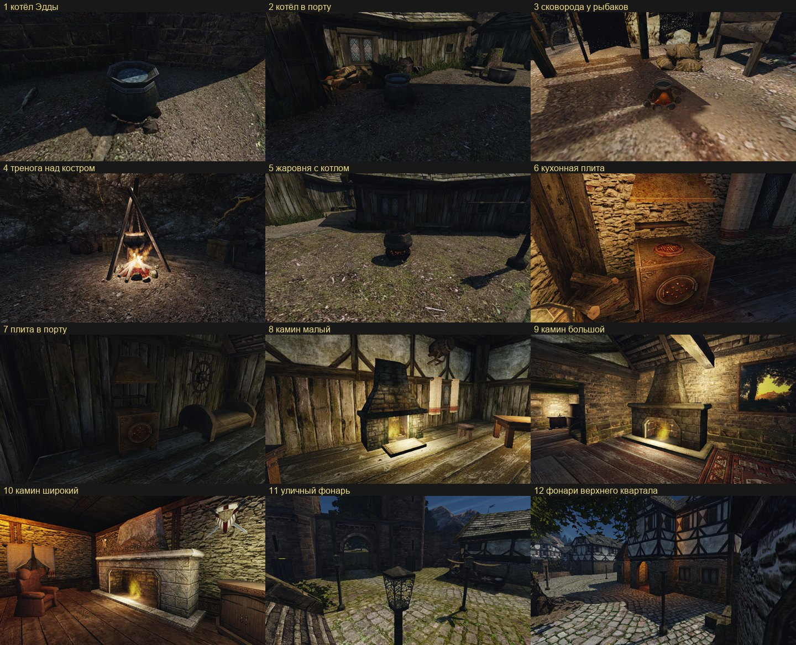

# Замысел оригинала: кухня и очаг

Ассет `city-hearth`, набор предметов, строка 18 [очереди](../../../../docs/remaster-pipeline.md#очередь-переделки). Просьба пользователя 2026-10-31: «котел с похлебкой можно было бы сделать более круглым. Детализацию самого кострища сделать… те предметы, которые видно, что на них мало бюджета именно по полигонам». Из списка бедных по полигонам предметов пользователь выбрал набор «Кухня и очаг».

Источники:
- кадры оригинала — 20 камер ([cameras.json](cameras.json), [`city-hearth.bench`](../../../../scripts/content/city-hearth.bench)), полдень, обычный FOV, NPC скрыты, сняты на Mac (Ryzen был занят очередью), `~/.local/share/gothic-ai/remaster/city-hearth/survey/original*/`. Лист — [original.jpg](original.jpg);
- геометрия — меши и модели базы (`meshes/<ВИЗУАЛ>.glb`, `models/<ВИЗУАЛ>.MDL|MDM|MDH.json`): габариты, треугольники, узлы, текстуры по частям;
- позиции — `worlds/*/vobs.json` базы; ближайшие точки пути дают место;
- текстуры — `original_view.py` в родном размере;
- форма — рендеры оригинальных мешей с четырёх сторон в Blender, только для себя.

Кадры и текстуры оригинала генератору не подаются.

## Что в наборе

Подмена — по имени визуала через `meshes/meshes.json`. Мобы (`.ASC`, `.MDS`) подменяются с сохранением узлов `ZS_POS*` и `BIP01 FIRE`: на них стоят NPC, у них варят и греются, на них горит огонь.

| Визуал | Что это | Копий: город / NW / весь остров | Габарит, м (ш × г × в) | Треуг. | Текстуры |
|---|---|---:|---|---:|---|
| `CAULDRON_OC` | котёл с похлёбкой, моб | 2 / 6 / 18 | 0,86 × 0,86 × 0,80 | 66 | `MOMESMELT01`, похлёбка — `OWODWAT_A0` |
| `FIREPLACE_GROUND` | кострище под котлом, моб | 2 / 5 / 27 | 1,11 × 1,22 × 0,17 | 150 | `MOSTSTONES02`, `NCODFLGREY01`, `MOWOWOODS01` |
| `PAN_OC` | сковорода на треноге над кострищем, моб | 3 / 6 / 13 | 0,88 × 0,80 × 0,40 | 252 | `MOMEMETALS01`, `_03`, `MOWOWOODS01`, камни и зола как выше |
| `OC_FIREPLACE_V5` | тренога с котлом на цепи | 3 / 7 / 23 | 2,16 × 2,43 × 3,34 | 142 | `MOMEBRAZIER`, `MOMECHAIN01`, `WAT_A0` |
| `NW_MISC_FIREPLACE_01` | костёр: кольцо камней, поленья, угли | 9 / 46 / 90 | 2,02 × 1,88 × 0,90 | 1 144 | `NW_NATURE_STEIN_06`, `NW_NATURE_BARK_01`, `MOWOFIREPLACE01` |
| `DT_FIREPLACE_V1` | жаровня на ножках с котлом | 4 / 4 / 12 | 0,87 × 0,89 × 0,90 | 304 | `MOMEKETTLE01` |
| `STOVE_NW_CITY_01` | кухонная плита с колпаком, моб | 26 / 36 / 38 | 1,00 × 1,00 × 2,30 | 116 | `OBJ_CITY_STOVE_01`, `_02`, `OBJ_CITY_GALLOW_01` |
| `NW_CITY_FIREPLACE_NORMAL_01` | камин малый | 23 / 24 / 24 | 2,42 × 1,50 × 3,00 | 108 | `OBJ_CITY_BOULDERPOOR_01` |
| `NW_CITY_FIREPLACE_LARGE_01` | камин большой | 14 / 21 / 21 | 3,63 × 1,40 × 3,65 | 122 | `OBJ_CITY_BOULDERBIG_01` |
| `NW_CITY_FIREPLACE_LARGE_02` | камин широкий | 4 / 4 / 4 | 5,43 × 1,40 × 4,09 | 122 | `OBJ_CITY_BOULDERBIG_02` |
| `NW_CITY_FIREPLACE_LARGE_021` | камин широкий, низкий | 4 / 6 / 6 | 5,43 × 1,40 × 3,10 | 122 | `OBJ_CITY_BOULDERBIG_02` |
| `FIREPLACE_NW_LAMP_01` | уличный фонарь на столбе, моб огня | 43 / 43 / 43 | 0,40 × 0,36 × 3,22 (из них 1,25 под землёй) | 96 | `OBJ_CITY_STREETLAMP_01`, `_02` (узор альфой) |

«Весь остров» — Хоринис, Яркендар, Долина рудников и остров драконов вместе. Модель встаёт во все места визуала сразу: костёр — в 90 мест, кострище — в 27, тренога — в 23. Это общий предмет, как общий материал (правило О1 [арт-библии](../../../../docs/khorinis-art-bible.md#общие-материалы)): он делается по замыслу оригинала для всех мест, а правило одного квартала его не двигает.

## Что это за место

Огонь в бедном портовом городе. Готовят на улице у хижин и в кухнях домов, греются у каминов, ночью улицы освещают масляные фонари на столбах ([арт-библия](../../../../docs/khorinis-art-bible.md#город-целиком)).

- **Котёл Эдды**, бедный квартал (точка `NW_CITY_HABOUR_POOR_AREA_CAULDRON`, 24,2 / −63,2 м). Эдда варит здесь рыбную похлёбку для бедняков. Котёл стоит прямо на кострище у каменной стены, в тени. В кадре почти чёрный: тело `#0E1114`, пояс `#13181E`, похлёбка `#172436`, камни кострища `#2D241F`. Утоптанная земля на солнце рядом — `#574D3A`, стена в тени — `#101213`.
- **Котёл в порту**, двор у хижины (точка `NW_CITY_PATH_HABOUR_13`). Рядом пни, дрова, второй котёл без огня.
- **Сковорода у рыбаков** — на дороге к кораблю (`NW_CITY_WAY_TO_SHIP`), под навесами для сетей, на светлой утоптанной земле; кольцо кострища под ней `#7A5D3A`.
- **Тренога над костром** — у маяка, в канализации (воровская гильдия) и за городом в лагерях бандитов. В кадре над костром висит котёл, снизу горит огонь.
- **Жаровня с котлом** — бедный квартал у хижин и угол нижнего города (`NW_CITY_RAUCH`). Стоит на земле и брусчатке, под котлом тлеют угли.
- **Кухонная плита** — 26 кухонь: таверна Корагона, хижины порта, дома верхнего квартала. Стоит у каменной стены под колпаком, рядом поленница, бочки, свеча. Короб `#4C2714`, медный колпак `#834B19`, стена в свете свечи `#623F20`.
- **Камины** — жилые комнаты: у Боспера, у кузнеца Гарада, у Леомара, таверна порта, дома верхнего квартала. Широкий камин верхнего квартала — из светлого тёсаного камня с резным колпаком. Камень большого камина `#4C3923`, огонь в топке `#7D592D`.
- **Фонари** — вдоль главной улицы нижнего города и по всем улицам верхнего квартала, 43 штуки. Днём — тёмный столб `#161A1B` на брусчатке `#665D37`, ночью — тёплый огонь в фонаре.

## Главная деталь

У каждого предмета своя. Числа — из обмера мешей.

- **Котёл** — пузатый железный котёл: ⌀ 0,86 м по пузу, высота 0,80 м, пузо на 0,4 высоты. Горло сужается до 0,70 м, над ним расширяется воротник высотой 0,12 м. Два клёпаных пояса: под воротником и у дна. Котёл стоит дном прямо на камнях кострища, без ножек и дужки. Похлёбка почти до края, на 0,1 м ниже воротника.
- **Кострище** — неровное кольцо из 8–9 угловатых камней ⌀ 1,1–1,2 м, высотой до 0,16 м. В середине низкая куча золы и углей, тлеющая оранжевым.
- **Сковорода** — кострище того же вида, над ним тренога из трёх тёмных брусков высотой около 0,4 м, на ней плоская сковорода ⌀ 0,5 м с длинной деревянной ручкой.
- **Тренога** — три тонкие жерди длиной около 3,3 м, сведены вверху, расставлены на 2 м. С вершины на цепи висит котёл того же вида, что у жаровни, около 1 м над огнём.
- **Костёр** — кольцо из 14–16 крупных серых камней ⌀ 1,9–2,0 м. Внутри шалаш из 6–7 поленьев с корой длиной до 1,2 м, высотой 0,9 м. Под ними красные угли во всё кольцо.
- **Жаровня** — железная чаша с углями на трёх коротких ногах, на ней восьмигранный котёл ⌀ 0,87 м. Котёл занимает верхние 2/3 высоты.
- **Кухонная плита** — чугунный короб 1,0 × 1,0 × 0,9 м на четырёх коротких брусках:
  - наверху круглая конфорка с решёткой, сквозь неё огонь;
  - спереди круглая дверца с отдушинами;
  - по углам граней кованые завитки.

  Над ней на стене висит трапециевидный колпак до 2,3 м, между ними тёмная полка. Цвет — ржавое железо, колпак светлее, медно-рыжий.
- **Камины** — каменная кладка. Внизу топка с карнизом-полкой, над ней сужающийся колпак-труба до потолка, перед топкой каменная плита. В топке огонь.
  - малый: 2,42 м шириной, 3,0 м высотой, топка прямоугольная;
  - большой: 3,63 × 3,65 м, у топки скошенные углы;
  - широкий: 5,43 м, у топки скошенные углы. Верхний квартал — светлый тёсаный камень с резным колпаком.
- **Фонарь** — чугунный столб около 2 м над землёй с поясками заклёпок на восьмигранной тумбе. Наверху четырёхгранный фонарь-трапеция с кованым узором вьюнка на всех гранях и пирамидальная крышка.

## Силуэт и пропорции

Габарит, начало координат, узлы и число вложений — как у оригинала, по таблице выше. Модель стоит на той же плоскости. Котёл стоит на кострище, а не над ним: так их ставит мир, вобы котла и кострища разнесены на 0,6 м. Фонарь уходит под землю на 1,25 м: так он встаёт на склонах.

## Черты оригинала: замысел, ограничение или то и другое

| Черта | Класс | Что делаем |
|---|---|---|
| котёл десятигранный, пузо из плоских граней | ограничение | круглый кованый котёл, толщина кромки, пояса с заклёпками объёмом |
| котёл почти чёрный, зеленоватое железо | замысел | сохраняем тон |
| похлёбка — плоский диск с текстурой воды | ограничение | густое варево с поверхностью; цвет — см. «Предлагаемые отступления» |
| камни кострищ — кубы-многогранники | ограничение | колотые камни разной формы, закопчённые изнутри |
| угли и зола нарисованы на конусе | ограничение | угли и обгорелые поленья объёмом, зола вокруг |
| поленья костра — гранёные бруски | ограничение | поленья с корой, обгорелые концы |
| жерди треноги и бруски под сковородой гранёные | ограничение | тонкие жерди, сведённые и связанные верёвкой |
| цепь — плоская полоса с текстурой | ограничение | звенья цепи объёмом |
| плита — куб с нарисованными дверцей и конфоркой | ограничение | дверца, заслонка, конфорка, завитки, ножки объёмом |
| колпак плиты висит отдельно, медно-рыжий | замысел | сохраняем |
| камины — плоские плиты с кладкой в текстуре | ограничение | кладка объёмом, карниз, глубина топки |
| топка камина — чёрная плоскость | ограничение | топка с глубиной, закопчённый свод и под |
| широкий камин верхнего квартала светлее, с резьбой | замысел | сохраняем |
| узор фонаря — альфа на плоских гранях | то и другое | узор остаётся тонким кружевом; рамка и крышка объёмом |
| всё тёмное, огонь — единственное светлое | замысел | сохраняем |

## Неоднозначности: здесь деталь наша

- Число камней, поленьев, заклёпок и звеньев, форма каждого камня решаются в пределах размеров выше.
- **Огонь** — эффекты движка (`FIRE`, `FIRE_SMOKE`, узлы `BIP01 FIRE`), а не модель. В наборе их не меняем, модель только оставляет им место. Угли — часть модели.
- **Тот же котёл** висит на треноге и стоит на жаровне. У оригинала это разные текстуры одного рода, у нас — одна модель котла в трёх предметах.
- **Колпак плиты** у оригинала — часть того же меша, хотя висит отдельно на стене. Он остаётся частью визуала плиты.
- **Свет.** Фонари и камины светят светом движка. Новых источников света набор не добавляет.

## Напряжения, которые нельзя «чинить»

- **Бедно, но в деле.** Котлы закопчённые и битые, но целые: в них варят каждый день. Не новые, не начищенные и не ржавые насквозь.
- **Темнота.** Котлы, плиты и камины тёмные; огонь — единственное яркое пятно. Не осветлять железо и камень.
- **Кухня в копоти.** Над топками и конфорками копоть, полка и колпак закопчены.
- **Фонарь — знак порядка.** Фонари стоят только в нижнем городе и верхнем квартале. Они ухоженнее всего остального набора: кованое железо без ржавых потёков.

## Правила квартала

- **П1, постоянная сырость.** Касается котла Эдды, котла в порту, жаровни бедного квартала и сковороды рыбаков. Но эти визуалы стоят и в лесах, и в Долине рудников. Поэтому сырость модели — не больше, чем у оригинала. Мох только на нижних камнях кострищ, по О1.
- **Н1, В1** — фахверк и камень. Касаются места каминов и плит, но не их самих: камины и плиты стоят во всех кварталах.
- **Свет города** ([арт-библия](../../../../docs/khorinis-art-bible.md#город-целиком)): ночью масляные фонари на столбах, тёплый свет из дверей таверн.

## Список сохранения

Атомарные вопросы «да / нет» для слепой пары. Предмет, которого нет в кадре, — «не видно».

1. Предметы набора на 1 и 2 стоят на тех же местах, тех же размеров и в той же посадке? Если нет — какой отличается.
2. Котёл на 1 и 2 — пузатый тёмный железный котёл с расширенным воротником и поясами, стоит прямо на камнях кострища, без ножек и без дужки?
   2a. Отношение высоты котла к ширине пуза совпадает в пределах ±10 %? Назови оба значения.
3. Варево в котле на 1 и 2 налито почти до края?
4. Кострище на 1 и 2 — низкое неровное кольцо камней с тлеющими углями в середине, того же поперечника?
5. Сковорода на 1 и 2 — плоская, на низкой треноге над кострищем, с длинной ручкой?
6. Тренога на 1 и 2 — три длинные тонкие жерди, сведённые вверху, с котлом на цепи над огнём?
7. Костёр на 1 и 2 — кольцо крупных камней с шалашом поленьев внутри и углями под ними, того же поперечника и высоты?
8. Жаровня на 1 и 2 — чаша с углями на коротких ножках с котлом сверху?
9. Плита на 1 и 2 — короб на ножках, в верхней грани конфорка с огнём, спереди круглая дверца, над ним колпак на стене?
   9a. Плита на 1 и 2 одного семейства цвета: ржавое бурое железо, колпак светлее и рыжее короба?
10. Камин на 1 и 2 — каменная топка с карнизом, над ней сужающийся колпак-труба до потолка, перед топкой плита пола? Те же ширина и высота?
    10a. Форма проёма топки (прямоугольник или скошенные углы) на 1 и 2 одна?
11. Фонарь на 1 и 2 — тёмный столб на восьмигранной тумбе с фонарём-трапецией с кованым узором и пирамидальной крышкой, той же высоты?
12. Железо и камень набора на 1 и 2 одного тона в пределах ±25 % яркости? Если нет — где светлее.
13. Всё остальное в кадре на 1 и 2 одинаково?

## Свойства нашего кадра

Должно быть верно на нашем изображении независимо от оригинала. Рецензент проверяет каждое изображение отдельно.

- **P1.** Котлы и сковорода круглые: на контуре не видно граней.
- **P2.** Камни кострищ и костра читаются колотым камнем разной формы, а не одинаковыми многогранниками или гладкими галечными шарами.
- **P3.** Угли, зола и поленья читаются объёмом: обгорелые концы, светящиеся угли в щелях, серая зола по краю.
- **P4.** Кладка каминов объёмная: видны швы и выступы камней, у топки есть глубина.
- **P5.** Нет «фэнтези-утвари»: глянцевой меди, чистого нового железа, рун и черепов, светлой обводки кромок.

## Отступления

Нет.

## Предлагаемые отступления

Решение пользователя; до него делаем как в оригинале.

- **Похлёбка вместо воды.** У оригинала в котле голубовато-серая вода (`#172436` в тени): это текстура воды. У Эдды в котле рыбная похлёбка. Предлагаю густое бурое варево с кусками и жирными пятнами того же тона в тени. Похлёбку пользователь сам назвал: «котел с похлебкой».

## Порядок работы

Двенадцать визуалов — три волны, у каждой свой концепт, свои ворота и своя приёмка в игре:
1. **Открытый огонь** — котёл, кострище, сковорода, тренога, костёр, жаровня. Общие камень, угли и железо котлов.
2. **Очаги в домах** — плита и четыре камина. Общие кладка и копоть.
3. **Фонарь.**

Бюджет треугольников — ориентир, точный даёт порог цены Ц1:

| Предмет | Бюджет |
|---|---|
| котёл | 2 500 |
| кострище | 2 000 |
| сковорода | 2 500 |
| тренога | 3 000 |
| костёр | 4 000 |
| жаровня | 3 000 |
| плита | 3 000 |
| камин малый | 3 000 |
| камины большие | 4 000 |
| фонарь | 2 000 |
