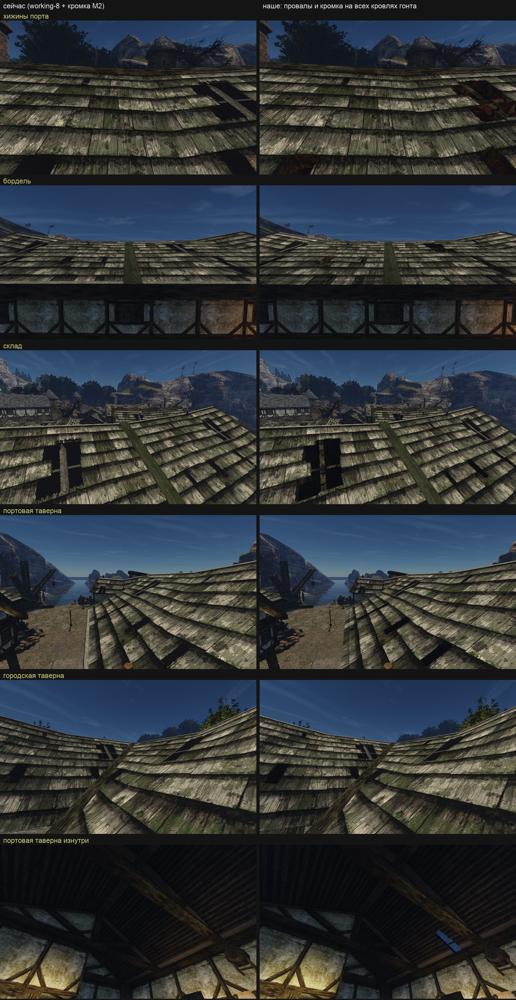
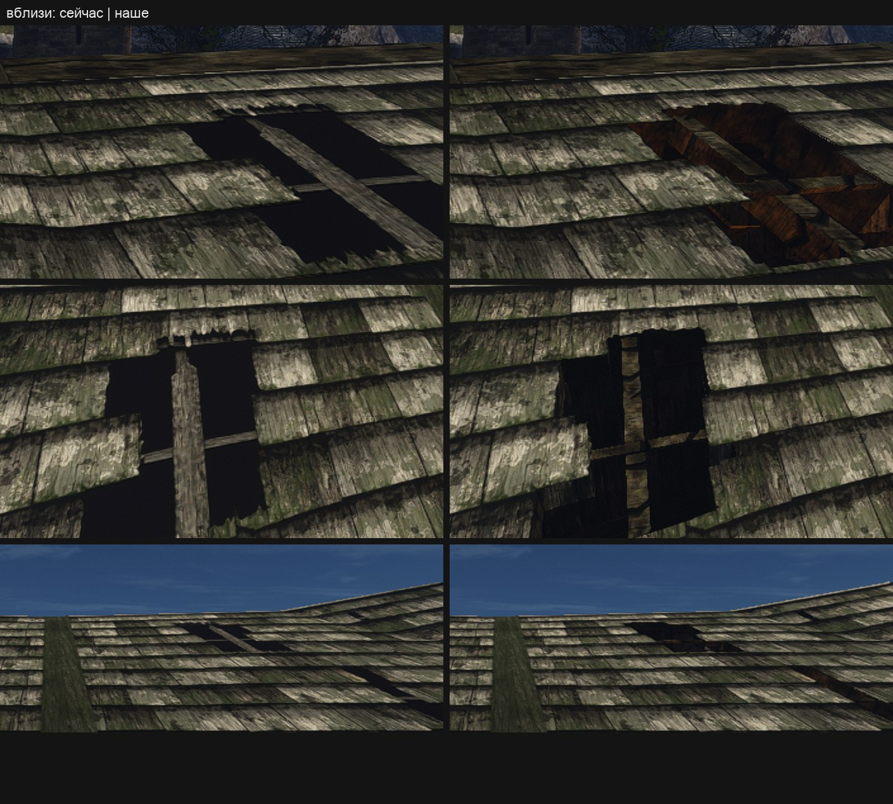

# Объём гонтовых кровель Хориниса

Провалы и кромка гонта `NW_CITY_ROOF_01` на всех кровлях города. Пилоты: провалы на хижине B037 ([`harbour-roof-holes`](../harbour-roof-holes/intent.md), включены в `working-8`) и кромка на хижинах B031, B035–B037 ([`harbour-roof-edge`](../harbour-roof-edge/README.md), М2, не включена). Лист замысла — [intent.md](intent.md), исполнение — [concept.md](concept.md). Принято пользователем в игре 2026-11-02 («Принимаю»), в рабочий контент не включено.

## Почему

Пользователь, 2026-11-01: в прогонах тестов крыши остаются плоскими. Причин две:
- e2e на Ryzen идут без нашего контента (каталог по умолчанию там пуст, и так задумано);
- настоящая геометрия была только на хижинах пилота, а на остальных кровлях гонта пять провалов на квадрат нарисованы.

Карты высот в движке нет, параллакс — отложенный шаг Д4. Карта нормалей `roofs-8` даёт рельеф только светом. На вопрос, переносить ли провалы и кромку на все кровли гонта, пользователь ответил: «Да, переносим».

## Что сделано

Правки мира [`city_roof_holes.py`](../../../../scripts/content/world/city_roof_holes.py) и [`city_roof_edge.py`](../../../../scripts/content/world/city_roof_edge.py), набор `cityroofs-1`. Они вызывают пилотные скрипты с рамкой города. Новое против пилота:
- провалы режутся на каждом квадрате текстуры, который лежит на скате: большие кровли несут несколько квадратов;
- провал без внутренней обшивки под ним (дом, куда не входят) получает закрытое дно `OWN_ROOF_HOLE_DARK` на 30 см. Его цвет — чернота нарисованных провалов `roofs-8`;
- провал, от которого после обрезки краем панели остаётся меньше 60 %, или который выходит за свои треугольники у границы куска, остаётся нарисованным;
- рейка и стропило лежат только под вырезанной частью провала и не выходят за свою панель. Первый рендер показал брус поверх соседнего ската борделя;
- граница куска — не кромка: кровля идёт дальше в соседнем куске.

Пилот B037 и куски М2 с теми же скриптами пересобираются в те же треугольники, UV и материалы (`world_edit.py compare`).

## Куски

| Кусок | Постройки | Треугольников до | после | Провалов | из них с закрытым дном |
|---|---|---:|---:|---:|---:|
| `0_-2` | хижина `HAFEN09` (южная половина) | 2 106 | 4 905 | 10 | 2 |
| `0_-1` | хижины порта, бордель, портовая таверна, лавка Маттео | 17 784 | 37 673 | 105 | 5 |
| `0_0` | хижины `HAFEN01`, `HAFEN02`, `FELLAN`, склад, `KARTEN` | 19 229 | 29 468 | 63 | 11 |
| `1_-1` | дом Боспера и Гритты, лавка Маттео | 8 656 | 13 313 | 20 | 15 |
| `1_0` | дом у рынка B052, городская таверна | 9 702 | 16 320 | 28 | 25 |
| всего | | 57 477 | 101 679 | 226 | 58 |

«До» — кусок `harbour-volume-4`: М2 в `0_-1` и `0_0`, лестница `stairs-3` в `1_-1`, остальные — база. Кусок `0_0` несёт и лестницу к казармам, `1_-1` — лестницу порта: в наборе их правки идут в том же списке, что и кровли.

Что осталось как было:
- 34 провала нарисованы: обрезаны краем панели больше чем на 40 %, выходят за свои треугольники у границы куска или лежат на коньке и изломе ската;
- 18 граней `ROOF_01` обращены вниз — нижняя сторона свесов у склада (16) и в `0_-1` (2). На них нет ни провалов, ни кромки;
- у маяка (`-1_2`) гонт лежит только на нижней стороне свеса, кровля сверху из другого материала: кусок не тронут;
- 5 реек и стропил пропущены: на гнутом скате они вышли бы над гонтом или сквозь дно. Провалы при этом остаются.

Кромка: 107 карнизов, 75 фронтонов, 668 торцевых гонтин. В куске `0_0` принятая кромка М2 ставила торцы и на нижнюю сторону свесов склада: 10 карнизов и 8 фронтонов наизнанку. В городском наборе их нет.

## Первый круг приёмки и исправления

Слепые пары `harbour-volume-4 | cityroofs-test-3`, сняты на Mac одним бинарником (Ryzen был занят): хижины — PASS в обоих порядках, бордель, склад и портовая таверна — REJECT. Причины и что исправлено (`cityroofs-test-4`):
- **Гонт темнее на 7–42 %.** Свет вершин (`COLOR_0`) новой вершине давал `world_bpy.bake_light`: среднее четырёх ближайших вершин базы. На длинных треугольниках больших кровель это вершины стен и внутренней обшивки, и свет гонта выходил в 3,7 раза темнее базы в той же точке. Теперь правки города сами светят свои вершины светом исходной поверхности в этой точке (`world_bpy.SurfaceLight`, `keep_own_light`): обшивка — своей обшивки, стенки, брус и кромка — гонта. Сверка по 250–265 углам кровли на кусок: наш свет к свету базы в той же точке — медиана 1,000, p5–p95 0,99–1,01.
- **Небо сквозь провал, стропило осколками.** Провал у конька и на изломе ската резался через оба треугольника, хотя они лежат под углом. Теперь соседом панели считается только треугольник почти в той же плоскости (до 4°). Брус ставится, только если его верх под гонтом, а низ выше дна провала.
- **Пункты 1 и 6 спорили с задуманной кромкой.** Светлая полоса по краю ската у оригинала — нарисованная коньковая доска. Кромка закрывает её нарочно: та читалась новой планкой (М2, дефолт 9a). Формулировки уточнены в [листе замысла](intent.md#список-сохранения).

Пилот B037, куски М2 и лестница порта с новыми скриптами пересобираются в те же куски, вплоть до цветов и нормалей (`world_edit.py compare --full`).

## Второй круг (2026-11-02)

Пары `harbour-volume-4 | cityroofs-test-4`. После раскрытия: хижины — PASS (главная деталь и материал лучше); склад — оба рецензента вслепую PASS, после раскрытия REJECT по P3 (конёк без торцов: его мы не трогаем по замыслу) и по ровным краям большого провала; бордель — REJECT; портовая таверна — REJECT.
- **Тон гонта (бордель, пункт 5).** Причина — нормали: у исходных треугольников они сглажены (от нормали грани в среднем на 7°, у 10 % углов больше чем на 33°), а новые треугольники после выреза несли нормаль грани. К коньку разница росла до 20–27 %. Теперь разрезанная обшивка и верх гонтин берут сглаженную нормаль исходной поверхности в своей точке (`SurfaceLight.normal_at`): медиана расхождения с базой 0°, у 90 % углов меньше 0,01°. На кадрах `cityroofs-test-6` отношение яркости гонта «наше / как сейчас» — медиана 1,000 на всех ракурсах (было 0,93–1,03).
- **Ветровая балка (портовая таверна, пункт 6, один порядок из двух).** У фронтона лежит объёмная ветровая балка, как у хижин. Ступени рядов поднимаются над скатом на 2–3 см и кончаются на её внутренней кромке, как принято в М2. Камера стоит у самого фронтона и смотрит почти вдоль ската: под таким углом торцы закрывают верх балки. Второй порядок увидел балку на месте.
- **Рыжая древесина в провалах (дефолт 9, бордель и хижины).** Рейка и стропило — из балки города `WOODBEAM_02`, стенки — та же балка, затемнённая до 30 %. Над жилым домом нутро светится сквозь вуаль 18 % тёплым светом очага. У оригинала рейка в провале нарисована серым старым деревом, а провал чёрный. Так же выглядит принятый пилот B037.

## Решение о нутре провала

Пользователь, 2026-11-02: «оно не может быть темным, как в оригинале, потому что в оригинале оно темное в текстуре. А если внутри есть свет, и мы смотрим из снаружи внутрь, то оно никак не будет темное. Поэтому мы делаем так, как логически правильно». Нутро остаётся как у принятого пилота: над жилым домом видно освещённое нутро, рейка и стропило — дерево балки. Чернота оригинала — свет, нарисованный в текстуре ([конвейер](../../../../docs/remaster-pipeline.md), «дух оригинала, современное исполнение»). Замечание рецензентов по дефолту 9 к нутру провала не относится: [дефолт 9](../../../../docs/remaster-defaults.md) уточнён.

## Приёмка

Пользователь посмотрел пары «как сейчас | наше» и вблизи ([выше](#второй-круг-2026-11-02)) и ответил: «Принимаю» (ворота `ingame`, 2026-11-02). Кромка на хижинах B031, B035–B037 в кусках `0_-1` и `0_0` городского набора — та же, что у [`harbour-roof-edge`](../harbour-roof-edge/README.md) (М2): городская правка строит её тем же скриптом вместо записей М2.

Как у прежних правок мира (`harbour-roof-holes`, `harbour-stairs-kasern`), резервной копии исходников нет: источник — скрипты и реестр `world-edits.jsonl` в git, куски пересобираются из базы.

Открыто: включать ли набор в рабочий контент (`working-9`).

## Цена

Ц1 на Ryzen, `harbour-volume-4 → cityroofs-test-3`, порт и рынок, A B B A ([отчёт](../../../performance/2026-11-02-content-cost/harbour-volume-4-vs-cityroofs-test-3/report.md)):

| Место | Δ p50 | Δ p95 | Треугольники/кадр | Вызовы отрисовки |
|---|---:|---:|---:|---:|
| порт | −0,19 % | −1,99 % | 1 021 тыс. → 1 082 тыс. (+6,0 %) | 73,1 → 73,1 |
| рынок | −0,20 % | −0,22 % | 957 тыс. → 1 002 тыс. (+4,7 %) | 71,3 → 71,3 |

Вердикт — «в шуме» на обоих местах. В `cityroofs-test-3` на 8 тыс. треугольников больше, чем в окончательном наборе, при тех же материалах, поэтому окончательный набор не дороже. Замер шёл после исправления [kaifaty/GothicAI#752](https://github.com/kaifaty/GothicAI/pull/752): до него Ц1 не собирался ни у кого, `perf_content.py` не переносил `ryzen-build.sh`.
