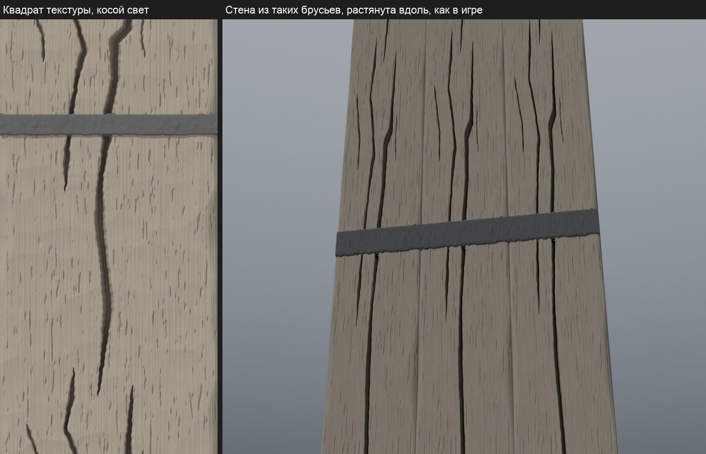
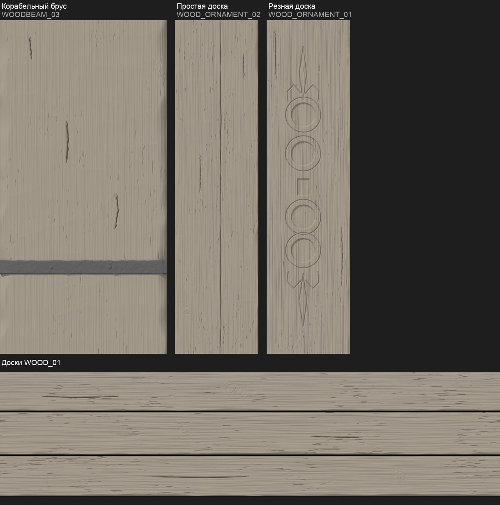
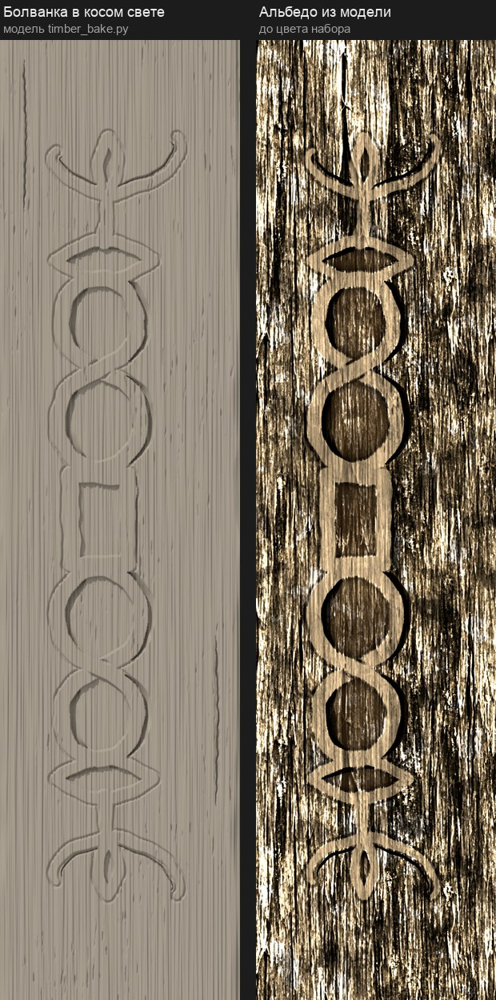

# Концепция: Дерево города — балки и доски

Замысел оригинала, по которому идёт проверка, — в [листе замысла](intent.md). Здесь — как дерево устроено и как его рисуем.

## Конструкция

- **`WOODBEAM_02` — тёсаный дубовый брус каркаса.** Грани стёсаны топором, волокно вдоль бруса. Брус высох и треснул: три длинные трещины на всю длину. Там, где трещина опасна, брус стянут кованой полосой на двух гвоздях.
- **`WOODBEAM_03` — корабельный брус.** Дерево с красноватым оттенком, вытертое руками и канатами, одна кованая полоса.
- **`WOOD_ORNAMENT_02` — простая тёсаная доска и брусок.** Навесы, малые постройки, сооружения рыбаков. Без железа и украшений.
- **`WOOD_ORNAMENT_01` — резная доска.** Узор вырезан в толще доски: две восьмёрки, квадрат в рамке между ними, лилия сверху и снизу.
- **`WOOD_01` — широкие доски пола и настила**, около 18 см, щели между ними.

## Материалы и старение

| Текстура | Материал | Как стареет | Цель тона оригинала (Oklab L) |
|---|---|---|---|
| `WOODBEAM_02` | дуб | темнеет почти до чёрного; сырость пятнами, зелёный налёт у трещин и полосы; рытвины; ржавые потёки ниже полосы | 0,274, тёмный оливково-бурый |
| `WOODBEAM_03` | смолистая сосна | вытирается до красноватого блеска по волокну, темнеет в трещинах | 0,361, тёмный красновато-бурый |
| `WOOD_ORNAMENT_02` | ель | серебрится и серо-буреет, мелкие трещины, грязь в них | 0,371, серо-бурый |
| `WOOD_ORNAMENT_01` | ель | светлая выветренная поверхность, тёмные углубления резьбы | 0,428, серо-белёсый |
| `WOOD_01` | ель | тёмные оливковые доски, сырость зелёными пятнами | 0,348, тёмный оливково-бурый |

## Что объёмное, что нарисованное

- Стойки, балки, мачты и доски — геометрия. Текстура не рисует тень от соседних деталей.
- Трещины, следы топора, полоса и гвозди, резьба — нарисованы. Рельеф даёт карта нормалей из альбедо, ослабленная (`relief`), чтобы тёсаный брус не читался корой.

## Раскладка текстур

| Текстура | Квадрат | Повтор | Позиционные черты |
|---|---|---|---|
| `WOODBEAM_02` | 1:2, 0,5 × 3,4 м | полосой вдоль V (60%), панелью (32%) | полоса на V ≈ 0,22–0,27, два гвоздя; трещины на всю длину |
| `WOODBEAM_03` | 1:2, 1,2 × 7,4 м | полосой вдоль V | полоса на V ≈ 0,71–0,76, два гвоздя |
| `WOOD_ORNAMENT_02` | 1:4, 0,45 × 3,7 м | полосой вдоль V | нет |
| `WOOD_ORNAMENT_01` | 1:4, 0,39 × 3,3 м | полосой вдоль V | две восьмёрки по ≈0,2 длины доски, по середине доски |
| `WOOD_01` | 4:1, 2,75 × 0,54 м | панелью и полосой вдоль U | три доски поперёк V |

## Концепт

Один `image_gen`-лист: пять ортогональных образцов рядом, в своих пропорциях — брус каркаса с полосой, корабельный брус, простая доска, резная доска, доски пола. Текстуры — правки этого листа в том же треде.

Ревью текстур Р2 их отклонило: трещины бруса каркаса тонкие, прямые и параллельные. С 2026-10-22 дерево строится моделью ([путь](../../../../docs/remaster-pipeline.md#материал-из-модели)), концепт текстуры — болванка из Blender. Первый — брус каркаса:

Грань бруса в пропорциях текстуры: тёс топора, волокно, карманы вдоль волокна, стёртые рёбра; трещины оригинала на обмеренных местах глубиной до 5,5 см; кованая полоса с двумя гвоздями. Справа — стена из таких брусьев, растянутая вдоль, как в игре.

Остальные четыре — тем же построителем `timber_bake.py`, каждая по обмеру своего оригинала:

- корабельный брус: тёс мягче, три короткие трещинки, ржавая полоса низко, на v 0,72–0,76;
- простая доска: пиленая ель, тёмная линия по всей длине, сучок;
- резная доска: лилия, восьмёрка, квадрат в рамке, восьмёрка, лилия. Восьмёрка — одна лента, перекрещенная в талии, как ∞; внутри петель выемка с тёмным серпом слева, снаружи справа чёрный серп. Ленты стоят между мягкими канавками. Первый вариант с четырьмя отдельными кольцами (по превью 64 × 256) переделан в `timber-7`:

  

- доски: три доски со щелями на стыках оригинала, сучки, трещинки.

## Связи

- Хижина порта и дом у рынка показывают `WOODBEAM_02` в своих кадрах. Их наборы снимаются вместе с набором дерева (`building_set.py compose`).
- `WOODBEAM_01` (тёмный дуб с полосой хижины) остаётся в ассете хижины: он стоит только на хижинах.
