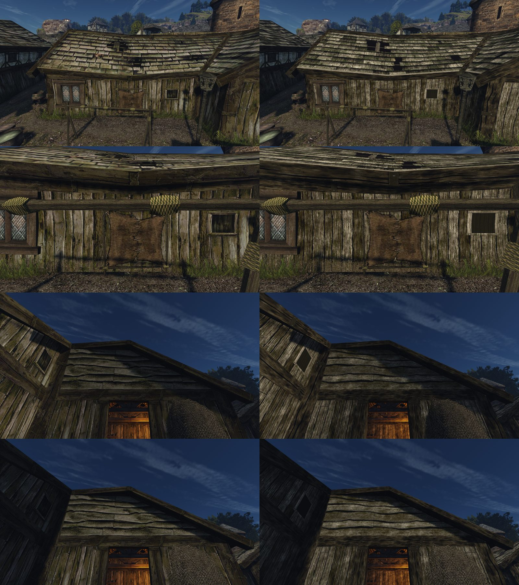
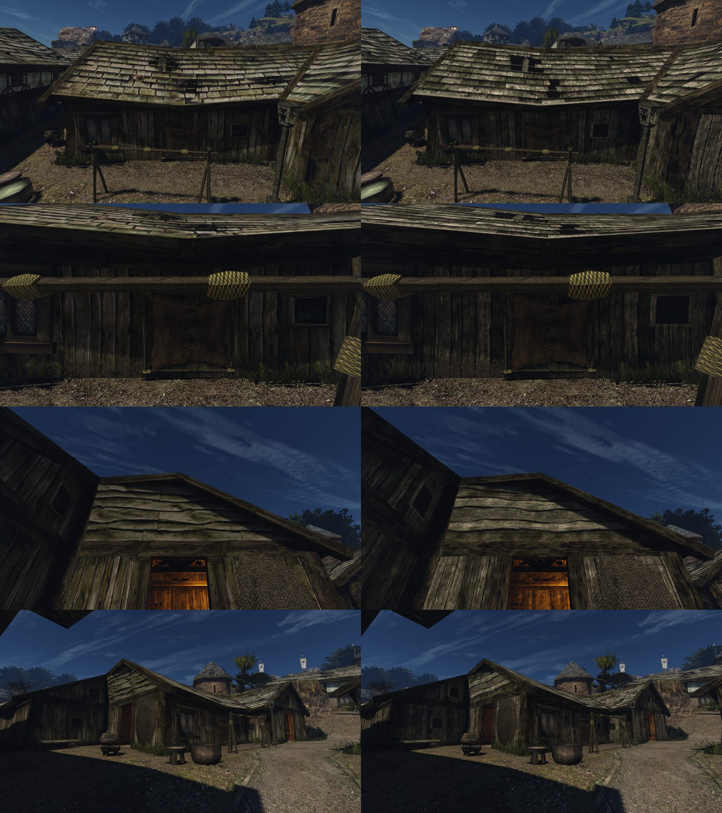

# Хижина бедного квартала порта

Ассет [конвейера ремастера](../../../../docs/remaster-pipeline.md), блок B037. В этой папке:
- [лист замысла](intent.md), [концепция](concept.md), [журнал решений](decisions.md);
- спецификация сборки `build.json`, манифест `asset.json` (исходники с SHA-256 и C2PA, выбор, вердикты, ворота);
- вердикты рецензента в `reviews/`.

## Наборы

| Набор | Что в нём | Итог |
|---|---|---|
| `hut-1` | доски, большое свинцовое окно, нарисованное в текстуре `HOLZWAND_02`, фронтон из досок с корой | Ошибка замысла. Большое окно оригинала — модель `NW_CITY_WINDOW_WOOD_OUT_01`, текстура несёт маленький тёмный проём. В игре вместо бедного проёма вышло второе нарядное окно |
| `hut-2` | маленький проём, как в оригинальной текстуре, на тех же досках, что `HOLZWAND_01`; фронтон из восьми рядов гладких досок | Рецензент Р3, три кадра, оба порядка: отказ (ниже) |
| `hut-3` | `hut-2`, рельеф досок и фронтона ×0,35 (`relief` в `build.json`) | Доски перестали читаться корой. Рецензентом не проверен |
| `hut-4` | все четыре текстуры — модель в Blender ([`hut_bake.py`](../../../../scripts/content/hut_bake.py), балка — `timber_bake.py beam01`) по обмеру оригинала в родном размере; база — оригинал, снят вместе с `roofs-8` и `timber-7` | В игре мха меньше, чем у оригинала (зелёных пикселей после подгонки цвета 4% против 9%), проём окна — чёрная дыра |
| `hut-5` | `hut-4`, под каждым рядом фронтона ступенька не меньше 8 мм | Промежуточный, снят, не разбирался |
| `hut-6` | мох полосами вдоль щелей и нахлёстов, зелёных пикселей 11% | Проём ещё темнее оригинала (яркость 16 против 24) |
| `hut-7` | `hut-6` и ставня в проёме светлее, как у оригинала | Рецензент Р3: три пары спорные. Мха у низа стены меньше, кромка фронтона идёт сквозь стык досок, окно — ровная тёмная заливка |
| `hut-8` | у низа стены гравий с землёй поверх досок и щелей, мох полосами над ним и пучками на земле; у каждой доски фронтона своя кромка, на стыке уступ; светлая рама окна; по два-три сучка на доску | Пользователь принял и включил (`working-3`). Затем: «доски, они как будто бы плоские»; нижняя доска фронтона над проёмом «стала какой-то другой» |
| `hut-9` | настоящий рельеф в модели: доски выгнуты на 1 см и скручены, кромки скруглены на 3 см, волокно глубже; нахлёст фронтона 5,5 см. Наклон нормалей 9° у стены и 7,5° у фронтона против 5° у `hut-8` (у принятых досок `WOOD_01` — 8°). Мох фронтона больше не густеет книзу квадрата, тон рядов ровнее (60–82 против 58–77 у оригинала) | На утреннем солнце стена серее и холоднее оригинала |
| `hut-10` | тени дерева оливково-бурые, как у оригинала (B/R в тени 0,35–0,44 против 0,39–0,42), светлые доски серые (0,77 и 0,77) | Пользователь принял и включил: «да, давай» (`working-4`) |

Наборы `hut-1`…`hut-3` собраны поверх `house-2`: 58 записей, 4 замены, остальные 54 записи совпадают побайтно. Источники — 18 PNG, все сгенерированы одной моделью: C2PA «ChatGPT gpt-image».

## Рецензент о hut-2

| Кадр | Вердикт | Что решило |
|---|---|---|
| Длинная сторона | REJECT | Доски ровнее и одной ширины, гвозди ровными рядами. Угловая стойка читается корой и светлее досок (`WOODBEAM_02` из house-2). На крыше втрое меньше мха, нет провалов, у гонта другой масштаб (`ROOF_01`) |
| Фронтон вблизи | REJECT | Кромки досок почти прямые (rms шва 1,1–2,1 px против 3,2–4,6 у оригинала), доски читаются корой, фронтон светлее. На стыке с ветровой доской светлый пунктир |
| Стена у окна | REJECT | Доски на 34–40% шире оригинала, повторяется одинаковая накладка, внизу бугристый рельеф. Мха у нас больше, это в нашу пользу (см. ниже) |

Пары в обоих порядках дали одинаковый итог. Окно-проём на месте и нужного размера: пункты 1, 2, 2a и 2b пройдены.

## hut-10 утром и в полдень

Сняты на Mac (Ryzen был занят обучением навигации): `harbour-hut.bench` и его копии на 8:00 и 18:30 (`harbour-hut-morning.bench`, `harbour-hut-evening.bench`). Утром солнце светит на длинную стену, и карта нормалей видна; в полдень стена в тени.

## Рецензент о hut-8

| Кадр | Итог двух порядков | Что решило |
|---|---|---|
| Длинная сторона | PASS / PASS | Все пункты сохранения да; фронтона в кадре нет (пункт 6 не проверен). Замечания: светлая ровная рама маленького окна, стена чуть холоднее |
| Фронтон вблизи | REJECT / PASS — спорно | Пункты сохранения пройдены в обоих порядках. Отказ — по свойству P1: волокно досок фронтона смазано вдоль доски (перепад вдоль доски 3,1 против 4,1 у оригинала) |
| Стена с окном | REJECT / PASS — спорно, пункт 5 | Мох: в одном порядке у нас меньше (доля пикселей мха 2,3% против 3,1%), в другом поровну. Окно на месте и того же размера: ширина рамы 0,145 против 0,144 |

По текстуре после сборки: зелёных пикселей у низа стены 10% против 9% у оригинала, избыток зелёного 6,3 против 7,1, стена чуть синее (B/R 0,68 против 0,62). Остаётся: на досках меньше сучков и гвоздей, чем у оригинала; волокно — ровные вертикальные штрихи.

## Что дальше

1. **Доски стены.** Узкие, около 13 на 3 м, неровной ширины, гвозди не сеткой. Повторяющиеся детали вроде накладок убрать: на повторе текстуры они видны дважды.
2. **Фронтон.** Волнистая кромка с обзолом, как у попытки 1, но гладкие лица досок, как у попытки 4. Мха больше, с тёмными пятнами, как у оригинала. Рельеф ×0,35.
3. **Общие текстуры.** Кровля `ROOF_01` и балка `WOODBEAM_02` общие с домом у рынка и половиной города. Пользователь решил делать их как в оригинале, отдельными ассетами `city-roofs` и `city-timber`, и переделать по конвейеру всё сделанное раньше ([очередь](../../../../docs/remaster-pipeline.md#очередь-переделки)). Следующий набор хижины собирается на базе оригинала и снимается вместе с ними. Большое окно — модель, оно уходит в этап 2.
4. **Конвейер.** Пункт «мха не меньше» должен быть направленным: «нет» засчитывается, только если меньше у нас. Сейчас симметричный пункт ловит и обратное.
