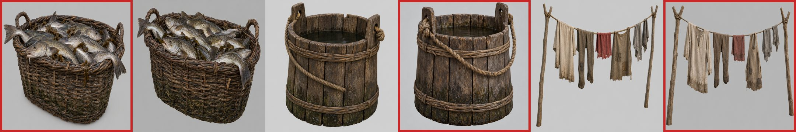
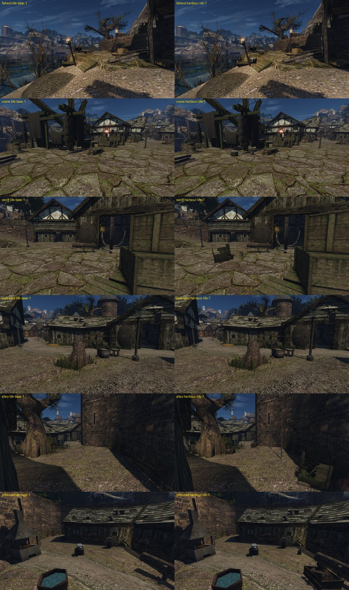

# Следы жизни порта

Шаг М4 [плана проработки мира](../../../../docs/world-detail-plan.md#план-выполнения), 2026-10-30. Лист замысла — [intent.md](intent.md), исполнение — [concept.md](concept.md). Не включено: ждёт приёмки и ворот пользователя по кварталу.

## Что сделано

22 добавки слоем предметов `worlds/NEWWORLD/vobs.d/harbour-life.json` в шести местах порта. Постройки, мостовая и предметы оригинала не тронуты: в слое нет ни `remove`, ни `move`.

| Место | Что добавлено |
|---|---|
| рыбацкий угол набережной | 2 корзины с рыбой, 2 ведра |
| двор у крана C | 2 корзины с рыбой, ведро |
| верфь | разбитый ящик и ведро на свободной мостовой |
| двор бедного квартала | ведро у корыта, 2 кучи колотых дров у стен |
| проулок у городской стены | верёвка с бельём вдоль глухой стены, 2 разбитых ящика и разбитая бочка в углах, 2 кучи дров, ведро |
| восточный двор у кузни | 2 кучи дров, ведро у горна |

Три новые модели — в игре таких вещей нет. Они построены в Blender по концептам `image_gen` и карточкам замысла ([concept.md](concept.md)):

| Визуал | Предмет | Треугольники | Атлас |
|---|---|---:|---|
| `OWN_HARBOUR_FISHBASKET_01` | корзина с рыбой | 4 894 | 1024 |
| `OWN_HARBOUR_BUCKET_01` | ведро | 2 116 | 1024 |
| `OWN_HARBOUR_LAUNDRY_01` | верёвка с бельём | 3 436 | 2048 |

Остальное — разбитый ящик М3 и визуалы игры: кучи колотых дров `OC_FIREWOOD_V2`, разбитая бочка `OC_BARREL_V1_DESTROYED`. Вороха сети М3 не ставились.

## Расстановка

Слой собирает [`harbour_life.py`](../../../../scripts/content/harbour_life.py) из [`harbour-life-placements.json`](../../../../data/content/world/harbour-life-placements.json); копия слоя — [`data/content/world/NEWWORLD/vobs.d/harbour-life.json`](../../../../data/content/world/NEWWORLD/vobs.d/harbour-life.json).
- Высота — по пятну габарита на меше мира рабочего набора: наибольшая из центра и углов, затем погружение на 1–10 см.
- Пол — первая поверхность под ближайшей точкой пути. Первые попытки брали самую высокую поверхность и ставили дрова на крыши и карнизы.
- `wall` ставит вещь вдоль ближайшей стены с зазором и поворачивает её на несколько градусов.
- `on` кладёт вещь на другую (после первой приёмки не используется).

Офлайн-проверка игровым валидатором на Ryzen: `content-convert check-vob-layer` — `valid (22 added, 0 removed, 0 moved)`. В игре: `vob layer … applied added=22`.

Наборы в `content-staging`:
- `life-7` — три модели и слой;
- `life-base-1` — сторона A: `lightfix-2` + `rigging-26`;
- `harbour-life-7` — сторона B: `lightfix-2` + `rigging-26` + `life-7`.

`building_set.py compose` теперь переносит и файлы `worlds/<МИР>/vobs.d/*.json`.

## В игре

Слева `life-base-1`, справа `harbour-life-7`. Полдень, обычный FOV, NPC скрыты. Сценарий — [`harbour-life.bench`](../../../../scripts/content/harbour-life.bench) из [cameras.json](cameras.json), съёмка через `gq` на Ryzen.

Четыре круга подгонки по кадрам до первой приёмки:
1. Ведро не загрузилось: группа `WATER` у материала статичного визуала запрещена. Стала `UNDEF`. Камера рыбаков смотрела в скамью, восточная — из хижины.
2. Верёвка с бельём во дворе встала к дальней стене, у верфи ящики закрыли висящую сеть. Бельё — во дворе вдоль хижины, ящики — южнее.
3. Бельё в проулке стояло торцом к камере у башни — убрано из проулка. Бельё на востоке стояло у горна кузни.
4. Перенесённое к дальней хижине бельё на востоке закрыло её окно (главная деталь) — убрано; вместо него у горна ведро с водой для закалки. Верёвка с бельём осталась одна, во дворе бедного квартала.

## Первая приёмка и второй круг

Ведущая сессия, r3, 12 вердиктов: fishers и poor-east приняты в обоих порядках; werft, alley, poor-yard, crane отклонены в обоих. Что нашла приёмка и что изменено:
- **Добавки закрывали главные детали и проходы.** На верфи штабель из кучи ящиков и трёх ящиков закрыл окно хижины, низ висящей сети, козлы с бревном, ребро остова и полвхода в сарай. У крана штабель в этаж закрыл дверь фахверкового дома и сузил проход. Во дворе бедного квартала шесты белья задели раму окна и перекладину стойки с сетью, корзина закрыла её ноги. Штабели, бухта, бельё и корзина двора убраны. На верфи осталась низкая пара — разбитый ящик и ведро — на свободной мостовой левее козел. Правило на все места внесено в [лист замысла](intent.md#главная-деталь).
- **Расставлено, а не свалено.** Ящики стояли рядами копий одной модели, поленница `OC_FIREWOOD_V3` — ровным коробом вдоль стены. Вместо поленниц — кучи колотых дров `V2` с разным поворотом, разбитые ящики — с наклоном.
- **Новое сухое дерево.** Солома `NW_MISC_STRAW_01` читалась штабелем медово-жёлтых досок (L 101, S 0,44), бухта на верфи — светлой метлой. Обе сняты.
- **Бельё** было чистым, сухим, самым ярким пятном в тени: L 62–90 при стене 33–36, края ступеньками.
  - Тон ткани снижен втрое: лён `0,24` → `0,085`.
  - Низ — отдельная зона сырого грязного подола.
  - Подол — мягкие волны.
  - Фактура ткани сильнее.
  - Верёвка теперь одна, в проулке вдоль глухой городской стены, где за ней нет окон и дверей.
- **Мелочи.** Рыба была почти белой: брюхо `0,16` → `0,085`. Пряди ламинарии торчали плоскими полосами — сняты. Гранёные брёвна `OC_FIREWOOD_V1` на востоке заменены кучей колотых дров.
- **Тени.** Слой создаёт обычный статичный `zCVob` (`vob_static`). Тень отбрасывает любой статичный меш с непрозрачным материалом, отдельного флага у vob нет. У базовых ящиков `dynamic_shadows` тоже `NONE`. В полдень солнце почти над головой, и тени у низких вещей короткие; у базовой скамьи в том же кадре тени тоже почти нет.

Пакеты слепых пар:
- первый круг — `~/.local/share/gothic-ai/remaster/harbour-life/reviews/r3-*`;
- второй круг — `r4-*`, те же шесть ракурсов, оба порядка, ключи `r4-*.key.json`.

fishers и poor-east пересняты: перекрашена рыба, заменены брёвна. Рецензенты не запускались: приёмку проводит ведущая сессия.

## Цена

Ц1 `life-base-1 → harbour-life-4`, место `harbour` (точка стенда у торгового пути, восточный двор и проулок в кадре), тихая машина: **Δ p95 −0,32 %, Δ p50 +0,24 %, «в шуме»**. Треугольников +26,9 тыс. на кадр (+1,7 %), вызовов отрисовки столько же (83,1). [Отчёт](../../../performance/2026-10-30-content-cost/life-base-1-vs-harbour-life-4/report.md). Прогон на промежуточном `harbour-life-3` (ещё с бельём на востоке) дал Δ p95 −0,42 %.

## Пакеты и проверки

- Слепые пары r4 — `~/.local/share/gothic-ai/remaster/harbour-life/reviews/r4-{fishers,crane,werft,poor-yard,alley,poor-east}/order-{1,2}`, ключи `r4-*.key.json`. Кадры — `captures/final-5/{life-base-1,harbour-life-7}/`.
- `content-convert check-vob-layer` на Ryzen: `valid (22 added, 0 removed, 0 moved)`; в игре: `vob layer … applied added=22 removed=0 moved=0`.
- `pytest`: `test_harbour_life.py`, `test_building_set.py`, `test_remaster.py`.
- Резервная копия источников ассета на dev-ubuntu: `remaster.py backup`.

## Включение

Не включено. Чтобы включить вместе с рабочим набором: `building_set.py compose working-<n> lightfix-2 rigging-26 life-7` (как сторона B `harbour-life-7`), затем `enable` — по слову пользователя.

