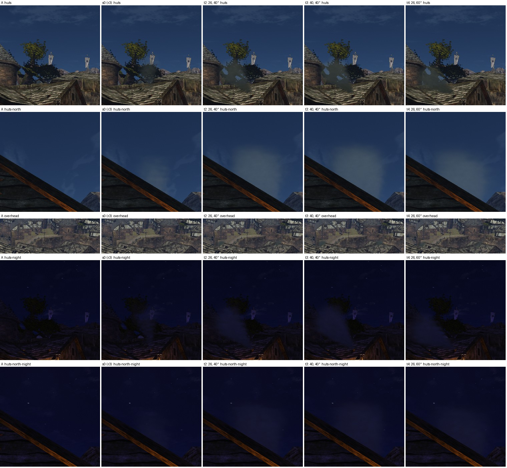
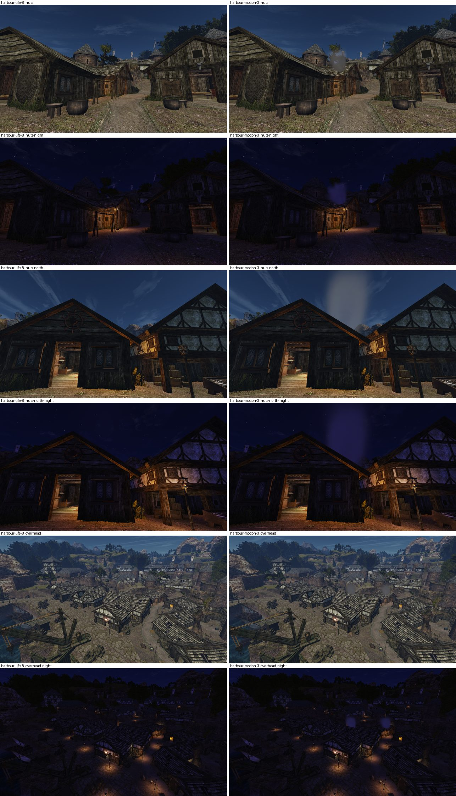
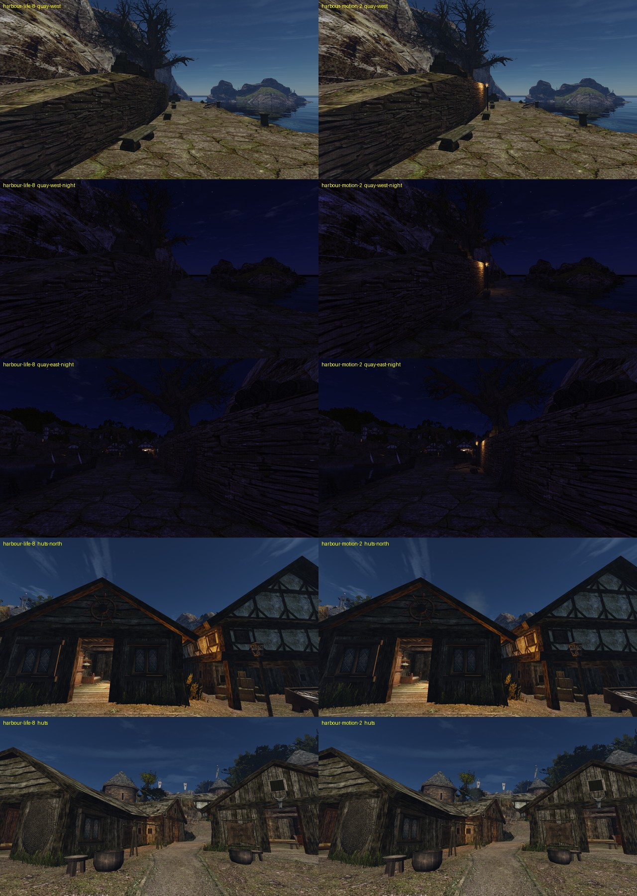

# Движение и ночь порта

Шаг М5 [плана проработки мира](../../../../docs/world-detail-plan.md#план-выполнения), 2026-10-31. Лист замысла — [intent.md](intent.md), исполнение — [concept.md](concept.md). Не включено: ждёт приёмки и ворот пользователя по кварталу.

## Что сделано

Слой предметов `worlds/NEWWORLD/vobs.d/harbour-motion.json`, 13 записей, и своё описание частиц `particles.d/harbour-smoke.json` (Д2б). Новых моделей и текстур нет, постройки и предметы оригинала не тронуты: в слое нет ни `remove`, ни `move`.

| Место | Что | Из чего |
|---|---|---|
| хижина `HAFEN04` у площади | дым из провала кровли 146 × 40 см над большим очагом | три эмиттера своего PFX `OWN_HARBOUR_SMOKE` вдоль провала, наклон 25° по ветру |
| хижина `HAFEN06` в бедном квартале | дым из провала кровли 73 × 54 см над очагом | два эмиттера `OWN_HARBOUR_SMOKE`, наклон 25° |
| дорога к кораблю под лагерем паладинов | две жаровни у подножия стены террасы, шагом ~25 м | столб `OC_LOB_LIGHTER_HUGE3`, огонь `FIRE_MEDIUM`, дым `FIRE_SMOKE`, свет `FIRE_SMALL_02` 500 см (194, 125, 56) — как у жаровен рыбаков и мола |

Слой собирает [`harbour_motion.py`](../../../../scripts/content/harbour_motion.py) из [`harbour-motion-placements.json`](../../../../data/content/world/harbour-motion-placements.json); копия — [`data/content/world/NEWWORLD/vobs.d/harbour-motion.json`](../../../../data/content/world/NEWWORLD/vobs.d/harbour-motion.json). Жаровня ставится к ближайшей стене расстановкой М4 (`harbour_life.place`). Её огонь, дым и свет привязаны к столбу (`attach`, `offset` в осях столба) с теми же смещениями, что у жаровен оригинала: 3,24, 3,50 и 3,83 м.

Наборы в `content-staging`:
- `motion-3` — слой и `particles.d` (r4); `motion-2` — слой r3 с `LIGHTSMOKE`;
- сторона A — `harbour-life-8` (порт после М4);
- сторона B — `harbour-motion-3`: `lightfix-2` + `rigging-26` + `life-8` + `motion-3` (r3 — `harbour-motion-2`).

Пересборка:

```
uv run --no-project --with numpy python scripts/content/harbour_motion.py layer --set motion-N --ground-set harbour-life-8
uv run --no-project --with numpy --with pillow --with scipy python scripts/content/building_set.py compose harbour-motion-N lightfix-2 rigging-26 life-8 motion-N
uv run --no-project --with numpy python scripts/content/harbour_motion.py bench
uv run --no-project --with numpy python scripts/content/harbour_motion.py bench --only huts,huts-north,overhead --name harbour-motion-smoke
```

`layer` пишет и `particles.d/harbour-smoke.json` в набор, с копией в [`data/content/particles.d/`](../../../../data/content/particles.d/harbour-smoke.json).

## Ткань

Вывод: ткань включена на всех полотнищах порта, но флаги корабля и два верхних паруса в игре никогда не становятся тканью. Правку данных сделать нельзя: нужна правка движка (см. «Находки для движка»).

Журнал игры на стороне A пишет `cloth tessellation` для всех 17 полотнищ меша мира NEWWORLD:
- 7 знамён `NW_CITY_FLAG_01` (289 частиц);
- 4 флага `NW_SHIP_FLAG_01/02` (81);
- 6 парусов `NW_SHIP_SAIL_02` (85).

Перепись этапа 6 совпала.

Что движется в игре, проверено сценарием [`harbour-motion-cloth.bench`](../../../../scripts/content/harbour-motion-cloth.bench). Герой стоит на точках пути, ветер штатный, через 8 с — `cloth checkpoint`:

| Точка пути | Активны (вес, скорость) | Не активны |
|---|---|---|
| `SHIP_DECK_16` (палуба) | паруса №4 (1,0; 8,1 см/с), №6 (1,0; 7,0) | все флаги, паруса №1, 2, 3, 5 |
| `SHIP_CREW_05` (палуба у грот-мачты) | паруса №1 (0,84), №3 (1,0; 2,5), №4 (1,0; 2,7) | все флаги, паруса №2, 5, 6 |
| `NW_WAITFOR_SHIP_05` (мол) | паруса №1 (0,32), №3 (0,15) | все флаги, остальные паруса |
| `NW_CITY_PALCAMP_01` (кран C) | нет | всё |
| `NW_CITY_MERCHANT_PATH_03` (улица у башен) | знамёна №6 (0,92), №7 (1,0) | весь корабль |

Ткань включается в 40 м от героя по прямой до центра полотнища, с 35 м — переход (`common/physics/cloth.h`). Центры флагов корабля на высоте 48–62 м, верхних парусов №2 и №5 — 45–47 м. Ближайшая к ним точка пути — в 40,6–59,4 м:

| Полотнище | Высота центра, м | Ближайшая точка пути, м | Точек пути ближе 35 / 40 м |
|---|---:|---:|---:|
| `NW_SHIP_FLAG_01:1` | 62,5 | 59,4 | 0 / 0 |
| `NW_SHIP_FLAG_02:1` | 60,9 | 56,0 | 0 / 0 |
| `NW_SHIP_FLAG_02:2` | 48,1 | 40,6 | 0 / 0 |
| `NW_SHIP_FLAG_02:3` | 50,0 | 42,1 | 0 / 0 |
| `NW_SHIP_SAIL_02:2` | 45,4 | 40,6 | 0 / 0 |
| `NW_SHIP_SAIL_02:5` | 47,5 | 44,2 | 0 / 0 |
| остальные 4 паруса | 11,6–26,4 | 14,7–22,0 | 13–58 / 26–73 |
| знамёна №6, №7 у бедного квартала | 22,1 | 18,9 | 52–56 / 76–83 |

Флаги без ткани стоят совсем. Колыхание материала (`wave_mode=3`, 20 см) движок применяет только к воде: `Material::isTesselated` возвращает «да» лишь для `Water`. В паре кадров корабля через 0,7 с разность на флагах 0,35 из 255, на скале 0,07 (`motion`), то есть флаги неподвижны. Меш корабля не тронут.

## Дым

Труб на кровлях порта нет: над всеми 17 очагами и печами квартала сразу кровля на 1,6–4,3 м, по кадрам обзора тоже. Дым идёт из настоящих провалов кровли рабочего набора (`roofholes-2`) над двумя горящими очагами — из 13 горящих. Таверна не дымит: её очаг закрыт сплошной кровлей.

В r3 эффект был `LIGHTSMOKE` игры: 5 частиц/с, жизнь 8 с, подъём 40 см/с, растёт от 10 до 300 см. Снос ветром (`flock_mode=WIND`) движок читает, но не применяет. Одного эмиттера с 11–15 м почти не видно: серая дымка за коньком. Поэтому над большим провалом три эмиттера, над малым два. `FIRE_SMOKE` (дым очага, 20 → 40 см, столб 2 м) с 15 м не виден вовсе. Ночью дым тёмно-серый и не светится.

### Отбор после r3: готовые PFX упёрлись в предел

Приёмка r3: свойство P1 «за секунду назвать дымом из хижины» — «нет» в `huts` днём, `overhead` днём и ночью и `huts-north` ночью. Дымка на тёмной кроне светлее фона на 8–15 уровней, над светлым гонтом почти не видна, основание у провала не читается, сверху это не дым. Цель круга — P1 «да» в `huts`, `huts-north` и `overhead` днём, ночью дым различим у кровли, только готовыми PFX.

Кандидаты — зацикленные эффекты программы частиц с дымовой текстурой и обычным смешиванием ([`smoke-screen/`](smoke-screen/)). Сняты `LIGHTSMOKE`, `FIRE_SMOKE`, `WATERVAPOUR` и `SMOKE1`. `TORCH_SMOKE` (5 → 25 см, α 80) и `MAGICPOTIONSMOKE` (2 → 60 см) мельче и прозрачнее `LIGHTSMOKE`, их не снимали. `GROUNDFOG*`, `AMBIENTFOG` и `MINE_DUST` рождают частицы в объёме 1,5–20 м и не идут из проёма. `GREENSMOKE` зелёный. Слой задаёт эмиттеру только имя PFX, место и поворот. Поэтому средства такие: число эмиттеров в проёме, основание из другого PFX и наклон. У `LIGHTSMOKE` направление вылета в осях предмета, и поворот эмиттера наклоняет шлейф по ветру мира (+z, `common/physics/worldwind.h`).

Съёмка — сценарий [`harbour-motion-screen.bench`](smoke-screen/harbour-motion-screen.bench): `huts`, `huts-north`, `overhead`, полдень и полночь, по два кадра через 0,7 с. Сторона A и все варианты сняты на одной сборке `remaster-engine` (main с #620) одной заявкой `gq`. Замер [`measure.py`](smoke-screen/measure.py): разность яркости варианта и A в области шлейфа, среднее по двум кадрам. Фон делится по пикселям A на небо, крону и кровлю. «Видно» — доля пикселей области, где |ΔY| > 8.

| Вариант | Эмиттеров дыма | `huts`: к кроне | `huts`: видно | `huts-north`: к небу | `huts-north`: видно | сверху `h06`: видно / p98 | ночь `huts` / `huts-north`: видно |
|---|---:|---:|---:|---:|---:|---:|---:|
| s0 — r3: `LIGHTSMOKE` 3 + 2 | 5 | +7,0 | 6 % | +1,7 | 6 % | 0,5 % / 3 | 7 % / 6 % |
| s1 — `LIGHTSMOKE` 8 + 5 | 13 | +11,2 | 10 % | +3,4 | 13 % | 1,3 % / 6 | 13 % / 14 % |
| s2 — s0 + основание `FIRE_SMOKE` 3 + 2 | 10 | +7,9 | 7 % | +2,0 | 7 % | 0,5 % / 3 | 9 % / 6 % |
| s3 — s0 + `SMOKE1` 1 + 1 | 7 | — | — | — | — | — | — |
| s4 — s0 + основание `WATERVAPOUR` 3 + 2 | 10 | +7,2 | 6 % | +1,9 | 7 % | 0,5 % / 3 | 8 % / 6 % |
| s5 — s1 + основание `FIRE_SMOKE` | 18 | +11,9 | 11 % | +3,4 | 14 % | 1,3 % / 6 | 14 % / 13 % |
| s6 — s5, `LIGHTSMOKE` наклонён на 40° | 18 | +10,5 | 11 % | +5,2 | 21 % | 1,1 % / 5 | 12 % / 21 % |
| t1 — `LIGHTSMOKE` 8 + 5, 40° | 13 | +9,5 | 10 % | +5,2 | 20 % | 1,2 % / 5 | 11 % / 22 % |
| t2 — `LIGHTSMOKE` 16 + 10, 40° | 26 | +11,9 | 13 % | +6,7 | 28 % | 1,9 % / 9 | 15 % / 28 % |
| t3 — `LIGHTSMOKE` 24 + 16, 40° | 40 | +13,2 | 14 % | +7,5 | 32 % | 2,3 % / 11 | 16 % / 31 % |
| t4 — t2, наклон 60° | 26 | +5,4 | 9 % | +6,2 | 27 % | 1,5 % / 6 | 9 % / 26 % |
| t5 — t2 + основание `WATERVAPOUR` | 31 | +11,8 | 13 % | +6,8 | 29 % | 1,8 % / 9 | 15 % / 28 % |



Что из этого следует:
- **`SMOKE1`** (умножение, `MUL`) движок рисует непрозрачными чёрными прямоугольниками. Его цифры — это артефакт, вариант отпадает.
- **Основание из другого PFX** (`FIRE_SMOKE`, `WATERVAPOUR`) почти ничего не даёт. В обоих ракурсах хижин провал лежит за коньком, и начало шлейфа закрыто кровлей.
- **Плотность упирается в цвет.** Частицу `BLEND` освещают окружающий свет и солнце по фазовой функции (`main.frag`, `diffuseLight` для `T_PFX`). Днём против солнца плотный дым сходится к серо-синему (RGB ≈ 50–60, 55–75, 55–95), а это почти яркость неба. От 13 к 40 эмиттерам контраст к небу растёт с +5 до +7,5, видимая доля шлейфа — с 20 до 32 %.
- **`huts-north`** при 26–40 эмиттерах и наклоне 40° даёт из-за фронтона светлое облако, которое можно назвать дымом.
- **`huts`.** Тот же дым ложится на крону серо-зелёным пятном по её силуэту, а на фоне неба пропадает. Шлейфом он не читается.
- **Сверху** (56 м) самый плотный вариант заметен на 2,3 % области, p98 — 11 уровней. Ночью сверху разницы нет ни в одном варианте.

Вывод: готовые PFX не дают читаемого шлейфа в `huts` и сверху. Пакетов по ним не собирали, решили делать свой PFX (Д2б, ниже). Для своего PFX дыма из замеров следует:
- цвет темнее неба (серый 60–90 вместо 150 → 255) и выше непрозрачность, чтобы дым темнил небо и светлый гонт, а не сливался с ними;
- рост частицы в 4–6 раз вместо 30, чтобы шлейф оставался столбом, а не облаком;
- жизнь дольше 8 с, чтобы столб поднимался выше конька.

Наклон эмиттера по ветру в `LIGHTSMOKE` уже работает поворотом в слое. Пересъёмка трёх ракурсов дыма для следующего круга — [`harbour-motion-smoke.bench`](../../../../scripts/content/harbour-motion-smoke.bench) и [`-night`](../../../../scripts/content/harbour-motion-smoke-night.bench) (`harbour_motion.py bench --only huts,huts-north,overhead --name harbour-motion-smoke`). Варианты собирает [`gen_variants.py`](smoke-screen/gen_variants.py), снимает [`screen.sh`](smoke-screen/screen.sh).

### Свой дым (Д2б), r4

После Д2б (#628) дым — своё описание частиц `OWN_HARBOUR_SMOKE` на основе `LIGHTSMOKE` в [`data/content/particles.d/harbour-smoke.json`](../../../../data/content/particles.d/harbour-smoke.json). Его пишет `harbour_motion.py layer` из раздела `particles` расстановки, вместе со слоем. Эмиттеров по-прежнему 3 + 2 в тех же точках провалов. Наклон 25° по ветру задаёт `tilt` эмиттера.

Почему `LIGHTSMOKE` бледный: его текстура `GROUNDFOG` в среднем непрозрачна на 4 % (альфа 10 из 255, максимум 119) и зеленовата. Дымовая текстура игры `SMK_16BIT_A0` (8 кадров) непрозрачна на 27 %, серая.

| Поле | `LIGHTSMOKE` | `OWN_HARBOUR_SMOKE` |
|---|---|---|
| текстура | `GROUNDFOG.TGA` | `SMK_16BIT_A0.TGA`, 2 кадра/с |
| цвет | 150 → 255 | 170 → 190 |
| непрозрачность | 255 → 0 | 200 → 0 |
| размер | 10 см, рост ×30 | 80 см, рост ×6 |
| жизнь | 8 ± 0,4 с | 13,5 ± 1,5 с |
| подъём | 40 см/с | 40 ± 15 см/с |
| конус вылета | ±20° | ±20° |
| частиц/с | 5 | 8 |

Отбор — пять кругов, 26 вариантов. Сторона A и все варианты сняты на сборке от main (после #548 и #628) с базой нового формата `15cdc40c…`. Её импорт сделан из `~/gothic-ai/game` в кэш задачи на Ryzen и хранилище `/mnt/shared/gothic-ai/remaster-harbour-motion`. Инструменты:
- [`gen_own.py`](smoke-screen/gen_own.py) собирает варианты;
- [`own.sh`](smoke-screen/own.sh) собирает движок, импортирует базу, проверяет `check-particles` и `check-vob-layer` и снимает;
- [`measure_wide.py`](smoke-screen/measure_wide.py) мерит в широкой области вокруг обоих шлейфов.

Шаги:
- **o** — текстура и цвет. Тёмный серый (60–110, мои прежние предложения) по яркости совпадает с небом и в `huts-north` пропадает. Светлее неба нужно, темнее гонта на солнце — тоже.
- **p** — светлый серый, шире, наклон 25° против 40°.
- **q** — ещё светлее и шире.
- **r** — конус вылета ±20° вместо ±10°: столб расходится и тает кверху, а не стоит ровной колонной.
- **s** — жизнь частицы.

| Вариант | `huts`: к кроне | `huts-north`: к небу | `huts-north`: видно | сверху: видно / p98 | ночь `huts` / `huts-north` / сверху: видно |
|---|---:|---:|---:|---:|---:|
| r3 (`LIGHTSMOKE` 3 + 2) | +6 | +0,6 | 2 % | 0,1 % / 0 | 2 % / 2 % / 0 % |
| лучший из готовых, t3 (40 × `LIGHTSMOKE`) | +12 | +2,6 | 10 % | 0,4 % / 0 | 6 % / 10 % / 0 % |
| o2 — серый 60 → 80 | +2 | +0,4 | 0 % | 0,8 % / 2 | 2 % / 0 % / 0,4 % |
| p5 — серый 140 → 160, 60 см ×6, 15 с | +17 | +9,8 | 34 % | 2,9 % / 12 | 10 % / 34 % / 2,5 % |
| q5 — серый 170 → 190, 80 см ×6, 15 с | +29 | +18,3 | 50 % | 5,1 % / 19 | 16 % / 49 % / 4,8 % |
| r2 — q5, конус ±20° | +34 | +19,2 | 53 % | 6,7 % / 21 | 21 % / 52 % / 6,7 % |
| s1 — r2, 12 с | +36 | +15,5 | 45 % | 5,1 % / 19 | 23 % / 44 % / 2,8 % |
| **s2 — r2, 13,5 с (выбран)** | +35 | +17,7 | 50 % | 6,0 % / 20 | 22 % / 50 % / 5,0 % |
| пара r4: `harbour-motion-3` | +36 | +25,5 | 56 % | 5,8 % / 21 | 10 % / 47 % / 7,5 % |

Все цифры этой таблицы — в одной широкой области. Поэтому строки r3 и t3 не совпадают с таблицей готовых PFX выше. Строки r3 и t3 сняты на сборке до #548 со своей стороной A.



Что видно в кадрах пары r4:
- **`huts`.** Серый клуб поднимается над коньком дальней хижины на фоне кроны.
- **`huts-north`.** Из-за фронтона встаёт серый столб, расходится и тает кверху.
- **Сверху.** Над двумя хижинами два серых шлейфа.
- **Ночью.** Дым синеватый: частицы освещает ночной окружающий свет. Он различим у кровли во всех трёх ракурсах.

Почему не 15 с (r2): столб в `huts-north` доходил до верха кадра ровной колонной. При 12 с (s1) ночью сверху он почти пропадает. Наклон 25° вместо 40° выбран потому, что шлейф стоит прямее и меньше уходит на крону в `huts`; в `huts-north` разница мала. Варианты круга q — в [`sheet-own.jpg`](smoke-screen/sheet-own.jpg).

### r5: одна попытка по карточке исследования

r4 приёмка отклонила: столб слишком плотный, ночью дым светится. После второго непринятого круга дым разобран в исследовании [«Дым очага в игровом мире»](../../../Дым%20очага%20в%20игровом%20мире.md). Круг r5 — не подбор, а один прогон по его карточке: 3 серых × 2 альфы, сторона A и чёрные зонды одной заявкой `gq`, числа до рецензента.

**Текстура `OWN_HUT_SMOKE`.** Из трёх текстур, которые советует карточка, ни одна не годится как есть:
- `SMK_FIRE` — та же альфа, что у `SMK_16BIT_A0`: круглое пятно с плато; низ текстуры оранжевый;
- у `GROUNDFOG` вся альфа в одном углу квадрата, в среднем 4 %;
- `FIRESMOKE` по форме подходит: статичная, клочья неровные, плато нет, на крайнем пикселе ноль. Но её собственный тексель тёмный, около 122/111/100. Шейдер умножает его на цвет вершины, и серый 75–115 даёт альбедо 0,09–0,16 вместо 0,28–0,53, на которые рассчитана карточка (она считала тексель белым). Такой дым темнее кроны, а цель — светлее кроны. Чтобы вернуть альбедо, понадобился бы серый вершины 172–264, а это против правила «не выше 128».

Поэтому текстура своя: альфа `FIRESMOKE`, умноженная на круглое мягкое окно, RGB белый. Окно равно 1 внутри 0,45 полустороны и 0 дальше 0,78. В крайних 12 % квадрата альфа нулевая, поэтому край спрайта не виден. Пик альфы остаётся 0,867. Цвет дыма теперь задаёт только цвет вершины, как и считает карточка.

Текстуру собирает [`own_texture.py`](smoke-screen/own_texture.py) из базы игрока. В git она не лежит: это производная от оригинала. В игру она пока попадает только через `OPENGOTHIC_TEXTURES`: имя `OWN_HUT_SMOKE.png`, в `visName_S` — `OWN_HUT_SMOKE.TGA`. Чтобы её можно было поставлять, частицы должны читать текстуры из `content/materials` (шаг Е4 исследования). Без этого шага эмиттер с такой текстурой в игре не создаётся. Обе стороны сняты с одним и тем же `OPENGOTHIC_TEXTURES`: скрипт съёмки передаёт его через `QUALITY_PILOT_TEXTURES`.

## Свет

Ночью оригинал светит так:
- 17 фонарей на столбах `FIREPLACE_NW_LAMP_01` (`oCMobFire`, дерево `FIRETREE_LAMP`: декаль пламени и свет `FIRESMALL` 550 см, (255, 119, 66) с мерцанием) — площадь у таверны и северный причал; распорядок `FIREPLACE` зажигает их ночью;
- три жаровни у рыбаков, шесть у мола и кормы — горят круглые сутки;
- западная набережная от крана C до рыбаков, 65 м — тёмная.

Две новые жаровни делят эти 65 м на отрезки по ~25 м. Свет — пятнами, как у жаровен рыбаков; набережная не становится освещённой улицей.

Новые фонари на столбах не ставились. Свет и эмиттеры слоя горят круглые сутки, а фонарь в полдень выбился бы из соседних. Пламя фонаря — декаль, слой ставит только PFX, а самое малое пламя PFX — около 40 см. Тени точечного света в обычной игре нет (только `-rt 1` или отладочный `-vsm 1`), поэтому жаровни стоят на открытом месте, их свет — 5 м, как у оригинала.

Свет из дверей таверны — шаг М6. Чайки и плеск в шаг не входят: для них нужен свой PFX (Д2б) — светлая кружащая птица и всплеск по таймеру у стенки. Готовые `BIRDFLY` (стая чёрных птиц, разовый вылет) и `PFX_WATERSPLASH_SEA` (разовый всплеск) не подходят.

## В игре



Сценарии — [`harbour-motion.bench`](../../../../scripts/content/harbour-motion.bench) (полдень) и [`harbour-motion-night.bench`](../../../../scripts/content/harbour-motion-night.bench) (полночь) из [cameras.json](cameras.json), съёмка через `gq` на Ryzen, обе стороны на одной сборке.

Отличия от сценария `remaster.py`:
- видны эффекты и модели со скелетом: столбы фонарей — модели, а `view hide animated` спрятал бы их вместе с героем;
- герой стоит далеко за целью на линии взгляда (`hero_spot`), чтобы не попасть в кадр. Камера стенда смотрит на точку над героем, а `goto` сбрасывает камеру, поэтому увести героя после кадрирования нельзя;
- у камер ткани (`ship`, `banners`) герой стоит у цели, иначе ткань не активна.

Слепые пары `harbour-life-8 | harbour-motion-2`, весь кадр, оба порядка — 8 ракурсов днём и ночью:
- `quay-west` и `quay-east` — дорога к кораблю с обеих сторон, жаровни;
- `quay-north`, `tavern` — фонари оригинала;
- `fishers` — жаровни рыбаков;
- `huts`, `huts-north` — дым;
- `overhead` — порт сверху.

Камеры `ship` и `banners` — только для движения ткани: слой их не меняет, кадры A и B отличаются не больше чем 20 пикселями шума.

Движение, `harbour_motion.py motion`: средняя |ΔY| (из 255) пары кадров через 0,7 с в области дыма. Для сравнения — та же область на стороне A и неподвижная стена.

| Ракурс | Дым, B | Та же область, A | Стена |
|---|---:|---:|---:|
| `huts`, полдень | 2,09 (2,6 % пикселей > 8) | 0,31 | 0,005 |
| `huts`, полночь | 1,00 | 0,07 | 0,000 |
| `huts-north`, полдень | 1,19 | 0,007 | 0,009 |
| `huts-north`, полночь | 0,49 | 0,03 | 0,002 |
| `banners`, ближнее знамя | 2,47 (5,8 %) | — | 0,06 |
| `ship`, главный флаг | 0,35 | — | скала 0,07 |

Дым и знамя движутся. Флаги корабля стоят.

Пара r4 (`final-3`, свой дым): в области дыма 3,77 в `huts` днём (A — 0,34), 1,85 ночью (A — 0,13); в `huts-north` 1,24 днём (A — 0,19), 0,66 ночью (A — 0,02). Стена и фронтон — 0,000–0,007.

## Цена

Ц1 `harbour-life-8 → harbour-motion-2`, одна заявка `gq quiet`, A B B A. [Отчёт](../../../performance/2026-10-31-content-cost/harbour-life-8-vs-harbour-motion-2/report.md).

| Место | Δ p50 | Δ p95 | Вердикт | Треугольники/кадр | Вызовы/кадр |
|---|---:|---:|---|---:|---:|
| `harbour` (полдень) | −0,04 % | −2,35 % | в пороге | −4 тыс. | +0,7 |
| `harbour-night` (полночь, новое место стенда) | +1,06 % | +0,96 % | в шуме | +1,4 тыс. | +1,0 |

Ц1 после своего дыма не перемерялся: эмиттеров осталось 5 (порог — больше 10). Частиц стало больше: 8/с × 13,5 с ≈ 108 на эмиттер, около 540 на порт против 200 у `LIGHTSMOKE`; частица до 4,8 м против 3 м.

В полдень p95 A разошёлся между повторами на 0,61 мс: −2,35 % — шум стороны A, а не выигрыш. Место `harbour-night` добавлено в стенд этим шагом (`scripts/bench/perf-harbour-night.bench`): то же место, что `harbour`, в полночь, когда горят фонари, жаровни и свет слоя.

## Находки для движка

Правки движка не делались.

1. **Флаги корабля и верхние паруса не становятся тканью** (см. «Ткань»). Повтор: [`harbour-motion-cloth.bench`](../../../../scripts/content/harbour-motion-cloth.bench). Что предлагается: мерить расстояние для ткани меша мира по горизонтали или прибавлять к радиусу высоту полотнища над землёй. Цена — 494 частицы на корабле.
2. **Колыхание материала `wave_mode` только у воды.** Без ткани флаги стоят совсем, хотя в оригинале колышутся.
3. **Свет и эмиттеры слоя не знают времени суток**, а слой не ставит `oCMobFire`. Поэтому новый фонарь на столбе горел бы и в полдень. Для фонарей нужны часы у `light`/`emitter` (или `oCMobFire` в слое) и малое пламя: декаль или свой PFX (Д2б).
4. **Тени точечного света** в обычной игре нет: только `-rt 1` (выключен) или `-vsm 1`.
5. **Полосы через каждые 5 px** — регрессия SSAO в половинном разрешении (`fba25927b`, `halfResAoFog=1`). Каждый 5-й столбец кадра темнее, сильнее всего в тени. Опыт на тех же двух ракурсах — пик периода 5 px:
   - по умолчанию 46–70;
   - `halfResAoFog=0` — 3,0;
   - SSAO выключен — 3,1;
   - туман попроще — 45–67.

   Полосы есть во всех съёмках Ryzen с 30.10 до починки, значит и в парах r3 этого шага, на обеих сторонах одинаково. Повтор: `harbour-motion-stripes.bench` и `QUALITY_PILOT_INI="INTERNAL.halfResAoFog=0"`. Починено в [#620](https://github.com/kaifaty/GothicAI/pull/620) ([разбор](../../../render-features/2026-10-31-ssao-stripes/README.md)); отбор дыма после r3 снят на сборке с ним.
6. **Знамя на башне снизу не видно.** В кадре `banners` (с улицы снизу вверх) у ближней башни видны шпиль и растяжки, а полотнища нет. В штатном кадре `cloth setup NW_CITY_FLAG_01:6/7` оба знамени рисуются тканью: крепления 0 см, 4–16 см/с ([`harbour-motion-banners.bench`](../../../../scripts/content/harbour-motion-banners.bench)). Похоже на отсечение полотнища при взгляде снизу вблизи — не проверено.

## Пакеты и проверки

- Пакеты слепых пар — `~/.local/share/gothic-ai/remaster/harbour-motion/reviews/r3-{quay-west,quay-east,quay-north,tavern,fishers,huts,huts-north,overhead}{,-night}/order-{1,2}`, ключи `r3-*.key.json`. Кадры — `captures/final-2/{harbour-life-8,harbour-motion-2}/`.
- Пакеты r4 (свой дым) — `reviews/r4-{huts,huts-north,overhead}{,-night}/order-{1,2}`, ключи `r4-*.key.json`. Кадры — `captures/final-3/{harbour-life-8,harbour-motion-3}/`, сценарии [`harbour-motion-smoke.bench`](../../../../scripts/content/harbour-motion-smoke.bench) и `-night`. Обе стороны — на сборке `remaster-engine` от main (после #548 и #628) с базой `15cdc40c…`.
- `content-convert check-particles`: `valid (1 particle effects)`; `check-vob-layer`: `valid (13 added, 0 removed, 0 moved)`, на базе `15cdc40c…` и наборе `harbour-motion-3`; в игре — `vob layer … harbour-motion.json: applied added=13`.
- `pytest`: `test_harbour_motion.py`, `test_harbour_life.py`, `test_building_set.py`, `test_remaster.py`, `scripts/tests/test_perf_report.py`.

## Включение

Не включено. Включить вместе с рабочим набором: `building_set.py compose working-<n> lightfix-2 rigging-26 life-8 motion-3` (как сторона B, `compose` переносит и `particles.d`), затем `enable` — по слову пользователя.
