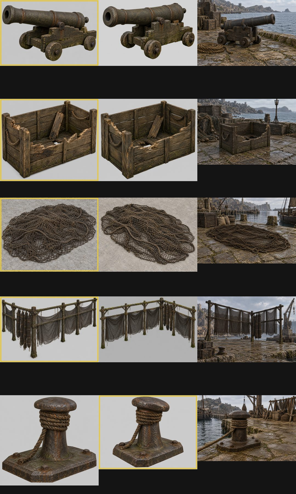
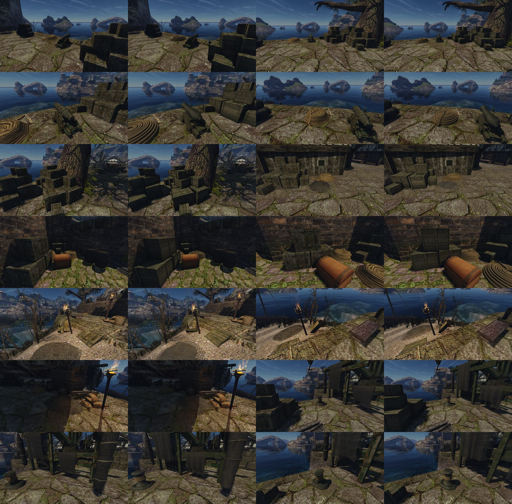

# Снасти порта

Шаг М3 [плана проработки мира](../../../../docs/world-detail-plan.md#план-выполнения), строка 10 [очереди ремастера](../../../../docs/remaster-pipeline.md#очередь-переделки), 2026-10-30. Лист замысла — [intent.md](intent.md), исполнение — [concept.md](concept.md). Не включено: ждёт приёмки ведущей сессии и ворот пользователя по кварталу.

## Что сделано

Девять визуалов порта, которые носят текстуры строки 10, — свои модели в Blender, по одной на визуал. Подмена — по имени визуала (`meshes/meshes.json`). Набор `rigging-13`; для съёмки — `harbour-rigging-13`: части `lightfix-1` и `rigging-13`, все прочие файлы побайтно как в `lightfix-1`.

| Визуал | Предмет | Треуг. оригинал → наш (бюджет) | Атлас |
|---|---|---|---|
| `NW_HARBOUR_CRATE_01` | ящик (замысел 2026-10-21) | 12 → 558 (1 500) | 2048 |
| `NW_HARBOUR_CRATEPILE_01` | куча ящиков (замысел 2026-10-21) | 135 → 3 216 (6 000) | 2048 |
| `NW_HARBOUR_CRATEBROKEN_01` | разбитый ящик | 152 → 745 (2 500) | 2048 |
| `NW_HARBOUR_ROPE_01` | бухта каната | 177 → 4 030 (4 200) | 2048 |
| `NW_HARBOUR_CANON_01` | пушка на лафете | 382 → 1 672 (3 500) | 2048 |
| `NW_HARBOUR_IRONROPEHOLDER_WROPE_01` | кнехт с канатом | 162 → 1 804 (2 000) | 1024 |
| `NW_HARBOUR_IRONROPEHOLDER_01` | кнехт | 98 → 488 (1 200) | 1024 |
| `NW_HARBOUR_FISHINGNETBIG` | ворох сети | 62 → 1 836 (3 600) | плитка сети |
| `NW_HARBOUR_FISHINGNETSMALL` | ворох сети, малый | 62 → 1 016 (2 400) | плитка сети |
| `NW_HARBOUR_FISHINGNET_01` | стойка для сетей | 1 030 → 6 354 + 3 360 сети (9 000) | 2048 + плитка сети |

Концепты — `image_gen` в свежих тредах Codex по брифам с числами обмера и цветами сцены; пиксели оригинала в генератор не шли. Выбор — `remaster.py select` в [asset.json](asset.json). Ящик и куча ящиков — ящики [порта](../../2026-10-crates-redesign/README.md) по замыслу 2026-10-21. Модели, построенные до конвейера, принятыми не считаются (ведущая сессия, 2026-10-30): у кучи новая раскладка по подложке, все три ящика с новым атласом.

Бухта каната построена заново. Модель рынка была двумя бухтами одна на другой, а у оригинала одна бухта с двумя концами, и число частей — главная деталь.

## Отклонения от концепта

- Пушка: ствол на концепте длиннее и тоньше; длина 1,55 м и толщина 0,51 м — по обмеру оригинала.
- Разбитый ящик: на концепте выломана длинная стенка; излом — по оригиналу: U-пролом в торце, обломанный верх стенки, щель в дне.

## Не входит

Меш корабля паладинов носит те же текстуры:
- такелаж `ROPE_01` — 1 230 м²;
- `ROPEWALL_01`;
- пушки `CANON_01`;
- порты `CANONHOLE`;
- ящики в трюме.

В этом шаге он остаётся оригиналом ([лист замысла](intent.md#неоднозначности-здесь-деталь-наша)). Ядра `CANONBALLS_*` не в строке очереди.

## В игре

В каждой паре слева `lightfix-1`, справа `harbour-rigging-13`. Кадры полдня, обычный FOV, NPC скрыты. Сценарий — [`harbour-rigging.bench`](../../../../scripts/content/harbour-rigging.bench) из [cameras.json](cameras.json), съёмка через `gq` на Ryzen.

Четыре круга подгонки по замерам кадров, линейный RGB граней:
1. **Ворохи сети почти не видны.** Редкая сеть (38 %) светлее песка под ней. Сеть сделана плотнее: ячейка 6 см, верёвка 2 см, 57 %, три слоя. Цвет непрозрачных текселей — 0,036 / 0,029 / 0,019. В кадре `fishers-mid` ворох был на 47 % светлее оригинала, стал на 19 %.
2. **Ящики чище оригинала.** Тон в тени совпадал (0,020), но разброс p90/p10 был 2,6 против 5,9 у оригинала, и цвет желтее (B/R 0,46 против 0,52). Добавлены:
   - контраст 1,85;
   - выгоревший верх;
   - тон досок по разбросу 0,24;
   - зелёный мох в стыках;
   - мокрый низ.
   
   Разброс стал 3,9–4,1. После перекоса в синее (B/R 0,56) цвет вернули в тёплое: 0,51 в тени.
3. **Стойка.** Полотна мелкой сети были вчетверо светлее оригинала (0,049 против 0,012): сквозь редкую сеть светила земля. Мелкая сеть стала плотнее (53 %) и темнее (0,032). Скатки толще (радиус 0,22–0,26 м) и почти цилиндром, из мелкой сети на тёмном сердечнике. Брусу добавлены мох в стыках и потёки.
4. **Короб ящиков** в щелях и под сдвинутой крышкой выходил лиловым: нейтральная цель давала синему усиление вдвое больше красного. Цель вернули тёмно-бурой.

## Второй круг: после первой приёмки

Первая приёмка (`r3-*`, `r1-*`): 26 из 28 вердиктов r3 — REJECT, все r1 — REJECT. Пушка и кнехт по форме прошли. Что изменено:
- **Лист замысла.** Бухта и ворох описаны холмами по кадрам оригинала, а не «плоскими». Куча и стойка описаны по подложке. Ручки ящиков записаны отступлением. Новый дефолт 14: список сохранения сверяется с кадрами.
- **Подложка.** [`underlay_check.py`](../../../../scripts/content/mesh3d/blender/underlay_check.py) рисует оригинал и нашу модель в трёх ортовидах и меряет габариты. Все десять визуалов — в пределах ±5 % по каждой оси.
- **Куча ящиков.** Десять ящиков трёх размеров на местах и высотах ящиков оригинала, отражённых по x: высокая часть справа, как в концепте 2026-10-21. Пустой полосы посередине больше нет. Ручки — у двух ящиков из десяти.
- **Ящик.** Без ручек и без пролома на короб: лиловые прямоугольники давал короб в проломе доски.
- **Разбитый ящик.** Один V-пролом в торце: шире кверху, до четверти высоты. Стенка и дно целые, ручки нет, стойки по высоте стенок. Торцы изломов берут цвет своей доски.
- **Бухта.** Холм с плоским верхом на половину поперечника, сдвинута к одному концу габарита и чуть овальная, как у оригинала.
- **Ворох сети.** Купол полнее. Ячея по оригиналу: 8,3 см, верёвка 2,4 см.
- **Стойка.** Построена заново по конструкции оригинала:
  - четыре стойки на его местах;
  - парные верхние балки с хомутами, второй ярус, связь с выносом, рейка, подкосы;
  - полотна со складками и провисом, одно почти до земли;
  - скатки — веретено и колонна;
  - мох на брусе.
- **Кнехт.** Плита — пирамида со скатом 10 см и срезами углов по оригиналу, столб толще, износ, немного мха и потёков.
- **Мох.** Новый ключ `moss` в [`bake_atlas.py`](../../../../scripts/content/mesh3d/blender/bake_atlas.py): пятна на верхах, у низа и в затенённых углах, доля зоны задаётся. Однопиксельная линия `crevice` снята. Покрытие:
  - доски и брусья ящиков — 7 %;
  - лафет — 7 %, ствол — 3 %;
  - кнехт — 3 %;
  - брус стойки — 20 %.
- **Тон ящиков.** Оливково-бурый: цель 0,054 / 0,043 / 0,019, контраст 1,6, без выгорания. Насыщенность освещённых граней в кадре 0,30–0,37 при 0,29–0,38 у оригинала. Зелёного на ящиках `pile-close` — 4,6 % против 0,2 % у `lightfix-1` на том же участке.

## Четвёртый круг: после третьей приёмки

Третья приёмка (`r6-*`): `crane-yard` и `quay-far` прошли в обоих порядках. Кучу на местах оригинала оставили — это решение ушло пользователю. Пушка, кнехт и бухта по форме проходят. Что изменено:
- **Ящики кучи повёрнуты как у оригинала.** Раньше я снимал по оригиналу осевые габариты ящиков, а ящики в его куче повёрнуты. Повёрнутый ящик 0,6 м даёт тот же габарит, что прямой 0,8 м, поэтому малые ящики выходили «шире и развёрнутыми на 90°». Теперь стороны и поворот каждого ящика берутся из прямоугольника наименьшей площади по его вершинам. Подложка закрывает наши ящики целиком. Одиночный ящик ориентирован верно: у оригинала `WOODCRATE_02` на торцах ±X, у нас торцы со стойками там же.
- **Ручек нет ни у одного ящика.** Тёмная петля ручки издалека читалась знаком «27». Отступление про ручки снято.
- **Разбитый ящик** — по высотам стенок оригинала, снятым растеризацией граней каждой стенки его меша:
  - стенки −Y нет, кроме 0,3 м у угла −X;
  - стенка +Y обломана до 0,33 у угла −X и до 0,68 у угла +X;
  - торец −X обломан до 0,36 на половине +Y;
  - у торца +X нет части у −Y, посередине пролом до 0,38;
  - у дна нет угла (+X, −Y).
  
  Угловая стойка по высоте ниже из двух стенок своего угла. Ключ `cuts` в `crate_broken.py`.
- **Лафет пушки** — по профилю щеки оригинала (растеризация его граней):
  - щёки x 0,23–0,35 от хвоста y −0,9 до переда +0,42, ступенями 0,21 → 0,26 → 0,41 → 0,52–0,60 → 0,69;
  - настил из трёх досок на 0,2 м;
  - колёса снаружи щёк, оси на ±0,375.
  
  Щека собрана выпуклыми частями по профилю: вогнутый контур триангулировался через ступени. Ствол поднят на 6°, ось на 0,68 м.
- **Ворох сети.** Ячейка по развёртке оригинала: у большого вороха 1,04 м на плитку — 8,6 см, у малого 0,63 м — 5,2 см. Середина — непрозрачный сердечник из скатанной сети под тремя слоями, так земля просвечивает только к краям. Сеть темнее, верёвки по краю нет.
- **Бухта** темнее: цель каната 0,075 / 0,045 / 0,014, медиана светлоты в кадре 56 против 61 у оригинала. Пункт 6 листа замысла переписан: бухта чуть темнее мостовой.
- **Мох** с мелким неровным слоем шума поверх полос (`detail` в `moss`): одни полосы читались штриховкой. На брусе стойки 55 % зоны, контраст 1,7, потёки грязи.
- **Стойка.**
  - Скатки не ставятся на землю: низ на 0,44–0,8 м, как у оригинала.
  - Низ скатки тупой и закруглённый.
  - Развёртка скатки идёт по постоянной оси, без закрутки «сверлом».
  - Перевязки — замкнутые кольца без торцов.
  - На парных балках хомуты 10 × 2 см и накладные бруски поперёк.
- **Замеры кадра** (зелёное, медиана L, σ L), `lightfix-1` → наше:

  | Участок | `lightfix-1` | наше |
  |---|---|---|
  | брус второго яруса | 12,4 %, 33, 16,3 | 24,5 %, 38, 12,8 |
  | верхние балки | 20,0 %, 28, 15,8 | 23,1 %, 29, 15,7 |
  | лафет | 2,4 %, 65, 20,0 | 2,6 %, 63, 23,9 |
  | куча | 0,2 %, 36, 24,6 | 6,6 %, 26, 25,5 |
  | бухта | L 61 | L 56 |
  | ворох | L 27 | L 29 |

## Третий круг: после второй приёмки

Вторая приёмка (`r5-*`, 27 из 28 вердиктов): PASS у `pile-close/o1`, `crates-path/o2`, `quay-wide/o1`. Кнехт прошёл везде, бухта вблизи — в обоих порядках. Что изменено:
- **Куча ящиков** — на местах и размерах ящиков оригинала, без отражения: отражённая раскладка уводила ящики с мест, где их видит игрок. Это две кучи `CRATEPILE`, у хижины и у пушки. Перед ворохом сети ящиков нет. Высокая часть кучи теперь там же, где у оригинала, а не справа, как в концепте 2026-10-21.
- **Разбитый ящик.** Ящик 26082 в мире лежит наклонно, и обе камеры рыбацкого угла видят его торец −X. V-пролом перенесён туда: шире кверху, до 22 % высоты. Стенки и дно целые. Тон на четверть темнее.
- **Мох** — полосами вдоль волокна каждой детали (ключ `grain`: шум вытянут в 4–5 раз вдоль оси детали по её текселям), с тягой к щелям и тени. Цвет темнее и оливковее. Добавлены тёмные мокрые потёки (`streaks`) и грязь в щелях между досками (`crevice`, тёмная, 3,5 см). Доля в атласе: ящики 16 %, лафет 14 %, ствол 4 %, брус стойки 50 %. Замер зелёного в кадре, оттенок 0,17–0,45, насыщенность выше 0,25 (у рецензентов участки и пороги другие, поэтому их проценты с этими не совпадают):

  | Участок | `lightfix-1` | наше |
  |---|---:|---:|
  | куча вблизи | 0,2 % | 5,9 % |
  | кучи издалека | 0,9 % | 2,3 % |
  | лафет | 2,4 % | 2,6 % |
  | передняя балка стойки | 12,4 % | 12,0 % |
  | верхние балки стойки | 20,0 % | 23,6 % |
- **Ворох сети** — ячейка 4 см по оригиналу, четыре слоя, в середине плотнее.
- **Бухта.** Под витками сердечник в канате, поэтому в уступах нет просветов. Хвосты лежат на земле. Шаг витков прежний: вблизи бухта прошла.
- **Пушка** — по подложке: ось ствола 6,5° у оригинала, у нас 9° на виде сбоку. Казна — конус от шишки к телу. Ствол тоньше: 0,21 против 0,255. Станина с одним большим уступом, сзади длинный клиновой хвост. Мох полосами и потёки.
- **Стойка.** Подкосы заменены накладками на стойках. Брус без светлых кромок и с меньшим контрастом. Полотна с провисом посередине. Мелкая сеть неровнее (смещение узлов 0,22 ячейки, верёвки с провисом). Скатки на 16 гранях, с закруглённым низом.
- **Не сделано: наклон верхнего ящика в `crate-close`.** У vob 20956 в `vobs.json` чистый поворот вокруг вертикали, наклона нет, меш оригинала — ровный куб. Наклон модели наклонил бы все 105 ящиков.
- **Съёмка.** После слияния `main` движок съёмки пересобран. База на Ryzen выбрана явно (`OPENGOTHIC_BASE_FINGERPRINT=3436f2…`, её отдаёт `content-convert resolve-base`): отпечаток в `game-base.json` указывает на базу старого формата. Кадры `lightfix-1` на новом движке побайтно совпали со старыми.

## Приёмка

Пакеты слепых пар `lightfix-1 | наше`, порядки `order-1` и `order-2`; рецензентов пускает ведущая сессия. Пакеты лежат вне git, в `~/.local/share/gothic-ai/remaster/harbour-rigging/reviews/`. Четвёртый круг — `r7-*` на `harbour-rigging-13`; третий — `r6-*` на `harbour-rigging-12`; второй — `r5-*` на `harbour-rigging-7`; первый — `r3-*` на `harbour-rigging-5`. Ракурсы те же:

| Пара | Что в кадре |
|---|---|
| `quay-far`, `quay-wide` | набережная издалека: пушка, бухта, кучи ящиков |
| `cannon-close` | пушка вблизи |
| `rope-close` | бухта вблизи |
| `pile-close` | кучи ящиков вблизи |
| `hut-yard` | ящики, бухта, малый ворох у хижины |
| `crates-path`, `crate-close` | одиночные ящики издалека и вблизи |
| `fishers-mid`, `broken-close` | рыбацкий угол, разбитый ящик |
| `net-close` | ворох сети вблизи |
| `crane-yard`, `rack-close` | стойка для сетей издалека и вблизи |
| `bollard-close` | кнехт вблизи |

Пакеты Р1 на выбранные концепты — `r1-cannon`, `r1-crate-broken`, `r1-net-heap`, `r1-net-rack`, `r1-bollard`, режим с эталоном: два кадра оригинала на его месте и концепт. Бухта своего концепта не имеет, её Р1 — `r1-rope`: бухта у пушки на кадре концепта `rig-cannon` 3. Ящик и куча идут по концепту 2026-10-21, нового концепта у них нет. Модели, построенные до конвейера, принятыми не считаются (ведущая сессия, 2026-10-30): их судят пары `r3-*`, как и новые.

## Известные остатки

- **Атлас стойки** покрывает около 22 % квадрата 2048 при размахе 9 м: вблизи брус мягче досок ящиков.
- **Сеть вороха** издалека читается мягче оригинала, ближе к полотну: слои накладываются, ячейка 4 см на плитке 0,5 м размывается мипами.
- **Сеть двусторонняя дублем граней:** движок не читает `doubleSided` у своих GLB. Это +100 % треугольников сети, у стойки 3 360 из 8 858.
- **Треугольники.** Ц1 на порту, `lightfix-1 → harbour-rigging-7`: Δ p95 +1,00 %, Δ p50 +0,03 %, вердикт «в шуме»; вызовов отрисовки столько же (83,1). Треугольников на кадр +304 тыс. (+24 %): место замера — грузовая дорожка порта, где стоят кучи ящиков, бухты и ящики ([отчёт](../../../performance/2026-10-30-content-cost/lightfix-1-vs-harbour-rigging-7/report.md)). Первый круг (`harbour-rigging-5`): Δ p95 +2,75 %, «в пороге», +328 тыс. ([отчёт](../../../performance/2026-10-30-content-cost/lightfix-1-vs-harbour-rigging-5/report.md)). Третий круг геометрию почти не меняет (бухта +394 треугольника, стойка +500 на копию), Ц1 не переснимался.
