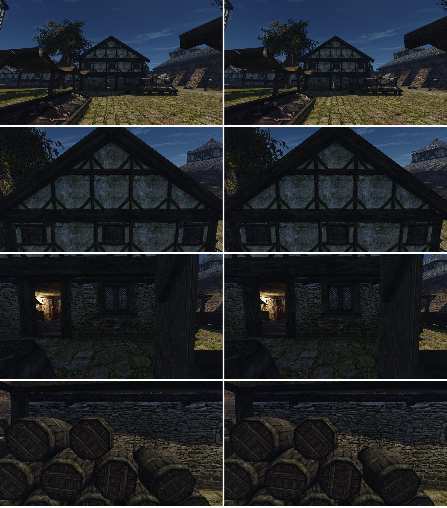

# Дом у рынка

Ассет [конвейера ремастера](../../../../docs/remaster-pipeline.md): фахверк нижнего города и края порта, семь текстур — каменный цоколь (`FACHWERKBASEMENT_EMPTY_01`, `_WINDOW_01`, `_CHAIN_01`) и верхний этаж (`WALL_03`, `WINDOW_03`, `WALL_04`, `WALL_05`). В этой папке:
- [лист замысла](intent.md), [концепция](concept.md), [журнал решений](decisions.md);
- спецификация сборки `build.json`, манифест `asset.json` (исходники с SHA-256 и C2PA, выбор, вердикты, ворота);
- вердикты рецензента в `reviews/`, листы наборов `market-<n>-*.jpg`.

Принят и включён набор `market-15`: «Принимаем» (2026-10-24). Рабочий контент на Mac — `working-5`.

## Наборы

| Набор | Что в нём | Итог |
|---|---|---|
| `market-1`…`market-8` | цоколь и верхний этаж моделью в Blender (`basement_bake.py`, `fachwerk_bake.py`) по обмеру оригинала, побелка процедурная | Пользователь: бут «ровнее и прямоугольнее, чем у оригинала», блоки у земли «слишком правильные», стена чище оригинала ([дефолты 9d, 9e](../../../../docs/remaster-defaults.md)) |
| `market-9` | бут клиньями и линзами, грубо околотые блоки неравной высоты, расшивка местами; штукатурка грязная, как у оригинала | Побелка по-прежнему «искусственная» рядом с оригиналом |
| `market-10` | побелка из картинки `image_gen`; укосины врезаны и срезаны вровень со стойками и ригелями | Виден повтор рисунка |
| `market-11`, `market-12` | одна целая картинка штукатурки на каждый квадрат между балками, грязная по всей площади, грязь нарисована под балки этого квадрата | «Мыльнее» оригинала |
| `market-13a`…`13c` | зерно сканов CC0 Poly Haven (`painted_plaster_wall`, `worn_mossy_plasterwall`) поверх картинки, разделение частот | Лучше 13c, но рядом с правкой оригинала проигрывает |
| `market-14` | все семь текстур — правки оригинала в `image_gen` ([правка оригинала](../../../../docs/remaster-pipeline.md#правка-оригинальной-текстуры)) | Р3 цоколя с цепью: мха у земли 3,8% против 21,3%, рецензент отказал |
| `market-15` | `market-14`, оттенок по пикселям оригинала (мох остаётся зелёным, 11,6% против 13%), рельеф бута 11°, «перец» генератора ослаблен | Пользователь принял и включил |

## Рецензент о market-14 и market-15

| Кадр | Набор | Итог двух порядков | Что решило |
|---|---|---|---|
| Фасад спереди | `market-15` | PASS / PASS | Все пункты сохранения да |
| Фасад вблизи | `market-14` | PASS / PASS | Каркас, побелка и грязь — как у оригинала |
| Окно цоколя | `market-14` | PASS / PASS | Окно и обрамление на месте |
| Цоколь с цепью | `market-15` | PASS / REJECT — спорно | Отказ только по дефолту 9e: блоки у земли ровные, как кирпич. Рецензент нашёл то же у оригинала: раскладка его, чёткий рисунок её проявляет |

Повтор штукатурки по квадратам рецензент тоже видит у оригинала.

Сняты на Mac: полдень (`market-house.bench`), косое солнце в 8:00 и 18:00 (`market-house-morning.bench`, `market-house-evening.bench`). При косом свете рельеф сравним с оригиналом.

## Что вынесли

- **Генератор не рисует реалистичную грязь с нуля, даже по ясному образцу.** И процедурная побелка, и картинки по брифу выходили «мыльными» и искусственными. [Исследование](../../../Реалистичные%20ИИ%20текстуры%20для%20игр.md): мыло даёт VAE генератора, лучшие HD-моды подают на вход саму оригинальную текстуру.
- **Правка оригинала уводит цвет.** Генератор делает его теплее и желтее, мох смазывает в бурый, мельчайшее зерно пересушивает. `edit_texture.py` возвращает свет пятен и оттенок пикселей оригиналу, а деталь оставляет от правки.
- **Ресурс — производная.** Вход в реестре — `original texture <имя>`. Для ремастера поверх Готики он годится, для полностью своей игры — нет.

## Не сделано

- Рецензенты Р1 и Р2: концепт принят до конвейера, а текстуры моделью судились сразу в игре (Р3). Тот же пробел у `harbour-hut`, поэтому `remaster.py check --stage done` их не пропускает.
