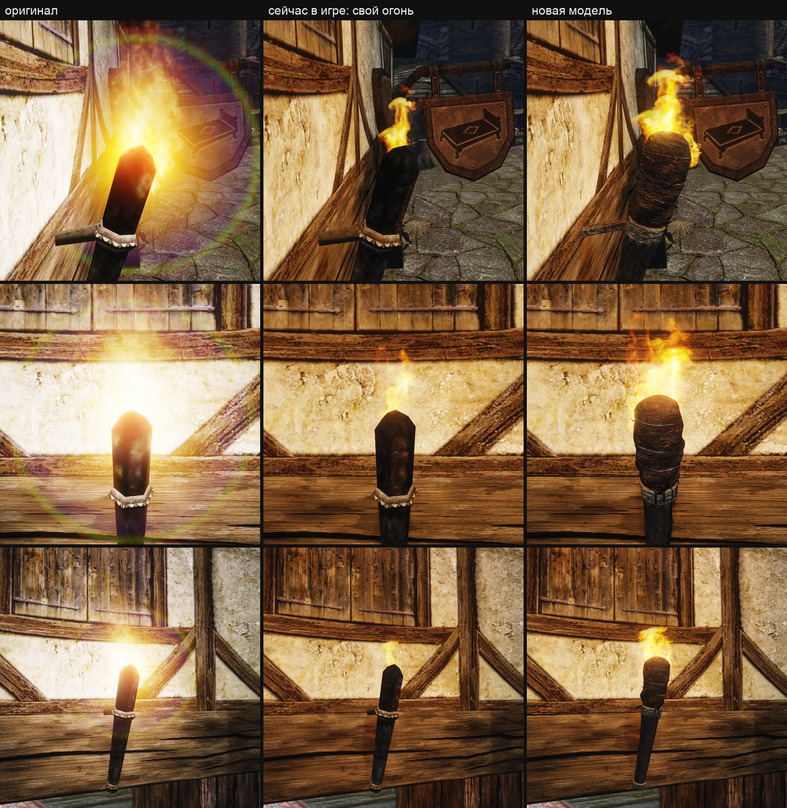
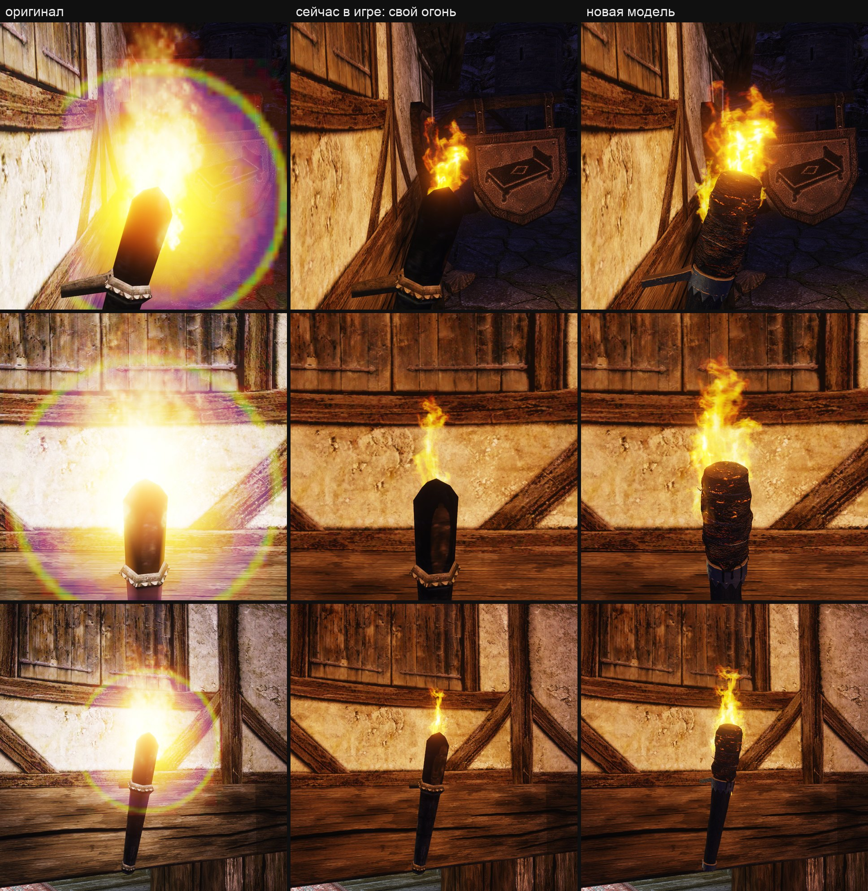
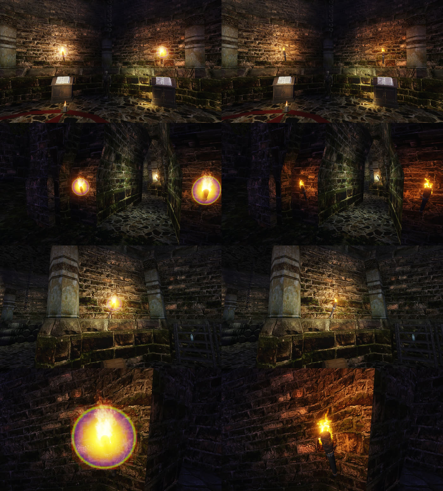

# Настенный факел: своя модель с обмоткой и жаром

Ассет `wall-torch-model`. Слова пользователя 13.11.2026: «огонь выглядит классно, но вот сам факел выглядит плохо, потому что это все еще факел 2002 года». [Исследование](research.md), [замысел оригинала](intent.md), [концепция](concept.md), [решения](decisions.md). Огонь, свет и копоть — [заметка огня](../wall-torch/README.md).

**Состояние на 14.11.2026.** Модель стоит у «Красного фонаря» и на 23 факелах башни Ксардаса и включена в рабочий контент игры набором `working-18` (`working-15` + `torch-model-8`). Оба включения — по слову пользователя: «да, включай в игру» о пробе и «Давай включим башник Сардаса и замерим производительность» о башне. Отдельного вердикта по виду (ворота В3) пользователь не давал. Остальной 121 факел мира — оригинал. [Цена](#цена) замерена в башне: на Mac разницы нет в пределах разброса, на RTX 3080 — около +0,14 мс на кадр в 8,2 мс.





## Что сделано

- **Выбор пользователя** — вариант Б из трёх концептов: «Б. Обмотка». Это отступление от оригинала по пункту 5a списка сохранения, записано в [листе замысла](intent.md#отступления).
- **Модель** — `scripts/content/mesh3d/blender/wall_torch.py`, 2676 треугольников из 3000 (у оригинала 134), 40 замкнутых частей:
  - тёсаная сосновая дубинка 80 см, 7 см у комля и 12 см у верха, с гранями от топора и лёгкой кривизной;
  - два кованых кольца с зубцами по нижнему краю, каждое заодно со своим штырём; у штыря уступ и костыль, уходящий в стену;
  - обмотка: комковатый ком 14 см в поперечнике на верхних 28 см, рваный нижний край, купол сверху;
  - три неровных витка проволоки с закрутками, семь застывших натёков смолы.

  Длина, толщины, наклон 24,4°, места поясов и штырей — из обмера меша оригинала, не с концепта.
- **Материал** — свой атлас 1024² на три материала (`OWN_WALL_TORCH_WOOD`, `_IRON`, `_FIRE`):
  - поверхности дерева и обмотки — две плитки `image_gen`, железо и смола — процедурные;
  - средние цвета дерева и железа — из замера текстур оригинала через его же развёртку;
  - жар — маска в альфе ORM: складки верхней части обмотки (`torch_tiles.py`, зона `OWN_TORCH_TOW_HOT`), `"emissive": 0.5`.
- **Пламя на головке** — эффекты и слой в [content/](content/):
  - основная карточка пламени шире (34 × 44 см) и начинается на 8 см ниже верха обмотки;
  - два боковых пламени на кромке верха и малые языки, рождающиеся кольцом вокруг обмотки (`OWN_TORCH_FLAME_SIDE`, `OWN_TORCH_LICKS`);
  - пульс 4,5 Гц вместо 6: головка толще;
  - искры, капли и копоть переставлены под обмотку.
- **Движок** — две добавки к слою предметов ([формат](../../../../docs/asset-migration.md#данные-мира)):
  - правка `visual`: предмет базы показывает модель из контента на своём месте. Лампа факела — дочерний объект его меша, поэтому убрать меш слой не даёт;
  - поле `offset_cm` правки `light`: свет лампы базы стоит в стороне от неё. Базовая лампа оказалась внутри новой обмотки, а двигать лампы слой не может.

  Обе правки не меняют ID, место и дерево предмета, сохранения подходят.
- **Места** — `wall_torch_set.py places --base <база>` пишет слой места по `vobs.json` базы, один файл на место. Первое место — башня Ксардаса, 23 факела, `wall-torch-xardas.json`. У каждого факела:
  - модель меняется на месте, пламя, искры и ореол оригинала уходят (`FIRE_MEDIUM`, `FIRE_SPARKS`, `ZFLARE6`);
  - семь эмиттеров своего огня встают по позе факела; у каждого пламени свой сид, факелы не мигают в такт;
  - своя лампа факела (не статичная) переезжает в пламя и идёт за его сигналом: цвет (230, 84, 15), предел вблизи 8, дальность остаётся от базы. В башне таких 20: у 16 лампа стояла в 79 см перед стеной, у 4 — у пламени;
  - факелу без своей лампы в пламя добавляется свет дальностью 200, общей дальностью ламп башни. В башне таких 3: у двух только статичная подсветка базы, у одного ламп нет. Статичные лампы базы не трогаются.
- **Набор** — `scripts/content/mesh3d/wall_torch_set.py`: плитки, модель, запекание, слои, упаковка части `torch-model-N`. Часть заменяет `torch-fire-1`: рабочий набор собирается из набора до неё (`working-15`) и новой части.

## Что показала игра

Mac, окно 1728 × 1117, рендер 75 %, набор `torch-model-view-7` (`working-15` + `torch-model-7`), бинарник ветки.

- **Слой применился:** `added=7 removed=2 lit=1 visual=1`, пропущенных файлов нет. Офлайн-проверки `check-particles` (8 эффектов) и `check-vob-layer` трёх слоёв прошли.
- **Свет на стене тот же:** средняя яркость пятна штукатурки 158,5 против 158,7 у `working-16`, размах ±3,4 % против ±3,2 %.
- **Пламя шире:** размах яркости в рамке пламени спереди 87 против 73.
- **Жар** виден ночью нитями в складках верхней трети; днём — отдельными тёмно-оранжевыми штрихами.

**В рабочем контенте (14.11.2026).** `building_set.py compose working-17 working-15 torch-model-7`, затем `enable working-17`; набор совпадает со снятым `torch-model-view-7` байт в байт, кроме имени в `composition.json`. Игра на Mac с контентом по умолчанию и бинарником `main` (`9717d2c3b`):
- новая игра: слой факела `added=7 removed=2 lit=1 visual=1`; размах яркости в рамке пламени спереди 86,7, с 3 м 80,3 — как у пробы;
- старое сохранение загрузилось, слой применился так же; размах 84,7 и 82,4.

Файлы — `wall-torch/model/working-17/` на хранилище: клипы и кадры двух прогонов, лист `check.png`.

**Башня Ксардаса (14.11.2026).** Часть `torch-model-8` — та же `torch-model-7` и слой башни; `working-18` отличается от `working-17` одним файлом слоя.
- Офлайн: `check-vob-layer` слоя башни — 164 добавлено (161 эмиттер и 3 света), 69 убрано.
- Игра на Mac с контентом по умолчанию и бинарником `main`: слой башни `added=164 removed=69 lit=20 visual=23`, пропущенных файлов нет; так же со старым сохранением, оно загрузилось.
- Кадры и клипы «было | стало» четырёх мест — `wall-torch/model/working-18/pairs/` на хранилище: стартовая комната, проход у входа, нижний зал, верх башни.



Что видно на кадрах: ореол оригинала ушёл, пламя меньше его пятна. Свет идёт из пламени, а не из точки в 79 см перед стеной, и несёт цвет лампы пробы (230, 84, 15) вместо жёлто-оранжевого (211, 127, 60) оригинала. По замеру кадров область стены вокруг факела стала рыжее и темнее: на 6–12 % в стартовой комнате и нижнем зале, на 33 % у ближнего факела прохода (в кадре оригинала в эту область входит яркий диск ореола). Пол не изменился (в пределах 1 %).

**Цвет света решён пользователем (14.11.2026).** На вопрос «Оставить в башне рыжий свет пробы или вернуть жёлто-оранжевый цвет оригинала?» по листу и клипам башни он ответил: «Оставить рыжий». Цвет (230, 84, 15) остаётся у ламп башни. Скрипт набора ставит тот же цвет и в следующих местах; отдельного решения по ним нет. Это решение о цвете света, не приёмка вида факела.

Круги своей настройки по кадрам игры (ни один не показывался пользователю как готовый):

| Круг | Что было не так | Что изменил |
|---|---|---|
| 1 | жар занимал треть обмотки и читался пятнистой шкурой; пламя тонкое на толстой головке | маска жара: 16 % плитки вместо 30 %, только верхняя зона, `emissive` 0,5; обмотка вдвое светлее; пламя шире, боковые пламена и языки; пояс толще |
| 2 | головка — ровный цилиндр с плоским верхом | купол сверху, комья крупнее |
| 3 | пояс тёмный и теряется, у оригинала он светлый | железо светлее, сильнее стёртые кромки |
| 4 | слепые рецензенты Р3 (набор `torch-model-5`): железо в пятнистой корке с рыжими крапинами читается головешкой и вчетверо темнее оригинала; головка 15,5 см при 14 на концепте; днём издалека огня по бокам обмотки не видно | плитка железа крупнее и ровнее, слабее рельеф, доля металла 0,3, цель цвета светлее; обмотка 14 см; языков по обмотке больше и они крупнее |
| 5 | второй прогон Р3 (набор `torch-model-6`): штырь обрывается перед стеной; рыжие крапины на железе и дереве | костыль 20 см; железо — своя ровная кованая плитка; тон дерева холоднее |

## Цена

Башня Ксардаса в полночь, место `xardas` [стенда](../../../../docs/performance.md): четыре вида по 8 с. A — `working-17`, в башне факелы оригинала; B — тот же набор со слоем башни. Порядок A B B A на одном бинарнике, анимированные модели скрыты на обеих сторонах.

| Вид | Что в кадре |
|---|---|
| 1 | стартовая комната, два факела в 5 м |
| 2 | проход у входа, три факела |
| 3 | нижний зал, один факел |
| 4 | факел лестницы в 1,3 м, пламя крупно |

**Mac M1 Pro, Metal, окно 1728 × 1117, рендер 75 % (как у игрока):**

| Вид | Кадр p50, мс: A | B | Δ | Кадр p95, мс: A | B | GPU, мс: A | B | Δ |
|---|---|---|---|---|---|---|---|---|
| 1 | 11,78 | 11,72 | −0,06 | 14,29 | 14,07 | 16,11 | 15,88 | −0,23 |
| 2 | 10,18 | 10,20 | +0,02 | 13,52 | 13,43 | 13,34 | 13,04 | −0,30 |
| 3 | 10,53 | 10,61 | +0,08 | 13,91 | 13,71 | 14,31 | 14,12 | −0,19 |
| 4 | 10,74 | 10,95 | +0,22 | 14,21 | 14,21 | 14,36 | 14,61 | +0,25 |

GPU — среднее время command buffer кадра; оно больше интервала кадров, потому что кадры на GPU перекрываются. Медианы двух прогонов одной стороны расходятся на 0,05 мс в видах 1–3 и на 0,22 мс в виде 4: разница сторон из этого разброса не выходит. Вызовов отрисовки на кадр — 62 вместо 58. Ограждение [заметки огня](../wall-torch/README.md#приёмка) «башня — не больше ≈1,5 мс GPU сверх оригинала» выполнено.

**Ryzen, RTX 3080, Vulkan, 1728 × 1117, рендер 100 %** (`scripts/perf-content.sh working-17 torch-model-view-8 xardas`):

| | A | B | Δ |
|---|---|---|---|
| Кадр p50, мс | 8,20 | 8,34 | +0,14 (+1,7 %) |
| Кадр p95, мс | 9,35 | 9,47 | +0,12 (+1,3 %) |
| Треугольников на кадр, все проходы | 535 тыс. | 619 тыс. | +84 тыс. |
| Вызовов отрисовки на кадр | 65 | 69 | +4 |

Вердикт стенда по p95 — «в шуме» (порог шума 2 %). Знак при этом один во всех видах и в обеих парах прогонов: медиана кадра B выше на 0,22 мс в виде 1, на 0,19 в виде 2, на 0,12 в виде 3 и на 0,04 в виде 4, при разбросе прогонов одной стороны 0,09–0,14 мс. То есть цена на 3080 есть, около 0,1–0,2 мс на кадр в 8 мс (122 → 120 кадров в секунду). Ожидание заметки огня для 3080 — 0,3–0,6 мс.

Не замерено: храм в землях троллей (около 50 факелов), разбивка GPU по проходам, рендер 100 % на Mac. Данные — `wall-torch/model/working-18/{perf-mac,perf-ryzen}/` на хранилище, CSV попыток Ryzen — `perf-content-worktrees/runs/perf-content-20261114T105753Z-21500/` там же.

## Что не сделано и не проверено

- **Приёмки вида (ворота В3) нет.** Решён только цвет света: «Оставить рыжий». Проба включена в игру его словами «да, включай в игру» после итоговых листов и клипов, башня — словами «Давай включим башник Сардаса и замерим производительность»; ворота В3 не записаны, раскатка на остальные места ждёт приёмки.
- **Башня не проходила рецензента:** кадры «было | стало» смотрел только я.
- **Рецензент Р3, первый прогон** (`reviews/r3-side`, `r3-far`, набор `torch-model-5`, по два порядка): два пропуска и два отказа. Отказы — толщина головки (пункт 1a) и вопрос 5a, который в слепой паре указывал на оригинал. Замечания к железу, толщине головки и огню по бокам исправлены в `torch-model-6`; пункты 1a и 5a в списке сохранения переписаны так, чтобы их можно было мерить в слепой паре.
- **Рецензент Р3, второй прогон** (`reviews/r3b-side`, `r3b-far`, набор `torch-model-6`): по списку сохранения все четыре рецензента поставили «да» на каждый видимый пункт; силуэт, главная деталь, износ, тон, материал и цельность — лучше оригинала. Итог по правилу конвейера всё равно «отклонено»: у нашего кадра не выполнены свойства:
  - P5 — днём с 3 м огня на боках обмотки не видно, пламя читается столбом над торцом (ночью языки по бокам видны). Отмечено в обоих прогонах; после второго подбор прекращён;
  - P1 — с 3 м дубинка читается ровной пятнистой трубкой: волокно плитки слишком мелкое для этой дистанции. Отмечено в обоих прогонах, подбор прекращён;
  - P3 — конец штыря обрывался перед стеной: у «Красного фонаря» стена дальше, чем конец штыря оригинала. В `torch-model-7` костыль удлинён с 9 до 20 см;
  - рыжие крапины на железе и дереве читались углями на холодных частях. В `torch-model-7` железо — ровная кованая плитка без ржавчины, тон дерева холоднее.

  После правок `torch-model-7` рецензент не перезапускался.
- **Пункты 1a, 3b, 4 и 7** на кадре сбоку не проверяются: комель за краем кадра. Нижний штырь закрыт дубинкой на всех кадрах.
- **Обмотка читается скорее корой**, чем паклей и тряпьём: волокон, торчащих из неё, у модели нет.
- **Рецензент Р1 отклонил лист видов** за наклон 17° вместо 24°, светлый тон и вынос; в модели эти величины взяты из обмера ([концепция](concept.md#лист-видов-обмотки-и-рецензент)).
- **Цена храма не замерена:** в землях троллей около 50 факелов, в башне замерены 23 ([цена](#цена)).
- **Другие места не сняты:** храм, монастырь, склеп. Штырь уходит в стену костылём; где стена дальше, он будет виден.
- **Жар дышит медленно** (`emberBreath`), в такт пламени не мигает. Если прочитается неживым — доработка движка.
- **Обтрёпанных волокон нет:** на концепте из обмотки торчит пакля, у модели край рваный только геометрией.
- **Раскатка на остальной 121 факел** — после приёмки: новым местом в `PLACES` скрипта набора или записью по имени меша.

## Как пересобрать

```sh
W="uv run --no-project --with numpy --with pillow --with scipy python scripts/content/mesh3d/wall_torch_set.py"
$W tiles && $W model && $W bake && $W layer
$W places --base ~/.cache/gothic-ai/base/<отпечаток>
$W pack --set torch-model-9
uv run --no-project --with numpy --with pillow --with scipy python scripts/content/building_set.py \
  compose torch-model-view-9 working-15 torch-model-9
```

Игра читает набор по `OPENGOTHIC_CONTENT=~/.local/share/gothic-ai/content-staging/torch-model-view-9`; нужен бинарник с правками слоя `visual` и `offset_cm` (`main` от 14.11.2026). Включение в рабочий контент — решение пользователя: `compose working-<n> working-15 torch-model-9`, затем `enable working-<n>`. Цена — `scripts/perf-content.sh <набор без места> <набор с ним> xardas`.

## Где что лежит

- Исходники `image_gen` — `~/.local/share/gothic-ai/content-sources/wall-torch-model/`: концепты 1–8, плитки `OWN_TORCH_WOOD`, `OWN_TORCH_TOW`.
- Сборка — `~/.local/share/gothic-ai/content-staging/wall-torch-model/{tiles,build/torch}`, части `torch-model-1…8`.
- Кадры и клипы — хранилище, `wall-torch/model/`.
- Запись модели — `data/content/prop-models.jsonl`, `wall-torch-model`.
