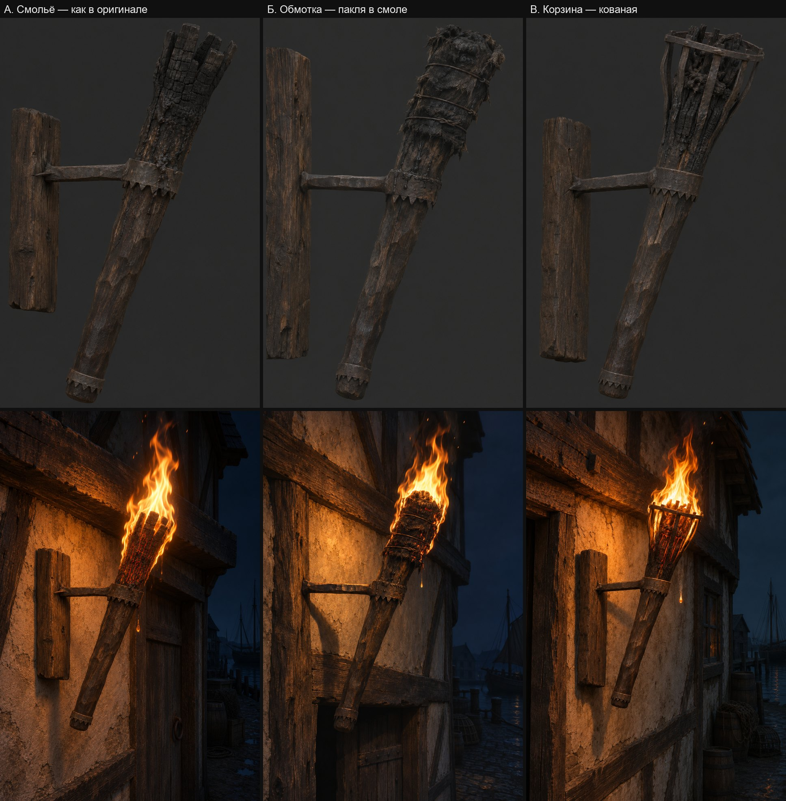

# Концепция: Настенный факел: модель и жар головки

Ассет `wall-torch-model`. Опирается на [лист замысла](intent.md), [исследование](research.md) и библию города. Форма, главная деталь и настроение — из листа замысла. Здесь решается исполнение: как построено, из чего, как стареет и как на нём сидит огонь.

## Что это за вещь

Расхожий факел острова: смолистую сосновую дубину вставляют толстым концом вверх в кованое кольцо на штыре и поджигают. Кольца ковал городской кузнец десятками, дубины рубят и меняют слуги, послушники и стража. Украшений нет, вещь одна и та же в башне мага, в храме и над дверью «Красного фонаря». Горит каждую ночь годами: железо в окалине и саже, дерево чёрное от копоти и смолы.

## Как построен

| Часть | Как устроена | Размер, см | Объёмное или нарисованное |
|---|---|---|---|
| Дубинка | смолистая сосна, тёсана топором: круглая, с плоскими неровными гранями, чуть кривая; сужается к комлю и сама заклинивается в кольце | длина 80; толщина 7 у комля, 12 у горящего конца | объёмное: грани и кривизна; волокно и сколы — нормали |
| Верхний пояс — кольцо держателя | кованая полоса, нижний край вырублен неровными зубцами вниз; шов внахлёст с заклёпкой | ширина 4, толщина 0,4; на 55 см от комля | объёмное, зубцы с толщиной |
| Верхний штырь | квадратный пруток, откован заодно с кольцом; конец в стене — костыль, вбитый в брус или шов кладки | сечение 2,5; 30 от оси дубинки до стены | объёмное |
| Нижний пояс и короткий штырь | такая же зубчатая полоса на комле: не даёт дереву колоться; от неё к стене — короткий штырь, держит наклон | ширина 3; штырь 10 до стены | объёмное |
| Горящая часть | верхняя треть выше кольца; три варианта ниже | длина 25 | объёмное; трещины угля — нормали и маска жара |

Наклон дубинки 24° от вертикали, горящий конец от стены: горящие капли падают мимо стены и штыря.

### Варианты горящей части

Выбирает пользователь по концептам.

- **А. Смольё** — как в оригинале, без отступлений. Горит само дерево: конец расколот топором на четыре–шесть долей на глубину 12 см, доли чуть разошлись. Верхняя треть обуглена в чёрную растрескавшуюся «крокодилову кожу», вниз к поясу стекли и застыли натёки смолы. Жар — в расколе и в трещинах угля.
- **Б. Обмотка** — отступление: у оригинала ткани нет. Верхняя треть обмотана комом пакли и тряпья в смоле, 14 × 22 см, перехвачена тремя витками проволоки; зубцы пояса не дают обмотке сползти. Жар — на обтрёпанных кромках и между витками.
- **В. Корзина** — отступление: меняет главную деталь и добавляет железо. Верхний пояс вырастает в корзину из восьми кованых полос высотой 20 см, раскрытую до 16 см, с обручем у верха. Внутри горят смолистые щепки и пакля. Жар — слой углей за полосами.

## Из чего сделано и как стареет

- **Сосна.** Почти чёрно-коричневая от копоти, смолы и рук: в кадре оригинала `#191614`, потёртые места `#27221D`. У комля — тёмный засаленный лоск от рук, на гранях сколы. К горящей части темнеет до угольно-чёрного. Мха и сырости нет: вещь сухая и общая для всех мест.
- **Кованое железо.** Тёмное серо-коричневое `#3A352C`, матовое, со следами молота; в углублениях тонкая ржавчина, кромки стёрты до тусклого серого `#7C6A55`. У огня — окалина и сажа. Блеска нет.
- **Уголь горящей части.** Чёрный, матовый, в трещинах; у кромок серый пепел. Тлеющие места в альбедо чёрные: цвет им даёт свечение, иначе лампа красит жар оранжевой краской.

Цвета сняты с кадра оригинала в полдень, это ограничители. Концепт просим тёмным, на тёмно-сером фоне ([дефолт 9f](../../../../docs/remaster-defaults.md)).

## Текстуры

| Текстура | Что изображает | Раскладка | Позиционные черты |
|---|---|---|---|
| `OWN_WALL_TORCH_01`, 1024² | атлас предмета: дубинка, железо, горящая часть | развёртка по частям, волокно вдоль дубинки; около 10 текселей на сантиметр | копоть гуще к горящему концу, лоск у комля, окалина у кольца |
| нормали | грани топора, волокно, трещины угля, следы молота | та же | — |
| ORM | затенение, шероховатость (сухое выше 0,8), металл; в альфе — маска жара | та же | жар только на горящей части |

Материал `OWN_WALL_TORCH_01` в `materials.json` с `"emissive"`; оригинальные `MOMEBRAZIER` и `OBJ_CITY_STREETLAMP_01` не трогаются — на них остаются жаровни и фонари.

## Пламя на головке

Сейчас карточка пламени стоит на торце, как на свече, а жар нарисован. По [исследованию](research.md#эталон-настоящий-факел):

1. **Головка — тёмное ядро в основании пламени.** Основание карточек `OWN_TORCH_FLAME` опускается на бока горящей части. Перед головкой мягкие частицы сами истончают пламя, и она видна сквозь него.
2. **Языки по головке.** Новый эмиттер: малые карточки того же атласа, 8–12 см, рождаются на поверхности головки, поднимаются на 10–20 см за 0,25–0,4 с. Они закрывают стык и дают пламя с боков.
3. **Жар.** Маска в трещинах и на кромках обугленной части, `"emissive"` движка: тускло-красный на гранях, оранжевый в глубине. Дышит медленно (`emberBreath`); если на головке это прочитается неживым — доработка движка «жар в такт пламени».
4. **Пульс.** `flicker` 4,5 Гц вместо 6: головка толще.
5. **Свет, искры, капли, копоть** переставляются под новую головку; лампа освещает саму дубинку и пояс.

## Концепт

Три варианта, 14.11.2026, по два кадра `image_gen`: вещь днём и она же горящей ночью на стене (правка первого кадра). Пользователь выбрал вариант Б: «Б. Обмотка».

Исходники — `content-sources/wall-torch-model/concept-attempt-1…6.png` с промптами в JSON рядом: Б — 1 и 2, В — 3 и 4, А — 5 и 6. Первая формулировка варианта А не прошла фильтр генератора картинок; в повторной «расколот топором на доли» заменено на «расщеплён на щепы, как конец колотого полена».

Моё чтение по [списку сохранения](intent.md#список-сохранения):

| Пункт | А. Смольё | Б. Обмотка | В. Корзина |
|---|---|---|---|
| 1. Толстая дубинка, расширяется к огню | да | да | да |
| 2. Наклон 24° ± 5° | 25° | 23° | 21° |
| 3. Пояс на 0,69 длины | 0,47 | 0,45 | 0,43 |
| 3a, 3b. Зубцы, пояс на комле | да | да | да |
| 4. Два штыря: у пояса и у комля | один: у комля нет | один: у комля нет | один: у комля нет |
| 5. Обугленная верхняя часть | да | да | да |
| 5a. Горит само дерево | да | нет: обмотка | нет: корзина |
| 6. Тон дубинки | светлее оригинала | светлее | светлее |

Что из концепта не берётся:
- **Место пояса.** На всех трёх пояс стоит около середины, а горящая часть занимает 40 % длины. В модели пояс — на 0,69, горящая часть — верхняя треть: при споре концепта и обмера побеждает обмер.
- **Тон.** Дерево на концептах коричневое, у оригинала почти чёрное (`#191614`). Тон задаёт атлас по замеру ([дефолт 9f](../../../../docs/remaster-defaults.md)).
- **Второй штырь.** На концептах опора одна: лист замысла до 14.11.2026 называл одну, второй штырь у комля нашёлся в обмере. В модели штырей два, как у оригинала.
- **Брусок на стене.** На кадрах дня это кусок бруса для показа костыля; на ночных кадрах А и В генератор оставил его на стене. В модель он не входит: штырь уходит в то, что за факелом.

### Лист видов обмотки и рецензент

Лист видов выбранного варианта (сбоку, спереди, сверху) — `concept-attempt-8.png`: правка кадра варианта Б с поясом на двух третях длины, более тёмным деревом и вторым, коротким штырём у комля (`concept-attempt-7.png` — тот же лист без него).

Рецензент Р1 (`reviews/r1-wrap`, эталон — три кадра оригинала) лист отклонил:

| Пункт | Ответ | Что увидел |
|---|---|---|
| 1, 1a, 3, 3a, 3b, 4, 5, 5a | да | дубинка, отношение толщин 2,2 (оригинал 1,8, допуск ±25 %), пояс на 0,63, зубцы, пояс на комле, два штыря, обугленная обмотка |
| 2. Наклон | нет | 16,5–17° на листе против 24,4° |
| 6. Тон | нет | дерево `#342c28` против `#1d1a15`, пояс не светлее дерева |
| 7. Габарит | нет | вынос 40 см против 45 — следствие наклона |
| P4. Жар | нет | на листе факел не горит |

Отклонённое берётся не с картинки: наклон и вынос модель получает из обмера оригинала (24,4°, метрика сборки `lean_deg`), тон дерева и железа — из замера текстур оригинала (цели атласа), жар — маской свечения. Лист задаёт характер обмотки, проволоки, натёков и ковки. Перегенерировать лист ради угла не стал: генератор держит числа углов плохо, а проверка формы — пара в игре (Р3).

Что концепт задаёт для огня: на всех трёх ночных кадрах пламя начинается на боках горящей части, она видна тёмным ядром, жар сидит в трещинах. Высота пламени на кадрах — 35–45 см, выше расчётных 25–33 см; пламя игры остаётся по расчёту.
