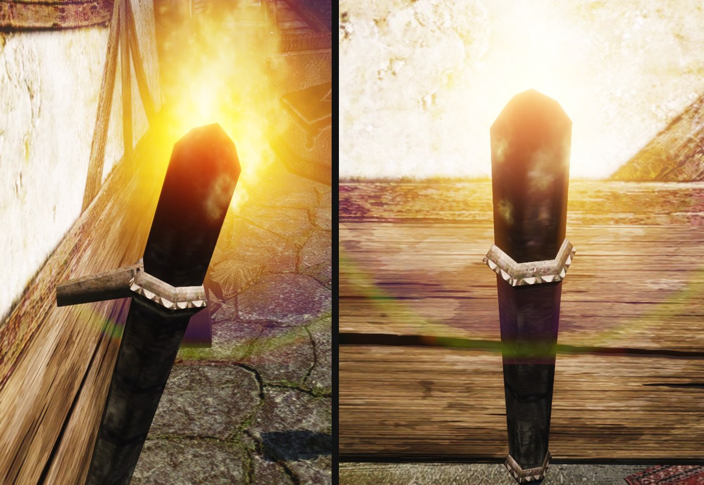

# Замысел оригинала: Настенный факел: модель и жар головки

Ассет `wall-torch-model`. Источники:
- кадры оригинала — полдень у «Красного фонаря», 1 м спереди и сбоку, 3 м (`~/.local/share/gothic-ai/remaster/wall-torch-model/original/`, вырезка — [original.jpg](original.jpg));
- геометрия — обмер меша `OW_MISC_WALL_TORCH_01` (скалярные числа, 13.11.2026);
- текстуры в родном размере — `MOMEBRAZIER.TGA` 256², `OBJ_CITY_STREETLAMP_01.TGA` 512 × 256.

Кадры оригинала генератору не подаются. Огонь, свет и копоть факела — отдельная работа, [заметка огня](../wall-torch/README.md).

## Что это за вещь и где она стоит

- Самый частый огонь игры: 145 штук одним мешем. Башня Ксардаса — 23, храм в землях троллей — около 50, монастырь — 11, склеп — 9, в порту один, у входа в «Красный фонарь».
- Одна и та же вещь висит в башне мага, в древнем храме и над дверью портового борделя. Значит, это расхожий предмет без украшений и без привязки к месту: дубинка, которую воткнули в держатель и подожгли.
- Игрок видит его ночью с 1–8 м, чаще снизу и сбоку: тёмная косая черта от стены и огонь на её конце. Днём с 1–3 м видна сама вещь.
- У «Красного фонаря» факел висит на тёмном брусе над дверью, рядом — кованый кронштейн вывески. Цвета соседей в кадре: брус `#60462B`, стойка фахверка `#453422`, штукатурка `#968D7E`.

## Главная деталь

- **Толстая дубинка, горящая с толстого конца.** Длина 80 см. Толщина растёт от 7 см у комля до 13 см у горящего конца (по углам шестигранника), отношение 1,8.
- **Наклон** 24° от вертикали, горящий конец — от стены.
- **Горящая часть** — верхняя треть, 25 см выше железного пояса: чёрная, обугленная, конец стёсан тупым остриём. Жар на конце нарисован в текстуре оранжево-красным переходом; торец взят с красного «угольного» квадрата атласа.

С игровой дистанции читается силуэт «толстая косая дубинка» и светлый железный пояс на тёмном дереве.

## Силуэт и пропорции

- Габарит 16 × 76 × 45 см: высота 76 см, вынос от стены 45 см.
- Дубинка — шестигранная призма, 46 треугольников. Железо — 88 треугольников. Всего 134.
- Железный пояс с зубчатым нижним краем — на 0,69 длины от комля (55 см). Второй, меньший зубчатый пояс — на самом комле.
- Опор две, обе — шестигранные штыри от стены: длинный под верхним поясом (30 см от оси дубинки до стены) и короткий у комля (10 см). Второй виден только в обмере: на кадрах его закрывает дубинка, и в первой записи листа (до 14.11.2026) стояла одна опора.
- Пламя оригинала стоит в 31 см от начала координат меша, свет — в 36 см.

## Черты оригинала: замысел, ограничение или то и другое

| Черта | Класс | Что делаем |
|---|---|---|
| Толстая дубинка, расширяется к огню | замысел | сохраняем длину, толщины и отношение 1,8 |
| Наклон 24° от стены | замысел | сохраняем |
| Шесть плоских граней, 46 треугольников | ограничение | круглое тёсаное дерево с неровными гранями от топора |
| Железный пояс с зубцами на 0,69 длины и пояс на комле | замысел | сохраняем место и зубчатый край; пояс — кованая полоса с толщиной |
| Опоры — два штыря из стены, у пояса и у комля | то и другое | обе остаются на своих местах; делаем их вещью, которая держит: как штырь вбит в стену и чем охватывает дубинку |
| Чёрная обугленная верхняя треть | замысел | сохраняем; обугливание — рельефом, а не заливкой |
| Жар на конце нарисован в текстуре | то и другое | замысел «конец тлеет» сохраняем; делаем настоящим свечением модели |
| Почти чёрное дерево, в кадре `#191614` | то и другое | тон тёмный, как у оригинала; под светом читаются волокно и смола |
| Текстура 256², общая с жаровней | ограничение | свой атлас предмета |
| Пламя стоит на торце, как на свече | ограничение | пламя охватывает горящую часть ([концепция](concept.md#пламя-на-головке)) |
| Ничего, кроме дерева и двух поясов: ни ткани, ни корзины | замысел | в варианте А сохраняем; ткань и корзина — предлагаемые отступления Б и В |

## Неоднозначности: здесь деталь наша

- **Что горит.** У оригинала горит сама дубинка. В жизни так горит только смольё — сосна, пропитанная живицей. Читаем дубинку как смолистую сосновую: расщеплённый конец, натёки смолы.
- **Зачем зубцы.** В текстуре это пилообразный край полосы. Читаем как кованую полосу с вырубленными зубцами: простое украшение кузнеца, оно же держит натёки смолы.
- **Чем штыри держат дубинку.** В оригинале они упираются в неё. У нас верхний пояс — кольцо на конце длинного штыря: дубинка сужается книзу и сама заклинивается в кольце толстым концом вверх, отсюда и конусность. Короткий штырь у комля откован заодно с нижним поясом и держит наклон: без него дубинка качалась бы в кольце.
- **Как штырь сидит в стене.** Кованый костыль, вбитый в брус или в шов кладки.

## Напряжения, которые нельзя «чинить»

- Грубая, но грозная: это дубина, а не изящный светильник.
- Расхожая, но кованая: железа мало, оно простое, однако оно есть.
- Одинаковая везде: не подстраивать под порт (мох, соль) — та же вещь висит в сухой башне и в храме.

## Правила квартала

- Г1, Г2, Г3 [арт-библии](../../../../docs/khorinis-art-bible.md#правила-кварталов) — для всех мест: тёмная тёплая палитра, всё старое и сделано руками, темноту не осветлять.
- П4 «железа мало» — для порта; у факела два пояса и два штыря, больше железа не добавляем.
- Правило сырости П1 к факелу не применяем: вещь общая для сухих и сырых мест, а огонь сушит её.

## Список сохранения

1. На 1 и 2 одна толстая деревянная дубинка длиной около 80 см, которая расширяется к горящему концу?
   1a. Отношение толщины у горящего конца к толщине у комля совпадает в пределах ±25 %? У оригинала 1,8. Назови оба значения.
2. Наклон дубинки от вертикали на 1 и 2 совпадает в пределах ±5°, горящий конец — от стены? У оригинала 24°.
3. Железный пояс охватывает дубинку примерно на двух третях длины от комля (0,69 ± 0,08) на 1 и 2?
   3a. У пояса зубчатый край?
   3b. На комле есть второй, меньший пояс?
4. Опор две: штырь от стены к дубинке у верхнего пояса и короткий штырь у комля, без узорной пластины, цепей и чаши?
5. Часть выше пояса — горящая: обугленная, чёрная?
   5a. Горящая часть — обмотка паклей и тряпьём в смоле под проволокой, без железной корзины? (отступление, принято 14.11.2026; у оригинала горит само дерево)
6. Тон дубинки днём — почти чёрный коричневый (в кадре оригинала `#191614`), железо светлее дерева и тусклое?
7. Габарит совпадает в пределах ±10 %: высота 76 см, вынос от стены 45 см?

## Свойства нашего кадра

P1. Дубинка читается тёсаным деревом: круглая, с неровными гранями и волокном, а не призмой.
P2. Железо читается кованым: у полосы и зубцов есть толщина, видны следы молота, блеска нет.
P3. Видно, как вещь работает: чем штырь держится в стене и чем держит дубинку.
P4. Горящий конец тлеет сам: жар виден в трещинах и без пламени, днём в тени.
P5. Пламя начинается на боках горящей части, а не над торцом: между головкой и огнём нет зазора.
P6. В полдень в дереве нет провалов в сплошной чёрный: рельеф читается.

## Отступления

- **Пункт 5a, обмотка.** Верхняя треть дубинки обмотана паклей и тряпьём в смоле и перевязана проволокой; у оригинала горит само дерево. Почему: так выглядит факел в современных играх, головка получает объём и жар между витками. Согласие пользователя 14.11.2026 по листу трёх концептов: «Б. Обмотка». Рецензент по пункту 5a проверяет обмотку, а не её отсутствие.

Не выбраны: А «Смольё» (без отступлений) и В «Корзина» (кованая корзина вместо пояса).

Каждое отступление записывается строкой: что меняем, почему, согласие пользователя с датой и его словами.
