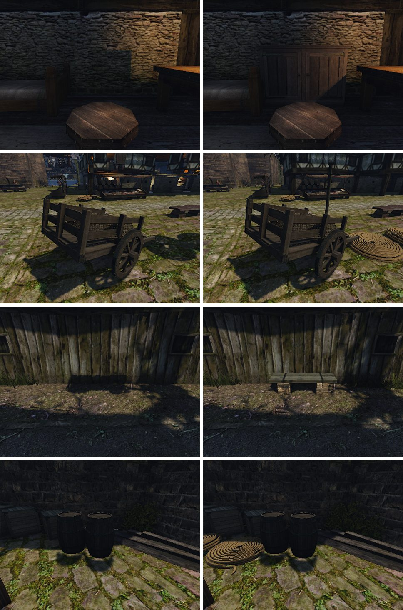

# Предметы пропадали из кадров стенда на Mac: Hi-Z

21 октября 2026 года. Mac, Apple M1 Pro, Metal.

## Симптом

При съёмке крупных планов предметов (стенд [`own-mesh-relief`](../../../scripts/bench/own-mesh-relief.bench), [отчёт о рельефе](../../content/2026-10-prop-relief/README.md)) отдельные предметы то были в кадре, то нет. Пропадали шкаф `NW_CITY_CUPBOARD_POOR_02`, канаты `NW_HARBOUR_ROPE_01` у тележки, фонарный столб, лавка, книжный шкаф. Так было и с нашими GLB, и с оригиналами. Перепись в каждом прогоне показывала, что меши открыты и подменены. Ожидание 4–6 с после `cam hold` не помогало. В тех же кадрах иногда пропадали наружные стены домов и верх городской стены. Сквозь них были видны освещённые комнаты и даль, поэтому казалось, что сменились время суток и небо.



Слева кадры прогонов до починки, справа — после, корень контента тот же.
- Шкаф не нарисован, а его тень на стене осталась.
- У тележки нет столба, канатов и наружной стены дома.
- Лавки нет.
- Канатов у бочек нет даже в прогоне, который тогда считался удачным.

## Причина

Тень без предмета показывает, что предмет загружен и есть в сцене. Его отбросила проверка видимости основного вида, а тени считаются своими проходами без этой проверки.

Видимость в OpenGothic считает GPU, `shader/materials/visibility_pass.comp`.
1. Кадр рисует крупные статичные объекты в буфер глубины.
2. По нему строится Hi-Z: пирамида 64×64 → 1×1, в каждой клетке самая дальняя глубина.
3. Каждый кластер мира и каждый vob сверяется с Hi-Z. Если ближняя точка его рамки дальше клетки, он не рисуется. Мип для проверки выбирается по размеру рамки на экране: рамка шире или выше 16 клеток (на кадре 800×600 это 256 пикселей) проверяется по мипу 5 или 6.

Мипы строит `shader/hiz/hiz_mip.comp`. Мипы 1–4 каждая рабочая группа строит у себя. Мипы 5–6 должна была строить последняя группа того же dispatch: группы считались атомарным счётчиком, приём AMD SPD. Последняя группа читает мип 4, который записали другие группы. На Metal запись в текстуру одной группой не обязана быть видна другой группе того же dispatch. `coherent` и `memoryBarrierImage()` дают здесь только барьер внутри группы. Поэтому последняя группа читала нули или старые значения.

Ноль в Hi-Z значит «прямо перед камерой стена». Всё, что проверялось по мипам 5–6 за такой клеткой, отсекалось. Какие тексели испорчены, зависит от расписания GPU, поэтому пропажи менялись от кадра к кадру и от прогона к прогону.

Пример из журнала пробы, кадр 225 прогона `base2`. Мип 4 — 4×4 по строкам, мип 5 — 2×2, значения R16:

```
мип 4:  22324 22321 22322 22323 / 24193 24190 24191 23566 / 0 0 0 0 / 0 0 0 0
мип 5:  должно 24193 24191 0 0, записано 0 0 0 0
```

## Воспроизведение

Стенд [`own-mesh-culling.bench`](../../../scripts/bench/own-mesh-culling.bench) снимает четыре точки из `own-mesh-relief`:
- комнату со столом и книжным шкафом;
- лавку;
- тележку со столбом и канатами;
- шкаф.

На каждой точке три кадра: через 1 с, 2,5 с и 4 с после переноса. Прогоны шли по очереди на Mac с оригинальными мешами: `WORLD=NEWWORLD.ZEN GOTHIC_AI=0 MOVABLE_VOBS=0 OPENGOTHIC_CONTENT=`.

Кадр считается неполным, если больше 0,3 % пикселей отличаются от кадра исправленной сборки больше чем на 40 из 255. Полные кадры совпадают с ним до пикселя (0,00 %). Неполные отличаются на 0,37–4,7 %, и это всегда пропавший предмет или стена.

| Сборка | Прогон | Неполных кадров из 12 | Проверок Hi-Z с испорченным мипом 5 |
|---|---|---:|---:|
| до | base1, с пробой | 10 | 2 из 18 |
| до | base2, с пробой | 6 | 3 из 18 |
| до | base3 | 10 | — |
| до | base4 | 12 | — |
| после | fix1, с пробой | 0 | 0 из 18 |
| после | fix2 | 0 | — |
| после | fix3 | 0 | — |
| после | final1, итоговый код | 0 | — |

До починки неполными были 38 кадров из 48:
- лавка — 9 из 12;
- тележка — 9 из 12;
- шкаф — 10 из 12;
- книжный шкаф — 10 из 12.

После починки неполных кадров 0 из 48, все прогоны совпали до пикселя. Полный `own-mesh-relief` с корнем наших GLB после починки дал все 16 кадров со всеми предметами (снимки справа на картинке выше).

Проба [`hiz-check.patch`](hiz-check.patch) — временная, в код не вошла. С `OPENGOTHIC_HIZ_CHECK=15` она раз в 15 кадров читает все мипы Hi-Z и пишет в журнал, сколько текселей каждого мипа ближе или дальше максимума своих четырёх источников. Перед чтением проба ждёт простоя GPU, и это меняет расписание кадра. Поэтому испорченный мип 5 она ловит реже, чем пропажи видны в кадрах. Мипы 1–4 и мип 6 относительно мипа 5 были верны во всех проверках.

## Починка

- `hiz_mip.comp`: мипы 5–6 строятся отдельным dispatch из одной группы (`baseMip = 4`), счётчик убран.
- `Renderer::buildHiZ`: второй dispatch, когда мипов больше пяти. Между двумя dispatch Metal сам ставит зависимость по текстуре: ресурсы отслеживаемые, кодировщик последовательный. На Vulkan барьер ставит отслеживание ресурсов Tempest.
- Граница записи в `processTile` теперь своя для каждого уровня. Раньше хвост писал мип 6 за пределы текстуры 1×1.

Цена — один dispatch на 64 потока над текстурой 4×4 за кадр.

## Что это значит для стенда

Отдельное правило ожидания после `goto pos` не нужно. После починки кадры через 1 с после переноса полные, и прежних ожиданий сценариев хватает. Сравнения «было/стало», снятые на Mac до этой починки, могли терять предметы в любом из двух прогонов. Поэтому разницу в наличии предмета в таких кадрах нельзя считать результатом правки.

Не проверено на Ryzen (Vulkan, NVIDIA): все слоты окна там занимала игра пользователя. Шейдер там тот же, и порядок двух dispatch обеспечивает барьер Tempest.

## Повтор

```sh
# два прогона подряд; PNG должны совпасть до пикселя
BENCH_HOST=local WORLD=NEWWORLD.ZEN GOTHIC_AI=0 MOVABLE_VOBS=0 OPENGOTHIC_CONTENT= \
  scripts/bench.sh own-mesh-culling <absolute out>
# проба: git apply reports/engine/2026-10-21-hiz-culling/hiz-check.patch, сборка, затем OPENGOTHIC_HIZ_CHECK=15
```
