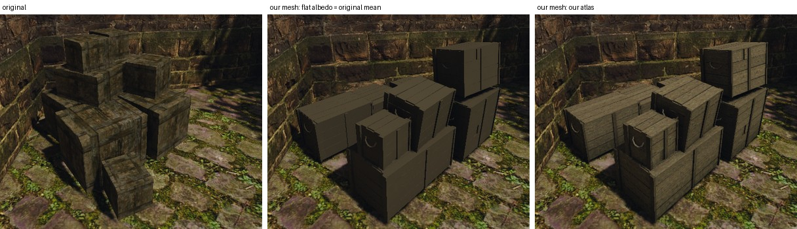
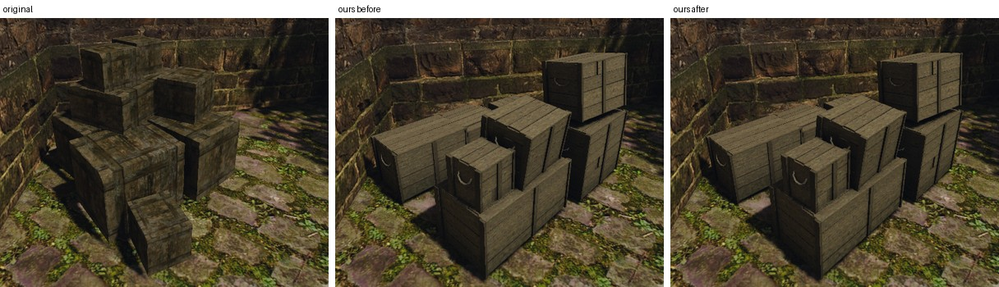
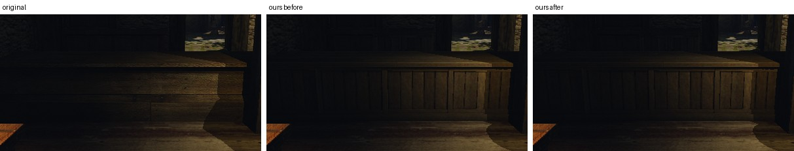
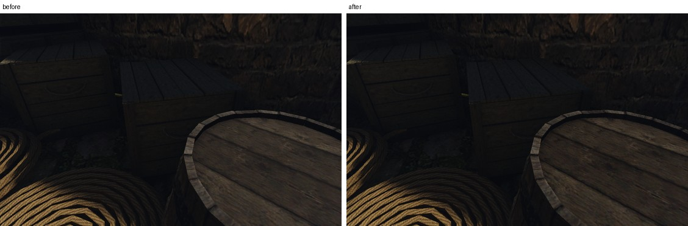
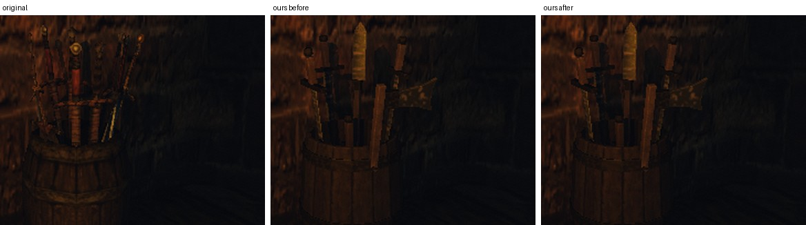
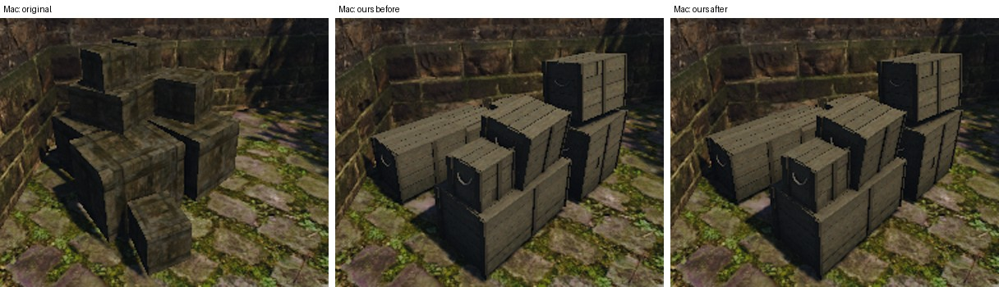

# Свои материалы серее и светлее оригиналов: блик шероховатого дерева

21 октября 2026 года. Ryzen (RTX 3080, Vulkan, GI Probes) и Mac (M1 Pro, Metal, без GI).

## Симптом

Наше тёмное дерево в игре выглядело серым и светлым рядом с оригиналами, даже когда средний цвет атласа совпадал с замером оригинала. Ящикам порта ([отчёт](../../content/2026-10-crates-redesign/README.md)) пришлось занизить цель на треть, и верх кучи всё равно остался светлее. Сессия кучи ящиков ([#347](https://github.com/kaifaty/GothicAI/pull/347)) объяснила это голубым отражением неба: движок добавляет его только материалам с ORM. Она оценила, что верхние грани светлеют от него вдвое.

## Что делает движок

Своя запись в `materials.json` ставит признак в альфе ORM. Только такие пиксели получают PBR, оригиналы освещаются по-старому.

| Свет | Оригинал | Свой материал до правки |
|---|---|---|
| солнце | Ламберт | Ламберт × (1 − металличность) + GGX, F0 = 0,04 |
| точечные светильники | Ламберт | то же, `light.frag` |
| рассеянный свет | небо и ambient (без GI) или пробы GI | то же, AO карты гасит небо |
| отражение неба | нет | LUT неба по отражённому лучу, split-sum Karis: `ambient_light.frag` без GI (Mac), `probe_ambient.frag` с GI Probes (Ryzen) |

Цвет текстуры и у оригинала, и у нас проходит через `textureAlbedo()`: `ACESinv(texel·0,78 + 0,001)·5`. Тексель 0,057 становится альбедо 0,25, тексель 0,015 — 0,11. Это растягивает тёмные тона в 4–7 раз. Блик с F0 = 0,04 от этого не растёт, поэтому на дереве он заметно слабее, чем в физическом рендере. При шероховатости 0,88 отражение неба даёт 0,02 от света неба. Рассеянный свет неба на тёмном дереве — 0,09–0,2 от него (0,8 × альбедо). Расчёт — по формулам шейдера.

## Сколько дал рендер: контроль на одинаковом текселе

Чтобы отделить рендер от контента, оригинальный ящик пропущен через путь своих материалов. Запись `materials.json` для `NW_HARBOUR_WOODCRATE_01/02` содержит только `scale` или постоянную ORM с шероховатостью 0,88. Меш и текстура — оригинальные, меняется только путь освещения. Стенд — `own-mesh-market`, кадр кучи ящиков в тени угла двора, Ryzen.

Медиана яркости граней, линейный RGB кадра после тонмаппинга:

| Грань | Старый путь (оригинал) | Путь своих, до правки | Путь своих, после правки |
|---|---:|---:|---:|
| верх, передний | 0,0457 | 0,0508 | 0,0456 |
| верх, малый | 0,0416 | 0,0460 | 0,0416 |
| верх, верхний | 0,0457 | 0,0516 | 0,0456 |
| верх, правый | 0,0331 | 0,0380 | 0,0331 |
| бок, малый | 0,0344 | 0,0376 | 0,0343 |
| бок, правый | 0,0312 | 0,0347 | 0,0314 |
| B/R граней | 0,30–0,33 | 0,32–0,37 | 0,30–0,33 |

До правки путь своих материалов давал +11–12% яркости и синеву. Это и есть серая плёнка. Со шероховатостью 1, без карты ORM, прибавка та же: +11%. После правки грани совпадают со старым путём. Остальные отличия кадров — тени листвы на ветру.

## Что рендер не объясняет: атлас кучи

Наша куча до правки светлее оригинала в 2,6 раза на верхних гранях (0,108 против 0,042) и в 1,5 раза на боковых. Рендер из этого даёт только 6–7%: на нашей куче правка снимает −6% с верха и −6…−9% с боков. Остальное — контент. Это показали три контрольных прогона на Ryzen с исправленной сборкой.



- **Геометрия.** Наш меш с ровным альбедо, равным среднему текселю оригинала (0,057 / 0,047 / 0,024), почти совпадает с оригиналом по тону. Боковые грани: 0,034 против 0,033, верхние 0,057 против 0,042. Верх у нас открыт, а кубы оригинала вдавлены друг в друга. Нормали оригинала жёсткие, как у нас: вершинные отклоняются от граней в среднем на 1°. Значит, его тусклый верх не от сглаживания.
- **Карта нормалей и ORM.** Атлас без них даёт тот же кадр, что с ними.
- **Атлас.** С нашим атласом тот же меш светлее ещё в 1,8 раза на верхних гранях и в 1,3 раза на боковых. Средний тексель атласа по всей развёртке — 0,036 / 0,030 / 0,016, это цель «на треть темнее оригинала». Но 53% площади развёртки занимают тёмный короб за щелями и стыки, их тексель около 0,012. Видимые доски — 0,069 / 0,057 / 0,030. Это в 1,9 раза светлее цели и в 1,2 раза светлее оригинала. Цель совпала со средним только за счёт граней, которых в игре не видно. У сундука внутренние грани вынесены в свою зону `INNER`, у ящиков — нет.
- **Почему серее.** Синеву дал и рендер, но на кадре B/R вырос всего на 0,01–0,03. Ровное альбедо с цветом оригинала на нашем меше тоже даёт B/R 0,41–0,43, а сам оригинал — 0,30–0,33. Бурый цвет оригинала даёт распределение цвета в его текстуре: тёмные грязь и мох. Среднее этого не передаёт.

Атласы ящиков подогнаны под старый рендер, их переделка — решение пользователя. Если переделывать, цель надо мерить по видимым граням. Короб за щелями — отдельная зона, как `INNER` у сундука.

## Правка

`materialSpecularWeight(roughness, metallic)` в `shader/lighting/material_brdf.glsl`:

```glsl
return mix(1.0 - smoothstep(0.5, 0.8, roughness), 1.0, metallic);
```

Вес умножает GGX солнца и светильников (`materialBrdf`) и отражение неба в обоих путях: `ambient_light.frag` без GI и `probe_ambient.frag` с GI Probes. Металл получает блик полностью. Шероховатый диэлектрик освещается так же, как оригинал: Ламберт, рассеянный свет, AO и рельеф карты нормалей.

Почему 0,5 и 0,8. Расчёт по формулам шейдера, тексель 0,015, солнце на 57°:

| Шероховатость | Пик GGX солнца / Ламберт | Отражение неба / небо в рассеянном, взгляд в лоб → под 73° |
|---:|---:|---|
| 0,3 | 14,5 | 0,40 → 1,50 |
| 0,5 | 2,0 | 0,34 → 1,12 |
| 0,6 | 1,1 | 0,30 → 0,93 |
| 0,7 | 0,9 | 0,27 → 0,56 |
| 0,8 | 0,7 | 0,24 → 0,32 |
| 0,88 | 0,5 | 0,21 → 0,23 |

До 0,5 у блика есть пик в зеркальном направлении и рост к скользящим углам. Он виден как блик, его надо оставить: стекло, воск, полированный камень. От 0,8 отражение почти не зависит от угла и ложится ровной серой плёнкой, которой у оригиналов нет.

Вес по зонам набора рынка (медианы шероховатости и металличности по развёртке):

| Зона | Шероховатость | Металличность | Вес блика |
|---|---:|---:|---:|
| стекло окна, лампы | 0,22–0,35 | 0 | 1 |
| воск свечи | 0,56 | 0 | 0,90 |
| кожа мешка | 0,70 | 0 | 0,26 |
| дерево, верёвка, ткань, мешковина, мех | 0,82–0,95 | 0 | 0 |
| клинки, щит, латунь | 0,55–0,57 | 0,78–0,84 | 0,97–0,99 |
| железо тележки, прилавка, окна | 0,61–0,68 | 0,48–0,65 | 0,66–0,89 |
| железо вывески | 0,88 | 0,17 | 0,17 |

Железо вывески по своей ORM — шершавая ржавчина, почти не металл, и блика у него почти не остаётся. Так задано в атласе.

Отвергнутые варианты:
- **Меньший F0 для шероховатых.** Он не гасит рост по Шлику к скользящим углам у блика солнца: тот же серый край остаётся.
- **Убрать только отражение неба.** Остаётся GGX солнца и светильников. При шероховатости 0,88 на скользящих углах он даёт до половины Ламберта (таблица выше).

## Проверка в игре

Ryzen, `own-mesh-market` и `own-mesh-relief` с корнем набора рынка, до и после правки, и с `OPENGOTHIC_CONTENT=` для оригиналов.









Яркость пикселей, которые изменились больше чем на 3 из 255 (медиана после / до):

| Кадр | Изменилось пикселей | Яркость |
|---|---:|---:|
| прилавок под лампой | 8,6% | 0,85 |
| ящик вблизи (relief) | 22,9% | 0,77 |
| тележка на солнце | 3,6% | 0,92 |
| куча ящиков | 6,6% | 0,93 |
| мешок с оружием | 8,7% | 0,93 |
| крыша прилавка, ткань | 5,8% | 0,93 |
| щит на стене (металл) | 0,3% | 0,88 |
| бочка с оружием (клинки, обручи) | 1,5% | 0,91 |

У металлических предметов меняется только дерево: древки, клёпки, доски бочки. На клинках и обручах разница меньше 3 из 255. Синтетическая фикстура `scripts/content/test-material.py` (полоса шероховатости от гладкой к матовой и металлическая полоса на мостовой у лампы) меняется мало: 0,6% пикселей днём, 0,1% ночью. Гладкая часть и металл по формуле не меняются.

### Mac

Mac M1 Pro, Metal. GI на Mac выключен (`gi = 0`), поэтому отражение неба идёт через `ambient_light.frag`, а не через пробы. Прогоны локальные, с теми же точками и корнями. Перед каждым прогоном проверялось, что на Mac нет другой игры.



| Грань | Старый путь (оригинал) | Путь своих, до правки | Путь своих, после правки |
|---|---:|---:|---:|
| верх, передний | 0,0467 | 0,0524 | 0,0467 |
| верх, малый | 0,0406 | 0,0459 | 0,0406 |
| верх, правый | 0,0337 | 0,0392 | 0,0337 |
| бок, малый | 0,0315 | 0,0350 | 0,0315 |
| B/R граней | 0,34–0,44 | 0,38–0,46 | 0,34–0,44 |

- **Контроль.** Без GI прибавка до правки больше, чем на Ryzen: +11–16% и B/R +0,03–0,04. Отражение берёт открытое небо без видимости проб. После правки кадры кучи, ящика и прилавка совпадают со старым путём до 1 из 255 (PSNR 84–91 дБ).
- **Наш набор.** Прилавок −15% на 10% пикселей, тележка −9%, куча −7% (B/R граней −0,02…−0,04). Щит и бочка с оружием меняются только в дереве.

## Ограничения

- Атласы набора рынка и ящиков не менялись. Они подогнаны под старый рендер, и после правки предметы в кадре на 6–15% темнее прежнего.
- Отражение неба у гладких своих материалов без GI (Mac) по-прежнему не знает о закрытых помещениях: его гасит только SSAO.
- Порог задан в шейдере, флага нет. Выключить свои карты целиком — `OPENGOTHIC_CONTENT=`.

## Как повторить

- Сборка до правки — `main` до PR, после — ветка PR. На Mac — `BENCH_HOST=local`. Стенды запускаются так:
  - `BENCH_HOST=ryzen OPENGOTHIC_CONTENT=~/.local/share/gothic-ai/content-staging/market-set/content scripts/bench.sh own-mesh-market`;
  - `own-mesh-relief` — так же;
  - оригиналы — с `OPENGOTHIC_CONTENT=`.
- Контроль на одинаковом текселе — корень с одним `materials/materials.json`:
  `{"NW_HARBOUR_WOODCRATE_01.TGA": {"scale": 1.0}, "NW_HARBOUR_WOODCRATE_02.TGA": {"scale": 1.0}}`. Вариант с шероховатостью добавляет `"orm"` с постоянной картой (1, 0,88, 0) из `write_dds` в `scripts/content/test-material.py`.
- Контроли и прогоны на Mac шли по семи точкам `own-mesh-market`: бочка с оружием, куча, щит, тележка, прилавок, бочка и ящик. Блоки точек скопированы без изменений.
- Медианы граней — прямоугольники на гранях кадра 800×600, медиана линейного RGB.
