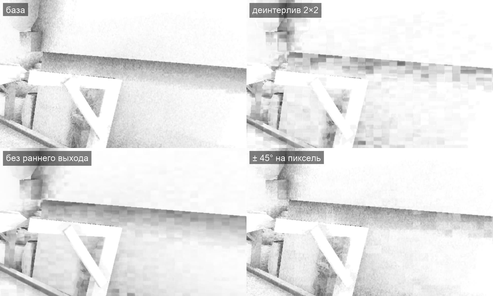

# Деинтерлив SSAO — не прошёл по виду, 2026-11-08

Шаг 1 «Следующих шагов» [`docs/performance.md`](../../../docs/performance.md#следующие-шаги). До него уже были [заметка про AO и туман](../2026-11-08-frame-waits/research/modern_ao_fog.md), пункт 11 [сводки](../2026-11-08-frame-waits/research.md) и [варианты-границы SSAO](../2026-11-08-frame-waits/README.md#во-что-упирается-ssao) второго круга: один поворот на группу снимал 35–51 % полного прохода.

**Итог.** Деинтерлив 2×2 удешевляет SSAO вместе с размытием на Mac в 1,4–2 раза, но больше половины выигрыша получено ценой AO. У потоков с общим поворотом близкие оценки, поэтому общий ранний выход группы срабатывает раньше. В лесу группа делает 3,2 итерации вместо 6,2, в интерьере 2,2 вместо 6,8, и AO заметно светлеет. Без раннего выхода уровень AO как у базы, но появляются блоки 32×16 пикселей. Причина: у всей SIMD-группы одни направления выборок, ошибка оценки общая на её область, а размытие ±3 пикселя её не сглаживает. Случайный сдвиг поворота на пиксель блоки ослабляет, но AO всё равно светлее. Атлас глубины 4×4 не ускоряет. В игру деинтерлив не идёт. Вошли починка копирования исходников на Ryzen и стенд клипов SSAO.

Кадр — только размытый AO (белый — открыто, тёмный — закрыто), рынок, 3456×1918, кусок 1000×600. У базы под балкой мягкий градиент и мелкое зерно. У деинтерлива градиента почти нет, видны блоки и вертикальные полосы узора 2×2. Без раннего выхода градиент возвращается, блоки остаются. С разбросом ±45° на пиксель блоки слабее, но AO под навесом светлее базы.

## Что вошло

| Правка | Зачем |
|---|---|
| `scripts/ryzen.sh` копирует исходники на Ryzen с `--no-times`, как `perf.sh` с #987 | `rsync -a` сохранял время файла. Файл, изменённый до последней сборки папки, оставался старше своих объектов, и ninja его пропускал. В этом круге `renderer.cpp` с атласом не пересобрался, игра упала на первом кадре. Хуже того, кэш движка на Ryzen сохранил этот бинарник под хешем новых исходников, и повторный запуск взял его оттуда. Запись кэша удалена вручную |
| Стенд `scripts/bench/ssao-clips.bench` | четыре клипа по 7 с: рынок с идущим героем, медленный поворот камеры у крыш, лесная дорога, дом с очагом ночью. Для приёмки следующих шагов SSAO по клипу «сейчас \| после» |

Код деинтерлива лежит в [`probes/`](probes/): `deinterleave-2x2.patch` (фазы 2×2 и потоки по фазам), `depth-atlas.patch` (поверх него атлас 4×4), `ao-view.patch` (проба, которая выводит в кадр размытый AO).

## Цена

Mac M1 Pro, 3456×1918, время энкодера `SSAO | SSAO-blur` (с атласом — и `SSAO-depth`), мс, среднее прогонов. Порядок A B A B, затем атлас между базой и вариантом.

| Вариант | Прогонов | Рынок | Лес | Интерьер |
|---|---:|---:|---:|---:|
| база | 3 | 4,35 | 7,82 | 5,92 |
| деинтерлив 2×2 | 3 | 3,18 | 5,23 | 2,94 |
| он же с атласом глубины 4×4 | 2 | 3,30 | 5,07 | 3,04 |

Атлас — копия глубины в 16 подкартинок, чтобы соседние потоки читали соседние тексели, — окупает свою копию и не больше. Время кадра в эти часы мерить было нельзя: Mac делили сборки Xcode, симуляторы iOS и рендер шортсов, средняя нагрузка доходила до 700. Серии ждали только загрузку GPU ниже 30 %. Число на равный вид даёт проба `eFG` второго круга: все итерации у всех групп и один поворот на группу. Это 5,12 / 6,44 / 4,18 мс против базы 4,50 / 7,79 / 5,97, то есть рынок дороже на 0,6 мс, лес и интерьер дешевле на 1,4 и 1,8 мс.

## Вид

Среднее AO кадра (1 — открыто) по снимкам пробы `ao-view.patch` и среднее число итераций из восьми:

| Снимок | База | Деинтерлив | Без раннего выхода | ±22° на пиксель | ±45° на пиксель | Итераций: база → деинтерлив |
|---|---:|---:|---:|---:|---:|---|
| рынок, вид A | 0,937 | 0,952 | 0,931 | 0,948 | 0,945 | 2,4 → 1,8 |
| рынок, вид B | 0,910 | 0,929 | 0,902 | 0,923 | 0,919 | 2,8 → 2,0 |
| лес | 0,528 | 0,677 | 0,525 | 0,616 | 0,588 | 6,2 → 3,2 |
| интерьер | 0,446 | 0,768 | 0,426 | 0,689 | 0,612 | 6,8 → 2,2 |

Механизм. `isSolved` прекращает итерации группы, когда наибольшее изменение AO за итерацию среди её 64 потоков меньше порога. Счётчик `vCnt` там всегда 0 или 64, так что `vCnt<4` — это сравнение группового максимума. При белом повороте 64 оценки независимы, и максимум из них велик, пока хоть один пиксель не сошёлся. При общем повороте оценки соседей связаны, максимум меньше, и группа выходит раньше с меньшим числом выборок.

Вариант с одним ядром на весь экран (без поворота области) ещё хуже. По экрану повторяются сдвинутые «призраки» краёв, классическая полосатость одного ядра, а группы с разным числом итераций видны квадратами 32×32.

В итоговом кадре разница малозаметна. Клипы Ryzen 1920×1080, база против деинтерлива: резкость 0,96–1,01, разница соседних кадров 0,98–1,01. На снимках 3456×1918 под балкой рынка у деинтерлива пропадает затемнение стены. Клип пользователю не показан: вариант не прошёл мою проверку по снимкам AO.

## Что может сработать

- **Мипы глубины (путь XeGTAO)** — рекомендую следующим. Белый шум на пиксель остаётся, дальние выборки читают мелкий уровень глубины, и их чтения ложатся в кэш. Проба `eF2` второго круга, где все чтения попадают в кэш, снимала с полного прохода 27–39 %. Вид меняется только на расстоянии, через глубину уровня. Нужна проверка снимками AO и клипом.
- **Деинтерлив по HBAO+.** Нужны фазы 4×4 с фиксированным поворотом, размытие, которое усредняет все 16 фаз (а не ±3 пикселя), и выход из цикла по сходимости каждого пикселя, а не по групповому максимуму. AO станет мягче. Выигрыш на равном числе выборок оценивается по `eFG`: лес −1,4 мс, интерьер −1,8 мс, рынок +0,6 мс. Это больше работы и меньше пользы, чем у мипов.

## Как мерили

- Mac: `scripts/perf.sh market forest interior` с `OPENGOTHIC_GPU_PASSES=1`, сборки RelWithDebInfo с профайлером. Снимки — место `shot` (четыре вида). Пробы `ao-view.patch` и `vec4(float(dbg)/8.0)` вместо AO в `ssao.comp` выводят в кадр размытый AO и число итераций.
- Ryzen: `TEMPEST_WINDOW_SIZE=1920x1080 BENCH_HOST=ryzen scripts/bench.sh scripts/bench/ssao-clips.bench`, метрики — `metrics.py` из [отчёта TAA](../../render-features/2026-11-03-taa/metrics.py) с маской `ssao-*.mp4`.
- Первая проба «глины» через `OPENGOTHIC_GPU_SKIP` прямого света дала мусор: пропущенный проход оставляет цель неочищенной. Поэтому AO выводится в кадр отдельной копией.
