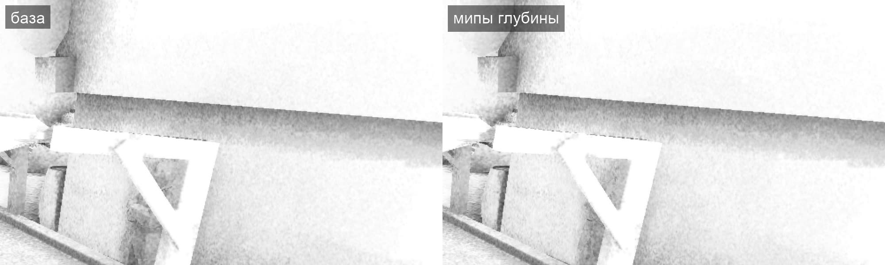

# Мипы глубины для SSAO, 2026-11-08

> **Заменено в тот же день.** Цепочку заменила одна копия глубины размером с SSAO (`ssao_depth.comp`), которую читают все выборки, без выбора уровня и поправки на наклон. Она быстрее: цепочка для всех выборок была не быстрее этой правки, а арифметика уровня в каждой выборке съедала выигрыш. Замеры — в [заметке об оптимизации шейдеров](../2026-11-07-shader-optimisation/README.md#ssao-куда-уходит-время-2026-11-08). Ниже — запись о #991 как он был.

Шаг 1 «Следующих шагов» [`docs/performance.md`](../../../docs/performance.md#следующие-шаги) после [деинтерлива, который не прошёл по виду](../2026-11-08-ssao-deinterleave/README.md). Исследование — [заметка про AO и туман](../2026-11-08-frame-waits/research/modern_ao_fog.md) (XeGTAO: мипы глубины, смещение уровня 3,3).

**Итог.** Дальние выборки SSAO читают прореженную глубину. На Mac SSAO вместе с размытием и новым проходом подешевел: на рынке 4,34 → 4,12 мс, в лесу 7,69 → 6,99, в интерьере 5,91 → 5,06. Кадр в лесу 19,59 → 19,02 мс, в интерьере 16,64 → 15,79 мс. Вид прежний: среднее AO кадра в пределах 0,004 от базы, на снимках «только AO» нет ни блоков, ни полос. По клипам Ryzen резкость и мерцание 1,00 от базы. Вид принимает пользователь по клипу.

## Как устроено

- **Цепочка глубины** — проход `SSAO-mips` (`shader/ssao/ssao_mips.comp`) перед `SSAO`. Картинка R32F половинного размера, шесть уровней. Тексель уровня k — глубина одного пикселя буфера, верхнего левого в его блоке 2^(k+1). Значения не усредняются и совпадают с буфером до бита.
- **Уровень по смещению** (`readSample` в `ssao.comp`). Выборка в `d` пикселях от своей точки читает уровень `floor(log2(d) − 3,3)`. Ближе 20 пикселей чтение прежнее, из полного буфера. Дальше выборка берёт ближайший сохранённый пиксель, сдвиг — не больше 5–10 % смещения.
- **Поправка на наклон.** Глубина выборки переносится в прочитанный пиксель по наклону NDC-глубины принимающей плоскости. Наклон даёт тот же соседний пиксель, по которому строится нормаль. Без поправки выборка у самой наклонной поверхности могла бы ложно оказаться «под» ней. На наших снимках разница без поправки не больше 0,001 по среднему, но поправка стоит дёшево и закрывает случай пологой земли вдали.

Белый поворот на пиксель, 32 выборки, ранний выход группы и размытие не менялись.

## Цена

Mac M1 Pro, 3456×1918, порядок A B A B, время энкодера `SSAO-mips | SSAO | SSAO-blur` и кадр, мс.

| Прогон | Рынок SSAO | Лес SSAO | Интерьер SSAO | Лес кадр | Интерьер кадр |
|---|---:|---:|---:|---:|---:|
| база A | 4,33 | 7,68 | 5,91 | 19,61 | 16,66 |
| мипы A | 4,11 | 6,98 | 5,05 | 19,02 | 15,78 |
| база B | 4,35 | 7,70 | 5,90 | 19,57 | 16,62 |
| мипы B | 4,13 | 7,00 | 5,07 | 19,01 | 15,80 |

Кадр рынка в этой серии шумел (15,4 / 18,1 / 15,3 / 15,8 мс): Mac делили чужие сборки. Кадр на Ryzen я не мерил: он упирается в CPU, а не в SSAO. Vulkan и цепочка уровней на RTX 3080 работают: клипы сняты там.

Выигрыш меньше, чем у пробы `eF2` второго круга (−27…−39 % полного прохода). Та проба читала глубину в центре, и вместе с промахами кэша менялся исход выборок: попаданий становилось меньше, а с ними и работы. Здесь исход выборок прежний, и снят только промах кэша дальних чтений.

Порог уровня 2,3 вместо 3,3 (уровни на вдвое меньших смещениях) не ускорил: лес 7,19 мс в одном чистом прогоне. Лес при этом стал светлее на 0,015 по среднему AO. Остался порог XeGTAO 3,3.

## Вид

Среднее AO кадра (1 — открыто) по снимкам пробы [`ao-view.patch`](../2026-11-08-ssao-deinterleave/probes/ao-view.patch):

| Снимок | База | Мипы | Мипы без поправки на наклон | Мипы, порог 2,3 |
|---|---:|---:|---:|---:|
| рынок, вид A | 0,937 | 0,938 | 0,938 | 0,937 |
| рынок, вид B | 0,910 | 0,909 | 0,909 | 0,909 |
| лес | 0,528 | 0,532 | 0,531 | 0,543 |
| интерьер | 0,446 | 0,447 | 0,447 | 0,447 |

Клипы стенда `scripts/bench/ssao-clips.bench` на Ryzen, 1920×1080, база против мипов: резкость 1,00, разница соседних кадров 1,00 во всех четырёх клипах.

## Как мерили

- Mac: `scripts/perf.sh market forest interior` с `OPENGOTHIC_GPU_PASSES=1`, сборки RelWithDebInfo с профайлером. Серия ждала загрузку GPU ниже 30 %, средняя нагрузка CPU была 100–250 от чужих задач.
- Снимки «только AO» — место `shot` со сборкой, в которую добавлена проба `ao-view.patch`.
- Ryzen: `TEMPEST_WINDOW_SIZE=1920x1080 BENCH_HOST=ryzen scripts/bench.sh scripts/bench/ssao-clips.bench`, метрики — `metrics.py` из [отчёта TAA](../../render-features/2026-11-03-taa/metrics.py) с маской `ssao-*.mp4`.
