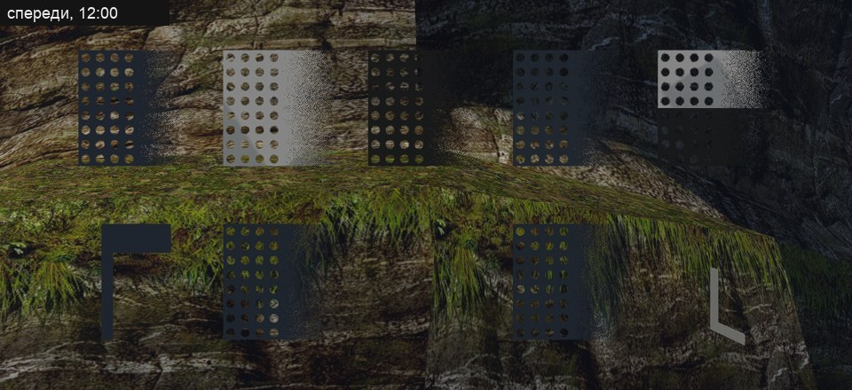
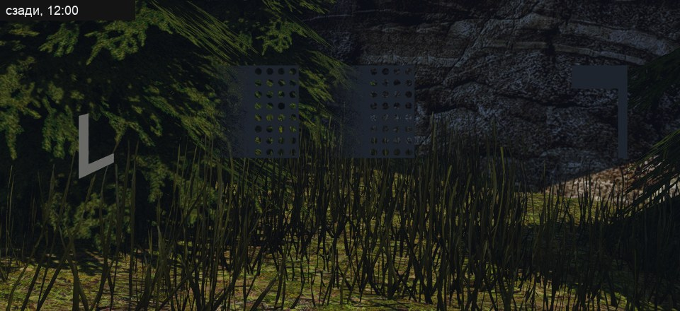

# Трава: как её делают объёмной и что из этого берём мы

Исследование к шагам В3 (трава по кромке скал) и В5 (растительность) [плана ландшафта](../../../docs/landscape-plan.md). Пользователь попросил его 2026-11-13, после первых кадров [слоя травы по кромке](../../content/2026-11-landscape-pilot/b3-rock-material.md#задача-2-что-вышло): слой работает, но выглядит ровным светлым ковром.

**Состояние (2026-11-13):** три ветки поиска закончены, сырые заметки — в [`research/`](research/README.md). Доклад о траве Ghost of Tsushima и слайды Horizon по свету первоисточником не прочитаны: всё о них взято из пересказов и помечено. Способ для нас ниже — предложение. Ступень 1 прошла три круга: слой запечён с 3D-травы, читается травой с рваным краем, листья матовые, цвет и разброс в ограждениях на обоих видах; вблизи светлые листья желтее и ярче мазков оригинала, повтор 4 м ослаблен, но виден. Приёмка — за ведущим и пользователем — [что вышло](../../content/2026-11-landscape-pilot/b3-rock-material.md#трава-слоя-материал-с-глубиной). Ступень 2 сделана пробой в два круга (2026-11-14): 1848 пучков в прямоугольнике пилота висят с конца полосы травы кучками и читаются дикой травой над камнем; открыт оттенок на солнце — пучки зеленее пожелтевшего слоя — [что вышло](../../content/2026-11-landscape-pilot/b3-rock-material.md#пучки-по-кромке). Из ступени 3 сделана шейдерная половина (2026-11-14): ветер в вершинах и свет сквозь лист у материала с полем `foliage`, первый потребитель — те же пучки; с 14 м между порывами движение едва видно — [что вышло](../2026-11-14-living-foliage/README.md#что-вышло). Экземпляры, кольцо у камеры и оттенок от земли не начаты.

## Коротко

1. **Объём травы — это в первую очередь цвет, а не геометрия.** Четыре вещи дают почти всё, и три из них почти бесплатны: затемнение от корня к верхушке с разбросом цвета по пучкам; цвет основания от земли под травой; сглаженные нормали; просвет против солнца.
2. **Наш слой плоский по понятной причине.** Скан травы снят без теней: в нём нет тёмных щелей между травинками, которые художник оригинала нарисовал прямо в текстуре. Мы подогнали среднюю яркость, а контраст потеряли.
3. **Плоский слой можно сделать глубже, но край и силуэт без геометрии не получить.** На кромке уступа нужны настоящие пучки.
4. **Пучки по кромке можно попробовать без правок движка:** нормали и затемнение у корня запекаются в саму модель и её текстуру.
5. **Луг — отдельная система** (шаг В5): отдельные травинки вокруг камеры, которых с расстоянием становится меньше, а сами они шире. Тени от травы почти все игры не считают.

## 1. Эталон

### Настоящая трава

| Что | Числа | Откуда |
|---|---|---|
| Пастбище под овцами | высота 4–5 см, 1 900–3 400 растений на м² | [заметка об эталоне](research/grass_reference_assets.md) |
| Ежа сборная (кочки) | лист 20–50 см, шириной до 1,5 см | там же |
| Мятлик луговой | лист до 20 см, 3–5 мм | там же |
| Овсяница | лист 0,6–1,4 мм, как игла | там же |
| Коротконожка (сухие склоны) | 70–120 см | там же |
| Цвет живой травы | около 0,14 / 0,16 / 0,07 в линейном RGB; общая таблица даёт 0,16–0,25, но она считает и невидимый глазу диапазон | [заметка о свете](research/grass_shading_lighting.md) |

Игры рисуют на порядок меньше, чем растёт: плотность изображают пучки, ширина травинок и цвет земли под ними.

Чего поиск не нашёл: размеров кромки дёрна на обрыве (насколько он нависает, какой длины свисающие листья), доли голой земли и сухой травы, измеренного цвета сухой травы.

### Трава оригинала

- **Нарисованная в текстуре скал.** `NW_NATURE_STEIN_02/04` несут траву в верхней полосе развёртки (20–40 % высоты), у `_04` ещё и у подножия. Тёмные щели между травинками и светлые кончики нарисованы в цвете.
- **Пучки-предметы.** `NW_NATURE_GRASSGROUP_01` — 688 штук по 40 треугольников на весь остров; ковры папоротника — 637 штук по 306–612 треугольников. Всего растений, травы и папоротника 2 479 предметов ([перепись](../2026-11-12-world-detail/research/world_census.md)).
- **Земля.** Трава на лугах — текстура `NW_NATURE_SWEETGRASS_01` 512 px, около 100 пикселей на метр.

## 2. Что даёт объём

По убыванию отдачи на цену. Порядок — суждение практиков, замеров «сколько объёма даёт каждый приём» нет.

| № | Приём | Что даёт | Как делают | Нужна геометрия |
|---|---|---|---|---|
| 1 | Затемнение от корня к верхушке и разброс по пучкам | главный признак глубины; поле перестаёт быть одноцветным | AMD: яркость = (доля высоты)^1,5, корень чёрный. Вдали затемнение убирают, иначе поле грязное. Высота, цвет и наклон общие у пучка (ячейки Вороного) | для слоя — запечь в цвет |
| 2 | Цвет основания от земли, дальняя земля — к цвету верхушек | нет линии у корня и нет кольца, где трава кончается | Witcher 3: карта цвета земли сверху, сильнее у корня и вдали | да |
| 3 | Сглаженные нормали | пучок освещён как одна масса, а не как шум из светлых и чёрных карточек | AMD: 75 % «вверх», 25 % своя нормаль. Horizon: нормаль всегда к камере. Вдали — нормаль земли | да |
| 4 | Просвет против солнца | трава светится на закате | Crysis: (взгляд · от солнца)^4 плюс мягкий свет с изнанки, на карту толщины 128×128 | да |
| 5 | Ветер волнами | поле читается как объём в движении | порыв — волна в десятки метров медленнее 1 Гц, плюс дрожь 1–2 Гц со своей фазой у травинки; гнётся верх, корень стоит | да |
| 6 | Меньше травинок вдали, но шире | плотность на глаз не падает | AMD: с 32 до 2 травинок на ячейку, ширина ×32/число | да |
| 7 | Тени от травы | мало | режут первыми: Horizon — только два ближних каскада и упрощённые меши; Tsushima — только экранные тени; в RDR2 это отдельная настройка | — |

Трава должна **получать** тени от деревьев и скал: это дёшево и обязательно.

Для **плоского слоя** без геометрии работают только цветовые приёмы: тёмный контрастный цвет со щелями, карта затенения, крупный шум оттенка и сухие пятна, переход к камню по высоте, ворсистый блик (Tsushima так делает мох). Под острым углом и на силуэте слой всё равно плоский.

## 3. Из чего трава сделана

| Способ | Числа | Где хорош | Где плох |
|---|---|---|---|
| Пучок-меш с карточками | Horizon: 20–36 треугольников вблизи, 10–18 дальше; прозрачность из карты 256×128 | вид сбоку и снизу: кромки, обочины, подножия | вид сверху: видны плоскости; перерисовка прозрачного |
| Отдельные травинки | 6–9 треугольников на травинку; у открытых реализаций около 400 на м² в ячейках по 5 м; 400–900 тыс. травинок шли на видеокарте 2013 года | луг под ногами, вид сверху | травинка тоньше пикселя мерцает — вдали её заменяют плоской |
| Плоский слой материала | — | вдали и как подложка | край и силуэт |
| Дальняя замена | цвет земли под цвет травы; у модов Skyrim отдельный упрощённый слой стоит до 20 кадров в секунду | за кольцом травы | — |

Как игры одевают кромку обрыва, не описано нигде: ни одного источника.

## 4. Что умеет движок

По [аудиту](../2026-11-12-world-detail/research/engine_audit.md) и работе шага В3.

- **Есть:** повторы одного меша рисуются одним непрямым вызовом; прозрачность по порогу, у своих GLB — со сглаживанием во времени; тени и сглаживание кадра; слой травы в материале скалы (поле `fringe`); добавка предметов слоем `vobs.d`.
- **Нет:** системы травы (кольцо у камеры, уровни детализации, угасание), ветра в вершинах (есть только наклон предмета целиком, считается на процессоре), просвета, своей модели света для листвы.
- **Цена предмета:** каждая добавка — полноценный предмет мира. Сотни пучков для пробы пройдут, сотни тысяч — нет.
- **Проверено кадром (2026-11-13,** набор `glb-probe-1` из [`own_glb_probe.py`](../../../scripts/content/own_glb_probe.py), сценарий [`own-glb-probe.bench`](../../../scripts/bench/own-glb-probe.bench), Ryzen, 2560×1440**):**
  - **Нормали вершин своего GLB доходят до света как записаны.** Пять одинаковых панелей верхнего ряда стоят в одной плоскости лицом к камере и отличаются только нормалями: к камере, вверх, вниз, от камеры, снизу вниз — сверху вверх. В полдень панель с нормалями вверх светлая, «к камере» тусклая, «вниз» и «от камеры» тёмные, пятая — переход от тёмного низа к светлому верху. В 17:30 картина та же с поправкой на низкое солнце. Значит, наклон нормалей пучка вверх и наружу запекается в модель и работает.
  - **Свой материал с альфа-маской рисуется с одной стороны.** Сзади все пять панелей верхнего ряда пропали. В нижнем ряду спереди видны «намотана к камере» и «обе стороны», сзади — «намотана от камеры» и «обе стороны». Значит, карточке травы нужны обе стороны в самой модели: вторая намотка с теми же нормалями, вдвое больше треугольников.
  - **Прозрачность по порогу у своего GLB — рассеянная** (`alphaMode: MASK`): круглые дыры режутся чисто, плавный спад альфы даёт зерно, а не ступень. Покрытие в мипах надо держать самому.
  - **Матрица `rotation` слоя предметов** применяется как «мир = M · своё»: флажок со строками (0,0,1), (1,0,0), (0,1,0) лёг древком вдоль +Z мира.
  - **Цвет вершин движок не читает:** загрузчик берёт из GLB только `POSITION`, `NORMAL` и `TEXCOORD_0` (по коду, строки `COLOR_0` в `OpenGothic/game` нет). Затемнение у корня — только в текстуре.

  | Спереди | Сзади |
  |---|---|
  |  |  |

## 5. Почему наш слой вышел плоским

1. **Нет тени между травинками.** Скан `sparse_grass` снят так, чтобы теней в цвете не было: их должен дать свет в игре. На плоскости он их дать не может. Оригинал рисует щели в текстуре.
2. **Подогнано среднее, а не разброс.** Цвет слоя приведён к среднему нарисованной травы; тёмных и светлых пикселей в нём меньше, чем в оригинале.
3. **Один оттенок на всей кромке.** Нет пятен суше и темнее.
4. **Короткая трава в скане.** Снято сверху, длинных листьев нет — рваный край получается мелким, издали он прямой.
5. **Нет силуэта.** Свисающие пучки — геометрия.

## 6. Способ для нас

Три ступени, каждая судится по кадрам отдельно.

1. **Материал слоя.** Запечь траву в Blender с модели, а не брать плоский скан: вид сверху на пучки `grass_medium_01` (CC0, уже скачана) даёт цвет с тенью между травинками, высоту и нормали с длинными листьями. Цвет и разброс привести к нарисованной траве оригинала на экране: среднее и контраст. Добавить крупный шум оттенка и сухие пятна.
   - **Состояние (2026-11-13):** три круга сделаны, в третьем листья матовые и цвет сведён с оригиналом в ограждениях — [что вышло](../../content/2026-11-landscape-pilot/b3-rock-material.md#трава-слоя-материал-с-глубиной), [что ещё не так](../../content/2026-11-landscape-pilot/b3-rock-material.md#что-ещё-не-так). Урок для следующих ступеней: шероховатость скана травы (в среднем 0,70, у травинок от 0,44) в нашем рендере даёт белый блик. Трава должна быть матовой (0,9 и выше), иначе на солнце она бледнеет, а цвет не сводится с оригиналом одним множителем.
2. **Пучки по кромке, проба без правок движка.** Три–пять вариантов пучка по 20–36 треугольников из тех же травинок, листья 20–50 см, часть свисает. Затемнение у корня — в текстуре, нормали вершин развёрнуты вверх и наружу в самой модели. Расставить по верхнему краю полос `STEIN_02/04` в видах пилота слоем предметов. Первым делом проверить два «не проверено» из раздела 4.
   - **Состояние (2026-11-14):** оба вопроса закрыты кадрами (раздел 4). Проба прошла два круга: пять форм в двух размерах по 24–48 треугольников с обеими сторонами, один атлас 2048², расстановка по границе слоя, посчитанной той же арифметикой, что в шейдере. Первый круг дал тёмные клинья вместо листьев: карточки были пучками целиком, шире мазков оригинала. Во втором карточки собраны из отдельных травинок шириной 1,5–3 см, и пучки читаются свисающими листьями. Завеса идёт кучками с промежутками до 4 м; по [приёмке](#7-приёмка) это не недостаток. Открыто: на солнце пучки зеленее пожелтевшего слоя. Цена в кадре `road-3` — в пределах шума. Подробно — [пучки по кромке](../../content/2026-11-landscape-pilot/b3-rock-material.md#пучки-по-кромке). Уроки для ступени 3: ширина листа важнее числа треугольников; одна шумовая маска не должна решать и «есть ли пучок», и «какой он».
3. **Система травы** (шаг В5): травинки в кольце у камеры, цвет основания от земли, ветер в вершинах с векторами движения, просвет для солнца, тени только получать. Проектируется отдельной заметкой после ступени 2.
   - **Состояние (2026-11-14):** сделаны ветер и просвет — [живая листва](../2026-11-14-living-foliage/README.md#что-вышло): поле `foliage` записи материала, вес изгиба из геометрии пучка без нового атрибута, векторы движения от прошлого тика, тот же ветер в тенях, просвет через бит 6 подсказок G-буфера. Лист наклоняется по напору ветра и качается своим маятником: с 14 м кромка движется всё время, просвет тёплый жёлто-зелёный. Цена до смены правила была в шуме и на виде с пучками у камеры; после неё не мерилась. Оговорки: в порыве лист широко качается на наклоне, а вдоль кромки бежит только рябь волн. Пучки тени отбрасывают — «тени только получать» остаётся системе экземпляров. Кольцо у камеры, экземпляры, уровни и оттенок от земли не начаты.

## 7. Приёмка

Пользователь, 2026-11-13, по кадрам ступени 1: повторять оригинал в мелких деталях не нужно; переносим дух, концепцию и гамму, делаем живее и современнее ([правило](../../../docs/remaster-pipeline.md)).

- **Кто и по чему:** пользователь по кадрам «оригинал | новое» уступа и стены у дороги, днём и в 17:30, и по клипу прохода. Движение травы и мерцание судят только по клипу.
- **Вопрос приёмки** — сохранён ли замысел места (заросшая кромка скалы, дикая трава свисает на камень) и его гамма, и стало ли оно живее. Совпадение мазков, длины языков и яркости по пикселям с оригиналом не требуется.
- **Оригинал задаёт семейство цвета,** а не число: замер яркости против оригинала остаётся грубой проверкой «не светится и не чёрное», подгонять по нему дальше не нужно.
- **Число-ограждение:** цена прохода G-буфера и кадра.

## 8. Чего не нашли

- Доклад о траве Ghost of Tsushima (GDC 2021): слайды закрыты, расшифровки нет. Числа «15 и 7 вершин на травинку», «83 тыс. травинок за 2,5 мс» ходят без источника.
- Слайды Horizon о свете травы прочитаны только в части геометрии; формулы света — по пересказу.
- Плотность и дальность травы в вышедших играх, кроме модов Skyrim.
- Замеры цены просвета, теней от травы и слоёв-оболочек на RTX 3080 и M1 Pro.
- Вид и размеры кромки дёрна на обрыве; как её одевают игры.
- Измеренный цвет живой и сухой травы в видимом диапазоне.
