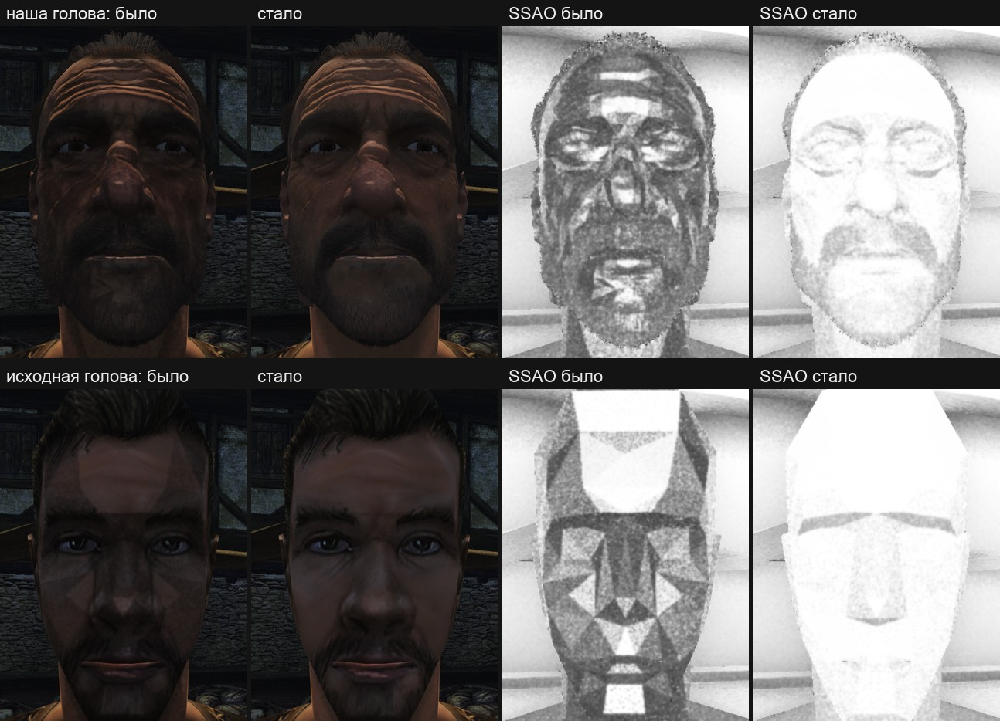
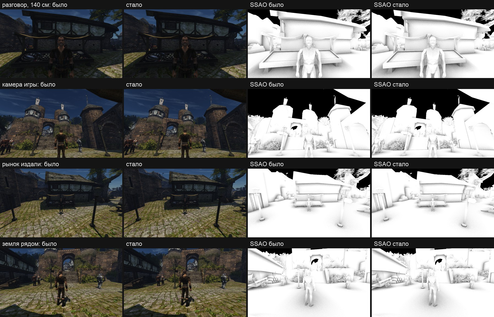
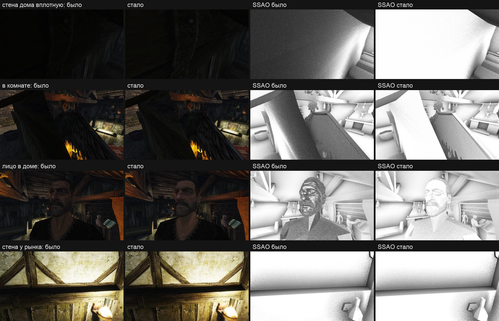

# Пробы SSAO за камерой (13.11.2026)

Пользователь спросил про кадр [проверки второго лица](../../content/2026-11-npc-hair/skin-sun.md): «а вот это что за странное отображение лица?» — лицо в собственной тени шло тёмными пятнами и «трещинами». Пятна оказались не кожей и не её картами: их рисовало затенение по экрану (SSAO). Пользователь: «Да, чинить».



## Коротко

- **Причина.** SSAO берёт вокруг точки пробы на расстоянии 50–150 см. Когда камера ближе к поверхности, часть проб уходит за камеру. Шейдер всё равно проецировал их на экран: такая проба попадает в точку, зеркальную через центр кадра, с глубиной дальше дальней плоскости, и всё, что там нарисовано, считалось её заслонкой.
- **Где видно.** Лицо в 38 см от камеры брало так заметную часть проб — со своих же зеркальных пикселей. Какие пробы куда попадут, зависит от наклона грани сетки, поэтому пятна повторяли грани. На исходной голове игры это крупные треугольники, на нашей плотной сетке — мелкая рябь и «трещины».
- **Видно только в тени:** SSAO затемняет свет неба, а не солнце и лампы. На солнце и у факела пятна тонут.
- **Та же ошибка на стенах.** Плоская стена дома вплотную к камере получала затенение в среднем 0,36 вместо 0,91 — ровным серым с зерном.
- **Правка** — в [`ssao.comp`](../../../OpenGothic/shader/ssao/ssao.comp): проба за камерой с экрана не читается и считается открытой.
- **Что не меняется:** обычная камера игры, рынок издали и у земли, расстояние разговора — среднее затенение то же до 0,3 из 255.
- **Цена:** на рынке в пределах шума, в интерьере +0,06 мс видеокарты из 2,5 ([замер](#цена-в-кадре)).

## Цель и приёмка

- **Цель:** на лице и на стене вблизи камеры нет затенения, которого нет в сцене; виды с обычной камерой остаются прежними.
- **Приёмка:**
  - причина подтверждена опытом на кадрах, а не чтением кода;
  - пары «было | стало» в одном кадре переключателем стенда: лицо крупно, в три четверти, на расстоянии разговора;
  - то же на исходной голове игры — ошибка не должна зависеть от нашего контента;
  - виды, которые меняться не должны: камера игры, рынок издали, земля рядом;
  - вид принимает пользователь по листам.

## Что было видно

Сцена — [`npc-head-look.bench`](../../../scripts/bench/npc-head-look.bench), рынок Хориниса в полдень, солнце сверху-сзади героя, камера в 38 см от лица. Лицо в собственной тени, освещено только небом.

На листе выше слева кадр игры, справа одно затенение (`ssao study 2`): белое — открыто. До правки по лицу идут тёмные участки с прямыми краями: «звезда» на подбородке, щёки, глазницы. У шеи тела оригинала — клин.

## Причина

Проход — [`ssao.comp`](../../../OpenGothic/shader/ssao/ssao.comp), по одному вызову на тексель половинного буфера.

| величина | значение |
|---|---|
| проб на точку | 32, за кадр 8, цикл 4 кадра |
| расстояние пробы от точки | 50–150 см (`sphereLen` 100 см, радиус 0,5–1,5) |
| полусфера | вокруг нормали грани, восстановленной по глубине, с весом по косинусу: больше проб у нормали |
| вес попадания | `2 / (1 + d²/100²)`, где `d` — от точки до найденной заслонки, см |
| камера до лица на кадре | 38 см |

У грани, повёрнутой к камере, нормаль смотрит в камеру, и пробы у нормали идут к ней. При 38 см до лица всё, что дальше 38 см вдоль взгляда, оказывается за камерой.

Проекция такой точки не имеет смысла, но считается. У точки за камерой `w` отрицательно:

- `x/w` и `y/w` меняют знак — проба попадает в точку кадра, зеркальную через его центр;
- `z/w` выходит больше единицы — дальше дальней плоскости.

Проверка «глубина в кадре меньше глубины пробы» тогда верна для любого нарисованного пикселя. Лицо занимает середину кадра, зеркальная точка — снова лицо, оно в нескольких сантиметрах от исходной точки, и попадание получает почти полный вес 2. Если зеркальная точка попала на фон, заслонка далеко и веса нет. Наклон грани решает, сколько проб куда попадёт, — отсюда участки по граням.

## Опыты

Временная проба в шейдерах (в git не вошла), один кадр, переключатель стенда. Контент — [второе лицо](../../content/2026-11-npc-pipeline/build.md).

| вариант | итог |
|---|---|
| без SSAO | лицо в тени ровное |
| одно SSAO | ровно те же пятна |
| плоская карта нормалей | пятна те же; уходит только светлая полоска рельефа на щеке |
| обычная карта теней вместо виртуальной (`OPENGOTHIC_VSM=0`) | пятна те же |
| тень солнца как до 11.11 (`vsm study 1`) | пятна те же |
| без отражения неба | пятна те же |
| пробы за камерой выброшены | пятен нет; у глаз, бороды и шеи зерно темнее |
| **пробы за камерой считаются открытыми** | пятен нет; выбран |

Первая догадка — рельеф карты нормалей под скользящим солнцем — не подтвердилась: классы граней (`vsm study 4`) показали, что солнце до щёк не доходит вовсе.

Почему «открыты», а не «выброшены». У грани лицом к камере за камеру уходят как раз пробы у нормали, самые весомые. Если их выбросить, оценку дают одни скользящие пробы, а они чаще упираются в соседний рельеф — затенение выходит темнее настоящего. Поверхность видна из камеры, значит, путь от неё к камере свободен.

## Правка

- [`ssao.comp`](../../../OpenGothic/shader/ssao/ssao.comp): у пробы считается `w` той же матрицей проекции. Если `w ≤ 0`, проба — промах, экран для неё не читается.
- **Переключатель стенда** — команда `ssao study <биты>`, в игре всегда 0:
  - `1` — пробы за камерой читаются с экрана, как до правки;
  - `2` — кадр показывает одно размытое затенение, в красном канале.

  То же из окружения на весь прогон: `OPENGOTHIC_SSAO_STUDY=<биты>`.
- **Сценарий** — [`ssao-behind-camera.bench`](../../../scripts/bench/ssao-behind-camera.bench), счёт — [`tools/pairs.py`](tools/pairs.py), листы — [`tools/sheet.py`](tools/sheet.py).

История SSAO по кадрам правкой не тронута: суммы попаданий и промахов копятся как раньше.

## Пары и числа

Ryzen, RTX 3080, 1920×1080, полдень, оверлей стенда выключен — это кадр игры без растяжки яркости. Каждый вид снят одной камерой: старое чтение, новое, снова старое. Затенение — среднее по поверхностям кадра, 0–255, 255 — открыто. «Светлее» и «темнее» — доля пикселей кадра, где новое затенение отличается от обоих старых больше чем на 8.

| вид | затенение, было → стало | светлее | темнее | яркость кадра, было → стало (снова было) |
|---|---|---|---|---|
| лицо крупно, 38 см | 200,2 → 225,5 | 27,8 % | 0,8 % | 24,8 → 26,3 (24,9) |
| лицо в три четверти | 200,9 → 229,4 | 27,6 % | 0,3 % | 30,3 → 31,8 (30,2) |
| расстояние разговора, 140 см | 221,8 → 222,1 | 1,7 % | 1,2 % | 31,6 → 31,7 (31,6) |
| камера игры | 238,9 → 238,9 | 1,0 % | 1,0 % | 50,0 → 50,0 (50,0) |
| рынок издали | 239,4 → 239,4 | 1,2 % | 1,1 % | 60,7 → 60,7 (60,7) |
| земля рядом | 238,2 → 238,1 | 0,9 % | 1,0 % | 63,4 → 63,4 (63,4) |
| стена дома вплотную | 92,8 → 232,7 | 86,6 % | 0,0 % | 7,1 → 10,0 (7,1) |
| в комнате дома | 158,6 → 208,0 | 46,0 % | 0,4 % | 24,5 → 26,0 (24,5) |
| лицо в доме, 40 см | 188,2 → 213,0 | 28,9 % | 1,5 % | 23,8 → 24,9 (23,7) |
| стена у рынка, лампа | 215,7 → 217,0 | 2,4 % | 0,0 % | 108,9 → 104,4 (108,4) |

Правка только открывает пробы, поэтому «темнее» — шум самого прохода: около 1 %. Там, где «светлее» на том же уровне, правка ничего не изменила.

С исходной головой игры (без своего контента) числа близкие: лицо крупно 202,3 → 227,1, в три четверти 202,1 → 231,1; остальные виды совпадают до 0,3.





Кадры по пикселям не сравниваются. Под TAA соседние кадры расходятся фазой смещения на каждой резкой текстуре, а лампы мерцают: у стены с лампой кадр потемнел на 4 % между снимками, хотя затенение только открылось. У затенения ни того, ни другого нет.

## Что изменится в игре

- **Крупные планы лица в тени** — ровная кожа вместо пятен. На солнце и у факела разницы почти нет.
- **Интерьеры.** Стены, балки и столы в шаге от камеры в рассеянном свете станут светлее: раньше они были затемнены этой ошибкой. В комнате дома гавани кадр светлее на 6 %, у самой стены — в 1,4 раза. Настоящее затенение в углах и под предметами остаётся.
- **Обычная камера за спиной героя на улице** — без изменений.

## Цена в кадре

Одна сборка, две стороны: `OPENGOTHIC_SSAO_STUDY=1` — пробы за камерой читаются как раньше, `0` — нынешнее. Стенд `scripts/perf.sh`, Ryzen с RTX 3080, окно 1920×1080, свет заморожен, по два повтора на сторону, места `market` и `interior`.

| место | p50 видеокарты, было → стало | Δ мс | Δ % | разброс повторов | среднее видеокарты |
|---|---|---|---|---|---|
| market | 2,547 → 2,560 мс | +0,013 | +0,5 % | 0,080 мс | — |
| interior | 2,497 → 2,555 мс | +0,058 | +2,3 % | 0,005 мс | 2,507 → 2,538 мс |

На рынке разница внутри разброса повторов. В интерьере она больше разброса: +0,06 мс по медиане, +0,03 мс по среднему. По проходам она не разложена, так что отнести её к самой правке или к разнице между запусками нельзя. Кадр на обоих местах ждёт процессора (8,3–8,7 мс кадр против 2,5 мс видеокарты), FPS 121,0 → 118,7 в интерьере и 115,8 → 115,3 на рынке — процессорная часть кадра во втором запуске тоже была длиннее (8,26 → 8,41 мс), а шейдер на неё не влияет.

Воспроизвести:

```
BENCH_HOST=ryzen PERF_WINDOW=1920x1080 PERF_REPEAT=2 \
  PERF_ENV='OPENGOTHIC_SSAO_STUDY=1 OPENGOTHIC_LIGHT_FREEZE=1' scripts/perf.sh market interior
NO_BUILD=1 BENCH_HOST=ryzen PERF_WINDOW=1920x1080 PERF_REPEAT=2 \
  PERF_ENV='OPENGOTHIC_SSAO_STUDY=0 OPENGOTHIC_LIGHT_FREEZE=1' scripts/perf.sh market interior
python3 scripts/perf_report.py compare <папка STUDY=1> <папка STUDY=0>
```

## Ограничения и что не сделано

- **Цена по проходам не разложена:** пара прогонов с `OPENGOTHIC_GPU_PASSES=1` не снята.
- **Mac не проверялся.** SSAO на Mac по умолчанию выключен (`zCloudShadowScale` включается только на дискретной видеокарте); шейдер проверен сборкой для Vulkan.
- **Камера спиной к стене.** Проба за камерой теперь всегда открыта. Если за камерой в шаге стоит стена, настоящее затенение от неё теряется. Экран о ней ничего не знает и раньше: прежний ответ был случайным.
- **Пробы за краем кадра** по-прежнему не считаются ничем — это прежнее правило, оно не менялось.
- **Нормаль по глубине.** Полусфера проб стоит на нормали грани, а не на сглаженной: слабая огранка затенения у низкополигональных моделей остаётся и после правки (клин на шее тела оригинала).
- **Интерьеры при лампах ночью не снимались:** ночью рассеянного света мало, вклад SSAO в кадр меньше.
- **Радиус 50–150 см** рассчитан на дома и не различает складки лица; мелкое затенение у век и ноздрей — задача [шейдера кожи](../../content/2026-11-hero-head/engine-plan.md#7-шейдеры-кожи-глаз-и-волос).

## Как повторить

```
W=~/.local/share/gothic-ai/mpfb/work/build/face2
TEMPEST_WINDOW_SIZE=1920x1080 BENCH_HOST=ryzen OPENGOTHIC_CONTENT=$W/content \
  scripts/bench.sh ssao-behind-camera <папка>
python reports/engine/2026-11-13-ssao-behind-camera/tools/pairs.py <папка> [<папка листов>]
```

Без `OPENGOTHIC_CONTENT` — исходная голова игры. Кадры двух прогонов лежат вне git на Mac, в `.bench/ssao-behind-own` и `.bench/ssao-behind-orig` рабочей копии.
