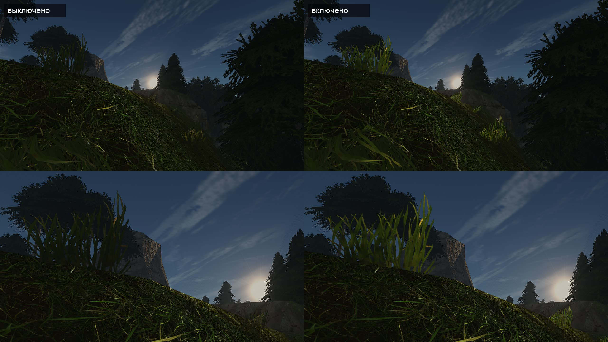

# Живая листва: ветер в вершинах и свет сквозь листья

Проект шейдерной половины ступени 3 [исследования травы](../2026-11-13-grass/README.md#6-способ-для-нас) (шаг В5 [плана ландшафта](../../../docs/landscape-plan.md)). Первый потребитель — 1848 пучков по кромке скал (набор `rock-grass-tufts-2`, [что вышло](../../content/2026-11-landscape-pilot/b3-rock-material.md#пучки-по-кромке)). Способ рассчитан на любой материал, который объявит себя листвой: деревья, кусты и трава с повторами возьмут его позже.

**Состояние (2026-11-14):** сделано, итог — в разделе [«Что вышло»](#что-вышло): код, клипы, числа и две оговорки о порыве с 5 м. Правило движения менялось дважды, действует третье: наклон по напору ветра и собственное качание листа. Остальные разделы — проект в том виде, в каком его принял ведущий; где вышло иначе, сказано в «Что вышло». Строки движка в проекте сверены по ветке на коммите `1aa062946`.

## Коротко

1. **Объявление.** Поле `foliage` в записи `materials.json` рядом с `projection` и `fringe`: `wind`, `flutter`, `translucency`, `anchor`. Запись даёт флаг корзины `BK_FOLIAGE` и одно упакованное число в свободном поле корзины.
2. **Вес изгиба — из геометрии, без нового атрибута.** Корни листьев пучка лежат на его оси X. Каждая вершина качается вокруг точки этой оси над собой: чем дальше от оси, тем сильнее. Длина плеча сохраняется, поэтому лист качается, а не тянется.
3. **Ветер — общий.** Скорость и направление берутся из `WorldWind::sample`, как у ткани и наклона деревьев. У листа три движения. Наклон идёт за напором ветра: порыв кладёт лист, держит и отпускает; две бегущие волны длиной 24 и 9,5 м — рябь на нём. Качание — собственный маятник листа: 0,66 Гц у листа 85 см, 0,97 Гц у 40 см, у каждого пучка своя частота и биение двух близких. Дрожь — 1,3 и 1,9 Гц. Всё считается от тика мира, поэтому стенд повторяет движение.
4. **Размах.** Лист 85 см: между порывами наклон 0,8–3,7 см и качание ±3,7–5,1 см, в порыве наклон 10–14 см и качание ±5,5 см. Лист 40 см: 0,4–1,7 см и ±1,8–2,4 см, в порыве 4,9–6,5 см и ±2,6 см ([таблица](#правило-движения)).
5. **TAA.** Прошлое положение вершины считается тем же правилом от прошлого тика и идёт в готовую формулу векторов движения. Без этого лист оставляет хвост, а дрожащая маска не сходится.
6. **Тени.** Тот же ветер в теневых проходах. У VSM нет кэша страниц, подвижный лист ничего не сбрасывает; цена — счёт вершин пучков.
7. **Свет сквозь лист.** Свободный бит 6 в подсказках G-буфера и сила просвета в канале металла (у листа металла нет — так уже сделаны волосы). В проходе солнца: `t · saturate(dot(V,−L))⁴ · saturate(1 − 1,5·N·L)`, окрашено листом, срезано тенью. Когда солнце не впереди камеры, добавка равна нулю точно.
8. **Трассировка и GI** видят лист неподвижным и без просвета — записано ограничением.
9. **Выключатели.** По умолчанию включено; `OPENGOTHIC_FOLIAGE=0` для стендов, `[INTERNAL] foliage=0` для игрока.
10. **Приёмка.** Четыре клипа «выключено | включено»: ветер у `ledge-near`, затишье с 14 м, проход героя под полосой, просвет в 20:15 (в 17:30 солнце стоит на 41° и листья не просвечивает).

## Что вышло

Состояние на 2026-11-14, ветка `codex/landscape-living-foliage` (PR #1343). Проект принят ведущим без правок; его ответы: бит 6 взять, порыв начать с 16 % длины листа, `eve-backlit` в 20:15 по первому годному месту, `ledge-wind` показывает собственный порыв мира. Ведущий добавил критерий: между порывами кромка должна быть видна в движении с 14 м вида `ledge`. Первые два правила движения его не выполнили, и на третьем ходу ведущий сменил само правило: наклон по напору ветра плюс собственное качание листа. Тем же ходом просвет сдвинут к зелёному, а `walk-ledge` переснят по густому отрезку. Ниже — итог с третьим правилом.

**Итог одной строкой.** Ветер и просвет работают. С 14 м кромка движется всё время. Порыв с 5 м — событие по среднему наклону, но лист на нём широко качается, а вдоль кромки порыв бежит слабее прежнего: это две оговорки на суд ведущего.

| Что | Итог |
|---|---|
| Ветер с 5 м (`ledge-wind`) | между порывами — лёгкое качание; порыв кладёт листья за 2,5–3 с, держит около 4,5 с и отпускает за 2 с; на наклоне лист качается на ±6,5 % длины. Корни стоят, тени идут за листьями, хвостов нет |
| Ветер с 14 м между порывами (`ledge-steady`) | полоса движется всё время, кончики ходят на 4–9 пикселей, соседи вразнобой. Критерий выполнен |
| Проход под полосой (`walk-ledge`) | полоса на солнце в кадре все 8 с, ветер виден весь клип; листья при движении камеры резкие |
| Просвет (`eve-backlit`) | листья против солнца светятся тёплым жёлто-зелёным: оттенок 71° при 77° у травы слоя и 72° у пучков в полдень. Без поля — тёмные силуэты |
| Цена | на прошлом ходу, до смены правила, кадр и каждый проход были в разбросе двух прогонов. С третьим правилом не мерилась: к счёту вершины добавилось два синуса, два косинуса и корень |
| Материалы без поля | кадры шести видов совпали с прежней сборкой на 99,1–100 % пикселей (мерилось до смены правила; третье общих путей не трогает) |

Вид принимают ведущий и пользователь по клипам.

### Что построено

| Часть | Где |
|---|---|
| Поле `foliage` записи `materials.json` | `Resources::MaterialMapFiles` (`resources.h`, `resources_textures.cpp`) → `Material::foliage` (`graphics/material.*`) |
| Числа записи, выключатель, ветер кадра и правило изгиба на процессоре | `graphics/foliagewind.h` |
| То же правило в шейдере | `shader/materials/foliage_wind.glsl`, вызов в `vertex_process.glsl` — для главного вида, теней и прошлого кадра |
| Корзина: флаг `BK_FOLIAGE`, упакованные числа, плечо меша, выросшая коробка | `graphics/drawbuckets.*`, `shader/scene.glsl` |
| Сфера отсечения с размахом листьев | `graphics/drawclusters.cpp`, `graphics/visualobjects.cpp` |
| Ветер этого и прошлого кадра в данных сцены | `graphics/sceneglobals.*` (`setTime`) |
| Бит листвы и сила просвета в G-буфере | `shader/materials/main.frag`, `shader/common.glsl` |
| Просвет в свете солнца | `shader/lighting/foliage_light.glsl`, `direct_light.frag` |
| Выключатель | `[INTERNAL] foliage` (`settings.cpp`, `renderer.cpp`), `OPENGOTHIC_FOLIAGE=0\|wind\|light` |
| Команда стенда `foliage wait-gust\|wait-lull` | `testbench_foliage.cpp` |
| Набор с полем из готового набора | `scripts/content/landscape_grass_tufts.py --living` |

Новых атрибутов вершины, целей G-буфера, полей в кусках мира и входов отпечатка базы нет. Корзина осталась 128 байт: заняты два её свободных поля (`foliage`, `foliageReach`). Данные сцены выросли на шесть векторов в конце: ветер, фазы волн и дрожи, качание — для этого кадра и для прошлого.

Поле `anchor` принимает одно значение `line`; второго режима и кода под него нет.

### Бит 6 подсказок G-буфера

Подсказки лежат в альфе `gbufDiffuse`. Заняты биты 1 (плоский), 2 (альфа-тест), 3 (вода), 4 (волосы), 5 (глаз) и теперь 6 (листва, `GBufFoliageBit = 1 << 6` в `shader/common.glsl`). Свободны биты 0 и 7.

У пикселя с битом 6 канал металла (`gbufOrm.b`) несёт не металл, а силу просвета `translucency`. Кто пишет бит, тот пишет и канал; кто читает ORM такого пикселя, обязан считать металл нулём.

**Пишет** один шейдер — `shader/materials/main.frag`: для корзины с `BK_FOLIAGE` и ненулевой силой просвета ставит бит в `outDiffuse.a` и пишет силу в `outOrm.b`.

**Читают** пять шейдеров:

| Шейдер | Что делает с битом |
|---|---|
| `lighting/direct_light.frag` | берёт силу просвета из `orm.b`, металл считает нулём; считает просвет (`foliageThrough`), ищет тень и для листа, повёрнутого от солнца, разворачивает нормаль в поиске тени к солнцу |
| `lighting/light.frag` (лампы) | металл нулём через `gbufOrmMaterial` |
| `lighting/ambient_light.frag` (фоновый свет, две выборки) | то же |
| `lighting/rt/probe_ambient.frag` (пробы) | то же |
| `virtual_shadow/vsm_mark_pages.comp` | размечает страницу тени и для листа, повёрнутого от солнца: без этого просвету нечем было бы срезаться тенью |

Общие помощники — `isGBufFoliage(hint)` и `gbufOrmMaterial(orm, hint)` в `common.glsl`. Следующий, кто займёт бит подсказок под материал без металла, может взять тот же приём: помощник уже обнуляет металл по биту, новому биту нужна одна строка в нём и проверка тех же пяти мест.

### Чем вышло иначе, чем в проекте

1. **Порыв мира приходит раз в 19,35 с, а не в 32 с.** Период ветра мира на стенде — 6 с (`zWindCycleTime + zWindCycleTimeVar`), не 10; цикл порыва — период / 0,31. Это и позволило снять собственный порыв мира без команды `cloth wind gust`.
2. **Клипы выстроены по тику мира.** Ветер — чистая функция тика, поэтому команда стенда `foliage wait-gust <мс>` ждёт, пока до пика порыва останется столько миллисекунд, а `foliage wait-lull <мс>` — до середины затишья. В мире она ничего не меняет и пишет событие `foliage_wait` с тиком и скоростью ветра. Прогоны «выключено» и «включено» ждут до одного и того же тика.
3. **Клипов четыре, не три.** Добавлен `ledge-steady` — затишье с 14 м — под критерий ведущего. `walk-ledge` к порыву больше не привязан: качание показывает ветер всё время.
4. **Место `eve-backlit` не из четырёх кандидатов проекта.** Первые два вечерних оказались в тени рельефа (ни одного освещённого пучка, у первого камера под землёй), третий закрыт дальним гребнем. Перебор повторён с лучом к солнцу по мешу всего мира и с коробками деревьев. Взято первое место, где листья видны на фоне неба и тёмной скалы: верхняя кромка того же уступа, камера `(35398, 4739, 1945)`, 20:15, солнце на 15°. Утренний запасной вариант не понадобился.
5. **Правило движения менялось дважды** — следующий раздел. Цвет просвета сдвинут к зелёному: `FoliageThroughTint` — `(0,75, 1,15, 0,32)` вместо `(1,1, 1,0, 0,5)`.
6. **Маска реактивности TAA не добавлена:** след листа на камне в `ledge-wind` при полном размере не виден.
7. **Сравнение «кадры без поля» сделано против сборки PR пучков, а не против свежей сборки `main`** — раздел «Кадры без поля» ниже.

### Правило движения

Правило менялось дважды. Действует третье; первые два — в [истории](#история-правила) ниже.

**Почему правило сменилось.** Первые два выводили всё движение из одного наклона, который качали две бегущие волны с периодами 6 и 3,2 с. Между гребнями наклон и его скорость равны нулю. Поэтому с 14 м кромка по 2–3 с стояла, а порыв был только волной повыше. Лист движется иначе: ветер его кладёт и держит, а качается он сам, как маятник своей длины. Третье правило складывает три движения:

| Движение | Что делает | Числа |
|---|---|---|
| Наклон | идёт за напором ветра: между порывами мал и почти ровен, в порыве лист ложится, держится и возвращается. Две бегущие волны (24 и 9,5 м, 6 и 3,2 с) — рябь на нём: четверть наклона от впадины до гребня | напор — квадрат `x` в ветерке (0,075–0,27); от 2,7 м/с плавно растёт до 1 при 4,3 м/с и дальше держится. `x` — скорость ветра / 5,65 м/с |
| Качание | собственный маятник листа вокруг наклона: в основном вдоль ветра, 0,3 — поперёк | частота `(1/2π)·√(3g/2L)`: 0,66 Гц у листа 85 см, 0,97 Гц у 40 см, 1,4 Гц у 20 см; у каждого пучка сдвинута по месту в пределах ±15 %. Вторая частота на 0,07–0,15 Гц выше, отсюда биение раз в 6,7–15 с. Размах — `0,085·√x` длины листа, не больше 6,5 % |
| Дрожь | мелкая быстрая часть, как была | 1,3 и 1,9 Гц; растёт как `x^0,75` |

**Размах кончика, см** (наклон — от впадины до гребня волн):

| Ветер | Напор | Лист 40 см: наклон | качание | дрожь | Лист 85 см: наклон | качание | дрожь |
|---|---|---|---|---|---|---|---|
| Самый тихий между порывами, 1,55 м/с | 0,075 | 0,4–0,5 | ±1,8 | ±0,5 | 0,8–1,0 | ±3,7 | ±1,05 |
| Ровный, 2,85 м/с | 0,27 | 1,3–1,7 | ±2,4 | ±0,7 | 2,8–3,7 | ±5,1 | ±1,5 |
| Пик порыва, 5,65 м/с (наклон полный с 4,3 м/с) | 1 | 4,9–6,5 | ±2,6 | ±1,0 | 10,2–13,6 (12–16 %) | ±5,5 | ±2,2 |

В порыве лист наклонён на 12–16 % длины и качается на ±6,5 %: кончик отстоит от покоя на 5,6–22,7 % длины, под потолком 0,30 рад.

**Повторяемость.** Сцена отдаёт шейдеру остаток тика мира от минуты, а каждый пучок качается целое число раз в минуту (лист 85 см — 34–46 раз). Поэтому качание — функция тика, и стенд повторяет движение. В данных сцены два новых вектора: `foliageSwing` и он же для прошлого кадра. Прошлое положение для TAA, теневые проходы и процессорная копия правила идут по тому же правилу. Запас коробок отсечения (`travel()`) не менялся: общий потолок наклона с качанием прежний.

**Два числа я выбрал сам, не по словам решения:**

- Качание в порыве не растёт выше 6,5 %. Решение говорило «растёт с напором». При 8,5 % лист на каждом махе возвращался туда, где его держит ветерок, и порыв читался более широким качанием, а не толчком.
- Рябь волн — четверть наклона от впадины до гребня (`0,875 ± 0,125`), а не четверть в каждую сторону: во впадине волн лист в порыве остаётся на 12 %.

Остальное — как в проекте: потолок 0,30 рад, вес у корня 0,35, ветер у стены. Числа лежат в `graphics/foliagewind.h` и повторены в `foliage_wind.glsl`; тест держит их в этих границах.

#### История правила

- **Первое, по проекту.** Напор — квадрат скорости, наклон `0,6 + 0,4·G` от гребня волн. На пике порыва 16 % длины, между порывами кончик листа 85 см ходил на 0,2–3,4 см. С 14 м это 1–2 пикселя кадра 2560×1440 (пиксель — около 1,3 см): кромка стояла.
- **Второе, круг правки.** Напор `(v / 5,65)^0,75` — 0,38–0,60 между порывами; наклон `0,5 + 0,5·G` — от покоя до полного. Между порывами кончик листа 85 см ходил на 0–5,2 … 0–8,2 см, но за период волны. В `ledge-steady` кончики ходили на 2–4 пикселя, по 2–3 с полоса стояла. В `ledge-wind` порыв не читался событием: напор за порыв рос только с 0,58 до 1.
- **Тогда же — ветер у стены, он остался.** Упёршийся в стену ветер поворачивает вдоль неё целиком и сохраняет скорость; сторона — по своей части вдоль стены, переход через ноль сглажен в 0,04. Стена `ledge-near` стоит к ветру почти в лоб, и без этого её листья получали меньше трети напора.

### Клипы

Сняты на Ryzen в 2560×1440 сценарием `scripts/bench/landscape-rock-material.bench` с набором `rock-grass-tufts-3` (копия `rock-grass-tufts-2` с полем `"foliage": {}`): один прогон с `OPENGOTHIC_FOLIAGE=0`, один без. Пары «выключено | включено» лежат вне git в `~/.local/share/gothic-ai/remaster/landscape-living-foliage/`. Каждая половина — полный кадр, уменьшенный до 1920×1080. Все пять пересняты с третьим правилом.

| Файл | Длина | Размер | Что снято |
|---|---|---|---|
| `ledge-wind.mp4` | 14 с | 8,1 МиБ | камера `ledge-near` (5 м), 12:00; пик порыва мира (5,64 м/с) на 7-й секунде |
| `ledge-steady.mp4` | 8 с | 3,1 МиБ | камера `ledge` (14 м), середина затишья (1,62 м/с) на 4-й секунде |
| `ledge-steady-crop.mp4` | 8 с | 2,4 МиБ | тот же клип, вырез полосы в родном размере, без уменьшения |
| `walk-ledge.mp4` | 8 с | 15,3 МиБ | герой идёт на запад под полосой по отрезку, где пучки висят гуще всего, на солнце; камера сзади слева. К порыву клип не привязан |
| `eve-backlit.mp4` | 8 с | 3,5 МиБ | 20:15, против солнца; пик порыва на 4-й секунде |

Лист для просвета — в git:



*Вверху — полные кадры, внизу — вырез 1280×720 в родном размере. Слева выключено, справа включено.*

### Суждение по клипам

Меры те же, что на прошлых ходах: доля пикселей полосы, которые меняются за ⅓ с, и ход кончиков листьев по зелёным пикселям в узких столбцах кадра.

**`ledge-steady`, 14 м между порывами: критерий выполнен.**

- Полоса движется всё время. За ⅓ с меняется 1,6–2,3 % её пикселей в каждой половине секунды клипа; самая тихая секунда — 1,67 %. Без ветра — 0,3–0,5 % (шум кадра), при втором правиле было 0,7–1,05 %.
- Кончики длинных листьев ходят на 4,3–8,6 пикселя (один — на 14), коротких пучков — на 3–7,5. При втором правиле было 0,4–2,3.
- Соседи идут вразнобой. На срезе «место — время» полосы листьев волнистые, фазы у соседей разные, размах у каждой то растёт, то падает. Без ветра — прямые линии.
- Оговорка: отдельный лист в минимуме своего биения на секунду затихает до 0,2–1 пикселя, пока соседи движутся. Короткие пучки стоят у нижнего края заданных 5–9 пикселей.

**`ledge-wind`, 5 м: ветерок читается; порыв — событие, но с двумя оговорками.**

- Между порывами листья качаются на 5–13 пикселей с частотой 0,62 Гц и биением. Это лёгкий ветерок, а не дрожь. За ⅓ с меняется 6,9–8,5 % пикселей полосы; без ветра — 0,2–0,4 %.
- Порыв: наклон, усреднённый за мах, за 2,5–3 с уходит на 13 пикселей, около 4,5 с держится на 12–14 и за 2 с возвращается. После порыва он на 3–6 пикселей ниже, чем до: затишье за порывом глубже. В порыве меняется 10–14,5 % пикселей.
- Корни стоят (по тесту — до 0,35 см). Листья на пике резкие, хвостов под TAA нет. Тени на камне идут за листьями.
- **Оговорка 1: «держит» верно для среднего наклона, а не для неподвижного листа.** На наклоне лист качается на 17–24 пикселя. В нижней точке маха он возвращается примерно туда, куда доходит верх качания ветерка; ближе 5,6 % длины к покою не подходит. Ручка одна — `SwingTop`: меньше качание в порыве — ровнее «держит», но лист тише.
- **Оговорка 2: вдоль кромки порыв бежит слабее, чем раньше.** Напор — одно число на сцену, поэтому листья ложатся по всей кромке разом. Бежит только рябь волн, около 4 % длины листа. Чтобы бежал сам фронт порыва, напор должен запаздывать по месту. Это новый замысел, в этот ход он не входил.

**`walk-ledge`: ветер виден весь клип.**

- Полоса стоит на солнце и в кадре все 8 с; пучки — в 10–13 м от камеры. В последнюю секунду левую четверть кадра занимает крона ели.
- Половины различаются у 0,4–0,9 % пикселей в первые 7 с и у 0,3 % в последнюю. В прежнем клипе после 5-й секунды было 0,03–0,17 %.
- Листья при движении камеры резкие, двойных контуров нет.
- Трава слоя под листьями неподвижна. С этого расстояния это не бросается в глаза; суждение — за пользователем.

**`eve-backlit`: тёплый жёлто-зелёный.**

- `FoliageThroughTint` сменён с `(1,1, 1,0, 0,5)` на `(0,75, 1,15, 0,32)`. Яркость просвета та же (0,0489 → 0,0491).
- Оттенок светящихся пикселей — 71° при насыщенности 0,62; у самой яркой четверти — 66°. Трава слоя на том же вечернем кадре — 77°, пучки с травой слоя в полдень — 72°. Прежний цвет был 51° (самая яркая четверть — 47°): охра.
- На кадре пучки читаются той же травой, освещённой сзади: теплее и светлее слоя, без охры и без неонового зелёного.
- Что лист в тени не светится, этот вид не показывает: все пучки в кадре стоят на солнце. По коду тень множит и прямой свет, и просвет.

### Цена

**Мерилась на прошлом ходу, до смены правила; с третьим правилом — нет.** Третье правило добавило к счёту вершины листвы два синуса, два косинуса, корень и несколько округлений на проход. По условию хода замер повторяется, только если счёт вырос больше чем на несколько синусов. Числа ниже — прежние.

RTX 3080, 1920×1080, без экрана, заявка `gq quiet`, медиана времени видеокарты за 8 с (1007–1046 кадров). По два прогона на сторону, вперемешку; ещё по два — с временем проходов (`OPENGOTHIC_GPU_PASSES=1`). Вид 1 — `road-3`, вид 2 — пучки у камеры (`ledge-near`), добавлен в `scripts/bench/perf-rock.bench`.

**Кадр, мс** (первые два числа — без времени проходов, вторые два — с ним):

| Вид | Выключено | Включено |
|---|---|---|
| `road-3` | 2,67 2,69 · 2,68 2,61 | 2,58 2,69 · 2,62 2,82 |
| `ledge-near` | 2,63 2,60 · 2,60 2,71 | 2,71 2,61 · 2,61 2,77 |

**Проходы, мс** (два прогона выключено | два включено):

| Проход | `road-3` | `ledge-near` |
|---|---|---|
| `GBuffer` | 0,415 0,407 \| 0,409 0,415 | 0,463 0,474 \| 0,458 0,465 |
| `VSM-rendering` | 0,260 0,256 \| 0,258 0,264 | 0,248 0,259 \| 0,248 0,246 |
| `VSM-visibility` | 0,108 0,106 \| 0,106 0,110 | 0,054 0,059 \| 0,057 0,058 |
| `VSM-pages` | 0,086 0,085 \| 0,087 0,088 | 0,088 0,090 \| 0,088 0,088 |
| `DirectSunLight-VSM` | 0,293 0,290 \| 0,292 0,298 | 0,330 0,341 \| 0,330 0,334 |
| `AmbientLight` | 0,076 0,076 \| 0,077 0,076 | 0,090 0,090 \| 0,091 0,090 |
| `TAA` | 0,129 0,126 \| 0,127 0,130 | 0,132 0,133 \| 0,132 0,134 |

Ни один проход не отличается больше чем на 0,007 мс; два прогона одной стороны расходятся до 0,011 мс. Цена в шуме на обоих видах.

Оговорка о стенде: `scripts/perf.sh rock` завершается кодом 1 — его проверка ждёт от места четыре вида и без экрана отвергает прогон по ритму приложения. Данные при этом полные; числа взяты из `frameprofile.csv` прогонов.

### Кадры без поля

**По коду.** Каждая новая ветка шейдеров стоит под `BK_FOLIAGE` или битом 6. Общие пути получили только шесть векторов в конце данных сцены и два поля корзины, которые были свободны.

**По кадрам.** Стоп-кадры сборки PR пучков с набором `rock-grass-tufts-2` (поля нет) против этой ветки с выключателем в 0, Ryzen, 2560×1440:

| Вид | Пикселей совпало точно | Наибольшая разница, из 255 |
|---|---|---|
| `road-1` | 99,99 % | 8 |
| `road-2` | 100,00 % | 1 |
| `road-3` | 99,97 % | 23 (больше 2 — у 0,001 %) |
| `road-4` | 99,10 % | 11 (больше 2 — у 0,002 %) |
| `ledge` | 100,00 % | 2 |
| `ledge-near` | 100,00 % | 1 |

Для сравнения: включённая листва меняет больше чем на 2 из 255 от 2,0 % (`road-2`) до 6,7 % (`ledge-near`) пикселей.

Три вида с героем или костром в кадре (`arch`, `eve-1`, `eve-3`) расходятся мелким шумом по всему кадру у 2,9–7,4 % пикселей. Столько же расходятся два прогона этой ветки между собой (`eve-1`: 4,9 %): это разброс стенда на частицах огня и герое, а не материал.

**Оговорка.** Кадры сравнивались до смены правила; после неё сравнение не повторялось. Сравнение идёт через выключатель: «набор с полем, листва выключена» против «набора без поля» на прежней сборке. Свежая сборка `main` для него не снималась.

### Тесты и проверки

- `gothic-material-texture-test` на Ryzen, 821 570 утверждений:
  - `foliageRecords` — умолчания, границы чисел, запись без поля, отклонение неверной записи, отдельная корзина у материала с полем;
  - `foliageWindMaths` — правило на процессоре: корень стоит, длина плеча сохраняется, напор, наклон, качание и дрожь из таблицы выше, частоты качания по длине листа и их биение, соседи не в ногу, общий потолок 0,30 рад, запас коробок покрывает вершину в любом ветре, стена не пускает лист в скалу, равные тики дают равный ответ, выключатель и упаковка.
- `glslangValidator`: 399 вариантов затронутых шейдеров, ошибок нет.
- Путь без mesh-шейдеров и без VSM (`OPENGOTHIC_MS=0 OPENGOTHIC_VSM=0`), Ryzen, два стоп-кадра на пике порыва: листья наклонены так же, как на основном пути (на пикселях листьев средняя разница с основным путём 6–7 из 255 против 31–38 с выключенной листвой), просвет в 20:15 есть.
- Этот путь проверен до смены правила; с третьим правилом не переснимался (правило вызывается из той же общей функции вершины).
- Перевод шейдеров в Metal не проверен: ветер в вершинной стадии, бит 6 и его читатели. Записано в [issue #1317](https://github.com/kaifaty/GothicAI/issues/1317).

### Ограничения

- Трассировка и GI (`-rt`, `-gi`, по умолчанию выключены) видят лист неподвижным и без просвета. Кадром не проверялось.
- Просвечивает только солнце. Лампы и фоновый свет лист не просвечивают.
- Наклонённый в плоскости стены лист немного меняет длину (по расчёту до 5 % у одного листа из 13). В клипах растяжение в глаза не бросается; отдельно оно не мерилось, меры из пункта 2 проекта не применялись.
- Трава слоя под пучками не движется.
- Напор ветра — одно число на сцену: по порыву листья ложатся разом по всей кромке, вдоль неё бежит только рябь волн. Бегущий фронт порыва — отдельный замысел.
- Отдельный лист в минимуме биения на секунду затихает; полоса целиком не стоит.
- Экземпляры, кольцо у камеры, уровни детализации и оттенок от земли — остальная часть ступени 3, не эта задача.

## 1. Цель

Пучки на кромке сейчас неподвижны и против солнца тёмные. Нужно два свойства:

- **Ветер.** Листья идут порывами, которые бегут вдоль кромки, и мелко дрожат сами. Корни стоят.
- **Просвет.** Когда низкое солнце стоит за травой, листья светятся.

Рамки заданы заранее и здесь не обсуждаются:

- Работает только у материалов с полем; сейчас это один материал пучков.
- Трава слоя `fringe`, нарисованная в камне, не движется. Мешает ли неподвижная короткая трава под качающимися листьями — решит клип.
- Штиль остаётся штилем, порыв виден, резины нет: корни не скользят, лист не тянется больше чем на несколько процентов.
- Под пиксели оригинала ничего не подгоняется.
- Повторы, кольцо вокруг камеры, уровни детализации и цвет от земли — не эта задача.

## 2. Эталон

### Ветер

| Что | Число | Откуда |
|---|---|---|
| Ветер мира | 1,55–5,65 м/с при `scale` 1 (1–3 балла по Бофорту) | `OpenGothic/common/physics/worldwind.h:12` |
| Порыв мира | раз в 32 с, выше половины силы около 8,5 с (на стенде период ветра 6 с, порыв раз в 19,35 с — [что вышло](#чем-вышло-иначе-чем-в-проекте)) | там же: слагаемое `2,8·gust⁴`, период 10 с / 0,31 |
| Направление мира | ±0,34 рад вокруг +Z, периоды 141 и 73 с | там же |
| Кончик травинки в порыве | 10–30 % её высоты | [заметка о свете и ветре](../2026-11-13-grass/research/grass_shading_lighting.md) |
| Дрожь кончика | 2–5 % высоты, 1–2 Гц | там же |
| Свисающий лист 85 см как маятник | своя частота 0,66 Гц | `T = 2π·√(2L/3g)` для однородной полосы |
| Свисающий лист 40 см | 0,97 Гц | то же |
| Напор ветра 5,65 м/с на лист в лоб | около 23 Н/м² | `½·ρ·v²·C`, `C` ≈ 1,2 |
| Вес листа | около 2 Н/м² | 0,2 кг/м² |

Напор в порыве на порядок больше веса листа: свободный лист лёг бы по ветру. В жизни этого не происходит, потому что лист лежит на камне, трётся о соседей и стоит к ветру ребром. Отсюда вывод: размах — выбор художника в пределах диапазона из исследования, а не расчёт. Частоты расчёт подтверждает: собственные 0,7–1 Гц у листа и 1–2 Гц у дрожи сходятся.

### Просвет

| Что | Число | Откуда |
|---|---|---|
| Лист пропускает | 10–15 % света на 550 нм, примерно столько же отражает | заметка о свете |
| Цвет прошедшего света | желтее и насыщеннее отражённого | там же |
| Формула Crysis | `saturate(dot(V,−L))⁴`, смешанная с завёрнутым светом сзади `saturate(dot(−N,L)·0,6+0,4)`, умножена на тень | GPU Gems 3, глава 16, по пересказу в заметке |
| Солнце в 17:30 (вид `eve` стенда) | 40,7° над горизонтом | `OpenGothic/common/graphics/sky/sky.cpp:81-122` |
| Солнце в 20:00 / 20:15 / 20:30 | 18,2° / 15,4° / 12,6° | там же |
| Солнце в 6:15 / 6:45 | 17,7° / 23,0° | там же |

Просвет виден, когда солнце низко и впереди камеры. Вечерний вид стенда снят в 17:30, там солнце высоко — для приёмки нужно другое время.

### Как решают другие

- **Crysis**: изгиб считается в вершине, после смещения длина до корня возвращается к исходной. Вес изгиба красят в цвет вершины. Ловушка — без возврата длины трава тянется.
- **Ghost of Tsushima**: ветер — прокручиваемая текстура шума, порывы видны как волны по полю. Плата — выборка текстуры в вершинном шейдере.
- **Horizon**: тени растительности рисуют с неподвижных моделей. Для низкой травы на земле это незаметно.
- **Общая ловушка**: без прошлого положения вершины временное сглаживание размазывает листву.

Сумма синусов вместо текстуры шума выбрана потому, что она точно повторяется от тика и не требует выборки в вершинном шейдере.

## 3. Что есть в движке

### Путь записи материала

| Что | Где |
|---|---|
| Разбор записи: `albedo`, `normal`, `orm` | `OpenGothic/common/resources_textures.cpp:178` |
| `hair`, `strand`, `eye` | там же, `:231`, `:239`, `:247` |
| `projection` | там же, `:268-278` |
| `fringe`; неверное поле отклоняет запись целиком | там же, `:283-310` |
| Запись ложится на материал: только сплошной, не вода, без анимации кадров и UV | `OpenGothic/common/graphics/material.cpp:71-99` |
| Сравнение материалов учитывает поля записи | там же, `:133-135` |
| Флаги корзины; последний — `BK_FRINGE = 0x4000`, `0x8000` свободен | `OpenGothic/common/graphics/drawbuckets.h:82` |
| Корзина на видеокарте: 128 байт, в конце свободны `padding0` и `padding1` | там же, `:111-114` |
| Только скаляры: массив в корзине ронял видеокарту на Metal | там же, `:101` |
| Заполнение корзины: коробка меша, флаги, кромка | `OpenGothic/common/graphics/drawbuckets.cpp:260-263`, `:300`, `:326-335` |
| Тест записей | `OpenGothic/tests/material_texture_test.cpp`, `fringeRecords` |

### Вершина

| Что | Где |
|---|---|
| Загрузчик своих GLB читает положение, нормаль и UV; цвета вершины нет | [`docs/own-content-meshes.md`](../../../docs/own-content-meshes.md) |
| Общая функция вершины для всех проходов | `OpenGothic/shader/materials/vertex_process.glsl:205` |
| Положение покоя | там же, `:214` |
| Мировое положение | там же, `:286` |
| Вектор движения: `(prevMat − obj.mat)·local + obj.mat·(local − v.pos)`, только при `scene.motionVectors` | там же, `:350-378` |
| Теневой проход VSM берёт ту же функцию | `OpenGothic/shader/materials/main.vert:130-131` |
| Векторы движения включены только в главном виде | `OpenGothic/common/graphics/sceneglobals.cpp:248` |
| Время сцены: `tickCount32` от тика мира | там же, `:225-228` |
| Сфера отсечения предмета растёт на размах волны | `OpenGothic/common/graphics/drawclusters.cpp:45` |

### Ветер

| Что | Где |
|---|---|
| Ветер мира — чистая функция тика | `OpenGothic/common/physics/worldwind.h:12` |
| Наклон предмета целиком: `legacy ? (0,0,4) : sample(...)` | там же, `:22-42` |
| Кто его получает: предметы оригинала с `anim_mode` | `OpenGothic/common/graphics/objvisual.cpp:354-362`, `visualobjects.cpp:819-826` |
| Настройки ветра: включён, период 4 + 6 с | `OpenGothic/common/settings.cpp:187-189`, `renderer.cpp:173-177` |
| Сила ветра от ткани: 0…4, сглажена | `OpenGothic/common/physics/cloth.cpp:331`, `renderer.cpp:588` |
| Команда стенда `cloth wind calm\|natural\|gust` → 0, 1, 2 | `OpenGothic/common/testbench_cloth.cpp:751-753` |

У пучков слоя `anim_mode` нет, наклон целиком их не трогает.

### G-буфер и свет

| Что | Где |
|---|---|
| Выходы: цвет RGBA8, нормаль R32U, ORM RGBA8, движение RG16F | `OpenGothic/shader/materials/main.frag:32-39` |
| Подсказки в альфе цвета: бит 1 плоский, 2 маска, 3 вода | `OpenGothic/shader/common.glsl:140-156`, `main.frag:95-112` |
| Бит 4 — волосы, бит 5 — глаза; биты 0, 6, 7 свободны | `OpenGothic/shader/common.glsl:161`, `:171` |
| Волосы кладут направление пряди в канал металла: «у волос металла нет» | `OpenGothic/shader/materials/main.frag:543-545` |
| `orm.a` = 1 у пикселя со своими картами | там же, `:461` |
| Проход солнца: признаки волос и глаз | `OpenGothic/shader/lighting/direct_light.frag:262-264` |
| Тень не ищется, если `N·L ≤ 0` | там же, `:214-216` |
| Свои материалы: `materialBrdf`, только при `light > 0` | там же, `:318-326` |
| Остальные читатели признаков и ORM | `lighting/light.frag:542-543`, `lighting/ambient_light.frag:104-154`, `lighting/rt/probe_ambient.frag:180`, `:216` |
| Разметка страниц VSM пропускает пиксель с `N·L ≤ 0` | `OpenGothic/shader/virtual_shadow/vsm_mark_pages.comp:197-199` |
| Дрожащая маска своих GLB: порог от клетки UV и номера кадра TAA | `OpenGothic/shader/materials/main.frag:912` |
| Вариант шейдера пучков | `OpenGothic/shader/CMakeLists.txt:211` (`main_obj_g_at_orm`) |

Карточки пучков записаны с обеих сторон с одинаковыми нормалями ([`glb_cards.py`](../../../scripts/content/glb_cards.py), `quad(..., both=True)`). Нормаль на 75 % смотрит «из скалы и вверх» (`landscape_grass_tufts.py:55-56`).

### Тени, трассировка, выключатели

| Что | Где |
|---|---|
| VSM каждый кадр чистит таблицу, размечает страницы с экрана и рисует их заново | `OpenGothic/common/graphics/renderer_vsm.cpp:67`, `:95`, `:162-166` |
| VSM включён всюду, кроме Apple | `OpenGothic/common/commandline.h:74` |
| Трассировка: BLAS строится по мешу покоя, предмет — матрица | `OpenGothic/common/graphics/visualobjects.cpp:349` |
| Маска в трассировке | `OpenGothic/common/graphics/rtscene.cpp:329` |
| Переменная стенда: образец | `OpenGothic/common/commandline.cpp:36-41`, `graphics/eyeshader.h:7-11` |
| Настройка игрока плюс переменная стенда: образец | `OpenGothic/common/graphics/renderer.cpp:298-304` (`taaReactive`) |

### Пучки

Оси пучка: X вдоль стены, Y вверх по поверхности, Z из скалы ([`landscape_tuft_spots.py:22`](../../../scripts/content/world/landscape_tuft_spots.py)). В шейдере это столбцы `obj.mat`.

- **Свисающий лист** (`landscape_grass_tufts.py:135`): корень в точке `(x, 1,5, −3)` см, то есть в 3,4 см от оси X и на 3 см внутри скалы. Лист идёт через перегиб вниз вдоль −Y. Кончик отстоит от скалы всего на 2–4 см. Наклон листа в плоскости стены повёрнут вокруг точки `(x, 0, 0)`.
- **Стоячий лист** (`:161`): два четырёхугольника от начала координат вдоль оси «вверх и из скалы».
- **Меши**: 10 штук, 24–48 треугольников, длина свисающей части 25–86 см. Всего 68 340 треугольников на 1848 пучков.

Наклоны листьев в плоскости стены (`:63-75`): у 11 из 13 карточек — до 8°, у одной 14°, у одной тонкой 20°.

## 4. Проект

### 1. Объявление

```json
"OWN_LANDSCAPE_GRASS_TUFTS.TGA": {
  "albedo": "landscape_grass_tufts/albedo.dds",
  "orm": "landscape_grass_tufts/orm.dds",
  "foliage": {"wind": 1.0, "flutter": 1.0, "translucency": 0.6, "anchor": "line"}
}
```

| Поле | Смысл | По умолчанию | Границы |
|---|---|---|---|
| `wind` | множитель наклона от ветра | 1 | 0…4 |
| `flutter` | множитель дрожи | 1 | 0…4 |
| `translucency` | доля света, проходящего сквозь лист | 0,6 | 0…1 |
| `anchor` | где корень: `line` — на оси X меша | `line` | пока только `line` |

Пустой объект `{}` включает листву с умолчаниями. Неверное значение отклоняет запись целиком, как у `fringe`.

**Путь до шейдеров:**

1. `MaterialMapFiles` получает поля при разборе записи.
2. `Material::foliage` входит в сравнение материалов.
3. Корзина получает флаг `BK_FOLIAGE = 0x8000`. Поле `padding0` становится `uint foliage`: по 8 бит на `wind`, `flutter`, `translucency` и `anchor`. Размер корзины остаётся 128 байт, массивов нет, `padding1` свободен.
4. Вершинный шейдер читает корзину в `processVertexCommon` и берёт длину плеча из коробки меша, которая в корзине уже есть.
5. `main.frag` ставит бит листвы и пишет силу просвета (пункт 6).
6. Сфера отсечения предмета растёт на наибольший размах, как у волны воды.

Новый код ложится в новые файлы: `shader/materials/foliage_wind.glsl`, `common/graphics/foliagewind.h` (то же правило на процессоре для тестов и для общих чисел сцены), выключатель по образцу `eyeshader.h`.

**Что понадобится для меша базы с именованной текстурой** (деревья, кусты, папоротник оригинала) — говорю, не делаю:

- Запись уже привязана к имени текстуры и ляжет на любой материал базы с ней. Это работает сегодня.
- У таких мешей нет линии корней. Нужен второй режим якоря: вес по высоте над низом коробки меша.
- Бит листвы сейчас читается только у пикселей со своими картами (`orm.a`). Запись без карт должна ставить этот признак сама.
- Наклон предмета целиком (`visualobjects.cpp:819`) и ветер в вершинах надо развести: либо одно, либо другое.
- Ствол и листья на одной текстуре требуют веса, которого в геометрии нет. Это и есть случай для цвета вершины, то есть для решения о формате.

### 2. Вес изгиба

Новый атрибут не нужен. Правило в местных осях пучка, до матрицы предмета:

```
pivot = (p.x, 0, 0)                 точка оси X над вершиной
r     = p − pivot = (0, p.y, p.z)   плечо
s     = |r| / reach                 0 у корня, 1 у самого дальнего кончика меша
d     = D · |r| · tan(θ) · mix(0,35, 1, s)
p'    = pivot + normalize(r + d) · |r|
```

`D` — направление ветра в осях пучка (пункт 3), `θ` — угол наклона, `reach` — наибольшее плечо по коробке меша.

Что это даёт:

- **Корень стоит.** У корня плечо 3,4 см и вес 0,35: в порыве он сдвигается меньше чем на 2 мм, и это внутри скалы.
- **Лист качается, а не тянется.** Длина плеча сохраняется точно. Свисающий лист ходит маятником вокруг корня, стоячий гнётся.
- **Кончик идёт дальше середины.** Множитель `mix(0,35, 1, s)` даёт изгиб, а не поворот жёсткой пластины.
- **Лист не уходит в камень.** Из `D` убрана часть, направленная в скалу; подъём от скалы оставлен малым.

Чего правило не знает — наклона листа в плоскости стены. Вершина качается вокруг точки над собой, а не вокруг корня своего листа. Наклонённый лист при этом немного меняет длину: на `½·sin(2α)·sin(θ)`.

| Наклон листа α | Сколько карточек | Изменение длины на пике порыва (θ = 0,16) |
|---|---|---|
| до 8° | 11 из 13 | до 2,2 % |
| 14° | 1 | 3,7 % |
| 20° (тонкий лист 25–36 см) | 1 | 5,1 %, это 1,3–1,8 см |

Это предел «нескольких процентов» из задачи, у одного листа — на границе. Если клип покажет резину, меры по порядку:

1. Снизить наклон (`K` в пункте 3).
2. Собрать в новом наборе эти два листа с наклоном до 8° — опцией `landscape_grass_tufts.py`, старые наборы не трогаются.
3. Точное решение — корень листа в каждой вершине. Это новый атрибут, то есть условие остановки; без решения ведущего не делаю.

**Набор.** Меши пересобирать не нужно. Новый набор — копия `rock-grass-tufts-2` с полем `foliage` в записи. Его делает опция того же скрипта; совпадение мешей, атласа и слоя предметов байт в байт проверяется `diff -r`.

**Отвергнутые способы веса:**

- Вес в UV — ломает UV, по которым читают текстуру трассировка и дрожащая маска.
- Цвет вершины `COLOR_0` — правка загрузчика и состава вершины.
- Вес по высоте над низом коробки — годится деревьям, но у свисающего листа корень вверху.

### 3. Поле ветра

**Откуда берётся.** Процессор считает скорость тем же правилом, что наклон предметов: `legacy ? (0,0,4) : WorldWind::sample(тик, период, включён, сила)`. В конец общих данных сцены (`SceneDesc`) добавляются четыре вектора: направление и напор для этого и прошлого тика и фазы волн для этого и прошлого тика. Файл `worldwind.h` не меняется. Трава, деревья и ткань получают один ветер.

**Напор.** `q = (|v| / 5,65)²`: 0,075 в штиль, 0,25 при ровном ветре, 1 на пике порыва мира.

**Угол наклона.** `θ = atan(K · wind · q · (0,6 + 0,4·G))`, `K = 0,162`, потолок 0,30 рад. `G` — сумма двух бегущих волн от −1 до 1:

| Волна | Длина | Период | Скорость | Направление | Доля |
|---|---|---|---|---|---|
| Большая | 24 м | 6 с | 4 м/с | +Z, среднее направление ветра | 0,55 |
| Малая | 9,5 м | 3,2 с | 3 м/с | повёрнуто на 55° к +X | 0,45 |

Фаза волны — `fract(dot(x, d)/λ) − (тик mod T)/T`, где `x` — место пучка в мире. Направления волн постоянны: если поворачивать их вместе с ветром, фаза в 300 м от начала координат прыгала бы на целые периоды.

**Почему волн две и под углом.** Стена вида `ledge-near` смотрит на −Z, то есть ветер дует в неё почти в лоб. Большая волна приходит на такую стену вся сразу: полоса дышит разом. Малая идёт вдоль неё с видимой длиной 11,6 м и скоростью 3,6 м/с — это и есть порыв, бегущий по кромке. На стене вдоль Z роли меняются.

**Ветер у стены.** В осях пучка ветер раскладывается на часть вдоль стены и часть в стену. Поток у стены идёт вдоль неё, поэтому:

- вдоль стены: своя часть плюс половина упёршейся, со знаком своей части, сглаженным около нуля;
- в скалу: убрана;
- от скалы (подветренная стена): 0,35 от своей части;
- вдоль оси листа: убирается сохранением длины.

Без «половины упёршейся» листья на стене `ledge-near` почти не качались бы: туда приходит не больше трети ветра вдоль стены.

**Дрожь.** Две синусоиды 1,3 и 1,9 Гц (периоды 770 и 530 мс). Фаза пучка — хэш его места, фаза листа — от местной X (0,35 рад на см, что заодно слегка крутит карточку по ширине). Размах `L · flutter · (0,004 + 0,022·q)`, вес растёт к кончику квадратично.

**Размах кончика, см** (в скобках — доля длины):

| Ветер | Лист 40 см: наклон | дрожь | Лист 85 см: наклон | дрожь |
|---|---|---|---|---|
| Штиль, 1,55 м/с | 0,1–0,5 (до 1,2 %) | ±0,2 | 0,2–1,0 | ±0,5 |
| Ровный, 2,85 м/с | 0,3–1,6 | ±0,4 | 0,7–3,4 | ±0,8 |
| Пик порыва мира, 5,65 м/с | 1,3–6,4 (до 16 %) | ±1,0 | 2,8–13,6 | ±2,2 |
| `cloth wind gust` на пике | до 11,8 (потолок) | ±1,5 | до 25 | ±3,3 |

Диапазон в столбце «наклон» — от впадины до гребня волны.

**Почему такие числа.** Исследование даёт кончику 10–30 % высоты в порыве. Взято 16 % по трём причинам: лист лежит на камне; карточка отстоит от скалы на 2–4 см, и большой размах покажет, что она плоская; больший угол растягивает наклонённые листья (пункт 2). Дрожь в порыве 2,6 % — у нижней границы диапазона 2–5 %. В штиль кончик ходит на полсантиметра: это «едва дышит».

**Повторяемость.** Все фазы — целочисленный остаток тика мира, приведённый к доле периода на процессоре. При фиксированном шаге стенда движение одинаково от прогона к прогону. На паузе прошлый тик равен этому, движение нулевое. `zWindEnabled=0` или сила 0 — листья стоят. Без физики ткани ветер постоянный, 4 м/с, волны и дрожь остаются.

### 4. TAA и векторы движения

**Что будет, если ничего не делать.** С 5 м пиксель — около 0,4 см. Дрожь в порыве ведёт кончик со скоростью до 22 см/с, то есть около 1 пикселя за кадр, а с 2 м — 2,5. Лист шириной 4–8 пикселей при этом:

- берёт историю с камня за собой, и ограничение по соседям тянет его цвет к камню;
- оставляет хвост по краю;
- не сводит дрожащую маску: её порог привязан к клетке UV и едет вместе с листом, а история — нет.

**Что делается.** Смещение прибавляется в местных осях до матрицы предмета. При `scene.motionVectors` то же правило считается второй раз — от прошлого тика и прошлого ветра — и подставляется в готовую формулу (`vertex_process.glsl:378`) как прошлое местное положение. Формула не меняется. Второй счёт идёт только в главном виде: у остальных видов `motionVectors = 0`.

**Что останется.** След на камне там, где лист только что был: история там от листа, её срежет ограничение по соседям. Тень листа движется по неподвижному камню без своего вектора — так же, как тени людей сегодня.

### 5. Тени

Выбор: **тот же ветер в теневых проходах.**

| Вариант | Что выходит | Цена |
|---|---|---|
| Тот же ветер | тень идёт за листом | счёт вершин пучков в теневом проходе |
| Неподвижная тень | в порыве лист уходит от своей тени на 10 см и больше; камень за ним в 5–10 см, расхождение видно | 0 |
| Без тени | пропадают тени в форме листьев — часть вида | экономит проход |

Почему первый дёшев:

- Код общий: теневой проход берёт ту же `processVertexCommon`, отдельной ветки не нужно.
- У VSM нет кэша страниц: каждый кадр таблица чистится и страницы рисуются заново. Подвижный лист ничего не сбрасывает.
- Каскады запасного пути тоже рисуются каждый кадр.

Ожидаемая цена: в `road-3` проход `VSM-rendering` стоит 0,27 мс, пучки добавили к нему 0,005–0,008 мс. Счёт ветра — доля от этой добавки, то есть в шуме. Проверяется и на месте, где пучки вплотную к камере.

Сфера отсечения растёт на размах, иначе отсечение по видимости и по страницам теней срезало бы отклонившийся лист. Траву тени по-прежнему накрывают.

### 6. Свет сквозь листья

**Как свет узнаёт листву.** `main.frag` для корзины с `BK_FOLIAGE` ставит бит 6 подсказок (`GBufFoliageBit = 1 << 6`) и пишет `translucency` в `outOrm.b`. Это тот же приём, что у волос: бит плюс канал металла, которого у материала нет. Читается только у пикселей со своими картами (`orm.a > 0,5`). Четыре читателя ORM (солнце, лампы, фоновый свет, пробы) для пикселя листвы считают металл нулём.

Состав G-буфера не меняется: те же четыре цели, те же форматы, занят свободный бит. Но это общий ресурс, поэтому вынесено в вопросы.

**Формула в проходе солнца** (`direct_light.frag`), только для листвы:

```
front   = max(N·L, 0)
through = t · saturate(dot(V, −L))⁴ · saturate(1 − 1,5·N·L)
свет    = albedo · sunColor · тень · (1/π) · (front + through · tint)
```

- **Окрашено листом.** `tint` сдвигает цвет листа к жёлтому: первое значение `(1,1, 1,0, 0,5)`. На него отведён один круг правки.
- **Срезано тенью.** Тень ищется один раз и множит оба слагаемых. Лист в тени скалы не светится.
- **В полдень на освещённой траве — ничего.** Множитель `saturate(dot(V, −L))⁴` равен нулю точно, когда солнце не впереди камеры. На виде `ledge-near` в 12:00 он равен 5·10⁻⁵.
- **Ограничено.** Наибольшая добавка — `t` от яркости листа, освещённого в лоб.

**Что значат одинаковые нормали с двух сторон.** Нормаль не говорит, какая сторона карточки освещена: она смотрит «из скалы» у обеих. Поэтому формула Crysis с завёрнутым светом по `−N` здесь не работает — она осветила бы обе стороны одинаково. Сторону определяет взгляд: множитель по `V·(−L)`. Множитель `1 − 1,5·N·L` гасит просвет там, где нормаль уже повёрнута к солнцу, чтобы свет не считался дважды.

**Три места, где сегодняшний код помешает:**

1. Тень не ищется при `N·L ≤ 0` (`direct_light.frag:215`). Для листвы поиск идёт, когда `front + through > 0`.
2. Сдвиг точки по нормали при `N·L < 0` уводит её за свою же карточку, и лист затеняет сам себя. Для листвы нормаль в поиске тени разворачивается к солнцу.
3. Страницы VSM не размечаются для пикселя с `N·L ≤ 0` (`vsm_mark_pages.comp:197-199`). Для листвы разметка идёт всегда. Это пятый читатель бита.

**Карта толщины** — не сейчас. Если понадобится, `main.frag` умножит `translucency` на AO из ORM (у корня темнее); состав G-буфера при этом тот же.

Только солнце. Лампы и фоновый свет листву не просвечивают.

### 7. Трассировка и GI

`-rt` и `-gi` выключены по умолчанию. Ограничение:

- BLAS построен по мешу покоя. Лучи теней (дальше первого каскада) и пробы видят лист неподвижным.
- Отражённый свет считает лист обычным матовым: просвета в GI нет.
- С `-rt` дальняя тень листа стоит, пока ближняя из VSM движется. Пучки дальше первого каскада малы, расхождение ожидается невидимым; проверяется одним кадром.

### 8. Выключатели

- По умолчанию включено.
- `OPENGOTHIC_FOLIAGE=0` — выключает оба свойства, для стендов и левой половины клипов. Значения `wind` и `light` оставляют одно из двух, чтобы судить о них порознь.
- `[INTERNAL] foliage=0` в `Gothic.ini` — для игрока; переменная стенда его перекрывает. Образец — `taaReactive`.
- Строка в [`docs/features/engine-render.md`](../../../docs/features/engine-render.md). Файл под храповиком долга, строка будет короткой со ссылкой сюда.

**Что останется непроверенным.** На Mac сборок нет, поэтому не проверяются: перевод шейдеров в Metal, путь без mesh-шейдеров и каскады как основной путь теней. Чем это закрывается частично: `glslangValidator` на всех затронутых вариантах и один прогон на Ryzen с `OPENGOTHIC_MS=0 OPENGOTHIC_VSM=0`. Корзина остаётся из скаляров — известная причина сбоя на Metal обойдена.

### 9. Цена

| Проход | Что добавляется | Ожидание |
|---|---|---|
| G-буфер | счёт ветра дважды на вершину (этот и прошлый тик) | в шуме: пучки добавляли 0,006–0,017 мс целиком |
| Тени VSM | счёт ветра один раз на вершину | в шуме |
| Разметка страниц | страницы под листья, повёрнутые от солнца | несколько страниц в кадре против солнца |
| Солнце | ветка по биту; для листвы — степень и один поиск тени | в шуме: листва в `road-3` — 1,3 % пикселей |
| Процессор | выборка ветра дважды за кадр | ничтожно |

Счёт ветра — около 40 операций и четыре синуса на вершину. В кадре не больше 68 340 треугольников пучков.

**Как меряется.** `scripts/perf.sh rock`, выключено и включено, по два прогона вперемешку: `GBuffer`, проходы VSM, `DirectSunLight-VSM`, кадр. Плюс новое место стенда у `ledge-near`, где пучки вплотную к камере: это несколько строк в `perf.sh` и короткий файл стенда. Прошлый замер отмечал, что такой цены нет.

### 10. Приёмка

Клипы на Ryzen, 2560×1440, в `scripts/bench/landscape-rock-material.bench`. Каждый — MP4 «выключено | включено», вне git, до 25 МиБ.

| Клип | Камера и время | Что должно быть видно |
|---|---|---|
| `ledge-wind`, 10 с | камера вида `ledge-near`, 12:00; первые 4 с — ветер мира без порыва, затем `cloth wind gust` | в штиль листья едва дышат; порыв приходит волной вдоль полосы; корни стоят; тени идут за листьями; хвостов нет |
| `walk-ledge`, 10–12 с | герой идёт под полосой травы вдоль нижней стены уступа, камера следом | в движении камеры листья не мажутся и не мерцают; трава слоя под ними не выглядит мёртвой |
| `eve-backlit`, 8 с и стоп-кадр | 20:15, камера вдоль стены к солнцу | листья светятся тёплым зелёным, скала за ними тёмная; лист в тени не светится |

**Почему не 17:30 и не `ledge-near`.** В 17:30 солнце на 41°. Стена `ledge-near` смотрит на −Z: вечернее солнце за ней, утреннее светит ей в лоб.

**Места для `eve-backlit`.** Перебор 1848 мест: длинные свисающие пучки на стене, по которой солнце скользит. Камера — в 4,5 м от группы против солнца, на 1,2 м от стены:

| Время | Группа пучков | Сколько | Камера |
|---|---|---|---|
| 20:15 | (28202, 3530, −831) | 13 | (27887, 3440, −1117) |
| 20:15 | (36762, 4727, 3197) | 13 | (36605, 4676, 2748) |
| 20:15 | (29323, 3884, 167) | 12 | (28976, 3833, −137) |
| 6:15 | (32292, 4443, 4244) | 11 | (32213, 4449, 4668) |

Перебор не проверял, не закрыто ли место рельефом. Первый стоп-кадр выбирает место; если все вечерние в тени горы — берётся утреннее.

**Как судим.** По клипам, не по стоп-кадрам. Суждение по каждому клипу пишется словами. Один круг правки; третьего круга подбором не будет.

**Что кадры без поля не изменились.** Двумя способами:

- по коду: каждая новая ветка стоит под `BK_FOLIAGE` или битом 6; общие пути получают только новые поля в конце данных сцены;
- по кадру: набор `rock-grass-tufts-2` (без поля) на сборке ветки против сборки `main`, виды `road-3` и `ledge-near`. Разница сравнивается с разницей двух прогонов `main`: стоп-кадры стенда не совпадают побитно из-за фазы SSAO ([разбор](../2026-11-10-still-shots-repeat/README.md)).

**Тесты.** Разбор поля в `material_texture_test.cpp` рядом с `fringeRecords`: умолчания, границы, отклонение неверной записи. Правило ветра на процессоре: корень стоит, длина плеча сохраняется, размах в штиль и в порыве в пределах таблицы, одинаковый тик даёт одинаковый ответ, равные тики дают нулевое движение.

## 5. Риски

| Риск | Что сделаю |
|---|---|
| Наклонённые листья тянутся до 5 % | меры из пункта 2, по порядку |
| На стене, в которую ветер дует в лоб, порыв не читается бегущим | доля малой волны; если мало — её направление |
| Неподвижная трава слоя под качающимися листьями выглядит мёртвой | судит клип `walk-ledge`; правка слоя — отдельная задача |
| Лист затеняет сам себя и не светится | разворот нормали в поиске тени (пункт 6); проверяется первым стоп-кадром |
| Место просвета закрыто рельефом | четыре кандидата и утреннее время |
| Цвет просвета уходит в кислотный | один круг по `tint` и `translucency` |
| След листа на камне при TAA | если виден — лист помечается в маске реактивности, которая уже есть |
| Metal не собран | `glslangValidator`, прогон без mesh-шейдеров и VSM на Ryzen; остальное — ограничение в документе |
| Храповик долга на `engine-render.md` и `scripts/bench/README.md` | короткие строки со ссылкой на заметку |

## Условия остановки

Ни одно не задето:

| Условие | Что в проекте |
|---|---|
| Новый атрибут или формат вершины | нет: вес из положения вершины |
| Состав G-буфера | не меняется: свободный бит 6 и канал металла у пикселей листвы |
| Формат кусков мира | нет |
| Входы отпечатка базы | нет: `resources_textures.cpp`, `material.cpp`, шейдеры и `graphics/` в `cmake/BaseFormat.cmake` не входят |
| Протокол, сохранения | нет |

Что меняется из общего, но в условия не входит: четыре вектора в конце данных сцены и одно свободное поле корзины.

## Вопросы ведущему

1. **Бит 6 подсказок G-буфера под листву.** Свободных битов три (0, 6, 7); волосы и глаза заняли 4 и 5 тем же приёмом. Если бит жалко, есть вариант без него: просвет не делается в отложенном свете вовсе, а ветер остаётся. Вариант «бит без числа в канале металла» даёт одну силу просвета на все материалы.
2. **Сила порыва: 16 % длины листа.** Нижняя половина диапазона исследования. Больше — заметнее плоскость карточки и растяжение наклонённых листьев.
3. **`eve-backlit` в 20:15 вместо вечернего вида 17:30**, и место — по первому стоп-кадру из четырёх кандидатов.
4. **`ledge-wind` с командой `cloth wind gust`.** Порыв мира приходит раз в 32 с и в 10 с клипа может не попасть.
