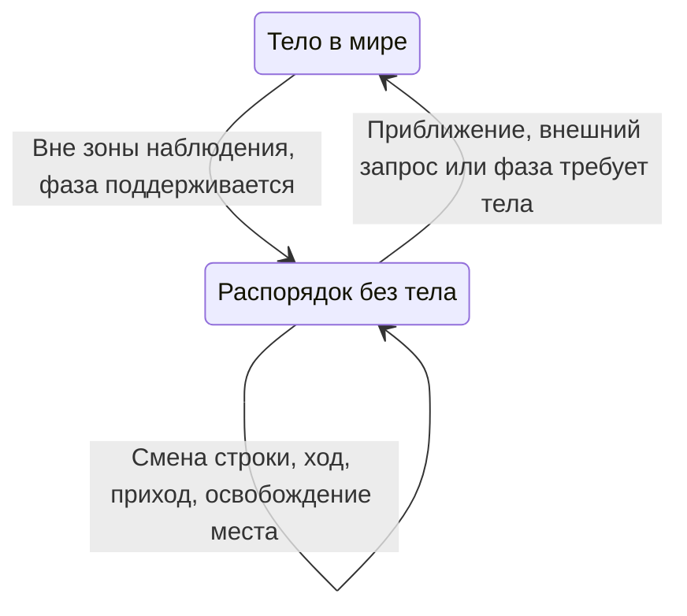

# Э3. Распорядки дальних NPC без физического тела

Исследование от 23 ноября 2026. Код сверялся на `d0c11d807`. Эталон для Э3 — принятый суточный прогон Э2.3 с seed 73106. Числа ниже получены из его архива. [Проверки Э2.3](e2-free-points.md#повторная-проверка-э23-после-ревью)

Предлагаю оставить в мире существующий `Npc` с его идентичностью, распорядком и состоянием. У подтверждённых занятий вдали может отсутствовать физическое тело. Смена строки, приход и освобождение места продвигают распорядок событиями. При подходе игрок встречает персонажа в той фазе, до которой тот успел дойти. Для первого пилота подходит уже сидящий NPC у костра. Тот же костёр даёт следующий тест для возвращения тела посреди пути.

## Движок до Э3.1

- **Уровень симуляции и восприятие назначаются отдельно.** `Full` действует в ближних кусках размером 64 м вокруг героя или камеры. Вход в кольцо происходит в пределах двух кусков по каждой оси, выход — после третьего. За кольцом включается `Simplified`. Политики восприятия `AiNormal`, `AiFar` и `AiFar2` используют границы 30 и 60 м от героя. Дальний NPC может быть в кадре. [Назначение уровней и политик](../../../OpenGothic/common/world/worldobjects_walk.cpp#L13) · [Кольца стриминга](../../../OpenGothic/common/world/chunkresidency.cpp#L92)
- **Тело сейчас сохраняется.** `WorldObjects::tick` вызывает `Npc::tick` и на уровне `Simplified`. При переходе на графовое движение движок оставляет `NpcItem` для лучей, боя и восприятия, а при возврате к физическому движению проверяет опору лучом и продолжает сохранённый путь. Анимация имеет свой проход и учитывает видимость. Открытый PR #1435 уменьшает частоту части дальних тиков. [Тик мира](../../../OpenGothic/common/world/worldobjects.cpp#L540) · [Передача движения](../../../OpenGothic/common/world/objects/npc_movement.cpp#L127) · [Проход анимации](../../../OpenGothic/common/world/worldobjects.cpp#L944) · [PR #1435](https://github.com/kaifaty/GothicAI/pull/1435)
- **Распорядок, активное состояние и физическая поза уже различаются.** `currentRoutine` учитывает полночь и промежутки между строками. `endTime` даёт время конца состояния. `tickRoutine` заканчивает строку на допустимом такте и учитывает текущую цель и речь. `FpLock` владеет конкретной свободной точкой и будит ожидающих после ухода последнего владельца. В сохранении уже есть координаты, путь, очередь, состояние и замок. [Часы и смена строки](../../../OpenGothic/common/world/objects/npc_routine.cpp#L155) · [Замок точки](../../../OpenGothic/common/world/fplock.cpp#L12) · [Сохранение NPC](../../../OpenGothic/common/world/objects/npc_save.cpp#L26)
- **Для продолжения движения уже есть опорные данные.** Графовый ход сохраняет положение на ребре и вычисляет прогресс по нему, а высоту берёт из профиля `WayHeights`. Оно уступает физике при неподходящей опоре или участке. `NpcLogicalState` прогнозирует позу и часы в тени настоящего тела и сверяется с ним. Отдельный `society-core` разыгрывает распорядок по очереди событий и оценивает положение на пути. При сверке на 370 людях вне окон перехода состояние совпало в 99,76% отметок. При исключении самоходных занятий положение было в пределах 10 м в 99,77% отметок. Медиана ошибки времени пути на 531 переходе составила 0,37 игровой минуты (p90 2,17). В окнах перехода условие 10 м прошло в 89,43% отметок. Такая сверка подходит для планирования, точку возвращения тела надо проверять отдельно. [Графовое движение и логическое состояние](../../../docs/world-streaming-npc.md) · [Паритет стенда общества](../../society/2026-11-05-routine-parity/README.md#итог)

## Что видно в суточном эталоне

`NEWWORLD`, `auto`, streaming, 1440,003 игровой минуты, 289 выборок, 1052 NPC без героя. Архив `/mnt/shared/gothic-ai/npc-events-e23/day-96edfff5d3ce/` содержит `npc-day.json`, `npc-day.csv` и `npc-day-events.csv`. SHA-256 журнала отметок — `078cb46e238cfe1d399e31cb840b0a8ba1379bb2c5f0b8cff9f58554a3aee9cc`.

| Наблюдение | Значение |
|---|---:|
| `Simplified` в конце суток | 779 из 1053, включая героя в знаменателе |
| Вызовы тика NPC на `Simplified` | 139,44 млн из 188,23 млн (74,08%) |
| Время `Npc::tick` на `Simplified` | 334,40 из 508,54 с (65,76%), в среднем 1,87 мс на тик мира |
| Вызовы в `Simplified` с признаком родного боевого движения | 85,71 млн из 139,44 млн (61,47%) |
| Пятиминутные отметки `Simplified` / `far2` | 225 554 из 304 028 |
| В них живой NPC исполняет одну из 12 событийных строк и очередь пуста | 19 921 |
| В них сидит на своей свободной точке костра, без mobsi | 3787 отметок у 23 NPC |

Для двух последних строк сверялись имя активного `ZS` с именем состояния в строке распорядка, `alive=1` и `queue=0`. Для костра дополнительно проверялись `body=11` (`BS_SIT`), `on_fp=1`, имя FP с `CAMPFIRE` и `mob=-`. Это размер наблюдаемой выборки для пилота. Фактическую пригодность определят видимость, занятость и внешние действия. Счётчик боевого движения включает NPC с оружием в руках и монстров в режиме `Fist`. Сумма `Npc::tick` показывает, где расходуется время, экономию Э3 измерит сравнение реализаций. [Условия боевого движения](../../../OpenGothic/common/world/objects/npc_movement.cpp#L19)

У `BAU_943_BAUER#0` `ZS_SIT_CAMPFIRE` начался на 772,093-й минуте прогона. На 780-й он шёл по дороге в **34,84 м** от будущего сиденья, на 795-й продолжал идти в 2,68 м от него. На 800-й уже удерживал `FP_CAMPFIRE_NW_FARM2_REST_03` и сидел. Строка 20:52–05:00 пересекает полночь. В этом случае значение `ZS` подходит для проверки расписания, для постановки тела нужны положение в пути или конкретное занятое место. [Разбор костра в Э2.3](e2-free-points.md#повторная-проверка-э23-после-ревью)

## Подходы в других движках

- **Unreal MassGameplay** отдельно задаёт уровень симуляции и представление сущности. Представление может отсутствовать. При смене уровня подсистема представления выдаёт или забирает Actor, а симуляция сущности имеет собственную частоту обновления. Для нас отсюда полезны отдельные правила появления тела и продвижения занятия. [Документация Epic](https://dev.epicgames.com/documentation/en-us/unreal-engine/overview-of-mass-gameplay-in-unreal-engine)
- **Warhorse** описывает ИИ разных уровней детализации для мира почти из 2400 NPC в Kingdom Come: Deliverance II. Цель — сохранять распорядки и реакцию на игрока вдали и свести зависимость сценариев от уровня симуляции к минимуму. Для GothicAI это аргумент сохранить ссылку на NPC при появлении и снятии тела. [Доклад Петра Смрчека](https://gdcvault.com/play/1035718/)
- **OpenMW** отдельно ограничивает частую обработку ИИ по дистанции и продвигает пакеты при ожидании. При допустимой дистанции `AiTravel::fastForward` переносит актёра к цели пакета и корректирует положение по опоре. На дороге NPC должен продолжить движение с расчётной позиции на текущем ребре. [Обработка актёров](https://github.com/OpenMW/openmw/blob/90a7266c865f4af5e89009ff98fbfdd2665cca39/apps/openmw/mwmechanics/actors.cpp#L1586-L1615) · [Продвижение при отдыхе](https://github.com/OpenMW/openmw/blob/90a7266c865f4af5e89009ff98fbfdd2665cca39/apps/openmw/mwmechanics/actors.cpp#L1927-L1969) · [Продвижение пути](https://github.com/OpenMW/openmw/blob/90a7266c865f4af5e89009ff98fbfdd2665cca39/apps/openmw/mwmechanics/aitravel.cpp#L126-L136)

## Как вести распорядок и возвращать тело

1. **Оставить один экземпляр NPC.** Тот же `Npc` сохраняет `C_NPC`, ссылки мира и VM, инвентарь, здоровье, строку и активное состояние. Для неподвижного занятия достаточно положения, направления, позы, одного существующего `FpLock` и срока строки. Снимаем коллизионное тело. Поза и часы занятия остаются доступны. Место удерживает тот же NPC. Создание тела связано с `Npc::setVisual`, у `NpcItem` есть RAII-снятие из физического списка. Перед включением режима нужен аудит входов, требующих коллизию. Например, `collosionCenter()` обращается к `centerAsym()`, который разыменовывает тело. [Создание тела](../../../OpenGothic/common/world/objects/npc_visual.cpp#L46) · [Снятие и запросы коллизии](../../../OpenGothic/common/physics/dynamicworld_npc.cpp#L12) · [Поиск экземпляра по ссылке VM](../../../OpenGothic/common/game/gamescript.cpp#L1545)
2. **Продвигать часы по событиям.** Конец строки берётся из существующих `currentRoutine/endTime` на `world.time()`. Движение и поза используют часы симуляции `tickCount()`, как нынешние скорость и жесты. Когда поддерживается ход, достаточно текущего сегмента `WayPath`, пройденной доли ребра, отметки времени и скорости. Вычисляем продвижение по прошедшему времени, высоту берём из проверенного профиля опоры. На конце ребра, приходе, смене строки и освобождении места исполняется соответствующее событие. Момент захвата FP должен совпадать с Э2, где команда хода может закрепить точку ещё на подходе. Последний владелец освобождает её через `FpLock`, который будит ожидающих. Для ожидания без тела это событие должно попасть к исполнителю распорядка. При совпадении конца строки и прихода сохраняем порядок Э2, включая очередь хода, которая может задержать End. [Движение по ребру](../../../OpenGothic/common/world/objects/npc_movement.cpp#L549) · [Захват точки при начале хода](../../../OpenGothic/common/world/objects/npc_aiqueue.cpp#L116) · [Порядок Э2](../../../OpenGothic/common/world/objects/npc_activityevents.cpp#L81) · [Два времени](../../../OpenGothic/common/game/gamesession.cpp#L408)
3. **Вернуть тело до кадра и до взаимодействия.** Подъём уровня ориентируется на логическую позицию, близость к герою и камере и запас до видимости. При движении NPC надо учитывать выход сегмента в активную область, при движении камеры — поворот и скачок вида. `ChunkResidency` даёт камеру, героя, упреждение и гистерезис. Его Near-кольцо уже использует эти позиции, а порог появления тела надо привязать к фактической видимости NPC и дальности взаимодействия. Перед публикацией восстановить корпус в рассчитанной точке с проверкой опоры, направление и устойчивую позу или продолжающийся ход. У движка уже есть проход `catchUpAnimation` после сдвига камеры и до отрисовки. Для появления в кадре он даёт место проверки готовой позы. Коллизия для лучей, выбора цели и взаимодействий нужна раньше, до первого такого запроса. На занятой FP использовать тот же замок. Восстановление продолжающейся фазы обрабатывается как продолжение, с нулём повторных Init, входных анимаций и тегов звука. Телепорт героя и загрузка требуют подготовить NPC у места назначения до первого наблюдаемого кадра. [Обновление фокуса стриминга](../../../OpenGothic/common/world/world.cpp#L330) · [Видимость в проходе анимации](../../../OpenGothic/common/world/worldobjects.cpp#L930) · [Шаг игры и кадра](../../../OpenGothic/common/game/simulationstep.cpp#L26)
4. **Возвращать тело по запросу игры.** Внешняя команда вроде `AI_StartState`, цель взаимодействия, бой, реплика, падение, изменившийся проход или отсутствующая опора требуют вернуть тело до обработки. Значение координаты, которым пользуется скрипт или поиск NPC, должно быть актуально даже вдали. Жесты рук и стойки на WP меняют общий RNG и сохраняемые локалы, в NotR у рук есть сюжетный вызов. Предметы и mobsi добавляют собственные состояния, прикрепление и анимационные события. Эти случаи пока ведёт текущий исполнитель. При смене мира, сне и `Wld_SetTime` сроки пересчитываются после установки времени. Нужна проверка, что срок относится к текущей строке и пути, если игру перемотали или занятие прервали. `resetPositionToTA` очищает очередь, снимает замок, ставит NPC на WP расписания и вызывает обновление при вставке. Обычный подход продолжает текущую фазу. [Вход из VM](../../../OpenGothic/common/game/gamescript_externals.cpp#L538) · [Поиск в мире](../../../OpenGothic/common/world/worldobjects.cpp#L1094) · [Перемотка времени](../../../OpenGothic/common/world/world.cpp#L1253) · [Сброс на точку распорядка](../../../OpenGothic/common/world/objects/npc_motion.cpp#L143)

Для сохранения первый пилот должен записывать то же состояние сидящего NPC, что и обычная игра. При загрузке поднимать уровень по текущей камере и герою. Для пути проверить, что существующих `GoTo`, `WayPath`, координат и часов достаточно для продолжения с этого же ребра. Порог включения режима определяем по видимости и самому долгому возврату тела в коротком оконном прогоне. Этот замер даст реальное число пригодных NPC на данном маршруте.

## Первый пилот и приёмка

**Э3.1. Костёр в позе `BS_SIT`.** Взять начатое и законно удерживаемое занятие с пустой очередью. Когда NPC возвращается, он уже сидит на той же FP. В конце строки двигателю достаточно разбудить его до выхода из позы и передать следующий шаг действующему исполнителю. Контракт в обоих режимах проверяет коллизию лучом, одного владельца сиденья, ту же позу при подходе и после загрузки сохранения, сделанного вдали. Повторных Init должно быть ноль. Действующие проверки Э2.3 продолжают проверять вставание и освобождение места после прерывания и конца строки. Вписать в существующий игровой контракт в обоих режимах, один безэкранный запуск до 8 минут по последнему времени этого контракта (423 с). [Контракт Э2.3](e2-free-points.md#повторная-проверка-э23-после-ревью) · [Постановки для занятий](../../../OpenGothic/tests/npc_activity_world_fixture.h)

**Э3.2. Подход к тому же костру.** Поддержать знакомый путь с проверенной опорой. В одном маршруте проверить возвращение тела на ходу, при ожидании места и в позе у огня. На передаче сохранить ребро и прогресс, разрешить сдвиг вдоль пути в пределах одного штатного шага симуляции и отдельно проверить высоту и отсутствие перескока через препятствие. Первый видимый кадр, разворот камеры, скачок героя и повторный заход через границу требуют уже готового тела. В журнал дописать причины возвращения тела, число физических тел, повторных Init и конфликтов места. Замерить цену массового возвращения тела (p95/p99 тика мира) вместе с долей NPC, которым доступен режим. Из профилей Э2 взять допуски на совпадение FP, время прихода и ноль новых пропусков или застреваний. В Э3 добавить проверку позиции и фазы на первом видимом кадре. [Действующий переход Full/Simplified](../../../scripts/bench/npc-tier-transitions.bench) · [Профиль занятий на точках](../../../scripts/bench/npc-day-parity.tolerances-points.json)

Для Э3.2 предлагается один повтор расширенного контракта до 8 минут, после ревью один полный день с seed 73106 и один оконный заход на Ryzen до 4 минут. Контроль — сохранённые сутки Э2.3, на Ryzen они заняли 19 мин 36 с без окна. Безэкранный прогон по правилам проекта идёт через `gq` на dev-ubuntu, Ryzen служит запасным. Ожидание очереди считается отдельно. При сравнении цены держать одинаковую частоту дальнего тика, если к тому времени войдёт #1435. [Правила прогонов](../../../docs/compute.md) · [Сводка Э2.3](e2-free-points.md#повторная-проверка-э23-после-ревью)

## Реализация Э3.1

Пилот включён только в `auto` для подтверждённой событийной формы костра в `Simplified`. Снятие возможно после входа в устойчивую `S_SIT`, пока NPC держит единственный замок своей FP и очередь пуста. Сидящий NPC сохраняет графику, состояние распорядка и данные для обычного сохранения. Физическая капсула и виртуальный контроллер снимаются из симуляции. Режим близости, видимость камеры и внешние команды возвращают коллизию для того же владельца. В конце строки продолжается штатная очередь вставания и ухода. [Текущая схема](../../../docs/world-streaming-npc.md) · [Контракт](../../../OpenGothic/tests/npc_activity_world_fixture.h)

### Проверка на Ryzen

Контракт на исходниках `8d8885fdc` использовал Энима (`BAU_944_EHNIM`) и его точку `FP_SIT_CAMPFIRE_PAUSE_02` в `NEWWORLD`. Героя перемещали между `NW_FARM2_FIELD_03_B` и `NW_BIGFARM_SHEEP2_02`. Контракт проверял уровень `Simplified` перед дальним запросом коллизии. Первая постановка с наблюдателем в городе ещё попадала в квадратное кольцо Near и оставляла уровень `Full`.

| Проверка | Результат |
|---|---|
| Вдали, события выключены | Луч по-прежнему находит Энима. У сиденья один владелец. |
| Вдали, события включены | Тело снято, луч не находит Энима. Тот же NPC держит одну бронь и сохраняет `S_SIT`, координаты и поворот. |
| Скачок камеры и подход героя | Тело возвращается до отрисовки или при смене уровня на ближний. Луч снова находит Энима, точка и поза те же. |
| Загрузка обычного сохранения, сделанного вдали | Восстановились точка, один владелец, исходные координаты, поворот и `S_SIT`. После подхода коллизия снова доступна. Повторных `Init` — 0. |
| Остальные три формы Э2.3 | В событийном режиме у сложенных рук, стойки на WP и `PEE` по 0 входов в VM Loop. |

Игровой журнал — `/mnt/shared/gothic-ai/npc-events-e31/candidate-4/contract.log`. Независимый маршрут острова прошёл в чистом окружении. За 60 с игрового времени зарегистрированы 4 пересечения границы, 14 загрузок кусков и 5 выгрузок. `strace` не нашёл обращений к запрещённым путям. Отчёт — `/mnt/shared/gothic-ai/e2e/e31/island/run-20261122T214318-60378/output/report.json`.

Обычная оконная проверка `load_rewind` на той же сборке прошла 4 из 4 проверок за 1 мин 23 с. Игра перемоталась на 30,243 игровой секунды. После загрузки вновь пришли `npc_views`, `story_world` и `npc_died`. Журнал и отпечаток запущенного бинарника — в `/mnt/shared/gothic-ai/npc-events-e31/rewind-8d8885fdc/`.

## Реализация Э3.2

На подходе к костру движок может снять физическое тело после построения опорного профиля. При снятии он сверяет высоту ног с опорой лучом и допускает разницу до 5 см. Граф продолжает обновлять координаты по профилю. Движок обновляет позицию для лучей при возврате тела и для записи обычного сохранения. При переходе к физическому движению сохраняются цель, остаток пути и положение на нём.

Пока кандидат на сиденье занят, стоящий NPC без команды ждёт событие освобождения точки. Перед выполнением очереди движок возвращает тело. Если путь снова допускает графовое движение, тело можно снять на его подтверждённом участке. В конце подхода и при обычном движении тело возвращается до обработки новой фазы. [Текущее поведение](../../../docs/world-streaming-npc.md#э32-дорога-к-костру)

Игровой контракт ведёт Энима к `FP_SIT_CAMPFIRE_PAUSE_02` через `NW_FARM2_FIELD_03_B`. В нём проверяются фактический ход без капсулы, возврат тела на том же ребре при скачке камеры и подходе героя, высота над опорой, ожидание занятого места и захват после его освобождения. [Контракт](../../../OpenGothic/tests/npc_activity_world_fixture.h)

### Проверка маршрута на Ryzen

На сборке `ae2060d42` Эним шёл из `NW_FARM2_FIELD_03` к `NW_FARM2_FIELD_03_B`. В начале `FP_SIT_CAMPFIRE_PAUSE_02` удерживал контрольный замок. При первой проверке до исправления ноги Энима оказались на 19,16 см выше опоры. Профиль сохранял высоту начала участка. После проверки опоры при снятии тела Эним сделал без капсулы шаг 4,15 см за 33 мс. Расхождение с опорой — 0,00 см после округления до сотых. Сферическая проверка вдоль этого шага не обнаружила препятствия.

Предкадровый проход вернул капсулу при появлении Энима в поле зрения камеры с 20 м. Координаты капсулы, ребро, фаза и поза совпали. При переносе героя к костру тело вернулось в те же координаты. Первый шаг с обычной физикой остался в границах одного шага графового движения.

Эним дошёл до занятого места, потерял коллизию вдали в ожидании и вернул её в той же точке при приближении героя. Освобождение замка пробудило его, и он сел в `S_SIT` на той же свободной точке. Повторных `Init` и двойных захватов места было 0. Проверка загрузки из Э3.1 тоже прошла. Полный `gothic-placed-items-contract` завершился за 6 мин 56 с с кодом 0. Журнал — `/mnt/shared/gothic-ai/npc-events-e32/route-4/contract.log`.

Остров прошёл в чистом окружении. За 60 с игрового времени он пересёк четыре границы, загрузил 14 и выгрузил пять кусков. Запрещённых путей в `strace` не было. Отчёт — `/mnt/shared/gothic-ai/e2e/e32/island/run-20261122T221119-78465/output/report.json`.

Оконный `check_walk` на том же бинарнике прошёл 3 из 3 проверок за 2 мин 55 с. Кавалорн дошёл до тела в пещере, увидел его и вернулся на расстояние 2,96 м от героя. Журналы — `/mnt/shared/gothic-ai/npc-events-e32/check-walk-ae2060d4/`.

### Суточная сверка

Сборка `ae2060d42` прошла одни игровые сутки на Ryzen без окна. Использованы сценарий `npcday 1440 5 shared probe`, seed 73106, база принятого прогона Э2.3, режим `auto` и включённый streaming. Прогон записал 1440,003 игровой минуты за 1013,919 с. В 289 выборках сопоставлены 304 028 отметок 1052 NPC без героя.

По профилю пяти точечных занятий прошли все 12 проверок. У костров время прихода совпало в 51 из 51 случая с точностью пяти игровых минут. Место совпало на всех 4849 отметках с бронью, а поза зарегистрирована 4842 раза в каждом журнале. Пропусков, застрявших NPC, двойных занятий, просроченных броней, броней без живого владельца и срабатываний сторожевого срока — по 0.

У караула появилось три дополнительных отметки поста. В прежних координатах и состоянии у Вамбо на t=480 записалась `FP_STAND_RAUL`, у `MIL_326_MILIZ` на t=840 и t=1110 — `FP_STAND_GUARDING_OV_05` и `FP_STAND_GUARDING_OV_04`. Время всех 178 приходов караула совпало в пределах шага журнала.

Журналы — `/mnt/shared/gothic-ai/npc-events-e32/day-ae2060d4/`. Сверка с принятым прогоном Э2.3 — `/mnt/shared/gothic-ai/npc-events-e32/day-analysis-ae2060d4/points.{md,json}`.

## Э3.3. Загрузка и возврат группы

На маршруте Э3.2 три NPC одновременно исполняют `ZS_SIT_CAMPFIRE`. Один идёт с поля, второй ждёт у костра, а Эним держит сиденье. Вдали тела всех троих должны отсутствовать. Один поворот камеры проверяет коллизию, координаты и позу каждого в первом видимом кадре.

Обычное сохранение записывается до поворота камеры. После загрузки проверяем текущее ребро и цель идущего NPC, координаты ожидающего, позу и бронь сидящего. Первый шаг не должен превышать один шаг по графу. Освобождение места проверяет, что ожидающий восстановил подписку. Повторных `Init` и двойных броней должно быть 0.

Бюджет — один запуск полного игрового контракта на Ryzen до 8 минут без окна плюс сборка. Один общий замер после слияния — до 4 минут на Ryzen без окна. На том же маршруте считаем снятые и возвращённые капсулы и измеряем p95/p99 тика мира и предкадрового прохода при возврате группы.

### Игровой контракт на Ryzen

Эним сидел на `FP_SIT_CAMPFIRE_PAUSE_02`, `BAU_943_BAUER` ждал рядом, `BAU_938_BAUER` шёл к ним с поля. Луч не нашёл ни одного из троих до сохранения. Камера раскрыла всю группу с 25 м от её центра, за пределами ближнего радиуса. Один предкадровый проход вернул все три капсулы в прежние координаты. Сохранились направление, ход, ожидание, поза `S_SIT` и единственная бронь.

Обычная загрузка восстановила координаты, направления и позы троих, а также текущее ребро и цель идущего. Его первый шаг на ребре к `NW_FARM2_FIELD_03_B` составил 2,79 см. Ожидающий остался на месте и занял сиденье вслед за уходом Энима. Повторных вызовов `Init` и двойных броней было 0. [Условия проверки](../../../OpenGothic/tests/npc_activity_world_fixture.h)

Полный `gothic-placed-items-contract` прошёл за 6 мин 40 с с кодом 0. В событийном режиме у всех четырёх форм Э2.3 осталось по 0 входов в VM Loop. Журнал и отпечаток бинарника — `/mnt/shared/gothic-ai/npc-events-e33/contract-1/`.

### Замер возврата трёх капсул

Один безэкранный прогон `quiet` на Ryzen после слияния `ba15538e2` занял 37,4 с без сборки. В сцене с теми же участниками выполнено 128 тиков по 33 мс с поворотом камеры к костру после каждого тика. Другие NPC мира оставались под внешним управлением, как в игровом контракте. Во всех 128 повторах перед поворотом были сняты 3 капсулы, а один предкадровый проход вернул все 3.

| Проход | p50, мс | p95, мс | p99, мс |
|---|---:|---:|---:|
| Тик сессии с миром (`GameSession::tick`) | 3,711 | 4,185 | 4,808 |
| Предкадровый проход с возвратом трёх тел | 0,673 | 0,805 | 0,908 |
| Повторный предкадровый проход с уже восстановленными телами | 0,081 | 0,107 | 0,139 |

Таймер предкадрового прохода охватывает `World::catchUpAnimation()` вместе с обновлением накопленной анимации. Парная разница с повторным проходом в том же ракурсе составила 0,718 мс на p95 и 0,823 мс на p99.

Контрольная загрузка в этом же прогоне подтвердила, что идущий NPC продолжает на сохранённом ребре с капсулой. У ожидающего и сидящего вдали капсулы снова снимаются. Замер сделан на коде движка из `main`, время снималось в тестовой постановке. Исходный журнал, версия, измерительный дифф и `timings.json` — `/mnt/shared/gothic-ai/npc-events-e33/measure-1/`.
