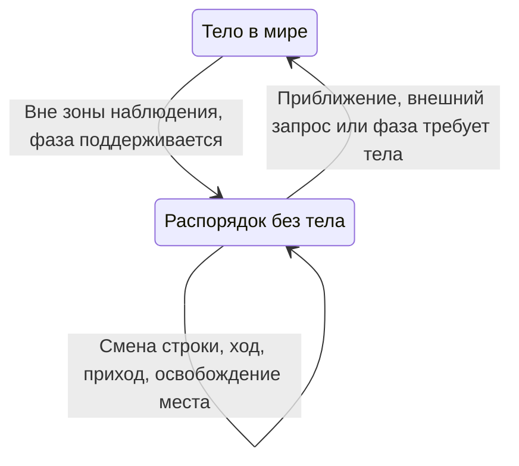

# Э3. Распорядки дальних NPC без физического тела

Исследование от 23 ноября 2026. Код сверялся на `d0c11d807`. Эталон для Э3 — принятый суточный прогон Э2.3 с seed 73106. Числа ниже получены из его архива. [Проверки Э2.3](e2-free-points.md#повторная-проверка-э23-после-ревью)

Предлагаю оставить в мире существующий `Npc` с его идентичностью, распорядком и состоянием. У подтверждённых занятий вдали может отсутствовать физическое тело. Смена строки, приход и освобождение места продвигают распорядок событиями. При подходе игрок встречает персонажа в той фазе, до которой тот успел дойти. Для первого пилота подходит уже сидящий NPC у костра. Тот же костёр даёт следующий тест для возвращения тела посреди пути.

## Что уже умеет движок

- **Уровень симуляции и восприятие назначаются отдельно.** `Full` действует в ближних кусках размером 64 м вокруг героя или камеры. Вход в кольцо происходит в пределах двух кусков по каждой оси, выход — после третьего. За кольцом включается `Simplified`. Политики восприятия `AiNormal`, `AiFar` и `AiFar2` используют границы 30 и 60 м от героя. Дальний NPC может быть в кадре. [Назначение уровней и политик](../../../OpenGothic/common/world/worldobjects_walk.cpp#L13) · [Кольца стриминга](../../../OpenGothic/common/world/chunkresidency.cpp#L92)
- **Тело сейчас сохраняется.** `WorldObjects::tick` вызывает `Npc::tick` и на уровне `Simplified`. При переходе на графовое движение движок оставляет `NpcItem` для лучей, боя и восприятия, а при возврате к физическому движению проверяет опору лучом и продолжает сохранённый путь. Анимация имеет свой проход и учитывает видимость. Открытый PR #1435 уменьшает частоту части дальних тиков. [Тик мира](../../../OpenGothic/common/world/worldobjects.cpp#L540) · [Передача движения](../../../OpenGothic/common/world/objects/npc_movement.cpp#L127) · [Проход анимации](../../../OpenGothic/common/world/worldobjects.cpp#L944) · [PR #1435](https://github.com/kaifaty/GothicAI/pull/1435)
- **Распорядок, активное состояние и физическая поза уже различаются.** `currentRoutine` учитывает полночь и промежутки между строками. `endTime` даёт время конца состояния. `tickRoutine` заканчивает строку на допустимом такте и учитывает текущую цель и речь. `FpLock` владеет конкретной свободной точкой и будит ожидающих после ухода последнего владельца. В сохранении уже есть координаты, путь, очередь, состояние и замок. [Часы и смена строки](../../../OpenGothic/common/world/objects/npc_routine.cpp#L155) · [Замок точки](../../../OpenGothic/common/world/fplock.cpp#L12) · [Сохранение NPC](../../../OpenGothic/common/world/objects/npc_save.cpp#L26)
- **Для продолжения движения уже есть опорные данные.** Графовый ход сохраняет положение на ребре и вычисляет прогресс по нему, а высоту берёт из профиля `WayHeights`. Оно уступает физике при неподходящей опоре или участке. `NpcLogicalState` прогнозирует позу и часы в тени настоящего тела и сверяется с ним. Отдельный `society-core` разыгрывает распорядок по очереди событий и оценивает положение на пути. При сверке на 370 людях вне окон перехода состояние совпало в 99,76% отметок. При исключении самоходных занятий положение было в пределах 10 м в 99,77% отметок. Медиана ошибки времени пути на 531 переходе составила 0,37 игровой минуты (p90 2,17). В окнах перехода условие 10 м прошло в 89,43% отметок. Такая сверка подходит для планирования, точку возвращения тела надо проверять отдельно. [Графовое движение и логическое состояние](../../../docs/world-streaming-npc.md) · [Паритет стенда общества](../../society/2026-11-05-routine-parity/README.md#итог)

## Что видно в суточном эталоне

`NEWWORLD`, `auto`, streaming, 1440,003 игровой минуты, 289 выборок, 1052 NPC без героя. Архив `/mnt/shared/gothic-ai/npc-events-e23/day-96edfff5d3ce/` содержит `npc-day.json`, `npc-day.csv` и `npc-day-events.csv`. SHA-256 журнала отметок — `078cb46e238cfe1d399e31cb840b0a8ba1379bb2c5f0b8cff9f58554a3aee9cc`.

| Наблюдение | Значение |
|---|---:|
| `Simplified` в конце суток | 779 из 1053, включая героя в знаменателе |
| Вызовы тика NPC на `Simplified` | 139,44 млн из 188,23 млн (74,08%) |
| Время `Npc::tick` на `Simplified` | 334,40 из 508,54 с (65,76%), в среднем 1,87 мс на тик мира |
| Вызовы в `Simplified` с признаком родного боевого движения | 85,71 млн из 139,44 млн (61,47%) |
| Пятиминутные отметки `Simplified` / `far2` | 225 554 из 304 028 |
| В них живой NPC исполняет одну из 12 событийных строк и очередь пуста | 19 921 |
| В них сидит на своей свободной точке костра, без mobsi | 3787 отметок у 23 NPC |

Для двух последних строк сверялись имя активного `ZS` с именем состояния в строке распорядка, `alive=1` и `queue=0`. Для костра дополнительно проверялись `body=11` (`BS_SIT`), `on_fp=1`, имя FP с `CAMPFIRE` и `mob=-`. Это размер наблюдаемой выборки для пилота. Фактическую пригодность определят видимость, занятость и внешние действия. Счётчик боевого движения включает NPC с оружием в руках и монстров в режиме `Fist`. Сумма `Npc::tick` показывает, где расходуется время, экономию Э3 измерит сравнение реализаций. [Условия боевого движения](../../../OpenGothic/common/world/objects/npc_movement.cpp#L19)

У `BAU_943_BAUER#0` `ZS_SIT_CAMPFIRE` начался на 772,093-й минуте прогона. На 780-й он шёл по дороге в **34,84 м** от будущего сиденья, на 795-й продолжал идти в 2,68 м от него. На 800-й уже удерживал `FP_CAMPFIRE_NW_FARM2_REST_03` и сидел. Строка 20:52–05:00 пересекает полночь. В этом случае значение `ZS` подходит для проверки расписания, для постановки тела нужны положение в пути или конкретное занятое место. [Разбор костра в Э2.3](e2-free-points.md#повторная-проверка-э23-после-ревью)

## Подходы в других движках

- **Unreal MassGameplay** отдельно задаёт уровень симуляции и представление сущности. Представление может отсутствовать. При смене уровня подсистема представления выдаёт или забирает Actor, а симуляция сущности имеет собственную частоту обновления. Для нас отсюда полезны отдельные правила появления тела и продвижения занятия. [Документация Epic](https://dev.epicgames.com/documentation/en-us/unreal-engine/overview-of-mass-gameplay-in-unreal-engine)
- **Warhorse** описывает ИИ разных уровней детализации для мира почти из 2400 NPC в Kingdom Come: Deliverance II. Цель — сохранять распорядки и реакцию на игрока вдали и свести зависимость сценариев от уровня симуляции к минимуму. Для GothicAI это аргумент сохранить ссылку на NPC при появлении и снятии тела. [Доклад Петра Смрчека](https://gdcvault.com/play/1035718/)
- **OpenMW** отдельно ограничивает частую обработку ИИ по дистанции и продвигает пакеты при ожидании. При допустимой дистанции `AiTravel::fastForward` переносит актёра к цели пакета и корректирует положение по опоре. Для подхода игрока к NPC на дороге нам нужен продолжение движения с расчётной позиции на текущем ребре. [Обработка актёров](https://github.com/OpenMW/openmw/blob/90a7266c865f4af5e89009ff98fbfdd2665cca39/apps/openmw/mwmechanics/actors.cpp#L1586-L1615) · [Продвижение при отдыхе](https://github.com/OpenMW/openmw/blob/90a7266c865f4af5e89009ff98fbfdd2665cca39/apps/openmw/mwmechanics/actors.cpp#L1927-L1969) · [Продвижение пути](https://github.com/OpenMW/openmw/blob/90a7266c865f4af5e89009ff98fbfdd2665cca39/apps/openmw/mwmechanics/aitravel.cpp#L126-L136)

## Как вести распорядок и возвращать тело

1. **Оставить один экземпляр NPC.** Тот же `Npc` сохраняет `C_NPC`, ссылки мира и VM, инвентарь, здоровье, строку и активное состояние. Для неподвижного занятия достаточно положения, направления, позы, одного существующего `FpLock` и срока строки. Снимаем `NpcItem` и приостанавливаем обновление тела и анимации. Место удерживает тот же NPC. Создание тела связано с `Npc::setVisual`, у `NpcItem` есть RAII-снятие из физического списка. Перед включением режима нужен аудит входов, требующих коллизию. Например, `collosionCenter()` обращается к `centerAsym()`, который разыменовывает тело. [Создание тела](../../../OpenGothic/common/world/objects/npc_visual.cpp#L46) · [Снятие и запросы коллизии](../../../OpenGothic/common/physics/dynamicworld_npc.cpp#L12) · [Поиск экземпляра по ссылке VM](../../../OpenGothic/common/game/gamescript.cpp#L1545)
2. **Продвигать часы по событиям.** Конец строки берётся из существующих `currentRoutine/endTime` на `world.time()`. Движение и поза используют часы симуляции `tickCount()`, как нынешние скорость и жесты. Когда поддерживается ход, достаточно текущего сегмента `WayPath`, пройденной доли ребра, отметки времени и скорости. Вычисляем продвижение по прошедшему времени, высоту берём из проверенного профиля опоры. На конце ребра, приходе, смене строки и освобождении места исполняется соответствующее событие. Момент захвата FP должен совпадать с Э2, где команда хода может закрепить точку ещё на подходе. Последний владелец освобождает её через `FpLock`, который будит ожидающих. Для ожидания без тела это событие должно попасть к исполнителю распорядка. При совпадении конца строки и прихода сохраняем порядок Э2, включая очередь хода, которая может задержать End. [Движение по ребру](../../../OpenGothic/common/world/objects/npc_movement.cpp#L549) · [Захват точки при начале хода](../../../OpenGothic/common/world/objects/npc_aiqueue.cpp#L116) · [Порядок Э2](../../../OpenGothic/common/world/objects/npc_activityevents.cpp#L81) · [Два времени](../../../OpenGothic/common/game/gamesession.cpp#L408)
3. **Вернуть тело до кадра и до взаимодействия.** Подъём уровня ориентируется на логическую позицию, близость к герою и камере и запас до видимости. При движении NPC надо учитывать выход сегмента в активную область, при движении камеры — поворот и скачок вида. `ChunkResidency` даёт камеру, героя, упреждение и гистерезис. Его Near-кольцо уже использует эти позиции, а порог появления тела надо привязать к фактической видимости NPC и дальности взаимодействия. Перед публикацией восстановить корпус в рассчитанной точке с проверкой опоры, направление и устойчивую позу или продолжающийся ход. У движка уже есть проход `catchUpAnimation` после сдвига камеры и до отрисовки. Для появления в кадре он даёт место проверки готовой позы. Коллизия для лучей, выбора цели и взаимодействий нужна раньше, до первого такого запроса. На занятой FP использовать тот же замок. Восстановление продолжающейся фазы обрабатывается как продолжение, с нулём повторных Init, входных анимаций и тегов звука. Телепорт героя и загрузка требуют подготовить NPC у места назначения до первого наблюдаемого кадра. [Обновление фокуса стриминга](../../../OpenGothic/common/world/world.cpp#L330) · [Видимость в проходе анимации](../../../OpenGothic/common/world/worldobjects.cpp#L930) · [Шаг игры и кадра](../../../OpenGothic/common/game/simulationstep.cpp#L26)
4. **Возвращать тело по запросу игры.** Внешняя команда вроде `AI_StartState`, цель взаимодействия, бой, реплика, падение, изменившийся проход или отсутствующая опора требуют вернуть тело до обработки. Значение координаты, которым пользуется скрипт или поиск NPC, должно быть актуально даже вдали. Жесты рук и стойки на WP меняют общий RNG и сохраняемые локалы, в NotR у рук есть сюжетный вызов. Предметы и mobsi добавляют собственные состояния, прикрепление и анимационные события. Эти случаи пока ведёт текущий исполнитель. При смене мира, сне и `Wld_SetTime` сроки пересчитываются после установки времени. Нужна проверка, что срок относится к текущей строке и пути, если игру перемотали или занятие прервали. `resetPositionToTA` очищает очередь, снимает замок, ставит NPC на WP расписания и вызывает обновление при вставке. Обычный подход продолжает текущую фазу. [Вход из VM](../../../OpenGothic/common/game/gamescript_externals.cpp#L538) · [Поиск в мире](../../../OpenGothic/common/world/worldobjects.cpp#L1094) · [Перемотка времени](../../../OpenGothic/common/world/world.cpp#L1253) · [Сброс на точку распорядка](../../../OpenGothic/common/world/objects/npc_motion.cpp#L143)

Для сохранения первый пилот должен записывать то же состояние сидящего NPC, что и обычная игра. При загрузке поднимать уровень по текущей камере и герою. Для пути проверить, что существующих `GoTo`, `WayPath`, координат и часов достаточно для продолжения с этого же ребра. Порог включения режима определяем по видимости и самому долгому возврату тела в коротком оконном прогоне. Этот замер даст реальное число пригодных NPC на данном маршруте.

## Первый пилот и приёмка

**Э3.1. Костёр в позе `BS_SIT`.** Взять начатое и законно удерживаемое занятие с пустой очередью. Когда NPC возвращается, он уже сидит на той же FP. В конце строки двигателю достаточно разбудить его до выхода из позы и передать следующий шаг действующему исполнителю. Контракт проверяет физический объект (`hasBody()` и его присутствие в списке), тот же ID и замок, ноль двойного занятия и повторных Init, освобождение однажды после ухода и пробуждение второго NPC. Проверить сохранение вдали и загрузку сразу рядом, скриптовое прерывание и переход через полночь. Вписать в существующий игровой контракт в обоих режимах, один безэкранный запуск до 8 минут по последнему времени этого контракта (423 с). [Контракт Э2.3](e2-free-points.md#повторная-проверка-э23-после-ревью) · [Постановки для занятий](../../../OpenGothic/tests/npc_activity_world_fixture.h)

**Э3.2. Подход к тому же костру.** Поддержать знакомый путь с проверенной опорой. В одном маршруте проверить возвращение тела на ходу, при ожидании места и в позе у огня. На передаче сохранить ребро и прогресс, разрешить сдвиг вдоль пути в пределах одного штатного шага симуляции и отдельно проверить высоту и отсутствие перескока через препятствие. Первый видимый кадр, разворот камеры, скачок героя и повторный заход через границу требуют уже готового тела. В журнал дописать причины возвращения тела, число физических тел, повторных Init и конфликтов места. Замерить цену массового возвращения тела (p95/p99 тика мира) вместе с долей NPC, которым доступен режим. Из профилей Э2 взять допуски на совпадение FP, время прихода и ноль новых пропусков или застреваний. В Э3 добавить проверку позиции и фазы на первом видимом кадре. [Действующий переход Full/Simplified](../../../scripts/bench/npc-tier-transitions.bench) · [Профиль занятий на точках](../../../scripts/bench/npc-day-parity.tolerances-points.json)

Для Э3.2 предлагается один повтор расширенного контракта до 8 минут, после ревью один полный день с seed 73106 и один оконный заход на Ryzen до 4 минут. Контроль — сохранённые сутки Э2.3, на Ryzen они заняли 19 мин 36 с без окна. Безэкранный прогон по правилам проекта идёт через `gq` на dev-ubuntu, Ryzen служит запасным. Ожидание очереди считается отдельно. При сравнении цены держать одинаковую частоту дальнего тика, если к тому времени войдёт #1435. [Правила прогонов](../../../docs/compute.md) · [Сводка Э2.3](e2-free-points.md#повторная-проверка-э23-после-ревью)

## Реализация Э3.1

Пилот включён только в `auto` для подтверждённой событийной формы костра в `Simplified`. Снятие возможно после входа в устойчивую `S_SIT`, пока NPC держит единственный замок своей FP и очередь пуста. Сидящий NPC сохраняет графику, состояние распорядка и данные для обычного сохранения. Физическая капсула и виртуальный контроллер снимаются из симуляции. Режим близости, видимость камеры и внешние команды возвращают коллизию для того же владельца. В конце строки продолжается штатная очередь вставания и ухода. [Текущая схема](../../../docs/world-streaming-npc.md) · [Контракт](../../../OpenGothic/tests/npc_activity_world_fixture.h)
