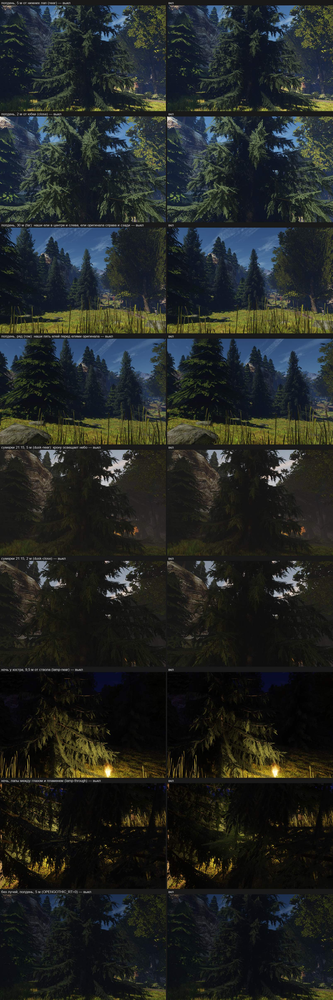

# Свет кроны: замысел и что построено

Дата: 2026-11-17. Задача 3 [доработок движка под деревья](engine-plan.md). Цель — ель с 5 м читается объёмом: снаружи светлые лапы, внутри тёмная масса. До этой задачи карточки хвои в глубине кроны освещались так же, как снаружи, и ель выглядела набором плоских картинок. Два круга правок самой ели (PR 1488, 1505) упёрлись в свет движка; пользователь 2026-11-17 выбрал этот путь.

Разделы 1–2 написаны до кода: эталон и замер кадра без света кроны. Раздел 3 — способ, как он построен. Раздел 4 — файлы, числа, пары кадров и ограничения.

**Итог.** С 5 м и 2 м в полдень крона читается объёмом: наружная хвоя ярче глубинной в 2,1 и 3,3 раза по медиане (было 0,9 и 1,5). Низ кроны не почернел. С 30 м ель темнее на 18–20 %, но не темнее елей оригинала. Просвет неба и ламп работает, но слаб: 3–6 % от неба, слабое свечение лап перед огнём. Без лучей глубина кроны почти чёрная.

## 1. Эталон: как освещена крона ели

**Свет, который приходит на крону.** [Daylight, Wikipedia](https://en.wikipedia.org/wiki/Daylight): прямое солнце в ясный полдень — 100 000–120 000 лк, тень под ясным небом — около 20 000 лк, пасмурный полдень — 1 000–2 000 лк. Лапа на солнце получает в 5–6 раз больше света, чем лапа в тени той же ели. В пасмурный день прямого света нет, остаётся одно небо.

**Сколько света доходит в глубину.** Свет в кроне убывает по закону Бера — Ламберта (Монси и Саэки): `I = I0·exp(−k·L)`, где `L` — площадь хвои над точкой на единицу площади земли, `k ≈ 0,5` для хвойных. У ели обыкновенной вся крона — `L` от 3 до 8. Половина кроны (`L` = 1,5–4) пропускает 47–14 % рассеянного света, вся — 22–2 %. Замеры под пологом согласны с этим порядком:

- [Leuchner, Hertel, Menzel 2011](https://portal.fis.tum.de/en/publications/spatial-variability-of-photosynthetically-active-radiation-in-eur/) (Agric. For. Meteorol. 151(9)): в теневой кроне бука и у земли медиана света — меньше 1 % от света над пологом; коническая крона ели пропускает больше при высоком солнце.
- Подрост ели живёт при 2–32 % света открытого места.
- Marková, Kubásek 2013 (Acta Univ. Agric. Silvic. Mendel. Brun. 61(1)): в пасмурный день полог ели пропускает заметно большую долю света, чем в ясный.

Оценка для одиночной ели (вывод из этих чисел, а не прямой замер): хвоя у ствола получает **10–30 % рассеянного света наружной лапы**, то есть в тени и в пасмурный день она темнее наружной в **3–10 раз** по яркости. В значениях sRGB это в 1,6–2,8 раза. Против наружной лапы на полуденном солнце глубина темнее в 20–50 раз — на фотографии почти чёрная. В пасмурный день разрыв ближе к нижней границе, 3–5 раз.

**Лапа против солнца.** Хвоя почти не просвечивает. [Lukeš и др. 2013](https://cris.vtt.fi/en/publications/optical-properties-of-leaves-and-needles-for-boreal-tree-species-/) (Remote Sensing Letters 4(7), doi 10.1080/2150704X.2013.782112): у хвои сосны и ели пропускание заметно ниже отражения, у листа берёзы они равны. [Hovi и др. 2017](https://www.silvafennica.fi/article/7753) (Silva Fennica 51(4)): в видимом свете хвоя поглощает почти всё, молодая хвоя светлее в зелёном. Поэтому лапа ели против солнца — тёмный силуэт с узкой светлой каймой по краю, где хвоя редкая. Она не светится насквозь, как лист клёна. Точных чисел пропускания хвои в открытых источниках найти не удалось; запись ели несёт `translucency` 0,35, и эта задача её не меняет.

**Замысел ели** ([заметка ели](../../content/2026-11-trees/fir/README.md)) говорит то же в цвете: среднее `#161d22`, освещённые края лап `#3a472e`, глубокая тень в кроне `#0c1115`. Тень темнее среднего в 2,2 раза по яркости, края светлее тени в 11 раз.

**Цель для кадра.** В тени наружная хвоя ярче глубинной в 2,5–4 раза по яркости (нижняя половина эталона). Больше не берём по двум причинам: «глубина» по каналу A, видимая снаружи сквозь редкую крону, — не самая глубокая точка, и кадр игры не должен проваливаться в чёрное. Медиана глубинной хвои — не темнее `#0c1115`, то есть `(12, 17, 21)`.

## 2. Что не так в нынешнем кадре

Набор `fir-probe-4`, сценарий `fir-probe.bench`, полдень, 2560×1440, Ryzen. Режим `OPENGOTHIC_CROWN_LIGHT=mask` красит пиксели кроны по открытости A, и по этой маске кадр без света кроны делится на три класса: глубина (A < 1/3), середина, наружная хвоя (A ≥ 2/3). Яркость — линейная, по Rec. 709; «тень» — 25-й процентиль класса, «солнце» — 90-й.

С лучами (GI), как на стенде:

| Вид | Доля глубины / наружной | Медиана глубины, sRGB | Медиана наружной, sRGB | Наружная ÷ глубина: тень | медиана | солнце |
|---|---|---|---|---|---|---|
| 30 м | 27 % / 56 % | `(40, 51, 50)` | `(36, 46, 47)` | 0,74 | 0,84 | 0,97 |
| 5 м | 17 % / 63 % | `(43, 53, 47)` | `(41, 50, 45)` | 0,64 | 0,91 | 1,03 |
| 2 м | 20 % / 59 % | `(39, 49, 44)` | `(49, 60, 49)` | 1,20 | 1,50 | 1,13 |
| лапа, 3 м | 43 % / 33 % | `(55, 67, 49)` | `(61, 73, 53)` | 0,77 | 1,20 | 1,06 |

Без лучей (`OPENGOTHIC_RT=0`), весь кадр темнее:

| Вид | Медиана глубины, sRGB | Медиана наружной, sRGB | Наружная ÷ глубина: тень | медиана | солнце |
|---|---|---|---|---|---|
| 30 м | `(27, 34, 33)` | `(25, 31, 32)` | 0,79 | 0,87 | 1,00 |
| 5 м | `(20, 24, 22)` | `(19, 23, 21)` | 0,79 | 0,95 | 1,05 |
| 2 м | `(15, 18, 17)` | `(17, 21, 18)` | 1,09 | 1,23 | 1,13 |
| лапа, 3 м | `(18, 22, 18)` | `(20, 24, 18)` | 0,93 | 1,14 | 1,06 |

1. **Глубина не темнее наружной хвои.** Отношение 0,6–1,5 при эталоне 3–10. С 5 м и 30 м глубинная хвоя в тени даже светлее наружной: наружные лапы свисают и обращены нормалью вниз, к тёмной земле.
2. **GI не помогает.** Пробы GI стоят с шагом от 25 см и крону изнутри не затеняют: с лучами и без них отношение одно и то же.
3. **На солнце разницы нет и не должно быть много:** 0,97–1,13. Пятно солнца в глубине кроны — настоящее, его пропускают просветы между лапами, и тени от карточек к карточке (VSM, лучи) его уже считают.
4. **С 30 м середина силуэта — глубина.** Лапы, обращённые к камере, видны с торца и почти ничего не закрывают; сквозь них видна хвоя у ствола. Затенение глубины затемнит середину дальней ели сильнее, чем ближней.

Сама хвоя ели в кадре светлее замысла: медиана по маске с 5 м `(42, 52, 46)` при среднем замысла `(22, 29, 34)`. Числа заметки ели (`(22, 29, 36)` с 5 м) сняты по прямоугольнику, в который попадает тёмный лес за просветами кроны.

## 3. Способ

Раздел описывает то, что построено. Замысел до кода был у́же: затенение кроны гасило только рассеянный свет, а солнце и лампы оставались теням от карточки к карточке. Первый прогон показал, что этого мало; почему — в разделе 4.

**Что читает канал A.** Корзина материала дерева (`"foliage": {"anchor": "tree"}`, кора и хвоя) получает бит `BK_CROWN`. Вершинный шейдер такой корзины кладёт A в длину нормали: `нормаль · (0,5 + 0,5·A)`. Так уже едет тень века у глаза; все читатели нормали её нормируют. Пиксельный шейдер G-буфера достаёт из длины **открытость** и делает из неё **затенение кроны**: `0,25 + 0,75·открытость`. Дно 0,25 — в пределах эталона 10–30 %.

Нормали разных направлений между вершинами выходят короче: у ствола из десяти граней — на 5 %. Поэтому верхняя десятая часть A читается как полная открытость (`открытость = A / 0,9`, не больше 1): круглый меш с A = 1 не темнеет.

**Куда оно пишется.** В альфу ORM G-буфера, и пиксель получает бит кроны — свободный нулевой бит подсказок в `gbufDiffuse.a`. G-буфер не растёт. Альфа ORM у своего материала больше 0,5, а ниже единицы в ней уже кодируется доля свечения: `1 − 0,49·доля`. Затенение кроны едет тем же кодом (`1 − 0,49·(1 − затенение)`), а бит кроны говорит, что это число — затенение, а не свечение. Шаг кода — 0,4 %. При A = 1 альфа равна единице, как у любого своего материала. AO карты (`gbufOrm.r`) остаётся AO карты.

Из этого два правила:

- материал дерева со свечением (`emissive` больше нуля) кроной не считается: число в альфе одно;
- материал без своих карт (альфа ORM не больше 0,5) кроной не считается: альфе негде нести затенение.

**На что действует.** На весь свет пикселя: каждый проход света умножает свой итог на затенение.

| Слагаемое | Где |
|---|---|
| Солнце, его блик и просвет | `direct_light.frag` |
| Лампы, их блик и просвет (новый) | `light.frag` |
| Небо, постоянная добавка, отражение неба и просвет неба (новый), без GI | `ambient_light.frag` |
| Пробы GI, отражения и просвет проб (новый) | `rt/probe_ambient.frag` |

Формулы рассеянного света — как на `main`: AO карты по-прежнему гасит только небо.

**Почему затенение берёт и солнце.** Свет в хвое убывает по Беру — Ламберту для любого луча, прямого тоже: до хвои у ствола солнце доходит редкими пятнами. Тени движка от карточки к карточке этого не дают: карточек в кроне мало, и глубина получает столько же солнца, сколько наружная лапа (раздел 4). Затенение — средняя доля света, дошедшего до этой глубины; пятна солнца в глубине остаются там, где их оставили тени, но в четыре раза темнее.

**Свет неба сквозь лист.** До этой задачи сквозь лист проходило только солнце: `foliageThrough()` даёт долю `translucency · cos⁴` угла между взглядом и направлением на солнце, она гаснет там, где нормаль и так обращена к солнцу. Небо — тот же источник, размазанный по полусфере. Интеграл этого лепестка по полусфере за листом равен 0,4 от освещённости площадки, обращённой от глаза (`∫cos⁴ = 2π/5` против `∫cos = π`). Поэтому пиксель кроны с долей просвета получает добавку:

`альбедо · оттенок просвета · translucency · 0,4 · E(−взгляд) · гашение`, затем затенение кроны.

- `E(−взгляд)` — освещённость со стороны, противоположной глазу: без GI — небо (под AO карты) и постоянная добавка в этом направлении, с GI — те же пробы, прочитанные в этом направлении;
- гашение — как у солнца: там, где нормаль карточки обращена от глаза, обычный рассеянный свет этот поток уже посчитал;
- оттенок — тот же, что у солнца (`FoliageThroughTint`).

При `translucency` 0,35 это до 14 % освещённости обратной стороны. Это согласно с эталоном: хвоя почти не просвечивает.

**Свет ламп сквозь лист.** Тот же лепесток `foliageThrough()` с направлением на лампу вместо солнца, под тенью лампы, с тем же оттенком. Лист, обращённый от лампы, перестаёт быть чёрным со стороны глаза, если глаз смотрит на лампу сквозь него. Тень лампы для такого пикселя ищется со стороны лампы, как у солнца; короткая экранная тень лампы для него не считается — луч уходит за саму карточку.

**Что не меняется.**

- Материал без `"anchor": "tree"` не получает ни бита корзины, ни бита пикселя: пучки `line`, трава, всё остальное рисуются как на `main`.
- Меш без `COLOR_0` несёт A = 1: затенение равно единице, альфа ORM — прежняя. От `main` такой материал дерева отличается только просветом неба и ламп.
- Формат базы и отпечаток: правятся шейдеры, корзина и флаг; загрузчики не трогаются. Новое поле записи не нужно — сила просвета берётся из `translucency`.
- Выключатель один: `OPENGOTHIC_CROWN_LIGHT=0` (ключ `[INTERNAL] crownLight=0`), по правилу «включено по умолчанию». Без него бит `BK_CROWN` не ставится, и кадр равен `main`. Свет кроны выключается и вместе со светом живой листвы (`OPENGOTHIC_FOLIAGE=0|wind`).

**Приёмка.** Пары кадров «выкл | вкл» того же сценария в полдень, один прогон в сумерки, ночной у огня. По маске: отношение наружной хвои к глубинной против цели 2,5–4, медиана глубины не темнее `(12, 17, 21)`, ель с 30 м против елей оригинала в том же кадре. Глазами: читается ли крона объёмом с 5 м и 2 м, не почернел ли низ кроны.

## 4. Что построено и что вышло

### Файлы

| Файл | Что в нём |
|---|---|
| `OpenGothic/common/graphics/crownlight.h` | флаг и его режимы, числа способа и то же правило на процессоре — для теста |
| `OpenGothic/shader/lighting/crown_light.glsl` | открытость из длины нормали, затенение, лепесток неба, цвета маски |
| `OpenGothic/shader/common.glsl` | бит кроны, код затенения в альфе ORM и его чтение (`gbufCrownShade`); крона не светится |
| `OpenGothic/shader/materials/vertex_process.glsl`, `main.frag` | A в длину нормали; запись затенения или маски в G-буфер |
| `OpenGothic/shader/lighting/direct_light.frag`, `light.frag`, `ambient_light.frag`, `rt/probe_ambient.frag` | затенение и просвет в четырёх проходах света |
| `OpenGothic/common/graphics/drawbuckets.*`, `sceneglobals.*`, `shader/scene.glsl`, `common/settings.cpp` | бит корзины `BK_CROWN`, бит кадра `VF_CROWN_MASK`, ключ `crownLight` |
| `OpenGothic/tests/foliage_tree_test.h` | `crownLightMaths` в `gothic-material-texture-test` |
| `scripts/bench/crown-light.bench`, [`crown-light-lamp.json`](crown-light-lamp.json) | сумерки и ночь у огня; слой предметов с огнём |

Числа: дно затенения 0,25; порог полной открытости 0,9; лепесток неба 0,4; код альфы 0,49 — тот же, что у свечения. Тест на процессоре проверяет разбор флага, кто считается кроной, путь A через длину нормали и через восемь бит альфы, A = 1 без изменений и границы лепестка неба. Нового поля записи нет.

### Первый прогон и правка способа

Первый прогон шёл по замыслу: затенение умножалось на AO карты и гасило только рассеянный свет. Отношение наружной хвои к глубинной по медиане почти не сдвинулось: 0,84 → 0,90 с 30 м, 0,91 → 1,00 с 5 м, 1,50 → 1,72 с 2 м.

Причина — в доле рассеянного света. В полдень он даёт пикселю кроны линейную яркость 0,003–0,005, а медиана глубинной хвои — 0,03: остальное — солнце. Тени от карточки к карточке глубину не затемняют: глубина и наружная хвоя получают одинаково солнца (отношение на 90-м процентиле 0,97–1,13 из раздела 2). Гасить десятую часть света бесполезно.

Способ изменён один раз: затенение берёт весь свет пикселя и едет в альфе ORM. Дно 0,25 после этого не подбиралось. Всё ниже — второй прогон.

### Полдень, с лучами

Набор `fir-probe-4`, сценарий `fir-probe.bench`, 2560×1440, Ryzen, по одному прогону. Классы — по маске полуденного прогона `OPENGOTHIC_CROWN_LIGHT=mask`. Медиана класса, sRGB:

| Вид | Крона: выкл → вкл | Глубина: выкл → вкл | Наружная: выкл → вкл |
|---|---|---|---|
| 30 м | `(38, 49, 49)` → `(31, 40, 44)` | `(40, 51, 50)` → `(24, 33, 41)` | `(36, 46, 47)` → `(36, 46, 47)` |
| 5 м | `(42, 52, 46)` → `(35, 44, 42)` | `(43, 53, 47)` → `(26, 33, 38)` | `(41, 50, 45)` → `(41, 51, 45)` |
| 2 м | `(44, 55, 47)` → `(38, 48, 45)` | `(39, 49, 44)` → `(24, 32, 37)` | `(49, 60, 49)` → `(51, 63, 52)` |
| лапа, 3 м | `(59, 71, 51)` → `(38, 47, 38)` | `(55, 67, 49)` → `(29, 36, 33)` | `(61, 73, 53)` → `(59, 71, 52)` |

Наружная хвоя ÷ глубинная по линейной яркости, выкл → вкл:

| Вид | Тень (25-й процентиль) | Медиана | Солнце (90-й) |
|---|---|---|---|
| 30 м | 0,74 → 1,35 | 0,84 → 1,76 | 0,97 → 2,31 |
| 5 м | 0,64 → 1,20 | 0,91 → 2,07 | 1,03 → 2,90 |
| 2 м | 1,20 → 2,03 | 1,50 → 3,29 | 1,13 → 3,34 |
| лапа, 3 м | 0,77 → 1,50 | 1,20 → 3,55 | 1,06 → 3,32 |

- **Цель 2,5–4** достигнута с 2 м и на лапе по медиане и на солнце, с 5 м — только на солнце (2,90; медиана 2,07), с 30 м не достигнута (1,76). В тени отношение ниже цели везде (1,2–2,0): наружные лапы свисают нормалью к тёмной земле, и их тёмная четверть темна сама по себе.
- **Глубина не почернела.** Медиана глубины `(24–29, 32–36, 33–41)` при границе `(12, 17, 21)`. Доля пикселей кроны темнее границы: 0,0 % с 30 м, 5 м и 2 м, 2,5 % на лапе (без света кроны 0,2 %). Нижняя треть кроны по медиане: `(33, 42, 45)` с 30 м, `(35, 44, 40)` с 5 м, `(34, 44, 40)` с 2 м.
- **Наружная хвоя не изменилась**: затенение её не трогает. С 2 м она светлее на 2–3 единицы — темнее стал кадр, и адаптация глаза подняла экспозицию.

Прямоугольники заметки ели (небо вычтено; в них попадает тёмный лес за просветами), медиана / светлые 10 %:

| Вид | Выкл | Вкл |
|---|---|---|
| 30 м | `(26, 34, 42)` / `(67, 78, 65)` | `(22, 30, 40)` / `(64, 75, 65)` |
| 5 м | `(25, 33, 38)` / `(94, 105, 70)` | `(23, 30, 37)` / `(92, 103, 68)` |
| 5 м, середина кроны | `(18, 25, 32)` / `(73, 86, 64)` | `(16, 22, 32)` / `(64, 76, 59)` |
| 2 м | `(30, 40, 44)` / `(113, 127, 83)` | `(29, 39, 43)` / `(113, 126, 82)` |
| лапа, 3 м | `(25, 33, 37)` / `(157, 165, 85)` | `(22, 29, 35)` / `(153, 160, 80)` |

**Ориентир бликов с 5 м** — светлые 10 % не ярче `(80, 92, 80)` при медиане около `(22–27, 30–35, 34–40)`. Медиана `(23, 30, 37)` в пределах. Светлые 10 % — `(92, 103, 68)`, выше ориентира на 12 и 11 в красном и зелёном, почти как без света кроны: самые светлые пиксели — открытые лапы на солнце, их затенение не трогает. Ориентир сдвинулся только в середине кроны: `(73, 86, 64)` → `(64, 76, 59)`.

**Ель с 30 м против елей оригинала.** Наши ели по маске в кадре `row`: медиана `(30, 38, 40)` → `(24, 31, 37)`, светлые 10 % `(52, 64, 57)` → `(47, 59, 55)`; в кадре `far` — `(31, 40, 44)` → `(25, 33, 40)` и `(57, 70, 62)` → `(51, 64, 58)`. Ель оригинала в кадре `row`, прямоугольником: `(12, 17, 22)` и `(61, 71, 38)`. Наша ель потемнела на 18–20 % по медиане и осталась светлее ели оригинала по медиане. Сравнение грубое: в прямоугольник оригинала попадает лес за ним. Светлые места у нашей ели тусклее и синее, чем жёлто-зелёные пятна солнца на елях оригинала; так было и без света кроны, свет кроны отнял ещё 5 единиц.

### Без мешлетов и без лучей

**`OPENGOTHIC_MS=0`**: числа равны прогону с мешлетами в пределах единицы (отношения по медиане 1,76 / 2,07 / 3,29 / 3,55).

**`OPENGOTHIC_RT=0`**: кадр вдвое темнее уже на `main` (раздел 2). Наружная ÷ глубинная по медиане: 0,87 → 1,66 с 30 м, 0,95 → 1,63 с 5 м, 1,23 → 1,96 с 2 м, 1,14 → 2,17 на лапе. Крона с 5 м: медиана `(19, 24, 22)` → `(16, 20, 20)`, светлые 10 % `(38, 45, 33)` → `(36, 43, 32)`.

Без лучей глубина уходит ниже границы: медиана `(13, 16, 17)` с 5 м, `(9, 12, 13)` с 2 м, `(11, 13, 12)` на лапе. Доля пикселей кроны темнее `(12, 17, 21)`, выкл → вкл: 0,1 → 0,6 % с 30 м, 26 → 37 % с 5 м, 43 → 51 % с 2 м, 38 → 53 % на лапе. Треть — половина кроны там темна и на `main`; свет кроны добавляет около 10 пунктов.

### Сумерки

Пасмурной погоды на стенде нет: команды погоды у него нет. Вместо неё — сумерки, 21:15 сценария `crown-light.bench`: солнце в двух градусах над горизонтом за елями, камерную сторону освещает небо. В 21:45 кадр уже ночной. Классы — по полуденной маске с тех же камер: ночью и в сумерках цвета маски освещает свет сцены, и классы по ней неверны.

| Вид | Наружная ÷ глубина: медиана | 90-й процентиль | Медиана глубины: выкл → вкл |
|---|---|---|---|
| 30 м | 1,02 → 1,30 | 0,98 → 1,35 | — |
| 5 м | 1,16 → 1,50 | 1,60 → 2,27 | `(26, 26, 21)` → `(21, 21, 19)` |
| 2 м | 1,25 → 1,62 | 1,46 → 2,20 | `(20, 20, 16)` → `(16, 16, 14)` |

Крона с 5 м: `(27, 28, 22)` → `(25, 25, 21)`, наружная хвоя `(28, 28, 22)` → `(27, 28, 22)`. Темнее границы — 0,0–0,1 % пикселей. Глубина с 2 м по яркости стоит у самой границы, тон теплее.

**Просвет неба почти не виден.** Наружная хвоя со светом кроны ярче на 3–4 % на 90-м процентиле и на 5–6 % на 99-м. На парах глаз этого не находит. В полдень прибавку не отделить от адаптации глаза.

### Ночь у огня

Источник ставится слоем предметов: [`crown-light-lamp.json`](crown-light-lamp.json) кладётся в `worlds/NEWWORLD/vobs.d/` копии набора. В нём пламя `FIRE_MEDIUM` и свет радиусом 18 м в 5,6 м от ствола второй ели ряда.

- `lamp-near`, ель у огня с 9,5 м от ствола. Пиксели, освещённые огнём (с травой): медиана `(52, 45, 18)` → `(35, 31, 13)`, светлые 10 % `(165, 145, 51)` → `(160, 140, 49)`. Отношение «вкл ÷ выкл» по яркости: 0,26 на 10-м процентиле, 0,76 на медиане, 1,00 на 90-м. Освещённые наружные лапы остались как были, глубина под огнём темнее вчетверо.
- `lamp-through`, лапы между глазом и пламенем. Прямоугольник лап перед огнём: медиана `(11, 11, 11)` → `(26, 27, 13)`, светлые 10 % `(67, 59, 27)` → `(81, 81, 28)`. Там, где без света кроны силуэт чёрный, появилось слабое зелёное свечение.
- `lamp-far`, та же ель с 25 м: светлые 10 % освещённых огнём пикселей — 0,79 от прежнего.

Пламя висит в воздухе над травой: слой ставит излучатель без жаровни. На замер кроны это не влияет.

### Пары и оценка глазами

Лист пар «выкл | вкл»: [`shots/crown-light-pairs.jpg`](shots/crown-light-pairs.jpg). Строки сверху вниз: полдень с 5 м, 2 м, 30 м и ряд елей; сумерки с 5 м и 2 м; ночь у огня и лапы против огня; полдень с 5 м без лучей.



- **С 5 м и 2 м в полдень крона читается объёмом.** Светлые лапы стоят перед тёмной сине-зелёной массой, ярусы отделились друг от друга. Без света кроны это ровное поле одинаковых побегов. Сам побег остался плоской картинкой: свет кроны этого не лечит.
- **С 30 м** середина силуэта темнее, края светлее. Ель темнее, чем была, но не темнее елей оригинала в том же кадре; блики на ней тусклее, чем на них.
- **Низ кроны не почернел** с лучами. Ядро кроны у ствола с 5 м — тёмно-синее, около `(17–22, 24–28, 33–38)`, выше границы.
- **Сумерки**: глубина немного темнее, объём читается слабо — контраст в кадре низкий сам по себе.
- **Ночь**: освещённые лапы на тёмной глубине читаются объёмом; просвет лампы слабый.
- **Без лучей** глубина почти чёрная. Кадр без лучей тёмен и на `main`.

### Время кадра

Грубая оценка: шаг lockstep между отметками журнала, по одному прогону, стенд шумит. Полдень: выкл 16,2 мс в среднем (13,1–28,1 по видам), вкл 14,6 мс (12,1–18,3); без лучей 13,2 против 10,8 мс; сценарий сумерек и ночи 15,15 против 15,24 мс. Разница — в пределах шума стенда, цены у света кроны замер не нашёл.

### Ограничения

- Лучи GI и отражений видят крону без A: свет, отражённый кроной на соседние предметы, не темнеет.
- Затенение — среднее по глубине, а не тень: оно не знает, с какой стороны свет. Глубина со стороны солнца и с теневой темнеет одинаково.
- Без лучей (`OPENGOTHIC_RT=0`) глубина кроны уходит ниже `(12, 17, 21)`.
- Просвет неба даёт 3–6 % и глазом не виден; просвет лампы — слабое свечение лап перед огнём.
- С 5 м и 30 м отношение ниже цели 2,5–4, в сумерках — 1,3–1,6.
- Материал дерева со свечением и материал без своих карт кроной не считаются.
- Верхняя десятая часть A читается как полная открытость.
- Режим маски верен только при дневном нейтральном свете.
- Пасмурная погода не снята: у стенда нет команды погоды. На Mac (Metal) кадры не сняты.

### Что поменять в ели, если понадобится

Генератор ели эта задача не трогала, и менять его для света не обязательно. Два места, где дальше решают данные, а не свет:

- **Середина силуэта с 30 м.** Лапы, обращённые к камере, видны с торца, сквозь них видна хвоя у ствола, и середина дальней ели темнеет сильнее краёв. Если это мешает, открытость надо считать не по расстоянию от оси, а по тому, сколько хвои закрывает точку снаружи.
- **Тусклые блики против елей оригинала.** Это цвет атласа лап, а не свет.

### Как повторить

```
SET=$HOME/.local/share/gothic-ai/remaster/trees-fir/fir-probe-4
OPENGOTHIC_CONTENT=$SET TEMPEST_WINDOW_SIZE=2560x1440 BENCH_HOST=ryzen scripts/bench.sh fir-probe <папка>
```

Пара — второй прогон с `OPENGOTHIC_CROWN_LIGHT=0`; классы — третий, с `OPENGOTHIC_CROWN_LIGHT=mask`: глубина красная, середина зелёная, наружная хвоя синяя, кора пурпурная. Сумерки и ночь — `scripts/bench.sh crown-light <папка>` на копии набора с [`crown-light-lamp.json`](crown-light-lamp.json) в `worlds/NEWWORLD/vobs.d/`; пара — так же.
