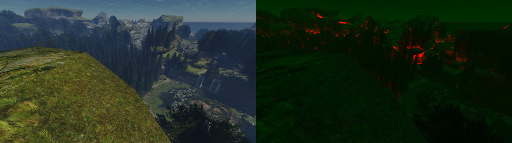

# Тень солнца моргает чёрным над лесом из елей

Дата: 2026-11-18. Статус: чёрные страницы исправлены в первом круге. Мигание теней вдали при переполнении предела пар убрано во [втором круге](#второй-круг): сделан отбор мешлетов по странице, а переполнение теперь отбрасывает пары по правилу. Цену изнутри леса (+0,8 мс проходов VSM) принял ведущий, предел пар не уменьшается. Переполнение у 256 и 1 024 полных елей осталось и ждёт уровней для теней (задача 5 [доработок движка](engine-plan.md)). 2026-11-19: [третий круг](#третий-круг-ритм-в-4-кадра) нашёл, почему одна дальняя тень всё ещё мигала в ритме 4 кадров клипа. Раскладка страниц теперь не зависит ни от отбора, ни от сетки джиттера ([третья версия](#третья-версия-раскладка-по-сетке-таблицы)). На стенде из 1 024 полных елей отбор с 30 м всё равно меняется: спрос одной грубой страницы гуляет больше запаса гистерезиса; в кадре мигания нет, остаток — [долг #1592](https://github.com/kaifaty/GothicAI/issues/1592). Цену третьей версии на лесе с уровнями (до +0,6 мс проходов VSM) ведущий принял 2026-11-19.

Пользователь увидел на экране Ryzen во время [замера цены леса](tree-cost.md), что «часть экрана моргает чёрным». Склон холма под камерой и долина уходили в чёрную тень кусками по страницам карты теней (VSM), а соседний прогон того же вида был освещён нормально.


## Коротко

1. **Причина — переполнение предела пар «мешлет — страница» и хвост буфера пар с прошлого кадра.** Проход видимости VSM (`vsm_visibility_pass.comp`) резервирует слоты пар счётчиком. Кластер, который пересёк предел 524 288, оставлял свои слоты ниже предела незаписанными. В них лежали пары прошлых кадров. Упаковка (`vsm_pack_draws.comp`, проход 1) читает все слоты ниже предела. Она засчитывала эти пары их отрисовкам сверх диапазонов, которые проход 0 разложил по счёту этого кадра. Пары ложились в диапазон следующей отрисовки, а та рисовала чужие мешлеты своим конвейером. Это мешлеты другого ведра, прочитанные в чужой раскладке вершин. Мусорные треугольники, обрезанные по прямоугольнику страницы, заливали всю страницу ближней глубиной: страница целиком «в тени».
2. **Ели — первое, что переполняет предел.** Кластер предмета — весь его меш: ель А — около 724 мешлетов. Её кластер идёт целиком в каждую страницу, которую задевает его сфера. На виде `near-30` 64 ели просят около 0,56 млн пар, 256 — около 1 млн, 1 024 — около 3 млн. Контроль без елей просит 24–26 тыс.
3. **Не каждый кадр** — потому что, какой кластер упрётся в предел и чьи пары лежат в хвосте, решает порядок, в котором видеокарта выполняет группы прохода видимости. Не всякая чужая пара даёт мусор. Без елей при пределе, заниженном до 16 384, пары тоже переливаются (5–63 за кадр), но склон не чернеет ни разу.
4. **Починка:** кластер, пересёкший предел, заполняет свои слоты ниже предела парой-пропуском `VSM_PAIR_SKIP`, и упаковка её пропускает. Новый счётчик `spilled` в журнале `OPENGOTHIC_VSM_STATS=1` считает пары, легшие за диапазон своей отрисовки: до правки 24–680 за кадр, после — 0.
5. **Итог:** 0 тёмных кадров из 750 на 64, 256 и 1 024 елях; на `main` — 3,2–4,4 % на 1 024 елях, на 64 — 35,6 % (при старом поведении). Контроль без елей не изменился. Проходы VSM дороже не стали: +0,004 мс у `VSM-rendering`.
6. **Чего правка не делает:** пары сверх предела по-прежнему не рисуются. Тени дальних грубых мипов и тени ламп при переполнении выпадают. Здесь первый круг ошибся: выпадали они не «устойчиво, без мигания». Какие кластеры упрутся в предел, решал порядок групп видеокарты, и вдали тени появлялись и пропадали от кадра к кадру. Мера средней яркости большой рамки этого не видела; разбор и починка — во [втором круге](#второй-круг). Огрубление мипа это не лечит: лес из 1 024 елей — 741 тыс. мешлетов, больше предела даже по одной странице на ель. Лечат уровни детализации для теней ([долг #1556](https://github.com/kaifaty/GothicAI/issues/1556)).

## Как воспроизвести

Сценарий `scripts/bench/tree-shadow-flicker.bench`: вид `near-30` из [`perf-trees.bench`](tree-cost.md) — камера на скальном холме в 30 м от края леса, полдень. Сначала стоп-кадр и клип 25 с, затем стоп-кадр вида `inside`. Наборы леса строит `scripts/content/fir_set.py forest` (`--count 0` — контроль).

```bash
OPENGOTHIC_CONTENT=<набор> OPENGOTHIC_VSM_STATS=1 TEMPEST_WINDOW_SIZE=1920x1080 BENCH_HOST=ryzen \
  scripts/bench.sh tree-shadow-flicker <папка>
python3 reports/engine/2026-11-16-modern-trees/shadow_flicker.py <папка>/near-30.mp4 [--ref <клип-эталон>]
```

Мера — доля кадров клипа, где средняя яркость склона под камерой (рамка 0,08–0,40 × 0,60–0,95 кадра) упала больше чем на треть от эталона. Эталон — медиана склона в клипе без предела (`OPENGOTHIC_VSM_PAIRS=4194304`): 73,5 из 255. `OPENGOTHIC_VSM_PAIRS=<n>` задаёт другой предел пар: с ним видно настоящий спрос сцены и воспроизводится переполнение без леса. При переполнении счётчик `meshletCount` — нижняя граница спроса: кластер бросает остальные страницы после первого отказа.

## Наименьшее воспроизведение

Ryzen, RTX 3080, 1920×1080, клип 25 с (750 кадров; первый прогон записал 500). Опыт со «старым поведением» — сборка с выключателем, который оставлял хвост незаписанным, как на `main`. Выключатель убран после опыта.

| Прогон | Пар за кадр (журнал) | `spilled` за кадр | Тёмных кадров |
|---|---:|---:|---:|
| 64 ели, старое поведение | 0,559–0,563 млн | 197–625 | 267 / 750 (35,6 %) |
| 256 елей, старое | 0,962–0,968 млн | 129–680 | 69 / 750 (9,2 %) |
| 1 024 ели, старое | 2,14–2,19 млн | 24–572 | 31 / 500 (6,2 %) |
| 1 024, старое, без mesh-шейдеров (`OPENGOTHIC_MS=0`) | 2,14–2,15 млн | 202–604 | 27 / 750 (3,6 %) |
| 1 024, старое, без ветра (`OPENGOTHIC_FOLIAGE=light`) | 1,86–1,92 млн | 40–447 | 24 / 750 (3,2 %) |
| 1 024, старое, без лучей (`OPENGOTHIC_RT=0`) | 2,14–2,16 млн | 65–179 | 34 / 750 (4,5 %) |
| без елей, предел 16 384, старое | 19,5–20,6 тыс. | 5–63 | 0 / 750 |
| без елей, предел 16 384, с пропусками | 19,6–20,2 тыс. | 0 | 0 / 750 |
| без елей, без правок | 24–26 тыс. (ниже предела) | 0 | 0 / 750 |
| 1 024, только пропуски | 2,15–2,17 млн | 0 | 0 / 750 |
| 1 024 без предела (`OPENGOTHIC_VSM_PAIRS=4194304`) | 2,94–3,17 млн | 0 | 0 / 750 |
| `main` `3f071ac2e`, 1 024 | — | — | 24 / 750 (3,2 %) |
| `main` `24de3fddb`, 1 024 | — | — | 33 / 750 (4,4 %) |

Вывод: моргание идёт с переполнением и только с переливом пар. Ветер, лучи и mesh-шейдеры его не убирают: они меняют спрос не больше чем на 15 %. Свет кроны и двусторонность отдельно не проверялись: они не меняют ни кластеров, ни их сфер, а значит, и счёта пар. Одна ель предел не переполняет: в контрольном наборе одинокая ель стоит в 36 м от камеры, спрос — 24–26 тыс. На этом виде предел переполняют уже 64 ели.

## Что изменено

- `vsm_visibility_pass.comp`, `emitCluster`: кластер, пересёкший предел, пишет `VSM_PAIR_SKIP` в свои слоты ниже предела. Предел приходит пуш-константой (`DrawCommands::vsmPairCap`).
- `vsm_pack_draws.comp`, проход 1: пропускает пары `VSM_PAIR_SKIP`. Пару, легшую за диапазон своей отрисовки, считает в `VsmHeader::pairSpill`.
- `vsm_common.glsl`: `VSM_PAIR_SKIP`, поле `pairSpill`; `vsm_clear.comp` обнуляет его каждый кадр.
- `renderer_vsm.cpp`: строка `vsm stats` пишет `spilled = …` и предел этого запуска.
- `DrawCommands::vsmPairCap`: предел 524 288 или `OPENGOTHIC_VSM_PAIRS=<n>` для опытов; буферы кластеров VSM следуют за ним.
- Тест: `tests/vsm_pair_cap_test.h` в `gothic-material-texture-test`. Настоящие `vsm_clear`, `vsm_visibility_pass` и `vsm_pack_draws` на видеокарте получают шесть кластеров трёх отрисовок: 42 пары при пределе 40. Хвост буфера заполнен «прошлым кадром». Тест проверяет, что перелива нет, каждая отрисовка берёт только свои мешлеты, а кластер, пересёкший предел, не рисуется. Со старым шейдером тест падает на «no pair is packed past its draw's range».

## Числа после правки

- **Тёмные кадры:** 0 / 750 для 64, 256 и 1 024 елей; три прогона на слитой с `main` ветке, `spilled = 0` при `OVERFLOW`. Склон держится в 72,95–73,90 у всех; эталон — 72,97–73,87.
- **Устойчивость при переполнении:** покадровая разница яркости долины и леса — медиана 0,13, максимум 0,90 из 255. У эталона без предела — 0,08 и 0,56, у старого поведения — 0,66 и 13,7. Эта мера оказалась слепой: средняя яркость большой рамки не видит пятна тени в углу кадра. Мера блоков второго круга нашла на этих же клипах 41 мигающий блок у 1 024 елей и 3 — у 256.
- **Контроль без елей**, по два прогона на каждой сборке, стоп-кадры 1920×1080. `near-30`: средняя разница `main ↔ стало` 0,006–0,009, `main ↔ main` — 0,007. `inside`: 0,002 и 0,002. Яркость кадров совпадает до сотых: 68,06 и 53,61.
- **Время кадра**, `scripts/perf.sh trees`, 2560×1440, 1 024 ели, два повтора, вид `view-2` (`near-30`). `main` `24de3fddb` — 20,872 мс, ветка `72c68b787` — 19,949 мс. Проходы VSM: `VSM-rendering` 4,740 → 4,744, `VSM-visibility` 0,171 → 0,173, `DirectSunLight-VSM` 0,465 → 0,474 мс. Разницу в −0,92 мс дали проходы вне VSM (`GI-Lighting`, `SSAO-depth`, `Irradiance`): это разброс стенда, а не правка.

## Мягкая деградация: почему не «грубее мип»

Задача просила, чтобы при исчерпании предела тень огрублялась, а не чернела. Первый круг так и сделал: смещение мипа страниц солнца по нагрузке прошлого кадра. Счётчик кадра поднимал смещение, если пар больше 0,85 предела, и медленно опускал, если меньше 0,35. Опыт на 1 024 елях:

| Вариант | Пар за кадр | Смещение | Яркость долины и леса против эталона |
|---|---:|---:|---:|
| только пропуски | 2,15 млн (переполнение) | 0 | +0,65 |
| пропуски и смещение | 1,05–1,08 млн (переполнение) | 3,0 (потолок) | +1,51 |

При смещении в три мипа страницы стали в 64 раза крупнее по площади, а пар стало меньше лишь в 2,9 раза. Дошли до пола: ель целиком, все её 724 мешлета, ложится хотя бы в одну страницу каждого мипа рядом с ней. 1 024 ели — 741 тыс. мешлетов, это больше предела. Огрубление сделало тени всего кадра в 8 раз грубее, а переполнение осталось. Поэтому от него отказался.

Что видно при переполнении теперь. Проход видимости идёт по мипам от мелких к крупным, лампы — последними. Пары сверх предела — это тени грубых мипов: дальние склоны, дальний край леса, двор за хижиной. Ближние тени целы. Средняя ошибка в долине и лесу — +0,65 яркости. Вывод «она не мигает» был неверен: в среднем по рамке ошибка стоит на месте, а в отдельных местах тени появлялись и пропадали ([второй круг](#второй-круг)). Тени ламп при переполнении выпадают целиком. На этом виде днём ламп нет.



## Что осталось

- **Предел пар переполнен на любом виде с 64 и больше полными елями.** Лечат свой уровень детализации для теней (п. 3 [предложения к уровням](tree-cost.md#что-из-этого-следует-для-уровней)) или отбор мешлетов предмета по странице. Мера готовности — `meshletCount` ниже предела на всех видах `perf-trees.bench` по `OPENGOTHIC_VSM_STATS=1`. Записано в [долг #1556](https://github.com/kaifaty/GothicAI/issues/1556). Отбор мешлетов сделан во втором круге: 64 ели теперь помещаются, 256 и 1 024 — нет.
- **Тени ламп при переполнении выпадают первыми:** проход видимости ставит их последними. Во втором круге лампы допускаются первыми.
- **Счётчик при переполнении занижен:** после первого отказа кластер не считает остальные страницы. Во втором круге спрос считается до записи пар, и `demand` в журнале — полный спрос.
- Строку `VSM` в таблицах [цены леса](tree-cost.md) по-прежнему нельзя читать как цену теней. Чёрных страниц больше нет, но тени сверх предела не рисуются.

## Где лежит

Клипы и кадры — вне git, `~/.local/share/gothic-ai/remaster/trees-fir/shadow-flicker/`:

- `before-main-24de3fd-f1024-near-30.mp4` — «было», `main`, 1 024 ели;
- `after-fix-f1024-near-30.mp4` — «стало»;
- `before-after-f1024-near-30.mp4` — склейка «было | стало», 1920×540;
- `before-after-f1024-near-30-frame270.png` — самый тёмный кадр «было» рядом с тем же кадром «стало»;
- `overflow-skip-vs-uncapped-diff.jpg` — где пропадает тень при переполнении;
- `perf/main-24de3fd`, `perf/fix-72c68b7` — замеры времени `perf.sh trees` с проходами видеокарты;
- `runs/` — все прогоны с журналами: `r*`, `s*` — опыты, `fix-*`, `main-*` — до слияния с `main`, `m-*` — после;
- `sets/` — наборы леса, копия `~/gothic-ai/tree-shadow-flicker/content/` на Ryzen.

## Второй круг

Дата: 2026-11-18. Пользователь посмотрел склейку «было | стало» первого круга: «на переднем плане починили, а на заднем плане, там, где деревья, всё ещё моргает».


### Что было неверно в первой оценке

Мерой устойчивости была средняя яркость большой рамки — склона, долины и леса. Пятно тени у фермы, которое появляется и пропадает, сдвигает среднее рамки на доли единицы и в нём тонет. Отсюда неверная фраза «выпадают — устойчиво, без мигания». При переполнении какие кластеры упрутся в предел, решал порядок групп видеокарты, а он меняется от кадра к кадру.

**Мера блоков** (`shadow_flicker.py --blocks <клип> [--map карта.png]`):
- кадр уменьшается до 480×270 и делится на блоки 10×10 пикселей;
- блок «прыгает», если его яркость между соседними кадрами изменилась больше чем на 15 % его медианы по клипу (плюс 4, чтобы тёмные блоки не прыгали от шума);
- клип мигает, если хоть один блок прыгнул три раза и больше; второе число — кадры, где прыгнули два блока и больше.

Карта рисует число прыжков блока красным поверх среднего кадра клипа. Мера повторяет первый счёт пользователя и даёт его же числа.

> **Поправка третьего круга.** Блоки 10×10 с порогом 15 % пятно, которое пропадает на 2 кадра из 4, не видели. На клипе `b2-f1024` итога этого круга они дают 0 мигающих блоков. Мера третьего круга (960×540, блоки 6×6, 8 %, без травы у камеры) находит там же два блока у сарая по 374 прыжка. Строка «0, 0» в таблице [чисел](#числа) ниже верна только для старой меры; [пересчёт](#третий-круг-ритм-в-4-кадра). Режим `--blocks` теперь по умолчанию считает новой мерой, старая — `--size 480x270 --block 10 --jump 0.15 --exclude none`.


| Клип `near-30` после PR 1557 | Мигающих блоков | Кадров с прыжками | Худший блок | Где |
|---|---:|---:|---:|---|
| 1 024 ели | 41 из 1 296 | 366 из 750 | 346 | x 0,65–1,00, y 0,37–0,70: долина, ферма |
| 256 | 3 | 73 | 238 | x 0,60–0,67, y 0,37–0,41 |
| 64, контроль | 0 | 0 | 0 | |
| 1 024 без предела | 0 | 0 | 0 | |

### Откуда спрос

Счётчики `vsm stats` второго круга считают полный спрос до записи пар. Это вид `near-30`, 1 024 ели, 1920×1080:

| | Лампы | Мипы 0–4 | Мип 5 | Мип 6 | Мип 7 | Мип 8 |
|---|---:|---:|---:|---:|---:|---:|
| пар после отбора мешлетов, тыс. | 23–27 | 30–40 | 481–487 | 512–521 | 299–302 | 250–255 |

Лес на экране лежит в мипах 2–5. Мипы 5–8 размечает ещё и туман (`vsm_fog_shadow.comp`): он берёт мип на четыре грубее, чем экран в той же точке, и закрывает лучами весь объём кадра. В грубой странице ель лежит целиком в одной записи. Отбор мешлетов там ничего не даёт, помог бы только уровень детализации для теней.

### Что сделано

1. **Отбор мешлетов предмета по странице.** Проход видимости (`vsm_visibility_pass.comp`) больше не пишет пары. Для каждой записи страницы, которую задевает сфера кластера, он записывает кандидата «кластер — запись — корзина». Новый проход `vsm_cull_meshlets.comp` берёт кандидата одной группой из 64 потоков. Для предмета — экземпляра статичного меша без деформации и морфа — он проверяет сферу каждого мешлета против прямоугольника записи или грани лампы. Остальные кластеры (земля, скины, пряди) идут целиком, как раньше.
   - Сферы мешлетов `PackedMesh` считал и раньше, теперь он их хранит, уровни детализации тоже. `StaticMesh::meshletSpheres` держит их на процессоре. Общий массив на видеокарте — `MeshletSpheres` (`graphics/meshletspheres.*`): мешлет i меша лежит по смещению `Bucket::meshletSpheres` плюс i. Массив заполняет `DrawBuckets`, когда пишет корзины, тем же кадром и тем же `patch.comp`, что и экземпляры.
   - Радиус мешлета растёт на масштаб экземпляра и на то, что сдвигает вершины: ветер дерева и волну материала (разница сферы кластера и `bboxRadius` корзины) и толщину.
   - Правило 32 пикселей прохода видимости осталось на кластере. Для мешлетов его нет: иначе мелкие мешлеты грубого мипа стёрли бы тень дальнего дерева.
2. **Предел — по правилу, а не гонкой счётчика.** Пары делятся на корзины:
   - сначала лампы — 16 корзин по расстоянию от камеры;
   - потом страницы солнца по мипу от мелкого к крупному, а в мипе — по кольцу таблицы страниц, до которого доходит запись, от центра наружу.

   `vsm_clear.comp` в начале кадра обнуляет спрос и переносит корзины, нарисованные в прошлом кадре, в `admitPrevBits`. Буфер заголовка при создании обнуляется: в первом кадре ни одна корзина не числится нарисованной. Первый проход `vsm_cull_meshlets.comp` считает пары каждой корзины, второй пишет их. Перед записью он берёт корзины по порядку, пока сумма помещается в предел. Первая корзина сверх предела и все за ней отбрасываются целиком. Спрос сосчитан до того, как записана хоть одна пара, поэтому порядок групп видеокарты ничего не решает: при неподвижной камере отбрасываются одни и те же корзины. Корзина, отброшенная в прошлом кадре, возвращается, только если влезает в 7/8 предела. Корзина, нарисованная в прошлом кадре, держит весь предел. Так спрос на границе не включает и не выключает кольцо страниц: ранние корзины гуляют на ±12 тыс. пар, а 1/8 предела — 65 тыс.
3. **Счётчики.** `OPENGOTHIC_VSM_STATS=1` пишет `meshletCount` (нарисовано), `demand` (спрос после отбора; `OVERFLOW`, если он больше предела), `whole clusters` (спрос, если брать кластеры целиком), `candidates` и строку `vsm pairs by class` со спросом ламп и каждого мипа и с тем, что отброшено.
4. **Тест** `vsmPairCapRecords` (`tests/vsm_pair_cap_test.h`) гоняет настоящие `vsm_visibility_pass`, `vsm_cull_meshlets` и `vsm_pack_draws` на видеокарте. Данные: три записи солнца (мипы 0–2) и грань лампы, предмет из семи мешлетов и кластер земли. Тест проверяет:
   - `vsm_clear.comp` обнуляет спрос, кандидатов и пары целых кластеров и переносит нарисованные корзины в «прошлый кадр»;
   - предмет даёт записи только мешлеты, чьи сферы её задевают, а сферы читаются по смещению корзины;
   - сфера мешлета растёт на масштаб экземпляра (2) и на запас сферы кластера над мешем (ветер, волна): мешлет 6 задевает страницу мипа 0 только так;
   - кластер без сфер идёт целиком;
   - корзины идут по порядку и лампы первыми; при пределе 16 спрос 17 отбрасывает мип 1 и всё за ним, хотя мип 2 влез бы;
   - отброшенный мип 1 не возвращается при пределе 17 без запаса в 1/8;
   - нарисованная корзина входит ровно на пределе;
   - упаковка пропускает слот `VSM_PAIR_SKIP` (находка ревью первого круга); слот называет существующую отрисовку, так что без фильтра она взяла бы его наверняка, а не по гонке;
   - `spilled = 0`, и ни одна отрисовка не берёт пар прошлого кадра.

   Первая версия теста упала на проверке спроса в сохранённой проверке на Ryzen. Ошибка была в тесте: он ставил единичную матрицу вида. Шейдер берёт центр сферы через вид солнца, а радиус переводит масштабом 1/1024 на сантиметр (`smWidthInv`, как `Camera::mkViewShadowVsm`). При единичном виде мешлеты в 32 см от центра оказывались в 32 единицах NDC, за таблицей страниц, и спрос корзин солнца выходил нулевым. Теперь вид теста масштабирует x и y на 1/1024, как игровой. Проверки прежние, их сообщения пишут фактический спрос корзин.

Подбор правила в этом круге шёл по замерам:
- корзины целыми мипами дали 0 мигающих блоков, но отбросили весь мип 5: долина стала светлее эталона на 11 из 255;
- жадное заполнение, которое после невлезшей корзины пробует следующие, качало число нарисованных пар между снимками от 230 до 480 тыс.: большие кольца мипов 7–8 то входили, то нет;
- принят префикс корзин с гистерезисом.

### Числа

Прогоны `tree-shadow-flicker.bench` на Ryzen, RTX 3080, 1920×1080, по два на каждый лес. Счётчики сняты во время клипа `near-30` и после него на виде `inside`.

| Лес | Спрос `near-30`: целыми кластерами → по мешлетам | Нарисовано | Спрос `inside` | Нарисовано | Мигающих блоков, два прогона |
|---|---|---:|---|---:|---|
| без елей | 24,5 тыс. → 18,6–19,0 тыс. (×1,3) | всё | — | — | 0 (один прогон) |
| 64 | 0,86–0,96 млн → 0,24 млн (×3,6–3,9) | всё | 1,38–1,57 млн → 0,25 млн (×5,6–6,2) | всё | 0, 0 |
| 256 | 1,60–1,70 млн → 0,78–0,79 млн (×2,1) | 0,48–0,49 млн, отброшены мипы 7–8 и край мипа 6 | 2,65–2,87 млн → 0,68–0,70 млн (×4) | 0,37–0,39 млн, отброшены мипы 7–8 | 0, 0 |
| 1 024 | 2,68–2,78 млн → 1,61–1,63 млн (×1,7) | 0,23–0,25 млн, отброшены внешние кольца мипа 5 и мипы 6–8 | 3,2–3,6 млн → 1,13–1,16 млн (×3) | 0,37–0,40 млн, отброшены мипы 7–8 | 0, 0 |

Во всех прогонах `spilled = 0`, кандидатов не больше 20,5 тыс. при ёмкости 524 288. У 256 елей срез один раз сдвинулся наружу до начала клипа, когда освободилась 1/8 предела. Во время клипа рисуется ровно 482–491 тыс.

- **Контроль без елей**, стоп-кадры против двух прогонов после PR 1557. `near-30`: |прежний₁ − новый| 0,008, |прежний₁ − прежний₂| 0,009; `inside`: 0,003 и 0,003. Средняя яркость та же: 69,94 и 57,03.
- **Что отброшено, 1 024 ели.** Медиана 60 кадров клипа против клипа без предела первого круга (`r4-f1024-full`, тот же вид). По кадру: +0,36 яркости из 255, после PR 1557 было +0,38. В рамке долины и фермы: +1,0, было +0,7. Пикселей, ушедших дальше 6, — 1,3 % против 1,2 %. Светлее эталона дальний гребень и двор фермы: это внешние кольца мипа 5, и в клипе они стоят.

### Цена

Одна тихая заявка `shadow_flicker_price.sh`: `perf-trees.bench`, 1 024 ели, 2560×1440, `OPENGOTHIC_GPU_PASSES=1`. Ветка `c544ed714` — код второго круга, слитый с `main` `60a42adf2`; прогоны «ветка, main, ветка». Время в мс:

| Вид | Кадр: main / ветка | `VSM-rendering` | `VSM-visibility` | Проходы VSM вместе |
|---|---|---|---|---|
| `inside` (view-1) | 26,38 / 26,34, 27,82 | 5,03 / 5,50, 6,20 | 0,189 / 0,201, 0,221 | 6,15 / 6,53, 7,34 |
| `near-30` (view-2) | 20,49 / 16,83, 18,49 | 5,01 / 2,53, 2,83 | 0,175 / 0,191, 0,209 | 5,88 / 3,33, 3,74 |
| `far-100` (view-3) | 20,92 / 21,17, 21,90 | 5,22 / 6,08, 6,24 | 0,205 / 0,214, 0,223 | 6,01 / 6,88, 7,05 |
| `far-300` (view-4) | 17,47 / 12,70, 12,98 | 5,06 / 0,51, 0,52 | 0,205 / 0,231, 0,236 | 5,80 / 1,25, 1,29 |

- `near-30` и `far-300` стали дешевле на 2,0–4,7 мс кадра.
- `inside` и `far-100` дороже по `VSM-rendering` на 0,5–1,2 мс. Два прогона ветки сами расходятся на 0,7 мс: шум стенда велик, но знак у обоих один.
- Почему дороже: `main` рисовал случайную часть пар из мипов 5–6 (туман и дальние страницы), а ветка рисует допущенные корзины целиком. Отбор мешлетов убрал дешёвые пары — мешлеты вне страницы, которые отсекались плоскостями. Осталась работа, которая даёт тень.
- `VSM-visibility` с проходом мешлетов дороже на 0,01–0,03 мс.
- Память: буфер кандидатов — 8 МБ при пределе 524 288. Массив сфер — 16 байт на мешлет загруженных статичных мешей.

### Что осталось

- **Цена изнутри леса принята** (решение ведущего 2026-11-18). Бриф ставил порог +0,5 мс кадра, а на `inside` ветка в среднем по двум прогонам дороже `main` на 0,71 мс кадра и на 0,79 мс проходов VSM. На остальных видах кадр дешевле. `main` был дешевле только тем, что случайно недорисовывал дальние тени. Предел пар остаётся 524 288.
- **Спрос 256 и 1 024 полных елей выше предела** — мипы 5–8, тени тумана и дальних колец. Лечат уровни для теней: ель с уровнями `fir_set.py --levels` вдали рисует 1/8 мешлетов. Долг #1556 остаётся.
- **Список кандидатов** держит до 524 288 записей «кластер — запись»; сейчас бывает до 20,5 тыс. Если он переполнится, то, какие кандидаты потерялись, снова решит порядок групп (`LOST` в журнале).
- **Срез корзин** может разово сдвинуться наружу при неподвижной камере, когда спрос падает на 1/8 предела: кольцо страниц появляется один раз и остаётся.

Вне git, `~/.local/share/gothic-ai/remaster/trees-fir/shadow-flicker/round-2/`:
- `before-after-f1024-near-30.mp4` — склейка «после PR 1557 | второй круг», 1920×540;
- `blocks-pr1557-f1024.png`, `blocks-round2-f1024.png` — карты прыжков обеих половин, и их JSON;
- `shadow-flicker-round2-sheet.png` — лист полного размера;
- `runs/` — прогоны с журналами: `a1` — корзины целыми мипами, `a2` — жадное заполнение, `a3`, `b1`, `b2` — итог; `price/` — заявка цены (`main`, `fix-1`, `fix-2`).

## Третий круг: ритм в 4 кадра

Дата: 2026-11-19. После PR 1566 пользователь увидел, что «всё ещё есть небольшое мигание одной тени вдали». PR 1566 обещал: при неподвижной камере отбрасываются одни и те же корзины. Обещание держалось для корзин, но не для страниц.

### Что было

Мера блоков третьего круга (`shadow_flicker.py --blocks`): кадр 960×540, блоки 6×6, прыжок — изменение яркости блока между соседними кадрами больше 8 % его медианы (плюс 4). Трава у камеры (x < 0,18, y > 0,66 кадра) не считается: она колышется ветром и прыгает и в клипе без елей.

| Клип `near-30` | Мигающих блоков | Кадров с прыжками | Худшие блоки |
|---|---:|---:|---|
| `b2-f1024`, итог второго круга | 3 | 374 | (0,694; 0,356) и (0,700; 0,356) — по 374 прыжка: земля перед сараем фермы за лесом |
| `b2-f256` | 21 | 234 | по 234 прыжка: дальние точки опушки, (0,469; 0,267), (0,25; 0,30) |
| `b2-f64`, контроль без елей `b1-f0` | 0 | 0 | — |
| `b2-f1024` старой мерой (10×10, 15 %) | 0 | 0 | — |

У сарая ритм строгий: 2 кадра клипа с тенью, 2 без. Тёмное значение (~54) — верное: без предела и в контроле там ровно столько.

### Как найдено

**Покадровый журнал** `OPENGOTHIC_VSM_STATS=frames` (`Renderer::logVsmFrame`, `renderer_vsm.cpp`). После прохода мешлетов `VsmHeader` копируется в буфер чтения своего слота кадра, а читается, когда слот приходит снова: ожидания видеокарты нет. Строка на каждый кадр подряд содержит:
- номер кадра, кандидатов, записи страниц, нарисованные пары, спрос;
- первую отброшенную корзину и была ли она нарисована в прошлом кадре;
- `admitBits` и `admitPrevBits`;
- `gpu==cpu` — тот же отбор `admit()`, повторённый на процессоре по спросу и прошлому кадру;
- `prev==last` — взятые корзины прошлого кадра совпадают с теми, что он нарисовал;
- спрос каждой непустой корзины с `+` (нарисована) или `-`.

Режим отбор не меняет. Прогоны `c1` (с журналом) и `c2` (тот же движок `30dbf01a265c`, без журнала) на 1 024 полных елях дают у сарая одинаково: 374 прыжка, рисунок «LLdd» в одной фазе, 376 светлых кадров из 750.

Журнал `c1`, 1 499 кадров записи клипа:
- `admitBits` ни разу не изменился;
- `gpu==cpu` во всех кадрах, `admitPrevBits` всегда равен `admitBits` кадра перед ним;
- гистерезис, перенос состояния между кадрами в полёте и запись `admitBits` группой работают как задумано, кандидатов не больше 17 тыс. при ёмкости 524 288.

Менялся состав корзин:

```
vsm frame 1360: … drawn 221045, demand 1599408, cut m5r9 313296 left out before, gpu==cpu … bins m4r4+8799 m4r5+2071  … m5r6+130147 m5r7+93 m5r9-313296  | фаза 0
vsm frame 1361: … drawn 234174, demand 1618608, cut m5r9 312466 left out before, gpu==cpu … bins            m4r5+23503 … m5r6+130140 m5r7+20 m5r9-312466  | фаза 1
vsm frame 1362: … drawn 233578, demand 1618023, cut m5r9 312473 left out before, gpu==cpu … bins            m4r5+23503 … m5r6+130150 m5r7+93 m5r9-312473  | фаза 2
vsm frame 1363: … drawn 235908, demand 1613482, cut m5r9 312470 left out before, gpu==cpu … bins            m4r5+23501 … m5r6+130144         m5r9-312470  | фаза 3
```

Состав повторяется с периодом ровно 8 кадров рендера: у наличия `m4r4` автокорреляция 1,00 на сдвиге 8 и 0,99 на 16. Восемь — число фаз джиттера TAA (Halton 2, 3; `Taa::Phases`). По фазам `m5r7` держит 93–101 пару в фазах 0, 2, 4, 5, 7 и 17 — в фазах 1, 3, 6. Значит, 76 пар записи у сарая уходят в отброшенную `m5r9`. Клип пишет каждый второй кадр рендера: снимок стенда рисует свой кадр через `Renderer::screenshoot`, и джиттер идёт на каждом. В нечётных фазах 1, 3, 5, 7 тень пропадает на 2 кадра клипа из 4. У 256 елей похоже, но 1 кадр из 4.

### Причина

Корзину пар задаёт запись страниц, а не страница. Записи — это квадраты 2×2 и 4×4 из `vsm_clump_pages.comp` и горизонтальные полосы до 15 страниц из `vsm_merge_pages.comp`. Квадраты считаются от сетки, которая начинается с первой размеченной страницы полосы рядов. Корзина записи — кольцо её дальней страницы (`vsmSunBin`), а срез отбрасывает корзины целиком.

Страница у среза, слитая с более дальними, уходит в их корзину. Разметка страниц на краях меняется с джиттером кадра, за ней сдвигаются квадраты и полосы. Страница у сарая (мип 5, кольцо 7) оказывалась то в своей записи `m5r7` (рисуется), то в полосе до кольца 9 (`m5r9`, отброшена). Выключатель тут не понадобился: и журнал, и клип показывают ровно восемь фаз.

### Правка

**Первая версия** (`cf7a26d1b`): ни один квадрат и ни одна полоса не держат страниц по обе стороны края корзин, нарисованных прошлым кадром. Прогоны после неё — по одному на набор:

| Набор | Мигающих блоков `near-30` | Нарисовано `near-30` | Отбор `inside`, кадры неподвижной камеры |
|---|---:|---:|---|
| 1 024 полные ели | 0 | 460–511 тыс. (до правки 217–253) | меняется в каждом из 600 кадров |
| 256 полных | 0 | 474–498 тыс. | меняется в каждом из 600 |
| 256 с уровнями | 0 | 217–226 тыс., всё | не меняется: переполнения нет |
| 1 024 с уровнями | 0 | 375–413 тыс., всё | меняется в 543 из 600 |

На `near-30` мигание ушло. Но журнал вида `inside` нашёл, что первая версия раскачивает срез: до правки отбор там менялся один раз за 600 кадров.

```
vsm frame 2720: … drawn 404556, cut m7r1 350684 left out before … bins m6r1+144176 m7r1-350684
vsm frame 2721: … drawn 396441, cut m7r0 299492 drawn before    … bins m6r1+144176 m7r0-299492
vsm frame 2722: … drawn 410058, cut m7r1 350680 left out before … bins m6r1+144175 m7r1-350680
```

Как раскачивается срез:
1. Когда отброшено кольцо 1 мипа 7, полосы режутся на краю колец 0 и 1.
2. Внутренние части полос попадают в кольцо 0, оно просит 299 тыс. пар и не влезает.
3. Тогда отброшен весь мип 7, края в нём нет, полосы сливаются и уходят в кольцо 1.
4. Кольцо 0 пустое и снова «влезает» — цикл повторяется.

Разрез по краю делал раскладку функцией среза, а срез — функцией раскладки.

**Вторая версия** (`a99be18a0`): в мипе первой корзины, отброшенной прошлым кадром (`vsmCutMip`), ни квадрат, ни полоса не держат двух колец, где бы в этом мипе ни лежал срез. В остальных мипах и без переполнения страницы сливаются как прежде. Раскладка теперь зависит только от мипа среза.

Расчёт был такой: разрез записей не уменьшает число пар, поэтому переход среза в другой мип сам себя закрепляет. Для полос это верно: проверка сферы против прямоугольника, правило 32 пикселей кластера и проверка глубины страниц монотонны по объединению. Для квадратов — нет, стенд это опроверг ([ниже](#проверка-второй-версии)). Квадрат 2×2 или 4×4 захватывает и неразмеченные страницы, а в мипе среза он распадается на одни размеченные, и пар становится меньше.

Внутри мипа среза у каждой страницы своя корзина, и гистерезис держит срез как прежде.

Тест второй версии (`vsmCutMipRecords`) заменён тестом третьей ([ниже](#третья-версия-раскладка-по-сетке-таблицы)).

### Проверка второй версии

Два прогона сверх бюджета, разрешённые пользователем, с журналом:

| Набор | Мигающих блоков `near-30` | Смен отбора за клип `near-30` | `inside`, последние 600 кадров |
|---|---|---:|---|
| 1 024 с уровнями (`e2`) | 0, переполнения нет: 375–413 тыс. пар | 0 | 0 смен: срез `m8r0`, мип 8 отброшен целиком (154 тыс.); 2 смены только в кадрах сразу после телепорта |
| 1 024 полные (`e1`) | **5**: у сарая 170, 170 и 169 прыжков, (0,881; 0,389) — 29 | **1 497 из 1 499** | 0 смен: срез `m7r0` |

На настоящем контенте вторая версия проходит. На полном лесе срез с `near-30` качается между мипами 5 и 6 через кадр:

```
vsm frame 1360: … drawn 221045, cut m5r9 313296 drawn before  … bins m5r5+39939 m5r6+130147 m5r7+93 m5r9-313296 …
vsm frame 1361: … drawn 430716, cut m6r6 517222 left out before … bins m5r0+14924 m5r2+36553 m5r3+59265 m5r4+88188 m5r5+88944 m5r6+39584 m5r7+21509 m5r8+17545 m5r9+104 …
```

Как качается срез:
1. Срез в мипе 6, мип 5 нарисован целиком и не разрезан. Мип 5 просит 483 тыс. пар (479–504), из них 312 тыс. — в длинных полосах `m5r9`. Они не влезают и при полном пределе.
2. Срез уходит в мип 5, мип 5 режется по кольцам и просит уже 370 тыс. (360–393). Весь мип влезает, срез возвращается в мип 6.

Разрез уменьшил спрос мипа на 23 %. Это квадраты: в мипе среза они распадаются на одни размеченные страницы, а неразмеченные страницы квадрата больше не берут пар. Без разреза раскладка мипа зависит от того, где срез, и петля замыкается уже между мипами, а не между кольцами.

Подбор дальше не шёл. Пользователь выбрал раскладку страниц, которая не зависит от отбора совсем.

### Третья версия: раскладка по сетке таблицы

Решение пользователя 2026-11-19. Раскладка записей не должна зависеть ни от среза отбора, ни от джиттера TAA, а корзина записи — только от раскладки. Тогда спрос корзин не зависит от отбора, и петля невозможна по устройству; гистерезис остаётся прежним.

Чем были плохи прежние раскладки:
- **`main`.** Сетка квадратов начиналась с первой размеченной страницы полосы рядов. Одна метка на краю, которую ставит или не ставит джиттер, сдвигала все квадраты полосы. Полосы шли через кольца, и корзина записи по дальней странице уносила ближние страницы в чужую корзину.
- **Обе версии разреза.** Раскладка зависела от отбора прошлого кадра: от края среза в первой версии, от его мипа во второй. Разрез менял спрос: полос становится больше, а квадраты теряют неразмеченные страницы. Изменённый спрос двигал срез.

**Третья версия** (`fc757e8e8`, `vsm_common.glsl`, `vsm_clump_pages.comp`, `vsm_merge_pages.comp`):
- **Кольца корзин шириной 2 страницы** (`VSM_RING_WIDTH`). Мип занимает 8 из своих 16 мест корзин. Центр таблицы (16) чётный, поэтому границы колец идут по чётным столбцам и рядам.
- **Квадраты только 2×2, на чётных x и y таблицы.** Квадрат такой сетки всегда лежит в одном кольце. Правило «хотя бы две метки и не одна строка» прежнее. Квадратов 4×4 больше нет: квадрат 4×4 никогда не лежит в одном кольце шириной 2.
- **Полоса кончается на смене кольца и на каждом 8-м столбце таблицы** (`VSM_STRIPE_PAGES`). Её концы не зависят от того, с какой страницы она началась.

Что из этого следует:
- каждая запись лежит в одном кольце, и корзина любой страницы — её мип и кольцо, что бы ни было размечено рядом и что бы ни нарисовал прошлый кадр;
- `admitPrevBits` раскладка больше не читает, `vsmCutMip` убран;
- лишняя метка меняет только свою запись.

Почему ширина 2, а не 1 или 4:
- при ширине 1 квадрат 2×2 почти никогда не лежит в одном кольце, и в каждом мипе остались бы одиночные страницы;
- при ширине 4 квадраты 4×4 остаются, но на мип выходит 4 корзины, а внешнее кольцо мипа (туда попадает большая часть страниц мипов от первого) — одна корзина в полмипа.

Ширина 2 срезает по четверти мипа и оставляет квадраты 2×2.

Запись по-прежнему сливается с соседней только при соседстве и в таблице, и в пуле страниц. Где кончится полоса, зависит и от того, где размещение положило записи; кольца это не меняет.

**Тест** `vsmLayoutRecords` (`tests/vsm_pair_cap_test.h`, в `gothic-material-texture-test`) гоняет на видеокарте полную цепочку кадра: `vsm_clear`, `vsm_mark_pages`, `vsm_clump_pages`, `vsm_list_pages`, `vsm_alloc_pages`, `vsm_merge_pages`, `vsm_visibility_pass`, `vsm_cull_meshlets`. Экран 32×32 пикселя, пиксель размечает клетку мипа 0. Тест проверяет:
- раскладку: каждая запись в одном кольце, квадраты на чётной сетке, полоса в одном 8-столбцовом отрезке, каждая размеченная страница — ровно в одной записи; ожидаемые 11 записей;
- что раскладка одинакова при любых корзинах прошлого кадра: ни одной, всех, двух префиксах мипа 0 и срезе в мипе 1;
- что метка далеко (3, 3) и метка на краю ряда (22, 16), как от джиттера, не меняют ни одной другой записи;
- отбор четыре кадра подряд. Кластер просит по 10 пар на запись: 30, 40 и 40 у колец 0, 1 и 2. При пределе 72 кольцо 1 влезает в полный предел (70), но не в 7/8 (63). Из кадра, где ничего не было нарисовано, кольцо 1 так и остаётся вне, из кадра, где было нарисовано всё, остаётся внутри. Раскладка, спрос и корзины одинаковы в каждом кадре.

С шейдерами `main` тест падает на «(17,12 4x4) (10,16 12x1)». С третьей версией проходит: `passed`, 2 546 544 проверки на Ryzen (RTX 3080). `glslangValidator` собирает все 277 вариантов шейдеров, которые включают изменённые файлы.

### Проверка третьей версии

Три прогона `tree-shadow-flicker.bench` с журналом (Ryzen, 1920×1080). Смены отбора считаются за последние 600 кадров перед концом клипа (`near-30`) и перед снимком (`inside`).

| Набор | Мигающих блоков `near-30` | Смен отбора `near-30` | Смен отбора `inside` |
|---|---:|---|---|
| 1 024 полные (`f1`) | 0 | **230 из 600** (511 за весь клип) | 1: кадр 2124, через 2 кадра после телепорта, дальше 0 |
| 1 024 с уровнями (`f2`) | 0 | 0: переполнения нет, спрос 314–366 тыс. (во второй версии 375–413) | 2: кадры 2124 и 2130, через 2 и 8 кадров после телепорта, дальше 0 за 594 кадра; срез `m7r0` |
| контроль без елей (`f3`) | 0 | 0, спрос 20–22 тыс. | 0, спрос 9–15 тыс. |

**Контроль совпадает с прежним.** Стоп-кадр `near-30` против контроля второго круга и двух контролей после PR 1557 отличается в среднем на 0,007–0,010 из 255, а два прежних контроля между собой — на 0,008–0,009. Для `inside` — 0,003–0,004 против 0,003; средняя яркость та же: 69,94 и 57,03.

**Что качается на полном лесе.** Переключается одна корзина — `m6r0`, кольцо 0 мипа 6. Её спрос прыгает между 49–50 тыс. и 144–155 тыс. пар (бывает и 91–98):

```
vsm frame 1504: … drawn 450990, cut m6r1 323854 left out before | … m5r5+32 m6r0+49687 m6r1-323854
vsm frame 1505: … drawn 400968, cut m6r0 145294 drawn before    | … m5r5+32 m6r0-145294 m6r1-323867
vsm frame 1506: … drawn 451052, cut m6r1 323854 left out before | … m5r5+32 m6r0+49685 m6r1-323854
```

Со 145 тыс. корзина не влезает и в полный предел (400 тыс. + 145 тыс.), с 50 тыс. влезает и под 7/8. Скачок в 96 тыс. пар больше запаса гистерезиса (1/8 предела, 65 тыс.). Записей при этом одна и та же сотня (123–124), кандидатов почти столько же: дело не в раскладке, а в том, размечена ли одна грубая страница. В странице мипа 6 лежит большой кусок леса, и она одна приносит ~96 тыс. пар полных елей.

Что известно о причине скачка:
- Разметка зависит от фазы джиттера: доля кадров со 145 тыс. по фазам — 0,34–0,62.
- Разметка зависит и от времени: большой и маленький спрос держатся сериями по 2,5 и 3 кадра. Видимо, ветер крон — это не проверено.
- От отбора разметка не зависит: `vsm_mark_pages` и разметка тумана (`vsm_fog_shadow.comp`, `PAGES`) теней не читают, раскладка — тоже.
- Разница «после нарисованной / после отброшенной корзины» (0,32 и 0,54) держится на 26 кадрах и объясняется тем, что большой спрос сам отбрасывает корзину.

В клипе мигания не видно, потому что снимок берёт нечётные фазы, где корзина почти всегда отброшена. В игре, где рисуются все фазы, тени страниц `m6r0` с 30 м на полном лесе будут переключаться.

На настоящем контенте (ели с уровнями) этого нет: на `near-30` нет переполнения, изнутри срез стоит на `m7r0` после того, как сцена догрузилась.

Ведущий принял третью версию (2026-11-19): петли через раскладку нет, на всех трёх наборах 0 мигающих блоков. Шум разметки грубых страниц записан долгом [#1592](https://github.com/kaifaty/GothicAI/issues/1592). Гасит его свой уровень ели для теней (#1556) или спрос корзины по максимуму за цикл джиттера.

### Цена третьей версии

Одна тихая заявка `shadow_flicker_price.sh`: `perf-trees.bench`, пять видов, 2560×1440, `OPENGOTHIC_GPU_PASSES=1`, по одному прогону. Сравниваются ветка, слитая с `main` (`4b7c7e839`), и сам `main` (`426eec6c3`). Наборы — 1 024 ели с уровнями и контроль без елей. Время в мс, «проходы VSM» — сумма `VSM-pages`, `VSM-pages-alloc`, `VSM-pages-epipolar`, `VSM-epipolar-fog`, `VSM-visibility` и `VSM-rendering`; порог — +0,3 мс на любом виде.

| Вид | Ели с уровнями: кадр GPU, main → ветка | Проходы VSM | из них `VSM-rendering` | `VSM-visibility` | Контроль: проходы VSM |
|---|---|---|---|---|---|
| изнутри (view-1) | 21,27 → 21,46 | 5,98 → 6,15 (+0,17) | 5,58 → 5,63 | 0,21 → 0,33 | 0,66 → 0,69 (+0,03) |
| 30 м (view-2) | 16,08 → 15,96 | 5,99 → 6,33 (**+0,34**) | 5,51 → 5,84 | 0,30 → 0,31 | 0,75 → 0,78 (+0,03) |
| 100 м (view-3) | 13,42 → 13,70 | 4,23 → 4,84 (**+0,60**) | 3,79 → 4,35 | 0,27 → 0,32 | 0,82 → 0,85 (+0,04) |
| 300 м (view-4) | 9,34 → 9,51 | 3,01 → 3,30 (+0,29) | 2,50 → 2,77 | 0,31 → 0,34 | 1,03 → 1,11 (+0,08) |
| проход (view-5) | 23,93 → 24,54 | 5,99 → 6,52 (**+0,54**) | 5,49 → 5,97 | 0,27 → 0,33 | 0,89 → 0,91 (+0,02) |

**На лесе с уровнями порог не держится:** с 30 м, со 100 м и в проходе проходы VSM дороже на 0,34–0,60 мс, почти всё — `VSM-rendering`. На контроле разница не больше 0,08 мс. `VSM-visibility` везде дороже на 0,01–0,12 мс: записей стало больше.

Почему дороже, не разобрано. На стенде клипа 1920×1080 ветка рисовала на 30 м меньше пар, чем прежняя раскладка: 314–366 тыс. против 375–413 тыс. Пар в отчёте цены нет. Вероятно, дело в записях без квадратов 4×4: их больше, они мельче, мешлет чаще попадает в несколько записей. Каждый вариант снят одним прогоном; во втором круге два прогона одной ветки расходились на 0,7 мс кадра и на 0,3 мс `VSM-rendering`.

**Цена принята ведущим 2026-11-19 без второго прогона.** Прибавки +0,54 и +0,60 мс выше известного шума `VSM-rendering` (0,3 мс), +0,17…0,34 — в его пределах, так что второй прогон решения не поменял бы; по правилу проекта о бюджете замеров (2026-11-18) его не снимали. За эту цену тени над лесом не мигают ни на одном наборе, а петли между раскладкой и отбором нет по устройству. Снимет её свой уровень ели для теней ([долг #1556](https://github.com/kaifaty/GothicAI/issues/1556)): пар грубых страниц станет на порядок меньше. Общий замер цены партии мер — после слияния, вместе с ним.

### Вид и цена на полном лесе

У 1 024 полных елей до правки около 313 тыс. пар мипа 5 лежали в длинных полосах до кольца 9. Полосы целиком уходили в `m5r9` вместе со своими страницами колец 5–6. Это недорисовка, а не правило: страницы колец 5–6 стояли в порядке до среза.

После правки эти страницы рисуются. Пар на `near-30` вдвое больше (476 тыс. против 234 тыс.), а срез стоит на кольце 7. Тень сарая в кольце 7 теперь отброшена всегда, без мигания. Блок у сарая — 74 против эталона 54.

Против клипа без предела (`r4-f1024-full`), медиана 60 кадров:

| | По кадру | Пикселей дальше 6 | Рамка долины и фермы |
|---|---:|---:|---:|
| итог второго круга | +0,41 | 1,6 % | +1,01 |
| первая версия | +0,39 | 1,6 % | +1,01 |

Остальные дорисованные страницы в кадре почти не видны: мипы 5–8 размечает в основном туман.

Цена не снята. На полном лесе с `near-30` пар вдвое больше, поэтому `VSM-rendering` там, вероятно, дороже. На лесе с уровнями `near-30` предел не переполняет, и правка ничего не меняет. На `inside` первая версия рисует столько же пар, сколько до правки: 380–431 тыс. против 380–432 тыс.

### Спрос по классам

Прогоны первой версии; без переполнения правка раскладку не трогает. Спрос и нарисованное — тыс. пар за кадр, классы — медиана, в скобках отброшено.

| Набор, вид | Спрос | Нарисовано | Лампы | Мипы 0–4 | Мип 5 | Мип 6 | Мип 7 | Мип 8 |
|---|---|---|---:|---:|---:|---:|---:|---:|
| 1 024 полные, `near-30` | 1 559–1 778, сверх предела | 460–511 | 25 | 39 | 451 (−38) | 516 (−516) | 301 (−301) | 252 (−252) |
| 1 024 полные, `inside` | 1 106–1 202, сверх | 380–431 | — | 210 | 52 | 144 | 325 (−325) | 412 (−412) |
| 256 полных, `near-30` | 765–792, сверх | 474–498 | 26 | 22 | 219 | 221 | 173 (−173) | 119 (−119) |
| 256 полных, `inside` | 689–745, сверх | 380–423 | — | 207 | 52 | 144 | 200 (−200) | 116 (−116) |
| 256 с уровнями, `near-30` | 217–226 | всё | 15 | 10 | 58 | 57 | 46 | 37 |
| 256 с уровнями, `inside` | 473–500 | всё | — | 172 | 45 | 92 | 107 | 71 |
| 1 024 с уровнями, `near-30` | 375–413 | всё | 14 | 18 | 111 | 105 | 73 | 63 |
| 1 024 с уровнями, `inside` | 589–629, сверх | 445–475 | — | 173 | 45 | 92 | 151 | 143 (−143) |

**Настоящий контент** — ели с уровнями детализации движка (`fir_set.py forest … --levels`, 1/2, 1/4, 1/8, 1/32 под 400, 200, 100, 50 пикселями):
- на `near-30` предел не переполняется: 256 елей просят 217–226 тыс., 1 024 — 375–413 тыс. из 524 288;
- изнутри леса 256 елей укладываются впритык (до 500 тыс.);
- 1 024 ели изнутри переполняют предел на 65–105 тыс., и мип 8 отбрасывается целиком.

Остаток — для своего уровня для теней по разрешению страницы, [долг #1556](https://github.com/kaifaty/GothicAI/issues/1556).

### Где лежит

Вне git, `~/.local/share/gothic-ai/remaster/trees-fir/shadow-flicker/round-3/`:
- `runs/c1-f1024-frames` — воспроизведение с журналом, `runs/c2-f1024-nolog` — тот же движок без журнала;
- `runs/d1-f1024`, `d2-f256`, `d3-f256-levels`, `d4-f1024-levels` — первая версия правки, с журналом, картами блоков `blocks.png` и `blocks.json`;
- `runs/e1-f1024`, `e2-f1024-levels` — вторая версия, так же;
- `runs/f1-f1024`, `f2-f1024-levels`, `f3-f0` — третья версия, так же;
- `price/run` — заявка цены третьей версии: `levels/{fix,main}`, `control/{fix,main}`, отчёты `perf_report.py`;
- `sets/tree-cost-256-levels`, `sets/tree-cost-1024-levels` — наборы с уровнями: места елей те же, что у полных наборов, база `95b3827d…`;
- `ref-c1-d1-valley.png` — долина и ферма: без предела, до правки, первая версия.

```bash
U="uv run --no-project --with numpy --with pillow --with scipy python"
T=~/.local/share/gothic-ai/remaster/trees-fir/fir-probe-4/materials/trees_fir
$U scripts/content/fir_set.py forest shadow-flicker/round-3/sets/tree-cost-1024-levels --textures $T --from working-34 \
  --count 1024 --levels --base ~/.cache/gothic-ai/base/95b3827d5c2d6e588b2398018d7a749cfd242df8eebf76a2c8c455f9113c03d2
OPENGOTHIC_CONTENT=<набор> OPENGOTHIC_VSM_STATS=frames TEMPEST_WINDOW_SIZE=1920x1080 BENCH_HOST=ryzen \
  scripts/bench.sh tree-shadow-flicker <папка>
uv run --no-project --with numpy python reports/engine/2026-11-16-modern-trees/shadow_flicker.py --blocks <папка>/near-30.mp4
```
