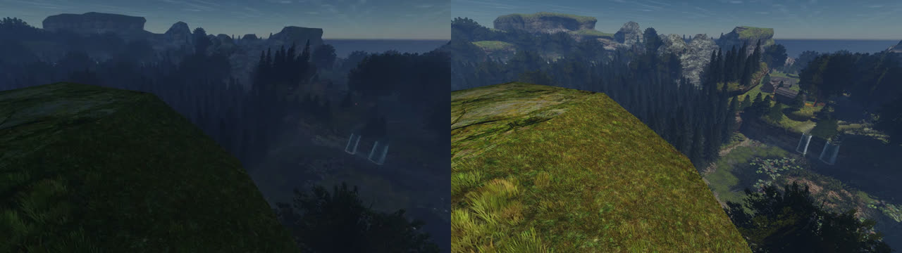
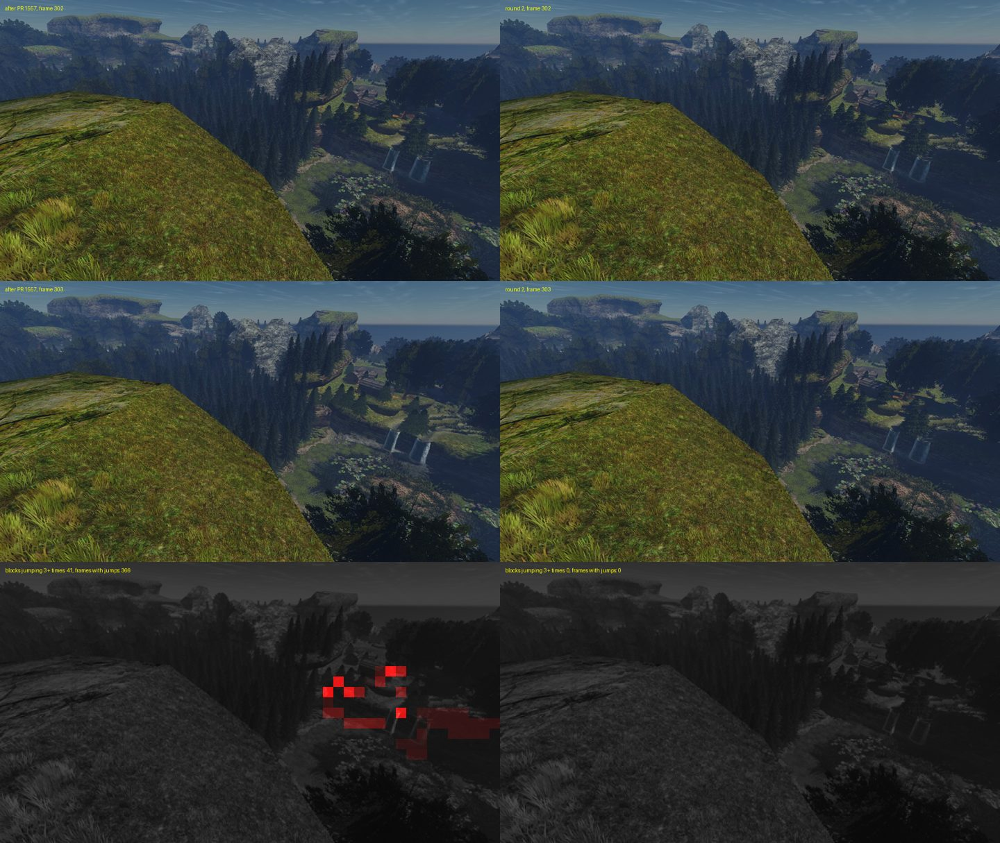

# Тень солнца моргает чёрным над лесом из елей

Дата: 2026-11-18. Статус: чёрные страницы исправлены в первом круге. Мигание теней вдали при переполнении предела пар убрано во [втором круге](#второй-круг): сделан отбор мешлетов по странице, а переполнение теперь отбрасывает пары по правилу. Цену изнутри леса (+0,8 мс проходов VSM) пользователь принял, предел пар не уменьшается. Переполнение у 256 и 1 024 полных елей осталось и ждёт уровней для теней (задача 5 [доработок движка](engine-plan.md)).

Пользователь увидел на экране Ryzen во время [замера цены леса](tree-cost.md), что «часть экрана моргает чёрным». Склон холма под камерой и долина уходили в чёрную тень кусками по страницам карты теней (VSM), а соседний прогон того же вида был освещён нормально.



## Коротко

1. **Причина — переполнение предела пар «мешлет — страница» и хвост буфера пар с прошлого кадра.** Проход видимости VSM (`vsm_visibility_pass.comp`) резервирует слоты пар счётчиком. Кластер, который пересёк предел 524 288, оставлял свои слоты ниже предела незаписанными. В них лежали пары прошлых кадров. Упаковка (`vsm_pack_draws.comp`, проход 1) читает все слоты ниже предела. Она засчитывала эти пары их отрисовкам сверх диапазонов, которые проход 0 разложил по счёту этого кадра. Пары ложились в диапазон следующей отрисовки, а та рисовала чужие мешлеты своим конвейером. Это мешлеты другого ведра, прочитанные в чужой раскладке вершин. Мусорные треугольники, обрезанные по прямоугольнику страницы, заливали всю страницу ближней глубиной: страница целиком «в тени».
2. **Ели — первое, что переполняет предел.** Кластер предмета — весь его меш: ель А — около 724 мешлетов. Её кластер идёт целиком в каждую страницу, которую задевает его сфера. На виде `near-30` 64 ели просят около 0,56 млн пар, 256 — около 1 млн, 1 024 — около 3 млн. Контроль без елей просит 24–26 тыс.
3. **Не каждый кадр** — потому что, какой кластер упрётся в предел и чьи пары лежат в хвосте, решает порядок, в котором видеокарта выполняет группы прохода видимости. Не всякая чужая пара даёт мусор. Без елей при пределе, заниженном до 16 384, пары тоже переливаются (5–63 за кадр), но склон не чернеет ни разу.
4. **Починка:** кластер, пересёкший предел, заполняет свои слоты ниже предела парой-пропуском `VSM_PAIR_SKIP`, и упаковка её пропускает. Новый счётчик `spilled` в журнале `OPENGOTHIC_VSM_STATS=1` считает пары, легшие за диапазон своей отрисовки: до правки 24–680 за кадр, после — 0.
5. **Итог:** 0 тёмных кадров из 750 на 64, 256 и 1 024 елях; на `main` — 3,2–4,4 % на 1 024 елях, на 64 — 35,6 % (при старом поведении). Контроль без елей не изменился. Проходы VSM дороже не стали: +0,004 мс у `VSM-rendering`.
6. **Чего правка не делает:** пары сверх предела по-прежнему не рисуются. Тени дальних грубых мипов и тени ламп при переполнении выпадают. Здесь первый круг ошибся: выпадали они не «устойчиво, без мигания». Какие кластеры упрутся в предел, решал порядок групп видеокарты, и вдали тени появлялись и пропадали от кадра к кадру. Мера средней яркости большой рамки этого не видела; разбор и починка — во [втором круге](#второй-круг). Огрубление мипа это не лечит: лес из 1 024 елей — 741 тыс. мешлетов, больше предела даже по одной странице на ель. Лечат уровни детализации для теней ([долг #1556](https://github.com/kaifaty/GothicAI/issues/1556)).

## Как воспроизвести

Сценарий `scripts/bench/tree-shadow-flicker.bench`: вид `near-30` из [`perf-trees.bench`](tree-cost.md) — камера на скальном холме в 30 м от края леса, полдень. Сначала стоп-кадр и клип 25 с, затем стоп-кадр вида `inside`. Наборы леса строит `scripts/content/fir_set.py forest` (`--count 0` — контроль).

```bash
OPENGOTHIC_CONTENT=<набор> OPENGOTHIC_VSM_STATS=1 TEMPEST_WINDOW_SIZE=1920x1080 BENCH_HOST=ryzen \
  scripts/bench.sh tree-shadow-flicker <папка>
python3 reports/engine/2026-11-16-modern-trees/shadow_flicker.py <папка>/near-30.mp4 [--ref <клип-эталон>]
```

Мера — доля кадров клипа, где средняя яркость склона под камерой (рамка 0,08–0,40 × 0,60–0,95 кадра) упала больше чем на треть от эталона. Эталон — медиана склона в клипе без предела (`OPENGOTHIC_VSM_PAIRS=4194304`): 73,5 из 255. `OPENGOTHIC_VSM_PAIRS=<n>` задаёт другой предел пар: с ним видно настоящий спрос сцены и воспроизводится переполнение без леса. При переполнении счётчик `meshletCount` — нижняя граница спроса: кластер бросает остальные страницы после первого отказа.

## Наименьшее воспроизведение

Ryzen, RTX 3080, 1920×1080, клип 25 с (750 кадров; первый прогон записал 500). Опыт со «старым поведением» — сборка с выключателем, который оставлял хвост незаписанным, как на `main`. Выключатель убран после опыта.

| Прогон | Пар за кадр (журнал) | `spilled` за кадр | Тёмных кадров |
|---|---:|---:|---:|
| 64 ели, старое поведение | 0,559–0,563 млн | 197–625 | 267 / 750 (35,6 %) |
| 256 елей, старое | 0,962–0,968 млн | 129–680 | 69 / 750 (9,2 %) |
| 1 024 ели, старое | 2,14–2,19 млн | 24–572 | 31 / 500 (6,2 %) |
| 1 024, старое, без mesh-шейдеров (`OPENGOTHIC_MS=0`) | 2,14–2,15 млн | 202–604 | 27 / 750 (3,6 %) |
| 1 024, старое, без ветра (`OPENGOTHIC_FOLIAGE=light`) | 1,86–1,92 млн | 40–447 | 24 / 750 (3,2 %) |
| 1 024, старое, без лучей (`OPENGOTHIC_RT=0`) | 2,14–2,16 млн | 65–179 | 34 / 750 (4,5 %) |
| без елей, предел 16 384, старое | 19,5–20,6 тыс. | 5–63 | 0 / 750 |
| без елей, предел 16 384, с пропусками | 19,6–20,2 тыс. | 0 | 0 / 750 |
| без елей, без правок | 24–26 тыс. (ниже предела) | 0 | 0 / 750 |
| 1 024, только пропуски | 2,15–2,17 млн | 0 | 0 / 750 |
| 1 024 без предела (`OPENGOTHIC_VSM_PAIRS=4194304`) | 2,94–3,17 млн | 0 | 0 / 750 |
| `main` `3f071ac2e`, 1 024 | — | — | 24 / 750 (3,2 %) |
| `main` `24de3fddb`, 1 024 | — | — | 33 / 750 (4,4 %) |

Вывод: моргание идёт с переполнением и только с переливом пар. Ветер, лучи и mesh-шейдеры его не убирают: они меняют спрос не больше чем на 15 %. Свет кроны и двусторонность отдельно не проверялись: они не меняют ни кластеров, ни их сфер, а значит, и счёта пар. Одна ель предел не переполняет: в контрольном наборе одинокая ель стоит в 36 м от камеры, спрос — 24–26 тыс. На этом виде предел переполняют уже 64 ели.

## Что изменено

- `vsm_visibility_pass.comp`, `emitCluster`: кластер, пересёкший предел, пишет `VSM_PAIR_SKIP` в свои слоты ниже предела. Предел приходит пуш-константой (`DrawCommands::vsmPairCap`).
- `vsm_pack_draws.comp`, проход 1: пропускает пары `VSM_PAIR_SKIP`. Пару, легшую за диапазон своей отрисовки, считает в `VsmHeader::pairSpill`.
- `vsm_common.glsl`: `VSM_PAIR_SKIP`, поле `pairSpill`; `vsm_clear.comp` обнуляет его каждый кадр.
- `renderer_vsm.cpp`: строка `vsm stats` пишет `spilled = …` и предел этого запуска.
- `DrawCommands::vsmPairCap`: предел 524 288 или `OPENGOTHIC_VSM_PAIRS=<n>` для опытов; буферы кластеров VSM следуют за ним.
- Тест: `tests/vsm_pair_cap_test.h` в `gothic-material-texture-test`. Настоящие `vsm_clear`, `vsm_visibility_pass` и `vsm_pack_draws` на видеокарте получают шесть кластеров трёх отрисовок: 42 пары при пределе 40. Хвост буфера заполнен «прошлым кадром». Тест проверяет, что перелива нет, каждая отрисовка берёт только свои мешлеты, а кластер, пересёкший предел, не рисуется. Со старым шейдером тест падает на «no pair is packed past its draw's range».

## Числа после правки

- **Тёмные кадры:** 0 / 750 для 64, 256 и 1 024 елей; три прогона на слитой с `main` ветке, `spilled = 0` при `OVERFLOW`. Склон держится в 72,95–73,90 у всех; эталон — 72,97–73,87.
- **Устойчивость при переполнении:** покадровая разница яркости долины и леса — медиана 0,13, максимум 0,90 из 255. У эталона без предела — 0,08 и 0,56, у старого поведения — 0,66 и 13,7. Эта мера оказалась слепой: средняя яркость большой рамки не видит пятна тени в углу кадра. Мера блоков второго круга нашла на этих же клипах 41 мигающий блок у 1 024 елей и 3 — у 256.
- **Контроль без елей**, по два прогона на каждой сборке, стоп-кадры 1920×1080. `near-30`: средняя разница `main ↔ стало` 0,006–0,009, `main ↔ main` — 0,007. `inside`: 0,002 и 0,002. Яркость кадров совпадает до сотых: 68,06 и 53,61.
- **Время кадра**, `scripts/perf.sh trees`, 2560×1440, 1 024 ели, два повтора, вид `view-2` (`near-30`). `main` `24de3fddb` — 20,872 мс, ветка `72c68b787` — 19,949 мс. Проходы VSM: `VSM-rendering` 4,740 → 4,744, `VSM-visibility` 0,171 → 0,173, `DirectSunLight-VSM` 0,465 → 0,474 мс. Разницу в −0,92 мс дали проходы вне VSM (`GI-Lighting`, `SSAO-depth`, `Irradiance`): это разброс стенда, а не правка.

## Мягкая деградация: почему не «грубее мип»

Задача просила, чтобы при исчерпании предела тень огрублялась, а не чернела. Первый круг так и сделал: смещение мипа страниц солнца по нагрузке прошлого кадра. Счётчик кадра поднимал смещение, если пар больше 0,85 предела, и медленно опускал, если меньше 0,35. Опыт на 1 024 елях:

| Вариант | Пар за кадр | Смещение | Яркость долины и леса против эталона |
|---|---:|---:|---:|
| только пропуски | 2,15 млн (переполнение) | 0 | +0,65 |
| пропуски и смещение | 1,05–1,08 млн (переполнение) | 3,0 (потолок) | +1,51 |

При смещении в три мипа страницы стали в 64 раза крупнее по площади, а пар стало меньше лишь в 2,9 раза. Дошли до пола: ель целиком, все её 724 мешлета, ложится хотя бы в одну страницу каждого мипа рядом с ней. 1 024 ели — 741 тыс. мешлетов, это больше предела. Огрубление сделало тени всего кадра в 8 раз грубее, а переполнение осталось. Поэтому от него отказался.

Что видно при переполнении теперь. Проход видимости идёт по мипам от мелких к крупным, лампы — последними. Пары сверх предела — это тени грубых мипов: дальние склоны, дальний край леса, двор за хижиной. Ближние тени целы. Средняя ошибка в долине и лесу — +0,65 яркости. Вывод «она не мигает» был неверен: в среднем по рамке ошибка стоит на месте, а в отдельных местах тени появлялись и пропадали ([второй круг](#второй-круг)). Тени ламп при переполнении выпадают целиком. На этом виде днём ламп нет.


## Что осталось

- **Предел пар переполнен на любом виде с 64 и больше полными елями.** Лечат свой уровень детализации для теней (п. 3 [предложения к уровням](tree-cost.md#что-из-этого-следует-для-уровней)) или отбор мешлетов предмета по странице. Мера готовности — `meshletCount` ниже предела на всех видах `perf-trees.bench` по `OPENGOTHIC_VSM_STATS=1`. Записано в [долг #1556](https://github.com/kaifaty/GothicAI/issues/1556). Отбор мешлетов сделан во втором круге: 64 ели теперь помещаются, 256 и 1 024 — нет.
- **Тени ламп при переполнении выпадают первыми:** проход видимости ставит их последними. Во втором круге лампы допускаются первыми.
- **Счётчик при переполнении занижен:** после первого отказа кластер не считает остальные страницы. Во втором круге спрос считается до записи пар, и `demand` в журнале — полный спрос.
- Строку `VSM` в таблицах [цены леса](tree-cost.md) по-прежнему нельзя читать как цену теней. Чёрных страниц больше нет, но тени сверх предела не рисуются.

## Где лежит

Клипы и кадры — вне git, `~/.local/share/gothic-ai/remaster/trees-fir/shadow-flicker/`:

- `before-main-24de3fd-f1024-near-30.mp4` — «было», `main`, 1 024 ели;
- `after-fix-f1024-near-30.mp4` — «стало»;
- `before-after-f1024-near-30.mp4` — склейка «было | стало», 1920×540;
- `before-after-f1024-near-30-frame270.png` — самый тёмный кадр «было» рядом с тем же кадром «стало»;
- `overflow-skip-vs-uncapped-diff.jpg` — где пропадает тень при переполнении;
- `perf/main-24de3fd`, `perf/fix-72c68b7` — замеры времени `perf.sh trees` с проходами видеокарты;
- `runs/` — все прогоны с журналами: `r*`, `s*` — опыты, `fix-*`, `main-*` — до слияния с `main`, `m-*` — после;
- `sets/` — наборы леса, копия `~/gothic-ai/tree-shadow-flicker/content/` на Ryzen.

## Второй круг

Дата: 2026-11-18. Пользователь посмотрел склейку «было | стало» первого круга: «на переднем плане починили, а на заднем плане, там, где деревья, всё ещё моргает».



### Что было неверно в первой оценке

Мерой устойчивости была средняя яркость большой рамки — склона, долины и леса. Пятно тени у фермы, которое появляется и пропадает, сдвигает среднее рамки на доли единицы и в нём тонет. Отсюда неверная фраза «выпадают — устойчиво, без мигания». При переполнении какие кластеры упрутся в предел, решал порядок групп видеокарты, а он меняется от кадра к кадру.

**Мера блоков** (`shadow_flicker.py --blocks <клип> [--map карта.png]`):
- кадр уменьшается до 480×270 и делится на блоки 10×10 пикселей;
- блок «прыгает», если его яркость между соседними кадрами изменилась больше чем на 15 % его медианы по клипу (плюс 4, чтобы тёмные блоки не прыгали от шума);
- клип мигает, если хоть один блок прыгнул три раза и больше; второе число — кадры, где прыгнули два блока и больше.

Карта рисует число прыжков блока красным поверх среднего кадра клипа. Мера повторяет первый счёт пользователя и даёт его же числа:

| Клип `near-30` после PR 1557 | Мигающих блоков | Кадров с прыжками | Худший блок | Где |
|---|---:|---:|---:|---|
| 1 024 ели | 41 из 1 296 | 366 из 750 | 346 | x 0,65–1,00, y 0,37–0,70: долина, ферма |
| 256 | 3 | 73 | 238 | x 0,60–0,67, y 0,37–0,41 |
| 64, контроль | 0 | 0 | 0 | |
| 1 024 без предела | 0 | 0 | 0 | |

### Откуда спрос

Счётчики `vsm stats` второго круга считают полный спрос до записи пар. Это вид `near-30`, 1 024 ели, 1920×1080:

| | Лампы | Мипы 0–4 | Мип 5 | Мип 6 | Мип 7 | Мип 8 |
|---|---:|---:|---:|---:|---:|---:|
| пар после отбора мешлетов, тыс. | 23–27 | 30–40 | 481–487 | 512–521 | 299–302 | 250–255 |

Лес на экране лежит в мипах 2–5. Мипы 5–8 размечает ещё и туман (`vsm_fog_shadow.comp`): он берёт мип на четыре грубее, чем экран в той же точке, и закрывает лучами весь объём кадра. В грубой странице ель лежит целиком в одной записи. Отбор мешлетов там ничего не даёт, помог бы только уровень детализации для теней.

### Что сделано

1. **Отбор мешлетов предмета по странице.** Проход видимости (`vsm_visibility_pass.comp`) больше не пишет пары. Для каждой записи страницы, которую задевает сфера кластера, он записывает кандидата «кластер — запись — корзина». Новый проход `vsm_cull_meshlets.comp` берёт кандидата одной группой из 64 потоков. Для предмета — экземпляра статичного меша без деформации и морфа — он проверяет сферу каждого мешлета против прямоугольника записи или грани лампы. Остальные кластеры (земля, скины, пряди) идут целиком, как раньше.
   - Сферы мешлетов `PackedMesh` считал и раньше, теперь он их хранит, уровни детализации тоже. `StaticMesh::meshletSpheres` держит их на процессоре. Общий массив на видеокарте — `MeshletSpheres` (`graphics/meshletspheres.*`): мешлет i меша лежит по смещению `Bucket::meshletSpheres` плюс i. Массив заполняет `DrawBuckets`, когда пишет корзины, тем же кадром и тем же `patch.comp`, что и экземпляры.
   - Радиус мешлета растёт на масштаб экземпляра и на то, что сдвигает вершины: ветер дерева и волну материала (разница сферы кластера и `bboxRadius` корзины) и толщину.
   - Правило 32 пикселей прохода видимости осталось на кластере. Для мешлетов его нет: иначе мелкие мешлеты грубого мипа стёрли бы тень дальнего дерева.
2. **Предел — по правилу, а не гонкой счётчика.** Пары делятся на корзины:
   - сначала лампы — 16 корзин по расстоянию от камеры;
   - потом страницы солнца по мипу от мелкого к крупному, а в мипе — по кольцу таблицы страниц, до которого доходит запись, от центра наружу.

   `vsm_clear.comp` в начале кадра обнуляет спрос и переносит корзины, нарисованные в прошлом кадре, в `admitPrevBits`. Буфер заголовка при создании обнуляется: в первом кадре ни одна корзина не числится нарисованной. Первый проход `vsm_cull_meshlets.comp` считает пары каждой корзины, второй пишет их. Перед записью он берёт корзины по порядку, пока сумма помещается в предел. Первая корзина сверх предела и все за ней отбрасываются целиком. Спрос сосчитан до того, как записана хоть одна пара, поэтому порядок групп видеокарты ничего не решает: при неподвижной камере отбрасываются одни и те же корзины. Корзина, отброшенная в прошлом кадре, возвращается, только если влезает в 7/8 предела. Корзина, нарисованная в прошлом кадре, держит весь предел. Так спрос на границе не включает и не выключает кольцо страниц: ранние корзины гуляют на ±12 тыс. пар, а 1/8 предела — 65 тыс.
3. **Счётчики.** `OPENGOTHIC_VSM_STATS=1` пишет `meshletCount` (нарисовано), `demand` (спрос после отбора; `OVERFLOW`, если он больше предела), `whole clusters` (спрос, если брать кластеры целиком), `candidates` и строку `vsm pairs by class` со спросом ламп и каждого мипа и с тем, что отброшено.
4. **Тест** `vsmPairCapRecords` (`tests/vsm_pair_cap_test.h`) гоняет настоящие `vsm_visibility_pass`, `vsm_cull_meshlets` и `vsm_pack_draws` на видеокарте. Данные: три записи солнца (мипы 0–2) и грань лампы, предмет из шести мешлетов и кластер земли. Тест проверяет:
   - `vsm_clear.comp` обнуляет спрос, кандидатов и пары целых кластеров и переносит нарисованные корзины в «прошлый кадр»;
   - предмет даёт записи только мешлеты, чьи сферы её задевают, а сферы читаются по смещению корзины;
   - сфера мешлета растёт на масштаб экземпляра (2) и на запас сферы кластера над мешем (ветер, волна): мешлет 6 задевает страницу мипа 0 только так;
   - кластер без сфер идёт целиком;
   - корзины идут по порядку и лампы первыми; при пределе 13 спрос 14 отбрасывает мип 1 и всё за ним, хотя мип 2 влез бы;
   - отброшенный мип 1 не возвращается при пределе 14 без запаса в 1/8;
   - нарисованная корзина входит ровно на пределе;
   - упаковка пропускает слот `VSM_PAIR_SKIP` (находка ревью первого круга); слот называет существующую отрисовку, так что без фильтра она взяла бы его наверняка, а не по гонке;
   - `spilled = 0`, и ни одна отрисовка не берёт пар прошлого кадра.

   Первая версия теста упала на проверке спроса в сохранённой проверке на Ryzen. Ошибка была в тесте: он ставил единичную матрицу вида. Шейдер берёт центр сферы через вид солнца, а радиус переводит масштабом 1/1024 на сантиметр (`smWidthInv`, как `Camera::mkViewShadowVsm`). При единичном виде мешлеты в 32 см от центра оказывались в 32 единицах NDC, за таблицей страниц, и спрос корзин солнца выходил нулевым. Теперь вид теста масштабирует x и y на 1/1024, как игровой. Проверки прежние, их сообщения пишут фактический спрос корзин.

Подбор правила в этом круге шёл по замерам:
- корзины целыми мипами дали 0 мигающих блоков, но отбросили весь мип 5: долина стала светлее эталона на 11 из 255;
- жадное заполнение, которое после невлезшей корзины пробует следующие, качало число нарисованных пар между снимками от 230 до 480 тыс.: большие кольца мипов 7–8 то входили, то нет;
- принят префикс корзин с гистерезисом.

### Числа

Прогоны `tree-shadow-flicker.bench` на Ryzen, RTX 3080, 1920×1080, по два на каждый лес. Счётчики сняты во время клипа `near-30` и после него на виде `inside`.

| Лес | Спрос `near-30`: целыми кластерами → по мешлетам | Нарисовано | Спрос `inside` | Нарисовано | Мигающих блоков, два прогона |
|---|---|---:|---|---:|---|
| без елей | 24,5 тыс. → 18,6–19,0 тыс. (×1,3) | всё | — | — | 0 (один прогон) |
| 64 | 0,86–0,96 млн → 0,24 млн (×3,6–3,9) | всё | 1,38–1,57 млн → 0,25 млн (×5,6–6,2) | всё | 0, 0 |
| 256 | 1,60–1,70 млн → 0,78–0,79 млн (×2,1) | 0,48–0,49 млн, отброшены мипы 7–8 и край мипа 6 | 2,65–2,87 млн → 0,68–0,70 млн (×4) | 0,37–0,39 млн, отброшены мипы 7–8 | 0, 0 |
| 1 024 | 2,68–2,78 млн → 1,61–1,63 млн (×1,7) | 0,23–0,25 млн, отброшены внешние кольца мипа 5 и мипы 6–8 | 3,2–3,6 млн → 1,13–1,16 млн (×3) | 0,37–0,40 млн, отброшены мипы 7–8 | 0, 0 |

Во всех прогонах `spilled = 0`, кандидатов не больше 20,5 тыс. при ёмкости 524 288. У 256 елей срез один раз сдвинулся наружу до начала клипа, когда освободилась 1/8 предела. Во время клипа рисуется ровно 482–491 тыс.

- **Контроль без елей**, стоп-кадры против двух прогонов после PR 1557. `near-30`: |прежний₁ − новый| 0,008, |прежний₁ − прежний₂| 0,009; `inside`: 0,003 и 0,003. Средняя яркость та же: 69,94 и 57,03.
- **Что отброшено, 1 024 ели.** Медиана 60 кадров клипа против клипа без предела первого круга (`r4-f1024-full`, тот же вид). По кадру: +0,36 яркости из 255, после PR 1557 было +0,38. В рамке долины и фермы: +1,0, было +0,7. Пикселей, ушедших дальше 6, — 1,3 % против 1,2 %. Светлее эталона дальний гребень и двор фермы: это внешние кольца мипа 5, и в клипе они стоят.

### Цена

Одна тихая заявка `shadow_flicker_price.sh`: `perf-trees.bench`, 1 024 ели, 2560×1440, `OPENGOTHIC_GPU_PASSES=1`. Ветка `c544ed714` — код второго круга, слитый с `main` `60a42adf2`; прогоны «ветка, main, ветка». Время в мс:

| Вид | Кадр: main / ветка | `VSM-rendering` | `VSM-visibility` | Проходы VSM вместе |
|---|---|---|---|---|
| `inside` (view-1) | 26,38 / 26,34, 27,82 | 5,03 / 5,50, 6,20 | 0,189 / 0,201, 0,221 | 6,15 / 6,53, 7,34 |
| `near-30` (view-2) | 20,49 / 16,83, 18,49 | 5,01 / 2,53, 2,83 | 0,175 / 0,191, 0,209 | 5,88 / 3,33, 3,74 |
| `far-100` (view-3) | 20,92 / 21,17, 21,90 | 5,22 / 6,08, 6,24 | 0,205 / 0,214, 0,223 | 6,01 / 6,88, 7,05 |
| `far-300` (view-4) | 17,47 / 12,70, 12,98 | 5,06 / 0,51, 0,52 | 0,205 / 0,231, 0,236 | 5,80 / 1,25, 1,29 |

- `near-30` и `far-300` стали дешевле на 2,0–4,7 мс кадра.
- `inside` и `far-100` дороже по `VSM-rendering` на 0,5–1,2 мс. Два прогона ветки сами расходятся на 0,7 мс: шум стенда велик, но знак у обоих один.
- Почему дороже: `main` рисовал случайную часть пар из мипов 5–6 (туман и дальние страницы), а ветка рисует допущенные корзины целиком. Отбор мешлетов убрал дешёвые пары — мешлеты вне страницы, которые отсекались плоскостями. Осталась работа, которая даёт тень.
- `VSM-visibility` с проходом мешлетов дороже на 0,01–0,03 мс.
- Память: буфер кандидатов — 8 МБ при пределе 524 288. Массив сфер — 16 байт на мешлет загруженных статичных мешей.

### Что осталось

- **Цена изнутри леса принята** (решение пользователя 2026-11-18). Бриф ставил порог +0,5 мс кадра, а на `inside` ветка в среднем по двум прогонам дороже `main` на 0,71 мс кадра и на 0,79 мс проходов VSM. На остальных видах кадр дешевле. `main` был дешевле только тем, что случайно недорисовывал дальние тени. Предел пар остаётся 524 288.
- **Спрос 256 и 1 024 полных елей выше предела** — мипы 5–8, тени тумана и дальних колец. Лечат уровни для теней: ель с уровнями `fir_set.py --levels` вдали рисует 1/8 мешлетов. Долг #1556 остаётся.
- **Список кандидатов** держит до 524 288 записей «кластер — запись»; сейчас бывает до 20,5 тыс. Если он переполнится, то, какие кандидаты потерялись, снова решит порядок групп (`LOST` в журнале).
- **Срез корзин** может разово сдвинуться наружу при неподвижной камере, когда спрос падает на 1/8 предела: кольцо страниц появляется один раз и остаётся.

Вне git, `~/.local/share/gothic-ai/remaster/trees-fir/shadow-flicker/round-2/`:
- `before-after-f1024-near-30.mp4` — склейка «после PR 1557 | второй круг», 1920×540;
- `blocks-pr1557-f1024.png`, `blocks-round2-f1024.png` — карты прыжков обеих половин, и их JSON;
- `shadow-flicker-round2-sheet.png` — лист полного размера;
- `runs/` — прогоны с журналами: `a1` — корзины целыми мипами, `a2` — жадное заполнение, `a3`, `b1`, `b2` — итог; `price/` — заявка цены (`main`, `fix-1`, `fix-2`).
