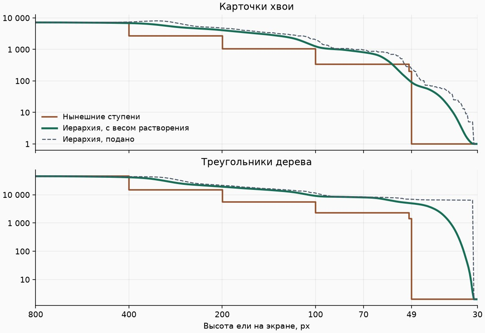
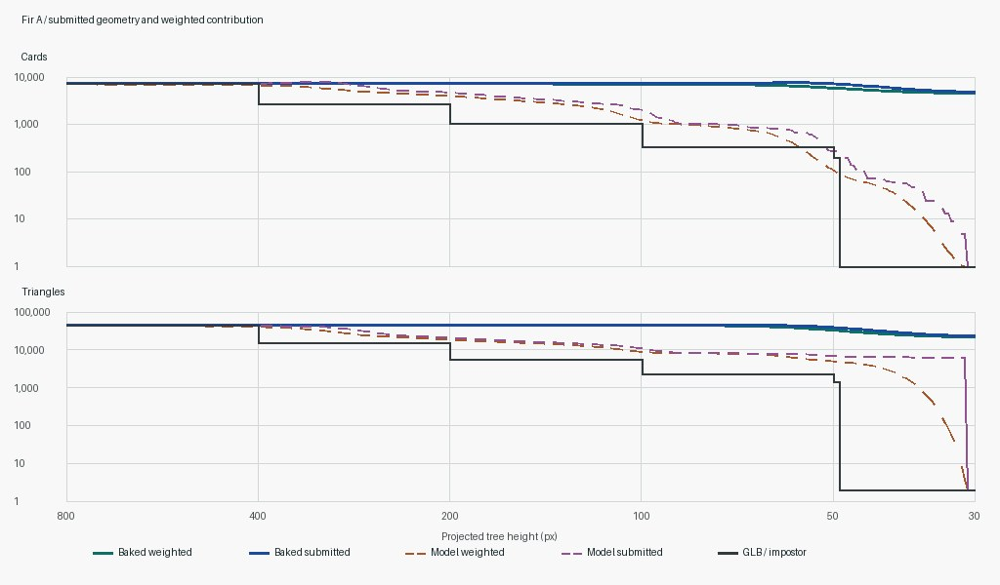

# Упрощение ели по лапам

Разведка шага 4б, 2026-11-19. Здесь **лапа** — вся хвоя одной живой ветви первого порядка, которую собирает `dress()`. Отдельная висящая гроздь или кисть на конце — часть лапы. [План деревьев](../../../docs/trees-plan.md#план), [устройство ели А](../../content/2026-11-trees/fir/README.md#что-построено).

## Коротко

Пилот выбирает срез кроны в главном виде по `hierarchy` из записи меша. Флаг по умолчанию выключен. Компактная подача и растворение включаются только для мешей с загруженной иерархией. [Устройство и стенд](#локальный-срез-в-движке), [цена выключенной схемы](#цена-выключенной-схемы).

Смены GLB древесины и модели тени у такой ели тоже идут растворением в полосе вокруг порога, как стык с импостером. [Плавная смена древесины и тени](#плавная-смена-древесины-и-тени).

В [пробе слияний](#проба-слияний) построены 1 673 родителя для 7 175 исходных карточек. На 200 px срез держит все 45 167 треугольников, прежняя модель давала около 19 239. На 100 px срез проходит допуски целого дерева при 44 717 треугольниках (19,81× L3). На 70 и 50 px просвет уже выходит за допуск. Верх полосы проверен у всех родителей по исходной хвое и готовому срезу детей. При первом мипе с порогом альфы 0,5 на измеренном максимуме 725 родителей выходят за допуск. Листы и данные передаются ведущему для решения по задаче 3.

Ствол и оси ветвей остаются общими для всей 3D-кроны. Побеги сливаются в гроздья, гроздья и оставшиеся побеги — в лапу, соседние лапы — в часть яруса. У каждого слияния своя полоса растворения по размеру на экране. В одном кадре верх и низ, ближняя и дальняя сторона могут быть на разных ступенях. При отлёте те же группы по очереди уходят в соответствующие участки одного импостера.

В расчёте целую лапу запекли на одну плоскость, на крест и на три креста вдоль ветви. В ракурсе с ребра одиночная плоскость со своим запеканием теряет всю видимую хвою. Крест возвращает покрытие, но остаётся ошибка положения просветов. По заданному численному критерию крест проходит до 4 px на собственной лапе и до 2 px после переноса на другую лапу того же типа. У ели высотой 50 px даже самая малая лапа имеет расчётный размер 2,6 px. Четыре общих типа креста проходят допуск только за границей нынешнего импостера.

В расчётной кривой за уменьшение высоты на 1 % меняется до 2,06 % исходной хвои в 3D и до 3,96 % с учётом стыка. При прежней смене GLB представление обновляется сразу у всей кроны. Плавная кривая взвешена по вкладу версий. В полосе подаются обе, а общая древесина стоит 6 422 треугольника до ухода последнего участка. На клипе старого перехода у 200 px ведущий заметил, что ель темнеет и теряет светлые слои. Поэтому при слиянии отдельно сверяем нормали, открытость и яркую часть кроны. Кривая показывает темп замены, а незаметность проверит будущий пролёт туда и обратно.

## 1. Как это делают другие

| Первичный источник | Решение и числа | Как относится к лапе |
|---|---|---|
| SpeedTree Modeler и Unity | У дерева общая кривая LOD. Генераторы отбирают ветви по размеру, скрытости и весу, ветвь может сжиматься к оси, оставшиеся fronds теряют сегменты, часть листьев увеличивается. Frond — сетка вдоль оси. Leaf Map Maker печёт цвет и нормаль группы листьев. Unity документирует геоморфинг меша и наложение двух представлений при выходе к billboard. | Можно разделить стабильную ось и меняющееся наполнение. Фраза «SpeedTree независимо выбирает в кадре печёную карточку каждой ветви» осталась неподтверждённым пересказом. [LOD](https://docs.unity3d.com/speedtree-modeler/manual/level-of-detail.html), [Frond](https://docs.unity3d.com/speedtree-modeler/manual/frond-generator.html), [Leaf Map Maker](https://www.youtube.com/watch?v=eHlKRU5D6Z8), [Unity SpeedTree fade](https://docs.unity.com/en-us/engine/6000.7/script-reference/unityengine/lodfademode/speedtree) |
| Epic, Fortnite Chapter 4 | `Preserve Area` передаёт площадь удалённых деталей оставшимся, расширяя открытые края. В деревьях 300–500 тыс. вершин вместо 10–20 тыс. На стенде Epic сплошная геометрия могла быть дешевле альфа-масок. Ветер получает индекс ветки из UV и запечённые позицию и поворот ветки. | Площадь нужна как отдельная цель, а цена зависит и от пустых пикселей карточек. [Разбор Epic](https://www.unrealengine.com/tech-blog/bringing-nanite-to-fortnite-battle-royale-in-chapter-4?lang=en-US) |
| Epic, Nanite Foliage | Экспериментальные Assemblies переиспользуют кластеры веток, до примерно 65 тыс. частей. Дальний уровень — воксели, до 128 блоков 4³ на кластер, выбор по ошибке. У одного дерева в демо The Witcher 4 размер на диске сократился с 3,5 ГБ до ~29 МБ, потоковая память для одного ракурса с 36 до 2,7 МБ. | Переиспользование шаблонов полезно для памяти. Иерархия, воксели и их растеризация — возможности Nanite. [Документация Epic](https://dev.epicgames.com/documentation/en-us/unreal-engine/nanite-foliage) |
| Guerrilla, Horizon Zero Dawn, GDC 2018 | Компоненты запекают в UV, делают цепочки LOD и собирают в SpeedTree. Пример дерева ~10 000 → 2 600 → 1 200 → 200+12 → 12 треугольников. Движение дерева, ветви и листа раздельное. Теневые меши отдельные, рубежи 8/80 м, дальний меш сплошной и статичный. Покрытие каждого mip сверяют после билинейной реконструкции и порога 0,5. | Сравнивать проекции после теста альфы, тень считать отдельно от цвета. [Доклад Guerrilla](https://media.gdcvault.com/gdc2018/presentations/gilbert_sanders_between_tech_and.pdf) |
| Sucker Punch, Ghost of Tsushima | Ствол и ветви управляются суставами с локальным ветром, у листа отдельный шум. Доклад GDC раскрывает GPU-траву. | Первичный источник подтверждает раздельный ветер. Порогов и способа LOD ветвей в этих публикациях нет. [Sucker Punch](https://blog.playstation.com/?p=345372), [GDC](https://gdcvault.com/play/1027033/) |
| Ubisoft, Assassin’s Creed Shadows, SIGGRAPH 2025 | Отдельный упрощённый BVH листвы без вершинной анимации. Для GI уменьшали площади сплошных треугольников по средней непрозрачности под треугольником. Это стоило 60 % полного alpha-test, ограничение двумя any-hit — 82 % на их сцене. | Прокси для лучей имеет свой критерий по светопропусканию. [Доклад Ubisoft, слайды 28, 32, 84–88](https://advances.realtimerendering.com/s2025/content/Advances%202025%20-%20Raytracing%20the%20world%20of%20Assassin%27s%20Creed%20Shadows.pdf) |
| Décoret и соавторы, SIGGRAPH 2003. Behrendt и соавторы, 2005 | Billboard clouds проецируют близкие к одной плоскости грани в RGBA с нормалями. Behrendt группируют листву по порядку ветвления, используют 1–3 плоскости по пропорциям группы и 50–200 плоскостей на дерево. Атлас с переменным освещением занимал 2–5 МБ против ~1 МБ с печёным светом. | Сначала подбирать плоскости к геометрии, затем печь. Дополнительный ракурс возвращает покрытие с ребра, но увеличивает перерисовку. [Décoret](https://graphics.cs.yale.edu/sites/default/files/bc03_0.pdf), [Behrendt, §§2.1–2.3](https://graphics.uni-konstanz.de/publikationen/Behrendt2005Realisticrealtime/Behrendt2005Realisticrealtime.pdf) |
| Max, Deussen и Keating, 1999 | Иерархия повторяемых частей, 1–2 шаблона на ступень, по шесть проекций с цветом, нормалью, глубиной. Выбор около одного экранного пикселя на тексель с поправкой на ближайшую точку. | Это офлайн-эталон для переиспользования. При смене ракурса открываются отсутствующие в запекании слои. [Статья](https://escholarship.org/uc/item/1sx886nk) |

Слияние слоёв альфы меняет и просвет, и набор передних цветов. Средний тон по выжившим пикселям может совпасть при крупных дырах. Для mip нужно отдельно хранить покрытие, взвешивать цвет по альфе в линейном пространстве и разводить атрибуты по краям **внутри ячейки**. Уровень мипа, сохраняющий суммарное покрытие, не восстанавливает исчезнувшую субпиксельную геометрию. Общий alpha-to-coverage для двух слоёв при 50 % может оставить лишь 50 % исходного покрытия. Порог двух версий должен делить один и тот же отсчёт на две дополняющие части. TAA усредняет шум, а смену глубины может отразить следом из истории. Проверять шум на месте, след в движении и тень отдельно. [GPU Gems 3, §4.6](https://developer.nvidia.com/gpugems/gpugems3/part-i-geometry/chapter-4-next-generation-speedtree-rendering), [Wyman и McGuire, Hashed Alpha Testing](https://research.nvidia.com/sites/default/files/pubs/2017-02_Hashed-Alpha-Testing/Wyman2017Hashed.pdf), [Decima, слайды 39–41](https://advances.realtimerendering.com/s2017/DecimaSiggraph2017.pdf).

### Разрез иерархии и плавность во времени

- **Nanite, доклад Epic 2021.** Кластеры по 128 треугольников объединяют в группу, прореживают примерно вдвое с сохранением общей внешней границы и снова делят на кластеры. Группа делит одну границу и ошибку, поэтому соседние кластеры меняются согласованно. Срез выбирает узлы, у которых собственная проецированная ошибка укладывается в допуск, а родительская уже превышает его. Разные области меша одновременно находятся на разных глубинах DAG. Замена каждой группы бинарна. В докладе опора на ошибку меньше пикселя и TAA, а частичное покрытие тонкой разрозненной листвы выделено в отдельную проблему. Для нас срез из разных глубин полезен сам по себе, а скачок альфа-покрытия и тона требует своей полосы. [Karis, Stubbe, Wihlidal, SIGGRAPH 2021](https://advances.realtimerendering.com/s2021/Karis_Nanite_SIGGRAPH_Advances_2021_final.pdf).
- **Прогрессивные меши Hoppe.** Локальные операции раскрытия вершины и схлопывания ребра образуют иерархию. Срез по экранной ошибке проходит на разной глубине. При морфе подробная связность уже есть, вершины плавно расходятся от родителя или сходятся к нему, а лишние грани убирают в конце. Это годится для карточек с соответствующими вершинами и UV. Для двух независимых печатей с другой глубиной и альфой нужна отдельно согласованная подмена. [Hoppe 1997](https://hhoppe.com/vdrpm.pdf), [Hoppe 1998, §4.2](https://hhoppe.com/svdlod.pdf).
- **Иерархия листвы Deng, Zhang и Jaeger.** Авторы объединяют листья попарно снизу вверх внутри поддеревьев и выбирают срез по дистанции и видимости ветви первого порядка. В их сцене с елью 454 491 полигон сокращались до 28 055 по дистанции и до 21 129 с учётом видимости. Слишком низкий вес боковой ветви портил её силуэт. У Remolar и соавторов ствол отделён, а пары листьев выбираются по близости и копланарности. Это первичные примеры локальных объединений. В них не измеряют плавность тона альфа-карточек между соседними кадрами. [Deng и соавторы, рис. 6](https://nlpr.ia.ac.cn/2007papers/gjhy/gh109.pdf), [Remolar и соавторы, WSCG 2003](https://www3.uji.es/~ribelles/papers/2003-WSCG/wscg03.pdf).
- **Плавный вклад листвы.** Cook и соавторы сохраняют устойчивый порядок удаления, плавно уменьшают площадь или непрозрачность исчезающих элементов и отдельно компенсируют изменение контраста. В работе по хвойным Deng и соавторы заменяют иглу полупрозрачной линией, когда её ширина падает ниже 1 px, затем сливают соседние линии. Первый результат получен в офлайн-рендере, второй относится к ширине отдельной иглы. Они дают ориентир для плавного вклада и проверки контраста. [Cook и соавторы, §§3.2–3.5](https://graphics.pixar.com/library/StochasticSimplification/paper.pdf), [Deng и соавторы, Continuous LOD Model of Coniferous Foliage](https://citeseerx.ist.psu.edu/document?doi=cbf68bd9bf092c9dd0d29449e5234bcc72937f61&repid=rep1&type=pdf).

## 2. Движок и цена выбора

- Сейчас CPU раз за кадр выбирает уровень по экранной высоте всего экземпляра и гистерезису 10 %. `StaticMesh::levelMeshlets` возвращает один смежный срез на материал, `VisualObjects::preFrameUpdateLevels` меняет диапазоны картинки и тени. `preFrameUpdateStrands` оставляет начало диапазона прядей и меняет длину префикса и толщину. Для нескольких разных версий лап в одном материале нужны либо несколько диапазонов, либо выбор при раскрытии списка видимости. Простое сокращение префикса этого не даёт. [Шкала](../../../OpenGothic/common/graphics/meshlevels.h), [срезы](../../../OpenGothic/common/graphics/mesh/submesh/staticmesh.cpp#L299), [обновление](../../../OpenGothic/common/graphics/visualobjects.cpp#L983), [пряди](../../../OpenGothic/common/graphics/visualobjects.cpp#L1079).
- CPU может собрать контрольный список по лапам, удобно сверять счётчики и результат GPU. Если завести кластер на лапу, 48 Б × 235 дают 11 280 Б на дерево (~11 МиБ на 1 024 деревьев) на одну копию и один диапазон, в полосе два диапазона удваивают эту оценку. Это до загрузок грязных диапазонов, CPU-копий и проверок видимости 240 640 лап за кадр, если видны все деревья. Кластер на ярус уменьшает число записей, но заставляет разом менять разные по размеру ветви в одном силуэте. Выбор на каждый мешлет разорвал бы лапу, если бы мешлеты одной лапы независимо решили сменить версию.
- Предпочтительный путь после проверки формы — раскрывать срез иерархии в основном `visibility_pass` после текущего отбора всего дерева. Если сфера, ошибка, полоса и диапазоны дочерних узлов и геометрии занимают 48 Б на событие, 1 668 событий дадут около 78 КиБ на ассет до листовых диапазонов и карт. Общий вес на слияние читают его мешлеты. Вне полосы подаётся выбранный срез, внутри полосы родитель и заменяемые дети. Текущая запись задания — 16 Б на мешлет в каждом активном обычном виде. Даже 235 записей на 1 024 дерева — около 3,7 МиБ буфера на вид, до дополнительных мешлетов и переходов. Ёмкость считать по максимуму всего среза с перекрытиями, без умножения на тени. Иерархия ландшафта показывает выбор по экранной ошибке родителя и дочернего кластера. Её загрузчик исключает листву и объекты с `levels`. [Кластеры](../../../OpenGothic/common/graphics/drawclusters.h#L17), [список видимости](../../../OpenGothic/shader/materials/visibility_pass.comp#L202), [ёмкость](../../../OpenGothic/common/graphics/drawcommands.cpp#L330), [иерархия ландшафта](../../../OpenGothic/shader/materials/cluster_lod.glsl#L46), [загрузчик](../../../OpenGothic/common/resources.cpp#L864).
- Полноразмерный мешлет своего статичного меша выделяет место под 64 вершины и 64 треугольника, примерно 3 328 Б геометрии плюс сфера. В классическом пути команда посылает 192 вершинных вызова на мешлет, даже если у креста 4 треугольника. Если положить среднюю и дальнюю версии каждой лапы в отдельные мешлеты, добавится ~1,5 МиБ на ассет, и останется работа пустых слотов. Для малых карточек нужен компактный список экземпляров, объединённый по материалу и типу, с границами лапы в метаданных. Стандартный проход мешлетов остаётся для полной геометрии. Упаковка разных лап в один обычный мешлет требует отдельного отсечения примитивов, иначе подаются и скрытые лапы. [Упаковка](../../../OpenGothic/common/graphics/mesh/submesh/packedmesh.h#L24), [буферы](../../../OpenGothic/common/graphics/mesh/submesh/staticmesh.cpp#L155), [обычная подача](../../../OpenGothic/common/graphics/drawcommands.cpp#L349).
- Обе версии идут в тот же GBuffer с общим комплементарным отсечением. В полосе цена геометрии равна сумме двух версий, площадь кандидатов до отбрасывания — до суммы их площадей. Плотный ракурс может приблизить цену пикселей к двойной только для сменяющейся хвои, без повторной отрисовки ствола. При разной ориентации суммарная площадь может измениться и вне полосы. Реальные фрагменты мерить счётчиком. На текущем пути `main.frag` порог альфы 0,5, у материала с `BK_HASHED_ALPHA` в GBuffer с TAA порог меняется во времени, в тенях он остаётся 0,5. Вариант с картами сейчас делает часть выборок до отбрасывания. Исторический ориентир леса А — 0,19–0,22 мс GBuffer на тысячу треугольников на ель при 1 007 елях, отдельно 0,8–1,7 мс пиксельной составляющей на внешних видах. Это цена прежней раскладки, а не прогноз для больших карточек. [Шейдер материала](../../../OpenGothic/shader/materials/main.frag#L1027), [цена леса](tree-cost.md#кривая-треугольники-ели--мс), [геометрия и пиксели](research/opt_geometry.md), [дальние представления](research/opt_far.md).
- В `codex/tree-smooth-near` (`c2b843b9c`, `732eb9734`) уже есть `_CARD_ID` отдельным целым на вершину, ранги, укорочение диапазона по началам мешлетов, длина `K` в `InstanceDesc.animPtr`, стабильное отсечение по UV, рангу и экземпляру. От 560 до 400 px остаётся от 100 до 80 % карточек, затем 80 % до жёсткой смены ниже 200. Дробные карточки исключены из записи HiZ. При 200 px список с сопоставимой ошибкой формы насчитывал 37 281 треугольник к 5 645 у осмысленного L2. Это таяние карточек, без запекания площади исчезнувших групп. [Замеры префикса](tree-smooth-lod.md#3-расчёт-без-игры).
- Движение дерева использует положение вершины в покое, общий для дерева пивот, высоту и охват, параметры текущего и предыдущего времени. В `COLOR_0` R задаёт вес ветви, G её фазу, B дрожь хвои, A открытость для освещения. Те же числа RG у контрольных точек, те же параметры дерева и локальные позиции дают то же движение этих точек. Плоскость между ними интерполирует поле ветра и не воспроизводит мелкую дрожь каждого исходного побега. A сейчас идёт через длину нормали в GBuffer. Для печёной A требуется отдельная выборка у материала прокси или проверка её аппроксимации в вершинах. Обычные `levels` используют те же материалы, поэтому отдельному атласу потребуется своя корзина. [Ветер](../../../OpenGothic/shader/materials/foliage_tree.glsl), [обработка вершин](../../../OpenGothic/shader/materials/vertex_process.glsl), [уровни](tree-lod.md#2-что-построено).

## 3. Расчёт по ели А

### Что в файле и сколько места занимает лапа

Вход — `OWN_TREE_FIR_A_4.glb`, seed 7, масштаб 1. Расчётная высота коробки дерева 18,474 м, с заглублённым комлем. Всего 45 167 треугольников. Древесина (включая 4 сухих сучка) — 6 422. У рукава и верхушки с G=0 — 1 588. У 235 живых лап — 37 157. В GLB 7 175 исходных карточек, 15 ячеек атласа из девяти семейств. Генератор хранит 1 065 висящих гроздей и 235 концевых кистей. Набор и форма **целой** лапы зависят от положения ветви и случайных параметров. Для пробы лапы сгруппированы по высоте, номеру мутовки и длине. В юбке 23 лапы, в основной части 79, коротких 9, верхних 124. [Код построения](../../../scripts/content/mesh3d/blender/fir_tree.py), [атлас и разметка](../../content/2026-11-trees/fir/README.md#что-построено).

Размер лапы — максимум ширины и высоты проекции хвои. Таблица содержит минимум, P10, медиану, P90, максимум по 235 лапам × 24 направлениям. Взяты восемь азимутов с шагом 45° и три наклона (0° и ±30°), масштаб ортографической проекции задан высотой коробки дерева. Положение и индекс треугольника читаются из GLB. Вторая колонка размеров — консервативный размер выбора по диагонали коробки лапы в её локальных осях. Он не меняется при повороте камеры на том же расстоянии. Перспективная проверка в движке берёт ближайшую часть коробки у камеры или оставляет полную форму, если коробка пересекает ближнюю плоскость.

| Ель, px | Проекция лапы, px | Размер для выбора, px |
|---:|---|---|
| 800 | 23,5 / 36,3 / 67,3 / 139,0 / 201,2 | 42,3 / 56,0 / 108,4 / 198,9 / 221,9 |
| 400 | 11,8 / 18,2 / 33,6 / 69,5 / 100,6 | 21,2 / 28,0 / 54,2 / 99,5 / 110,9 |
| 200 | 5,9 / 9,1 / 16,8 / 34,7 / 50,3 | 10,6 / 14,0 / 27,1 / 49,7 / 55,5 |
| 100 | 2,9 / 4,5 / 8,4 / 17,4 / 25,1 | 5,3 / 7,0 / 13,5 / 24,9 / 27,7 |
| 50 | 1,5 / 2,3 / 4,2 / 8,7 / 12,6 | 2,6 / 3,5 / 6,8 / 12,4 / 13,9 |

### Бюджет независимых лап и атлас

Контроль с двумя порогами непосредственно на лапу считает 12 треугольников средней лапы (три креста), 4 дальней (один крест), все исходные у полной плюс неизменные 8 010 треугольников. Числа до отсечения целых лап и мешлетов. Для трёх пар порогов `полная → средняя / средняя → дальняя` приведены счёт по центру ступени и сколько подаётся при полосах ±10 %. Старый ориентир — GLB, вступающий **ниже** высоты строки при отлёте, до импостера, без возвратного гистерезиса.

| Ель, px | Текущий ориентир | 48/16 px | 32/8 px | 16/4 px |
|---:|---:|---:|---:|---:|
| 800 | 45 167 | 45 046 / 45 326 | 45 167 / 45 167 | 45 167 / 45 167 |
| 400 | 15 052 | 39 946 / 42 121 | 43 934 / 44 724 | 45 167 / 45 167 |
| 200 | 5 645 | 19 682 / 21 786 | 33 019 / 36 294 | 43 934 / 44 724 |
| 100 | 2 257 | 9 646 / 9 926 | 10 486 / 10 710 | 33 019 / 36 294 |
| 50 | 1 406 | 8 950 / 8 950 | 9 646 / 9 926 | 10 486 / 10 710 |

Например, при 48/16 и высоте 200 px полны 28 лап, средние 164, дальние 43. В полосах 53 лапы. Для 32/8 при той же высоте полоса добавляет 3 275 треугольников, +9,9 %. Нижний предел с дальними крестами — 8 950. Даже при уходе всей хвои остаётся 6 422, то есть 1,14×, 2,85× и 4,57× бюджетов L2–L4. Оптимизацию древесины можно обсуждать отдельно, с запретом менять оси, длину и ветер, если поставлена цель сравняться по цене. В текущем эксперименте древесина фиксирована.

Две дальние и шесть средних карт на тип дают **32 ячейки на библиотеку** из четырёх типов. Расчёт на верхней кромке полосы берёт минимум один тексель на экранный пиксель, растяжение шаблона по всем лапам своего типа и поле 4 текселя с каждой стороны. Простая квадратная упаковка даёт такие размеры.

| Пороги лапы, px | Площадь ячеек с полями, текселей | Сторона атласа | Цвет + нормаль + A/ORM с полной цепочкой BC, на набор типов |
|---|---:|---:|---:|
| 48/16 | 30 193 | 256 | ~256 КиБ |
| 32/8 | 16 774 | 256 | ~256 КиБ |
| 16/4 | 7 818 | 128 | ~64 КиБ |

Это размеры при одинаковой раскладке трёх карт по 16 Б на блок 4×4, с округлением. Поле 4 текселя покрывает первые мипы, более мелкие мипы строятся внутри плитки, с ограничением выборки у границ. Оценка не включает более плотную библиотеку или карты гроздей из будущей задачи.

### Кривая разреза от 800 до 30 px

Разрез построен по исходным диапазонам карточек GLB. `cluster` объединяет побеги в гроздь или кисть, затем их и оставшиеся побеги — в лапу. Ячейка высотой 1,5 м и шириной 120° по азимуту собирает соседние лапы в часть яруса. Рукав и верхушка с G=0 группируются по тем же ячейкам блоками до четырёх карточек. Размер узла — диагональ его коробки. Для модели цены у грозди взяты 2 карты, у лапы 6, у части яруса 4, по 2 треугольника на карту. Если замена не экономит и карты, и треугольники, сохраняется состав детей. Так получились **1 632 замены и 36 переходов частей яруса к импостеру**. Счётчики и размеры читаются из модели, а печати для этой иерархии пока не строились.

Центры полос получены из диагонали и порогов 18, 30, 22 и 15 px **узла** для грозди, лапы, ячейки и перехода к импостеру соответственно. Для этого свипа центры ограничены интервалами 130–630, 85–420, 55–115 и 38–58 px высоты ели, затем независимо сдвинуты до ±12 % по порядковому ID узла. Это способ получить начальный набор локальных порогов по одному GLB. В кадре выбранный порог хранится в пикселях узла. Полоса ±10 % смещается целиком, если её верхняя граница попадает в полосу собственного ребёнка. Родитель начинает смену только после готовности детей. Две ветви иерархии могут менять уровень одновременно. Веса непрерывны в обе стороны по `smoothstep`.



| Высота ели, px | Иерархия с весом, карты / треугольники | Иерархия, подано карт / треугольников | Нынешний GLB или импостер, карты / треугольники |
|---:|---:|---:|---:|
| 800,00 | 7 175 / 45 167 | 7 175 / 45 167 | 7 175 / 45 167 |
| 597,74 | 7 113 / 44 579 | 7 255 / 45 203 | 7 175 / 45 167 |
| 399,87 | 6 830 / 41 519 | 7 412 / 43 698 | 2 685 / 15 052 |
| 298,77 | 5 522 / 29 449 | 7 644 / 38 687 | 2 685 / 15 052 |
| 199,87 | 4 067 / 19 239 | 4 738 / 21 433 | 1 051 / 5 645 |
| 99,90 | 1 245 / 9 100 | 2 022 / 11 428 | 336 / 2 257 |
| 62,29 | 629 / 7 400 | 831 / 8 104 | 336 / 2 257 |
| 49,93 | 106 / 5 093 | 282 / 6 992 | 199 / 1 406 |
| 48,94 | 90 / 4 973 | 238 / 6 904 | 1 / 2 |
| 40,03 | 34 / 2 564 | 61 / 6 544 | 1 / 2 |
| 35,13 | 7 / 453 | 25 / 6 472 | 1 / 2 |
| 30,00 | 1 / 2 | 1 / 2 | 1 / 2 |

Взвешенный столбец суммирует число карт и треугольников с их весом в полосе. Столбец подачи учитывает оба набора до снятия ушедшего и считает древесину целиком, пока остаётся хотя бы один 3D-участок. Импостер добавляется один раз как общая карточка с двумя треугольниками. На перекрытии его взвешенный вклад растёт по доле исходной хвои, представленной ушедшими участками. В 3D неизменны все 6 422 треугольника древесины, а при стыке её модельный вес убывает по той же доле. Реальная видимость и перерисовка зависят от масок. При 634,89 px расчётная подача достигает 45 339 треугольников, на 172 больше полного дерева, хотя взвешенная кривая уже идёт вниз. Пример около 200 px стоит в 3,8 раза больше нынешнего L2 по подаче треугольников. Это цена данного набора допущений, без предположения об экономии времени кадра.

**Гладкость.** Взяты 328 отсчётов, каждый следующий равен 99 % предыдущего, последний доведён до 30 px шагом меньше 1 %. На шаге складываем изменения веса слияний, взвешенные по числу исходных карточек в их поддеревьях, и делим на 7 175. Это доля исходной хвои по разметке, без взвешивания по экранному покрытию. Если шаг пересекает два последовательных слияния одной цепи, считаются оба изменения. Максимум до появления импостера — **2,06 %** на 311,03 → 307,92 px. Максимум вместе со стыком — **3,96 %** на 59,24 → 58,65 px, когда часть корней ещё заканчивает слияния. У прежних L1–L4 и импостера на пяти шагах смены подача всей кроны меняется за раз, то есть **100 %** по этому определению. При 201,89 → 199,87 px прежний путь падает с 2 685 до 1 051 карты. По замечанию ведущего, в клипе ближнего перехода у 200 px дерево темнеет и теряет светлые слои лап. Ни гладкость бюджета, ни предыдущий замер средней яркости DDS не закрывают этот дефект.

### Четыре ракурса и перенос на другую лапу

Растеризация берёт передний покрытый отсчёт по исходному DDS (mip 0, порог 0,5), без света. На каждый тип выбирается лапа, чьи локальные габариты ближе всего к медиане, и другая около P90 по отклонению габаритов. Печать с первой делалась спереди (+55° над поперечным направлением ветви) и под прямым углом к этому лучу (сбоку с ребра первой плоскости, −35°). Для других камер взяли поворот на 45° к концу оси и вид снизу примерно на −64°. У креста две плоскости. В варианте из трёх крестов каждая плоскость разделена на три полосы вдоль оси со своими глубинами по медиане отсчётов. При переносе плоскости растягиваются по местной коробке другой лапы. Ветвь и остальные лапы в эту картинку не входят.

На расчётном размере лапы **32 px** таблица показывает диапазон четырёх **собственных** запеканий. Δ просвета — изменение доли фона в фиксированном прямоугольнике полной лапы в процентных пунктах. Изменение считается по сумме покрытия, включая вынос за исходный прямоугольник. Δ тона — относительная разница средней линейной яркости Rec. 709 видимой хвои. Плюс в просвете означает больше фона.

| Ракурс | Одна плоскость, Δ просвета / Δ тона | Крест, Δ просвета / Δ тона | Три креста, Δ просвета / Δ тона |
|---|---|---|---|
| Спереди | −4,48…−2,79 п. п. / +0,05…+0,57 % | −4,48…−2,79 / +0,05…+0,57 % | −4,65…−3,00 / −0,09…+0,66 % |
| С ребра | +24,28…+40,21 / хвои нет во всех четырёх видах | −5,73…−3,62 / −0,01…+0,33 % | −5,91…−3,71 / −0,17…+0,44 % |
| Под 45° | +1,09…+5,34 / −1,53…+0,95 % | +1,09…+5,34 / −1,53…+0,95 % | +1,72…+5,18 / −1,93…+0,72 % |
| Снизу | −4,47…+1,24 / −0,51…+0,69 % | −10,72…−1,57 / −0,55…+1,04 % | −7,61…−0,51 / −0,47…+0,77 % |

На **другой** лапе того же типа с ребра основного запекания просвет при 32 px растёт на 22,36…30,53 п. п. у одиночной карты. У креста диапазон −14,31…−0,37 п. п., то есть он способен и закрыть лишнее. По всем ракурсам перенос креста даёт максимальные отклонения 14,31 п. п. просвета и 1,88 % тона. Это показывает, почему сравнения среднего тона недостаточно. Полные данные 8 лап × 4 ракурса × 3 представления × 12 размеров выводит скрипт.

Листы, слева направо полная лапа, одна карта, крест, три креста. Ряды в порядке таблицы, внутри ряда рамка и масштаб одинаковы. Это увеличенные изображения расчёта, не кадры игры.

| Тип | Собственное запекание | Перенос |
|---|---|---|
| Юбка | [G=59](shots/tree-bough-skirt-source.jpg) | [G=164](shots/tree-bough-skirt-holdout.jpg) |
| Основная | [G=149](shots/tree-bough-main-source.jpg) | [G=33](shots/tree-bough-main-holdout.jpg) |
| Короткая | [G=101](shots/tree-bough-short-source.jpg) | [G=56](shots/tree-bough-short-holdout.jpg) |
| Верх | [G=175](shots/tree-bough-top-source.jpg) | [G=61](shots/tree-bough-top-holdout.jpg) |

Повторить из корня. Входы уже лежат локально. GLB проверяется против параметров `fir.json` и записанных seed/scale по совпадению позиций, индексов, UV и всех байтов `COLOR_0`. Исходное запекание сделано с 2×2 отсчётами на тексель при 192 px на диагональ коробки. Оба рендера считаются при 256 px на диагональ и приводятся к экранным размерам усреднением по площади пикселя. Это модель покрытия, текущий движок отдельно тестирует альфу после mip и сжатия.

```sh
S=~/.local/share/gothic-ai/remaster/trees-fir/lod-designed/fir-probe-4
T="$S/meshes/trees_fir/OWN_TREE_FIR_A_4"
O=.bench-out/tree-bough-lod
mkdir -p "$O"
uv run --offline --no-project --with numpy --with pillow \
  python scripts/content/mesh3d/blender/tree_bough_lod.py "$T.glb" \
  --levels "$T"_L1.glb "$T"_L2.glb "$T"_L3.glb "$T"_L4.glb \
  --atlas "$S/materials/trees_fir/boughs-albedo.dds" --sheets "$O" > "$O/result.json"
```

SHA-256 полного GLB `4e2ff42209be7ebc3359d2d841bb717a42fa132337112b0b788e47cf6b9e8eac`, DDS `c2660be4cb430cb32265dba4cdaf1e653773a86d6506d565f2fbfcbfde2bd8e2`. [Скрипт](../../../scripts/content/mesh3d/blender/tree_bough_lod.py), [тест на малом GLB](../../../scripts/content/mesh3d/blender/test_fir_tree.py).

## 4. Проект

**Иерархия.** Лист — исходная карточка. Над листьями последовательно гроздь, лапа и часть яруса. Ячейка содержит близкие лапы, рукав и верхушку делим на небольшие группы и включаем в ту же схему. Соседние ветви иерархии владеют непересекающимися наборами исходных карточек. Переиспользуемые печати могут иметь общие ссылки. Ствол, корни, сухие сучки, оси, длина и исходные кольца ветвей общие для 3D. Полная хвоя хранит принятые позиции, индексы, UV, нормали, материалы и `COLOR_0`. У узлов явные ID, байт G остаётся фазой ветра. Пороги принадлежат узлам. На высоте 560 px у дерева больше нет общего переключателя.

**Гроздь и лапа.** Сначала брать исходные `cluster` и черенки. Сохранять ведущий побег и «крышу» вдоль оси, вторичные карточки группы печь на одну или две закреплённые плоскости. На следующем слиянии несколько представителей вдоль оси образуют более дешёвую лапу. Подбирать ориентацию и границы по отсчётам с нескольких сторон. Общая текстура подходит группам с близким угловым покрытием и профилем. Начать с висящих гроздей и концевых кистей, короткие и длинные проверить отдельно. Когда перенос превышает допуск, оставить состав детей и отдельно испытать печать следующего родителя.

**Часть яруса.** Объединять ближайшие лапы, когда проецируемая ошибка всего родителя уже мала. Карты удерживать на нескольких опорах и сохранять разницу глубины, где она влияет на просвет. Каждая опора несёт ветер исходной части. Общая фаза для группы разных ветвей сдвинула бы отдельные лапы в порыве. Крест целой лапы из пробы проходит до 4 px со своей печатью и до 2 px с перенесённой. Поэтому бюджеты 6 и 4 карт в кривой требуют будущего подбора групп и подтверждения по видам. Допустимый вариант может оказаться дороже.

**Запекание и светлые слои.** У библиотеки принятых типов свой атлас с базовым цветом и покрытием, картой нормалей передних попаданий с учётом исходной карты и открытостью из `COLOR_0.A` рядом с ORM. Фильтровать цвет в линейном пространстве с весом покрытия. Нормаль хранить в локальной системе опоры и при переносе поворачивать вместе с ней. A записывать в шейдинг ровно один раз. Продлевать атрибуты на прозрачное поле ячейки и проверять долю отсечённого покрытия каждого mip после кодека. При крупной разнице цветовых или нормальных слоёв оставлять две карты или две опоры. Сравнить средний тон, P90 яркости и долю светлого слоя на одинаковом покрытии при фиксированной экспозиции. Взять свет сверху и сбоку, включая вид снизу. У нормалей сравнить углы и распределение `N·L` по совпадающим отсчётам, у открытости — край и глубину кроны отдельно. Уделить внимание светлым концам на паре около 200 px, где ведущий увидел потемнение. Размер атласа зависит от числа проверенных повторяемых печатей. Диапазон 128–256² получен для четырёх прежних типов целой лапы.

**Разрез и растворение.** Экранный размер узла берётся по ближайшей точке консервативной коробки с запасом на ветер, ошибка — по отложенным проекциям. Родитель допустим при малой ошибке и готовых детях. На пути от листа к корню полосы предка и потомка не перекрываются. Когда вес родителя в (0, 1), рисуются только он и заменяемый набор детей. При весе 1 дети снимаются. По остальным ветвям срез меняет глубину независимо. Начать с диагонали узла и полосы ±10 % с устойчивым сдвигом на каждом узле. Верх полосы вместе со сдвигом должен укладываться в проверенный размер. Распределение доли смены контролировать по высоте и азимуту. При приближении использовать те же веса в обратном порядке. Маска комплементарна, один стабильный хэш от экземпляра, узла и отсчёта без сдвига TAA, `h >= t` для детей и `h < t` для родителя. Альфа атласа проверяется отдельно. Геоморф сначала применять к совместимым UV и вершинам, где подробная связность может дожить до конца слияния. Он помогает удержать число поданных треугольников. Лишние грани уходят до совпадения по глубине. Независимые печати меняются растворением.

**Ветер.** Когда печётся гроздь, сохранить её черенок и ход вдоль оси, скопировать RG в соответствующих опорных точках полной ветви. Если у большой карты меняется вес по длине, добавить промежуточную точку или оставить две связанные секции. В обычном и mesh-пути рассчитывать ветер до смешения, с одинаковым пивотом дерева и параметрами текущего и предыдущего кадров. У мелкой дрожи B проверять амплитуду в px на пороге. Отдельную дрожь всех исходных игл из плоскости восстановить нельзя. Для коллизии остаётся полный меш.

**Подача и старый путь.** Сначала сравнить выбор на CPU с эталонным компактным списком. Измерив пригодные прокси, подключить GPU-выбор из пункта 2. Ближняя полная геометрия идёт обычным путём, переходные карточки идут компактным списком в своём материале. Скелет рисуется один раз. По умолчанию крона вне заслонов, при диагностическом включении дробная крона не пишет HiZ. Из `tree-smooth-near` подходят стабильный ID и правило дробного отсечения в HiZ. Общее таяние рангов и визуальные L1–L4 служат путём отката. В иерархии весом управляет соответствующий узел. Предлагаемый флаг пилота `OPENGOTHIC_TREE_BOUGH_LOD=1`, по умолчанию выключен до приёмки. Отсутствие проверенных данных оставляет прежний путь. `OPENGOTHIC_MESH_LEVELS=0` старше и даёт полный меш. Выключатели теней и импостера оставляют прежний смысл. При выключении отдельного уровня теней в пилоте нужна явная ссылка на прежний цельнодеревный диапазон картинки как теневой эквивалент.

**Тени и лучи.** Не вводить дублирование лап в VSM. Сохранить нынешнюю независимую шкалу теней и полную исходную крону у ближней тени. Солнце и лампы получают штатные диапазоны и границы с запасом на ветер. После выхода из 3D сохранить ненулевой диапазон у записи тени. При нулевом общем счётчике проходы видимости выходят ещё до чтения тени. BLAS — тот же последний GLB с имеющимся альфа-тестом, без перестроения по камере. В принятом стенде импостер запечён из L4. Этот источник остаётся зафиксирован, чтобы сравнение стыка не смешало две правки. [Тени](tree-shadow-level.md), [лучи](tree-lod.md#5-лучи-и-свет-под-кроной), [импостер](tree-impostor.md).

**Стык с импостером.** Первый шаг — комплементарное растворение всего текущего среза и древесины в существующий импостер. Теневой диапазон и BLAS остаются на прежней шкале. При нулевом остатке 3D снимается его подача. Возможный второй шаг — сдача участков кроны по одному с общей разметкой владельцев на видах импостера. Решение о нём принимает ведущий по числам покрытия, тона и глубины первого шага. [Импостер](tree-impostor.md).

### Очередь реализации

Все задачи сохраняют принятый полный вид, включая ветер и материалы. Проверки данных сравнивают его прямо с исходным GLB. Первыми идут данные и сравнение без игры, затем подача и проходы.

| № | Узкая задача | Готово, когда | Приёмка |
|---|---|---|---|
| 1 | Иерархия исходной хвои | Срез по листьям содержит исходные карточки ровно один раз и совпадает с полным GLB по геометрии, материалам и ветру. У каждого родителя явные дети и консервативные границы. | Автоматическая |
| 2 | Гроздь → лапа → часть яруса | Для каждого этажа есть родитель с проверенной верхней границей полосы. На отложенных видах измерены площадь, P90 тона, нормали при нескольких направлениях света, открытость, цвет и покрытие после mip. Отдельно проверены перенос типа и светлые слои около 200 px. | Ведущий выбирает кандидата по числам и листам |
| 3 | Локальный срез и компактная подача | CPU-эталон и основной GPU-список совпадают, срез покрывает все листья, на каждой цепочке предков одновременно максимум одна полоса. На всём диапазоне есть кривая весов и реальной подачи, проверены обычный и mesh-пути, старый контент и выключатель. | Автоматическая |
| 4 | Растворение, ветер и проходы | При одинаковом времени и порыве общие опоры совпадают, проверены пространственная маска и скорость. Нет переполнений VSM, лучевой BLAS тот же, сфера отсечения вмещает лапу на обеих ступенях даже в порыве. | Ведущий получает данные и кадры переходов в составе заключительного пролёта |
| 5 | Стык и приёмка | Текущий срез и древесина переходят в принятый импостер под общей маской. Подача 3D прекращается после полосы. Покрытие, тон и счётчики стыка приложены к одному непрерывному пролёту туда и обратно. | Пролёт смотрят ведущий и пользователь |

### Локальный срез в движке

Здесь описана бинарная подача из задачи 3. Правило выбора задачи 4 и текущая подача в полосе описаны ниже. [Растворение в полосе](#растворение-в-полосе).

В записи `meshes/meshes.json` поле `"hierarchy": "<папка>/<VISUAL>_H.json"` задаёт путь относительно `meshes/`. Поле `glb` внутри JSON задаёт путь к GLB иерархии относительно самого JSON. Загрузчик читает корни, детей, коробки, сферы, пороги `low_px`, `threshold_px`, `high_px` и диапазоны примитивов. Поле `max_px` хранит исходный измеренный максимум. В наборе ×4 рабочие пороги увеличены после выбора пользователя. Порядок узлов при загрузке становится прямым обходом от корней с индексом конца каждого поддерева. Диапазоны исходной хвои в GLB сверяются с `_CARD_ID`, а материалы всех страниц берутся из `materials.json` по именам примитивов. У пилотного меша одна исходная крона с альфа-тестом. При пустом поле, ошибке загрузки или выключателе работает штатный путь. [Загрузчик](../../../OpenGothic/common/graphics/treeboughasset.cpp).

Диагональ `box` переводится в сантиметры и проецируется по глубине ближайшей точки `cull_box`. Коробка и сфера включают запас на ветер. Узел перед ближней плоскостью раскрывается. Ниже `threshold_px` выбирается родитель, при приближении раскрытие происходит на `1,1 × threshold_px`. Нулевой `high_px` оставляет раскрытый узел. Загрузчик проверяет вложенность коробок и непересечение полос предков. Вес внутри полосы идёт в задание вместе с индексом узла и признаком стороны перехода. Задача 3 рисует одну сторону. [Правило выбора GPU](../../../OpenGothic/shader/materials/tree_bough_cut.glsl).

`visibility_pass` проверяет целую крону до обхода. Крона пилота пропускает запись глубины заслонов и ранней глубины по истории. При включённом шаге 3б она проходит повторную проверку по ранней пирамиде целой коробкой с запасом на ветер. `tree_bough_expand.comp` раскрывает только прошедшие кроны. Когда срез целиком раскрыт и полосы не активны, работают обычные мешлеты полной хвои. В остальных случаях диапазоны карточек собираются по материалу и классу размера. Обычный путь использует команды на 6, 12, 18, 27, 36 или 48 индексов, mesh-путь задаёт выходы по фактической длине диапазона. Древесина рисуется один раз из штатного уровня дерева. Ближняя тень берёт полную крону, дальняя — штатную отдельную ступень. При `OPENGOTHIC_SHADOW_LEVELS=0` тень берёт прежний GLB картинки. BLAS продолжает использовать последний GLB. На пороге импостера всё дерево переключается штатным способом. [Компактная геометрия](../../../OpenGothic/shader/materials/tree_bough_cards.glsl).

| Запись | Размер |
|---|---:|
| Общая на ассет | 64 Б на узел, 16 Б на диапазон, 4 Б на корень и 80 Б заголовок GPU |
| Дополнительная геометрия ассета | 36 Б на вершину, 4 Б на скалярный индекс, 4 Б заголовок диапазона |
| На экземпляр | 32 Б запись GPU, 4 Б метка видимости и `4 × ceil(число узлов / 32)` Б гистерезис |
| Связь с текущими кластерами | 4 Б на слот таблицы до последнего кластера иерархии |
| Подача в главном виде | 16 Б на диапазон в максимальном срезе по каждому материалу и классу размера, 20 Б на косвенную команду |

У дерева ×4 8 848 узлов, 36 корней, 61 670 вершин и 136 455 скалярных индексов. Это 708 064 Б общих записей GPU, 2 801 332 Б дополнительной геометрии и 1 144 Б записей GPU на экземпляр до таблицы кластеров и подачи. Сумма предельных ёмкостей команд даёт на экземпляр 138 736 Б под компактную подачу в обычном пути и 137 248 Б в mesh-пути. CPU хранит общие узлы, диапазоны и корни ассета. В диагностическом режиме CPU добавляются история и список выбранных узлов на экземпляр.

`OPENGOTHIC_TREE_BOUGH_LOD=1` включает пилот и имеет приоритет над `[INTERNAL] treeBoughLod`. `OPENGOTHIC_MESH_LEVELS=0` выключает его вместе со штатными ступенями. `[INTERNAL] treeBoughLodCpu=1` подаёт список CPU для сверки. Растворение карточек и поэтапный переход частей кроны в импостер идут в задачах 4 и 5.

`gothic-mesh-gltf-test` сравнивает срез CPU и GPU на малом дереве на 655 отсчётах от 800 до 30 px и обратно. Тест проверяет покрытие листьев, гистерезис, веса и отсутствие перекрытия активных полос на цепочке предков. `fir-bough-lod.bench` снимает один оконный пролёт над набором `~/.local/share/gothic-ai/remaster/trees-fir/bough-x4/content` с иерархией слева и штатными GLB справа. Клип и `frameprofile.csv` пишутся в `bough-x4/run/`. Экранная высота в `tree_bough_height_mpx` дана в тысячных долях пикселя. Из того же кадра берутся `tree_bough_nodes`, `tree_bough_source_cards`, `tree_bough_parent_cards` и `tree_bough_triangles`. [Команда стенда](../../../scripts/bench/fir-bough-lod.bench).

В расчёте по коробкам ×4 и направлению камеры стенда взяты 277 шагов с уменьшением высоты ели на 1 % от 800 px до порога импостера. За шаг узел среза менялся в среднем у 0,515 % исходных карточек. Пик — 244 из 7 175 карточек (3,40 %) при 54,66 → 54,12 px. Считается смена владельца карточки в бинарном срезе, независимо от площади покрытия.

Одна оконная заявка Ryzen прошла 20 ноября. Ожидание окна заняло 335 с. В `~/.local/share/gothic-ai/remaster/trees-fir/bough-x4/run/` лежат `fir-bough-lod.mp4` (4 824 кадра, 1 920 × 1 080, 30 кадров/с) и `fir-bough-lod.csv` (4 824 строки счётчиков). Для левой ели взята копия набора с обменом двух имён `visual` в слое VOB. Высота левой ели в записи прошла 519,425 → 37,287 px и обратно. CSV связывает высоту и счётчики одного GPU-отсчёта. Чтение отстаёт на оборот слотов кадра, поэтому индекс строки обозначает порядок чтения во время записи.

| Высота на отлёте, px | Узлы | Исходные карточки | Родительские карточки | Треугольники хвои |
|---:|---:|---:|---:|---:|
| 400,049 | 7 125 | 7 106 | 36 | 38 441 |
| 199,987 | 5 260 | 4 525 | 1 430 | 27 515 |
| 99,957 | 2 981 | 1 600 | 2 690 | 14 286 |
| 50,001 | 1 271 | 572 | 1 425 | 6 102 |

Последний 3D-отсчёт при 49,004 px подал 5 900 треугольников хвои. С 48,990 px счётчики 3D-хвои обнулились на 910 отсчётов и вернулись при 53,904 px.

### Растворение в полосе

На `low_px` и ниже подаётся родитель, на `high_px` и выше раскрываются дети. Между границами вес родителя равен `1 − smoothstep(low_px, high_px, px)`. Вместе с родителем идёт дочерний срез из ближайших разрешённых карточек и листьев. Вложенность коробок и порядок порогов гарантируют, что на одной цепочке одновременно действует одна полоса. Пороги ×4 уже содержат сдвиг по ID. CPU и GPU используют текущую проекцию, поэтому веса обратимы и на экземпляр хватает 4 Б метки видимости поверх записи 32 Б. Буфер заданий вмещает дочерний срез и родителя вместе с независимыми полосами других ветвей. Для ×4 это 141 376 Б на экземпляр в обычном пути и 141 008 Б в mesh-пути.

В главном проходе маска хеширует один отсчёт в плоскости на глубине пивота дерева. Смещение от его проекции переводится в сантиметры, чтобы масштаб маски следовал за деревом при отлёте. Сдвиг TAA один у проекции и фрагмента, зерно зависит от экземпляра и узла перехода. На общем отсчёте маска выбирает ровно одну версию независимо от UV и глубины карточек. Альфа материала проверяется своим штатным порогом, включая хешированный порог с TAA для материалов с `BK_HASHED_ALPHA`. При разных контурах двух версий результирующее покрытие следует их маскам альфы. [Маска](../../../OpenGothic/shader/materials/tree_bough_dissolve.glsl).

Обычный и mesh-конвейеры рассчитывают ветер и векторы движения до отсечения в пиксельном шейдере. Оба используют штатный пивот экземпляра, `COLOR_0` и параметры ветра текущего и предыдущего кадров. В наборе ×4 проверены 8 848 коробок и сфер для 61 670 вершин с запасом на полный порыв. Хвоя среза идёт в G-буфер, пропуская заслоны и раннюю глубину. Ближняя тень берёт полную крону, дальняя пользуется своей шкалой, BLAS берётся из последнего GLB. На этом этапе граница общего импостера была жёсткой.

В счётчиках `tree_bough_active_bands` одна запись на узел перехода, в `tree_bough_version_pairs` одна на пару родителя и узла дочернего среза, в `tree_bough_band_triangles` сумма поданных треугольников обеих сторон до пиксельного отсечения. Пилот включается через `OPENGOTHIC_TREE_BOUGH_LOD=1` и по умолчанию выключен до общего замера цены.

На Metal и Vulkan `gothic-mesh-gltf-test` прошёл 25 227 проверок. Срезы CPU и GPU совпали на 655 отсчётах от 800 до 30 px и обратно, включая прежний бинарный срез вне полос. В тестовом G-буфере с TAA и хешированной альфой 527 покрытых пикселей разделились на 264 родительских и 263 дочерних в обоих конвейерах. Два отдельных случая подтвердили прежние диапазоны отрисовки и лучей при выключенном флаге и у меша без иерархии.

Для приёмки записан один пролёт `fir-bough-lod.bench` на Ryzen. Ожидание окна заняло 2 с, игра 201 с. В `~/.local/share/gothic-ai/remaster/trees-fir/bough-x4/run-dissolve/` лежат `fir-bough-lod.mp4` (4 824 кадра, 1 920 × 1 080, 30 кадров/с), покадровый `fir-bough-lod.csv` и исходный `frameprofile.csv`. Слева иерархия, справа штатные уровни. Для счётчиков кадр определён по слоту, из которого GPU вернул результат. Высота левой ели прошла 519,425 → 37,287 px и обратно. Максимумы за кадр составили 479 полос, 1 816 пар версий и 11 830 треугольников в полосах. В 5 364 отсчётах VSM спрос достигал 61 452 пар из 524 288, сбросов и потерянных кандидатов было 0.

Номера кадров отсчитываются от нуля. Положение камеры для трёх крупнейших узлов с записанной серединой полосы восстановлено по отметкам пролёта, число треугольников взято из диапазонов обеих версий. Покадровые суммы реконструкции совпали со всеми тремя счётчиками GPU в 4 785 из 4 824 кадров, включая три указанных кадра. На остальных 39 кадрах разница достигала 2 полос, 16 пар и 84 треугольников. У шести более крупных полос, до 152 треугольников, середина оказалась за штатной границей импостера.

| ID узла | Кадр | Вес родителя | Высота ели, px | Треугольники узла | Пары узла | Треугольники всех полос в кадре |
|---:|---:|---:|---:|---:|---:|---:|
| 8501 | 2 065 | 0,5009 | 49,907 | 140 | 28 | 3 304 |
| 8504 | 2 036 | 0,5006 | 50,300 | 130 | 26 | 3 088 |
| 8526 | 1 956 | 0,4997 | 51,417 | 120 | 24 | 3 146 |

**2026-11-20.** Пользователь посмотрел пролёт `run-dissolve` и принял вид прогрессивной схемы ×4 («уже очень-очень неплохо, я не заметил переходов»). Стык с импостером не оценивался. Флаг остаётся выключенным по умолчанию до общего замера цены.

### Стык с импостером: растворение

Только у статической ели с загруженной иерархией и импостером вес карточки равен `1 − smoothstep(46, 56, px)` для порога 49 px. Края масштабируются пропорционально порогу записи. Камера на отлёте и возврате использует одну кривую. При весе 0 главный вид подаёт 3D, при весе 1 остаётся карточка. Древесина в 3D выбирает штатный GLB со своим гистерезисом. Флаг `OPENGOTHIC_TREE_BOUGH_LOD` остаётся выключенным по умолчанию.

Вес рассчитывается один раз на CPU для каждого объекта подмеша и передаётся в G-буфер обеих версий. При дробном весе сначала выбирается версия целого дерева по хэшу отсчёта относительно общего пивота. Оставшаяся 3D-хвоя применяет комплементарную маску узла, поэтому её полоса может пересекаться с полосой стыка. Альфа каждой версии по-прежнему задаёт её собственный контур. Обе стороны пишут глубину победившего отсчёта только в G-буфер. Дробная 3D-сторона пропускает заслоны и раннюю глубину истории, как хвоя среза. Движение 3D рассчитывается штатными вершинами текущего и предыдущего кадра, репроекция статического импостера берёт его восстановленную глубину. Теневые проходы и BLAS используют штатные диапазоны.

Сборки Metal и Vulkan прошли. На Metal проверка среза дала 28 919 утверждений, а три проверки выключателя и старого меша завершились с кодом 0. На Vulkan тест GLB дал 40 911 утверждений. На 655 отсчётах туда и обратно проверены 40 дробных весов стыка. В обоих конвейерах тестовый срез и штатная геометрия оставили одинаковые 263 из 527 пикселей при дробном весе.

Один оконный прогон `fir-bough-lod.bench` на Ryzen записал 4 824 кадра 1920 × 1080 при 30 кадрах/с. Ожидание окна — 3 с, работа игры — 275 с. Клип `fir-bough-lod.mp4`, покадровая таблица `fir-bough-lod.csv` и исходный `frameprofile.csv` лежат в `~/.local/share/gothic-ai/remaster/trees-fir/bough-x4/run-joint/`. Слева ель с иерархией, справа ель со штатными ступенями. Номера кадров отсчитываются от нуля.

| Направление | Точка полосы | Кадр | Высота, px | Вес импостера | Треугольники хвои | Треугольники всего дерева |
|---|---|---:|---:|---:|---:|---:|
| Отлёт | Начало | 1 649 | 55,956 | 0,00006 | 9 786 | 10 106 |
| Отлёт | Середина | 1 985 | 51,006 | 0,49910 | 8 128 | 8 448 |
| Отлёт | Конец | 2 240 | 46,027 | 0,99998 | 6 626 | 6 854 |
| Возврат | Начало | 2 585 | 46,067 | 0,99987 | 6 626 | 6 854 |
| Возврат | Середина | 2 840 | 51,007 | 0,49895 | 8 128 | 8 356 |
| Возврат | Конец | 3 175 | 55,940 | 0,00011 | 9 790 | 10 110 |

В полосе подано 6 854–10 110 треугольников левой ели. Число хвои взято из `tree_bough_triangles` с привязкой счётчика к слоту кадра. К нему добавлены треугольники древесины выбранного GLB и два треугольника импостера. На кадрах 2 241–2 584 `tree_bough_triangles` равен нулю и в главном виде остаются два треугольника карточки. Разницу в двух центрах полосы даёт древесина L3 на отлёте (318 треугольников) и L4 на возврате (226).

После клипа тот же процесс снял 3D, принудительную карточку и фон со скрытой статикой в трёх одинаковых для каждой пары позах камеры. Выгрузка глубины и ID в режиме записи `OPENGOTHIC_BENCH_REALTIME=1` недоступна, поэтому покрытие оценено по RGB. В проекции габарита левой ели считались пиксели, где хотя бы один канал темнее фона на 3 кода из 255. В соседней полосе фона разница достигала 2 кодов. Средний тон — яркость Rec.709 после перевода RGB в линейные значения по кривой sRGB, отдельно в каждой маске.

| Точка | Высота, px | Покрытие 3D → импостер, px | Δ покрытия | Пересечение / объединение | Средняя яркость 3D → импостер | Δ тона |
|---|---:|---:|---:|---:|---:|---:|
| Перед полосой | 56,512 | 904 → 801 | −11,39 % | 82,16 % | 0,09194 → 0,09377 | +1,98 % |
| Середина | 51,006 | 689 → 592 | −14,08 % | 77,67 % | 0,10339 → 0,10479 | +1,36 % |
| После полосы | 45,471 | 458 → 372 | −18,78 % | 70,43 % | 0,11346 → 0,11371 | +0,22 % |

При пороге 3–5 кодов оценка потери покрытия составляет 11,39–12,93 %, 14,08–17,58 % и 18,78–29,13 % соответственно. Изменение тона лежит в диапазонах +1,57…+1,98 %, +0,94…+1,36 % и −0,02…+0,22 %. Маска стыка делит общие отсчёты, а разница контуров самих версий сохраняется. `joint-contour.csv` в папке прогона содержит значения по всем порогам.

### Цена выключенной схемы

В `perf-trees` у 1 024 елей `OWN_TREE_FIR_A_4` четыре штатные GLB-ступени и импостер на 49 px. Записи `hierarchy` у этого меша нет. Древесина и хвоя используют `main_obj_g_orm_bindless.mesh`. Фрагментные варианты — `main_obj_g_orm_bindless.frag` для древесины и `main_obj_g_at_orm_bindless.frag` для хвои. Тени VSM берут `main_obj_v_bindless` и `main_obj_v_at_bindless`, включая тень последнего GLB за импостером. Сам импостер рисуют `impostor.vert` и `impostor_orm.frag`. Заслоны используют `visibility_pass_hiz_cr.comp` и глубину семейства `main_obj_d`. Главный вид при выключенной истории использует `visibility_pass_hiz.comp`.

**Что нашли.** #1637 уже собирал отдельные варианты `TREE_BOUGH_CARDS` и `TREE_BOUGH_LOD`. При выключенном флаге иерархия не загружается, поэтому компактные команды, дополнительные SSBO и проход развёртывания не создаются. В обычную проверку видимости по-прежнему уходит 64 Б push-констант. В общем коде появились проверки наличия компактной страницы при привязке буферов на CPU, итоговые привязки и косвенные вызовы остались прежними. #1644 добавил растворение внутри компактной подачи. На обоих слияниях проверка 124 штатных модулей подтвердила одинаковые исполняемые байты до и после. Скачок P2 → P3 на 1,505 мс в `GBuffer` этой сверкой не объясняется. [Исходный замер](tree-optimization.md#откуда-удорожание-после-19-ноября).

#1649 добавил цену и для обычных мешей. Общая геометрия объектов читала `animPtr` ради тега перехода и при его наличии меняла смысл `materialRef` с ID материала на ссылку в `payload`. Общие фрагментные варианты проверяли тег, условно читали `payload` и экземпляр и содержали дополнительный `discard`. Обычный импостер проверял ту же маску до выборок атласа. Штатные тени кода перехода не получили. Размеры GPU-записей остались прежними, так как стык занял свободные поля в записи статичного экземпляра и импостера.

В исправлении обычные команды снова используют шейдеры без тега, чтений и маски стыка. Варианты `TREE_BOUGH_JOINT` для 3D и импостера создаются по необходимости для статичных мешей с иерархией и импостером. Видимость сохраняет штатный проход, пока в сцене нет зарегистрированных крон. При их наличии вариант `TREE_BOUGH_LOD` использует прежнее общее распределение кластеров и разворачивает срез только по зарегистрированным кронам. Для штатной видимости восстановлена передача исходной структуры без токена среза. На CPU штатные деревья больше не вычисляют вес стыка.

**Сверка SPIR-V.** Сравнены 124 модуля из сборки с одинаковыми флагами CMake и glslang 16.3.0. В набор вошли 48 вариантов `GBuffer` и истории, 30 вариантов глубины и теней, 5 модулей импостера и 41 модуль проверки видимости, HiZ и VSM. Проверены bindless и slot, вершинная и mesh-стадии, варианты с картами материалов и без них. `spirv-opt --strip-debug --compact-ids` убирает из сравнения вложенные исходники, номера строк и сдвиги ID.

Относительно первого родителя #1649 изменились 48 модулей `GBuffer` и истории, 4 фрагментных варианта импостера и 2 варианта видимости с историей. После исправления 19 модулей совпадают с P2 сразу. Оставшиеся различия пришли из #1639. Поле `grassGroundParts` в конце `SceneDesc` сохраняет смещения прежних полей и не читается в этих вариантах. В `mainGBuffer` два прежних присваивания в непересекающиеся компоненты `outDiffuse` идут в другом порядке. Ни одно из двух отличий не добавляет исполняемых операций на лесном пути. При временной перекомпиляции без этих двух изменений совпали 124 из 124 модулей.

Дополнительно сверены фактические сборки Ryzen с SDK 1.4.341.0 и glslang 16.2.0. Все 518 модулей P2 с теми же именами в P3 совпали после удаления отладочных записей. У P2 и исправленной сборки после исключения аннотации `grassGroundParts` совпали 22 из 24 проверенных модулей леса, а в двух фрагментных вариантах `GBuffer` остался описанный порядок записи цвета и альфы. Для включённого пути 52 варианта стыка и 16 компактных вариантов побайтно совпали с соответствующими модулями #1649 после удаления отладочных данных.

**Первая пара.** Одна оконная заявка `gq quiet` `37b1afabc48e` на Ryzen с RTX 3080 заняла 5 мин 44 с вместе с архивированием. Сначала прошёл `main` (`0469be771`), затем исправление (`753e125db`). В обоих прогонах Vulkan, 2560×1440, штатные RT, GI и VSM, выключенный `treeBoughLod` и `OPENGOTHIC_HIZ_PRECISE=0 OPENGOTHIC_HIZ_HISTORY=0 OPENGOTHIC_GPU_PASSES=1 OPENGOTHIC_VSM_STATS=frames`. Все 3 293 измеренных кадра контроля и 3 249 кадров ветки имеют полные данные GPU. Сырые CSV лежат в `/mnt/shared/gothic-ai/tree-bough-off-cost/runs/off-20261120T000053Z/` в папках `main/trees/repeat-1/` и `fixed/trees/repeat-1/`.

Среднее время в миллисекундах на кадр, в каждой ячейке `main` → ветка.

| Вид | Кадр GPU | `GBuffer` | `VSM-rendering` |
|---|---:|---:|---:|
| Изнутри леса | 20,820 → 20,097 | 9,127 → 7,705 | 4,711 → 5,049 |
| С 30 м | 10,702 → 11,451 | 4,737 → 5,042 | 1,234 → 1,334 |
| Со 100 м | 9,866 → 10,238 | 3,629 → 3,730 | 1,086 → 1,141 |
| С 300 м | 7,399 → 7,658 | 2,382 → 2,374 | 1,264 → 1,306 |
| Проход героя | 20,441 → 20,629 | 8,226 → 8,009 | 3,613 → 3,781 |

Изнутри леса `GBuffer` дешевле на 1,422 мс при цели 1,2 мс. Исторический ориентир P2 для этого вида — 7,525 мс. На проходе кадр дороже на 0,188 мс. С 30, 100 и 300 м кадр дороже на 0,749, 0,372 и 0,259 мс соответственно, выше допуска 0,2 мс в первой паре.

**Обратный порядок.** В заявке `gq quiet` `7357b5a4b0c2` сначала прошла ветка (`753e125db`), затем `main` (`0469be771`). Окно заняло 5 мин 25 с вместе с архивированием. Оба бинарника совпали по SHA-256 с первой парой. Настройки запуска, набор и база те же. Полные данные GPU получены для 3 395 кадров ветки и 3 235 кадров контроля. Сырые CSV лежат в `/mnt/shared/gothic-ai/tree-bough-off-cost/runs/fixed-first-20261120T001828Z/` в папках `fixed/trees/repeat-1/` и `main/trees/repeat-1/`.

Среднее время в миллисекундах на кадр. Для сравнения с первой парой порядок чисел в ячейках по-прежнему `main` → ветка.

| Вид | Кадр GPU | `GBuffer` | `VSM-rendering` |
|---|---:|---:|---:|
| Изнутри леса | 21,467 → 19,609 | 9,035 → 8,075 | 5,131 → 4,706 |
| С 30 м | 11,552 → 10,643 | 5,098 → 4,714 | 1,337 → 1,229 |
| Со 100 м | 10,246 → 9,752 | 3,750 → 3,581 | 1,134 → 1,070 |
| С 300 м | 7,771 → 7,514 | 2,420 → 2,359 | 1,303 → 1,266 |
| Проход героя | 20,750 → 20,080 | 8,316 → 8,091 | 3,775 → 3,607 |

**Среднее двух пар.** Оба порядка имеют равный вес. Разница «ветка минус `main`» в скобках вычислена из неокруглённых средних, мс.

| Вид | Кадр GPU (Δ) | `GBuffer` (Δ) | `VSM-rendering` (Δ) |
|---|---:|---:|---:|
| Изнутри леса | 21,144 → 19,853 (−1,290) | 9,081 → 7,890 (−1,191) | 4,921 → 4,877 (−0,044) |
| С 30 м | 11,127 → 11,047 (−0,080) | 4,918 → 4,878 (−0,040) | 1,285 → 1,282 (−0,003) |
| Со 100 м | 10,056 → 9,995 (−0,061) | 3,690 → 3,656 (−0,034) | 1,110 → 1,106 (−0,004) |
| С 300 м | 7,585 → 7,586 (+0,001) | 2,401 → 2,366 (−0,035) | 1,284 → 1,286 (+0,002) |
| Проход героя | 20,595 → 20,354 (−0,241) | 8,271 → 8,050 (−0,221) | 3,694 → 3,694 (0,000) |

При обратном порядке разница кадра GPU поменяла знак на всех трёх внешних видах. После усреднения ни один вид не подорожал больше чем на 0,2 мс. Единственный положительный остаток кадра, +0,001 мс с 300 м, укладывается в шум. На этом виде крупнейшие положительные разницы у `Irradiance` (+0,026 мс) и `GrassContactMask` (+0,023 мс). Метки Vulkan могут перекрываться, поэтому эти числа нельзя складывать в остаток кадра. Наибольшая экономия изнутри приходится на `GBuffer` (−1,191 мс). [Как измеряются метки Vulkan](../../../docs/performance.md).

Четыре режима `bough-*` завершились с кодом 0 на Metal и Vulkan. `bough-cut` прошёл по 28 919 проверок на каждом бэкенде, включая 655 отсчётов среза и 40 дробных весов стыка.

### Цена включённой схемы в лесу

20 ноября на Ryzen с RTX 3080 прошли две оконные заявки `gq quiet` с обратным порядком. Все четыре запуска `perf-trees.bench` используют Vulkan при 2560×1440, штатные RT, GI, VSM и обе меры шага 3. В окружении `OPENGOTHIC_GPU_PASSES=1 OPENGOTHIC_VSM_STATS=frames`. Между вариантами меняется только `OPENGOTHIC_TREE_BOUGH_LOD=0|1`.

В `~/.local/share/gothic-ai/remaster/trees-fir/bough-x4/forest-1024/` стоят 1 024 ели А зерна 7 на позициях общего стенда. Повороты взяты из стенда, масштабы 0,8–1,2 — из его сетки. Все экземпляры используют одну запись меша с L0–L4, импостером и общей иерархией ×4. Перед замером на Ryzen проверены SHA-256 17 файлов, включая принятые L1–L4, импостер, иерархию и атлас.

Коммит сборки `a15322df6e18f1a63246afba104f873597801f0a`. SHA-256 бинарника `840a243fd81c6893ce83ffa56e8c7dad88240cc999b46167dbd462a235bba98e`. Бинарник один для обоих порядков.

| Порядок | Заявка | Время окна | Папка на хранилище | Кадры с замером GPU по порядку запуска |
|---|---|---:|---|---:|
| Выкл → вкл | `d8e2c4b1be67` | 323,5 с | `/mnt/shared/gothic-ai/tree-bough-forest-cost/runs/20261120T011657Z-off-on/` | 3 709 / 1 910 |
| Вкл → выкл | `026990ccdb7e` | 318,8 с | `/mnt/shared/gothic-ai/tree-bough-forest-cost/runs/20261120T011657Z-on-off/` | 1 877 / 3 524 |

Итого 642,3 с окна с архивированием. В каждой папке сырые `frameprofile.csv` и `frameprofile.csv.gpu.csv`, `game.log` и `metadata.json` лежат в `off/trees/repeat-1/` и `on/trees/repeat-1/`.

Первую заявку со старыми L1–L4 (`1825b55a9760`, 307,5 с окна, один завершённый и один отменённый запуск) исключили из расчёта.

#### Время и геометрия

В ячейках «выкл → вкл (Δ)», среднее на кадр. Сначала усреднены кадры каждого запуска, затем оба порядка с равным весом. У всех 11 020 кадров есть валидные замеры времени GPU и геометрии. «Видимость и срез» — сумма `Visibility`, `HiZ-history-seeds` и `HiZ-history-retest`. Развёртывание кроны входит в эти метки. Треугольники — поле `triangles` по всем проходам Vulkan. [Как измеряются метки Vulkan](../../../docs/performance.md).

| Вид | Кадр GPU, мс | `GBuffer`, мс | `VSM-rendering`, мс | Видимость и срез, мс | Треугольники, тыс. | Δ кадра GPU в прямом / обратном порядке, мс |
|---|---:|---:|---:|---:|---:|---:|
| Изнутри леса | 17,291 → 33,393 (+16,103) | 3,929 → 19,039 (+15,111) | 4,815 → 4,950 (+0,135) | 0,114 → 1,290 (+1,176) | 25 972,7 → 39 563,4 (+13 590,8) | +16,532 / +15,673 |
| С 30 м | 9,718 → 24,190 (+14,472) | 2,368 → 15,574 (+13,206) | 1,571 → 1,644 (+0,073) | 0,067 → 1,298 (+1,232) | 9 898,6 → 21 068,7 (+11 170,1) | +14,736 / +14,208 |
| Со 100 м | 8,926 → 22,313 (+13,386) | 1,701 → 13,603 (+11,902) | 1,377 → 1,505 (+0,128) | 0,055 → 1,306 (+1,251) | 7 173,6 → 18 526,3 (+11 352,7) | +13,637 / +13,136 |
| С 300 м | 7,000 → 11,940 (+4,940) | 1,530 → 4,601 (+3,071) | 1,397 → 1,924 (+0,526) | 0,052 → 0,618 (+0,566) | 6 855,1 → 13 270,2 (+6 415,2) | +5,028 / +4,852 |
| Проход героя | 17,192 → 29,908 (+12,716) | 3,945 → 15,931 (+11,985) | 3,629 → 3,657 (+0,027) | 0,120 → 1,273 (+1,153) | 17 921,7 → 27 069,5 (+9 147,8) | +12,885 / +12,546 |

Прирост `GBuffer` равен 62–94% прироста времени кадра. Метки GPU могут перекрываться, поэтому это отношение двух замеров. Переполнений VSM, кадров с потерей кандидатов и сброшенных пар — по 0 за 37 646 отсчётов, включая прогрев. Пик спроса — 378 192 пары при пределе 524 288. Журнал пишет выборки общей памяти устройства. Пик видеопамяти отдельного набора стенд не записал.

#### Счётчики схемы

Для включённой схемы в таблице средние на кадр, кроме высоты, для которой взят максимум по двум запускам. При выключенной схеме все эти счётчики равны 0, поэтому значения также дают Δ. Из средних исключены первые два отсчёта каждого вида, пока возвращаются счётчики слотов предыдущего вида.

| Вид | Макс. высота ели, px | Узлы | Исходные карточки | Родительские карточки | Треугольники хвои | Активные полосы | Пары версий | Треугольники в полосах |
|---|---:|---:|---:|---:|---:|---:|---:|---:|
| Изнутри леса | 2 359,745 | 3 743 243 | 3 182 005 | 1 086 829 | 19 418 090 | 115 915 | 459 290 | 2 891 843 |
| С 30 м | 506,963 | 2 988 760 | 2 263 388 | 1 405 345 | 15 110 823 | 129 493 | 526 953 | 3 302 970 |
| Со 100 м | 231,034 | 2 781 443 | 1 715 248 | 2 081 761 | 13 589 156 | 87 681 | 485 264 | 2 799 244 |
| С 300 м | 78,708 | 1 169 880 | 557 307 | 1 231 679 | 5 638 438 | 21 034 | 370 073 | 1 897 009 |
| Проход героя | 3 654,333 | 2 473 667 | 2 246 094 | 440 504 | 13 047 969 | 76 346 | 291 249 | 1 868 379 |

#### Разложение прибавки геометрии

Для четырёх фиксированных камер восстановили высоту и срез каждого дерева из его трансформации, проекции камеры и коробок узлов. Высота пропорциональна высоте GLB с учётом масштаба, делённой на расстояние до центра его коробки. Вертикальный угол камеры — 67,5°. Счётчики кадра суммируют кроны после отсева. В расчёте долю кадров, в которых подаётся каждая крона, оставили переменной от 0 до 1. Семь покадровых счётчиков задали семь ограничений на средние суммы. Все четыре системы сошлись без допуска. Для каждой группы высот посчитали минимум и максимум прибавки относительно L0–L4 с допустимым гистерезисом, на том же наборе поданных крон. Жёсткий срез выбирает одну сторону по `threshold_px`. Разница между подачей обеих сторон и этим срезом даёт отдельную оценку цены полос.

В таблице диапазоны прибавки в миллионах треугольников на кадр. В скобках их доля от замеренного Δ по всем проходам. Границы для разных столбцов получены независимо. Профиль даёт GPU-время целых проходов, поэтому доли относятся к геометрии.

| Вид | Хвоя >200 px | Хвоя 50–200 px | Хвоя <50 px | Вторая сторона локальных полос | Полная древесина |
|---|---:|---:|---:|---:|---:|
| Изнутри леса | 0,776–6,694 (5,7–49,3%) | 5,926–12,268 (43,6–90,3%) | 0 | 1,499–1,547 (11,0–11,4%) | 0 |
| С 30 м | −0,00035…2,544 (−0,003…22,8%) | 7,596–11,255 (68,0–100,8%) | 0 | 1,746–1,825 (15,6–16,3%) | 0 |
| Со 100 м | 0–0,409 (0–3,6%) | 8,863–9,956 (78,1–87,7%) | 0–0,017 (0–0,2%) | 1,455–1,531 (12,8–13,5%) | 0 |
| С 300 м | 0 | 2,797–3,208 (43,6–50,0%) | 0,850–1,040 (13,2–16,2%) | 0,974–1,008 (15,2–15,7%) | 0 |
| Проход героя | — | — | 0 | 0,153–1,716 (1,7–18,8%) | 0 |

В пробежке все 1 024 ели выбрали L0–L3 в каждом из 1 648 отсчётов, поэтому вклад хвои ниже 50 px равен 0. Для второго слоя полос её диапазон рассчитан по числу полос, пар версий и треугольников обеих сторон из CSV и составу среза из иерархии. Каждая полоса добавляет один из двух известных диапазонов треугольников в зависимости от того, какую сторону оставил бы жёсткий порог. Позиция камеры в движении и геометрия по высотам в этом режиме не записаны, поэтому два оставшихся диапазона на пробежке не разделяются. [Учёт разбивки в профиле, долг #1655](https://github.com/kaifaty/GothicAI/issues/1655).

Флаг заменяет подачу хвои. Древесина сохраняет штатный GLB с 6 422 треугольниками на L0 и 640, 456, 318, 226 на L1–L4. Наложение 3D-уровня и импостера на стыке 46–56 px и изменения видимости и теней входят в общий Δ. Счётчики локальных полос считают обе версии хвои до отсечения, без второй версии на стыке с импостером. [Выбор GLB и стыка в движке](../../../OpenGothic/common/graphics/visualobjects.cpp).

#### Откуда цена включённой схемы

Сырые CSV двух порядков из PR 1653 дают те же средние по 11 020 кадрам, что и в таблицах выше. Для счётчиков схемы отброшены первые два отсчёта каждого вида в каждом запуске.

1. Основную прибавку даёт геометрия допуска ×4. При 400 / 200 / 100 / 50 px взвешенный срез с древесиной уровня стоит 44 730 / 27 078 / 14 607 / 6 419 треугольников. Вступающие ниже тех же порогов L1–L4 стоят 15 052 / 5 645 / 2 257 / 1 406. Изнутри леса схема подала в `GBuffer` 19,418 млн треугольников хвои. Если отнести разницу всех проходов 13,591 млн к хвое, оценка для выключенной схемы составит 5,827 млн, а отношение — 3,33×. С 30 и 100 м та же арифметика даёт 15,111 против ≈3,941 млн (3,83×) и 13,589 против ≈2,236 млн (6,08×). Отношение 39,56 / 25,97 = 1,52× относится к сумме всех проходов вместе с тенями. С 300 м разница всех проходов превышает счётчик хвои схемы, поэтому оценка вычитанием там неприменима.
2. Дополнительная работа `GBuffer`, делённая на весь поданный срез ×4, составляет 0,778 / 0,874 / 0,876 / 0,919 нс на треугольник хвои и 4,04 / 4,42 / 4,28 / 4,85 нс на узел изнутри, с 30 и 100 м и на проходе героя. С 300 м — 0,545 нс и 2,625 нс. Наклон обычного `GBuffer` по оценённому объёму хвои между 30 и 100 м около 0,39 нс на треугольник, а между внутренним видом и 100 м — 0,62 нс (между внутренним видом и 30 м — 0,83 нс). Штраф подачи порядка 1,5–2× остаётся оценкой. В mesh-пути у узла среза своя группа и в среднем около пяти треугольников, а крона пропускает раннюю глубину. Эти вклады в PR 1653 отдельно не измерялись.
3. Если оценить только 13,591 млн добавленных изнутри треугольников по 0,5 нс, получится около +6,8 мс при цене подачи обычного пути. В старой пробе ×8 и ×16 были жёсткими ступенями, а отпечатки теряли покрытие на мипах. Печать с компенсацией покрытия и растворение позволяют сравнить геометрию этих допусков в условиях, применённых к принятому ×4. [Проба порога глаза](#проба-порога-глаза), [печать ×4](#печать-и-покрытие-мипов).

## 5. Как принять

Для итоговой приёмки после задачи 5 нужен один непрерывный клип, **одна заявка Ryzen на 5 минут окна** с готовой сборкой. Старт у полной ели около 800 px, затем отлёт по маршруту существующего `fir-lod.bench` с небольшим поворотом через боковой ракурс, ниже 30 px и назад. При необходимости продлить дальнюю часть маршрута. На том же маршруте снять счётчики, отметки фактических переходов и одинаковые по камере и времени кадры до, в центре и после ключевых полос. Пары с исходной геометрией и кадры без TAA получить короткими парами отсчётов из того же прогона, контроль цены взять из принятого общего замера. Пользователю показать обычный проход с TAA без отметок. Критерий — на обеих половинах клипа ни одной различимой ступени в контуре, просвете, цвете, движении или тени. Схема отбора размеров и позиции переходов идут отдельно от клипа.

До показа сравнить:

- Неподвижные проекции с одинаковой экспозицией и игровым временем. Считать просвет в фиксированном контуре полной ели, потерю и вынос маски, среднюю и P90 яркости в линейном цвете, долю светлых отсчётов, углы нормалей и глубину, включая вид на ребро. Для всего дерева начать с допустимого отклонения просвета 1 п. п. и тона 2 %, остаток маски сравнить с действующими L1–L4 при той же высоте. Для одиночной лапы использовать обе пространственные метрики из пункта 6. На паре около 200 px отдельно сравнить, сколько светлых концов и слоёв видно по каждой стороне дерева.
- В движении сравнить те же маски и тон между соседними кадрами после переноса предыдущего кадра по движению. Посчитать максимальный и P95 остаток на границе полосы относительно полного дерева в движении и время затухания следа TAA. Для общих опор проверить совпадение координат в покое и в порыве, по остальной кроне — экранную амплитуду. Проверить неподвижность тени между соседними кадрами с одной камерой и временем, положение просветов под деревом и около него.
- Геометрию, задания видимости, фрагменты до и после теста альфы, `GBuffer` и `VSM-rendering`, пары «мешлет — страница» и оверфлоу. Посчитать максимальную долю смены за 1 % высоты, включая стык. Для первой пробы ориентир ≤5 % по карточкам, затем сверить распределение по высоте, азимуту и покрытым пикселям, особенно в светлой части. В полосе записывать число активных пар версий и цену пикового кадра. Цена партии мер сравнивается на общем стенде 1 024 елей. Предел теней сейчас 524 288 пар. [Бюджет леса](../../../docs/trees-plan.md#цель), [контроль цены](tree-cost.md).

## 6. Численная граница

Для изолированной лапы считаем порог пройденным, если сумма модулей разности покрытия ≤1 эквивалентного пикселя площади и сумма модулей разности линейной яркости на нейтральном фоне 0,18 ≤0,10 пикселя при единичном контрасте. Последнее равно ошибке контраста 10 % на одном пикселе. Это консервативный критерий отбора кандидатов до игры, без обещания порога зрения. Числа ниже — максимумы по четырём видам, отдельно по четырём собственным и четырём перенесённым картам. Пиксели в первой колонке относятся к диагонали коробки. В каждой ячейке площадь разности покрытия / суммарная разность яркости.

| Лапа, px | Одна плоскость, своя | Крест, свой | Крест, перенос | Три креста, перенос |
|---:|---:|---:|---:|---:|
| 2 | 0,53 / 0,086 | 0,10 / 0,016 | 0,21 / 0,034 | 0,24 / 0,038 |
| 4 | 2,12 / 0,345 | 0,47 / 0,076 | 1,94 / 0,316 | 1,87 / 0,303 |
| 8 | 8,52 / 1,383 | 2,20 / 0,359 | 8,08 / 1,312 | 7,87 / 1,279 |
| 16 | 33,86 / 5,497 | 11,19 / 1,820 | 34,24 / 5,567 | 33,97 / 5,522 |

На проверенной сетке размеров 1, 2, 4, 8, 12, 16, 24, 32, 48, 64, 96, 128 px обе метрики проходят у одиночной карты **до 2 px**, у собственного креста и трёх крестов **до 4 px**, у всех перенесённых версий **до 2 px**. Для креста при 4 px переход от собственного к общему шаблону увеличивает худшую ошибку покрытия с 0,47 до 1,94 px². При 8 px даже собственное запекание даёт 2,20 px². Между измеренными точками граница не определена. Ближе остаются смещённые просветы, несовпадение контуров, потеря параллакса между побегами и сдвиг глубины. С ребра одиночная карта вырождается даже при идентичной печати.

Оценка относится к одной ели, четырём выбранным лапам и четырём переносам. В расчёте отсутствуют освещение, открытость при шейдинге, ветер, перекрытие другими лапами, перспективное и временное движение. Сжатие и мипы будущей печати не измерялись. Суммарная ошибка всех лап может стать видна даже ниже границы отдельной лапы. Одинаковый тон из DDS поэтому даёт ориентир для запекания, а отсутствие различимой смены проверяет непрерывный клип.

**Последняя ступень.** У старого пути один импостер сменяет всё L4 ниже 49 px. У иерархии карточка импостера подаётся один раз, при начале первой локальной маски около 70 px. Остальные участки раскрываются независимо. На модельном шаге 31,14 → 30,82 px растровая подача падает с 6 432 до 2 треугольников, главным образом из-за 6 422 треугольников общей древесины. У последнего остатка на начало шага всего **0,0234 %** взвешенного вклада; это расчёт по разметке хвои, а не процент затронутых пикселей ствола. После полного ухода даже последний мешлет снимается целиком. Так непрерывной остаётся маска видимости, а конец подачи по-прежнему дискретен.

Чтобы скрыть этот край, проверять у обоих представлений пивот, покрытие, нормали, светлые слои и глубину в одной рамке, и связывать маски одного и того же отсчёта с одним владельцем. Пиксели древесины должны уходить вместе с соседними участками, иначе весь ствол исчезнет при снятии последней команды. При выходе за контур импостера или смене его опорного вида нужны отдельные пары отсчётов, включая взгляд с ребра и снизу. Цена может оказаться выше модели, если пересечения потребуют держать несколько соседних корней вместе. Порог 49 px остаётся ориентиром прежнего пути, а конец подачи у новой схемы определяется завершением всех локальных полос.

## Проба слияний

Задачи 1–2 шага 4б, 2026-11-19. Вход — полная ель А (`OWN_TREE_FIR_A_4`, зерно 7, масштаб 1) и её нынешние L1–L4 из набора выше. Генератор строит лес корней из ячеек высотой 1,5 м и шириной 120°. Внутри ячейки лапы сгруппированы по живым ветвям, а побеги — по `cluster` в гроздья и концевые кисти. Карточки рукава и верхушки образуют отдельные группы до четырёх. Одноэлементные группы сохраняют исходный узел. Древесина стоит 6 422 треугольника во всех разрезах.

### Как считались пороги

Для каждого родителя перебрали закреплённые плоскости поперёк лучей запекания. Опоры разделяют состав вдоль оси по черенкам, а у части яруса сначала по ветвям. У каждой карточки своя медианная глубина передних попаданий и своя печать. Углы ограничены исходной коробкой в покое. В каждом из двух поперечных сечений карточки RG скопированы у ближайшей вершины той же исходной ветви. У многоветвенной ячейки проверяли не менее двух разных фаз. Печать хранит линейно взвешенный по покрытию цвет, нормаль передних отсчётов с исходной DXT5nm и открытость из `COLOR_0.A`. На диагональ коробки приходятся 48 текселей запекания с 2 × 2 лучами и 80 отсчётов в отложенном виде до интегрирования по экранным пикселям.

На четырёх отложенных направлениях с компонентой вдоль оси сравнивали печать с оригинальными листьями по двум допускам §6. Сетка размеров от 0,5 до 64 px измеряет диагональ коробки с запасом на ветер. Пропущенные точки между отсчётами отдельно не сертифицировались. На запланированном верхнем крае полосы выбирали наименьшее число карточек, прошедшее оба допуска. Если весь перебор там проигрывал, выбирали наибольший проверенный меньший размер и самый дешёвый кандидат при равных размерах. Потолки перебора — 4 карты для грозди и кисти, 8 для лапы и части яруса, 3 для рукава и верхушки, с дополнительным ограничением по цене готовых детей.

Верх полосы ограничен проверенным размером узла. По условию пробы пороги убывают к корню в пикселях собственной диагонали каждого узла, поэтому верх предка также ниже нижних краёв активных полос потомков в этих единицах. Коробка предка вмещает коробки потомков, и это ограничение даёт запас к условию непересечения полос в пикселях высоты дерева. Кривая цены использует пороги с этим запасом. Центр полосы сдвигается до ±12 % по ID с запасом на верхние 10 %. После сдвига точный верх проверен повторным сравнением с исходными листьями и фактически подаваемым срезом детей. В спорном случае уже запечённый кандидат проверяется на меньшей точке той же сетки. Основной замер интегрирует дробное покрытие переднего попадания. Для проверки чувствительности отдельно фильтровали каждую плитку до первого мипа и применяли порог альфы 0,5. Сравнение мипа с исходным DDS проверяет эту модель выборки, включая потери покрытия тонкой хвои.

| Этаж | Узлов | Карт на узел, мин. / медиана / макс. | Прошли намеченный верх | Измеренный максимум, px, мин. / медиана / макс. | Верх готовой полосы, px, мин. / медиана / макс. | Макс. ошибка покрытия / яркости против детей, px² | Средний угол / макс. \|Δ открытости\|, ° / п. п. | Не прошли на mip 1 при измеренном максимуме |
|---|---:|---:|---:|---:|---:|---:|---:|---:|
| Гроздь | 1 065 | 1 / 2 / 4 | 5 | 5 / 10 / 24 | 3,96 / 8,01 / 21,77 | 0,607 / 0,099 | 12,62 / 9,42 | 430 |
| Кисть | 235 | 1 / 2 / 3 | 33 | 5 / 10 / 32 | 4,21 / 9,89 / 22,10 | 0,598 / 0,097 | 12,72 / 15,45 | 122 |
| Лапа | 235 | 1 / 2 / 8 | 0 | 4 / 7 / 20 | 2,61 / 5,52 / 17,11 | 0,561 / 0,092 | 9,93 / 15,69 | 104 |
| Часть яруса | 35 | 2 / 4 / 7 | 0 | 3,5 / 5 / 10 | 1,85 / 3,12 / 9,12 | 0,308 / 0,050 | 7,84 / 26,93 | 8 |
| Рукав | 100 | 1 / 2 / 3 | 0 | 4 / 8 / 20 | 3,16 / 7,20 / 15,82 | 0,610 / 0,099 | 13,68 / 0,57 | 58 |
| Верхушка | 3 | 1 / 1 / 2 | 3 | 22,18 / 24 / 24 | 19,79 / 20,48 / 21,17 | 0,497 / 0,080 | 24,70 / 0,00 | 3 |

Из 1 632 узлов, не прошедших намеченный верх, у 1 565 на первом превышении сработал предел яркости, у 67 — яркости и покрытия одновременно. Сумма яркости учитывает фон 0,18. При появлении или исчезновении тёмной хвои она растёт даже при небольшом изменении среднего тона оставшихся отсчётов. Все 1 673 узла получили допустимый меньший или намеченный верх. На повторной проверке рукав №8737 пришлось опустить с 6,64 до 6,00 px по яркости. С двумя направлениями света максимум суммы ошибки яркости против детей составил 0,103 px². В таблице оба пороговых критерия приведены для цвета без света, как в §6.

Перенос печати проверен между типичной по габаритам лапой и лапой того же типа около P90 по отклонению габаритов. Ни один перенос не прошёл на размере собственной печати целевой лапы. В итоговом атласе каждая плитка принадлежит одному узлу.

| Тип лапы | Источник → цель, ID | Своя / перенесённая, допустимые px | Ошибка переноса на своём размере, покрытие / яркость, px² |
|---|---:|---:|---:|
| Юбка | 8477 → 8476 | 6 / 4 | 0,974 / 0,158 |
| Основная | 8549 → 8503 | 6 / 4 | 0,771 / 0,125 |
| Короткая | 8580 → 8544 | 5 / 4 | 0,693 / 0,112 |
| Верхняя | 8671 → 8593 | 7 / 5 | 1,239 / 0,201 |

[Дети и родитель на верхнем крае полосы](shots/tree-hierarchy-nodes.jpg) — по два узла каждого этажа, увеличены экранные отсчёты худшего по ошибке яркости отложенного вида.

### Сравнение целой ели

Использованы восемь азимутов через 45° и наклоны 0°, +30° и −30°. Для каждой высоты фиксировали один срез по центрам полос в пересчёте по высоте полной ели в метрах и рисовали его на запрошенной высоте проекции для каждого ракурса. При наклоне калибровка по высоте проекции усиливает масштаб отсчётов. Ортографическая растеризация пользуется общим кадром и сеткой 400, 800 или 1 600 отсчётов по высоте дерева, затем усредняет их до экранных пикселей.

Просвет — изменение суммы покрытия внутри фиксированного контура полной ели. Контур замкнут диском 0,1 м с заполнением внутренних дыр. Остаток маски — сумма потерь и выносов, делённая на площадь полного покрытия. Тон, P90 и доля светлых относятся к передним видимым отсчётам хвои. Порог светлого — P90 полной ели при том же свете. Помимо цвета без света использованы два направления `(1, 0,5, 1)` и `(−1, −0,5, 0,55)` в координатах Z вверх. Коэффициент света `0,55 + 0,17 × открытость + 0,28 × max(0, N·L)`. Ориентир для дерева — до 1 п. п. по просвету и до 2 % по среднему тону в каждом из 24 видов и при всех трёх режимах света.

| Представление, px | Δ просвета, п. п. | Δ среднего тона, % | Δ P90, % | Δ светлых, п. п. | Остаток маски, % | В допуске |
|---|---:|---:|---:|---:|---:|---|
| Разрез, 800 | 0 | 0 | 0 | 0 | 0 | да |
| Разрез, 400 | 0 | 0 | 0 | 0 | 0 | да |
| Разрез, 300 | 0 | 0 | 0 | 0 | 0 | да |
| Разрез, 200 | 0 | 0 | 0 | 0 | 0 | да |
| Разрез, 150 | −0,001…+0,016 | −0,006…+0,003 | −0,116…+0,002 | −0,022…+0,002 | 0…0,019 | да |
| Разрез, 100 | +0,042…+0,485 | −0,081…+0,028 | −0,283…+0,147 | −0,229…+0,167 | 0,090…0,556 | да |
| Разрез, 70 | +1,185…+3,158 | −0,083…+0,316 | −0,303…+0,403 | −0,534…+0,947 | 1,357…3,464 | просвет |
| Разрез, 50 | +13,043…+18,422 | −0,175…+1,705 | −0,156…+2,084 | −0,702…+4,813 | 14,403…20,125 | просвет |
| L1, 400 | −0,631…+2,504 | −0,871…+2,297 | −0,333…+2,106 | −0,490…+2,348 | 9,426…14,753 | просвет, тон |
| L2, 200 | +0,637…+10,338 | −3,835…+2,445 | −1,780…+2,916 | −1,961…+2,982 | 13,650…24,094 | просвет, тон |
| L3, 100 | −2,171…+4,059 | +0,331…+4,401 | +0,617…+4,401 | +1,078…+7,876 | 20,283…26,846 | просвет, тон |
| L4, 50 | +3,738…+9,693 | −2,293…+3,434 | −2,558…+3,462 | −3,658…+16,463 | 17,731…23,640 | просвет, тон |

Диапазоны охватывают все ракурсы и, для яркости, все три режима света. У 200 px разрез состоит из 7 175 исходных карточек, поэтому Δ P90 и Δ доли светлых равны нулю при обоих направлениях света. У L2 в тех же условиях доля светлых изменяется до −1,96 п. п., а P90 до −1,78 %. В предыдущем замере L1–L4 было пять видов и тон считался по среднему sRGB атласа. Расширение сетки камер и освещения меняет проверяемые величины.

Листы «полная | разрез» в натуральную величину и с увеличением для 400, 200, 100 и 50 px. [Азимут 0°, наклон 0°](shots/tree-hierarchy-tree-a.jpg), [азимут 135°, наклон +30°](shots/tree-hierarchy-tree-b.jpg).

### Цена построенных слияний



Во всех колонках указаны карты / треугольники. Взвешенная цена суммирует доли детей и родителя по `smoothstep`. Цена подачи включает обе геометрии, пока обе имеют ненулевой вес. Реальная кривая считает постоянно общие 6 422 треугольника древесины. В модели из разведки после 70 px начинается сдача участков импостеру. Измеренный разрез заканчивается на 3D-карточках задачи 2. Нынешние ступени указаны по уровню, который включается сразу ниже границы строки.

| Высота, px | Разрез для сравнения | Построено, с весом | Построено, подано | Модель, с весом | Модель, подано | Нынешняя ступень |
|---:|---:|---:|---:|---:|---:|---:|
| 800 | 7 175 / 45 167 | 7 175 / 45 167 | 7 175 / 45 167 | 7 175 / 45 167 | 7 175 / 45 167 | 7 175 / 45 167 |
| 400 | 7 175 / 45 167 | 7 175 / 45 167 | 7 175 / 45 167 | 6 831 / 41 524 | 7 412 / 43 698 | 2 685 / 15 052 |
| 300 | 7 175 / 45 167 | 7 175 / 45 167 | 7 175 / 45 167 | 5 548 / 29 686 | 7 673 / 38 887 | 2 685 / 15 052 |
| 200 | 7 175 / 45 167 | 7 175 / 45 167 | 7 175 / 45 167 | 4 069 / 19 250 | 4 738 / 21 433 | 1 051 / 5 645 |
| 150 | 7 174 / 45 155 | 7 174 / 45 153 | 7 178 / 45 163 | 3 116 / 15 483 | 3 581 / 16 960 | 1 051 / 5 645 |
| 100 | 7 125 / 44 717 | 7 127 / 44 730 | 7 200 / 45 039 | 1 249 / 9 112 | 2 022 / 11 428 | 336 / 2 257 |
| 70 | 6 934 / 42 970 | 6 928 / 42 914 | 7 383 / 44 599 | 812 / 8 066 | 959 / 8 360 | 336 / 2 257 |
| 50 | 5 814 / 32 662 | 5 838 / 32 860 | 7 222 / 38 960 | 107 / 5 101 | 282 / 6 992 | 199 / 1 406 |
| 30 | 4 479 / 21 592 | 4 473 / 21 597 | 4 772 / 22 822 | 1 / 2 | 1 / 2 | 1 / 2 |

При выполненном допуске дерева по треугольникам разрез тяжелее L1 на 400 px в **3,00×**, L2 на 200 px в **8,00×**, L3 на 100 px в **19,81×** (подача с полосами **19,96×**). На 50 px разрез уже вне допуска по просвету и весит **23,23×** L4 (подача **27,71×**). Полностью раскрытый разрез на 50 px совпадает с контрольной елью и даёт верхнюю границу допустимой цены **32,12×** L4. Допустимая цена частично упрощённого разреза на этой высоте остаётся неизвестной.

За 1 % высоты наибольшая доля исходных карточек, взвешенная по изменению веса слияний, **1,30 %**, на шаге 54,12 → 53,57 px из 328 отсчётов. В расчётной кривой разведки — 2,06 % в 3D и 3,96 % со стыком. У ступеней прежних GLB — 100 %. Пик подачи построенной кривой — 45 189 треугольников.

Атлас на ассет — 3 370 плиток в двух парах PNG 1 024², **2 197 521 Б** на диске и **16 777 216 Б** распакованного RGBA8. Геометрия родителей — 13 480 вершин и 6 740 треугольников, **525 720 Б** в буфере GLB с выравниванием. Весь GLB с листьями и древесиной — **2 904 492 Б**, файл иерархии — **5 218 282 Б**. Четыре JPEG вместе занимают **511 874 Б**.

### Данные для следующей задачи

`hierarchy.glb` и `hierarchy.json` лежат в `~/.local/share/gothic-ai/remaster/trees-fir/hierarchy/` вместе с атласом и исходными числами `result.json`. В GLB примитив 0 — исходная древесина, 1 — исходная хвоя, дальше идут диапазоны запечённых родителей по страницам. У исходных вершин хвои `_CARD_ID` — ненормализованный `uint16` с шагом 4 Б, ID с единицы. Вершины, треугольники, UV, нормали и четыре байта `COLOR_0` этих двух исходных примитивов сохранены. Атлас лежит отдельными файлами с соответствием страниц в JSON. RGB цвета в sRGB, альфа — покрытие. RGB второй карты кодирует нормаль в системе ассета, Z вверх, через `n = 2 × rgb − 1`, её альфа — открытость. При будущем подключении открытость читается из карты ровно один раз.

Срезу задачи 3 понадобятся корни, дети каждого ID, число исходных карточек, страницы материалов и диапазоны вершин и индексов в каждом примитиве. `first_index` и `index_count` считают скалярные индексы. `box` — консервативная коробка исходной хвои, по ней измерены экранные пороги. `cull_box` и `sphere` вмещают также родительские плоскости и всех потомков с запасом на ветер. Для выбора нужны `low_px`, `threshold_px`, `high_px` и измеренный `max_px`. Нулевой верх удерживает дочерний срез. Это формат пробы генератора. Задача 3 определит представление диапазонов, сфер и порогов для движка.

Проверка выходных данных обошла 36 корней и нашла 7 175 уникальных листьев. У 1 673 родителей диапазоны лежат в границах примитивов, коробки вмещают потомков и каждый активный предок включается после завершения полосы потомка. Обычная сборка записала все пять L0–L4 побайтно как прежний сборщик и как файлы входного набора.

Повторить с локально доступными GLB и DDS. Расчёт шёл одной заявкой Ryzen `gq batch` без окна, 10 потоков и 9 процессов подбора. Для повторения на Ryzen эти же файлы предварительно копируются в каталог задачи.

```sh
S=~/.local/share/gothic-ai/remaster/trees-fir/lod-designed/fir-probe-4
T="$S/meshes/trees_fir/OWN_TREE_FIR_A_4"
A="$S/materials/trees_fir"
O=~/.local/share/gothic-ai/remaster/trees-fir/hierarchy
OPENBLAS_NUM_THREADS=1 uv run --offline --no-project --with numpy --with pillow \
  python scripts/content/mesh3d/blender/tree_hierarchy_probe.py "$T.glb" \
  --levels "$T"_L1.glb "$T"_L2.glb "$T"_L3.glb "$T"_L4.glb \
  --atlas "$A/boughs-albedo.dds" --normal "$A/boughs-normal.dds" --bark "$A/bark-albedo.dds" \
  --out "$O" --sheets "$O/sheets" --jobs 9
```

## Проба порога глаза

Шаг 4б, 2026-11-19. Для каждого k = 4, 8, 16 взяты четыре жёстких разреза ели А. Разрез на пороге P выбирает узлы по сохранённым порогам при высоте P/k, затем показывается как обычный GLB при P. Ниже верхнего края ступени разрез остаётся тем же. Движок принимает максимум четыре GLB в `levels`, поэтому пороги совпадают с контролем: 400, 200, 100 и 50 px. У всех четырёх елей один штатный импостер ниже 49 px. При возврате действует гистерезис 10 %.

У выбранных родителей сохранены положения вершин, индексы и `COLOR_0.RGB` из `hierarchy.glb`. Отпечатки сделаны из тех же опор и с тех же направлений. Размер плитки даёт не менее 1,5 текселя на пиксель при верхнем пороге показа с учётом гистерезиса, берётся максимум по уровням, в которые вошёл узел. Для ракурса клипа дополнительно учтена перспектива вдоль обеих осей карточки. В верхних четвертях квадратного атласа варианта лежат исходные DDS-блоки хвои и новые отпечатки. Для исходной хвои в GLB варианта обе оси UV уменьшены вдвое. Контроль берёт прежние GLB и материалы.

При переходе с формата PR 1620 открытость усредняется по покрытию плитки и пишется в `COLOR_0.A`, а DXT5nm оставляет только положительную полусферу касательной системы для нормали.

### Числа вариантов

Сравнение с полной елью сделано растеризатором «Пробы слияний» на пороге P. Диапазоны охватывают 8 азимутов и 3 наклона, для тона и доли светлых ещё три режима света. Для прокси растеризатор берёт покрытие и нормаль из упакованного DDS, открытость из вершин. Контрольные L1–L4 перенесены из таблиц выше. Варианты в клипе оставляют полные 6 422 треугольника древесины. Во второй колонке цены учтена древесина нынешней ступени на том же пороге, то есть 640, 456, 318 или 226 треугольников.

| Ступень | Порог, px | Карточки | Треугольники в клипе | Треугольники с древесиной L | Δ просвета, п. п. | Δ среднего тона, % | Δ светлых, п. п. | Остаток маски, % |
| :--- | ---: | ---: | ---: | ---: | ---: | ---: | ---: | ---: |
| Контроль L1 | 400 | 2 685 | 15 052 | 15 052 | −0,631…+2,504 | −0,871…+2,297 | −0,490…+2,348 | 9,426…14,753 |
| k=4 | 400 | 7 125 | 44 717 | 38 935 | +0,050…+0,366 | −0,048…+0,016 | −0,067…+0,034 | 0,091…0,430 |
| k=8 | 400 | 5 814 | 32 662 | 26 880 | +8,719…+12,840 | +0,238…+1,367 | −0,640…+1,321 | 10,902…15,480 |
| k=16 | 400 | 4 276 | 20 628 | 14 846 | +22,022…+27,183 | +0,317…+1,698 | −2,314…+1,120 | 27,603…33,898 |
| Контроль L2 | 200 | 1 051 | 5 645 | 5 645 | +0,637…+10,338 | −3,835…+2,445 | −1,961…+2,982 | 13,650…24,094 |
| k=4 | 200 | 5 814 | 32 662 | 26 696 | +12,002…+17,456 | +0,067…+1,887 | −0,449…+1,771 | 14,403…20,296 |
| k=8 | 200 | 4 276 | 20 628 | 14 662 | +26,690…+31,740 | +0,019…+1,859 | −2,825…+1,504 | 31,900…38,129 |
| k=16 | 200 | 1 937 | 12 322 | 6 356 | +30,236…+34,150 | −0,798…+1,482 | −5,407…−0,630 | 36,818…42,368 |
| Контроль L3 | 100 | 336 | 2 257 | 2 257 | −2,171…+4,059 | +0,331…+4,401 | +1,078…+7,876 | 20,283…26,846 |
| k=4 | 100 | 4 276 | 20 628 | 14 524 | +32,654…+38,903 | −0,296…+2,355 | −0,682…+7,123 | 38,066…44,267 |
| k=8 | 100 | 1 937 | 12 322 | 6 218 | +34,511…+40,169 | −1,363…+1,375 | −1,765…+4,208 | 40,362…46,519 |
| k=16 | 100 | 426 | 7 286 | 1 182 | +36,393…+41,193 | −2,123…+1,534 | −5,102…+2,385 | 43,505…48,667 |
| Контроль L4 | 50 | 199 | 1 406 | 1 406 | +3,738…+9,693 | −2,293…+3,434 | −3,658…+16,463 | 17,731…23,640 |
| k=4 | 50 | 1 937 | 12 322 | 6 126 | +41,804…+47,328 | −1,726…+1,835 | −2,678…+17,333 | 46,393…52,231 |
| k=8 | 50 | 426 | 7 286 | 1 090 | +42,872…+46,667 | −2,980…+1,385 | −5,595…+21,977 | 48,627…52,704 |
| k=16 | 50 | 129 | 6 680 | 484 | +40,063…+44,924 | −3,204…+1,959 | −4,984…+24,206 | 46,352…52,296 |

Атласы DDS занимают **47 535 776 Б** для k=4, **47 535 776 Б** для k=8 и **47 535 776 Б** для k=16. В каждом наборе цвет и нормаль 4 096² занимают по 22 369 728 Б, карта ORM 2 048² занимает 2 796 320 Б. Исходные блоки хвои сохранены побайтно до мипа 4 × 4 исходной страницы.

### Клип

Одна оконная заявка Ryzen, 2 с ожидания окна. Запись в полдень длится 160,8 с, 4 824 кадра при 30 кадрах/с и 1 920 × 1 080. На холме западнее фермы Акила стоят четыре ели А зерна 7 с поворотом 0° и шагом 11,5 м. Слева направо идут контроль, k=4, k=8 и k=16. Камера отходит с 23 до 400 м и возвращается тем же путём. Скорость задана логарифмическими отрезками. Полоса 56–48 px проходится медленнее в обе стороны, чтобы разделить пороги 50 и 49 px с учётом гистерезиса. Кратчайший промежуток между соседними сменами одной ели составил 74 кадра (2,47 с).

Клип `fir-eye-threshold.mp4` и таблица `fir-eye-threshold.csv` лежат в `~/.local/share/gothic-ai/remaster/trees-fir/eye-threshold/`. Для каждого кадра CSV содержит время, расчётную высоту и ступень каждой ели. Расчёт привязан к отметкам времени из записи и повторяет выбор `MeshLevels::pick` по расстоянию до центра исходной коробки. Нумерация кадров начинается с 0.

| Слева направо | Отлёт, кадры L1 / L2 / L3 / L4 / импостер | Возврат, кадры L4 / L3 / L2 / L1 / L0 |
|:---|:---|:---|
| Контроль | 271 / 792 / 1261 / 2059 / 2133 | 3043 / 3117 / 3628 / 4104 / 4639 |
| k=4 | 345 / 808 / 1266 / 2066 / 2140 | 3035 / 3109 / 3623 / 4083 / 4546 |
| k=8 | 339 / 805 / 1264 / 2062 / 2136 | 3039 / 3113 / 3624 / 4086 / 4552 |
| k=16 | 273 / 792 / 1262 / 2060 / 2134 | 3042 / 3116 / 3628 / 4103 / 4636 |

### Как повторить

Используется та же полная ель и те же DDS, что в «Пробе слияний». Для перепечки и сравнения запустить её команду через `gq batch` на Ryzen без окна, заменить `--out "$O" --sheets "$O/sheets"` на `--eye "$O" --out <папка вариантов>` и сохранить вывод с диапазонами 24 видов. Перед этим положить рядом с `boughs-albedo.dds` также `boughs-orm.dds` из того же набора. После копирования вариантов на Mac собрать стенд и снять клип одной оконной заявкой.

```sh
BASE=~/.local/share/gothic-ai/remaster/trees-fir
OUT="$BASE/eye-threshold"
UV_OFFLINE=1 uv run --no-project --with numpy --with pillow python scripts/content/fir_set.py \
  eye-threshold eye-threshold/content --control "$BASE/lod-designed/fir-probe-4" \
  --impostor-from "$BASE/tree-impostor" --variants "$OUT/variants"
RUN="$PWD/.bench-out/fir-eye-threshold"
WORLD=NEWWORLD.ZEN OPENGOTHIC_CONTENT="$OUT/content" OPENGOTHIC_TEXTURES= \
  OPENGOTHIC_MESH_LEVELS=1 OPENGOTHIC_IMPOSTORS=1 OPENGOTHIC_BENCH_REALTIME=1 \
  OPENGOTHIC_BENCH_ENCODER='-c:v h264_nvenc -preset p4 -b:v 24M' \
  TEMPEST_WINDOW_SIZE=1920x1080 BENCH_HOST=ryzen RYZEN_BENCH_WINDOW=1 RYZEN_LOCK_WAIT=1200 \
  scripts/bench.sh fir-eye-threshold "$RUN"
python3 scripts/content/fir_eye_frames.py "$OUT/content" "$RUN" "$OUT/fir-eye-threshold.csv"
cp "$RUN/fir-eye-threshold.mp4" "$OUT/fir-eye-threshold.mp4"
```

## Набор ×4

Шаг 4б, 2026-11-19. Пользователь выбрал ×4 по клипу пробы. В наборе `~/.local/share/gothic-ai/remaster/trees-fir/bough-x4/content` ель А (`OWN_TREE_FIR_A_BOUGH_X4`, зерно 7) стоит на месте k=4, контроль рядом на прежнем месте. Оба дерева ссылаются на одни L0–L4 и импостер. Проверка заново собрала L0–L4 и побайтно сравнила их с исходным набором.

Запись `hierarchy` указывает на `meshes/trees_fir/bough-x4/OWN_TREE_FIR_A_BOUGH_X4_H.json` относительно корня контента. Внутри сохранены 36 корней, 7 175 листьев и 1 673 родителя. `low_px`, `threshold_px` и `high_px` умножены на четыре, включая прежний сдвиг ±12 % по ID. Полосы на цепочках по-прежнему разделены. `max_px` — измерение строгой пробы. Плоскости, позиции и байты ветра исходных карточек сохранены, а `COLOR_0.A` у родителей — средняя открытость по покрытым отсчётам. Ключи страниц `rgba` и `attributes` ведут к DDS цвета и нормали DXT5nm в касательной системе карточки.

### Печать и покрытие мипов

На верхнем крае полосы каждой карточке выделено не менее 1,5 текселя на экранный пиксель по обеим осям. Отсчёт печати интегрирует 4 × 4 луча по исходным карточкам опоры с порогом 0,5. Цвет и нормаль усредняются с весом исходного покрытия. Для каждого мипа распределение фильтрованной альфы сдвигается к порогу 0,5 так, чтобы сохранить площадь, измеренную у детей. В цвет отдельная поправка не вводится. Границы плиток выровнены на 8 текселей, на мипе 3 остаётся по одному текселю полей с каждой стороны.

Доли в таблице взвешены по площади содержимого плиток на мипе 0. После DXT5 меряется повторно декодированная и билинейно фильтрованная альфа. Последняя колонка — разность с покрытием проекций детей.

| Мип | Дети, % | Печать до порога, % | После 0,5, % | После DXT5 и 0,5 без поправки, % | После поправки и 0,5, % | После поправки, DXT5 и 0,5, % | Δ к детям, п. п. |
|---:|---:|---:|---:|---:|---:|---:|---:|
| 0 | 23,800 | 23,800 | 22,277 | 22,472 | 23,811 | 23,927 | +0,127 |
| 1 | 23,800 | 23,462 | 17,488 | 17,556 | 23,810 | 23,879 | +0,078 |
| 2 | 23,800 | 21,237 | 5,283 | 5,334 | 23,802 | 23,962 | +0,161 |
| 3 | 23,800 | 16,776 | 0,037 | 0,036 | 23,813 | 24,133 | +0,332 |

На мипе 3 усреднение оставляло 16,776 % покрытия, а порог отбрасывал почти всё. DXT5 поверх некомпенсированной печати менял результат меньше чем на 0,20 п. п. на любом мипе. Мипы 0–3 после поправки и сжатия отличаются от детей на 0,08–0,33 п. п. в среднем по плиткам. Проверка на тонкой игле двух карточек поддельной ели требует не более 2 п. п. на каждом мипе.

| Атлас родителей | Плиток | Текселей содержимого | С полями и выравниванием | Мипы | Размер DDS |
|---|---:|---:|---:|---:|---:|
| Одна пара 2 048², цвет и нормаль | 3 370 | 472 961 | 3 347 264 (79,80 % страницы) | 0–3 | 11 141 376 Б |

### Цена разреза

Диапазон 800–30 px, без перехода в импостер. В каждой ячейке сначала взвешенное число, затем поданное. Вес родителя растёт по `smoothstep` между краями его полосы. Пока вес между 0 и 1, в подаче есть и родитель, и заменяемый срез. Полная древесина стоит 6 422 треугольника. Древесина L1–L4 вступает строго ниже 400, 200, 100, 50 px на отлёте без гистерезиса и стоит 640, 456, 318, 226 треугольников. Ниже 49 px расчёт 3D сохраняет древесину L4. Выбор древесины не влияет на карточки хвои.

| Высота, px | Карточки | Треугольники с полной древесиной | С древесиной уровней |
|---:|---:|---:|---:|
| 800 | 7 175,00 / 7 175 | 45 167,00 / 45 167 | 45 167,00 / 45 167 |
| 400 | 7 126,62 / 7 200 | 44 729,83 / 45 039 | 44 729,83 / 45 039 |
| 300 | 7 003,30 / 7 328 | 43 626,98 / 44 806 | 37 844,98 / 39 024 |
| 200 | 5 837,71 / 7 222 | 32 860,23 / 38 960 | 27 078,23 / 33 178 |
| 150 | 4 817,90 / 5 454 | 24 072,75 / 26 967 | 18 106,75 / 21 001 |
| 100 | 4 259,82 / 4 451 | 20 573,06 / 21 236 | 14 607,06 / 15 270 |
| 70 | 3 433,96 / 3 795 | 17 488,43 / 18 684 | 11 384,43 / 12 580 |
| 50 | 1 995,97 / 2 524 | 12 523,46 / 14 254 | 6 419,46 / 8 150 |
| 40 | 1 144,11 / 1 592 | 9 595,12 / 10 982 | 3 399,12 / 4 786 |
| 30 | 499,33 / 559 | 7 498,28 / 7 670 | 1 302,28 / 1 474 |

За один шаг в 1 % высоты меняется максимум 1,546 % взвешенного вклада исходной хвои при 39,42 → 39,03 px. Максимум найден перебором границ и стационарных точек суммы весов. Сетка с шагом 1 % даёт 1,541 % при 39,23 → 38,84 px.

### Сравнение с полной елью

Растеризатор «Пробы слияний» использует 8 азимутов и наклоны 0°, +30°, −30°. В каждой высоте берётся жёсткий срез по центрам локальных полос и полная древесина. У отпечатков мип определяется по экранным градиентам UV, DDS фильтруется трилинейно с порогом 0,5. Для исходной хвои сохранена выборка мипа 0 из прежней пробы. В `main.frag` порог 0,5 используется в тенях и при фиксированном отсечении. В основном проходе при TAA и `BK_HASHED_ALPHA` порог зависит от пикселя и кадра.

| Высота, px | Δ просвета, п. п. | Δ тона без света, % | Δ тона со светом 1, % | Δ тона со светом 2, % | За допуском по просвету / тону |
|---:|---:|---:|---:|---:|---:|
| 400 | +0,012…+0,061 | −0,013…+0,012 | −0,012…+0,020 | −0,022…+0,012 | 0 / 24 и 0 / 72 |
| 300 | +0,065…+0,149 | −0,004…+0,055 | −0,014…+0,075 | −0,002…+0,072 | 0 / 24 и 0 / 72 |
| 200 | +0,887…+1,674 | +0,114…+0,495 | −0,046…+0,606 | +0,123…+0,702 | 0 / 24 и 0 / 72 |
| 150 | +2,502…+3,550 | +0,489…+1,033 | −0,007…+1,402 | +0,281…+1,297 | 24 / 24 и 0 / 72 |
| 100 | +3,484…+4,858 | +0,867…+1,655 | +0,315…+2,108 | +0,569…+1,791 | 24 / 24 и 1 / 72 |
| 70 | +3,622…+5,636 | +1,171…+2,076 | +0,832…+2,686 | +0,477…+2,067 | 24 / 24 и 9 / 72 |
| 50 | +4,016…+7,073 | +1,603…+2,607 | +0,613…+3,061 | −0,249…+2,276 | 24 / 24 и 24 / 72 |

Оба допуска выполнены на 400, 300 и 200 px. Для сравнения, в пробе порога глаза максимум просвета k=4 на 200, 100 и 50 px составлял +17,456, +38,903 и +47,328 п. п. На 150–50 px остаётся выход за допуск по просвету, на 100–50 px отдельные ракурсы и режимы света выходят за допуск по тону.

В худшем ракурсе каждой из четырёх высот 150, 100, 70 и 50 px принудительный мип 0 оставляет соответственно +3,246, +4,363, +5,420 и +6,563 п. п. просвета. Слитая карточка сохраняет площадь в направлении печати. При смене ракурса меняются проекции и перекрытия отдельных побегов. Сплошная альфа на тех же плоскостях даёт уже избыток покрытия на 7,472–9,261 п. п. На 50 px при азимуте 225° выбор видимых отсчётов даёт +2,279 % среднего тона без света, а освещение с запечёнными нормалями и открытостью даёт +3,061 % и −0,249 % по двум направлениям. [Долг по просвету и тону](https://github.com/kaifaty/GothicAI/issues/1632).

[Полная ель и срез ×4 при 400, 200, 100 и 50 px, азимут 0°, наклон 0°](shots/tree-bough-x4-a.jpg), [азимут 135°, наклон +30°](shots/tree-bough-x4-b.jpg). Два JPEG занимают 421 741 Б.

### Как повторить

Одна заявка `gq batch` на Ryzen без окна, 10 потоков и 9 процессов печати. Для неё в папку задачи копируются перечисленные GLB и DDS. Таблицы, 335 точек кривой и замеры каждого ракурса лежат в `~/.local/share/gothic-ai/remaster/trees-fir/bough-x4/result.json`. В набор установлены GLB и DDS из того же прогона. Запусков игры и оконных заявок было 0.

```sh
BASE=~/.local/share/gothic-ai/remaster/trees-fir
S="$BASE/lod-designed/fir-probe-4"
T="$S/meshes/trees_fir/OWN_TREE_FIR_A_4"
A="$S/materials/trees_fir"
OUT="$BASE/bough-x4"
OPENBLAS_NUM_THREADS=1 UV_OFFLINE=1 uv run --offline --no-project --with numpy --with pillow \
  python scripts/content/mesh3d/blender/tree_hierarchy_probe.py "$T.glb" \
  --levels "$T"_L1.glb "$T"_L2.glb "$T"_L3.glb "$T"_L4.glb \
  --atlas "$A/boughs-albedo.dds" --normal "$A/boughs-normal.dds" --bark "$A/bark-albedo.dds" \
  --bough-x4 "$BASE/hierarchy" --out "$OUT/bake" --sheets "$OUT/sheets" --jobs 9
UV_OFFLINE=1 uv run --offline --no-project --with numpy --with pillow python scripts/content/fir_set.py \
  bough-x4 bough-x4/content --control "$S" --impostor-from "$BASE/tree-impostor" --hierarchy "$OUT/bake"
```

## Допуски ×8 и ×16

Шаг 4б, 2026-11-20. Печать `tree_hierarchy_probe.py --bough <иерархия> --k 4|8|16` масштабирует три порога узла вместе с прежним сдвигом по ID. На верхнем крае полосы закладывает 1,5 текселя на экранный пиксель и сохраняет покрытие на мипах 0–3. Наборы `bough-x8/content` и `bough-x16/content` собраны от тех же L0–L4 и импостера, что и `bough-x4/content`. Все пути в этом разделе относительно `~/.local/share/gothic-ai/remaster/trees-fir/`.

Укладка ×8 требует следующего размера после 2 048². Для ×16 та же укладка превышает одну страницу 4 096² и помещается в пару 8 192². В каждой паре цвет DXT5 и нормаль DXT5nm по четыре мипа.

| Допуск | Размер одной страницы | Плиток | Текселей содержимого | С полями и выравниванием | DDS, байт за пару | Макс. Δ покрытия мипа к детям, п. п. |
|---|---:|---:|---:|---:|---:|---:|
| ×4 | 2 048² | 3 370 | 472 961 | 3 347 264 | 11 141 376 | 0,332 |
| ×8 | 4 096² | 3 370 | 1 813 469 | 6 205 312 | 44 564 736 | 0,127 |
| ×16 | 8 192² | 3 370 | 7 094 092 | 14 560 832 | 178 258 176 | 0,065 |

### Цена разреза и сравнение с полной елью

В ячейках сначала взвешенное число, затем поданное. В полосе подаются обе версии. Древесина берётся из уровня, который действовал бы на отлёте без гистерезиса. Порог строгий, поэтому ровно при 400 px ещё действует древесина L0. Строки L1–L4 взяты из прежней пробы при вступлении сразу ниже порога, хвоя в них равна сумме за вычетом древесины.

| Высота, px | Вариант | Карточки | Треугольники хвои | Треугольники с древесиной уровня |
|---:|:---|---:|---:|---:|
| 400 | L1 | 2 685 | 14 412 | 15 052 |
| 400 | ×4 | 7 126,62 / 7 200 | 38 307,83 / 38 617 | 44 729,83 / 45 039 |
| 400 | ×8 | 5 837,71 / 7 222 | 26 438,23 / 32 538 | 32 860,23 / 38 960 |
| 400 | ×16 | 4 259,82 / 4 451 | 14 151,06 / 14 814 | 20 573,06 / 21 236 |
| 300 | ×4 | 7 003,30 / 7 328 | 37 204,98 / 38 384 | 37 844,98 / 39 024 |
| 300 | ×8 | 4 817,90 / 5 454 | 17 650,75 / 20 545 | 18 290,75 / 21 185 |
| 300 | ×16 | 3 623,80 / 4 016 | 11 763,67 / 13 090 | 12 403,67 / 13 730 |
| 200 | L2 | 1 051 | 5 189 | 5 645 |
| 200 | ×4 | 5 837,71 / 7 222 | 26 438,23 / 32 538 | 27 078,23 / 33 178 |
| 200 | ×8 | 4 259,82 / 4 451 | 14 151,06 / 14 814 | 14 791,06 / 15 454 |
| 200 | ×16 | 1 995,97 / 2 524 | 6 101,46 / 7 832 | 6 741,46 / 8 472 |
| 150 | ×4 | 4 817,90 / 5 454 | 17 650,75 / 20 545 | 18 106,75 / 21 001 |
| 150 | ×8 | 3 623,80 / 4 016 | 11 763,67 / 13 090 | 12 219,67 / 13 546 |
| 150 | ×16 | 885,63 / 1 451 | 2 342,57 / 4 062 | 2 798,57 / 4 518 |
| 100 | L3 | 336 | 1 939 | 2 257 |
| 100 | ×4 | 4 259,82 / 4 451 | 14 151,06 / 14 814 | 14 607,06 / 15 270 |
| 100 | ×8 | 1 995,97 / 2 524 | 6 101,46 / 7 832 | 6 557,46 / 8 288 |
| 100 | ×16 | 413,33 / 472 | 838,66 / 956 | 1 294,66 / 1 412 |
| 50 | L4 | 199 | 1 180 | 1 406 |
| 50 | ×4 | 1 995,97 / 2 524 | 6 101,46 / 7 832 | 6 419,46 / 8 150 |
| 50 | ×8 | 413,33 / 472 | 838,66 / 956 | 1 156,66 / 1 274 |
| 50 | ×16 | 145,31 / 182 | 291,62 / 366 | 609,62 / 684 |

Растеризатор сравнивает жёсткий срез по центрам полос и полную древесину с полной елью. На каждой высоте те же 24 вида, что у ×4, и те же три режима света. Отпечатки фильтруются по мипам с порогом 0,5. Сравнения L1–L4 перенесены из [пробы слияний](#сравнение-целой-ели).

| Высота, px | Вариант | Δ просвета, п. п. | Δ тона без света, % | Δ тона со светом 1, % | Δ тона со светом 2, % |
|---:|:---|---:|---:|---:|---:|
| 400 | L1 | −0,631…+2,504 | −0,871…+2,297 | −0,333…+2,106 | −0,490…+2,348 |
| 400 | ×4 | +0,012…+0,061 | −0,013…+0,012 | −0,012…+0,020 | −0,022…+0,012 |
| 400 | ×8 | +1,036…+1,623 | +0,255…+0,546 | +0,062…+0,658 | +0,200…+0,817 |
| 400 | ×16 | +4,411…+5,294 | +0,941…+1,295 | +0,186…+1,470 | +0,322…+1,454 |
| 300 | ×4 | +0,065…+0,149 | −0,004…+0,055 | −0,014…+0,075 | −0,002…+0,072 |
| 300 | ×8 | +2,924…+3,731 | +0,703…+1,042 | +0,214…+1,244 | +0,324…+1,182 |
| 300 | ×16 | +4,827…+6,155 | +1,116…+1,550 | +0,270…+1,910 | +0,248…+1,568 |
| 200 | L2 | +0,637…+10,338 | −3,835…+2,445 | −1,780…+2,916 | −1,961…+2,982 |
| 200 | ×4 | +0,887…+1,674 | +0,114…+0,495 | −0,046…+0,606 | +0,123…+0,702 |
| 200 | ×8 | +4,285…+5,382 | +0,825…+1,493 | +0,282…+1,693 | +0,463…+1,549 |
| 200 | ×16 | +5,495…+8,633 | +1,391…+2,019 | −0,244…+2,186 | −0,738…+1,738 |
| 150 | ×4 | +2,502…+3,550 | +0,489…+1,033 | −0,007…+1,402 | +0,281…+1,297 |
| 150 | ×8 | +4,438…+6,115 | +1,132…+1,756 | +0,437…+2,129 | +0,355…+1,689 |
| 150 | ×16 | +8,002…+12,573 | +1,615…+2,403 | −0,544…+2,707 | −1,482…+2,573 |
| 100 | L3 | −2,171…+4,059 | +0,331…+4,401 | +0,617…+4,401 | +1,078…+7,876 |
| 100 | ×4 | +3,484…+4,858 | +0,867…+1,655 | +0,315…+2,108 | +0,569…+1,791 |
| 100 | ×8 | +4,319…+8,101 | +1,262…+1,944 | +0,049…+2,107 | −0,690…+1,797 |
| 100 | ×16 | +8,579…+14,430 | +1,797…+2,927 | −0,563…+3,120 | −1,317…+3,195 |
| 50 | L4 | +3,738…+9,693 | −2,293…+3,434 | −2,558…+3,462 | −3,658…+16,463 |
| 50 | ×4 | +4,016…+7,073 | +1,603…+2,607 | +0,613…+3,061 | −0,249…+2,276 |
| 50 | ×8 | +7,458…+13,939 | +1,452…+3,190 | −0,074…+3,299 | −0,568…+3,585 |
| 50 | ×16 | +10,106…+20,281 | +1,657…+2,895 | −0,731…+4,157 | −1,898…+4,354 |

Максимум смены за уменьшение высоты на 1 % одинаков у трёх допусков — **1,546 %** взвешенного вклада исходной хвои. Для ×4 он приходится на 39,42 → 39,03 px, для ×8 на 78,84 → 78,06 px, для ×16 на 157,69 → 156,11 px. Перебраны границы и стационарные точки суммы весов на 30–800 px. Стык с импостером в этот расчёт 3D-среза не входит. На сетке с шагом 1 % пики равны 1,541 / 1,542 / 1,542 %.

### Прогноз геометрии в лесу

Взяты четыре неподвижные камеры `perf-trees.bench` при 2 560 × 1 440 и вертикальном угле 67,5°. Для каждой из 1 024 елей восстановлены положение, поворот, масштаб, высота на экране и срез с обеими сторонами полос. Как в PR 1653, неизвестная доля кадров подачи каждого дерева лежит от 0 до 1. Семь счётчиков ×4 задают ограничения на средние суммы. Для ×8 и ×16 те же доли дают диапазоны возможной подачи. Штатные L0–L4 посчитаны на этих же кронах по прежним порогам с гистерезисом 10 %. Отношения оптимизированы для каждой камеры отдельно с общими долями в числителе и знаменателе. Древесина и треугольники импостера не входят в таблицу.

| Вид | Вариант | Узлы или штатные карточки, млн/кадр | Треугольники хвои, млн/кадр | Узлы / штатные карточки | Треугольники / штатные |
|---|---|---:|---:|---:|---:|
| Изнутри | L0–L4 | 0,655…1,714 | 3,318…9,085 | — | — |
| Изнутри | ×4 | 3,743 | 19,418 | 2,18…5,71 | 2,14…5,85 |
| Изнутри | ×8 | 2,555…2,667 | 12,831…13,582 | 1,52…4,00 | 1,45…4,00 |
| Изнутри | ×16 | 1,239…1,857 | 5,998…9,689 | 0,92…2,45 | 0,88…2,46 |
| 30 м | L0–L4 | 0,404…0,726 | 2,094…3,756 | — | — |
| 30 м | ×4 | 2,989 | 15,111 | 4,12…7,40 | 4,02…7,22 |
| 30 м | ×8 | 1,715…1,789 | 8,254…8,725 | 2,40…4,38 | 2,24…4,10 |
| 30 м | ×16 | 0,665…0,803 | 3,186…3,992 | 0,94…1,89 | 0,87…1,81 |
| 100 м | L0–L4 | 0,401…0,563 | 2,143…2,921 | — | — |
| 100 м | ×4 | 2,781 | 13,589 | 4,94…6,94 | 4,65…6,34 |
| 100 м | ×8 | 1,368…1,395 | 6,574…6,709 | 2,45…3,45 | 2,27…3,10 |
| 100 м | ×16 | 0,347…0,368 | 1,659…1,764 | 0,64…0,91 | 0,59…0,81 |
| 300 м | L0–L4 | 0,089…0,152 | 0,513…0,879 | — | — |
| 300 м | ×4 | 1,170 | 5,638 | 7,69…13,19 | 6,42…10,99 |
| 300 м | ×8 | 0,180…0,186 | 0,840…0,870 | 1,19…2,08 | 0,96…1,69 |
| 300 м | ×16 | 0,049…0,051 | 0,280…0,285 | 0,33…0,56 | 0,32…0,55 |

Подача всех 3D-крон в пределах камеры без проверки заслонов завышает измерение ×4. Калибровка по среднему двух порядков воспроизводит семь счётчиков с невязкой меньше одного узла или треугольника. Последние две колонки показывают независимую сверку между порядками. В них прогноз по счётчикам первого порядка минус измерение во втором.

| Вид | До калибровки, Δ узлов | До калибровки, Δ треугольников | Между порядками, узлов/кадр | Между порядками, треугольников/кадр |
|---|---:|---:|---:|---:|
| Изнутри | +12,86 % | +12,80 % | −198 | −955 |
| 30 м | +21,84 % | +23,09 % | +31 | +163 |
| 100 м | +31,17 % | +31,88 % | −52 | −253 |
| 300 м | +14,87 % | +14,87 % | +2 | +8 |

Точки кривых и отсчёты ракурсов лежат в `bough-x4/result.json`, `bough-x8/bake/result.json` и `bough-x16/bake/result.json`. Интервалы и сверки лежат в `bough-relax/forest-forecast.json`. Печать и расчёты заняли три безоконные заявки `gq batch`, включая остановку на подготовке DDS-кодека и попытку укладки ×16 в пару 4 096². Повторная печать ×4 дала побайтное совпадение пяти файлов, включая результаты ракурсов. Прогрессивный набор ×4 с новым параметром воспроизвёл 337 файлов принятого набора.

### Пролёт трёх елей

`fir_set.py bough bough-relax/content --k 4 8 16` ставит слева направо ×4, ×8 и ×16. У всех елей зерно 7 и поворот 0°. Три записи мешей используют общие L0–L4 и импостер, каждая иерархия ссылается на свой атлас. Перед оконной заявкой совпали SHA-256 всех 349 файлов загруженного набора. В журнале игры подтверждена загрузка трёх иерархий по 8 848 узлов и 7 175 исходных карточек.

В `bough-relax/run/fir-bough-lod.mp4` одна запись маршрута `fir-bough-lod.bench` до первого `stop`. Полдень, 1 920 × 1 080, 30 кадр/с, 4 824 кадра за 160,8 с. Схема включена через `OPENGOTHIC_TREE_BOUGH_LOD=1`. Единственная оконная заявка Ryzen `9b95974d8e3b` ждала 2 с, игра заняла 199 с, стенд завершился за 210 с с кодом 0. Архив прогона лежит в `/mnt/shared/gothic-ai/tree-bough-relax/run/`.

В `bough-relax/run/fir-bough-lod.csv` на каждый кадр записаны три высоты, стадии перехода и общие счётчики схемы. Высоты восстановлены по маршруту и измеренной максимальной высоте, GPU-счётчики привязаны по повторному использованию слота кадра. Число поданных импостеров совпало со стадиями на всех 4 824 кадрах. Нумерация кадров с нуля.

| Ель слева направо | Начало ухода в импостер | Только импостер | Начало возврата 3D | Только 3D |
|---|---:|---:|---:|---:|
| ×4 | 1 649 | 2 241 | 2 585 | 3 176 |
| ×8 | 1 656 | 2 242 | 2 583 | 3 173 |
| ×16 | 1 652 | 2 241 | 2 584 | 3 175 |

## Разнесённые слияния

Шаг 4б, 2026-11-20. На пролёте трёх елей ×4, ×8 и ×16 пользователь увидел смены на каждой: «Переходы видны везде… срабатывают в разное время». Здесь моменты слияний разнесены по высоте на экране, чтобы в любой момент отлёта менялась малая доля пучков в случайных местах кроны. Пути в этом разделе даны относительно `~/.local/share/gothic-ai/remaster/trees-fir/`. Вывода о виде здесь нет, его даст пользователь по клипу.

### Почему была волна

У ×4 порог узла задан в пикселях его собственной диагонали. Пучки хвои почти одного размера, поэтому в пикселях высоты ели их пороги стоят кучно. Проверка по `bough-x4/content/meshes/trees_fir/bough-x4/OWN_TREE_FIR_A_BOUGH_X4_H.json` даёт такую картину. Из 1 673 родителей 1 300 — узлы `hang` и `end` (1 065 и 235) с медианами центра полосы 215,7 и 188,7 px высоты ели. В отрезок 260–130 px попадают 1 030 из них, а самая плотная октава вмещает 1 112 (85,5 %). Для всего нижнего яруса из 1 403 родителей карточек, вместе с `sleeve` и `leader`, это 84,0 %. Сдвиг по ID равен ±12 %, полоса растворения узла `high_px / low_px` — 1,222. По ели проходит одна волна: уровень с растворением. Старшие ярусы дают свои волны: у `bough` медиана 78,0 px, у `tier` — 24,0 px.

### Закон расписания

Печать `tree_hierarchy_probe.py --bough <иерархия> --stagger R` читает строгую иерархию и заменяет масштаб `--k` расписанием в пикселях высоты ели (функция `stagger()`).

- **Ярус** — высота узла над исходными карточками. Ярус 1 — родители карточек: `hang`, `end`, `sleeve`, `leader`, всего 1 403 узла. Ярус 2 — лапы (235), ярус 3 — части ярусов (35).
- **Порядок внутри яруса** задаёт хеш ID (финализатор splitmix64), а не обход. Узел получает долю `u = (ранг по хешу + 0,5) / n`. Поэтому моменты одного яруса равномерны без случайных сгустков, а соседи в кроне независимы.
- **Ярус 1:** момент равен `800 × (50 / 800)^u` px высоты ели. Моменты равномерны по логарифму на отрезке 800–50 px длиной 4 октавы. Средний геометрический момент — 200 px, у ×4 было 210 px.
- **Старшие ярусы:** последний допустимый момент выводится из правила загрузчика. Верх полосы узла не выше нижнего края ближайших полос под ним в собственных пикселях узла. Узел сливается на `2^(−2u)` от этого момента, то есть от 0 до 2 октав позже по отлёту.
- **Полоса:** `high_px / low_px = R`, края — `centre × (1 ± b)` при `b = (R − 1) / (R + 1)`. Для Б `R = 11/9` и `b = 0,1`, как у ×4. Для В `R = 1,5` и `b = 0,2`.

В файл по-прежнему пишутся `low_px`, `threshold_px` и `high_px` узла в его собственных единицах, `max_px` сохранён. Формат и движок не менялись. Загрузчик принял оба набора: три иерархии по 8 848 узлов и 7 175 исходных карточек. Правило загрузчика задано в собственных пикселях, а лапа в 1,4–2,0 раза больше своих гроздей (у 5 % пар — более чем в 3,9 раза). Поэтому лапа сливается ниже самой поздней из своих гроздей. Минимум из шести моментов, равномерных на 800–50 px, почти всегда лежит в нижней октаве, и ярус 2 уходит за импостер. Медиана Б — 20,8 px, у 5 % лап момент выше 230 px.

| Набор | Ярус | Узлов | Средний геометрический, px | P5 / P50 / P95, px | Самая плотная октава, % яруса |
|---|---:|---:|---:|---:|---:|
| А, ×4 | 1 | 1 403 | 210,1 | 140,0 / 208,9 / 324,7 | 84,0 |
| А, ×4 | 2 | 235 | 77,8 | 39,1 / 78,0 / 151,4 | 54,5 |
| А, ×4 | 3 | 35 | 28,6 | 13,8 / 24,0 / 74,3 | 51,4 |
| Б | 1 | 1 403 | 200,0 | 57,5 / 200,0 / 695,8 | 25,0 |
| Б | 2 | 235 | 23,8 | 5,6 / 20,8 / 230,2 | 29,8 |
| Б | 3 | 35 | 2,4 | 0,8 / 2,6 / 6,8 | 34,3 |
| В | 1 | 1 403 | 200,0 | 57,5 / 200,0 / 695,8 | 25,0 |
| В | 2 | 235 | 19,4 | 4,5 / 16,9 / 187,6 | 29,8 |
| В | 3 | 35 | 1,6 | 0,6 / 1,7 / 4,5 | 34,3 |

Октава считается окном `[x, 2x)`, которое начинается у любого момента яруса.

### Числа без игры

Доля смены — взвешенный вклад исходной хвои, который меняется за уменьшение высоты на 1 %. Расчёт тот же, что в «Допусках ×8 и ×16», на сетке с шагом 1 % от 800 px. Строка 56–800 px отделяет 3D-крону до начала стыка с импостером (56–46 px при пороге 49 px).

| Набор | Максимум 30–800 px, % | P95 30–800 px, % | Максимум 56–800 px, % | P95 56–800 px, % | Где максимум, px |
|---|---:|---:|---:|---:|---:|
| А, ×4 | 1,541 | 1,302 | 1,327 | 1,278 | 39,23 → 38,84 |
| Б | 0,384 | 0,358 | 0,384 | 0,351 | 59,24 → 58,65 |
| В | 0,310 | 0,302 | 0,310 | 0,302 | 58,65 → 58,06 |

Цена разреза: в ячейке сначала взвешенное число, затем поданное. Древесина уровней вступает строго ниже 400, 200, 100 и 50 px, как в «Наборе ×4». Строки А совпадают с таблицей того раздела.

| Высота, px | Набор | Карточки | Треугольники с полной древесиной | С древесиной уровня |
|---:|:---|---:|---:|---:|
| 400 | А | 7 126,62 / 7 200 | 44 729,83 / 45 039 | 44 729,83 / 45 039 |
| 400 | Б | 6 515,63 / 6 834 | 39 277,25 / 40 646 | 39 277,25 / 40 646 |
| 400 | В | 6 530,90 / 7 137 | 39 374,76 / 42 034 | 39 374,76 / 42 034 |
| 300 | А | 7 003,30 / 7 328 | 43 626,98 / 44 806 | 37 844,98 / 39 024 |
| 300 | Б | 6 249,97 / 6 546 | 36 945,62 / 38 224 | 31 163,62 / 32 442 |
| 300 | В | 6 256,83 / 6 877 | 36 987,00 / 39 638 | 31 205,00 / 33 856 |
| 200 | А | 5 837,71 / 7 222 | 32 860,23 / 38 960 | 27 078,23 / 33 178 |
| 200 | Б | 5 816,75 / 6 123 | 33 361,83 / 34 653 | 27 579,83 / 28 871 |
| 200 | В | 5 845,07 / 6 477 | 33 482,82 / 36 130 | 27 700,82 / 30 348 |
| 150 | А | 4 817,90 / 5 454 | 24 072,75 / 26 967 | 18 106,75 / 21 001 |
| 150 | Б | 5 541,15 / 5 833 | 30 918,04 / 32 181 | 24 952,04 / 26 215 |
| 150 | В | 5 551,43 / 6 178 | 30 971,24 / 33 665 | 25 005,24 / 27 699 |
| 100 | А | 4 259,82 / 4 451 | 20 573,06 / 21 236 | 14 607,06 / 15 270 |
| 100 | Б | 5 107,87 / 5 420 | 27 225,57 / 28 574 | 21 259,57 / 22 608 |
| 100 | В | 5 138,42 / 5 772 | 27 371,13 / 30 138 | 21 405,13 / 24 172 |
| 50 | А | 1 995,97 / 2 524 | 12 523,46 / 14 254 | 6 419,46 / 8 150 |
| 50 | Б | 4 326,40 / 4 566 | 20 964,51 / 22 082 | 14 860,51 / 15 978 |
| 50 | В | 4 437,01 / 4 926 | 21 506,06 / 23 769 | 15 402,06 / 17 665 |

Б и В дешевле А от 400 до 300 px, на 200 px цена сопоставима, ниже 150 px они дороже. На 100 px разница с древесиной уровня составляет +45,5 % взвешенных треугольников, на 50 px — в 2,3 раза. Причина — лапы, которые теперь сливаются за импостером (таблица ярусов). Более широкая полоса В подаёт обе версии на большем отрезке, поэтому поданных треугольников у неё на 3–8 % больше, чем у Б.

Сравнение с полной елью: жёсткий срез по центрам полос и полная древесина, те же 24 вида и три режима света, что в «Наборе ×4».

| Высота, px | Набор | Δ просвета, п. п. | Δ тона без света, % | Δ тона со светом 1, % | Δ тона со светом 2, % |
|---:|:---|---:|---:|---:|---:|
| 400 | А | +0,012…+0,061 | −0,013…+0,012 | −0,012…+0,020 | −0,022…+0,012 |
| 400 | Б | +0,902…+1,166 | +0,192…+0,300 | +0,034…+0,346 | +0,018…+0,262 |
| 400 | В | +0,878…+1,135 | +0,185…+0,290 | +0,046…+0,369 | +0,005…+0,266 |
| 300 | А | +0,065…+0,149 | −0,004…+0,055 | −0,014…+0,075 | −0,002…+0,072 |
| 300 | Б | +1,088…+1,443 | +0,269…+0,442 | +0,102…+0,445 | +0,083…+0,425 |
| 300 | В | +1,078…+1,484 | +0,249…+0,414 | +0,086…+0,441 | +0,106…+0,412 |
| 200 | А | +0,887…+1,674 | +0,114…+0,495 | −0,046…+0,606 | +0,123…+0,702 |
| 200 | Б | +1,533…+2,373 | +0,385…+0,667 | +0,201…+0,830 | +0,068…+0,658 |
| 200 | В | +1,574…+2,296 | +0,417…+0,692 | +0,181…+0,793 | +0,155…+0,669 |
| 150 | А | +2,502…+3,550 | +0,489…+1,033 | −0,007…+1,402 | +0,281…+1,297 |
| 150 | Б | +1,788…+2,546 | +0,454…+0,919 | +0,127…+1,014 | +0,138…+0,834 |
| 150 | В | +1,766…+2,529 | +0,497…+0,970 | +0,188…+1,078 | +0,215…+0,888 |
| 100 | А | +3,484…+4,858 | +0,867…+1,655 | +0,315…+2,108 | +0,569…+1,791 |
| 100 | Б | +2,179…+3,269 | +0,727…+1,253 | +0,242…+1,409 | +0,500…+1,198 |
| 100 | В | +2,097…+2,957 | +0,748…+1,269 | +0,294…+1,426 | +0,536…+1,313 |
| 70 | А | +3,622…+5,636 | +1,171…+2,076 | +0,832…+2,686 | +0,477…+2,067 |
| 70 | Б | +2,627…+3,796 | +0,953…+1,588 | +0,501…+1,863 | +0,649…+1,686 |
| 70 | В | +2,579…+3,475 | +1,000…+1,684 | +0,459…+1,901 | +0,685…+1,845 |
| 50 | А | +4,016…+7,073 | +1,603…+2,607 | +0,613…+3,061 | −0,249…+2,276 |
| 50 | Б | +2,854…+3,991 | +1,311…+2,148 | +0,976…+2,440 | +0,905…+2,210 |
| 50 | В | +2,871…+4,134 | +1,327…+2,144 | +0,646…+2,407 | +0,998…+2,287 |

На 400 и 300 px у Б и В уже слиты четверть и треть гроздей, поэтому просвет больше, чем у А, на 0,9–1,4 п. п. Ниже 150 px меньше просвет и смещение тона: лапы остаются раскрытыми.

Атласы печатаются с той же плотностью — 1,5 текселя на экранный пиксель на верхнем крае полосы узла. Покрытие на мипах сохраняется тем же способом, что у ×4. Укладка Б и В на 1,3 % и 9,2 % больше страницы 2 048², поэтому страница — 4 096².

| Набор | Страница | Плиток | Текселей содержимого | С полями и выравниванием | DDS, байт за пару | Δ покрытия мипов 0–3 к детям после DXT5, п. п. |
|---|---:|---:|---:|---:|---:|---:|
| А, ×4 | 2 048² | 3 370 | 472 961 | 3 347 264 | 11 141 376 | +0,127 / +0,078 / +0,161 / +0,332 |
| Б | 4 096² | 3 370 | 1 085 155 | 4 248 832 | 44 564 736 | +0,082 / +0,048 / +0,057 / +0,228 |
| В | 4 096² | 3 370 | 1 274 675 | 4 578 752 | 44 564 736 | +0,072 / +0,025 / +0,070 / +0,188 |

### Прогноз геометрии в лесу

`scripts/content/fir_bough_forest.py` берёт 1 024 ели стенда `bough-x4/forest-1024` и четыре камеры `perf-trees.bench` при 2 560 × 1 440 и вертикальном угле 67,5°. Каждая ель, сфера которой задевает пирамиду видимости и чья высота больше нижнего края стыка (46 px), подаёт срез по правилу `selectNode`. Размер каждого узла меряется у ближнего угла его коробки. Заслоны не учитываются. Подача ×4 по этой модели калибрует остальные наборы одним множителем на камеру по треугольникам, измеренным в PR 1653 (`bough-relax/forest-forecast.json`). Это проще прежнего прогноза: интервала долей нет.

Сверка модели: подача ×4 без калибровки совпадает с прежней «холодной» подачей с 300 м с точностью 0,03 %. Со 100 м разница 2,1 %, с 30 м и изнутри модель ниже на 11,8 % и 9,9 %: в пирамиду попадает меньше крон, 660 и 709 против 725 и 767. Прогноз ×8 и ×16 этой моделью лежит в прежних интервалах или в пределах 5 % от их краёв.

| Вид | Калибровка ×4 | А, ×4, млн/кадр | Б, млн/кадр | В, млн/кадр | Б / А | В / А | Штатные L0–L4, млн/кадр |
|---|---:|---:|---:|---:|---:|---:|---:|
| Изнутри | 0,984 | 19,418 | 19,936 | 20,883 | 1,03 | 1,08 | 3,318…9,085 |
| 30 м | 0,921 | 15,111 | 16,180 | 17,086 | 1,07 | 1,13 | 2,094…3,756 |
| 100 м | 0,775 | 13,589 | 17,687 | 18,874 | 1,30 | 1,39 | 2,143…2,921 |
| 300 м | 0,871 | 5,638 | 9,859 | 10,755 | 1,75 | 1,91 | 0,513…0,879 |

С 300 м ели занимают 32–79 px, а лапы Б и В сливаются в основном ниже 46 px, поэтому подача там почти вдвое больше, чем у ×4. Отсчёты по камерам и узлы лежат в `bough-stagger/forest-forecast.jsonl`.

### Клип

`fir_set.py bough bough-stagger/content --labels X4 S122 S150` ставит слева направо три ели. А — принятый ×4 из `bough-x4/bake`, его четыре файла побайтно совпадают с файлами набора `bough-x4/content`. Б — `bough-s122`, В — `bough-s150`. У всех зерно 7 и поворот 0°, общие L0–L4 и импостер, места те же, что у ×4, ×8 и ×16 в `bough-relax`. Кроме иерархий и списков набор совпадает с `bough-relax/content`. Перед оконной заявкой совпали SHA-256 всех 349 файлов на Ryzen и локально.

Оконная заявка Ryzen ждала окно 2 с. Игра заняла 502 с, стенд — 514 с, код 0. Окно было занято дольше прежних 199 с: после `stop` кадры сравнения ждали подгрузки. Отдельная заявка без окна до этого 261 с собирала движок. Архив прогона лежит в `/mnt/shared/gothic-ai/tree-bough-stagger/run-20261120T081646Z/`, печать и расчёты — в `/mnt/shared/gothic-ai/tree-bough-stagger/out/`.

- `bough-stagger/run/fir-bough-lod.mp4` — 1 920 × 1 080, 30 кадр/с, 4 824 кадра, 160,8 с, 491 МБ. Полдень, `OPENGOTHIC_TREE_BOUGH_LOD=1`.
- `bough-stagger/run/fir-bough-lod-25mb.mp4` — та же длительность и то же число кадров. H.264 в два прохода при 1 150 кбит/с, 23 256 111 Б.
- `bough-stagger/run/fir-bough-lod.csv` записан `scripts/content/fir_bough_frames.py`. В нём для каждого кадра три высоты, стадии стыка и счётчики схемы. Счётчики GPU приходят на 2 кадра позже, наибольшая высота совпала с путём в среднем до 0,001 px. Число поданных импостеров совпало со стадиями на всех 4 824 кадрах. На прогоне `bough-relax` тот же инструмент повторил прежний CSV, кроме двух последних строк, где счётчиков GPU ещё нет.

| Ель слева направо | Начало ухода в импостер | Только импостер | Начало возврата 3D | Только 3D |
|---|---:|---:|---:|---:|
| А, ×4 | 1 649 | 2 241 | 2 585 | 3 176 |
| Б | 1 656 | 2 242 | 2 583 | 3 173 |
| В | 1 652 | 2 241 | 2 584 | 3 175 |

Кадры нумеруются с нуля. Стадии считаются по краям 56 и 46 px.

### Как повторить

Печать — одна заявка `gq batch` на Ryzen без окна, 12 потоков, по 9 процессов печати на набор. Она заняла 5 мин на оба набора. Числа А для таблиц расписания печатает `--bands-only --k 4` без печати плиток.

```sh
BASE=~/.local/share/gothic-ai/remaster/trees-fir
S="$BASE/lod-designed/fir-probe-4"
T="$S/meshes/trees_fir/OWN_TREE_FIR_A_4"
A="$S/materials/trees_fir"
for pair in "S122 1.2222222222222223" "S150 1.5"; do
  set -- $pair
  OPENBLAS_NUM_THREADS=1 UV_OFFLINE=1 uv run --offline --no-project --with numpy --with pillow \
    python scripts/content/mesh3d/blender/tree_hierarchy_probe.py "$T.glb" \
    --levels "$T"_L1.glb "$T"_L2.glb "$T"_L3.glb "$T"_L4.glb \
    --atlas "$A/boughs-albedo.dds" --normal "$A/boughs-normal.dds" --bark "$A/bark-albedo.dds" \
    --bough "$BASE/hierarchy" --stagger "$2" --out "$BASE/bough-stagger/$1/bake" --sheets "$BASE/bough-stagger/$1/sheets" --jobs 9
done
UV_OFFLINE=1 uv run --offline --no-project --with numpy --with pillow --with scipy python scripts/content/fir_set.py \
  bough bough-stagger/content --control "$S" --impostor-from "$BASE/tree-impostor" --labels X4 S122 S150 \
  --hierarchy "$BASE/bough-x4/bake" "$BASE/bough-stagger/S122/bake" "$BASE/bough-stagger/S150/bake"
python3 scripts/content/fir_bough_frames.py "$BASE/bough-stagger/content" "$BASE/bough-stagger/run" \
  "$BASE/bough-stagger/run/fir-bough-lod.csv" --visuals OWN_TREE_FIR_A_BOUGH_X4 OWN_TREE_FIR_A_BOUGH_S122 OWN_TREE_FIR_A_BOUGH_S150
python3 scripts/content/fir_bough_forest.py "$BASE/bough-x4/forest-1024" "$BASE/bough-relax/forest-forecast.json" \
  "$BASE/bough-x4/content/meshes/trees_fir/bough-x4/OWN_TREE_FIR_A_BOUGH_X4_H.json" \
  "$BASE/bough-stagger/content/meshes/trees_fir/bough-s122/OWN_TREE_FIR_A_BOUGH_S122_H.json" \
  "$BASE/bough-stagger/content/meshes/trees_fir/bough-s150/OWN_TREE_FIR_A_BOUGH_S150_H.json"
```

Пролёт снят командой из заголовка `scripts/bench/fir-bough-lod.bench` с `BASE=$BASE/bough-stagger` и `RYZEN_WORKTREE=tree-bough-stagger`.

## Плавная смена древесины и тени

Шаг 4б, 2026-11-20. На клипе `bough-stagger/run/fir-bough-lod.mp4` пользователь увидел скачки у левой ели на 8–9-й секунде и у средней и правой на 11–12-й. У ели с иерархией хвоя уже растворяется по лапам, а древесина и модель тени менялись жёстко на порогах уровней. Здесь обе смены идут растворением в полосе вокруг порога. Пути даны относительно `~/.local/share/gothic-ai/remaster/trees-fir/`. Вид принят пользователем 2026-11-20 по клипу `bough-stagger/run-smooth/fir-bough-lod-25mb.mp4`: «переходов теперь не видно». На клипе три ели — ×4 и два разнесённых расписания; ни у одной переходов не видно. Дальше — цена.

### Причина

По счётчикам `mesh_level0`…`mesh_level4` старого прогона древесина левой ели перешла с L0 на L1 на кадре 271 (399,5 px), правой — на 339, средней — на 345. Кадр 246, где ведущий видел всплеск, — начало отрезка пути камеры: камера простояла один кадр, а следующий шаг вышел длиннее. На 400 px при 1080p совпадают два жёстких переключения: древесина L0 → L1 и модель тени L3 → L4 по шкале `MeshLevels::pickShadow`. Обратно оба возвращаются на 440 px.

Одна оконная заявка Ryzen проверила, какое из двух видно. Сценарий [`fir-level-pop.bench`](../../../scripts/bench/fir-level-pop.bench) проходит отрезки 2–3 пути `fir-bough-lod.bench` (левая ель 466 → 362 px) туда и обратно дважды за одну игру: с обычной шкалой теней и с `shadow levels full`, где все тени берут полный GLB. Ожидание окна — 147 с, игра — 74 с, код 0. Мера — та же, что у скрипта ниже: вырезка ели на кадре 1/8 размера, покадровая разность и её выброс над медианой 61 кадра. В таблице выброс на кадре смены, в скобках — отношение к медиане и наибольшее отношение у кадров на 8–60 кадров дальше.

| Ель, переход | Обычные тени, единиц яркости | С полными тенями |
|---|---:|---:|
| Левая, отлёт 400 px | +0,229 (×1,47; вокруг ×1,15) | −0,032 (×0,93; ×1,31) |
| Левая, возврат 440 px | +0,374 (×1,82; ×1,27) | −0,040 (×0,92; ×1,23) |
| Средняя, отлёт | +0,556 (×2,59; ×1,36) | +0,166 (×1,46; ×1,61) |
| Средняя, возврат | +0,587 (×2,54; ×1,37) | −0,009 (×0,98; ×1,29) |
| Правая, отлёт | +0,297 (×2,12; ×1,47) | −0,032 (×0,89; ×1,26) |
| Правая, возврат | +0,399 (×2,31; ×1,27) | +0,001 (×1,00; ×1,22) |

С полными тенями всплеск уходит в пяти переходах из шести. В шестом остаётся 30 % выброса, но ниже соседнего шума. Видимый скачок даёт смена модели тени: в один кадр меняются тень на земле и самозатенение кроны. Смена древесины L0 → L1 лежит ниже шума меры, как и смены древесины на 200, 100 и 50 px в старом клипе. Записи — `bough-stagger/level-pop-diag/`, архив — `/mnt/shared/gothic-ai/tree-level-pop/diag-20261120T093706Z/`.

### Исследование

Как плавно меняют модель, отбрасывающую тень:

- Unreal Engine растворяет уровни флагом материала Dithered LOD Transition: тот же экранный дизеринг идёт и в проход глубины тени, шум тени гасит TAA главного вида. У VSM Unreal 5 растворение уровней и сдвиг вершин сбрасывают кэш страниц, поэтому там уровни заменяет Nanite.
- Unity (LOD Group, Cross Fade) и Godot 4 (fade видимости, Self) рисуют обе модели с дизерингом и в проходе теней. Известная ловушка — зернистая тень на время смены.
- SpeedTree меняет уровни морфингом вершин и обходится без масок. Для этого уровни строят под морфинг; наши GLB так не устроены.
- Общие ловушки: маска, меняющаяся каждый кадр, мерцает в тени на неподвижной камере; экранная маска в карте теней плывёт с камерой; кэшированные страницы сбрасываются каждый кадр смены.

Что умеет наш VSM (по коду):

- Кэша страниц между кадрами нет: `vsm_clear.comp` каждый кадр чистит таблицу, страницы рисуются заново (`renderer_vsm.cpp`). Сбрасывать нечего; цена полосы — пары «мешлет — страница» второй модели, пока полоса идёт. Предел — 524 288 пар, пик леса — 396 622.
- Солнце читается шатром 4×4 (бокс 3 текселя, `vsm_sun_shadow.glsl`). Попиксельный шум он не скрывает, а оставляет неподвижным зерном.
- Модель тени выбирает CPU на объект. Страница отбирает мешлеты по их сферам (`vsm_cull_meshlets.comp`).

Варианты:

1. Комплементарная маска двух теневых моделей, закреплённая в пространстве света за деревом. Для солнца она точна: один луч света видит одну модель. Маска не зависит ни от камеры, ни от кадра, поэтому на неподвижной камере тень стоит. Платим только внутри полосы.
2. Подача в тень того же среза по лапам. Тень на всём пути до импостера несла бы ближнюю хвою (45 167 треугольников) вместо L3/L4 (5 639 и 1 408), а древесина менялась бы по-прежнему. Отклонено.
3. Сдвиг и разнос порогов шкалы по ID дерева. В лесу смены разойдутся по времени, но каждая ель по-прежнему скачет в один кадр. Отклонено как основной способ.

Выбран первый. Клетка маски — 1/128 высоты дерева: 14,4 см у ели А, около трёх пикселей на 400 px. Она крупнее текселя тени, поэтому смена идёт пятнами по нескольку текселей, а не зерном, и не зависит от смены мипа VSM.

### Устройство

- **Полосы.** Порог уровня (400, 200, 100, 50 px главного вида) и порог шкалы тени (800 и 400 px при 1080p) стали полосами в пропорциях стыка с импостером: от `px × 56/49` до `px × 46/49` доля грубой модели равна `TreeBough::impostorJointWeight(px, высота)`. Пороги разнесены на октаву, поэтому в каждой шкале одновременно действует не больше одной полосы. Гистерезис у этих елей больше не нужен: полоса обратима. Вне полос тонкая сторона совпадает с прежним жёстким выбором в обе стороны. [`treelevelband.h`](../../../OpenGothic/common/graphics/treelevelband.h).
- **Два кластера.** Кластер объекта (древесина и крона отдельно) рисует тонкую сторону полосы главного вида и полосы тени, второй кластер со своим экземпляром — грубую. Слово полосы лежит в слоте деформации статичного экземпляра: метка, сторона и две доли по 15 бит. Второй кластер идёт той же командой; место в ней резервируется один раз, по самому большому уровню ниже полного меша. [`visualobjects_levelband.cpp`](../../../OpenGothic/common/graphics/visualobjects_levelband.cpp).
- **Главный вид.** Варианты стыка `main_joint_g*` берут для древесины ту же попиксельную маску, что стык: отсчёт относительно проекции пивота в сантиметрах, без сдвига TAA. Ранг берётся из другой компоненты того же хеша, поэтому полоса 50 px (46,9–57,1) может идти вместе со стыком (46–56). Ветер, векторы движения и прошлый кадр у обеих сторон общие: экземпляры совпадают, кроме слова.
- **Тени.** Новые варианты `main_joint_d*` и `main_joint_v*` подключаются только для мешей с иерархией и импостером. Клетка — смещение отсчёта от пивота в плоскости поперёк света. У солнца направление — `sunDir`, у страницы лампы — от лампы к пивоту.
- **Отсечение.** В вариантах `visibility_bough*` кластеры с активной полосой не попадают в заслоны и в ранний проход истории, как сторона стыка. Грубая сторона, у которой полоса только в тенях, главным видом пропускается.
- **Счётчики.** `tree_level_bands` и `tree_shadow_bands` в `frameprofile.csv` — объекты в полосе главного вида и в полосе тени.

Цена на объект с иерархией: 64 Б второго экземпляра, 48 Б кластера и резерв подачи по мешлетам L1. Внутри полосы обе модели рисуются и в главном виде, и в тенях.

Штатные шейдеры не менялись. Сборка `main` и ветки одним glslang, `spirv-opt --strip-debug --compact-ids`: совпали все 518 штатных модулей. Из 80 модулей вариантов иерархии различаются 78 (`main_joint_*`, `main_bough_*`, `impostor_joint*`, `visibility_bough*`, `tree_bough_*`), ещё 31 модуль новый (`main_joint_d*`, `main_joint_v*`, `tree_level_band_test.comp`).

`gothic-mesh-gltf-test` проверяет:

- на 678 высотах от 900 до 30 px и обратно доли полос монотонны, а вне полос тонкая сторона равна прежнему жёсткому выбору главного вида и тени;
- на GPU обе стороны четырёх слов покрывают каждую из 4 096 клеток ровно один раз в главном виде и в тенях, а доля грубой стороны отличается от слова меньше чем на 160 клеток;
- в растре вариантов стыка без полосы кадр совпадает со штатным, а в полосе стороны делят пиксели без наложений и дыр — отдельно и внутри стыка.

Metal: режимы `bough-cut` (37 077 проверок), `bough-env-off`, `bough-legacy`, `bough-ini` и `shadow-default` — код 0. Vulkan на Ryzen: весь тест, 49 069 проверок, код 0.

### Клип

Одна оконная заявка Ryzen: `fir-bough-lod.bench` на `bough-stagger/content` с `OPENGOTHIC_TREE_BOUGH_LOD=1`. Ожидание окна — 98 с, игра — 271 с, код 0. Архив — `/mnt/shared/gothic-ai/tree-level-pop/run-20261120T102651Z/`.

- `bough-stagger/run-smooth/fir-bough-lod.mp4` — 1 920 × 1 080, 30 кадр/с, 4 824 кадра, 160,8 с.
- `bough-stagger/run-smooth/fir-bough-lod-25mb.mp4` — H.264 в два прохода при 1 150 кбит/с, 23 256 872 Б, та же длительность.
- `bough-stagger/run-smooth/fir-bough-lod.csv` — `fir_bough_frames.py`: счётчики GPU на 2 кадра позже, высоты совпали с путём до 0,001 px, стадии стыка — те же кадры, что в `run`.

По `frameprofile.csv` полоса 400 px идёт на кадрах 154–386 (левая ель 457 → 346 px): на пике 3 объекта в полосе древесины и 6 — в полосе тени (древесина и крона каждой ели). Полоса 200 px — кадры 696–848, 100 px — 1 171–1 307, 50 px — 1 635–2 228 (вместе со стыком с 1 649-го). Обратный путь симметричен.

### Было | стало

`scripts/content/fir_bough_pops.py` на обоих клипах. Ячейка: пик отношения к медиане в пределах 4 кадров от смены, через «/» — наибольшее отношение на 8–60 кадров дальше. Скачок — пик от ×1,5 и выше всех соседних. Пороги — кадры прежних жёстких смен: отлёт ниже порога, возврат от 1,1 порога.

| Смена | Левая, было | Левая, стало | Средняя, было | Средняя, стало | Правая, было | Правая, стало |
|---|---|---|---|---|---|---|
| Отлёт 400 px (древесина и тень) | **1,90 / 1,29, скачок** | 1,25 / 1,31 | **2,11 / 1,36, скачок** | 1,33 / 1,36 | **2,13 / 1,20, скачок** | 1,15 / 1,22 |
| Возврат 440 px | **1,65 / 1,19, скачок** | 1,14 / 1,20 | **2,48 / 1,18, скачок** | 1,15 / 1,22 | **2,26 / 1,23, скачок** | 1,16 / 1,26 |
| Отлёт 200 px | 1,31 / 1,36 | 1,32 / 1,41 | 1,45 / 1,56 | 1,39 / 1,62 | 1,27 / 1,37 | 1,13 / 1,40 |
| Возврат 220 px | 1,16 / 1,22 | 1,14 / 1,18 | 1,14 / 1,32 | 1,19 / 1,28 | 1,27 / 1,40 | 1,20 / 1,30 |
| Отлёт 100 px | 1,50 / 2,23 | 1,43 / 1,87 | 1,67 / 2,95 | 1,72 / 2,36 | 1,56 / 2,22 | 1,56 / 2,14 |
| Возврат 110 px | 1,32 / 1,57 | 1,44 / 1,48 | 1,28 / 1,81 | 1,26 / 1,81 | 1,36 / 2,05 | 1,63 / 2,35 |
| Отлёт 50 px | 2,20 / 2,75 | 2,00 / 3,00 | 2,00 / 3,00 | 2,00 / 3,25 | 1,78 / 3,00 | 2,00 / 2,50 |
| Возврат 55 px | 2,43 / 3,40 | 1,43 / 3,20 | 1,33 / 2,75 | 1,60 / 2,60 | 1,50 / 2,75 | 1,75 / 3,50 |

На старом клипе мера находит шесть скачков — 400 px туда и 440 px обратно у каждой ели. На новом — ни одного. Порог теней 400 px при 1080p совпадает с порогом древесины, порог 800 px путь не проходит (наибольшая высота — 634 px), его проверяют только тесты. Смены одной древесины на 200, 100 и 50 px не видны мере и на старом клипе: их отсутствие в новом клипе — не доказательство, плавность там даёт та же маска, что у принятого растворения лап. В разности кадров 270 → 272 у старого клипа видны пятна тени левой ели, у нового — нет.

### Ограничения

- Полосы есть только у мешей с иерархией и импостером: маскированные теневые варианты подключаются вместе с вариантами стыка. Без импостера (`OPENGOTHIC_IMPOSTORS=0`) смена остаётся жёсткой, с прежним гистерезисом.
- У лампы клетки берут направление от лампы к пивоту. Лучи близкой лампы расходятся по кроне, и на границе клетки две модели могут разойтись на долю клетки.
- Полоса 800 px и каскады без VSM в клип не попали, их проверяют только тесты.
- Цена не мерилась: её снимет общий прогон после слияния. Маскированные теневые варианты у елей с иерархией несут позицию и слово экземпляра и вне полос.

### Как повторить

```sh
BASE=~/.local/share/gothic-ai/remaster/trees-fir/bough-stagger
# диагностика — команда из заголовка scripts/bench/fir-level-pop.bench; клип — из fir-bough-lod.bench с BASE=$BASE
python3 scripts/content/fir_bough_frames.py "$BASE/content" "$BASE/run-smooth" "$BASE/run-smooth/fir-bough-lod.csv" \
  --visuals OWN_TREE_FIR_A_BOUGH_X4 OWN_TREE_FIR_A_BOUGH_S122 OWN_TREE_FIR_A_BOUGH_S150
UV_OFFLINE=1 uv run --offline --no-project --with numpy python scripts/content/fir_bough_pops.py \
  "$BASE/content" "$BASE/run-smooth" "$BASE/run-smooth/fir-bough-lod.csv" \
  --visuals OWN_TREE_FIR_A_BOUGH_X4 OWN_TREE_FIR_A_BOUGH_S122 OWN_TREE_FIR_A_BOUGH_S150
```

## Раннее слияние и ранний импостер

Шаг 4б, 2026-11-20. Вид переходов принят, поэтому здесь удешевляется сама ель: хвоя сливается раньше, импостер вступает раньше. Код движка не менялся, меняется только содержимое набора. Пути в этом разделе даны относительно `~/.local/share/gothic-ai/remaster/trees-fir/`. Вывода о виде здесь нет, его даст пользователь по клипу.

### Закон и отрезки

Печать `tree_hierarchy_probe.py --bough <иерархия> --stagger R` получила три параметра. Без них выход прежний: меры `--bands-only` для `--stagger 1.2222222222222223` совпали с `bough-stagger/S122/bake/result.json`, тесты проверяют те же моменты на поддельной ели.

- `--stagger-px TOP BOTTOM` — отрезок яруса 1 вместо 800–50 px. Порядок по хешу ID и равномерность по логарифму высоты прежние.
- `--stagger-gap OCTAVES` — насколько старший узел может отстать от последнего допустимого момента, вместо 2 октав. При 0 полоса узла касается самой нижней полосы под ним в его собственных пикселях. Запас 10⁻⁹ не даёт округлению поднять её выше.
- `--impostor-px PX` — порог импостера варианта. От него зависят древесина уровней в кривой цены и конец 3D-кроны в мере смены.

| Вариант | Файл | Полоса `high / low` | Ярус 1, px высоты ели | Отставание старших ярусов | Импостер, px | Стык, px | Уровни L1–L4, px |
|---|---|---:|---|---:|---:|---|---|
| А, контроль | `S122` из `bough-stagger/content` | 1,222 | 800–50 | 2 октавы | 49 | 56–46 | 400, 200, 100, 50 |
| Б, умеренный | `S122B600G0` | 1,222 | 800–600 | 0 | 80 | 91,4–75,1 | 400, 200, 100, 81,6 |
| В, смелый | `S122B700G0` | 1,222 | 800–700 | 0 | 100 | 114,3–93,9 | 400, 200, 124,2, 102,0 |

Загрузчик берёт импостер только ниже порога последнего уровня (`meshImpostorFiles`). Поэтому L4 стоит на 50/49 порога импостера, как у ели А. Уровень выше сдвигается, только если его полоса (`px × 46/49…56/49`) налезла бы на следующую. Сами GLB L0–L4 и файлы импостера общие для трёх елей.

Отрезки подобраны прогнозом в лесу (раздел ниже) на сетке: низ яруса 1 от 400 до 740 px, отставание 0–1 октава. Взят самый широкий отрезок, при котором выполнены цели по отношению к L0–L4. У Б цель связывает камера со 100 м: при 580 px отношение 1,03, при 600 px — 0,99. У В её связывает камера с 30 м: при 680 px — 0,999, при 700 px — 0,98. Любое отставание больше нуля дороже на 2–8 %.

Правило загрузчика задано в собственных пикселях узла, а родитель больше ребёнка. Отношение диаметров по парам «лапа — дочерний узел» — 1,23 / 1,84 / 3,70 (P5 / P50 / P95), «часть яруса — лапа» — 1,23 / 1,66 / 4,97. Поэтому лапа кончает слияние не раньше чем ниже самой нижней своей грозди в `(1 + b) / (1 − b) × D_лапы / D_грозди` раз. При полосе 1,222 это 1,22 × 1,84 ≈ 2,3 раза по медиане, с частью яруса — ещё в ~2 раза. Даже при всём ярусе 1 на 800 px часть ярусов кончает слияние выше импостера 80 px лишь у 69 % узлов. Цели по стоимости при этом достигнуты, поэтому правило движка не трогали.

| Набор | Ярус | Узлов | Средний геометрический, px | P5 / P50 / P95, px | Самая плотная октава, % | Слияние кончается выше импостера, % | Выше верха стыка, % |
|---|---:|---:|---:|---:|---:|---:|---:|
| А | 1 | 1 403 | 200,0 | 57,5 / 200,0 / 695,8 | 25,0 | 96,9 | 92,1 |
| А | 2 | 235 | 23,8 | 5,6 / 20,8 / 230,2 | 29,8 | 20,4 | 17,4 |
| А | 3 | 35 | 2,4 | 0,8 / 2,6 / 6,8 | 34,3 | 0 | 0 |
| Б | 1 | 1 403 | 692,8 | 608,7 / 692,8 / 788,5 | 100 | 100 | 100 |
| Б | 2 | 235 | 285,1 | 114,7 / 304,1 / 528,8 | 56,2 | 99,6 | 97,4 |
| Б | 3 | 35 | 125,4 | 48,4 / 122,4 / 323,4 | 42,9 | 62,9 | 57,1 |
| В | 1 | 1 403 | 748,3 | 704,7 / 748,3 / 794,6 | 100 | 100 | 100 |
| В | 2 | 235 | 312,2 | 123,2 / 341,0 / 551,9 | 58,3 | 97,9 | 92,3 |
| В | 3 | 35 | 141,3 | 54,6 / 139,6 / 367,2 | 42,9 | 60,0 | 54,3 |

Моменты — центры полос в пикселях высоты ели. «Кончается» — нижний край полосы. Проверка загрузчика по напечатанным файлам: у всех 1 673 родителей Б и В нижний край полосы не ниже верхних краёв предков, каждая из 7 175 исходных карточек лежит ровно под одним корнем.

### Числа без игры

Цена разреза. В ячейке сначала взвешенное число, затем поданное. Хвоя — сумма без полной древесины, 6 422 треугольника. Древесина уровня вступает строго ниже порогов своего варианта. «Стык» и «импостер» — высота внутри стыка или ниже него. Ниже стыка 3D-срез не подаётся, а внутри стыка подаётся вместе с импостером. Строки L1–L4 взяты из «Допусков ×8 и ×16», строки А совпадают с «Разнесёнными слияниями».

| Высота, px | Вариант | Карточки | Треугольники хвои | С древесиной уровня |
|---:|:---|---:|---:|---:|
| 400 | L1 | 2 685 | 14 412 | 15 052 |
| 400 | А | 6 515,63 / 6 834 | 32 855,25 / 34 224 | 39 277,25 / 40 646 |
| 400 | Б | 4 184,00 / 4 471 | 13 742,96 / 14 782 | 20 164,96 / 21 204 |
| 400 | В | 4 045,88 / 4 242 | 13 189,93 / 13 838 | 19 611,93 / 20 260 |
| 300 | А | 6 249,97 / 6 546 | 30 523,62 / 31 802 | 31 163,62 / 32 442 |
| 300 | Б | 3 682,77 / 4 052 | 11 918,45 / 13 040 | 12 558,45 / 13 680 |
| 300 | В | 3 410,90 / 3 749 | 11 011,02 / 12 060 | 11 651,02 / 12 700 |
| 200 | L2 | 1 051 | 5 189 | 5 645 |
| 200 | А | 5 816,75 / 6 123 | 26 939,83 / 28 231 | 27 579,83 / 28 871 |
| 200 | Б | 2 434,46 / 2 860 | 7 797,52 / 9 086 | 8 437,52 / 9 726 |
| 200 | В | 2 136,82 / 2 527 | 6 807,03 / 8 030 | 7 447,03 / 8 670 |
| 150 | А | 5 541,15 / 5 833 | 24 496,04 / 25 759 | 24 952,04 / 26 215 |
| 150 | Б | 1 568,39 / 1 943 | 4 851,98 / 6 100 | 5 307,98 / 6 556 |
| 150 | В | 1 389,29 / 1 640 | 4 255,19 / 5 046 | 4 711,19 / 5 502 |
| 100 | L3 | 336 | 1 939 | 2 257 |
| 100 | А | 5 107,87 / 5 420 | 20 803,57 / 22 152 | 21 259,57 / 22 608 |
| 100 | Б | 566,51 / 813 | 1 462,93 / 2 242 | 1 918,93 / 2 698 |
| 100 | В, стык | 352,17 / 572 | 758,41 / 1 458 | 984,41 / 1 684 |
| 50 | L4 | 199 | 1 180 | 1 406 |
| 50 | А, стык | 4 326,40 / 4 566 | 14 542,51 / 15 660 | 14 860,51 / 15 978 |
| 50 | Б, импостер | 179,52 / 221 | 361,29 / 446 | 587,29 / 672 |
| 50 | В, импостер | 131,29 / 205 | 262,61 / 414 | 488,61 / 640 |

На 400 px хвоя Б и В уже на уровне L1, на 200 px — в 1,3–1,5 раза больше L2, на 100 px — меньше L3.

Сравнение с полной елью — жёсткий срез по центрам полос и полная древесина. Те же 24 вида и три режима света, что в «Наборе ×4». Ниже стыка срез на экране не виден, строки оставлены для сравнения с А.

| Высота, px | Вариант | Δ просвета, п. п. | Δ тона без света, % | Δ тона со светом 1, % | Δ тона со светом 2, % |
|---:|:---|---:|---:|---:|---:|
| 400 | L1 | −0,631…+2,504 | −0,871…+2,297 | −0,333…+2,106 | −0,490…+2,348 |
| 400 | А | +0,902…+1,166 | +0,192…+0,300 | +0,034…+0,346 | +0,018…+0,262 |
| 400 | Б | +4,836…+5,738 | +0,967…+1,286 | +0,168…+1,606 | +0,074…+1,397 |
| 400 | В | +5,044…+5,952 | +1,011…+1,342 | +0,256…+1,682 | +0,027…+1,445 |
| 300 | А | +1,088…+1,443 | +0,269…+0,442 | +0,102…+0,445 | +0,083…+0,425 |
| 300 | Б | +5,032…+6,027 | +1,106…+1,504 | +0,255…+1,884 | +0,156…+1,494 |
| 300 | В | +4,593…+6,636 | +1,160…+1,571 | +0,220…+1,883 | +0,181…+1,545 |
| 200 | L2 | +0,637…+10,338 | −3,835…+2,445 | −1,780…+2,916 | −1,961…+2,982 |
| 200 | А | +1,533…+2,373 | +0,385…+0,667 | +0,201…+0,830 | +0,068…+0,658 |
| 200 | Б | +5,507…+9,608 | +1,203…+1,791 | +0,032…+2,123 | −0,142…+2,038 |
| 200 | В | +5,737…+10,898 | +1,323…+1,865 | +0,147…+2,318 | −0,386…+2,234 |
| 150 | А | +1,788…+2,546 | +0,454…+0,919 | +0,127…+1,014 | +0,138…+0,834 |
| 150 | Б | +6,395…+11,938 | +1,201…+2,015 | −0,285…+2,581 | −0,935…+2,347 |
| 150 | В | +6,363…+12,413 | +1,508…+2,231 | +0,082…+3,127 | −0,944…+2,587 |
| 100 | L3 | −2,171…+4,059 | +0,331…+4,401 | +0,617…+4,401 | +1,078…+7,876 |
| 100 | А | +2,179…+3,269 | +0,727…+1,253 | +0,242…+1,409 | +0,500…+1,198 |
| 100 | Б | +9,904…+15,979 | +1,394…+2,208 | −0,830…+2,854 | −1,167…+3,140 |
| 100 | В, стык | +10,087…+17,061 | +1,748…+2,757 | −0,963…+3,527 | −1,266…+3,922 |
| 70 | А | +2,627…+3,796 | +0,953…+1,588 | +0,501…+1,863 | +0,649…+1,686 |
| 70 | Б, импостер | +9,528…+18,595 | +1,748…+2,890 | −0,922…+3,457 | −0,774…+4,088 |
| 70 | В, импостер | +10,010…+19,564 | +1,843…+2,981 | −0,983…+3,637 | −0,477…+4,694 |
| 50 | L4 | +3,738…+9,693 | −2,293…+3,434 | −2,558…+3,462 | −3,658…+16,463 |
| 50 | А, стык | +2,854…+3,991 | +1,311…+2,148 | +0,976…+2,440 | +0,905…+2,210 |
| 50 | Б, импостер | +10,230…+20,422 | +2,156…+3,479 | −0,459…+4,644 | −0,614…+4,414 |
| 50 | В, импостер | +10,192…+20,041 | +1,896…+3,019 | −0,924…+4,733 | −1,047…+4,976 |

Просвет Б и В на 400–300 px на 4–5 п. п. больше, чем у А, и больше, чем у L1. На 200–100 px он близок к ×16 (+5,5…+8,6 п. п. на 200 px, +8,6…+14,4 п. п. на 100 px) и выше L2 и L3. Тон без света смещён в ту же сторону, что у А, но в 2–5 раз сильнее.

Доля смены за 1 % высоты считается на сетке с шагом 1 % от 800 px. Вторая пара колонок — 3D-крона до верха стыка своего варианта.

| Набор | Максимум 30–800 px, % | P95 30–800 px, % | Максимум до стыка, % | P95 до стыка, % | Где максимум, px |
|---|---:|---:|---:|---:|---:|
| А | 0,384 | 0,358 | 0,384 | 0,351 (56–800) | 59,24 → 58,65 |
| Б | 2,585 | 2,296 | 2,585 | 2,523 (91,4–800) | 695,00 → 688,05 |
| В | 4,698 | 1,456 | 4,698 | 3,427 (114,3–800) | 753,18 → 745,65 |

Для сравнения: у ×4 максимум 1,546 %, его вид без скачков пользователь принял на клипе `run-smooth`. У Б весь ярус 1 сливается на 0,42 октавы, у В — на 0,19.

Атласы печатаются с прежней плотностью — 1,5 текселя на экранный пиксель на верхнем крае полосы узла. Покрытие на мипах сохраняется так же, как у ×4. Плитки Б и В в 4,8 и 5,5 раза больше по площади, чем у А, но укладка ещё помещается в страницу 4 096², как у А.

| Набор | Страница | Плиток | Текселей содержимого | С полями и выравниванием | DDS, байт за пару | Δ покрытия мипов 0–3 к детям после DXT5, п. п. |
|---|---:|---:|---:|---:|---:|---:|
| А | 4 096² | 3 370 | 1 085 155 | 4 248 832 | 44 564 736 | +0,082 / +0,048 / +0,057 / +0,228 |
| Б | 4 096² | 3 370 | 5 173 266 | 11 698 368 | 44 564 736 | +0,069 / +0,027 / +0,038 / +0,062 |
| В | 4 096² | 3 370 | 5 995 307 | 12 930 432 | 44 564 736 | +0,067 / +0,024 / +0,032 / +0,065 |

### Плотность импостера

Плитка кадра импостера — 128 текселей, из них 96 на диаметр сферы захвата (`impostor_bake.py`, `TILE − 2 × PADDING`). Сфера ели А в 1,238 раза больше её высоты (диагональ коробки 22,88 м при высоте 18,47 м). Поэтому на высоте ели `h` px приходится `77,5 / h` текселя на пиксель экрана.

| Вариант | Верх стыка, px | Текселей на пиксель на верхнем крае | На пороге | На нижнем крае |
|---|---:|---:|---:|---:|
| А | 56,0 | 1,38 | 1,58 | 1,69 |
| Б | 91,4 | **0,85** | 0,97 | 1,03 |
| В | 114,3 | **0,68** | 0,78 | 0,83 |

У Б и В на верхнем крае стыка тексель шире пикселя. Перепечь импостер крупнее без кода движка нельзя. Загрузчик принимает только атлас 1 536 × 1 536 DXT5 с пятью мипами (`MeshLevels::ImpostorAtlasSize` и `ImpostorMipCount`, проверка в `Resources::implLoadMeshImpostor`). Шейдер `impostor.frag` считает сетку кадров от `Tile = 128`. Импостер Б и В остался прежним — те же три DDS, что у А. Для плитки ≥ 1 текселя на пиксель нужна плитка 160 (Б) и 192 (В) текселей. Это атлас 1 920² (3 × 4 910 528 Б) и 2 304² (3 × 7 071 104 Б) против нынешних 3 × 3 142 784 Б. Решение за ведущим, см. «Ограничения».

### Прогноз геометрии в лесу

`fir_bough_forest.py` с порогом импостера у каждой иерархии (`--impostor-px 49 49 80 100`). Калибровка по ×4 та же, что в «Разнесённых слияниях». Ели ниже нижнего края стыка своего варианта 3D не подают. Штатные L0–L4 теперь считаются той же моделью на тех же кронах. Их калибровка совпадает с ×4, пороги 400, 200, 100 и 50 px, импостер 49 px. Нижняя граница — возврат с гистерезисом 1,1, верхняя — смена на пороге. Счёт елей по уровням в замере штатного прогона (`stock_all_trees_measured` в `bough-relax/forest-forecast.json`) совпал со сменой на пороге в трёх видах из четырёх. Поэтому основное отношение — к верхней границе. Прежний интервал L0–L4 из PR 1658 (3,318…9,085 млн изнутри) получался из неизвестных долей кадров. Новая модель изнутри и со 100 м лежит внутри него, с 30 и 300 м её верхняя граница выше прежней на 2 % и 14 %. Древесина и цена импостеров в таблицу не входят.

| Вид | Вариант | Кроны в 3D | Узлы или карточки, млн/кадр | Треугольники хвои, млн/кадр | Треугольники / L0–L4 | Узлы / карточки L0–L4 | Треугольники / ×4 |
|---|---|---:|---:|---:|---:|---:|---:|
| Изнутри | L0–L4 | 709 | 1,258…1,415 | 6,656…7,492 | — | — | 0,34…0,39 |
| Изнутри | ×4 | 709 | 3,743 | 19,418 | 2,59…2,92 | 2,65…2,98 | 1 |
| Изнутри | А | 709 | 3,815 | 19,936 | 2,66…3,00 | 2,70…3,03 | 1,03 |
| Изнутри | Б | 702 | 1,545 | 7,733 | **1,03**…1,16 | 1,09…1,23 | 0,40 |
| Изнутри | В | 646 | 1,391 | 6,966 | **0,93**…1,05 | 0,98…1,11 | 0,36 |
| 30 м | L0–L4 | 660 | 0,636…0,743 | 3,273…3,831 | — | — | 0,22…0,25 |
| 30 м | ×4 | 660 | 2,989 | 15,111 | 3,94…4,62 | 4,02…4,70 | 1 |
| 30 м | А | 660 | 3,156 | 16,180 | 4,22…4,94 | 4,25…4,97 | 1,07 |
| 30 м | Б | 619 | 0,929 | 4,473 | **1,17**…1,37 | 1,25…1,46 | 0,30 |
| 30 м | В | 532 | 0,777 | 3,745 | **0,98**…1,14 | 1,05…1,22 | 0,25 |
| 100 м | L0–L4 | 999 | 0,459…0,523 | 2,401…2,709 | — | — | 0,18…0,20 |
| 100 м | ×4 | 999 | 2,781 | 13,589 | 5,02…5,66 | 5,32…6,06 | 1 |
| 100 м | А | 999 | 3,516 | 17,687 | 6,53…7,37 | 6,72…7,65 | 1,30 |
| 100 м | Б | 754 | 0,555 | 2,676 | **0,99**…1,11 | 1,06…1,21 | 0,20 |
| 100 м | В | 501 | 0,406 | 1,959 | **0,72**…0,82 | 0,78…0,88 | 0,14 |
| 300 м | L0–L4 | 663 | 0,153…0,173 | 0,890…1,002 | — | — | 0,16…0,18 |
| 300 м | ×4 | 663 | 1,170 | 5,638 | 5,62…6,33 | 6,77…7,67 | 1 |
| 300 м | А | 663 | 2,041 | 9,859 | 9,83…11,08 | 11,81…13,38 | 1,75 |
| 300 м | Б | 13 | 0,002 | 0,008 | **0,01** | 0,01 | 0,00 |
| 300 м | В | 0 | 0 | 0 | **0** | 0 | 0 |

Цели брифа по отношению к L0–L4 (жирное): у Б не больше ≈1,5 изнутри и с 30 м, не больше 1,0 со 100 и 300 м — выполнены. У В не больше 1,0 по всем четырём — выполнены. По нижней границе L0–L4 (возврат) В выходит за 1,0 изнутри и с 30 м на 5–14 %. Со 300 м почти весь лес Б и В — импостеры, на 3D-кроны там остаются 13 и 0 елей. Отсчёты по камерам — `bough-early/forest-forecast.jsonl`.

### Клип

`fir_set.py bough bough-early/content --labels S122 S122B600G0 S122B700G0 --impostor-px 49 80 100` ставит слева направо А, Б и В. У всех зерно 7 и поворот 0°, места те же, что в `bough-stagger`. Запись А в `meshes.json` и четыре файла её иерархии побайтно совпадают с `bough-stagger/content`. Перед оконной заявкой совпали SHA-256 всех 349 файлов набора на Ryzen и локально. В журнале игры три иерархии по 8 848 узлов и 7 175 исходных карточек и импостеры «under 49 / 80 / 100 px».

Сборка движка шла отдельной заявкой без окна, 267 с. Оконная заявка ждала окно 2 с, игра заняла 273 с, стенд — 283 с, код 0. Архив прогона лежит в `/mnt/shared/gothic-ai/tree-bough-early/run-20261120T121305Z/`, печать — в `/mnt/shared/gothic-ai/tree-bough-early/out/print/`.

- `bough-early/run/fir-bough-lod.mp4` — 1 920 × 1 080, 30 кадр/с, 4 824 кадра, 160,8 с, 491 МБ. Полдень, `OPENGOTHIC_TREE_BOUGH_LOD=1`.
- `bough-early/run/fir-bough-lod-25mb.mp4` — та же длительность и то же число кадров. H.264 в два прохода при 1 150 кбит/с, 23 254 993 Б.
- `bough-early/run/fir-bough-lod.csv` — `fir_bough_frames.py`: счётчики GPU на 2 кадра позже, высоты совпали с путём в среднем до 0,001 px. Число поданных импостеров совпало со стадиями на всех 4 824 кадрах.

| Ель слева направо | Наибольшая высота, px | Начало ухода в импостер | Только импостер | Начало возврата 3D | Только 3D |
|---|---:|---:|---:|---:|---:|
| А | 519,4 | 1 649 (56,0 px) | 2 241 (46,0 px) | 2 585 (46,1 px) | 3 176 (56,0 px) |
| Б | 634,1 | 1 328 (91,3 px) | 1 456 (75,0 px) | 3 370 (75,2 px) | 3 499 (91,4 px) |
| В | 625,3 | 1 176 (114,2 px) | 1 307 (93,8 px) | 3 519 (93,9 px) | 3 650 (114,3 px) |

Кадры считаются с нуля, высота дана на кадре смены стадии. Все три ели ближе всего на кадре 0, дальше всего на кадре 2 382 (37,3 px). Ближе 634 px маршрут не подходит, поэтому полная крона Б и В в клип не попадает. У Б на кадре 0 все 1 403 родителя карточек уже в полосе, 44 % слиты полностью. У В слиты все. Значит, слияния яруса 1 у В клип не показывает, а у Б показывает только их конец, от 634 до 540 px. Клип проверяет вид слитой кроны и слияния старших ярусов.

[Лист: каждая ель на отлёте при 400, 200 и 100 px](shots/tree-bough-early.jpg) (241 098 Б). Полные кадры лежат в `bough-early/run/frames/`.

### Мера скачков

`fir_bough_pops.py` на новом клипе и для сравнения на принятом `bough-stagger/run-smooth`. Пороги жёстких смен скрипт теперь берёт из уровней каждой ели. «Скачки в 3D» — кадры с отношением к медиане от ×1,5, наибольшие в своей окрестности.

| Клип | Ель слева направо | Скачков в 3D | Помечено на порогах прежних смен |
|---|---|---:|---|
| `run-smooth`, принят | ×4 / S122 / S150 | 13 / 23 / 18 | — |
| `bough-early/run` | А | 15 | 0 из 8 |
| `bough-early/run` | Б | 9 | 1 из 8: отлёт 100 px, кадр 1 267, пик ×2,27, вокруг ×2,27 |
| `bough-early/run` | В | 7 | 1 из 8: возврат 136,6 px, кадр 3 767, пик ×1,73, вокруг ×1,72 |

Обе пометки на уровне соседнего шума: наибольшее отношение в 8–60 кадрах вокруг не меньше пика или отстаёт на 0,01. У Б на 100 px идут полоса древесины L3 (93,9–114,3 px) и слияния частей ярусов, у В 136,6 px лежит внутри полосы L3 (116,6–142,0 px). Таблица по всем порогам — `bough-early/run/pops.txt`.

### Ограничения

- Импостер Б и В печатан под 49 px: на верхнем крае стыка 0,85 и 0,68 текселя на пиксель. Атлас крупнее требует правки загрузчика и шейдера импостера.
- Ближняя часть пути (полная крона и слияния яруса 1 выше 634 px) в клип не попадает.
- Прогноз в лесу — модель без заслонов с калибровкой по ×4. В нём нет цены импостеров на экране и древесины. Цену в миллисекундах снимет общий прогон после выбора пользователя.

### Как повторить

Печать — одна заявка `gq batch` на Ryzen без окна, 12 потоков, по 9 процессов печати. Оба набора и проверка мер S122 заняли 7 мин 37 с вместе с ожиданием.

```sh
BASE=~/.local/share/gothic-ai/remaster/trees-fir
S="$BASE/lod-designed/fir-probe-4"
T="$S/meshes/trees_fir/OWN_TREE_FIR_A_4"
A="$S/materials/trees_fir"
for spec in "B600 600 80" "B700 700 100"; do
  set -- $spec
  OPENBLAS_NUM_THREADS=1 UV_OFFLINE=1 uv run --offline --no-project --with numpy --with pillow \
    python scripts/content/mesh3d/blender/tree_hierarchy_probe.py "$T.glb" \
    --levels "$T"_L1.glb "$T"_L2.glb "$T"_L3.glb "$T"_L4.glb \
    --atlas "$A/boughs-albedo.dds" --normal "$A/boughs-normal.dds" --bark "$A/bark-albedo.dds" \
    --bough "$BASE/hierarchy" --stagger 1.2222222222222223 --stagger-px 800 "$2" --stagger-gap 0 \
    --impostor-px "$3" --out "$BASE/bough-early/print/S122$1G0/bake" --sheets "$BASE/bough-early/print/S122$1G0/sheets" --jobs 9
done
UV_OFFLINE=1 uv run --offline --no-project --with numpy --with pillow --with scipy python scripts/content/fir_set.py \
  bough bough-early/content --control "$S" --impostor-from "$BASE/tree-impostor" --labels S122 S122B600G0 S122B700G0 \
  --hierarchy "$BASE/bough-stagger/S122/bake" "$BASE/bough-early/print/S122B600G0/bake" "$BASE/bough-early/print/S122B700G0/bake" \
  --impostor-px 49 80 100
V="OWN_TREE_FIR_A_BOUGH_S122 OWN_TREE_FIR_A_BOUGH_S122B600G0 OWN_TREE_FIR_A_BOUGH_S122B700G0"
python3 scripts/content/fir_bough_frames.py "$BASE/bough-early/content" "$BASE/bough-early/run" \
  "$BASE/bough-early/run/fir-bough-lod.csv" --visuals $V
UV_OFFLINE=1 uv run --offline --no-project --with numpy python scripts/content/fir_bough_pops.py \
  "$BASE/bough-early/content" "$BASE/bough-early/run" "$BASE/bough-early/run/fir-bough-lod.csv" --visuals $V
C="$BASE/bough-early/content/meshes/trees_fir"
python3 scripts/content/fir_bough_forest.py "$BASE/bough-x4/forest-1024" "$BASE/bough-relax/forest-forecast.json" \
  "$BASE/bough-x4/content/meshes/trees_fir/bough-x4/OWN_TREE_FIR_A_BOUGH_X4_H.json" \
  "$C/bough-s122/OWN_TREE_FIR_A_BOUGH_S122_H.json" "$C/bough-s122b600g0/OWN_TREE_FIR_A_BOUGH_S122B600G0_H.json" \
  "$C/bough-s122b700g0/OWN_TREE_FIR_A_BOUGH_S122B700G0_H.json" --impostor-px 49 49 80 100
```

Пролёт снят командой из заголовка `scripts/bench/fir-bough-lod.bench` с `BASE=$BASE/bough-early` и `RYZEN_WORKTREE=tree-bough-early`.
