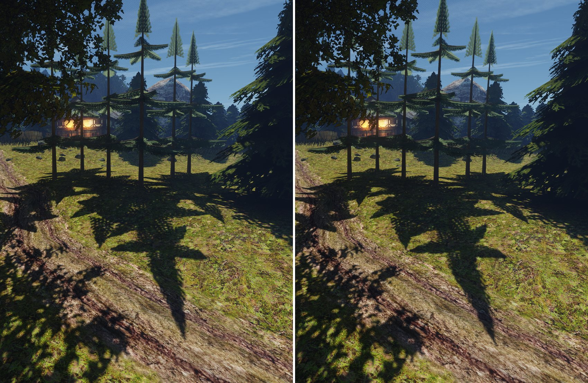
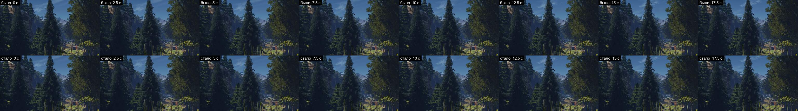
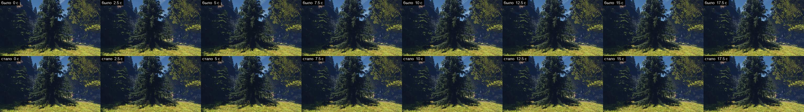
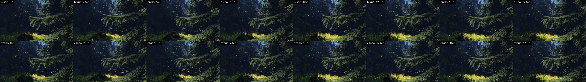
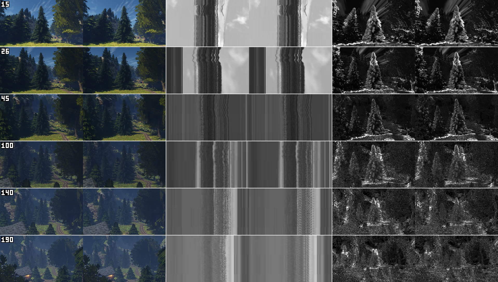

# Ветер дерева: эталон и что построено

Дата: 2026-11-16, построено 2026-11-17. Задача 1 [доработок движка](engine-plan.md): данные в вершине своего GLB и режим `"anchor": "tree"` поля `foliage`.

## 1. Эталон движения

Эталон собран до кода. Числа правила в разделе 2 выведены из него.

### Что измерено на настоящих деревьях

| Что | Число | Источник | Как проверено |
|---|---|---|---|
| Собственная частота ствола хвойного | `f0 = 0,0948 + 3,4317 · DBH/H²` Гц (DBH — диаметр на высоте груди в см, H — высота в м); 602 дерева, 8 видов | Moore, Maguire 2004 [1] | связь — по аннотации; коэффициенты — по выдаче поиска, полный текст закрыт. С DBH в см и H в м формула даёт измеренные 0,26–0,56 Гц из строк ниже, с другими единицами — нет |
| Хвойные качаются как консольная балка, одна собственная частота главная | 603 дерева, R² = 0,77 | Jackson и др. 2019 [2] | текст |
| Частота падает с высотой, сильнее всего от 5 до 20 м | — | Jackson и др. 2021 [3] | текст |
| Примеры частот | явор 0,26 Гц; клёны зимой 0,50–0,56 Гц | [2], [4] | текст; выдача поиска |
| Затухание | летом 8,6 ± 2,2 %, зимой 3,9 ± 1,3 % от критического | [2] | текст |
| Раскачка в порыве | резонанса нет; большое качание набирается за 2–3 периода | работа о ветровале ели ситхинской [5] | выдача поиска; автор и год по ней не подтверждены |
| Отклонение ствола при ветре 4–8 м/с | сосны 9,5 м и 13,5 м: до 2 см и до 5 см на высоте середины кроны | Peltola и др. 1993, по [6] | текст [6] |
| Размах качания от скорости ветра | `σ ∝ I · U²`: размах растёт как квадрат средней скорости (I — турбулентность, 10–12 %) | Cardona, Dabiri 2022 [6] | текст |
| Крупные ветки | почти та же частота, что у всего дерева (дугласия) | Spatz и др. 2007 [7] | аннотация |
| Ветки старших порядков | чем выше порядок ветки, тем выше её частоты | Rodriguez и др. 2012 [8] | аннотация |
| Дрожь листа | осина: 3–5 Гц при 2–4 м/с; пик спектра кроны 1–2 Гц, движение есть до 10 Гц; кручение одного листа 6 ± 1 Гц | [9] | выдача поиска |
| Что движется при каком ветре | слабый ветер — дрожит лист; сильнее — ветки качает порывами, лист идёт с ними | [9] | выдача поиска |
| Шкала Бофорта, суша | 2 балла (1,6–3,3 м/с) — шелестят листья; 3 (3,4–5,4) — листья и тонкие ветки в постоянном движении; 4 (5,5–7,9) — качаются тонкие ветки; 5 (8,0–10,7) — качаются тонкие стволы; 6 (10,8–13,8) — качаются толстые сучья; 7 (13,9–17,1) — качаются стволы деревьев | NOAA [10] | выдача поиска |

Чисел по дрожи хвои и по частотам веток ели в источниках не нашлось. Для них взяты числа осины и правило «ветка быстрее ствола».

### Что из этого следует для дерева 12 м и 30 м

Пропорции — лесные, высота к диаметру около 62: ель 12 м со стволом 20 см и ель 30 м со стволом 48 см. Тогда `DBH/H² = 1,61/H`, и частота зависит только от высоты: `f0 = 0,0948 + 5,535/H`.

| | Ель 12 м | Ель 30 м |
|---|---|---|
| Частота ствола | 0,56 Гц, период 1,8 с | 0,28 Гц, период 3,6 с |
| Сколько длится качание после толчка (затухание 4–9 %) | 2–4 периода: 4–7 с | 2–4 периода: 7–14 с |
| Отклонение верхушки при ветре мира в затишье (1,55–2,85 м/с) | 0,4–1,3 см | 1–5 см |
| Отклонение верхушки при порыве мира (5,65 м/с) | около 5 см, 0,4 % высоты | 11–18 см, 0,4–0,6 % высоты |
| Отклонение верхушки при 7 баллах (16 м/с) | около 36 см, 3 % высоты | 0,9–1,5 м, 3–5 % высоты |
| Ветки первого порядка | 0,6–1,5 Гц | 0,3–0,8 Гц |
| Лист и побег | 2–5 Гц, край ходит на 0,5–2 см | то же: размер листа от высоты дерева не зависит |

Как получены отклонения. Сосна 13,5 м даёт до 5 см на середине кроны при 8 м/с. Форма изгиба балки — квадрат высоты, середина кроны на 0,7 высоты, поэтому верхушка идёт вдвое дальше: 10 см, 0,74 % высоты. Дальше размах пересчитан по квадрату скорости. Для 30 м измерений отклонения не нашлось: нижнее число — та же доля высоты, верхнее — запас на то, что высокое дерево мягче (частота вдвое ниже). Это оценка, а не замер.

**Порыв против затишья.** Ветер мира — от 1,55 до 5,65 м/с, порыв раз в 19 с. Это 2 балла в затишье и нижний край 4 баллов в порыве. Настоящее дерево при таком ветре стволом почти не качается: в затишье шелестит лист, в порыве ходят тонкие ветки. Размах между затишьем и порывом различается в 4–13 раз (квадрат скорости). Движение — не маятник: ствол идёт за напором ветра, а собственное качание лежит поверх и гаснет за 2–4 периода.

### Что берём в игру

1. **Затишье — как в жизни.** Ствол отклоняется на доли процента высоты, ветки почти стоят, лист дрожит.
2. **Порыв — как у настоящего дерева при 7 баллах** («качаются стволы деревьев»): верхушка уходит на 3 % высоты. Это в пять-семь раз больше, чем даёт настоящий ветер 5,65 м/с. Причина та же, что у [живой листвы](../2026-11-14-living-foliage/README.md): порыв в игре — событие, трава и пучки уже читают его как сильный ветер, и дерево, которое в порыве стоит, выглядит мёртвым. Поле `wind` записи материала множит наклон и качание, если контенту нужно иначе.
3. **Частоты — как в жизни:** ствол по формуле от высоты, ветка в 1,6–2,8 раза быстрее ствола, лист 2,6 и 3,8 Гц.
4. **Отношение порыва к затишью — квадрат скорости**, как у напора `FoliageWind::pressure`: 0,075–0,25 в затишье, 1 в порыве.

### Источники

1. Moore J. R., Maguire D. A. Natural sway frequencies and damping ratios of trees: concepts, review and synthesis of previous studies. Trees 18 (2004), 195–203. <https://link.springer.com/article/10.1007/s00468-003-0295-6>
2. Jackson T. и др. An architectural understanding of natural sway frequencies in trees. J. R. Soc. Interface 16 (2019). <https://discovery.ucl.ac.uk/id/eprint/10078184/>
3. Jackson T. и др. The motion of trees in the wind: a data synthesis. Biogeosciences 18 (2021), 4059–4072. <https://bg.copernicus.org/articles/18/4059/2021/>
4. Dendrobiology 64 (2010), 37–42. <https://www.idpan.poznan.pl/images/stories/dendrobiology/vol64/64_37_42.pdf>
5. An assessment of the static and dynamic factors involved in windthrow. Forestry. <https://scilit.com/publications/111bce5f8d3a90c4b4ebbec44141c1d3>
6. Cardona J. L., Dabiri J. O. Wind speed inference from environmental flow–structure interactions. Part 2. Flow 2 (2022), E1. <https://doi.org/10.1017/flo.2021.15>
7. Spatz H.-C., Brüchert F., Pfisterer J. Multiple resonance damping or how do trees escape dangerously large oscillations? Am. J. Bot. 94 (2007), 1603–1611. <https://pubmed.ncbi.nlm.nih.gov/17938116/>
8. Rodriguez M. и др. The multimodal dynamics of a walnut tree: experiments and models. J. Appl. Mech. 79 (2012). <https://doi.org/10.1115/1.4005553>
9. Статьи о дрожи листа осины: <https://pmc.ncbi.nlm.nih.gov/articles/PMC5234829/>, <https://pmc.ncbi.nlm.nih.gov/articles/PMC6000177/>
10. NOAA. Land Beaufort Scale. <https://www.ncei.noaa.gov/sites/default/files/2021-09/Land_Beaufort_Scale.pdf>

Как решают то же игры (Crysis, Horizon, SpeedTree) — [`research/tree_tech.md`](research/tree_tech.md), раздел D.

## 2. Что построено

Материал с полем `"foliage": {"anchor": "tree"}` качается как дерево: ствол клонится по напору ветра и качается на своей частоте, ветку отжимает порыв, который идёт по кроне волной с наветренной стороны, хвоя дрожит пятнами за его фронтом. Что вершина — ствол, ветка или лист, говорит цвет вершины своего GLB (`COLOR_0`). Режим `line` для пучков и система травы не тронуты.

### Данные в вершине

`COLOR_0` своего GLB доезжает до `Resources::Vertex::color` как записан, без гаммы: R в младшем байте, дальше G, B, A. RGB без альфы получает A = 1. Меш без `COLOR_0` получает прежние единицы. Размер вершины не изменился.

| Канал | Смысл | Кто читает |
|---|---|---|
| R | вес ветки: 0 у ствола, 1 на конце ветки | ветер дерева |
| G | фаза ветки, одна на ветку | ветер дерева |
| B | вес дрожи листа: 0 у черешка, 1 на свободном крае | ветер дерева |
| A | открытость кроны | никто; ждёт задачи 3 |

### Правило движения

Дерево стоит в осях своего меша: корень в начале координат, ствол вдоль +Y. Высота берётся по коробке всего меша, поэтому кора и листва одного дерева гнутся как одно тело. Размахи ствола и ветки — доли этой высоты; поле `wind` записи умножает их, поле `flutter` — дрожь листа.

| Часть | Что делает | Числа |
|---|---|---|
| Ствол, наклон | идёт за напором ветра, растёт как квадрат высоты, расстояние точки от корня сохраняется | верхушка на пике порыва — 3 % высоты (36 см у ели 12 м) |
| Ствол, качание | вокруг наклона, на двух близких частотах с биением раз в 15–30 с | размах 0,1 % высоты без напора и до 0,8 % на пике; поперёк ветра — 0,35 от этого |
| Частота ствола | `0,0948 + 5,535 / H(м)` Гц, высота от 3 до 60 м; у деревьев одной высоты расходится на ±10 % по месту | 0,56 Гц у 12 м, 0,28 Гц у 30 м |
| Ветка, вес R | ветер отжимает её по ветру и держит, пока дует порыв; назад, против ветра, она не уходит; вдоль самой себя не растягивается | конец лапы длиной L уступает на `0,08 · L · √(L / 4,6 м)`: 37 см у 4,6 м, 11 см у 2 м, 3,7 см у 1 м; вокруг этого ходит на ±50 %; в затишье — не больше трети |
| Длина ветки | из вершины: расстояние от оси ствола, делённое на R | новый канал не нужен |
| Ветка, вертикаль | следствие того же напора: подветренная лапа поднимается, наветренная опускается, боковая остаётся на своей высоте | 0,6 от хода по ветру |
| Частота ветки | четыре бегущие волны ветра; лапа берёт две-три соседние по своей длине | 0,28, 0,48, 0,78 и 1,38 Гц: длинная лапа ходит на 0,3–0,5 Гц, короткая — на 0,8–1,4 Гц |
| Хвоя, вес B | свободный край дрожит вверх-вниз и поперёк ветра, пятнами за фронтом порыва, сильнее на внешней трети лапы | до 2 см на пике порыва, до 0,5 см в затишье; 2,6 и 3,8 Гц; от высоты дерева не зависит |
| Порыв | бегущий фронт мира: стволу — по месту дерева, ветке и хвое — по месту вершины | 5 м/с вдоль +Z; крону шириной 9 м проходит за 1,8 с |

Все числа лежат в `common/graphics/foliagetree.h` и повторены в `shader/materials/foliage_tree.glsl`; менять их нужно в обоих файлах сразу.

Одна и та же функция работает в основном проходе, в тенях и для прошлого кадра TAA. Прошлый кадр берёт фронт прошлого кадра. Коробка отсечения растёт на ход вершины: `высота × wind × 0,127 + flutter × 2,8 см` — 1,55 м у ели 12 м. Предмет с материалом дерева не получает старый сдвиг всего объекта от ветра (`MeshObjects::Mesh::setWind`).

### Файлы

| Что | Где |
|---|---|
| Числа, правило на процессоре, запас коробки | `OpenGothic/common/graphics/foliagetree.h` |
| То же в вершинном шейдере | `OpenGothic/shader/materials/foliage_tree.glsl`, вызов — `vertex_process.glsl` |
| Чтение `COLOR_0` | `OpenGothic/common/gltfmeshcolor.*`, вызов — `Resources::loadVisualMesh`, укладка в вершину — `PackedMesh` |
| Разбор `anchor` | `OpenGothic/common/resources_textures.cpp` |
| Тесты | `OpenGothic/tests/foliage_tree_test.h` (цель `gothic-material-texture-test`), `OpenGothic/tests/mesh_gltf_color.h` (цель `gothic-mesh-gltf-test`) |
| Проба | `scripts/content/tree_wind_probe.py`, `scripts/bench/tree-wind-probe.bench` |
| Клипы порыва на ели А | `scripts/bench/fir-wind.bench` |

Выключатель прежний: `[INTERNAL] foliage=0`, для стендов — `OPENGOTHIC_FOLIAGE=0|wind|light`.

### Чем вышло иначе, чем в проекте

1. **`COLOR_0` читает отдельный файл, а не загрузчик.** `gltfmesh.cpp` и `asset/staticmesh.h` входят в отпечаток базы: правка любого из них заставила бы всех заново импортировать базу ради данных, которых в базе нет. Поэтому `gltfmeshcolor.cpp` второй раз проходит по тем же байтам GLB в порядке загрузчика и отдаёт по одному цвету на вершину. Отпечаток базы не изменился. Цена — копия порядка обхода: если загрузчик поменяет порядок, читатель должен поменяться с ним. Числа вершин сверяются с мешем, поэтому при расхождении дерево рисуется без цветов и в журнал идёт ошибка, а чужой цвет на вершину не попадает. Долг записан в [#1482](https://github.com/kaifaty/GothicAI/issues/1482).
2. **В пробе шесть елей двух вариантов, а не одна.** На ряду видно, что соседние деревья качаются не в ногу.
3. **В сценарии есть кадр `shade`.** Солнце в 10:00 стоит за дальней камерой, тени уходят на восток вниз по склону, и с дальнего вида их не видно. Тени снимает третья камера — с востока, из-под кроны дерева оригинала.

### Кадры пробы

Ryzen, 2560×1440, 10:00, набор `tree-wind-probe-1`: шесть елей по 12 м (1944 треугольника каждая) на лугу пилота. Слева — покой (`OPENGOTHIC_FOLIAGE=0`), справа — пик порыва. Ветер дует вдоль +Z: на дальнем виде влево, на виде теней вправо.


`far`, 26 м от первой ели. Верхушки шести елей ушли влево на 12–14 пикселей (−13, −14, −13, −12, −12, −12), это около 0,3 м при 42 пикселях на метр. Пик этого порыва — 4,4 м/с из 5,65. В затишье после порыва (`far-lull`) верхушки стоят в 0–2 пикселях от покоя. Ярусы веток сдвинуты меньше верхушки, ствол у земли стоит.



`shade`, с востока назад на ели, пик порыва 5,6 м/с. Конец тени ели у (41550, 380), ближней к камере, ушёл вправо на 58 пикселей и вниз на 18; конец тени первой ели (41300, 0) — вправо на 43 и вниз на 3. Тень наклонена вместе с елью.

Кадры сняты до правки движения веток (раздел 3); ствол с тех пор не менялся. Движение судят по клипам `fir-wind.bench`: вид движения принимает пользователь глазом.

### Проверки

- `gothic-material-texture-test` на Ryzen — 855 093 утверждения, все прошли. `foliageTreeMaths`:
  - ствол: корень стоит; длина ствола сохраняется; кора и листва в одной точке идут одинаково; при R = 0 и B = 0 вершина идёт только со стволом; повёрнутое дерево клонится по ветру мира; соседние деревья не в ногу;
  - ветка: порыв приходит к подветренной ветке позже, чем к наветренной (6 м по ветру — 0,8–1,6 с); короткая ветка ходит меньше длинной и чаще; против ветра ветка не уходит; подветренный конец поднимается, наветренный опускается; в затишье ход ветки и дрожь хвои — не больше 0,35 от хода в порыв;
  - хвоя у ствола и на верхушке дрожит меньше, чем на конце лапы;
  - ни одна вершина не выходит за запас коробки; у дерева 60 м с ветками длиннее 7,2 м и кроной шире 0,3 высоты ход ветки не выходит за её долю запаса; равные тики дают равный ответ; прошлый кадр стоит там, где его держал фронт прошлого кадра; пучок отвечает как раньше.

  `foliageTreeRecords` — разбор записи.
- `gothic-mesh-gltf-test` на Ryzen — 9 846 утверждений, все прошли: `COLOR_0` доходит до вершины, меш без него получает единицы, обход не в ногу с загрузчиком цвет не кладёт.
- `glslangValidator` — 230 вариантов шейдеров, отказов 0.

### Ограничения

- Корень дерева должен лежать в начале координат меша, ствол — идти вдоль +Y. Наклонённое в модели дерево гнётся от оси меша, а не от своего ствола.
- Частота берётся из высоты меша с пропорциями лесного хвойного дерева. Толщину ствола и породу правило не знает.
- У ветки нет своей опоры: она сдвигается с весом R, а не поворачивается вокруг основания. На длинной ветке это видно как сдвиг, а не как изгиб.
- У правила нет памяти: положение ветки — функция времени и места. Поэтому после порыва ветка возвращается за напором, а затухающих качаний вокруг покоя не делает.
- Длина ветки оценивается по расстоянию от оси ствола. У ветки, которая растёт круто вверх, оценка занижена, и она ходит меньше, чем должна.
- Кора и листва идут вместе, только если у их записей одно значение `wind`. Коре для режима дерева нужна запись со своими картами в `materials.json`.
- Масштаб предмета в слое предметов не задаётся, поэтому деревья разной высоты — разные меши.
- Трассировка лучей и GI видят дерево неподвижным, как и живую листву.
- Примитивы одного узла и материала с одинаковыми `POSITION`, `NORMAL` и `TEXCOORD_0` делят вершины, и разный `COLOR_0` у них не поддержан: меш рисуется без цветов, в журнал идёт ошибка.
- Порыв в игре по размаху — ветер в 7 баллов, хотя скорость ветра мира — 4 балла. Так решено в эталоне: дерево, которое в порыве стоит, выглядит мёртвым.
- Камера `shade` стоит под кроной дерева оригинала, и верхушки части елей с неё закрыты. Сверху склон закрывает та же крона шириной 30 м.
- Проба — грубая ель для проверки движения. По ней нельзя судить о виде дерева.

## 3. Круг правки движения

Дата: 2026-11-18. Пользователь посмотрел клипы новой ели (`fir-probe-4`) и движение не принял: направления и размах неестественные, все ветки шевелятся сразу, будто ветер дует отовсюду. Это единственный круг правки. Сначала замысел, потом код; что вышло — в подразделах «Что вышло», «Клипы „было“ и „стало“» и «Что осталось плохо».

### Как ель движется в порыве 4–6 м/с

| Что | Число или правило | Источник | Как проверено |
|---|---|---|---|
| Ветка идёт за ветром, а не звенит | динамический коэффициент 0,98–1,19 у сосны приморской: отклонение почти равно статическому от того же напора, резонанс добавляет до 19 % | Sellier, Fourcaud 2009, по обзору [11] | текст обзора |
| Чем гасится качание | внутреннее трение дерева — меньше 5 % от критического; основное — сопротивление хвои воздуху и удары веток друг о друга | Moore, Maguire 2004 [1]; [11] | аннотация; текст обзора |
| Затухание дерева с ветками | клён остролистный: 13–17 % от критического, без веток — в разы меньше | [4] | выдача поиска, PDF не прочитан |
| Порыв — одно событие для кроны | качание дерева идёт за когерентными порывами над пологом, а не за мелкой турбулентностью | доклад AMS [12] | аннотация |
| Порыв едет со скоростью ветра | вихрь переносится средним потоком (гипотеза Тейлора); по ниве и по пологу он идёт видимой волной — пятно наклона бежит вместе с вихрем | общее положение метеорологии пограничного слоя; обзор Finnigan 2000 не перечитывался | — |
| Крупная ветка | почти частота всего дерева | Spatz и др. 2007 [7] | аннотация |
| Ветки старших порядков | чем короче и тоньше, тем быстрее | Rodriguez и др. 2012 [8] | аннотация |

Измеренных частот и затухания лапы ели по её длине в источниках не нашлось. Ниже — оценка по балке, а не замер.

**Частота лапы от длины.** Консольная балка: `f ∝ d / L²`. У веток толщина растёт с длиной примерно как `d ∝ L^1,5`, тогда `f ∝ L^−0,5`. Привязка — нижняя лапа ели A (4,6 м) на частоте ствола дерева 18 м, 0,40 Гц [7]:

| Лапа | Длина | Частота (оценка) |
|---|---|---|
| нижняя | 4,6 м | 0,4 Гц |
| средняя | 2 м | 0,6 Гц |
| верхняя | 1 м | 0,85 Гц |
| у верхушки | 0,45 м | 1,3 Гц |

**Что из этого видит глаз.**

1. Порыв 5 м/с проходит крону шириной 9,5 м за 1,9 с. Напор ветра мира нарастает 2,2 с. Значит, наветренный край кроны уже отжат, когда подветренный только начинает двигаться: фронт виден.
2. Лапу отжимает по ветру, и она держится отжатой, пока порыв дует (у ветра мира — около 3 с). Турбулентность порыва качает её вокруг этого положения, но назад, против ветра, она не уходит. Именно это одностороннее движение и говорит, откуда дует.
3. После порыва лапа возвращается и делает одно-два затухающих качания: затухание 13–17 % гасит размах втрое за период.
4. Длинная лапа не успевает за быстрыми вихрями и ходит широко и медленно. Короткая ходит мало и чаще.
5. Вертикаль — следствие того же напора. Нижние лапы ели свисают концом вниз. Ветер вдоль подветренной лапы дует ей под низ и вытягивает её: конец поднимается. Наветренную лапу он прижимает сверху: конец опускается. Боковую лапу он отводит по ветру вбок, почти без вертикали.
6. Хвоя дрожит там, где воздух быстрый и рваный: на свободных концах лап и в вихрях за фронтом. В затишье (2 балла) хвоя ели почти стоит: игла короткая и жёсткая, это не лист осины.

### Что не так в прежнем правиле

Числа — для ели A (18,07 м, 239 веток, лапы от 4,6 м внизу до 0,45 м у верхушки), `wind: 1`, `flutter: 1`.

| Что | Прежнее правило | Почему плохо |
|---|---|---|
| Когда отвечает ветка | напор один на всё дерево, по месту его корня; фаза качания — случайная по ветке | все 239 веток отвечают в один тик, каждая в своей фазе: «ветер со всех сторон». Должно быть 1,9 с от края до края кроны |
| Размах | доля высоты дерева: конец любой ветки уступает на 18 см и качается на ±11 см | лапа 0,45 м ходит на 29 см — 64 % своей длины; лапа 4,6 м — на 6 % |
| Вертикаль | свой синус, ±14,5 см у конца любой ветки, от направления ветра не зависит | ветки машут вверх-вниз сами по себе |
| Закон во времени | ровный синус 0,64–1,12 Гц (1,6–2,8 частоты ствола), от длины ветки не зависит; в затишье остаётся 21–36 % размаха | крона не замирает и не отвечает на порыв: в затишье концы кивают на ±3–5 см без остановки |
| Дрожь хвои | 0,75–1,0 см в затишье и 1,5 см на пике порыва, на каждой карточке кроны | рябит вся крона сразу и почти одинаково в затишье и в порыв |

Разбор из брифа подтвердился по коду во всех пяти пунктах.

### Новое правило

Ствол не меняется: наклон 3 % высоты на пике порыва и качание на своей частоте, напор берётся по месту дерева. Меняются ветка и хвоя.

1. **Напор — по месту вершины.** Бегущий фронт мира (`foliageFrontAt`, 5 м/с вдоль +Z) считается для каждой вершины по её координате в мире, а не один раз на дерево. Порыв проходит ель A за 1,9 с.
2. **Длина лапы — из того, что уже есть в вершине.** `r` — расстояние вершины от оси ствола, R — её доля длины ветки, значит длина лапы `L ≈ r / R`. Новый канал не нужен. У основания ветки (R < 0,05) оценка грубая, но размах там нулевой.
3. **Размах — от длины лапы, а не от высоты дерева.** Конец лапы длиной L уступает на `0,08 · L · √(L / 4,6 м)`: 37 см у лапы 4,6 м, 11 см у 2 м, 3,7 см у 1 м, 1,1 см у 0,45 м. Вдоль ветки отклонение растёт как квадрат R — форма изгиба балки. Доля длины не растёт дальше лапы 7,2 м, а `r` берётся не больше 0,3 высоты дерева: так запас коробки отсечения остаётся долей высоты.
4. **Одно движение, один сигнал.** Отклонение ветки — `размах × s`, где `s = q + 0,5 · e · T`:
   - `q` — напор по месту вершины, 0–1;
   - `T` — турбулентность, от −1 до 1 (пункт 5);
   - `e` — больший из двух напоров: сейчас и 1,2 с назад. Турбулентность приходит вместе с фронтом и держится ещё 1,2 с после порыва — это затухающее качание при возврате.

   На пике порыва `s` лежит между 0,5 и 1,5: лапа отжата и качается, но против ветра не уходит. В затишье `q` = 0,075–0,27, и ход лапы — не больше трети пикового.
5. **Турбулентность — бегущие волны, а не свой синус ветки.** Четыре волны идут по миру вдоль +Z со скоростью фронта: 0,28, 0,48, 0,78 и 1,38 Гц, длины 17,6, 10,3, 6,4 и 3,6 м, каждая чуть повёрнута вбок. Лапа берёт две-три соседние по своей длине: 4,6 м — первые две, 1,4 м — вторую и третью, 0,45 м — последние две. Волна бежит по кроне с наветренной стороны на подветренную, поэтому соседние лапы идут не в ногу, а одна за другой. Фаза G сдвигает волны ветки не больше чем на ±0,06 оборота — чтобы соседи не шагали строем.
6. **Направление.** По горизонтали ветка идёт по ветру, но не вдоль самой себя (как и раньше). По вертикали — `0,6 × размах × s × (ветер · направление ветки)`: подветренная лапа поднимается, наветренная опускается, боковая остаётся на своей высоте. Своего синуса у вертикали нет.
7. **Дрожь хвои — пятнами за фронтом.** Размах — `2 см × flutter × B × e × пятно × конец`:
   - `пятно` — гребень двух быстрых волн из пункта 5, едет по кроне по ветру;
   - `конец` — 0,3 у ствола и 1 на внешней трети лапы.

   В затишье это не больше 0,5 см и только в пятнах; на пике — до 2 см на концах лап. Частоты прежние, 2,6 и 3,8 Гц.

### Что вышло

Правило построено по замыслу, все семь пунктов. Числа по склейке не менялись: замеры на клипах совпали с расчётом, а что усиливать, должен решить глаз пользователя (см. «Что осталось плохо»).

От замысла отличается одно. Затухающего качания после порыва нет: у правила нет памяти. Вместо него турбулентность держится 1,2 с после спада напора, но при напоре затишья её размах мал, и ветка просто возвращается.

**Расчёт по правилу** — ель A (18,07 м), `wind: 1`, `flutter: 1`, порыв с полным напором. Ход конца лапы относительно её основания:

| Лапа | В порыв | В затишье | Частота хода |
|---|---|---|---|
| нижняя 4,6 м, поперёк ветра | 22–55 см по ветру, по вертикали до 3 см | 1–12 см | 0,3–0,5 Гц |
| нижняя 4,6 м, наветренная | конец опускается до 30 см, по ветру до 5 см | до 3 см | 0,3–0,5 Гц |
| нижняя 4,6 м, подветренная | конец поднимается на 6–29 см, по ветру до 4 см | до 3 см | 0,3–0,5 Гц |
| средняя 2 м | 5–16 см | 0,5–3 см | 0,8 Гц |
| верхняя 1 м | 2–5 см | 0,2–1 см | 0,8–0,9 Гц |
| у верхушки 0,45 м | 0,6–1,6 см | до 0,4 см | 1,4 Гц |

Хвоя: до 2,0 см на концах лап в порыв, до 0,5 см в затишье. Порыв проходит от наветренного края кроны до подветренного (9,2 м) за 1,8 с.

Запас коробки отсечения вырос с 0,106 до 0,127 высоты дерева: 2,3 м у ели A.

### Клипы «было» и «стало»

Сценарий [`fir-wind.bench`](../../../scripts/bench/fir-wind.bench), набор `fir-probe-4`, Ryzen, 1920×1080, полдень. Три клипа по 20 с, каждый начинается за 3 с до пика порыва:

| Клип | Откуда | Пик порыва | Масштаб на ели |
|---|---|---|---|
| `wind-far` | 30 м от ели A | 4,4 м/с | 3,3 см на пиксель |
| `wind-near` | 5 м от нижних лап | 4,8 м/с | 0,55 см на пиксель |
| `wind-bough` | 3 м от лапы на солнце, сбоку | 5,6 м/с | 0,33 см на пиксель |

Порывы в «было» и «стало» одни и те же: то же зерно, те же тики. Клипы и склейки «было | стало» (1920×540) лежат вне git: `~/.local/share/gothic-ai/remaster/trees-fir/wind-clips/{before,after}/` и `side-{far,near,bough}.mp4` там же.

**Камеры оставлены прежними**, потому что ими снято «было». Они смотрят почти вдоль ветра: ветер уходит от камеры и влево, и на экране видно только 0,57 хода по ветру. Наветренная сторона ели — справа. Камера поперёк ветра показала бы волну лучше, но для неё нет «было».

Склейки я оценивал по кадрам и замерам на них: разность соседних кадров, слежение за участком лапы, задержка движения между полосами кроны. Движение глазом принимает пользователь: по склейкам «было | стало» он принял его 2026-11-18.

| Замер | Было | Стало |
|---|---|---|
| Задержка движения по кроне, `wind-near`, пять полос справа налево | −0,2…+0,2 с без порядка: вся крона сразу | 0 → 0,20 → 0,43 → 0,73 → 0,90 с, по порядку от наветренного края |
| То же по лапе, `wind-bough`, три полосы | 0 / 0 / 0 с | 0,07 / 0,13 / 0,20 с |
| Середина лапы, `wind-bough`, по горизонтали | раз в секунду ходит между покоем и 11 см и обратно | отжата на 5–13 см и держится 8 с, медленно ходит на ±2–2,5 см (0,3–0,5 Гц); возврат за 0,7 с |
| Та же лапа, по вертикали | свой ход ±3–6 см, не в такт горизонтали | идёт вместе с горизонталью, половина её хода |
| Та же лапа в затишье | ±3–5 см без остановки | до 1 см |
| Конец нижней левой лапы, `wind-near` | −2 и −10 см попеременно, раз в секунду; по вертикали ±3–5 см | уходит на 10 см за 0,9 с, держится на 4–13 см, возвращается к 6,5 с; по вертикали до 1 см |
| Движение кадра в порыв и в затишье, `wind-near` | 1,7–3,2 и 1,1 | 0,8–1,2 и 0,4 |
| То же, `wind-bough` | 6,6–8,3 и 3,7–4,3 | 1,2–2,6 и 0,5 |
| То же, `wind-far` | 0,4 и 0,2 | 0,2 и 0,2 |
| Верхушка, `wind-far` | 14–20 см по ветру | то же: ствол не менялся |

«Движение кадра» — средняя разность яркости соседних кадров (640×360, шкала 0–255); это мера того, сколько в кадре шевелится, а не сантиметры.

**Читается ли направление ветра.** С 5 и 3 м — да: лапы уходят в одну сторону и стоят там, пока дует порыв, назад не машут; движение начинается справа, с наветренного края, и доходит до левого через 0,9 с. С 30 м — слабо: порыв читается по наклону ствола, как и раньше, а ход лап там — 2–3 пикселя и медленный.

**Идут ли лапы волной.** По замеру — да, задержка растёт по порядку от края к краю, движение идёт по кроне пятнами, которые меняют место. Но камеры смотрят вдоль ветра, волна на экране сжата почти вдвое, и это мягкий переход, а не явно бегущая полоса.

**Не стала ли ель мёртвой.** Риск есть. В затишье крона почти стоит: движение кадра упало в 2,5–8 раз, середина лапы ходит в пределах сантиметра. Так и задумано, но с 30 м затишье и порыв по лапам теперь почти не различаются — различает их только ствол.

**Рябит ли хвоя.** Нет. Раньше мерцала вся крона всегда; теперь хвоя дрожит пятнами в порыв (до 2 см) и почти стоит в затишье (до 0,5 см).

### Что осталось плохо

1. **С 30 м лапы почти не видны в движении.** Ход 2–3 пикселя на частоте 0,3–0,5 Гц; порыв от затишья отличает только наклон ствола. Усилить можно долей турбулентности (`BranchGust`, сейчас 0,5) или размахом (`BranchGive`, 0,08), но это меняет и ближний вид — решать по глазу.
2. **Возврат после порыва — без качаний.** Лапа приходит в покой за 0,7 с и останавливается. Настоящая делает одно-два затухающих. Для этого правилу нужна память или второй, запаздывающий сигнал напора.
3. **В сильный порыв лапа долго стоит отжатой.** Напор ветра мира в порыв 5,6 м/с упирается в единицу и держится 8 с; лапа всё это время отжата и ходит на ±25 %. Это свойство кривой напора мира, общей с травой, а не правила дерева.
4. **`wind-bough` начинается уже внутри порыва.** Самый сильный порыв набирает напор раньше, чем за 3 с до пика, и прихода фронта на этом клипе нет — только удержание и возврат.
5. **Верхняя треть кроны идёт со стволом.** Короткие лапы ходят на 1–5 см — так по балке, но на экране это не видно, и верх выглядит цельным.
6. **Ветка сдвигается, а не поворачивается** вокруг основания — прежнее ограничение; при ходе 40–55 см у нижних лап это заметнее, чем раньше.
7. **Волну с этих камер видно вполсилы** — они смотрят вдоль ветра.

### Раскадровки

Кадры через 2,5 с, «было» над «стало». Движения по стоп-кадрам не видно — они показывают, что и откуда снято; судить нужно по клипам.







### Источники к разделу

11. James K. R. и др. Tree biomechanics literature review: dynamics. Arboriculture & Urban Forestry 40(1), 2014. <https://auf.isa-arbor.com/content/40/1/1>
12. Доклад конференции AMS о качании деревьев и когерентных порывах над пологом. <https://ams.confex.com/ams/pdfpapers/110669.pdf>

## 4. Затухание с расстоянием

Дата: 2026-11-18. Шаг 3 [порядка мер](tree-optimization.md#3-порядок-мер): вдали ветер дерева гаснет по уровням — сначала дрожь хвои, потом ход лап, последним ствол; за последним порогом дерево рисуется без ветра. Ближнее движение раздела 3 не меняется.

### Замысел

**По какой величине гаснет.** По размеру хода уровня на экране главного вида, в пикселях, а не по расстоянию в метрах:

```
пикселей = ход уровня, см · K / расстояние до корня дерева, см
K = половина высоты кадра в пикселях / tg(половины вертикального угла зрения)
```

Причины:
- Движение перестаёт быть видимым, когда оно меньше пикселя-двух, а не на каком-то числе метров. При 1080p и при 1440p, при обычном угле и при прицеливании из лука (угол уже) порог в метрах разный, в пикселях — один.
- Ход уровня зависит от высоты дерева. Ель 18 м и ёлка 6 м на одном расстоянии качаются на разное число пикселей; порог в метрах пришлось бы задавать для каждой породы.
- Цена честная: кадр 4K платит за ветер дальше, чем 1080p, потому что и видит его дальше.

`K` берётся из проекции и разрешения G-буфера главного вида. При вертикальном угле 67,5° это 808 пикселей на единицу тангенса для 1080p и 1078 для 1440p. Если кадр рисуется в меньшем разрешении и растягивается, пороги считаются в нарисованных пикселях.

**Вес считается на дерево, а не на вершину**: расстояние берётся от камеры до корня (сдвиг матрицы объекта). Поэтому всё дерево гаснет как одно тело, а вершине хватает одного сравнения, чтобы выйти без расчёта ветра.

**Ход уровня** — наибольший, какой правило даёт дереву этой высоты при полном напоре и единичных `wind` и `flutter`. Значения материала в вес не входят: кора (`flutter` 0) и хвоя (`flutter` 1) — два материала одного дерева, и при разных весах лапа из коры разошлась бы с хвоей на ней.

| Уровень | Ход | Ель A, 18,07 м | Ель 12 м |
|---|---|---|---|
| Хвоя | `LeafMax` | 2 см | 2 см |
| Лапы | конец самой длинной лапы, какую допускает правило: `BranchReach · высота · BranchGive · min(√(длина / BranchLong), BranchTopK)` | 47 см (настоящая нижняя лапа — 37 см, средняя — 11 см) | 25,5 см |
| Ствол | наклон верхушки: `TreeLean · высота` | 54 см | 36 см |

**Пороги и полоса.** Вес уровня равен `smoothstep(нет, полный, пикселей)`: выше «полного» — ровно единица (правило вблизи то же до бита), ниже «нет» — ровно ноль, между ними гладко, без излома на краях.

| Уровень | Полный от | Нет ниже | Ель A при 1440p | Ель A при 1080p | Ель 12 м при 1440p |
|---|---|---|---|---|---|
| Хвоя | 0,8 пикселя | 0,5 | 27 → 43 м | 20 → 32 м | 27 → 43 м |
| Лапы | 5 | 3 | 101 → 169 м | 76 → 127 м | 55 → 92 м |
| Ствол | 4 | 2,5 | 146 → 234 м | 110 → 175 м | 97 → 155 м |

Откуда числа:
- **Хвоя.** Дрожь — до 2 см в порыв. Меньше пикселя это мерцание, а не движение, и сглаживание по времени его съедает. Оценка исследования — 30–40 м.
- **Лапы.** Порог выше пикселя, потому что ход считается по самой длинной лапе, а средняя идёт вчетверо меньше: на пороге «нет» средняя лапа ели A ходит на 0,7 пикселя, нижняя — на 2,4. С 30 м при 1080p лапы ходят на 2–3 пикселя и уже «почти не видны» (раздел 3); полоса начинается в 2,5 раза дальше. Nanite Foliage выключает анимацию ниже 0,1 высоты экрана — для ели A при 1440p это 135 м.
- **Ствол.** Наклон — самое медленное движение (порыв набирает напор за 2–3 с) и самое крупное. На пороге «нет» верхушка ели высотой 83 пикселя идёт на 2,5 пикселя за несколько секунд. Качание вокруг наклона там — 0,6 пикселя.

Полоса затухания — от «полного» до «нет», в 1,6–1,7 раза по расстоянию: 16 м у хвои, 68 м у лап, 88 м у ствола (ель A, 1440p). Исследование предлагало 10–20 м; широкая полоса дешевле не стоит, а позу меняет медленнее.

**Порядок гарантирован правилом, а не числами.** Вес лап не меньше веса хвои, вес ствола не меньше веса лап (берётся наибольший). У низкой ёлки ход лап в пикселях меньше хода хвои, и по одним порогам лапы замерли бы раньше хвои; так хвоя всегда первая, ствол всегда последний. Если вес ствола ноль — нули все три.

**Замирает в позе покоя.** Вес множит ход: за порогом дерево стоит как без ветра, а не в последней позе порыва. Поза зависит только от расстояния и ветра, поэтому скачка нет ни при подходе, ни при отходе.

**Тень.** Вес считается по расстоянию до главной камеры во всех проходах: в основном, в каскадах, в страницах VSM, в заслонах `HiZ`. Отдельной работы для этого нет: блок сцены каждого вида — копия главного, в теневых видах заменены только матрица вида и флаги, а `camPos`, проекция и разрешение остаются главными. Тень поэтому гаснет вместе с деревом, а не по расстоянию до теневой камеры. Оговорка: тень длинного дерева ложится ближе к камере, чем его корень, и ход тени на экране чуть больше хода самого дерева; при пороге в пикселях это доли пикселя.

**Прошлый кадр.** Положение прошлого кадра считается с тем же весом, что и текущего: вес берётся один раз на вершину. Вектор движения тогда описывает только ветер. Ошибка — изменение веса за кадр: бегущий герой проходит полосу лап (68 м) за 7 с, вес меняется на 0,3 % за кадр, это тысячные пикселя.

**Ранний выход.** В шейдере вершин вес считается до всего остального. Если вес ствола ноль, вершина не идёт ни в фронт порыва, ни в правило — ни для текущего, ни для прошлого кадра. Если нули только у лап и хвои, правило выходит после ствола: без двух чтений фронта и четырёх волн.

**Коробки отсечения.** У дерева две границы:
- сфера экземпляра (`Cluster::r`) — по ней идут проверка пирамиды во всех видах и выбор страниц VSM;
- коробка меша (`Bucket::bbox`) — одна на все экземпляры меша, по ней идёт только проверка заслонов главного вида.

Сфера сжимается: процессор раз в кадр считает тот же вес с запасом (расстояние на 2 % ближе, вес округлён вверх до восьмых) и ставит радиус по ходу с этим весом. Камера и разрешение у процессора и шейдера одни и те же, того же кадра, поэтому сфера всегда не меньше настоящего хода и скачка отсечения нет. Коробка меша остаётся с полным запасом: она общая, а сделать её своей для экземпляра можно только в шейдере отбора кластеров, который эта задача не трогает.

**Переключатель.** `[INTERNAL] treeWindFade=0|1`, `OPENGOTHIC_TREE_WIND_FADE=0|1` сильнее. Выключен — ветер на любом расстоянии, как было. Пучки и режим `line` затухание не читают вовсе.

### Что построено

| Что | Где |
|---|---|
| Пороги, вес на процессоре (`fade`), вес с запасом для сферы (`fadeBound`), ход с весом (`travel`) | `OpenGothic/common/graphics/foliagetree.h` |
| Те же пороги и вес в вершинном шейдере (`foliageTreeFade`), ранний выход | `OpenGothic/shader/materials/foliage_tree.glsl`, вызов — `vertex_process.glsl` |
| `K` главного вида в блоке сцены (`foliageFade.x`; ноль — затухания нет) | `OpenGothic/common/graphics/sceneglobals.*`, `shader/scene.glsl` |
| Общий вес для частей дерева и свой радиус каждой части | `VisualObjects::preFrameUpdateTrees` в `common/graphics/visualobjects.cpp` |
| Переключатель и строка журнала `render: tree wind fade = …` | `OpenGothic/common/graphics/treewindfade.h`, умолчание — `common/settings.cpp` |
| Тест | `foliageTreeFadeMaths` в `OpenGothic/tests/foliage_tree_test.h` |
| Клипы | `scripts/bench/fir-wind-fade.bench` |

Пороги лежат рядом с правилом в `foliagetree.h` и повторены в `foliage_tree.glsl`; менять их нужно в обоих файлах сразу, как и числа правила.

В пределах одного кадра кора и хвоя переиспользуют вес и код затухания при совпадении меша, положения и вертикальной оси. При смене ступени радиус каждой части учитывает изгиб, дрожание и амплитуду её материала. Дерево, которое стоит в полосе, меняет сферы не чаще, чем камера проходит ступень.

### Клипы «выключено» и «включено»

Сценарий [`fir-wind-fade.bench`](../../../scripts/bench/fir-wind-fade.bench), набор `fir-probe-4`, Ryzen, 1920×1080, полдень. Два прогона, по одному: с `OPENGOTHIC_TREE_WIND_FADE=0` и без него. Шесть стоячих клипов по 20 с на одной линии взгляда, каждый начинается за 3 с до пика порыва. Порывы в обоих прогонах одни и те же, тик в тик. Имя клипа — расстояние от камеры до корня ели A в метрах.

| Клип | Ель на экране | Хвоя | Лапы | Ствол |
|---|---|---|---|---|
| `fade-15` | 866 пикселей | 1 | 1 | 1 |
| `fade-26` | 577 | 0,39 | 1 | 1 |
| `fade-45` | 341 | 0 | 1 | 1 |
| `fade-100` | 146 | 0 | 0,36 | 1 |
| `fade-140` | 103 | 0 | 0 | 0,38 |
| `fade-190` | 76 | 0 | 0 | 0 |

Веса — расчёт по порогам для 1080p. Клипы и склейки «выключено | включено» (1920×540) лежат вне git: `~/.local/share/gothic-ai/remaster/trees-fir/wind-fade/{off,on}/fade-<N>.mp4` и `fade-<N>-off-on.mp4` там же. В склейке 15 м — весь кадр, уменьшенный вдвое; в остальных — середина кадра один к одному. Для 100, 140 и 190 м есть ещё `fade-<N>-off-on-x3.mp4`: середина 320×180, увеличенная втрое без сглаживания.

Клипы я оценивал по кадрам и замерам на них: срез кроны по времени (строка пикселей на четверть высоты ниже верхушки, время вниз), слежение за верхними 45 % кроны с точностью до долей пикселя, карта медленного движения (разброс посекундных средних). Как клип выглядит глазом, решает пользователь.

| Клип | Ход верхушки за 20 с, выключено | Включено | Совпадение хода во времени |
|---|---|---|---|
| `fade-26` | 5,13 пикселя | 5,07 | 1,00; расходятся не больше чем на 0,1 пикселя |
| `fade-45` | 0,48 | 0,48 | 1,00; на 0,01 |
| `fade-100` | 0,49 | 0,41 | 0,997 |
| `fade-140` | 0,27 | 0,10 | 0,84 |
| `fade-190` | 0,43 | 0,11 | −0,42: во включённом остался только шум замера, около 0,1 пикселя |

Слежение занижает ход, когда за елью пёстрый фон: на 45 м оно даёт 0,48 пикселя, а на срезе по времени верхушка идёт примерно на 3. Поэтому столбцы годятся для сравнения «выключено» с «включено», а не как размер хода. Размер по разделу 3: в порыв этих клипов верхушка уходит на 14–20 см, это 0,8–1,2 пикселя на 140 м и 0,6–0,85 на 190 м, за 2–3 с.

### Что вышло

1. **До первого порога движение то же.** На 15, 26 и 45 м ход во времени совпадает с выключенным до сотых и десятых пикселя. Покадрово клипы не совпадают и совпасть не могут: облака, трава и фаза кадра в двух прогонах разные (средняя разность «выключено − включено» на 15 м — 1,55 уровня яркости, между кадрами одного клипа через треть секунды — 1,96). То, что ответ правила вблизи тот же до бита, проверяет тест, а не клип.
2. **Где ель замирает, не видно.** На 100 м лапы идут в 0,36 хода, на 140 м стоят; на 190 м стоит вся ель. Ни на кадрах в пик порыва, ни на срезах по времени, ни на картах движения разницы, которую можно показать пальцем, нет: затухание убирает медленный наклон верхушки меньше чем на пиксель за несколько секунд. Замер его находит (0,27 → 0,10 и 0,43 → 0,11 пикселя), глаз на кадре — нет.
3. **Хвоя на 26–45 м.** Дрожь там меньше пикселя и до затухания; разницы на кадрах и срезах нет.
4. **Тень.** Теневые проходы берут те же веса, и на картах движения разница «выключено − включено» есть только в верхней части кроны: на земле под елью её нет ни на одном расстоянии. Отдельно тень на 140 и 190 м не разглядеть — это пятно 10–20 пикселей на траве, которая сама шевелится. Расхождения тени с деревом не видно, но эти клипы и не могли бы показать расхождение в доли пикселя.
5. **Пороги оставлены расчётными.** Круг подбора по клипам не понадобился: замирание не видно. Пороги с запасом: ход уровня считается для полного напора и единичных `wind` и `flutter`, а в порыве клипов настоящий ход в 2,5–4 раза меньше. Их можно придвинуть, но без новых прогонов это не проверить, а прогонов больше нет.

### Что осталось плохо

1. **Цена не измерена.** По решению пользователя 2026-11-18 задача с кодом цену сама не снимает: лес из 1 024 елей с этой мерой и без неё одним прогоном снимет ведущий после слияния, мера переключается `OPENGOTHIC_TREE_WIND_FADE`. Сколько из 4–7 мс ветра вернулось, пока неизвестно.
2. **Коробка меша не сжата.** Сфера дерева за порогом теряет запас на ветер, а коробка меша (`Bucket::bbox`) — нет: она одна на все экземпляры, и сжать её для дальнего дерева можно только в шейдере отбора кластеров (`visibility_pass.comp`), который эта задача не трогает. Цена: проверка заслонов главного вида у дальних елей идёт по коробке, которая шире настоящей примерно на метр с каждой стороны (ель A), и чуть реже их отбрасывает. Проверка пирамиды и выбор страниц тени идут по сфере.
3. **Дальние ели мерцают раз в секунду — и без затухания.** На всех четырёх новых елях, что видны в кадре на 140 и 190 м, отдельные пиксели на освещённом краю кроны и у основания ходят пилой с периодом 1,07 с (32 кадра). Это есть в обоих прогонах: размах на частоте 0,9–1,0 Гц у 1 % самых подвижных пикселей — 1,25 уровня яркости без затухания и 1,77 с ним на 140 м, 0,85 и 1,16 на 190 м; у худшего пикселя — 9,5 и 15,7. Это не ветер: у качания такой частоты нет. Когда ель стоит, мерцание не прячется за движением и потому сильнее. На увеличенных кадрах в противоположных фазах глазом оно не различается. Причину я не разбирал; похоже на известное мерцание тени по страницам VSM (задача `tree-shadow-flicker`), код которых здесь трогать нельзя.
4. **Вес считается по главной камере и разрешению нарисованного кадра.** Тень длинного дерева лежит ближе к камере, чем корень, и гаснет чуть раньше, чем перестаёт быть видимым её ход; при рендере в пониженном разрешении с растяжкой пороги считаются в нарисованных пикселях.
5. **Ход лап одинаков для всех пород.** Он считается по самой длинной лапе, какую допускает правило для дерева этой высоты, а не по настоящей кроне: у узкой ели лапы замирают позже, чем могли бы.
6. **Слежение на пёстром фоне занижает ход** — см. выше; настоящий размер убранного движения взят из раздела 3, а не из этих клипов.

### Проверки затухания

- `gothic-material-texture-test` на Ryzen — 2 546 327 утверждений, все прошли; `gothic-mesh-gltf-test` — 9 852, все прошли. `foliageTreeFadeMaths`, ели 18 и 6 м при 1440p и 1080p:
  - вес и поза непрерывны по расстоянию: шаг 5 см нигде не даёт скачка;
  - порядок: хвоя замирает первой, ствол последним, у низкой ёлки тоже; у каждого уровня полоса, а не черта;
  - кора и хвоя одного дерева гаснут одинаково;
  - за последним порогом сдвиг вершины ровно ноль, запас сферы — ноль;
  - до первого порога ответ правила тот же до бита, для текущего и прошлого кадра; половина веса — половина хода лапы;
  - сфера с запасом не меньше хода вершины с настоящим весом, ступенями по восьмой;
  - без `K` и для пучка вес — единица на любом расстоянии; пучок затухание не читает; запас коробки дерева с полным ветром прежний;
  - переключатель: включено по умолчанию, переменная окружения сильнее.

  Прежние проверки `foliageTreeMaths` не правились.
- `glslangValidator` — 403 варианта затронутых шейдеров, отказов 0.
- Два прогона `fir-wind-fade` на Ryzen: коды 0, в журналах `render: tree wind fade = 1 by [INTERNAL] treeWindFade` и `= 0 by OPENGOTHIC_TREE_WIND_FADE`.

### Повторное использование расчёта на CPU, 2026-11-24

Тихая серия A/B/B/A на Ryzen 3950X и RTX 3080. В обоих вариантах те же
1 024 ели, внутреннее разрешение 1280×720, TAAU до 2560×1440, ветер, GI,
история HiZ и L4 солнечных страниц `m7–m8`. Стенд собран на `7c681a111`
с L4. В B заменён один объект C++ со штатной правкой. Таймеры совпадают с
замером при разделении ветра и LOD. Маршрут пробежки тот же. Разброс
положения героя между запусками 4,25 см в начале и 4,57 см в конце.

| Вид | Кадры A / B | Границы ветра P50, A → B, мс | Границы ветра P95, A → B, мс | `encode_main` P50, A → B, мс |
|---|---:|---:|---:|---:|
| Спиной к лесу | 811 / 817 | 0,283 → 0,195 | 0,327 → 0,233 | 2,506 → 2,432 |
| Изнутри леса | 585 / 592 | 0,291 → 0,195 | 0,323 → 0,222 | 2,746 → 2,565 |
| Проход героя | 732 / 731 | 0,292 → 0,200 | 0,333 → 0,239 | 2,990 → 2,916 |

Выигрыш медианы расчёта границ в двух отдельных парах составляет
0,094 и 0,083 мс спиной к лесу, 0,104 и 0,088 мс изнутри и 0,100 и
0,082 мс на проходе. P95 полного кадра на проходе вырос на 0,065 и
0,060 мс в двух парах. Изнутри разница P95 меняет знак. Счётчики хвои
спиной к лесу нулевые в обеих версиях.

В отдельной диагностической сборке на каждом обходе сверялись биты
трёх весов, код ступени и итоговый радиус для каждого материала. До
второй контрольной пары прошли 1 983 912 проверок без расхождений,
включая 2 210 смен ступени. Готовый вес использован в 943 610 проверках.

В пяти парах A/B у каждого снимка совпали игровой тик и направление
солнца. Глубина совпала на всех 4 608 000 пикселях. Оба 8-битных
коэффициента солнечной тени совпали во всех пяти парах, включая кадры
под елью и на проходе при низком солнце. На двух кадрах прохода у 174
и 1 719 пикселей изменились только флаги диагностических областей земли
и героя в верхних битах маски. В кадре спиной к лесу разошлись по три
значения цвета и нормали, глубина там совпала. Повтор A/A успел снять две
неподвижные пары. В обеих совпали все пять буферов.

Суммарно занято 4 мин 49,09 с Ryzen с архивацией. После запуска с
холодным кэшем Vulkan серию повторили с кэшем предыдущего лесного
замера. В A/B со снимками процесс завис после сдачи всех пяти пар и
сообщения об окончании сценария. Повтор A/A ограничен двумя готовыми
парами, остальные кадры в сравнение A/A не входят. Сырые профили,
снимки, сценарий и сверка исходников лежат в
`/mnt/shared/gothic-ai/fir-wind-bounds-20261124/{result-warm,result-control}/`.
Сводка и расчёт сохранены в соседней `analysis/`.

### Раскадровка затухания

Строки — 15, 26, 45, 100, 140 и 190 м. Столбцы: кадр в пик порыва без затухания и с ним; срез кроны по времени за 20 с (время вниз) без затухания и с ним; карта медленного движения без затухания и с ним (усиление своё в каждой строке). Дальние строки вырезаны один к одному. Замирания по ней не видно — она показывает, что и откуда снято и что срезы на 100–190 м почти прямые в обоих прогонах. Мелкая клетка на срезах 140 и 190 м — мерцание раз в секунду из «Что осталось плохо».


