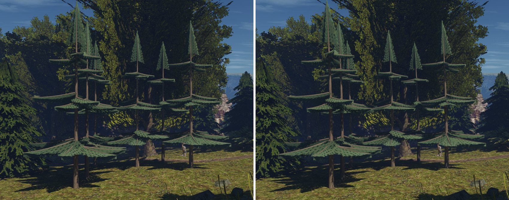

# Ветер дерева: эталон и что построено

Дата: 2026-11-16, построено 2026-11-17. Задача 1 [доработок движка](engine-plan.md): данные в вершине своего GLB и режим `"anchor": "tree"` поля `foliage`.

## 1. Эталон движения

Эталон собран до кода. Числа правила в разделе 2 выведены из него.

### Что измерено на настоящих деревьях

| Что | Число | Источник | Как проверено |
|---|---|---|---|
| Собственная частота ствола хвойного | `f0 = 0,0948 + 3,4317 · DBH/H²` Гц (DBH — диаметр на высоте груди в см, H — высота в м); 602 дерева, 8 видов | Moore, Maguire 2004 [1] | связь — по аннотации; коэффициенты — по выдаче поиска, полный текст закрыт. С DBH в см и H в м формула даёт измеренные 0,26–0,56 Гц из строк ниже, с другими единицами — нет |
| Хвойные качаются как консольная балка, одна собственная частота главная | 603 дерева, R² = 0,77 | Jackson и др. 2019 [2] | текст |
| Частота падает с высотой, сильнее всего от 5 до 20 м | — | Jackson и др. 2021 [3] | текст |
| Примеры частот | явор 0,26 Гц; клёны зимой 0,50–0,56 Гц | [2], [4] | текст; выдача поиска |
| Затухание | летом 8,6 ± 2,2 %, зимой 3,9 ± 1,3 % от критического | [2] | текст |
| Раскачка в порыве | резонанса нет; большое качание набирается за 2–3 периода | работа о ветровале ели ситхинской [5] | выдача поиска; автор и год по ней не подтверждены |
| Отклонение ствола при ветре 4–8 м/с | сосны 9,5 м и 13,5 м: до 2 см и до 5 см на высоте середины кроны | Peltola и др. 1993, по [6] | текст [6] |
| Размах качания от скорости ветра | `σ ∝ I · U²`: размах растёт как квадрат средней скорости (I — турбулентность, 10–12 %) | Cardona, Dabiri 2022 [6] | текст |
| Крупные ветки | почти та же частота, что у всего дерева (дугласия) | Spatz и др. 2007 [7] | аннотация |
| Ветки старших порядков | чем выше порядок ветки, тем выше её частоты | Rodriguez и др. 2012 [8] | аннотация |
| Дрожь листа | осина: 3–5 Гц при 2–4 м/с; пик спектра кроны 1–2 Гц, движение есть до 10 Гц; кручение одного листа 6 ± 1 Гц | [9] | выдача поиска |
| Что движется при каком ветре | слабый ветер — дрожит лист; сильнее — ветки качает порывами, лист идёт с ними | [9] | выдача поиска |
| Шкала Бофорта, суша | 2 балла (1,6–3,3 м/с) — шелестят листья; 3 (3,4–5,4) — листья и тонкие ветки в постоянном движении; 4 (5,5–7,9) — качаются тонкие ветки; 5 (8,0–10,7) — качаются тонкие стволы; 6 (10,8–13,8) — качаются толстые сучья; 7 (13,9–17,1) — качаются стволы деревьев | NOAA [10] | выдача поиска |

Чисел по дрожи хвои и по частотам веток ели в источниках не нашлось. Для них взяты числа осины и правило «ветка быстрее ствола».

### Что из этого следует для дерева 12 м и 30 м

Пропорции — лесные, высота к диаметру около 62: ель 12 м со стволом 20 см и ель 30 м со стволом 48 см. Тогда `DBH/H² = 1,61/H`, и частота зависит только от высоты: `f0 = 0,0948 + 5,535/H`.

| | Ель 12 м | Ель 30 м |
|---|---|---|
| Частота ствола | 0,56 Гц, период 1,8 с | 0,28 Гц, период 3,6 с |
| Сколько длится качание после толчка (затухание 4–9 %) | 2–4 периода: 4–7 с | 2–4 периода: 7–14 с |
| Отклонение верхушки при ветре мира в затишье (1,55–2,85 м/с) | 0,4–1,3 см | 1–5 см |
| Отклонение верхушки при порыве мира (5,65 м/с) | около 5 см, 0,4 % высоты | 11–18 см, 0,4–0,6 % высоты |
| Отклонение верхушки при 7 баллах (16 м/с) | около 36 см, 3 % высоты | 0,9–1,5 м, 3–5 % высоты |
| Ветки первого порядка | 0,6–1,5 Гц | 0,3–0,8 Гц |
| Лист и побег | 2–5 Гц, край ходит на 0,5–2 см | то же: размер листа от высоты дерева не зависит |

Как получены отклонения. Сосна 13,5 м даёт до 5 см на середине кроны при 8 м/с. Форма изгиба балки — квадрат высоты, середина кроны на 0,7 высоты, поэтому верхушка идёт вдвое дальше: 10 см, 0,74 % высоты. Дальше размах пересчитан по квадрату скорости. Для 30 м измерений отклонения не нашлось: нижнее число — та же доля высоты, верхнее — запас на то, что высокое дерево мягче (частота вдвое ниже). Это оценка, а не замер.

**Порыв против затишья.** Ветер мира — от 1,55 до 5,65 м/с, порыв раз в 19 с. Это 2 балла в затишье и нижний край 4 баллов в порыве. Настоящее дерево при таком ветре стволом почти не качается: в затишье шелестит лист, в порыве ходят тонкие ветки. Размах между затишьем и порывом различается в 4–13 раз (квадрат скорости). Движение — не маятник: ствол идёт за напором ветра, а собственное качание лежит поверх и гаснет за 2–4 периода.

### Что берём в игру

1. **Затишье — как в жизни.** Ствол отклоняется на доли процента высоты, ветки почти стоят, лист дрожит.
2. **Порыв — как у настоящего дерева при 7 баллах** («качаются стволы деревьев»): верхушка уходит на 3 % высоты. Это в пять-семь раз больше, чем даёт настоящий ветер 5,65 м/с. Причина та же, что у [живой листвы](../2026-11-14-living-foliage/README.md): порыв в игре — событие, трава и пучки уже читают его как сильный ветер, и дерево, которое в порыве стоит, выглядит мёртвым. Поле `wind` записи материала множит наклон и качание, если контенту нужно иначе.
3. **Частоты — как в жизни:** ствол по формуле от высоты, ветка в 1,6–2,8 раза быстрее ствола, лист 2,6 и 3,8 Гц.
4. **Отношение порыва к затишью — квадрат скорости**, как у напора `FoliageWind::pressure`: 0,075–0,25 в затишье, 1 в порыве.

### Источники

1. Moore J. R., Maguire D. A. Natural sway frequencies and damping ratios of trees: concepts, review and synthesis of previous studies. Trees 18 (2004), 195–203. <https://link.springer.com/article/10.1007/s00468-003-0295-6>
2. Jackson T. и др. An architectural understanding of natural sway frequencies in trees. J. R. Soc. Interface 16 (2019). <https://discovery.ucl.ac.uk/id/eprint/10078184/>
3. Jackson T. и др. The motion of trees in the wind: a data synthesis. Biogeosciences 18 (2021), 4059–4072. <https://bg.copernicus.org/articles/18/4059/2021/>
4. Dendrobiology 64 (2010), 37–42. <https://www.idpan.poznan.pl/images/stories/dendrobiology/vol64/64_37_42.pdf>
5. An assessment of the static and dynamic factors involved in windthrow. Forestry. <https://scilit.com/publications/111bce5f8d3a90c4b4ebbec44141c1d3>
6. Cardona J. L., Dabiri J. O. Wind speed inference from environmental flow–structure interactions. Part 2. Flow 2 (2022), E1. <https://doi.org/10.1017/flo.2021.15>
7. Spatz H.-C., Brüchert F., Pfisterer J. Multiple resonance damping or how do trees escape dangerously large oscillations? Am. J. Bot. 94 (2007), 1603–1611. <https://pubmed.ncbi.nlm.nih.gov/17938116/>
8. Rodriguez M. и др. The multimodal dynamics of a walnut tree: experiments and models. J. Appl. Mech. 79 (2012). <https://doi.org/10.1115/1.4005553>
9. Статьи о дрожи листа осины: <https://pmc.ncbi.nlm.nih.gov/articles/PMC5234829/>, <https://pmc.ncbi.nlm.nih.gov/articles/PMC6000177/>
10. NOAA. Land Beaufort Scale. <https://www.ncei.noaa.gov/sites/default/files/2021-09/Land_Beaufort_Scale.pdf>

Как решают то же игры (Crysis, Horizon, SpeedTree) — [`research/tree_tech.md`](research/tree_tech.md), раздел D.

## 2. Что построено

Материал с полем `"foliage": {"anchor": "tree"}` качается как дерево: ствол клонится по напору ветра и качается на своей частоте, ветка кивает и уступает ветру, лист дрожит. Что вершина — ствол, ветка или лист, говорит цвет вершины своего GLB (`COLOR_0`). Режим `line` для пучков и система травы не тронуты.

### Данные в вершине

`COLOR_0` своего GLB доезжает до `Resources::Vertex::color` как записан, без гаммы: R в младшем байте, дальше G, B, A. RGB без альфы получает A = 1. Меш без `COLOR_0` получает прежние единицы. Размер вершины не изменился.

| Канал | Смысл | Кто читает |
|---|---|---|
| R | вес ветки: 0 у ствола, 1 на конце ветки | ветер дерева |
| G | фаза ветки, одна на ветку | ветер дерева |
| B | вес дрожи листа: 0 у черешка, 1 на свободном крае | ветер дерева |
| A | открытость кроны | никто; ждёт задачи 3 |

### Правило движения

Дерево стоит в осях своего меша: корень в начале координат, ствол вдоль +Y. Высота берётся по коробке всего меша, поэтому кора и листва одного дерева гнутся как одно тело. Размахи ствола и ветки — доли этой высоты; поле `wind` записи умножает их, поле `flutter` — дрожь листа.

| Часть | Что делает | Числа |
|---|---|---|
| Ствол, наклон | идёт за напором ветра, растёт как квадрат высоты, расстояние точки от корня сохраняется | верхушка на пике порыва — 3 % высоты (36 см у ели 12 м) |
| Ствол, качание | вокруг наклона, на двух близких частотах с биением раз в 15–30 с | размах 0,1 % высоты без напора и до 0,8 % на пике; поперёк ветра — 0,35 от этого |
| Частота ствола | `0,0948 + 5,535 / H(м)` Гц, высота от 3 до 60 м; у деревьев одной высоты расходится на ±10 % по месту | 0,56 Гц у 12 м, 0,28 Гц у 30 м |
| Ветка, вес R | уступает ветру, качается вдоль него и кивает; вдоль самой себя не растягивается | уступает на 1 % высоты, качается на 0,6 %, кивает на 0,8 %; без напора — 0,15 от качания и кивка |
| Частота ветки | в 1,6–2,8 раза выше ствола, по фазе G | 0,9–1,6 Гц у 12 м |
| Лист, вес B | свободный край дрожит вверх-вниз и поперёк ветра, углы одной карточки не в ногу | 0,3 см без напора, до 2,1 см; 2,6 и 3,8 Гц; от высоты дерева не зависит |
| Порыв | бегущий фронт мира приходит по месту дерева, как у травы и пучков | 5 м/с вдоль +Z |

Все числа лежат в `common/graphics/foliagetree.h` и повторены в `shader/materials/foliage_tree.glsl`; менять их нужно в обоих файлах сразу.

Одна и та же функция работает в основном проходе, в тенях и для прошлого кадра TAA. Коробка отсечения растёт на ход вершины: `высота × wind × 0,106 + flutter × 2,94 см` — 1,3 м у ели 12 м. Предмет с материалом дерева не получает старый сдвиг всего объекта от ветра (`MeshObjects::Mesh::setWind`).

### Файлы

| Что | Где |
|---|---|
| Числа, правило на процессоре, запас коробки | `OpenGothic/common/graphics/foliagetree.h` |
| То же в вершинном шейдере | `OpenGothic/shader/materials/foliage_tree.glsl`, вызов — `vertex_process.glsl` |
| Чтение `COLOR_0` | `OpenGothic/common/gltfmeshcolor.*`, вызов — `Resources::loadVisualMesh`, укладка в вершину — `PackedMesh` |
| Разбор `anchor` | `OpenGothic/common/resources_textures.cpp` |
| Тесты | `OpenGothic/tests/foliage_tree_test.h` (цель `gothic-material-texture-test`), `OpenGothic/tests/mesh_gltf_color.h` (цель `gothic-mesh-gltf-test`) |
| Проба | `scripts/content/tree_wind_probe.py`, `scripts/bench/tree-wind-probe.bench` |

Выключатель прежний: `[INTERNAL] foliage=0`, для стендов — `OPENGOTHIC_FOLIAGE=0|wind|light`.

### Чем вышло иначе, чем в проекте

1. **`COLOR_0` читает отдельный файл, а не загрузчик.** `gltfmesh.cpp` и `asset/staticmesh.h` входят в отпечаток базы: правка любого из них заставила бы всех заново импортировать базу ради данных, которых в базе нет. Поэтому `gltfmeshcolor.cpp` второй раз проходит по тем же байтам GLB в порядке загрузчика и отдаёт по одному цвету на вершину. Отпечаток базы не изменился. Цена — копия порядка обхода: если загрузчик поменяет порядок, читатель должен поменяться с ним. Числа вершин сверяются с мешем, поэтому при расхождении дерево рисуется без цветов и в журнал идёт ошибка, а чужой цвет на вершину не попадает. Долг записан в [#1482](https://github.com/kaifaty/GothicAI/issues/1482).
2. **В пробе шесть елей двух вариантов, а не одна.** На ряду видно, что соседние деревья качаются не в ногу.
3. **В сценарии есть кадр `shade`.** Солнце в 10:00 стоит за дальней камерой, тени уходят на восток вниз по склону, и с дальнего вида их не видно. Тени снимает третья камера — с востока, из-под кроны дерева оригинала.

### Кадры пробы

Ryzen, 2560×1440, 10:00, набор `tree-wind-probe-1`: шесть елей по 12 м (1944 треугольника каждая) на лугу пилота. Слева — покой (`OPENGOTHIC_FOLIAGE=0`), справа — пик порыва. Ветер дует вдоль +Z: на дальнем виде влево, на виде теней вправо.

`far`, 26 м от первой ели. Верхушки шести елей ушли влево на 12–14 пикселей (−13, −14, −13, −12, −12, −12), это около 0,3 м при 42 пикселях на метр. Пик этого порыва — 4,4 м/с из 5,65. В затишье после порыва (`far-lull`) верхушки стоят в 0–2 пикселях от покоя. Ярусы веток сдвинуты меньше верхушки, ствол у земли стоит.

`shade`, с востока назад на ели, пик порыва 5,6 м/с. Конец тени ели у (41550, 380), ближней к камере, ушёл вправо на 58 пикселей и вниз на 18; конец тени первой ели (41300, 0) — вправо на 43 и вниз на 3. Тень наклонена вместе с елью.

Клипы движения — отдельная задача: вид движения принимает пользователь глазом.

### Проверки

- `gothic-material-texture-test` на Ryzen — 845 377 утверждений, все прошли. `foliageTreeMaths`: корень стоит; длина ствола сохраняется; кора и листва в одной точке идут одинаково; при R = 0 и B = 0 вершина идёт только со стволом; ни одна вершина не выходит за запас коробки; равные тики дают равный ответ; соседние деревья не в ногу; повёрнутое дерево клонится по ветру мира; пучок отвечает как раньше. `foliageTreeRecords` — разбор записи.
- `gothic-mesh-gltf-test` на Ryzen — 9 843 утверждения, все прошли: `COLOR_0` доходит до вершины, меш без него получает единицы, обход не в ногу с загрузчиком цвет не кладёт.
- `glslangValidator` — 204 варианта шейдеров, отказов 0.

### Ограничения

- Корень дерева должен лежать в начале координат меша, ствол — идти вдоль +Y. Наклонённое в модели дерево гнётся от оси меша, а не от своего ствола.
- Частота берётся из высоты меша с пропорциями лесного хвойного дерева. Толщину ствола и породу правило не знает.
- У ветки нет своей опоры: она сдвигается с весом R, а не поворачивается вокруг основания. На длинной ветке это видно как сдвиг, а не как изгиб.
- Кора и листва идут вместе, только если у их записей одно значение `wind`. Коре для режима дерева нужна запись со своими картами в `materials.json`.
- Масштаб предмета в слое предметов не задаётся, поэтому деревья разной высоты — разные меши.
- Трассировка лучей и GI видят дерево неподвижным, как и живую листву.
- Примитивы одного узла и материала с одинаковыми `POSITION`, `NORMAL` и `TEXCOORD_0` делят вершины, и разный `COLOR_0` у них не поддержан: меш рисуется без цветов, в журнал идёт ошибка.
- Порыв в игре по размаху — ветер в 7 баллов, хотя скорость ветра мира — 4 балла. Так решено в эталоне: дерево, которое в порыве стоит, выглядит мёртвым.
- Камера `shade` стоит под кроной дерева оригинала, и верхушки части елей с неё закрыты. Сверху склон закрывает та же крона шириной 30 м.
- Проба — грубая ель для проверки движения. По ней нельзя судить о виде дерева.
